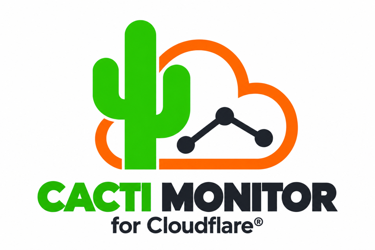
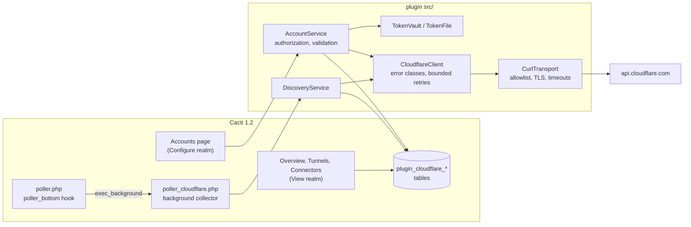
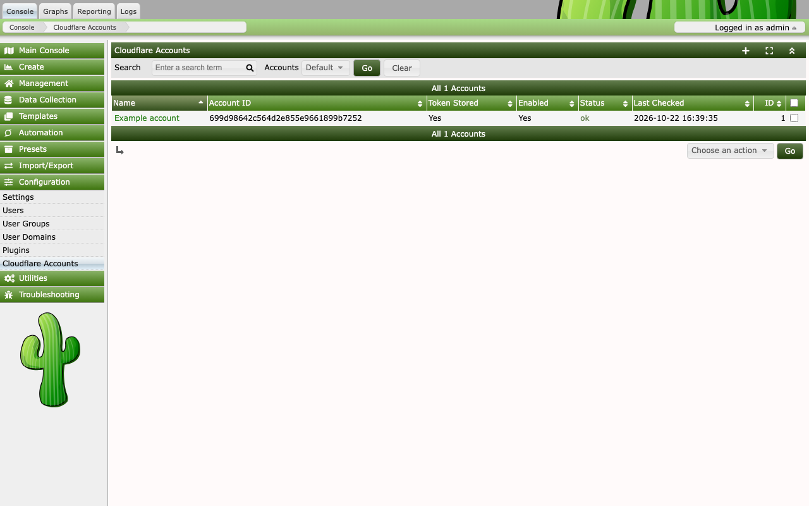
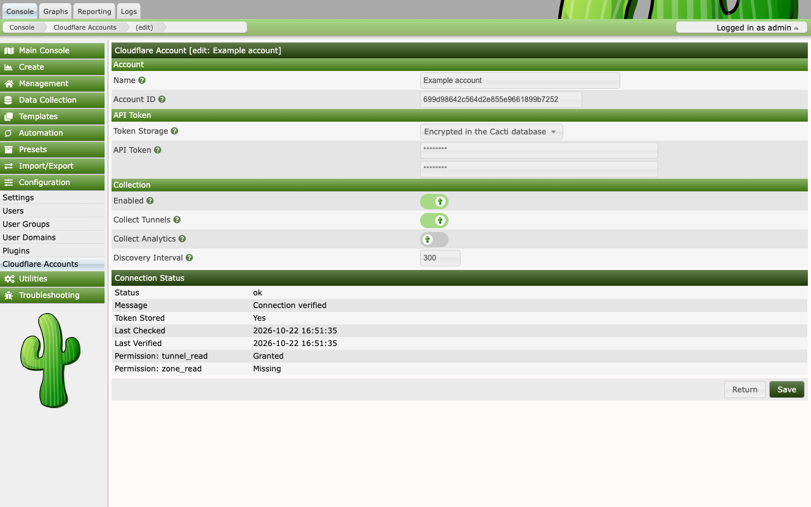
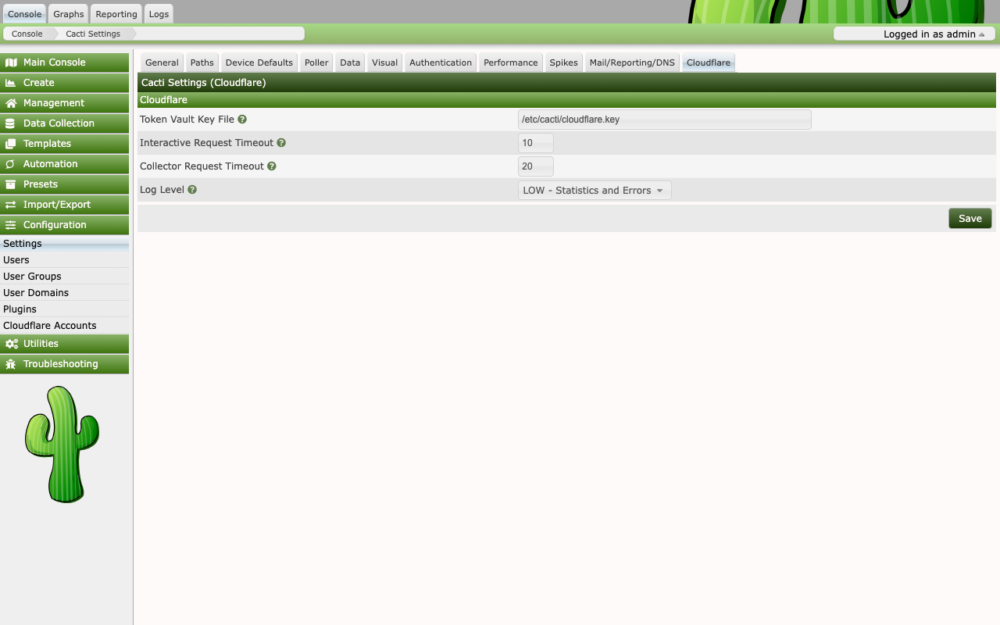
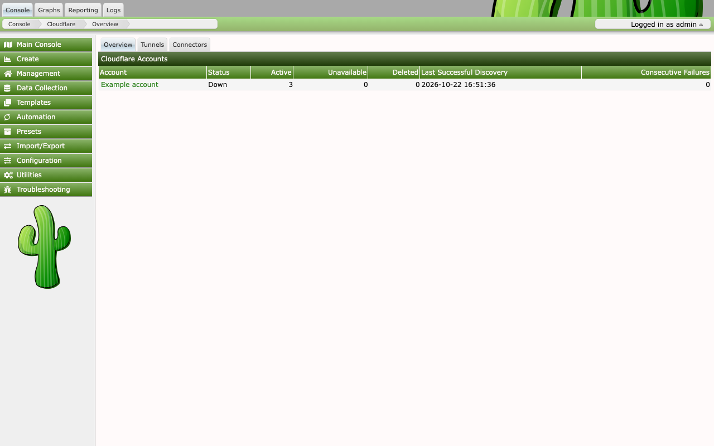
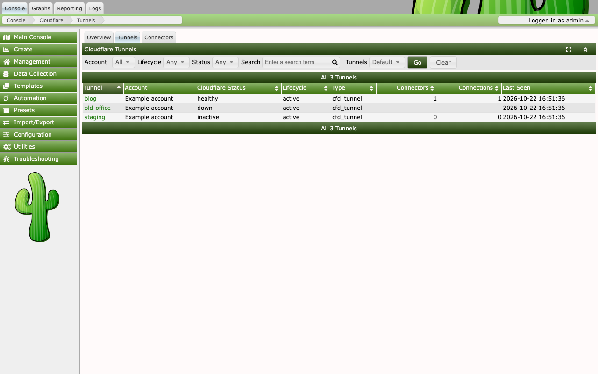
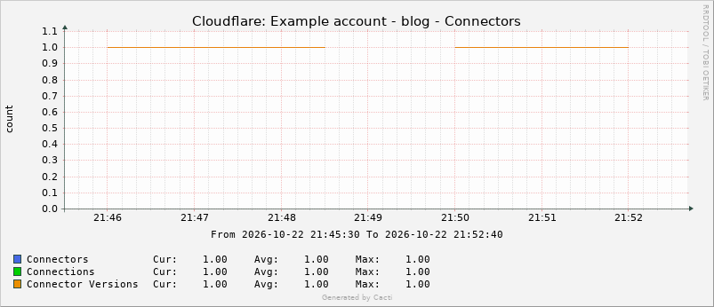

<p align="center">
  
</p>

# Cloudflare plugin for Cacti

[](https://github.com/somethingwithproof/plugin_cloudflare/actions/workflows/ci.yml)
[](https://sonarcloud.io/summary/new_code?id=somethingwithproof_plugin_cloudflare)
[](LICENSE)


[](https://sonarcloud.io/summary/new_code?id=somethingwithproof_plugin_cloudflare)
[](https://sonarcloud.io/summary/new_code?id=somethingwithproof_plugin_cloudflare)
[](https://sonarcloud.io/summary/new_code?id=somethingwithproof_plugin_cloudflare)


A Cacti 1.2 plugin that is being built to monitor Cloudflare Tunnels and
zone analytics. It reads from the Cloudflare API with scoped API tokens,
never changes anything in Cloudflare, and keeps its data in its own tables.

**Status: Milestone 3.** The plugin configures Cloudflare accounts, tests
their tokens, discovers their tunnels and connectors, and graphs each tunnel's
health, connectors, connections and connector versions. It does not collect
zone analytics yet.

| Available now | Planned |
|---|---|
| Install, upgrade, disable and uninstall through Cacti's plugin manager | GraphQL analytics and Thold alerts (Milestone 4) |
| Cloudflare: View and Cloudflare: Configure permissions | Fault injection, TLA+ models and full documentation (Milestone 5) |
| Add, edit, delete, enable and disable Cloudflare accounts | |
| Store a token in a file or encrypted in the Cacti database | |
| Verify a token and check its tunnel and zone read permissions | |
| Tunnel and connector discovery in a background collector started by the main poller | |
| Overview, Tunnels and Connectors pages under Management > Cloudflare Tunnels | |
| Lifecycle tracking: `active`, `unavailable` and `deleted` | |
| One Cacti device per account, created by an administrator, with the tunnels as the indexes of a data query | |
| Per tunnel Connectors, Health and Collection graphs, drawn from one RRD file per tunnel | |
| Values the plugin cannot vouch for are stored as unknown (`U`), never as 0 | |

## Why this plugin

Cacti operators who publish services through Cloudflare Tunnel have no view
of the tunnel inside Cacti. A tunnel can lose all of its connectors while
the origin hosts still answer SNMP, so the existing graphs stay green while
users see errors. The goal of this plugin is to put tunnel health and zone
traffic next to the device graphs operators already watch, without giving
Cacti any ability to change Cloudflare.

Three constraints shape the design:

- **Read-only.** The plugin only calls `GET` endpoints and the GraphQL
  Analytics API. It needs no edit permission on any Cloudflare resource.
- **Optional.** Cloudflare outages, expired tokens and rate limits must not
  slow the Cacti UI or stall polling of other devices. All API calls have
  hard timeouts, and collection runs in a background process launched by
  the poller.
- **No core changes.** The plugin uses only the Cacti 1.2 plugin hooks and
  its own tables, so Cacti upgrades and other plugins are unaffected.

## How it works



- **Cacti glue** (`setup.php`, `includes/`, the page scripts) registers
  hooks and realms, renders pages with Cacti's own helpers, and delegates
  every action to the library in `src/`.
- **The library** (`src/`, namespace `Cacti\PluginCloudflare\`) has no
  dependency on Cacti globals, so it is tested against a real database and
  a fake HTTP transport without a running Cacti.
- **One outbound path.** `CurlTransport` is the only code that touches the
  network, and it accepts only `https://api.cloudflare.com`. Each failure
  is mapped to one error class (`auth`, `permission`, `rate_limited`,
  `transient`, ...), which drives the status shown in the UI.
- **Storage** goes through Cacti's own PDO connection with prepared
  statements. Schema changes are numbered, idempotent migrations.

The design decisions and their reasons are in
[docs/design.md](docs/design.md).

## Screenshots

The screenshots come from a test stack, not a live Cloudflare account. The
stack runs Cacti 1.2.31 against a fake Cloudflare API that returns fixture
data, so the account, its ID and the three tunnels are placeholders.



*The Cloudflare Accounts list. The fake API accepts the token, so Verify
reports `ok`.*



*Editing an account. The token fields are always empty; the stored token is
never sent back to the browser. Collect Tunnels and Create Graphs are on and
Collect Analytics is off. Connection Status shows the result of the last
Verify: `ok`, tunnel read granted and zone read missing.*



*Settings > Cloudflare.*



*Management > Cloudflare Tunnels > Overview. The status is the worst Cloudflare
status among the account's active tunnels, here `down` because one fixture
tunnel is down. `Disabled`, `Not collected`, `Collection failing` and `Not yet
collected` take precedence over tunnel health, in that order, so an account
whose last run failed shows `Collection failing` whatever its tunnels report.*



*The Tunnels tab. Connectors and Connections show `-` for old-office, because
the fake API answers its connections request as an unknown tunnel and nothing
was stored, and 0 for staging, which has no running connector.*



*The Connectors graph of the blog tunnel. All three lines are 1 before and
after a gap in the middle, where the fake API returned errors and the plugin
stored unknown values. The lines do not fall to 0. The graph comes from the
same fixture stack (`make screenshots`), which sets a 30 second step on this
one data source so that seven minutes of polling fill the graph.*

## Requirements

- Cacti 1.2.25 through 1.2.31. Cacti 1.2.31 itself needs PHP 8.0 or later.
- PHP 7.4 through 8.4 with the `curl`, `openssl` and `pdo_mysql` extensions.
  The plugin refuses to enable without them.
- MariaDB 10.6 or later, or MySQL 8.0 or later.
- HTTPS access from the Cacti server to `api.cloudflare.com`. Proxies are not
  supported.

See [docs/compatibility.md](docs/compatibility.md) for what is tested.

## Install

1. Put the plugin in Cacti's `plugins/cloudflare` directory, either by
   extracting a release archive (`make package` builds one) or with a git
   clone. The directory must be named `cloudflare`.
2. Install and enable it from Console > Configuration > Plugins, or with the
   CLI as the web server user:

   ```sh
   php cli/plugin_manage.php --plugin=cloudflare --install --enable
   ```

3. The admin user gets the Cloudflare: Configure permission at install. Grant
   it to other users or groups under Console > Configuration > Users.
4. Create a token with the permissions in
   [docs/token-permissions.md](docs/token-permissions.md). In short:
   Account > Cloudflare Tunnel > Read, and optionally Zone > Zone > Read.
5. Store the token in one of the two ways below, then add the account under
   Console > Configuration > Cloudflare Accounts and run Verify from the
   actions menu.

### Option A: encrypted in the database

The plugin encrypts tokens with a 32-byte key that you create. It never
creates or writes the key itself. The file must be readable by the web
server and poller users, must not be readable by others, and its directory
must let those users reach it. For a web server running as `www-data`:

```sh
sudo mkdir -p /etc/cacti
sudo sh -c 'umask 077 && openssl rand -hex 32 > /etc/cacti/cloudflare.key'
sudo chgrp www-data /etc/cacti/cloudflare.key
sudo chmod 0440 /etc/cacti/cloudflare.key
```

The default path is `/etc/cacti/cloudflare.key`; change it under Settings >
Cloudflare > Token Vault Key File. When the key is missing or refused, the
edit form offers only the token file option. Keep a backup of the key:
without it, stored tokens cannot be decrypted and must be entered again.

### Option B: token file

Write the token, and nothing else, to a file the web server and poller users
can read and others cannot, then enter its absolute path on the edit form:

```sh
sudo sh -c 'umask 077 && cat > /etc/cacti/cloudflare-account.token'   # paste the token, then Ctrl-D
sudo chgrp www-data /etc/cacti/cloudflare-account.token
sudo chmod 0440 /etc/cacti/cloudflare-account.token
```

The file is checked when it is read, at Verify, not when you save. Symbolic
links, files over 4 KiB and files readable or writable by others are
refused.

## Upgrade

1. Replace the files in `plugins/cloudflare` with the new release, keeping
   the directory name.
2. Open Console > Configuration > Plugins, or Console > Configuration >
   Cloudflare Accounts, once as an admin. That runs the plugin's migrations,
   imports the Cloudflare templates and copies the data query file (see
   [Tunnel metrics and graphs](#tunnel-metrics-and-graphs)), and, on an
   upgrade from 0.1.0, registers the `poller_bottom` hook.

`poller.php` does not run the plugin's upgrade, so until step 2 the
new schema is missing and nothing is collected.

## Account status

Verify sets the account's status:

| Status | Meaning |
|---|---|
| `unknown` | Not verified since the account was added or its credentials changed |
| `ok` | The token is active and can read tunnels |
| `token_inactive` | Cloudflare reports the token as disabled or expired |
| `auth_failed` | Cloudflare rejected the token as invalid or expired (HTTP 401) |
| `permission_denied` | The token is active but cannot read tunnels, or it lacks the permissions to call the token verify endpoints (HTTP 403) |
| `unreachable` | The API could not be reached, timed out or returned a server error |
| `rate_limited` | Cloudflare returned HTTP 429 |
| `error` | Any other failure, including a token file that is missing or insecure, a token vault key file that is missing or unusable, or a stored token that cannot be decrypted |

The edit page also shows whether tunnel read and zone read were granted.

## Tunnel discovery

After each polling cycle on the main poller, the `poller_bottom` hook starts
a background collector with `exec_background` when at least one enabled
account has Collect Tunnels on. The collector never runs in the poller's
process, so a slow Cloudflare API does not delay `poller.php`. Remote pollers
never start it.

For each account that is due, the collector lists the account's tunnels, then
reads the connections of its active tunnels, which gives each tunnel's
connectors, their versions, data centers and origin addresses. Accounts are
due every Discovery Interval (default 300 seconds). A run starts no new
account after 50 seconds and makes at most 200 connection requests. Either
limit can also stop an account part way through reading its connections; that
account is recorded as `partial`, and the next run continues with the tunnels
attempted least recently. Accounts not started stay due for the next run.

A tunnel has a lifecycle, kept apart from the status Cloudflare reports
(`healthy`, `degraded`, `down` or `inactive`):

| Lifecycle | Meaning |
|---|---|
| `active` | The tunnel was in the last complete listing |
| `deleted` | A complete listing did not include it, which includes an empty listing. The row and its history stay, and the tunnel becomes `active` again if it reappears |
| `unavailable` | Cloudflare could not be read for three runs in a row, so the tunnel's state is unknown |

Only a complete, successful listing adds, updates or deletes tunnels, and a
failed listing never deletes one. A failure to read Cloudflare at all
(`transient`, `rate_limited`, `auth` or `permission`) counts toward an outage;
after three in a row, before any complete listing, the account's active
tunnels become `unavailable`. The next complete listing restores them and
resets the count. A tunnel that Cloudflare no longer knows when its
connections are read is skipped without failing the account.

In `cacti.log`, discovery lines start with `CLOUDFLARE: discovery` and the run
summary with `CLOUDFLARE: collector`. Failures and lifecycle changes, such as
a failed listing or tunnels marked `unavailable`, are logged at Cacti's
default `LOW` level; each account's result and the run summary are logged at
`MEDIUM`. Connection reads can fail on every tunnel, so for each account only
the first failure of each error class is logged at `LOW`, the rest at
`MEDIUM`, followed by one `LOW` line per class with the number of tunnels that
failed.

Management > Cloudflare Tunnels needs the Cloudflare: View permission and is
read-only:

- **Overview** lists each account with its status, tunnel counts by lifecycle,
  the last successful discovery and the number of consecutive failures.
- **Tunnels** lists tunnels across accounts or for one account, with filters
  for account, lifecycle, status and name, and sortable columns.
- **Connectors** shows the connectors of the tunnel chosen on the Tunnels tab.

## Tunnel metrics and graphs

Cacti reads tunnel state through a script server data query,
`ss_cloudflare.php`. It answers from the plugin's tables only and never calls
Cloudflare, so a Cloudflare outage cannot slow the poller. Each tunnel gives
six values: health (healthy 3, degraded 2, down 1, inactive 0), connectors,
connections, connector versions, the seconds since its connections were last
read, and the discovery job's consecutive failures. A value is printed only
when the plugin can vouch for it, which means the last discovery succeeded,
the tunnel is `active` and the reading is recent. Otherwise it is `U`, and the
graph shows a gap instead of a zero that would look like an outage. The rules
are in [docs/metrics.md](docs/metrics.md).

### Create the device

An account maps to at most one Cacti device. The device holds the account's
tunnels as the indexes of the Cloudflare Tunnels data query. Nothing creates
it automatically:

1. Open Console > Configuration > Cloudflare Accounts.
2. Select the account, choose Create Cacti Device from the actions menu, and
   confirm.

The action needs both the Cloudflare: Configure realm and Cacti's
Sites/Devices/Data realm (the one for `host.php`). The menu entry appears only
to users who hold both, and the server refuses the request from anyone else.
The device is named `Cloudflare: <account name>`, uses the Cloudflare Account
host template and the main poller, has SNMP version 0 and no availability
check, and gets the hostname `<account ID>.cloudflare.invalid`. That name is
reserved and never resolves; Cacti does not connect to it. If the account
already has a device, the action says so and changes nothing. If an
administrator deletes the device in Cacti, the plugin does not make another
until Create Cacti Device is run again.

### Create Graphs

Create Graphs on the account form is off by default. When it is on, each time
a discovery of the account ends `ok` or `partial`, the collector reindexes the
device and creates any missing graphs for the account's `active` tunnels:
Connectors, Health and Collection, three per tunnel. A tunnel's three graphs
share one RRD file. One run creates at most 50 graphs and stops after 20
seconds, and the next run continues. The plugin never removes a Cacti object.
A graph that an administrator deletes is not made again, and a tunnel that
Cloudflare no longer lists keeps its graph and RRD file, which show `U`.

Turning Create Graphs on needs both realms. Turning it off needs only
Configure. A user without the Sites/Devices/Data realm who saves the form
leaves the setting as it was, with a warning. With Create Graphs off, the
device is still reindexed after each discovery, so new tunnels appear as
indexes of the data query.

### The data query file

Cacti 1.2.31 reads a data query XML only from inside its `resource`
directory. At install and upgrade the plugin therefore copies one file,
`templates/resource/cloudflare_tunnels.xml`, to
`<Cacti>/resource/script_server/cloudflare_tunnels.xml`. It is the only file
the plugin writes outside its own directory, so the user that installs or
upgrades the plugin must be able to write to that directory.
Uninstall keeps the file, along with the devices, graphs, RRD files and
templates. If the copy or the template import fails, the plugin logs it and
Create Cacti Device tries again.

## Settings

Settings > Cloudflare holds:

- **Token Vault Key File**: path to the vault key.
- **Interactive Request Timeout**: total seconds for a request made from the
  web interface, such as Verify. Default 10; values outside 5 to 60 fall
  back to 10.
- **Collector Request Timeout**: total seconds for a request made by the
  background collector. Default 20; values outside 5 to 60 fall back to 20.
- **Log Level**: stored. Nothing reads it yet.

On the account form, Collect Tunnels and Discovery Interval control discovery,
and Create Graphs controls graph creation. Collect Analytics is stored and has
no effect in this release.

## Uninstall and data retention

Uninstall drops the plugin's own tables, which hold accounts, encrypted
tokens, discovered tunnels, job state and the record of which Cacti objects it
made, and deletes its `cloudflare_` settings. It does not remove the key file,
token files, the copied `resource/script_server/cloudflare_tunnels.xml`, or any
Cacti devices, graphs, data sources, RRD files or templates. Those hold
historical monitoring data, and removing them is an explicit administrator
action in Cacti.

## Known limitations

- A run makes at most 200 connection requests. Tunnels beyond that cap are
  refreshed less often than the observation window, so their connection
  graphs show gaps.
- The plugin overwrites administrator edits to the imported templates when an
  upgrade changes the shipped template XML.
- The account's device must stay on the main poller. The plugin's tables are
  in the main database and the script reads them there.
- Deleted tunnels stay in the data query index, with their graphs and RRD
  files, and print `U`.
- Cacti disables a plugin whose code ends in a true fatal error, such as
  running out of memory. See [docs/security.md](docs/security.md).

## Security

- Global API Keys are refused; only scoped API tokens are accepted.
- Tokens are stored in a file you provision or encrypted with AES-256-GCM
  under a key file that never enters the database. They are never shown
  in a page, written to a log, or included in an error message.
- Database errors carry only the SQLSTATE and the driver error code, never
  the statement's values.
- Every change is a POST protected by Cacti's CSRF token, and is checked
  against the Cloudflare: Configure permission. Creating a Cacti device or
  turning on Create Graphs also needs Cacti's Sites/Devices/Data permission.
  A disabled plugin refuses its pages.

Details and known limitations are in [docs/security.md](docs/security.md).
Report vulnerabilities privately as described in [SECURITY.md](SECURITY.md).

## Roadmap

Each milestone ships as a 0.x release: Milestone 1 is 0.1.0, Milestone 2 is
0.2.0, and so on. Version 1.0.0 is reserved for the release that completes
every milestone below.

| Milestone | Scope | State |
|---|---|---|
| 1. Foundation | Plugin lifecycle, permissions, account configuration, connection test | In review ([#1](https://github.com/somethingwithproof/plugin_cloudflare/pull/1)) |
| 2. Discovery | Tunnel and connector discovery in a background collector, Overview, Tunnels and Connectors pages | Implemented, unreleased |
| 3. Metrics | Tunnel health data sources, graph templates, outage handling that never records a fabricated zero | Implemented, unreleased |
| 4. Analytics and alerting | Plan-aware GraphQL analytics per zone, Thold thresholds with outage suppression | Planned |
| 5. Hardening | Fault injection, TLA+ models of discovery and collection, full documentation | Planned |

## Development

The tools need PHP 8.x and Composer; the plugin code itself stays PHP 7.4
compatible. Integration and BDD tests need a database, which
`make db-up` starts in Docker on port 33061.

```sh
composer install
make db-up
make ci            # unit, integration, BDD, PHPStan, php-cs-fixer, php -l on PHP 7.4
make smoke         # installs the plugin into Cacti 1.2.31 in Docker and walks its lifecycle
make package       # builds build/cloudflare-<version>.tar.gz and checks its contents
make db-down
```

`make smoke` and `make screenshots` need a Cacti checkout; set `CACTI_REPO`
to its path. The integration tests read `CF_TEST_DSN`, `CF_TEST_DB_USER`
and `CF_TEST_DB_PASS`, and skip when the database is unreachable unless `CI`
is set.

## Contributing

Pull requests are welcome. Each commit needs a DCO sign-off
(`git commit -s`). Write the test first; `make ci` must pass, and changes
to the Cacti glue should also pass `make smoke`. Plugin code must stay PHP
7.4 compatible and follow Cacti's code style (tabs, single quotes, braces
on the same line).

## Documentation

- [docs/security.md](docs/security.md): security controls and known limitations
- [docs/token-permissions.md](docs/token-permissions.md): token permissions
- [docs/compatibility.md](docs/compatibility.md): supported versions and the interfaces used
- [docs/metrics.md](docs/metrics.md): metric catalog and when a value is unknown
- [docs/collector-protocol.md](docs/collector-protocol.md): what `ss_cloudflare.php` reads and prints
- [docs/schema.md](docs/schema.md): database tables
- [docs/design.md](docs/design.md): design decisions
- [CHANGELOG.md](CHANGELOG.md)

## License

GPL-2.0-or-later. See [LICENSE](LICENSE).

## Trademarks

Cloudflare is a registered trademark of Cloudflare, Inc. This project is an independent open-source tool and is not affiliated with, sponsored, or endorsed by Cloudflare, Inc.

The project is also not affiliated with the Cacti Group. See
[docs/images/README-logo.md](docs/images/README-logo.md) for the logo.
