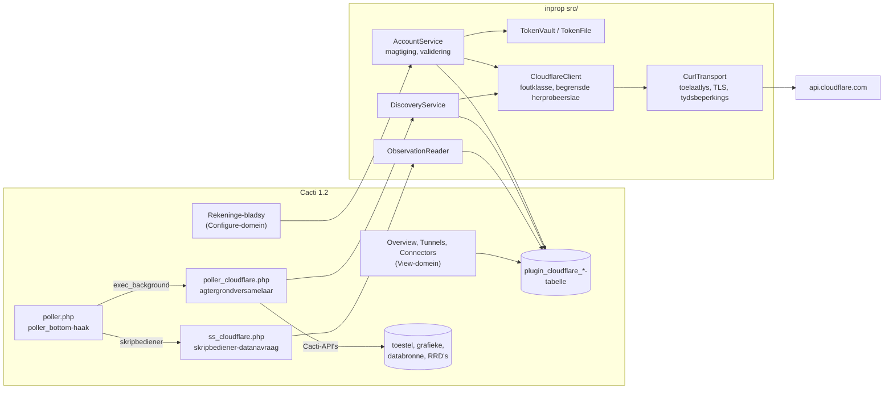

<!-- Source: README.md; SHA256: f8de0e02c5904e15bfa4c71edcaab219e5e5d4f6d9dbe589f4ed16351df6bf4d -->

<!-- translations:start -->
[English](../../../README.md) | [简体中文](../zh-CN/README.md) | [हिन्दी](../hi-IN/README.md) | [Español (España)](../es-ES/README.md) | [Español (Latinoamérica)](../es-419/README.md) | [العربية (السعودية)](../ar-SA/README.md) | [Afrikaans](README.md) | [አማርኛ](../am-ET/README.md) | [العربية (مصر)](../ar-EG/README.md) | [العربية (المغرب)](../ar-MA/README.md) | [বাংলা](../bn-BD/README.md) | [Bosanski](../bs-BA/README.md) | [Deutsch](../de-DE/README.md) | [فارسی](../fa-IR/README.md) | [Filipino](../fil-PH/README.md) | [Français](../fr-FR/README.md) | [Français (Maroc)](../fr-MA/README.md) | [Français (Sénégal)](../fr-SN/README.md) | [Hausa](../ha-NG/README.md) | [עברית](../he-IL/README.md) | [Hrvatski](../hr-HR/README.md) | [Bahasa Indonesia](../id-ID/README.md) | [Igbo](../ig-NG/README.md) | [Italiano](../it-IT/README.md) | [日本語](../ja-JP/README.md) | [한국어](../ko-KR/README.md) | [Malagasy](../mg-MG/README.md) | [मराठी](../mr-IN/README.md) | [Bahasa Melayu](../ms-MY/README.md) | [Nederlands](../nl-NL/README.md) | [Polski](../pl-PL/README.md) | [Português (Brasil)](../pt-BR/README.md) | [Русский](../ru-RU/README.md) | [Kinyarwanda](../rw-RW/README.md) | [Soomaali](../so-SO/README.md) | [Српски](../sr-RS/README.md) | [Svenska](../sv-SE/README.md) | [Kiswahili](../sw-KE/README.md) | [தமிழ்](../ta-IN/README.md) | [తెలుగు](../te-IN/README.md) | [ไทย](../th-TH/README.md) | [Türkçe](../tr-TR/README.md) | [Українська](../uk-UA/README.md) | [اردو](../ur-PK/README.md) | [Tiếng Việt](../vi-VN/README.md) | [isiXhosa](../xh-ZA/README.md) | [Yorùbá](../yo-NG/README.md) | [繁體中文](../zh-TW/README.md) | [isiZulu](../zu-ZA/README.md)
<!-- translations:end -->

<p align="center">
  
</p>

# Cloudflare-inprop vir Cacti

[](https://github.com/somethingwithproof/plugin_cloudflare/actions/workflows/ci.yml)
[](https://sonarcloud.io/summary/new_code?id=somethingwithproof_plugin_cloudflare)
[](../../../LICENSE)


[](https://sonarcloud.io/summary/new_code?id=somethingwithproof_plugin_cloudflare)
[](https://sonarcloud.io/summary/new_code?id=somethingwithproof_plugin_cloudflare)
[](https://sonarcloud.io/summary/new_code?id=somethingwithproof_plugin_cloudflare)


'n Cacti 1.2-inprop wat gebou word om Cloudflare Tunnels en
sone-analitika te monitor. Dit lees vanaf die Cloudflare-API met afgebakende API-tekens,
verander nooit enigiets in Cloudflare nie, en hou sy data in sy eie tabelle.
In Cacti kopieer dit datanavraag-XML-lêers na `resource/script_server/` en
skep toestelle, grafieke en sjablone deur Cacti se eie API's, sonder enige
kernlêerwysigings.

**Status: 0.4.0-dev, onvrygestel.** Die laaste vrygestelde weergawe is 0.3.0. Die ontwikkelingsweergawe voeg CSV-voorraaduitvoere, eksplisiete aftreding van geskrapte tonnels, gekasde sone-analitika en opsionele Thold-sjablone by. Kwalifisering met 'n lewendige verskaffer en ontplooiingskwalifisering is steeds hangende.

Die tabel hieronder beskryf die stabiele 0.3.0-vrystelling. Ontwikkelingstoevoegings word hieronder onder Operateurswerkvloeie en sone-analitika beskryf.

| Nou beskikbaar | Beplan |
|---|---|
| Installeer, gradeer op, deaktiveer en deïnstalleer deur Cacti se inpropbestuurder | GraphQL-analitika en Thold-waarskuwings (Mylpaal 4) |
| Cloudflare: View-, Operator- en Configure-toestemmings | Foutinjektering, TLA+-modelle en volledige dokumentasie (Mylpaal 5) |
| Voeg by, wysig, skrap, aktiveer en deaktiveer Cloudflare-rekeninge | |
| Berg 'n teken in 'n lêer of geënkripteer in die Cacti-databasis | |
| Verifieer 'n teken en kontroleer sy tonnel- en sone-leestoestemmings | |
| Tonnel- en koppelaarontdekking in 'n agtergrondversamelaar wat deur die hoofpeiler begin word | |
| Overview-, Tunnels- en Connectors-bladsye onder Management > Cloudflare Tunnels | |
| Lewensiklusopsporing: `active`, `unavailable` en `deleted` | |
| Een Cacti-toestel per rekening, deur 'n administrateur geskep, met die tonnels as die indekse van 'n datanavraag | |
| Per-tonnel Connectors-, Health- en Collection-grafieke, geteken vanuit een RRD-lêer per tonnel | |
| Waardes waarvoor die inprop nie kan instaan nie, word as onbekend (`U`) gestoor, nooit as 0 nie | |

## Toegangsrolle

| Domein | Toegang |
| --- | --- |
| Cloudflare: View | Bestaande moniteringsbladsye. |
| Cloudflare: Operator | Monitering plus die Operations-bladsy en persoonlike triage-erkennings. |
| Cloudflare: Configure | Operateurtoegang plus die bestaande konfigurasie- en administratiewe aksies. |

Nadat opgraderingslêers gekopieer is, maak die Plugins-bladsy as 'n administrateur oop om
die nuwe domein te registreer. Ken die Operator-domein eksplisiet toe onder **Configuration > Users** of gebruikersgroepe.
Opgraderings behou die bestaande View- en Admin-domein-ID's en -toekennings. Admin-toegang
erf Operator-toegang, en Operator-toegang erf View-toegang by elke versoek;
dit voeg nie gestoorde toekennings by gebruikers of groepe nie. Inpropinstellings vereis ook
Cloudflare: Configure-toegang benewens Cacti se Settings-toestemming.

Sigbaarheid van Cloudflare-rekeninge stem ooreen met die bestaande View-domein; dit geld oor die hele rekening.
Aanmeldbewyse, konfigurasie, kartering, skrapping en ander administratiewe veranderings
bly in die administratiewe bladsye. Erkennings duur slegs in die huidige
gebruiker se sessie, vir hoogstens een uur en slegs terwyl dieselfde waarneming
vars bly. Nuwe of veranderde waarnemings maak dit ongeldig. Dit merk nooit 'n mislukte
meting as gesond nie en onderdruk nooit waarskuwings nie.

## Waarom hierdie inprop

Cacti-operateurs wat dienste deur Cloudflare Tunnel publiseer, het geen sigbaarheid
oor die tonnel binne Cacti nie. 'n Tonnel kan al sy koppelaars verloor terwyl
die oorspronggashere steeds op SNMP reageer, sodat die bestaande grafieke groen bly terwyl
gebruikers foute sien. Die doel van hierdie inprop is om tonnelgesondheid en soneverkeer
langs die toestelgrafieke te plaas wat operateurs reeds dophou, sonder om aan
Cacti enige vermoë te gee om Cloudflare te verander.

Drie beperkings vorm die ontwerp:

- **Leesalleen.** Die inprop roep slegs `GET`-eindpunte en die GraphQL
  Analytics-API aan. Dit benodig geen wysigingstoestemming op enige Cloudflare-hulpbron nie.
- **Opsioneel.** Cloudflare-onderbrekings, vervalde tekens en tempobeperkings moet nie
  die Cacti-gebruikerskoppelvlak vertraag of die peiling van ander toestelle laat vassteek nie. Alle API-oproepe het
  harde tydsbeperkings, en versameling loop in 'n agtergrondproses wat deur
  die peiler begin word.
- **Geen kernwysigings nie.** Die inprop gebruik die Cacti 1.2-inprophake en sy
  eie tabelle. Dit kopieer een datanavraag-XML na `resource/script_server/` en
  skep toestelle, grafieke en sjablone deur Cacti se eie API's. Geen
  kernlêerwysigings nie, sodat Cacti-opgraderings en ander inproppe onaangeraak bly.

## Hoe dit werk



- **Cacti-gom** (`setup.php`, `includes/`, die bladsyskripte) registreer
  hake en domeine, lewer bladsye met Cacti se eie hulpfunksies, en delegeer
  elke aksie na die biblioteek in `src/`.
- **Die biblioteek** (`src/`, naamspasie `Somethingwithproof\Cloudflare\`) het geen
  afhanklikheid van Cacti-globales nie, sodat dit teen 'n regte databasis en
  'n nagemaakte HTTP-vervoerlaag getoets word sonder 'n lopende Cacti.
- **Een uitgaande pad.** `CurlTransport` is die enigste kode wat aan die
  netwerk raak, en dit aanvaar slegs `https://api.cloudflare.com`. Elke mislukking
  word na een foutklas (`auth`, `permission`, `rate_limited`,
  `transient`, ...) gekarteer, wat die status dryf wat in die gebruikerskoppelvlak gewys word.
- **Berging** gaan deur Cacti se eie PDO-verbinding met voorbereide
  stellings. Skemaveranderings is genommerde, idempotente migrasies.

Die ontwerpbesluite en hul redes is in
[docs/design.md](../../design.md).

## Skermkiekies

Die skermkiekies kom van 'n toetsstapel, nie van 'n lewendige Cloudflare-rekening nie. Die
stapel loop Cacti 1.2.31 teen 'n nagemaakte Cloudflare-API wat toetsdata
terugstuur, sodat die rekening, sy ID en die drie tonnels plekhouers is.


*Die lys van Cloudflare-rekeninge. Die nagemaakte API aanvaar die teken, dus meld Verify
`ok`.*


*Wysiging van 'n rekening. Die tekenvelde is altyd leeg; die gestoorde teken word
nooit na die blaaier teruggestuur nie. Collect Tunnels en Create Graphs is aan en
Collect Analytics is af. Connection Status wys die resultaat van die laaste
Verify: `ok`, tonnel-lees toegestaan en sone-lees ontbreek.*


*Settings > Cloudflare.*


*Management > Cloudflare Tunnels > Overview. Die status is die slegste Cloudflare-status
onder die rekening se aktiewe tonnels, hier `down` omdat een toetstonnel
af is. `Disabled`, `Not collected`, `Collection failing` en `Not yet
collected` geniet voorrang bo tonnelgesondheid, in daardie volgorde, sodat 'n rekening
waarvan die laaste lopie misluk het `Collection failing` wys ongeag wat sy tonnels meld.*


*Die Tunnels-oortjie. Connectors en Connections wys `-` vir old-office, omdat
die nagemaakte API sy verbindingsversoek as 'n onbekende tonnel beantwoord en niks
gestoor is nie, en 0 vir staging, wat geen lopende koppelaar het nie.*


*Die Connectors-grafiek van die blog-tonnel. Al drie lyne is 1 voor en
ná 'n gaping in die middel, waar die nagemaakte API foute teruggestuur het en die inprop
onbekende waardes gestoor het. Die lyne daal nie na 0 nie. Die grafiek kom van dieselfde
toetsstapel (`make screenshots`), wat 'n 30-sekonde-stap op hierdie
een databron stel sodat sewe minute se peiling die grafiek vul.*

## Vereistes

- Cacti 1.2.25 tot en met 1.2.31. Cacti 1.2.31 self vereis PHP 8.0 of nuwer.
  CI toets slegs 1.2.31; 1.2.25 is laas op 2026-10-22 met die hand getoets.
- PHP 7.4 tot en met 8.4 met die `curl`-, `openssl`- en `pdo_mysql`-uitbreidings.
  Die inprop weier om daarsonder geaktiveer te word.
- MariaDB 10.6 of nuwer, of MySQL 8.0 of nuwer.
- HTTPS-toegang vanaf die Cacti-bediener na `api.cloudflare.com`. Instaanbedieners word
  nie ondersteun nie.

Sien [docs/compatibility.md](../../compatibility.md) vir wat getoets word.

## Installasie

1. Plaas die inprop in Cacti se `plugins/cloudflare`-gids, hetsy deur
   die argief vanaf
   [GitHub Releases](https://github.com/somethingwithproof/plugin_cloudflare/releases)
   uit te pak (`make package` wat in 'n uitklok van die vrystelling-etiket uitgevoer word,
   bou dieselfde argief) of met 'n git-kloon. Die gids moet `cloudflare` heet.
2. Installeer en aktiveer dit vanaf Console > Configuration > Plugins, of met die
   CLI as die webbediener-gebruiker:

   ```sh
   php cli/plugin_manage.php --plugin=cloudflare --install --enable
   ```

3. Die admingebruiker kry die Cloudflare: Configure-toestemming tydens installasie. Ken
   dit aan ander gebruikers of groepe toe onder Console > Configuration > Users.
4. Skep 'n teken met die toestemmings in
   [docs/token-permissions.md](../../token-permissions.md). Kortliks:
   Account > Cloudflare Tunnel > Read, en opsioneel Zone > Zone > Read.
5. Stoor die teken op een van die twee wyses hieronder, voeg dan die rekening by onder
   Console > Configuration > Cloudflare Accounts en voer Verify vanaf die
   aksies-kieslys uit.

### Opsie A: geënkripteer in die databasis

Die inprop enkripteer tekens met 'n 32-greep-sleutel wat jy skep. Dit skep
of skryf nooit self die sleutel nie. Die lêer moet leesbaar wees vir die
webbediener- en peiler-gebruikers, moet nie vir ander leesbaar wees nie, en sy gids
moet daardie gebruikers toelaat om dit te bereik. Vir 'n webbediener wat as `www-data` loop:

```sh
sudo mkdir -p /etc/cacti
sudo sh -c 'umask 077 && openssl rand -hex 32 > /etc/cacti/cloudflare.key'
sudo chgrp www-data /etc/cacti/cloudflare.key
sudo chmod 0440 /etc/cacti/cloudflare.key
```

Die verstekpad is `/etc/cacti/cloudflare.key`; verander dit onder Settings >
Cloudflare > Token Vault Key File. Wanneer die sleutel ontbreek of geweier word,
bied die wysigingsvorm slegs die tekenlêer-opsie. Hou 'n rugsteun van die sleutel:
daarsonder kan gestoorde tekens nie gedekripteer word nie en moet dit weer ingevoer word.

#### Rotasie van die sleutel

Daar is geen hersleutel-opdrag nie. 'n Nuwe sleutel kan nie tekens wat onder die
ou een gestoor is, dekripteer nie, so rotasie beteken dat elke gestoorde teken weer ingevoer moet word:

1. Hou elke rekening se tekenwaarde byderhand. Cloudflare wys 'n teken se waarde
   slegs wanneer dit geskep of gerol word, so rol die teken in die Cloudflare-paneelbord
   as jy dit nie meer het nie.
2. Skep die nuwe sleutel by 'n nuwe pad met die opdragte hierbo, byvoorbeeld
   `/etc/cacti/cloudflare.key.new`, met dieselfde eienaar en modus.
3. Stel Settings > Cloudflare > Token Vault Key File op die nuwe pad in en stoor.
   Voortaan rapporteer Verify op 'n rekening wat steeds met die ou sleutel geënkripteer is
   "Stored token cannot be decrypted", en elke versamelaar-lopie teken
   `discovery token unavailable` met `reason=decrypt_failed` daarvoor aan.
4. Vir elke rekening wat sy teken in die databasis stoor, maak dit oop onder
   Console > Configuration > Cloudflare Accounts, plak die teken in albei
   tekenvelde, stoor, en voer Verify uit. Dit behoort `ok` te rapporteer.
5. Wanneer elke sodanige rekening verifieer, verwyder die ou sleutellêer en sy
   rugsteune.

Tussen stappe 3 en 4 word 'n rekening se tonnels nie vervars nie en hul
gesondheid-, konnekteerder- en verbindingsgrafieke teken U aan. Tekenlêer-rekeninge word
nie geraak nie.

### Opsie B: tekenlêer

Skryf die teken, en niks anders nie, na 'n lêer wat die webbediener- en peiler-gebruikers
kan lees en ander nie kan nie, en voer dan sy absolute pad op die wysigingsvorm in:

```sh
sudo sh -c 'umask 077 && cat > /etc/cacti/cloudflare-account.token'   # paste the token, then Ctrl-D
sudo chgrp www-data /etc/cacti/cloudflare-account.token
sudo chmod 0440 /etc/cacti/cloudflare-account.token
```

Die lêer word nagegaan wanneer dit gelees word, tydens Verify, nie wanneer jy stoor nie. Simboliese
skakels, lêers groter as 4 KiB en lêers wat deur ander leesbaar of skryfbaar is, word
geweier.

Enigiemand met Cloudflare: Configure kan enige pad invoer, en die peiler-gebruiker
lees dit. Om tekenlêers op een plek te hou, stel Settings > Cloudflare >
Token File Directory in, byvoorbeeld na `/etc/cacti`; 'n pad daarbuite word dan
geweier. Sien [docs/security.md](../../security.md#token-file).

## Opgradering

1. Vervang die lêers in `plugins/cloudflare` met die nuwe vrystelling, en behou
   die gidsnaam.
2. Maak Console > Configuration > Plugins, of Console > Configuration >
   Cloudflare Accounts, een keer as 'n admin oop. Dit voer die inprop se migrasies uit,
   voer die Cloudflare-sjablone in en kopieer die datanavraag-lêer (sien
   [Tonnelmetrieke en -grafieke](#tunnel-metrics-and-graphs)), en registreer by 'n
   opgradering vanaf 0.1.0 die `poller_bottom`-haak.

`poller.php` voer nie die inprop se opgradering uit nie, so tot by stap 2 ontbreek die nuwe
skema. Elke versamelaar-lopie doen dan niks en teken
`CLOUDFLARE: collector skipped; plugin upgrade pending, open Console > Plugins` aan.
Die Cloudflare Tunnels-bladsye vereis slegs Cloudflare: View, so hulle voer nooit
die opgradering uit nie, en tot by stap 2 kan hulle "The Cloudflare tunnels could not
be read" wys.

## Rekeningstatus

Verify stel die rekening se status:

| Status | Betekenis |
|---|---|
| `unknown` | Nie geverifieer sedert die rekening bygevoeg is of sy aanmeldbewyse verander het nie |
| `ok` | Die teken is aktief en kan tonnels lees |
| `token_inactive` | Cloudflare rapporteer die teken as gedeaktiveer of verval |
| `auth_failed` | Cloudflare het die teken as ongeldig of verval verwerp (HTTP 401) |
| `permission_denied` | Die teken is aktief maar kan nie tonnels lees nie, of dit het nie die toestemmings om die tekenverifiëring-eindpunte aan te roep nie (HTTP 403) |
| `unreachable` | Die API kon nie bereik word nie, het uitgetel of het 'n bedienerfout teruggestuur |
| `rate_limited` | Cloudflare het HTTP 429 teruggestuur |
| `error` | Enige ander mislukking, insluitend 'n tekenlêer wat ontbreek of onveilig is, 'n tekenkluis-sleutellêer wat ontbreek of onbruikbaar is, of 'n gestoorde teken wat nie gedekripteer kan word nie |

Die wysigingsbladsy wys ook of tonnellees- en sonelees-toestemming toegestaan is.

## Tonnelontdekking

Ná elke peilsiklus op die hoofpeiler begin die `poller_bottom`-haak
'n agtergrond-versamelaar met `exec_background` wanneer ten minste een geaktiveerde
rekening Collect Tunnels aan het. Die versamelaar loop nooit in die peiler se
proses nie, so 'n stadige Cloudflare-API vertraag nie `poller.php` nie. Afgeleë peilers
begin dit nooit nie.

Vir elke rekening wat verskuldig is, lys die versamelaar die rekening se tonnels, en lees dan
die verbindings van sy aktiewe tonnels, wat elke tonnel se
konnekteerders, hul weergawes, datasentrums en oorsprongadresse gee. Rekeninge is
elke Discovery Interval (verstek 300 sekondes) verskuldig. 'n Lopie begin geen nuwe
rekening ná 50 sekondes nie en doen hoogstens 200 verbindingsversoeke. Enigeen van beide
beperkings kan ook 'n rekening halfpad deur die lees van sy verbindings stop; daardie
rekening word as `partial` aangeteken, en die volgende lopie gaan voort met die tonnels
wat die langste gelede probeer is. Rekeninge wat nie begin is nie bly verskuldig vir die volgende lopie.

'n Tonnel het 'n lewensiklus, wat apart gehou word van die status wat Cloudflare rapporteer
(`healthy`, `degraded`, `down` of `inactive`):

| Lewensiklus | Betekenis |
|---|---|
| `active` | Die tonnel was in die laaste volledige lysing |
| `deleted` | 'n Volledige lysing het dit nie ingesluit nie, wat 'n leë lysing insluit. Die ry en sy geskiedenis bly behoue, en die tonnel word weer `active` as dit weer verskyn |
| `unavailable` | Drie getelde onderbrekings sonder 'n volledige lysing tussenin laat die tonnel se toestand onbekend |

Slegs 'n volledige, suksesvolle lysing voeg tonnels by, werk hulle by of skrap hulle, en 'n
mislukte lysing skrap nooit een nie. 'n Mislukking om Cloudflare hoegenaamd te lees
(`transient`, `rate_limited`, `auth` of `permission`) tel as 'n onderbreking;
ná drie getelde onderbrekings sonder 'n volledige lysing tussenin word die
rekening se aktiewe tonnels `unavailable`. Die volgende volledige lysing
herstel hulle en stel die telling terug. 'n Tonnel wat Cloudflare nie meer ken
wanneer sy verbindings gelees word nie, word oorgeslaan sonder om die rekening te laat misluk. Ander
mislukkings verhoog of herstel nie die onderbrekingsteller nie.

In `cacti.log` begin ontdekkingsreëls met `CLOUDFLARE: discovery` en die lopie-opsomming
met `CLOUDFLARE: collector`. Mislukkings en lewensiklusveranderings, soos
'n mislukte lysing of tonnels wat as `unavailable` gemerk is, word op Cacti se
verstek-`LOW`-vlak aangeteken; elke rekening se resultaat en die lopie-opsomming word op
`MEDIUM` aangeteken. Verbindingslesings kan op elke tonnel misluk, dus word slegs die eerste
mislukking van elke foutklas vir elke rekening op `LOW` aangeteken, die res op `MEDIUM`,
gevolg deur een `LOW`-reël per klas met die aantal tonnels wat misluk het.

Management > Cloudflare Tunnels vereis die Cloudflare: View-toestemming en is
leesalleen:

- **Overview** lys elke rekening met sy status, tonneltellings volgens lewensiklus,
  die laaste suksesvolle ontdekking en die aantal opeenvolgende mislukkings.
- **Tunnels** lys tonnels oor rekeninge heen of vir een rekening, met filters
  vir rekening, lewensiklus, status en naam, en sorteerbare kolomme.
- **Connectors** wys die konnekteerders van die tonnel wat op die Tunnels-oortjie gekies is.

## Tonnelmetrieke en -grafieke

Cacti lees tonneltoestand deur 'n skripbediener-datanavraag,
`ss_cloudflare.php`. Dit antwoord slegs vanuit die inprop se tabelle en roep nooit
Cloudflare aan nie, so 'n Cloudflare-onderbreking kan nie die peiler vertraag nie. Elke tonnel gee
ses waardes: gesondheid (healthy 3, degraded 2, down 1, inactive 0), konnekteerders,
verbindings, konnekteerder-weergawes, die sekondes sedert sy verbindings laas
gelees is, en die ontdekkingstaak se opeenvolgende mislukkings. Gesondheid, konnekteerders,
verbindings en weergawes word slegs gedruk wanneer die inprop daarvoor kan instaan,
wat beteken dat die laaste ontdekking geslaag het, die tonnel `active` is en die
lesing onlangs is. Andersins is dit `U`, en die grafiek wys 'n gaping in plaas
van 'n nul wat soos 'n onderbreking sou lyk. Die twee versamelingswaardes bly
tydens 'n onderbreking gedruk, sodat die Collection-grafiek dit wys; dit is slegs `U`
vir 'n geskrapte tonnel of een waarvan die verbindings nooit vervars is nie. Die reëls
is in [docs/metrics.md](../../metrics.md).

### Skep die toestel

'n Rekening karteer na hoogstens een Cacti-toestel. Die toestel hou die rekening se
tonnels as die indekse van die Cloudflare Tunnels-datanavraag. Niks skep
dit outomaties nie:

1. Maak Console > Configuration > Cloudflare Accounts oop.
2. Kies die rekening, kies Create Cacti Device vanaf die aksies-kieslys, en
   bevestig.

Die aksie vereis beide die Cloudflare: Configure-gebied en Cacti se
Sites/Devices/Data-gebied (die een vir `host.php`). Die kieslysinskrywing verskyn slegs
vir gebruikers wat albei hou, en die bediener weier die versoek van enigiemand anders.
Die toestel heet `Cloudflare: <account name>`, gebruik die Cloudflare Account-gasheersjabloon
en die hoofpeiler, het SNMP-weergawe 0 en geen beskikbaarheidskontrole nie,
en kry die gasheernaam `<account ID>.cloudflare.invalid`. Daardie naam is
gereserveer en word nooit opgelos nie; Cacti verbind nie daarmee nie. As die rekening
reeds 'n toestel het, meld die aksie dit en verander niks. As 'n
administrateur die toestel in Cacti skrap, maak die inprop nie nog een
totdat Create Cacti Device weer uitgevoer word nie.

### Skep grafieke

Create Graphs op die rekeningvorm is by verstek af. Wanneer dit aan is, herindekseer
die versamelaar die toestel elke keer wanneer 'n ontdekking van die rekening `ok` of `partial` eindig
en skep enige ontbrekende grafieke vir die rekening se `active` tonnels:
Connectors, Health en Collection, drie per tonnel. 'n Tonnel se drie grafieke
deel een RRD-lêer. Een lopie skep hoogstens 50 grafieke en stop ná 20
sekondes, en die volgende lopie gaan voort. Die inprop verwyder nooit 'n Cacti-objek nie.
'n Grafiek wat 'n administrateur skrap word nie weer gemaak nie, en 'n tonnel wat
Cloudflare nie meer lys nie behou sy grafiek en RRD-lêer, wat `U` wys.

Om Create Graphs aan te skakel vereis albei gebiede. Om dit af te skakel vereis slegs
Configure. 'n Gebruiker sonder die Sites/Devices/Data-gebied wat die vorm stoor,
laat die instelling soos dit was, met 'n waarskuwing. Met Create Graphs af word
die toestel steeds ná elke ontdekking herindekseer, sodat nuwe tonnels as
indekse van die datanavraag verskyn.

### Die datanavraag-lêer

Cacti 1.2.31 lees 'n datanavraag-XML slegs van binne sy `resource`-gids.
By installasie en opgradering kopieer die inprop dus een lêer,
`templates/resource/cloudflare_tunnels.xml`, na
`<Cacti>/resource/script_server/cloudflare_tunnels.xml`. Dit is die enigste lêer
wat die inprop buite sy eie gids skryf, so die gebruiker wat die inprop installeer of
opgradeer moet na daardie gids kan skryf.
Deïnstallasie behou die lêer, saam met die toestelle, grafieke, RRD-lêers en
sjablone. As die kopiëring of die sjablooninvoer misluk, teken die inprop dit aan en
probeer Create Cacti Device weer.

## Instellings

Instellings > Cloudflare bevat:

- **Token-kluissleutellêer**: pad na die kluissleutel.
- **Token-lêergids**: wanneer dit gestel is, word 'n tokenlêer daarbuite geweier.
  Dit is by verstek leeg, wat enige pad toelaat. Sien [docs/security.md](../../security.md#token-file).
- **Tydlimiet vir interaktiewe versoeke**: totale sekondes vir 'n versoek wat
  vanaf die webkoppelvlak gemaak word, soos Verifieer. Verstek 10; waardes buite
  5 tot 60 val terug na 10.
- **Tydlimiet vir versamelaarversoeke**: totale sekondes vir 'n versoek wat
  deur die agtergrondversamelaar gemaak word. Verstek 20; waardes buite 5 tot 60
  val terug na 20.
- **Logboekvlak**: gestoor. Niks lees dit nog nie.

Op die rekeningvorm beheer Versamel Tonnels en Ontdekkingsinterval ontdekking,
en Skep Grafieke beheer die skep van grafieke. Versamel Analise word gestoor en
het geen effek in hierdie vrystelling nie.

## Tale

Die inprop sluit vertalings in vir Spaans (Spanje, `es-ES`), Frans
(`fr-FR`), Duits (`de-DE`), Vereenvoudigde Sjinees (`zh-CN`), Hindi (`hi-IN`),
Arabies (`ar-SA`) en Japannees (`ja-JP`). Cacti wys hulle sodra taalondersteuning
aan is (Konfigurasie > Instellings > Algemeen > Taalondersteuning) en 'n
gebruiker die taal kies. 'n Latyns-Amerikaanse Spaanse katalogus (`es-419`) word
ook saamgestuur, maar Cacti 1.2 het geen Latyns-Amerikaanse Spaanse lokale om te
kies nie, dus tree dit eers in werking wanneer Cacti een byvoeg; kies tot dan
Spaans (`es-ES`).

Sommige teks bly in Engels: die statuswaardes wat die inprop stoor en wys soos
dit is (`ok`, `active`, `unavailable`, `deleted`, en die tonnelstatus wat
Cloudflare rapporteer), en alles wat die inprop na die Cacti-logboek skryf.

## Deïnstallasie en databehoud

Deïnstallasie verwyder die inprop se eie tabelle, wat rekeninge, geënkripteerde
tokens, ontdekte tonnels, taakstatus en die rekord van watter Cacti-objekte dit
gemaak het bevat, en skrap sy `cloudflare_`-instellings. Dit verwyder nie die
sleutellêer, tokenlêers, die gekopieerde `resource/script_server/cloudflare_tunnels.xml`,
of enige Cacti-toestelle, grafieke, databronne, RRD-lêers of sjablone nie. Daardie
hou historiese moniteringsdata, en die verwydering daarvan is 'n eksplisiete
administrateurhandeling in Cacti.

Die behoue toestel hou op om data te ontvang. Ná 'n deïnstallasie, of nadat sy
rekening geskrap is, besit geen rekening die gasheer nie, so sy grafieke behou
hul geskiedenis maar druk van toe af `U`. Skep Cacti-toestel op die
hergeïnstalleerde of herbygevoegde rekening maak 'n nuwe toestel; dit hergebruik
nie die oue nie, so skrap die ou toestel in Cacti sodra sy geskiedenis nie meer
nodig is nie.

## Bekende beperkings

- 'n Lopie maak hoogstens 200 verbindingsversoeke. Tonnels bo daardie limiet
  word minder gereeld as die waarnemingsvenster verfris, sodat hul
  verbindingsgrafieke gapings toon.
- Die inprop oorskryf administrateurwysigings aan die ingevoerde sjablone
  wanneer 'n opgradering die saamgestuurde sjabloon-XML verander.
- Die rekening se toestel moet op die hoof-poller bly. Die inprop se tabelle is
  in die hoofdatabasis en die skrip lees hulle daar.
- Geskrapte tonnels bly in die datanavraagindeks en druk `U` totdat 'n
  administrateur hulle eksplisiet uit diens stel. Uitdienstelling verwyder slegs die
  inprop-aangetekende grafieke en ongedeelde databronne deur Cacti; die
  inventarisry bly sigbaar. Cacti beheer RRD-skoonmaak.
- Cacti deaktiveer 'n inprop waarvan die kode in 'n ware fatale fout eindig,
  soos om sonder geheue te raak. Sien [docs/security.md](../../security.md).

## Sekuriteit

- Globale API-sleutels word geweier; slegs afgebakende API-tokens word aanvaar.
- Tokens word gestoor in 'n lêer wat jy voorsien of geënkripteer met AES-256-GCM
  onder 'n sleutellêer wat nooit die databasis binnegaan nie. Hulle word nooit op
  'n bladsy gewys, na 'n logboek geskryf of in 'n foutboodskap ingesluit nie.
- Databasisfoute dra slegs die SQLSTATE en die drywer-foutkode, nooit die
  stelling se waardes nie.
- Elke verandering is 'n POST wat deur Cacti se CSRF-token beskerm word.
  Administratiewe rekening- en konfigurasieveranderings vereis
  Cloudflare: Konfigureer; persoonlike siftingsbevestigings vereis
  Cloudflare: Operateur. Om 'n Cacti-toestel te skep of Skep Grafieke aan te
  skakel, vereis ook Cacti se Werwe/Toestelle/Data-toestemming. 'n Gedeaktiveerde
  inprop weier sy bladsye.

Besonderhede en bekende beperkings is in [docs/security.md](../../security.md).
Rapporteer kwesbaarhede privaat soos beskryf in [SECURITY.md](../../../SECURITY.md).

## Operateur-werkstrome en sone-analise

Ontwikkelingstoevoegings sluit eksplisiete uitdienstelling van geskrapte tonnels,
vermoëbewuste sone-analise en invoerbare Thold-sjablone in. Hierdie toevoegings
het nog geen vrystellingmerker of lewendige-rekening-kwalifikasie nie. Sien
[docs/analytics-and-alerting.md](../../analytics-and-alerting.md) vir opstelling,
metrieksemantiek en verifikasiebeperkings.

### Inventarisuitvoere

Die Tonnels- en Connectors-bladsye bied Uitvoer vir die Cloudflare: Bekyk-gebied. Tonnel-CSV-lêers sluit elke bypassende ry in, met gebruik van die aktiewe rekening-, lewensiklus-, status-, soek- en sorteerinstellings oor alle bladsye heen. Connector-CSV-lêers sluit weergawes, argitektuur, datasentrums en oorsprongadresse vir die gekose tonnel in. Aflaaie lees slegs gekaste rekords. Onbekende tellings is leeg; formuleagtige selle word met 'n apostroof voorafgegaan vir veilige sigbladinvoer.

## Padkaart

Elke mylpaal word as 'n 0.x-vrystelling genommer daarna vrygestel: Mylpaal 3 is
0.3.0, Mylpaal 4 sal 0.4.0 wees. Mylpale 1 en 2 is nie op hul eie vrygestel nie
en is deel van 0.3.0. Weergawe 1.0.0 is gereserveer vir die vrystelling wat elke
mylpaal hieronder voltooi.

| Mylpaal | Omvang | Status |
|---|---|---|
| 1. Grondslag | Inprop-lewensiklus, toestemmings, rekeningkonfigurasie, verbindingstoets | Vrygestel in 0.3.0 ([#2](https://github.com/somethingwithproof/plugin_cloudflare/pull/2) tot [#5](https://github.com/somethingwithproof/plugin_cloudflare/pull/5)) |
| 2. Ontdekking | Tonnel- en connector-ontdekking in 'n agtergrondversamelaar, Oorsig-, Tonnels- en Connectors-bladsye | Vrygestel in 0.3.0 ([#6](https://github.com/somethingwithproof/plugin_cloudflare/pull/6)) |
| 3. Metrieke | Tonnelgesondheid-databronne, grafieksjablone, onderbrekingshantering wat nooit 'n versinde nul aanteken nie | Vrygestel in 0.3.0 ([#7](https://github.com/somethingwithproof/plugin_cloudflare/pull/7)) |
| 4. Analise en waarskuwings | Planbewuste GraphQL-analise per sone, Thold-drempels met onderbrekingsonderdrukking | Beplan |
| 5. Verharding | Foutinjektering, TLA+-modelle van ontdekking en versameling, volledige dokumentasie | Beplan |

## Ontwikkeling

Die nutsmiddels vereis PHP 8.x en Composer; die inpropkode self bly PHP 7.4-versoenbaar.
Integrasie- en BDD-toetse benodig 'n databasis, wat
`make db-up` in Docker op poort 33061 begin.

```sh
composer install
make db-up
make ci            # unit, integration, BDD, PHPStan, php-cs-fixer, php -l on PHP 7.4
make smoke         # installs the plugin into Cacti 1.2.31 in Docker and walks its lifecycle
make package       # builds build/cloudflare-<version>.tar.gz and checks its contents
make db-down
```

`make smoke` en `make screenshots` benodig 'n Cacti-werkskopie; stel `CACTI_REPO`
na sy pad. Die integrasietoetse lees `CF_TEST_DSN`, `CF_TEST_DB_USER`
en `CF_TEST_DB_PASS`, en slaan oor wanneer die databasis onbereikbaar is tensy `CI`
gestel is.

## Bydraes

Trekversoeke is welkom. Elke commit benodig 'n DCO-aftekening
(`git commit -s`). Skryf die toets eerste; `make ci` moet slaag, en veranderings
aan die Cacti-koppelkode behoort ook `make smoke` te slaag. Inpropkode moet PHP
7.4-versoenbaar bly en Cacti se kodestyl volg (oortjies, enkelaanhalingstekens,
krulhakies op dieselfde reël).

### Vertalings

Boodskappe word gemerk met `__('...', 'cloudflare')`. `locales/build_gettext.sh`
(`make i18n`, wat GNU gettext benodig) herskep die sjabloon
`locales/po/cacti.pot`, voeg dit saam in elke katalogus `locales/po/<locale>.po`
en kompileer `locales/LC_MESSAGES/<locale>.mo`; commit al drie. CI laat loop
`make i18n-check`, wat misluk wanneer 'n katalogus 'n inskrywing mis of 'n wasige
inskrywing het, 'n formaatstring verskil, of 'n gekompileerde lêer verouderd is,
en die eenheidstoetsstel kontroleer ook plekhouers, HTML-merkers en randspasies
van elke inskrywing. 'n Veranderde boodskap vereis dus dat sy vertalings in
dieselfde trekversoek bygewerk word. 'n Nuwe taal is 'n nuwe `<locale>.po` genoem
soos Cacti sy lokale noem (byvoorbeeld `pt-BR`), gevoeg by `CatalogTest::LOCALES`
en by die argiefkontrole in `tests/build/package.sh`. Behou Cloudflare-, Cacti- en
Thold-produkname, API en GraphQL, en toestemmingsname soos
`Account Cloudflare Tunnel Read`, soos hulle is.

## Dokumentasie

- [docs/security.md](../../security.md): sekuriteitsbeheermaatreëls en bekende beperkings
- [docs/token-permissions.md](../../token-permissions.md): tokentoestemmings
- [docs/compatibility.md](../../compatibility.md): ondersteunde weergawes en die koppelvlakke wat gebruik word
- [docs/metrics.md](../../metrics.md): metriekkatalogus en wanneer 'n waarde onbekend is
- [docs/collector-protocol.md](../../collector-protocol.md): wat `ss_cloudflare.php` lees en druk
- [docs/schema.md](../../schema.md): databasistabelle
- [docs/design.md](../../design.md): ontwerpbesluite
- [CHANGELOG.md](../../../CHANGELOG.md)

## Lisensie

GPL-2.0-or-later. Sien [LICENSE](../../../LICENSE).

## Handelsmerke

Cloudflare is 'n geregistreerde handelsmerk van Cloudflare, Inc. Hierdie projek is 'n onafhanklike oopbron-nutsmiddel en is nie geaffilieer met, geborg deur, of onderskryf deur Cloudflare, Inc. nie.

Die projek is ook nie met die Cacti-projek geaffilieer nie. Sien
[docs/images/README-logo.md](../../images/README-logo.md) vir die logo.
