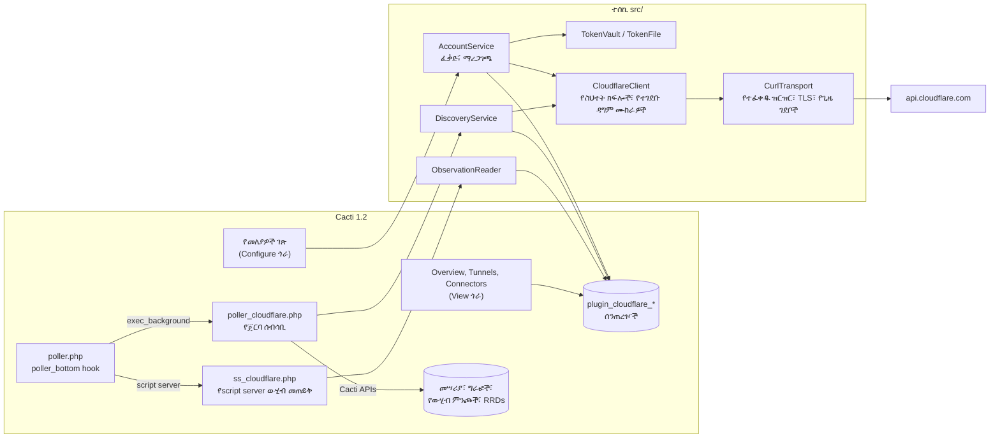

<!-- Source: README.md; SHA256: 813d1c85c236b426b83e42e63c69496f33f8909b5e435d0d45efa6a4ba2f17ca -->

<!-- translations:start -->
[English](../../../README.md) | [简体中文](../zh-CN/README.md) | [हिन्दी](../hi-IN/README.md) | [Español (España)](../es-ES/README.md) | [Español (Latinoamérica)](../es-419/README.md) | [العربية (السعودية)](../ar-SA/README.md) | [Afrikaans](../af-ZA/README.md) | [አማርኛ](README.md) | [العربية (مصر)](../ar-EG/README.md) | [العربية (المغرب)](../ar-MA/README.md) | [বাংলা](../bn-BD/README.md) | [Bosanski](../bs-BA/README.md) | [Deutsch](../de-DE/README.md) | [فارسی](../fa-IR/README.md) | [Filipino](../fil-PH/README.md) | [Français](../fr-FR/README.md) | [Français (Maroc)](../fr-MA/README.md) | [Français (Sénégal)](../fr-SN/README.md) | [Hausa](../ha-NG/README.md) | [עברית](../he-IL/README.md) | [Hrvatski](../hr-HR/README.md) | [Bahasa Indonesia](../id-ID/README.md) | [Igbo](../ig-NG/README.md) | [Italiano](../it-IT/README.md) | [日本語](../ja-JP/README.md) | [한국어](../ko-KR/README.md) | [Malagasy](../mg-MG/README.md) | [मराठी](../mr-IN/README.md) | [Bahasa Melayu](../ms-MY/README.md) | [Nederlands](../nl-NL/README.md) | [Polski](../pl-PL/README.md) | [Português (Brasil)](../pt-BR/README.md) | [Русский](../ru-RU/README.md) | [Kinyarwanda](../rw-RW/README.md) | [Soomaali](../so-SO/README.md) | [Српски](../sr-RS/README.md) | [Svenska](../sv-SE/README.md) | [Kiswahili](../sw-KE/README.md) | [தமிழ்](../ta-IN/README.md) | [తెలుగు](../te-IN/README.md) | [ไทย](../th-TH/README.md) | [Türkçe](../tr-TR/README.md) | [Українська](../uk-UA/README.md) | [اردو](../ur-PK/README.md) | [Tiếng Việt](../vi-VN/README.md) | [isiXhosa](../xh-ZA/README.md) | [Yorùbá](../yo-NG/README.md) | [繁體中文](../zh-TW/README.md) | [isiZulu](../zu-ZA/README.md)
<!-- translations:end -->

<p align="center">
  
</p>

# ለCacti የCloudflare ተሰኪ

[](https://github.com/somethingwithproof/plugin_cloudflare/actions/workflows/ci.yml)
[](https://sonarcloud.io/summary/new_code?id=somethingwithproof_plugin_cloudflare)
[](../../../LICENSE)


[](https://sonarcloud.io/summary/new_code?id=somethingwithproof_plugin_cloudflare)
[](https://sonarcloud.io/summary/new_code?id=somethingwithproof_plugin_cloudflare)
[](https://sonarcloud.io/summary/new_code?id=somethingwithproof_plugin_cloudflare)


የCloudflare Tunnels እና የzone ትንታኔዎችን (analytics) ለመቆጣጠር እየተገነባ ያለ የCacti 1.2 ተሰኪ ነው። በተገደቡ የAPI ቶከኖች ከCloudflare API ያነባል፣ በCloudflare ውስጥ ምንም ነገር አይቀይርም፣ እንዲሁም ውሂቡን በራሱ ሰንጠረዦች ውስጥ ያስቀምጣል። በCacti ውስጥ የውሂብ መጠይቅ XML ፋይሎችን ወደ `resource/script_server/` ይቀዳል፤ እንዲሁም ምንም ዋና ፋይሎችን ሳይቀይር መሣሪያዎችን፣ ግራፎችን እና አብነቶችን (templates) በCacti የራሱ APIs በኩል ይፈጥራል።

**ሁኔታ፡ 0.4.0-dev፣ ያልተለቀቀ።** የመጨረሻው የተለቀቀ ስሪት 0.3.0 ነው። የልማት ስሪቱ የCSV የንብረት ዝርዝር ወጪዎችን፣ የተሰረዙ tunnels በግልጽ ማሰናበትን፣ የተሸጎጡ (cached) የzone ትንታኔዎችን እና አማራጭ የThold አብነቶችን ያክላል። ከቀጥታ አቅራቢ ጋር እና የማሰማራት ማረጋገጫ ገና በመጠባበቅ ላይ ነው።

ከታች ያለው ሰንጠረዥ 0.3.0 የተረጋጋውን ልቀት ይገልጻል። የልማት ተጨማሪዎች ከታች በኦፕሬተር የሥራ ፍሰቶች እና የzone ትንታኔዎች ስር ተገልጸዋል።

| አሁን የሚገኙ | የታቀዱ |
|---|---|
| በCacti የተሰኪ አስተዳዳሪ በኩል መጫን፣ ማሻሻል፣ ማሰናከል እና ማራገፍ | GraphQL ትንታኔዎች እና የThold ማንቂያዎች (Milestone 4) |
| የCloudflare ፈቃዶች፡ View፣ Operator እና Configure | የስህተት መርፌ (Fault injection)፣ TLA+ ሞዴሎች እና ሙሉ ሰነድ (Milestone 5) |
| የCloudflare መለያዎችን ማከል፣ ማርትዕ፣ መሰረዝ፣ ማንቃት እና ማሰናከል | |
| ቶከንን በፋይል ውስጥ ወይም በCacti የውሂብ ጎታ ውስጥ በተመሰጠረ መልኩ ማስቀመጥ | |
| ቶከንን ማረጋገጥ እና የtunnel እንዲሁም የzone የማንበብ ፈቃዶቹን መፈተሽ | |
| በዋናው poller በሚጀመር የጀርባ ሰብሳቢ ውስጥ የtunnel እና የconnector ግኝት | |
| በManagement > Cloudflare Tunnels ስር ያሉ የOverview፣ Tunnels እና Connectors ገጾች | |
| የሕይወት ዑደት ክትትል፡ `active`፣ `unavailable` እና `deleted` | |
| በአንድ መለያ አንድ የCacti መሣሪያ (በአስተዳዳሪ የሚፈጠር)፣ tunnels የውሂብ መጠይቅ መረጃ ጠቋሚዎች ሆነው | |
| በእያንዳንዱ tunnel Connectors፣ Health እና Collection ግራፎች፣ በአንድ tunnel ከአንድ የRRD ፋይል የተሳሉ | |
| ተሰኪው ሊያረጋግጣቸው የማይችላቸው እሴቶች እንደ 0 ሳይሆን እንደ ያልታወቀ (`U`) ይቀመጣሉ | |

## የመዳረሻ ሚናዎች

| ጎራ (Realm) | መዳረሻ |
| --- | --- |
| Cloudflare: View | ነባር የክትትል ገጾች። |
| Cloudflare: Operator | ክትትል እንዲሁም የOperations ገጽ እና የግል የማጣሪያ ማረጋገጫዎች (acknowledgments)። |
| Cloudflare: Configure | የOperator መዳረሻ እንዲሁም ነባር የውቅር እና የአስተዳደር እርምጃዎች። |

የማሻሻያ ፋይሎችን ከቀዱ በኋላ አዲሱን ጎራ (realm) ለመመዝገብ እንደ አስተዳዳሪ የPlugins ገጽን ይክፈቱ። የOperator ጎራውን በ**Configuration > Users** ወይም በተጠቃሚ ቡድኖች ስር በግልጽ ይመድቡ። ማሻሻያዎች ነባሮቹን የView እና የAdmin ጎራ መለያዎች (IDs) እና ፈቃዶች ይጠብቃሉ። የAdmin መዳረሻ የOperator መዳረሻን ይወርሳል፣ የOperator መዳረሻም በእያንዳንዱ ጥያቄ ላይ የView መዳረሻን ይወርሳል፤ ይህ በተጠቃሚዎች ወይም በቡድኖች ላይ የተቀመጡ ፈቃዶችን አይጨምርም። የተሰኪ ቅንብሮች ከCacti Settings ፈቃድ በተጨማሪ የCloudflare: Configure መዳረሻን ይጠይቃሉ።

የCloudflare መለያ ታይነት ከነባሩ የView ጎራ ጋር ይዛመዳል፤ በመለያ ደረጃ አጠቃላይ ነው። የምስክር ወረቀቶች፣ ውቅር፣ ካርታ ስራ (mapping)፣ መሰረዝ እና ሌሎች የአስተዳደር ለውጦች በአስተዳደር ገጾች ውስጥ ይቆያሉ። ማረጋገጫዎች (acknowledgments) የሚቆዩት በአሁኑ የተጠቃሚ ክፍለ ጊዜ (session) ውስጥ ብቻ፣ ቢበዛ ለአንድ ሰዓት እና ያው ምልከታ ትኩስ ሆኖ እስከቆየ ድረስ ብቻ ነው። አዲስ ወይም የተለወጡ ምልከታዎች ውድቅ ያደርጓቸዋል። የወደቀ መለኪያን እንደ ጤናማ በጭራሽ አይመዘግቡም ወይም ማንቂያዎችን አያፍኑም።

## ይህ ተሰኪ ለምን አስፈለገ

በCloudflare Tunnel በኩል አገልግሎቶችን የሚያትሙ የCacti ኦፕሬተሮች በCacti ውስጥ ስለ tunnel ምንም እይታ የላቸውም። የመነሻ አስተናጋጆች (origin hosts) አሁንም ለSNMP ምላሽ እየሰጡ ሳለ አንድ tunnel ሁሉንም connectors ሊያጣ ይችላል፣ ስለዚህ ተጠቃሚዎች ስህተቶችን ሲያዩ ነባሮቹ ግራፎች አረንጓዴ ሆነው ይቆያሉ። የዚህ ተሰኪ ዓላማ ለCacti በCloudflare ውስጥ ምንም ነገር የመቀየር ችሎታ ሳይሰጥ የtunnel ጤናን እና የzone ትራፊክን ኦፕሬተሮች አስቀድመው ከሚመለከቷቸው የመሣሪያ ግራፎች ጎን ማስቀመጥ ነው።

ንድፉን ሦስት ገደቦች ይቀርጹታል፡

- **ለንባብ ብቻ (Read-only)።** ተሰኪው `GET` መጨረሻ ነጥቦችን (endpoints) እና የGraphQL Analytics APIን ብቻ ይጠራል። በማንኛውም የCloudflare ሀብት ላይ የአርትዖት ፈቃድ አያስፈልገውም።
- **አማራጭ (Optional)።** የCloudflare መቋረጦች፣ ጊዜያቸው ያለፈባቸው ቶከኖች እና የመጠን ገደቦች (rate limits) የCacti UIን ማዘግየት ወይም የሌሎች መሣሪያዎችን polling ማቆም የለባቸውም። ሁሉም የAPI ጥሪዎች ጥብቅ የጊዜ ገደቦች (timeouts) አሏቸው፣ እና መሰብሰብ የሚካሄደው በpoller በተጀመረ የጀርባ ሂደት ውስጥ ነው።
- **ዋና ለውጦች የሉም።** ተሰኪው የCacti 1.2 የተሰኪ መንጠቆዎችን (hooks) እና የራሱን ሰንጠረዦች ይጠቀማል። አንድ የውሂብ መጠይቅ XML ወደ `resource/script_server/` ይቀዳል እና መሣሪያዎችን፣ ግራፎችን እና አብነቶችን በCacti የራሱ APIs በኩል ይፈጥራል። ምንም ዋና ፋይል ስለማይቀየር የCacti ማሻሻያዎች እና ሌሎች ተሰኪዎች አይነኩም።

## እንዴት እንደሚሰራ



- **የCacti ማያያዣ** (`setup.php`፣ `includes/`፣ የገጽ ስክሪፕቶች) መንጠቆዎችን እና ጎራዎችን ይመዘግባል፣ ገጾችን በCacti የራሱ አጋዦች ያሳያል፣ እና እያንዳንዱን እርምጃ በ`src/` ውስጥ ላለው ቤተ-መጽሐፍት ያስተላልፋል።
- **ቤተ-መጽሐፍቱ** (`src/`፣ የስም ቦታ `Somethingwithproof\Cloudflare\`) በCacti globals ላይ ምንም ጥገኝነት የለውም፣ ስለዚህ Cacti ሳይሰራ ከእውነተኛ የውሂብ ጎታ እና ከሐሰተኛ የHTTP ማጓጓዣ ጋር ይሞከራል።
- **አንድ የውጪ መንገድ።** `CurlTransport` አውታረ መረቡን የሚነካ ብቸኛው ኮድ ነው፣ እና `https://api.cloudflare.com` ብቻ ይቀበላል። እያንዳንዱ ውድቀት ወደ አንድ የስህተት ክፍል (`auth`፣ `permission`፣ `rate_limited`፣ `transient`፣ ...) ይመደባል፣ ይህም በUI ውስጥ የሚታየውን ሁኔታ ይመራል።
- **ማከማቻ** በተዘጋጁ መግለጫዎች (prepared statements) በCacti የራሱ PDO ግንኙነት በኩል ያልፋል። የስኪማ (schema) ለውጦች ቁጥር የተሰጣቸው፣ ድጋሚ ቢሄዱ ተመሳሳይ ውጤት የሚሰጡ (idempotent) ፍልሰቶች ናቸው።

የንድፍ ውሳኔዎቹ እና ምክንያቶቻቸው በ[docs/design.md](../../design.md) ውስጥ ይገኛሉ።

## ቅጽበታዊ ገጽ እይታዎች

ቅጽበታዊ ገጽ እይታዎቹ የመጡት ከሙከራ ስብስብ (test stack) እንጂ ከቀጥታ የCloudflare መለያ አይደለም። ስብስቡ Cacti 1.2.31ን የተመሰለ ውሂብ ከሚመልስ ሐሰተኛ የCloudflare API ጋር ያስኬዳል፣ ስለዚህ መለያው፣ መለያ ቁጥሩ (ID) እና ሦስቱ tunnels ምትክ ቦታ ያዢዎች (placeholders) ናቸው።


*የCloudflare Accounts ዝርዝር። ሐሰተኛው API ቶከኑን ስለሚቀበል Verify `ok` ብሎ ሪፖርት ያደርጋል።*


*መለያን ማርትዕ። የቶከን መስኮቹ ሁልጊዜ ባዶ ናቸው፤ የተቀመጠው ቶከን ወደ አሳሹ በጭራሽ ተመልሶ አይላክም። Collect Tunnels እና Create Graphs በርተዋል እና Collect Analytics ጠፍቷል። Connection Status የመጨረሻውን Verify ውጤት ያሳያል፡ `ok`፣ የtunnel ንባብ ተፈቅዷል እና የzone ንባብ ይጎድላል።*


*Settings > Cloudflare.*


*Management > Cloudflare Tunnels > Overview። ሁኔታው ከመለያው active tunnels መካከል የከፋው የCloudflare ሁኔታ ነው፣ እዚህ አንድ የተመሰለ tunnel ስለወረደ `down` ነው። `Disabled`፣ `Not collected`፣ `Collection failing` እና `Not yet collected` በዚህ ቅደም ተከተል ከtunnel ጤና ይልቅ ቅድሚያ ይይዛሉ፣ ስለዚህ የመጨረሻው ሩጫው የወደቀ መለያ tunnels ምንም ቢዘግቡ `Collection failing` ያሳያል።*


*የTunnels ትር። Connectors እና Connections ለold-office `-` ያሳያሉ፣ ምክንያቱም ሐሰተኛው API ለግንኙነቶች ጥያቄው እንደ ያልታወቀ tunnel ስለሚመልስ እና ምንም ስላልተቀመጠ ነው፣ እና ምንም የሚሰራ connector ለሌለው ለstaging 0 ያሳያል።*


*የblog tunnel የConnectors ግራፍ። ሦስቱም መስመሮች መሃል ላይ ካለው ክፍተት በፊት እና በኋላ 1 ናቸው፤ እዚያ ጋር ሐሰተኛው API ስህተቶችን ስለመለሰ ተሰኪው ያልታወቁ እሴቶችን አስቀምጧል። መስመሮቹ ወደ 0 አይወርዱም። ግራፉ የመጣው ከተመሳሳይ የተመሰለ ስብስብ (`make screenshots`) ሲሆን ሰባት ደቂቃዎች polling ግራፉን እንዲሞላ በዚህ አንድ የውሂብ ምንጭ ላይ የ30 ሰከንድ እርምጃ ያዘጋጃል።*

## መስፈርቶች

- Cacti ከ1.2.25 እስከ 1.2.31። Cacti 1.2.31 ራሱ PHP 8.0 ወይም ከዚያ በላይ ያስፈልገዋል።
  CI የሚፈትሸው 1.2.31ን ብቻ ነው፤ 1.2.25 በእጅ ለመጨረሻ ጊዜ የተፈተሸው በ2026-10-22 ነው።
- PHP ከ7.4 እስከ 8.4 ከ`curl`፣ `openssl` እና `pdo_mysql` ቅጥያዎች ጋር።
  ያለ እነዚህ ፕለጊኑ ለመንቃት እምቢ ይላል።
- MariaDB 10.6 ወይም ከዚያ በላይ፣ ወይም MySQL 8.0 ወይም ከዚያ በላይ።
- ከCacti አገልጋይ ወደ `api.cloudflare.com` የHTTPS መዳረሻ። ፕሮክሲዎች
  አይደገፉም።

የተፈተሹትን ለማየት [docs/compatibility.md](../../compatibility.md)ን ይመልከቱ።

## መጫኛ

1. ፕለጊኑን በCacti የ`plugins/cloudflare` ማውጫ ውስጥ ያስቀምጡ፤ ይህንንም ከ
   [GitHub Releases](https://github.com/somethingwithproof/plugin_cloudflare/releases)
   ማህደሩን በማውጣት (በልቀት መለያው ቅጂ ላይ `make package`ን ማስኬድ ተመሳሳይ
   ማህደር ይገነባል) ወይም በgit clone ማድረግ ይችላሉ። ማውጫው `cloudflare`
   ተብሎ መሰየም አለበት።
2. ከConsole > Configuration > Plugins ይጫኑትና ያንቁት፣ ወይም እንደ ድር
   አገልጋይ ተጠቃሚ በCLI ያድርጉት፦

   ```sh
   php cli/plugin_manage.php --plugin=cloudflare --install --enable
   ```

3. የአስተዳዳሪ ተጠቃሚው በሚጫንበት ጊዜ የCloudflare: Configure ፈቃድን ያገኛል።
   በConsole > Configuration > Users ስር ለሌሎች ተጠቃሚዎች ወይም ቡድኖች ይስጡት።
4. በ[docs/token-permissions.md](../../token-permissions.md) ውስጥ ባሉት ፈቃዶች
   ቶከን ይፍጠሩ። በአጭሩ፦ Account > Cloudflare Tunnel > Read እና እንደ አማራጭ
   Zone > Zone > Read።
5. ቶከኑን ከታች ካሉት በሁለቱ መንገዶች በአንዱ ያስቀምጡ፣ ከዚያም መለያውን በ
   Console > Configuration > Cloudflare Accounts ስር ያክሉ እና ከድርጊቶች
   ምናሌ Verifyን ያስኪዱ።

### አማራጭ A፦ በዳታቤዝ ውስጥ የተመሰጠረ

ፕለጊኑ እርስዎ በሚፈጥሩት 32-ባይት ቁልፍ ቶከኖችን ይመሰጥራል። ቁልፉን ራሱ በፍጹም
አይፈጥርም ወይም አይጽፍም። ፋይሉ በድር አገልጋዩ እና በpoller ተጠቃሚዎች የሚነበብ፣
በሌሎች የማይነበብ መሆን አለበት፣ እንዲሁም ማውጫው እነዚያ ተጠቃሚዎች እንዲደርሱበት
መፍቀድ አለበት። እንደ `www-data` ለሚሰራ ድር አገልጋይ፦

```sh
sudo mkdir -p /etc/cacti
sudo sh -c 'umask 077 && openssl rand -hex 32 > /etc/cacti/cloudflare.key'
sudo chgrp www-data /etc/cacti/cloudflare.key
sudo chmod 0440 /etc/cacti/cloudflare.key
```

ነባሪው መንገድ `/etc/cacti/cloudflare.key` ነው፤ በSettings >
Cloudflare > Token Vault Key File ስር ይቀይሩት። ቁልፉ ሲጠፋ ወይም ተቀባይነት
ሲያጣ፣ የማስተካከያ ቅጹ የቶከን ፋይል አማራጩን ብቻ ያቀርባል። የቁልፉን ምትኬ
ያስቀምጡ፦ ያለ እሱ የተቀመጡ ቶከኖችን መፍታት አይቻልም እና እንደገና መግባት አለባቸው።

#### ቁልፉን መቀየር

ዳግም የመቁለፍ ትእዛዝ የለም። አዲስ ቁልፍ በአሮጌው ቁልፍ ስር የተቀመጡ ቶከኖችን
መፍታት አይችልም፣ ስለዚህ ቁልፍ መቀየር ማለት እያንዳንዱን የተቀመጠ ቶከን እንደገና
ማስገባት ማለት ነው፦

1. የእያንዳንዱን መለያ የቶከን እሴት በእጅዎ ያዘጋጁ። Cloudflare የቶከንን እሴት
   የሚያሳየው ሲፈጠር ወይም ሲታደስ ብቻ ነው፣ ስለዚህ ከሌለዎት በCloudflare
   ዳሽቦርድ ውስጥ ቶከኑን ያድሱት።
2. ከላይ ባሉት ትእዛዞች አዲሱን ቁልፍ በአዲስ መንገድ ላይ፣ ለምሳሌ
   `/etc/cacti/cloudflare.key.new`፣ በተመሳሳይ ባለቤት እና የፈቃድ ሁኔታ ይፍጠሩ።
3. Settings > Cloudflare > Token Vault Key Fileን ወደ አዲሱ መንገድ ያቀናብሩ
   እና ያስቀምጡ። ከአሁን ጀምሮ፣ አሁንም በአሮጌው ቁልፍ በተመሰጠረ መለያ ላይ Verify
   "Stored token cannot be decrypted" የሚል ሪፖርት ያደርጋል፣ እና እያንዳንዱ
   የሰብሳቢ ሩጫ ለእሱ `discovery token unavailable`ን ከ`reason=decrypt_failed`
   ጋር በመዝገብ ያሰፍራል።
4. ቶከኑን በዳታቤዝ ውስጥ ለሚያስቀምጥ እያንዳንዱ መለያ፣ በConsole >
   Configuration > Cloudflare Accounts ስር ይክፈቱት፣ ቶከኑን በሁለቱም የቶከን
   መስኮች ውስጥ ይለጥፉ፣ ያስቀምጡ እና Verifyን ያስኪዱ። `ok`ን ሪፖርት ማድረግ
   አለበት።
5. ሁሉም እንደዚህ ያሉ መለያዎች ሲረጋገጡ፣ አሮጌውን የቁልፍ ፋይል እና ምትኬዎቹን
   ያስወግዱ።

በደረጃ 3 እና 4 መካከል የመለያው ቱነሎች አይታደሱም እንዲሁም የጤና፣ የconnector
እና የግንኙነት ግራፎቻቸው Uን ይመዘግባሉ። የቶከን ፋይል መለያዎች አይነኩም።

### አማራጭ B፦ የቶከን ፋይል

የድር አገልጋዩ እና የpoller ተጠቃሚዎች ሊያነቡት በሚችሉት እና ሌሎች ሊያነቡት
በማይችሉት ፋይል ውስጥ ቶከኑን ብቻ (ሌላ ምንም ነገር ሳይጨምሩ) ይጻፉ፣ ከዚያም
በማስተካከያ ቅጹ ላይ ሙሉ መንገዱን ያስገቡ፦

```sh
sudo sh -c 'umask 077 && cat > /etc/cacti/cloudflare-account.token'   # paste the token, then Ctrl-D
sudo chgrp www-data /etc/cacti/cloudflare-account.token
sudo chmod 0440 /etc/cacti/cloudflare-account.token
```

ፋይሉ የሚፈተሸው ሲያስቀምጡ ሳይሆን በሚነበብበት ጊዜ፣ ማለትም በVerify ወቅት ነው።
ሲምቦሊክ ሊንኮች፣ ከ4 KiB በላይ የሆኑ ፋይሎች እና በሌሎች ሊነበቡ ወይም ሊጻፉ
የሚችሉ ፋይሎች ተቀባይነት አያገኙም።

Cloudflare: Configure ያለው ማንኛውም ሰው ማንኛውንም መንገድ ማስገባት ይችላል፣
እና የpoller ተጠቃሚው ያነበዋል። የቶከን ፋይሎችን በአንድ ቦታ ለማቆየት፣
Settings > Cloudflare > Token File Directoryን ለምሳሌ ወደ `/etc/cacti`
ያቀናብሩ፤ ከዚያ ውጭ ያለ መንገድ ተቀባይነት አያገኝም።
[docs/security.md](../../security.md#token-file)ን ይመልከቱ።

## ማሻሻያ

1. የማውጫውን ስም እንደያዙ በ`plugins/cloudflare` ውስጥ ያሉትን ፋይሎች በአዲሱ
   ልቀት ይተኩ።
2. እንደ አስተዳዳሪ በአንድ ጊዜ Console > Configuration > Pluginsን ወይም
   Console > Configuration > Cloudflare Accountsን ይክፈቱ። ያ የፕለጊኑን
   ዝውውሮች ያስኪዳል፣ የCloudflare አብነቶችን ያስገባል እና የዳታ መጠይቅ ፋይሉን
   ይቀዳል ([የቱነል መለኪያዎች እና ግራፎች](#tunnel-metrics-and-graphs)ን
   ይመልከቱ)፣ እንዲሁም ከ0.1.0 ሲሻሻል `poller_bottom` hookን ይመዘግባል።

`poller.php` የፕለጊኑን ማሻሻያ አያስኪድም፣ ስለዚህ እስከ ደረጃ 2 ድረስ አዲሱ
ስኪማ የለም። እያንዳንዱ የሰብሳቢ ሩጫ ምንም አያደርግም እና
`CLOUDFLARE: collector skipped; plugin upgrade pending, open Console > Plugins`ን
በመዝገብ ያሰፍራል። የCloudflare Tunnels ገጾች የሚያስፈልጋቸው
Cloudflare: Viewን ብቻ ስለሆነ ማሻሻያውን በፍጹም አያስኪዱም፣ እና እስከ ደረጃ 2
ድረስ "The Cloudflare tunnels could not be read" ሊያሳዩ ይችላሉ።

## የመለያ ሁኔታ

Verify የመለያውን ሁኔታ ያዘጋጃል፦

| ሁኔታ | ትርጉም |
|---|---|
| `unknown` | መለያው ከተጨመረ ወይም የማረጋገጫ መረጃው ከተቀየረ በኋላ አልተረጋገጠም |
| `ok` | ቶከኑ ንቁ ነው እና ቱነሎችን ማንበብ ይችላል |
| `token_inactive` | Cloudflare ቶከኑ እንደቦዘነ ወይም ጊዜው እንዳለፈበት ሪፖርት ያደርጋል |
| `auth_failed` | Cloudflare ቶከኑን ልክ ያልሆነ ወይም ጊዜው ያለፈበት በማለት ውድቅ አድርጎታል (HTTP 401) |
| `permission_denied` | ቶከኑ ንቁ ነው ነገር ግን ቱነሎችን ማንበብ አይችልም፣ ወይም የቶከን ማረጋገጫ መጨረሻ ነጥቦችን ለመጥራት ፈቃድ የለውም (HTTP 403) |
| `unreachable` | APIውን ማግኘት አልተቻለም፣ ጊዜው አልፏል ወይም የአገልጋይ ስህተት መልሷል |
| `rate_limited` | Cloudflare HTTP 429 መልሷል |
| `error` | የጠፋ ወይም ደህንነቱ ያልተጠበቀ የቶከን ፋይል፣ የጠፋ ወይም ጥቅም ላይ የማይውል የቶከን ቮልት ቁልፍ ፋይል፣ ወይም ሊፈታ የማይችል የተቀመጠ ቶከንን ጨምሮ ማንኛውም ሌላ ውድቀት |

የማስተካከያ ገጹም የቱነል ንባብ እና የዞን ንባብ መሰጠታቸውን ያሳያል።

## የቱነል ግኝት

በዋናው poller ላይ ከእያንዳንዱ የpolling ዑደት በኋላ፣ ቢያንስ አንድ የነቃ መለያ
Collect Tunnels የበራ ሲሆን የ`poller_bottom` hook በ`exec_background` የጀርባ
ሰብሳቢ ያስጀምራል። ሰብሳቢው በpoller ሂደት ውስጥ በፍጹም አይሰራም፣ ስለዚህ
ዘገምተኛ የCloudflare API `poller.php`ን አያዘገየውም። የርቀት pollerዎች በፍጹም
አያስጀምሩትም።

ጊዜው ለደረሰ እያንዳንዱ መለያ፣ ሰብሳቢው የመለያውን ቱነሎች ይዘረዝራል፣ ከዚያም
የንቁ ቱነሎቹን ግንኙነቶች ያነባል፣ ይህም የእያንዳንዱን ቱነል connectors፣
ስሪቶቻቸውን፣ የመረጃ ማዕከሎችን እና የመነሻ አድራሻዎችን ይሰጣል። መለያዎች
በየDiscovery Interval (ነባሪ 300 ሰከንዶች) ጊዜያቸው ይደርሳል። አንድ ሩጫ ከ50
ሰከንዶች በኋላ ምንም አዲስ መለያ አይጀምርም እና ቢበዛ 200 የግንኙነት ጥያቄዎችን
ያደርጋል። ከሁለቱ ገደቦች ማንኛውም ግንኙነቶቹን በማንበብ መካከል አንድን መለያ
በከፊል ሊያቆመው ይችላል፤ ያ መለያ እንደ `partial` ይመዘገባል፣ እና የሚቀጥለው
ሩጫ በቅርቡ ባልተሞከሩ ቱነሎች ይቀጥላል። ያልተጀመሩ መለያዎች ለሚቀጥለው ሩጫ
ጊዜያቸው እንደደረሰ ይቆያሉ።

አንድ ቱነል Cloudflare ሪፖርት ከሚያደርገው ሁኔታ (`healthy`፣ `degraded`፣ `down`
ወይም `inactive`) ተለይቶ የሚያዝ የህይወት ዑደት አለው፦

| የህይወት ዑደት | ትርጉም |
|---|---|
| `active` | ቱነሉ በመጨረሻው የተሟላ ዝርዝር ውስጥ ነበር |
| `deleted` | የተሟላ ዝርዝር ቱነሉን አላካተተም፣ ይህም ባዶ ዝርዝርን ያካትታል። ረድፉ እና ታሪኩ ይቆያሉ፣ እና ቱነሉ እንደገና ከታየ እንደገና `active` ይሆናል |
| `unavailable` | በመካከላቸው የተሟላ ዝርዝር ሳይኖር ሶስት የተቆጠሩ መቋረጦች የቱነሉን ሁኔታ ያልታወቀ ያደርጉታል |

ቱነሎችን የሚያክለው፣ የሚያዘምነው ወይም የሚሰርዘው የተሟላና የተሳካ ዝርዝር ብቻ
ነው፣ እና ያልተሳካ ዝርዝር አንድን ቱነል በፍጹም አይሰርዝም። Cloudflareን ሙሉ
በሙሉ ማንበብ አለመቻል (`transient`፣ `rate_limited`፣ `auth` ወይም
`permission`) እንደ መቋረጥ ይቆጠራል፤ በመካከላቸው የተሟላ ዝርዝር ሳይኖር ከሶስት
የተቆጠሩ መቋረጦች በኋላ፣ የመለያው ንቁ ቱነሎች `unavailable` ይሆናሉ።
የሚቀጥለው የተሟላ ዝርዝር ወደነበሩበት ይመልሳቸዋል እና ቆጠራውን ዳግም ያስጀምራል።
ግንኙነቶቹ ሲነበቡ Cloudflare ከእንግዲህ የማያውቀው ቱነል መለያውን ሳያከሽፍ
ይታለፋል። ሌሎች ውድቀቶች የመቋረጥ ቆጣሪውን አይጨምሩም ወይም ዳግም አያስጀምሩም።

በ`cacti.log` ውስጥ የግኝት መስመሮች በ`CLOUDFLARE: discovery` እና የሩጫ
ማጠቃለያው በ`CLOUDFLARE: collector` ይጀምራሉ። እንደ ያልተሳካ ዝርዝር ወይም
`unavailable` ተብለው ምልክት የተደረገባቸው ቱነሎች ያሉ ውድቀቶች እና የህይወት
ዑደት ለውጦች በCacti ነባሪ `LOW` ደረጃ ይመዘገባሉ፤ የእያንዳንዱ መለያ ውጤት እና
የሩጫው ማጠቃለያ በ`MEDIUM` ደረጃ ይመዘገባሉ። የግንኙነት ንባቦች በእያንዳንዱ
ቱነል ላይ ሊከሽፉ ይችላሉ፣ ስለዚህ ለእያንዳንዱ መለያ የእያንዳንዱ የስህተት ክፍል
የመጀመሪያ ውድቀት ብቻ በ`LOW` ይመዘገባል፣ የተቀረው በ`MEDIUM`፣ ከዚያም በክፍል
አንድ የ`LOW` መስመር የከሸፉትን ቱነሎች ቁጥር ይዞ ይከተላል።

Management > Cloudflare Tunnels የCloudflare: View ፈቃድን ይፈልጋል እና
ለንባብ ብቻ ነው፦

- **Overview** እያንዳንዱን መለያ ከሁኔታው፣ በህይወት ዑደት የቱነል ቆጠራዎች፣
  ከመጨረሻው የተሳካ ግኝት እና ከተከታታይ ውድቀቶች ብዛት ጋር ይዘረዝራል።
- **Tunnels** በመለያዎች ውስጥ ወይም ለአንድ መለያ ቱነሎችን ይዘረዝራል፤ ለመለያ፣
  ለህይወት ዑደት፣ ለሁኔታ እና ለስም ማጣሪያዎች እንዲሁም ሊደረደሩ የሚችሉ አምዶች
  አሉት።
- **Connectors** በTunnels ትር ላይ የተመረጠውን ቱነል connectors ያሳያል።

<a name="tunnel-metrics-and-graphs"></a>

## የቱነል መለኪያዎች እና ግራፎች

Cacti የቱነልን ሁኔታ የሚያነበው `ss_cloudflare.php` በሚባል የስክሪፕት
አገልጋይ ዳታ መጠይቅ በኩል ነው። መልስ የሚሰጠው ከፕለጊኑ ሰንጠረዦች ብቻ ነው እና
Cloudflareን በፍጹም አይጠራም፣ ስለዚህ የCloudflare መቋረጥ pollerን ሊያዘገየው
አይችልም። እያንዳንዱ ቱነል ስድስት እሴቶችን ይሰጣል፦ ጤና (healthy 3፣
degraded 2፣ down 1፣ inactive 0)፣ connectors፣ ግንኙነቶች፣ የconnector
ስሪቶች፣ ግንኙነቶቹ ለመጨረሻ ጊዜ ከተነበቡበት ጊዜ ጀምሮ ያሉ ሰከንዶች እና
የግኝት ስራው ተከታታይ ውድቀቶች። ጤና፣ connectors፣ ግንኙነቶች እና ስሪቶች
የሚታተሙት ፕለጊኑ ዋስትና ሊሰጣቸው ሲችል ብቻ ነው፣ ይህም ማለት የመጨረሻው ግኝት
ተሳክቷል፣ ቱነሉ `active` ነው እና ንባቡ የቅርብ ጊዜ ነው ማለት ነው። አለበለዚያ
`U` ናቸው፣ እና ግራፉ እንደ መቋረጥ ከሚመስል ዜሮ ይልቅ ክፍተትን ያሳያል።
ሁለቱ የመሰብሰቢያ እሴቶች በመቋረጥ ጊዜ ታትመው ይቆያሉ፣ ስለዚህ የCollection
ግራፉ ያሳየዋል፤ `U` የሚሆኑት ለተሰረዘ ቱነል ወይም ግንኙነቶቹ በፍጹም ላልታደሱ
ቱነል ብቻ ነው። ህጎቹ በ[docs/metrics.md](../../metrics.md) ውስጥ ይገኛሉ።

### መሳሪያውን መፍጠር

አንድ መለያ ቢበዛ ከአንድ የCacti መሳሪያ ጋር ይዛመዳል። መሳሪያው የመለያውን
ቱነሎች እንደ Cloudflare Tunnels ዳታ መጠይቅ መረጃ ጠቋሚዎች ይይዛል። ምንም
ነገር በራስ-ሰር አይፈጥረውም፦

1. Console > Configuration > Cloudflare Accountsን ይክፈቱ።
2. መለያውን ይምረጡ፣ ከድርጊቶች ምናሌ Create Cacti Deviceን ይምረጡ እና
   ያረጋግጡ።

ድርጊቱ ሁለቱንም የCloudflare: Configure ክልል እና የCactiን Sites/Devices/Data
ክልል (ለ`host.php` የሆነውን) ይፈልጋል። የምናሌው ግቤት የሚታየው ሁለቱንም
ለያዙ ተጠቃሚዎች ብቻ ነው፣ እና አገልጋዩ ከሌላ ማንኛውም ሰው የሚመጣውን ጥያቄ
ውድቅ ያደርጋል። መሳሪያው `Cloudflare: <account name>` ተብሎ ይሰየማል፣
የCloudflare Account አስተናጋጅ አብነትን እና ዋናውን poller ይጠቀማል፣ SNMP
ስሪት 0 እና ምንም የተገኝነት ፍተሻ የለውም፣ እንዲሁም
`<account ID>.cloudflare.invalid` የሚል የአስተናጋጅ ስም ያገኛል። ያ ስም
የተጠበቀ ነው እና በፍጹም አይፈታም፤ Cacti ከእሱ ጋር አይገናኝም። መለያው
አስቀድሞ መሳሪያ ካለው፣ ድርጊቱ ያንኑ ይናገራል እና ምንም አይቀይርም። አንድ
አስተዳዳሪ መሳሪያውን በCacti ውስጥ ከሰረዘ፣ Create Cacti Device እንደገና
እስኪካሄድ ድረስ ፕለጊኑ ሌላ አይፈጥርም።

### ግራፎችን መፍጠር

በመለያው ቅጽ ላይ Create Graphs በነባሪነት ጠፍቷል። ሲበራ፣ የመለያው ግኝት
`ok` ወይም `partial` ሆኖ በተጠናቀቀ ቁጥር፣ ሰብሳቢው መሳሪያውን ዳግም መረጃ
ጠቋሚ ያደርጋል እና ለመለያው `active` ቱነሎች ማንኛውንም የጎደሉ ግራፎችን
ይፈጥራል፦ Connectors፣ Health እና Collection፣ በአንድ ቱነል ሶስት። የአንድ
ቱነል ሶስት ግራፎች አንድ የRRD ፋይል ይጋራሉ። አንድ ሩጫ ቢበዛ 50 ግራፎችን
ይፈጥራል እና ከ20 ሰከንዶች በኋላ ይቆማል፣ እና የሚቀጥለው ሩጫ ይቀጥላል።
ፕለጊኑ የCacti ነገርን በፍጹም አያስወግድም። አንድ አስተዳዳሪ የሰረዘው ግራፍ
እንደገና አይሰራም፣ እና Cloudflare ከእንግዲህ የማይዘረዝረው ቱነል ግራፉን እና
`U`ን የሚያሳየውን የRRD ፋይሉን ይዞ ይቆያል።

Create Graphsን ማብራት ሁለቱንም ክልሎች ይፈልጋል። ማጥፋት ግን Configureን ብቻ
ይፈልጋል። የSites/Devices/Data ክልል የሌለው ተጠቃሚ ቅጹን ሲያስቀምጥ
ቅንብሩን እንደነበረ ይተወዋል፣ ከማስጠንቀቂያ ጋር። Create Graphs ጠፍቶ
እያለም፣ መሳሪያው ከእያንዳንዱ ግኝት በኋላ አሁንም ዳግም መረጃ ጠቋሚ ይደረግበታል፣
ስለዚህ አዲስ ቱነሎች እንደ ዳታ መጠይቁ መረጃ ጠቋሚዎች ይታያሉ።

### የዳታ መጠይቅ ፋይሉ

Cacti 1.2.31 የዳታ መጠይቅ XMLን የሚያነበው ከ`resource` ማውጫው ውስጥ ብቻ
ነው። ስለዚህ ፕለጊኑ ሲጫን እና ሲሻሻል አንድ ፋይል፣
`templates/resource/cloudflare_tunnels.xml`ን፣ ወደ
`<Cacti>/resource/script_server/cloudflare_tunnels.xml` ይቀዳል። ፕለጊኑ
ከራሱ ማውጫ ውጭ የሚጽፈው ብቸኛው ፋይል እሱ ነው፣ ስለዚህ ፕለጊኑን የሚጭነው
ወይም የሚያሻሽለው ተጠቃሚ ወደዚያ ማውጫ መጻፍ መቻል አለበት። ማራገፍ ፋይሉን
ከመሳሪያዎቹ፣ ከግራፎቹ፣ ከRRD ፋይሎቹ እና ከአብነቶቹ ጋር አብሮ ያቆየዋል።
ቅጂው ወይም የአብነት ማስገባቱ ካልተሳካ፣ ፕለጊኑ በመዝገብ ያሰፍረዋል እና
Create Cacti Device እንደገና ይሞክራል።

## ቅንብሮች

ቅንብሮች > Cloudflare የሚከተሉትን ይይዛል፦

- **የቶከን ማከማቻ ቁልፍ ፋይል**፦ ወደ ማከማቻ ቁልፉ የሚወስደው መንገድ።
- **የቶከን ፋይል ማውጫ**፦ ሲዋቀር፣ ከዚህ ማውጫ ውጭ ያለ የቶከን ፋይል ውድቅ ይደረጋል። በነባሪ ባዶ ነው፣ ይህም ማንኛውንም መንገድ ይፈቅዳል። [docs/security.md](../../security.md#token-file) ይመልከቱ።
- **የመስተጋብር ጥያቄ የጊዜ ገደብ**፦ ከድር በይነገጹ ለሚቀርብ ጥያቄ (እንደ ማረጋገጥ ያለ) የሚፈቀደው ጠቅላላ ሰከንድ። ነባሪው 10 ነው፤ ከ5 እስከ 60 ውጭ ያሉ እሴቶች ወደ 10 ይመለሳሉ።
- **የሰብሳቢ ጥያቄ የጊዜ ገደብ**፦ ከበስተጀርባ ሰብሳቢው ለሚቀርብ ጥያቄ የሚፈቀደው ጠቅላላ ሰከንድ። ነባሪው 20 ነው፤ ከ5 እስከ 60 ውጭ ያሉ እሴቶች ወደ 20 ይመለሳሉ።
- **የመዝገብ ደረጃ**፦ ይቀመጣል። እስካሁን የሚያነበው ነገር የለም።

በመለያ ቅጹ ላይ ዋሻዎችን መሰብሰብ እና የግኝት ክፍተት ግኝትን ይቆጣጠራሉ፣ እና ግራፎችን መፍጠር የግራፍ መፍጠርን ይቆጣጠራል። ትንታኔዎችን መሰብሰብ ይቀመጣል እና በዚህ እትም ላይ ምንም ተጽእኖ የለውም።

## ቋንቋዎች

ተሰኪው ወደ ስፓኒሽ (ስፔን፣ `es-ES`)፣ ፈረንሳይኛ (`fr-FR`)፣ ጀርመንኛ (`de-DE`)፣ ቀላል ቻይንኛ (`zh-CN`)፣ ሂንዲ (`hi-IN`)፣ አረብኛ (`ar-SA`) እና ጃፓንኛ (`ja-JP`) ትርጉሞችን ይዞ ይቀርባል። የቋንቋ ድጋፍ አንዴ ከበራ (ውቅረት > ቅንብሮች > አጠቃላይ > የቋንቋ ድጋፍ) እና ተጠቃሚው ቋንቋውን ከመረጠ በኋላ Cacti እነዚህን ያሳያል። የላቲን አሜሪካ ስፓኒሽ ካታሎግ (`es-419`) እንዲሁ አብሮ ይቀርባል፣ ነገር ግን Cacti 1.2 የሚመረጥ የላቲን አሜሪካ ስፓኒሽ አካባቢያዊ ቋንቋ ስለሌለው Cacti አንድ እስኪያክል ድረስ ተግባራዊ አይሆንም፤ እስከዚያ ድረስ ስፓኒሽ (`es-ES`) ይምረጡ።

አንዳንድ ጽሑፎች በእንግሊዝኛ ይቆያሉ፦ ተሰኪው እንዳሉ የሚያከማቻቸው እና የሚያሳያቸው የሁኔታ እሴቶች (`ok`፣ `active`፣ `unavailable`፣ `deleted` እና Cloudflare ሪፖርት የሚያደርገው የዋሻ ሁኔታ)፣ እንዲሁም ተሰኪው ወደ Cacti መዝገብ የሚጽፈው ሁሉም ነገር።

## ማራገፍ እና የውሂብ ማቆየት

ማራገፍ የተሰኪውን የራሱን ሰንጠረዦች ያጠፋል፤ እነዚህም መለያዎችን፣ የተመሰጠሩ ቶከኖችን፣ የተገኙ ዋሻዎችን፣ የሥራ ሁኔታን እና የፈጠራቸውን የCacti ነገሮች መዝገብ የሚይዙ ሲሆን፣ የ`cloudflare_` ቅንብሮቹንም ይሰርዛል። የቁልፍ ፋይሉን፣ የቶከን ፋይሎችን፣ የተቀዳውን `resource/script_server/cloudflare_tunnels.xml` ወይም ማንኛውንም የCacti መሣሪያዎችን፣ ግራፎችን፣ የውሂብ ምንጮችን፣ የRRD ፋይሎችን ወይም አብነቶችን አያስወግድም። እነዚያ ታሪካዊ የክትትል ውሂብን ይይዛሉ፣ እና እነሱን ማስወገድ በCacti ውስጥ በአስተዳዳሪው የሚደረግ ግልጽ እርምጃ ነው።

የተቀመጠው መሣሪያ ውሂብ መቀበል ያቆማል። ከተራገፈ በኋላ ወይም መለያው ከተሰረዘ በኋላ የአስተናጋጁ ባለቤት የሆነ መለያ ስለሌለ፣ ግራፎቹ ታሪካቸውን ይይዛሉ ነገር ግን ከዚያን ጊዜ ጀምሮ `U` ያትማሉ። በድጋሚ በተጫነው ወይም በድጋሚ በታከለው መለያ ላይ የCacti መሣሪያ መፍጠር አዲስ መሣሪያ ይፈጥራል፤ አሮጌውን መልሶ አይጠቀምም፣ ስለዚህ ታሪኩ ከእንግዲህ አስፈላጊ ካልሆነ አሮጌውን መሣሪያ በCacti ውስጥ ይሰርዙ።

## የታወቁ ገደቦች

- አንድ ሂደት ቢበዛ 200 የግንኙነት ጥያቄዎችን ያደርጋል። ከዚያ ገደብ በላይ ያሉ ዋሻዎች ከምልከታ መስኮቱ ባነሰ ድግግሞሽ ይታደሳሉ፣ ስለዚህ የግንኙነት ግራፎቻቸው ክፍተቶችን ያሳያሉ።
- ማሻሻያ የቀረበውን የአብነት XML ሲቀይር፣ ተሰኪው አስተዳዳሪው በገቡት አብነቶች ላይ ያደረጋቸውን አርትዖቶች ይተካል።
- የመለያው መሣሪያ በዋናው ፖለር ላይ መቆየት አለበት። የተሰኪው ሰንጠረዦች በዋናው የውሂብ ጎታ ውስጥ ናቸው እና ስክሪፕቱ ከዚያ ያነባቸዋል።
- የተሰረዙ ዋሻዎች በውሂብ መጠይቅ መረጃ ጠቋሚ ውስጥ ይቆያሉ እና አስተዳዳሪው በግልጽ እስኪያሰናብታቸው ድረስ `U` ያትማሉ። ማሰናበት በCacti በኩል በተሰኪው የተመዘገቡትን ግራፎች እና ያልተጋሩ የውሂብ ምንጮችን ብቻ ያስወግዳል፤ የዝርዝር ረድፉ እንደታየ ይቆያል። Cacti የRRD ጽዳትን ይቆጣጠራል።
- Cacti ኮዱ በእውነተኛ ከባድ ስህተት (ለምሳሌ የማህደረ ትውስታ እጥረት) የሚያበቃ ተሰኪን ያሰናክላል። [docs/security.md](../../security.md) ይመልከቱ።

## ደህንነት

- ዓለም አቀፍ API ቁልፎች ውድቅ ይደረጋሉ፤ የተገደበ ወሰን ያላቸው የAPI ቶከኖች ብቻ ተቀባይነት አላቸው።
- ቶከኖች እርስዎ በሚያዘጋጁት ፋይል ውስጥ ይቀመጣሉ ወይም በAES-256-GCM ተመስጥረው ወደ ውሂብ ጎታ በፍጹም በማይገባ የቁልፍ ፋይል ሥር ይቀመጣሉ። በገጽ ላይ በፍጹም አይታዩም፣ ወደ መዝገብ አይጻፉም ወይም በስህተት መልዕክት ውስጥ አይካተቱም።
- የውሂብ ጎታ ስህተቶች SQLSTATE እና የነጂውን የስህተት ኮድ ብቻ ይይዛሉ፣ የአረፍተ ነገሩን እሴቶች በፍጹም አይይዙም።
- እያንዳንዱ ለውጥ በCacti የCSRF ቶከን የተጠበቀ POST ነው። አስተዳደራዊ የመለያ እና የውቅረት ለውጦች Cloudflare: Configure ያስፈልጋቸዋል፤ የግል የልየታ ማረጋገጫዎች Cloudflare: Operator ያስፈልጋቸዋል። የCacti መሣሪያ መፍጠር ወይም ግራፎችን መፍጠርን ማብራት እንዲሁ የCacti Sites/Devices/Data ፈቃድ ያስፈልገዋል። የተሰናከለ ተሰኪ ገጾቹን ይከለክላል።

ዝርዝሮች እና የታወቁ ገደቦች በ[docs/security.md](../../security.md) ውስጥ ይገኛሉ።
ተጋላጭነቶችን በ[SECURITY.md](../../../SECURITY.md) ውስጥ እንደተገለጸው በግል ሪፖርት ያድርጉ።

## የኦፕሬተር የሥራ ፍሰቶች እና የዞን ትንታኔዎች

የልማት ጭማሪዎች የተሰረዙ ዋሻዎችን በግልጽ ማሰናበትን፣ አቅምን ያገናዘበ የዞን ትንታኔዎችን እና ወደ ውስጥ የሚገቡ የThold አብነቶችን ያካትታሉ። እነዚህ ጭማሪዎች እስካሁን የእትም መለያ ወይም የቀጥታ መለያ ብቁነት የላቸውም። ለማዋቀር፣ ለመለኪያ ትርጉሞች እና ለማረጋገጫ ገደቦች [docs/analytics-and-alerting.md](../../analytics-and-alerting.md) ይመልከቱ።

### የዝርዝር ወደ ውጭ መላኪያዎች

የዋሻዎች እና የአገናኞች ገጾች ለCloudflare: View መስክ Export ያቀርባሉ። የዋሻ CSV ፋይሎች በሁሉም ገጾች ላይ ንቁውን መለያ፣ የሕይወት ዑደት፣ ሁኔታ፣ ፍለጋ እና የድርደራ ቅንብሮችን በመጠቀም እያንዳንዱን የሚዛመድ ረድፍ ያካትታሉ። የአገናኝ CSV ፋይሎች ለተመረጠው ዋሻ ስሪቶችን፣ አርክቴክቸርን፣ የውሂብ ማዕከላትን እና የመነሻ አድራሻዎችን ያካትታሉ። ውርዶች የተሸጎጡ መዝገቦችን ብቻ ያነባሉ። ያልታወቁ ቆጠራዎች ባዶ ናቸው፤ ቀመር መሰል ሕዋሶች ለደህንነቱ የተጠበቀ የተመን ሉህ ማስገባት በአፖስትሮፊ ይጀምራሉ።

## የመንገድ ካርታ

እያንዳንዱ ምዕራፍ በእሱ ቁጥር እንደ 0.x እትም ይቀርባል፦ ምዕራፍ 3 0.3.0 ነው፣ ምዕራፍ 4 0.4.0 ይሆናል። ምዕራፎች 1 እና 2 በራሳቸው አልተለቀቁም እና የ0.3.0 አካል ናቸው። ስሪት 1.0.0 ከታች ያሉትን ሁሉንም ምዕራፎች ለሚያጠናቅቀው እትም የተያዘ ነው።

| ምዕራፍ | ወሰን | ሁኔታ |
|---|---|---|
| 1. መሠረት | የተሰኪ የሕይወት ዑደት፣ ፈቃዶች፣ የመለያ ውቅረት፣ የግንኙነት ሙከራ | በ0.3.0 ተለቋል ([#2](https://github.com/somethingwithproof/plugin_cloudflare/pull/2) እስከ [#5](https://github.com/somethingwithproof/plugin_cloudflare/pull/5)) |
| 2. ግኝት | በበስተጀርባ ሰብሳቢ ውስጥ የዋሻ እና የአገናኝ ግኝት፣ አጠቃላይ እይታ፣ የዋሻዎች እና የአገናኞች ገጾች | በ0.3.0 ተለቋል ([#6](https://github.com/somethingwithproof/plugin_cloudflare/pull/6)) |
| 3. መለኪያዎች | የዋሻ ጤና የውሂብ ምንጮች፣ የግራፍ አብነቶች፣ በጭራሽ የውሸት ዜሮ የማይመዘግብ የመቋረጥ አያያዝ | በ0.3.0 ተለቋል ([#7](https://github.com/somethingwithproof/plugin_cloudflare/pull/7)) |
| 4. ትንታኔ እና ማንቂያ | በየዞኑ እቅድን ያገናዘበ GraphQL ትንታኔ፣ የመቋረጥ መከልከያ ያላቸው የThold ገደቦች | የታቀደ |
| 5. ማጠናከር | የስህተት መርፌ፣ የግኝት እና የመሰብሰብ TLA+ ሞዴሎች፣ ሙሉ ሰነድ | የታቀደ |

## ልማት

መሣሪያዎቹ PHP 8.x እና Composer ያስፈልጋቸዋል፤ የተሰኪው ኮድ ራሱ ግን ከPHP 7.4 ጋር ተኳሃኝ ሆኖ ይቆያል። የውህደት እና የBDD ሙከራዎች የውሂብ ጎታ ያስፈልጋቸዋል፣ ይህንንም `make db-up` በDocker ውስጥ በወደብ 33061 ላይ ያስጀምረዋል።

```sh
composer install
make db-up
make ci            # unit, integration, BDD, PHPStan, php-cs-fixer, php -l on PHP 7.4
make smoke         # installs the plugin into Cacti 1.2.31 in Docker and walks its lifecycle
make package       # builds build/cloudflare-<version>.tar.gz and checks its contents
make db-down
```

`make smoke` እና `make screenshots` የCacti ቼክአውት ያስፈልጋቸዋል፤ `CACTI_REPO` ወደ መንገዱ ያዋቅሩ። የውህደት ሙከራዎቹ `CF_TEST_DSN`፣ `CF_TEST_DB_USER` እና `CF_TEST_DB_PASS` ያነባሉ፣ እና `CI` ካልተዋቀረ በቀር የውሂብ ጎታው የማይደረስ ሲሆን ይዘላሉ።

## አስተዋጽኦ ማድረግ

የፑል ጥያቄዎች እንኳን ደህና መጡ። እያንዳንዱ ኮሚት የDCO ፊርማ (`git commit -s`) ያስፈልገዋል። መጀመሪያ ሙከራውን ይጻፉ፤ `make ci` ማለፍ አለበት፣ እና በCacti ማገናኛ ላይ የሚደረጉ ለውጦች እንዲሁ `make smoke` ማለፍ አለባቸው። የተሰኪ ኮድ ከPHP 7.4 ጋር ተኳሃኝ ሆኖ መቆየት እና የCactiን የኮድ አጻጻፍ ስልት (ታቦች፣ ነጠላ ትምህርተ ጥቅሶች፣ በተመሳሳይ መስመር ላይ ያሉ ቅንፎች) መከተል አለበት።

### ትርጉሞች

መልዕክቶች በ`__('...', 'cloudflare')` ምልክት ተደርጎባቸዋል። `locales/build_gettext.sh` (GNU gettext የሚያስፈልገው `make i18n`) አብነቱን `locales/po/cacti.pot` እንደገና ያመነጫል፣ ወደ እያንዳንዱ ካታሎግ `locales/po/<locale>.po` ያዋህደዋል እና `locales/LC_MESSAGES/<locale>.mo` ያጠናቅራል፤ ሦስቱንም ያስገቡ። CI `make i18n-check` ያስኬዳል፣ ይህም አንድ ካታሎግ ግቤት ሲጎድለው ወይም ግልጽ ያልሆነ ግቤት ሲኖረው፣ የቅርጸት ሕብረቁምፊ ሲለያይ ወይም የተጠናቀረ ፋይል ጊዜው ያለፈበት ሲሆን ይወድቃል፤ የአሃድ ሙከራው ደግሞ የእያንዳንዱን ግቤት ቦታ ያዥዎችን፣ የHTML መለያዎችን እና የጠርዝ ክፍተቶችን ይፈትሻል። ስለዚህ የተቀየረ መልዕክት በተመሳሳይ የፑል ጥያቄ ውስጥ ትርጉሞቹ መዘመን አለባቸው። አዲስ ቋንቋ Cacti አካባቢያዊ ቋንቋዎቹን እንደሚሰይመው (ለምሳሌ `pt-BR`) የተሰየመ አዲስ `<locale>.po` ሲሆን፣ ወደ `CatalogTest::LOCALES` እና በ`tests/build/package.sh` ውስጥ ወደሚገኘው የማህደር ፍተሻ ይታከላል። የCloudflare፣ Cacti እና Thold የምርት ስሞችን፣ API እና GraphQLን፣ እንዲሁም እንደ `Account Cloudflare Tunnel Read` ያሉ የፈቃድ ስሞችን እንዳሉ ያቆዩ።

## ሰነዶች

- [docs/security.md](../../security.md)፦ የደህንነት መቆጣጠሪያዎች እና የታወቁ ገደቦች
- [docs/token-permissions.md](../../token-permissions.md)፦ የቶከን ፈቃዶች
- [docs/compatibility.md](../../compatibility.md)፦ የሚደገፉ ስሪቶች እና ጥቅም ላይ የዋሉ በይነገጾች
- [docs/metrics.md](../../metrics.md)፦ የመለኪያ ካታሎግ እና እሴት መቼ እንደማይታወቅ
- [docs/collector-protocol.md](../../collector-protocol.md)፦ `ss_cloudflare.php` ምን እንደሚያነብ እና እንደሚያትም
- [docs/schema.md](../../schema.md)፦ የውሂብ ጎታ ሰንጠረዦች
- [docs/design.md](../../design.md)፦ የንድፍ ውሳኔዎች
- [CHANGELOG.md](../../../CHANGELOG.md)

## ፈቃድ

GPL-2.0-or-later። [LICENSE](../../../LICENSE) ይመልከቱ።

## የንግድ ምልክቶች

Cloudflare የCloudflare, Inc. የተመዘገበ የንግድ ምልክት ነው። ይህ ፕሮጀክት ራሱን የቻለ ክፍት ምንጭ መሣሪያ ሲሆን ከCloudflare, Inc. ጋር የተቆራኘ፣ ስፖንሰር የተደረገ ወይም የጸደቀ አይደለም።

ፕሮጀክቱ ከCacti ፕሮጀክት ጋርም የተቆራኘ አይደለም። ለአርማው [docs/images/README-logo.md](../../images/README-logo.md) ይመልከቱ።
