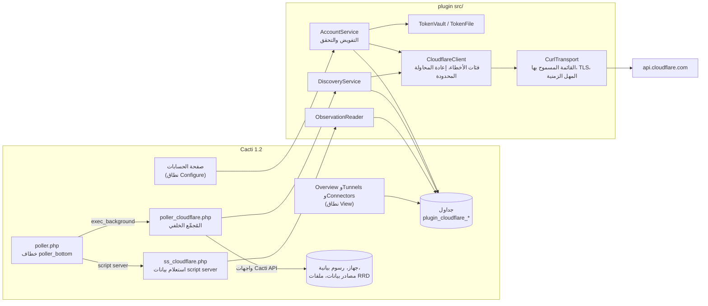

<!-- Source: README.md; SHA256: 813d1c85c236b426b83e42e63c69496f33f8909b5e435d0d45efa6a4ba2f17ca -->

<!-- translations:start -->
[English](../../../README.md) | [简体中文](../zh-CN/README.md) | [हिन्दी](../hi-IN/README.md) | [Español (España)](../es-ES/README.md) | [Español (Latinoamérica)](../es-419/README.md) | [العربية (السعودية)](../ar-SA/README.md) | [Afrikaans](../af-ZA/README.md) | [አማርኛ](../am-ET/README.md) | [العربية (مصر)](README.md) | [العربية (المغرب)](../ar-MA/README.md) | [বাংলা](../bn-BD/README.md) | [Bosanski](../bs-BA/README.md) | [Deutsch](../de-DE/README.md) | [فارسی](../fa-IR/README.md) | [Filipino](../fil-PH/README.md) | [Français](../fr-FR/README.md) | [Français (Maroc)](../fr-MA/README.md) | [Français (Sénégal)](../fr-SN/README.md) | [Hausa](../ha-NG/README.md) | [עברית](../he-IL/README.md) | [Hrvatski](../hr-HR/README.md) | [Bahasa Indonesia](../id-ID/README.md) | [Igbo](../ig-NG/README.md) | [Italiano](../it-IT/README.md) | [日本語](../ja-JP/README.md) | [한국어](../ko-KR/README.md) | [Malagasy](../mg-MG/README.md) | [मराठी](../mr-IN/README.md) | [Bahasa Melayu](../ms-MY/README.md) | [Nederlands](../nl-NL/README.md) | [Polski](../pl-PL/README.md) | [Português (Brasil)](../pt-BR/README.md) | [Русский](../ru-RU/README.md) | [Kinyarwanda](../rw-RW/README.md) | [Soomaali](../so-SO/README.md) | [Српски](../sr-RS/README.md) | [Svenska](../sv-SE/README.md) | [Kiswahili](../sw-KE/README.md) | [தமிழ்](../ta-IN/README.md) | [తెలుగు](../te-IN/README.md) | [ไทย](../th-TH/README.md) | [Türkçe](../tr-TR/README.md) | [Українська](../uk-UA/README.md) | [اردو](../ur-PK/README.md) | [Tiếng Việt](../vi-VN/README.md) | [isiXhosa](../xh-ZA/README.md) | [Yorùbá](../yo-NG/README.md) | [繁體中文](../zh-TW/README.md) | [isiZulu](../zu-ZA/README.md)
<!-- translations:end -->

<p align="center">
  
</p>

# إضافة Cloudflare لنظام Cacti

[](https://github.com/somethingwithproof/plugin_cloudflare/actions/workflows/ci.yml)
[](https://sonarcloud.io/summary/new_code?id=somethingwithproof_plugin_cloudflare)
[](../../../LICENSE)


[](https://sonarcloud.io/summary/new_code?id=somethingwithproof_plugin_cloudflare)
[](https://sonarcloud.io/summary/new_code?id=somethingwithproof_plugin_cloudflare)
[](https://sonarcloud.io/summary/new_code?id=somethingwithproof_plugin_cloudflare)


إضافة لنظام Cacti 1.2 قيد التطوير لمراقبة أنفاق Cloudflare (Cloudflare Tunnels) وتحليلات النطاقات (Zone Analytics). تقرأ الإضافة من واجهة برمجة تطبيقات Cloudflare باستخدام رموز API محددة الصلاحيات، ولا تُجري أي تعديلات في Cloudflare مطلقًا، وتحتفظ ببياناتها في جداولها الخاصة. داخل Cacti، تنسخ الإضافة ملفات XML الخاصة باستعلامات البيانات إلى `resource/script_server/` وتنشئ الأجهزة والرسوم البيانية والقوالب عبر واجهات برمجة تطبيقات Cacti نفسها، دون أي تعديل في الملفات الأساسية.

**الحالة: 0.4.0-dev، غير مُصدرة.** آخر إصدار مُصدر هو 0.3.0. تضيف نسخة التطوير تصدير قوائم الجرد بصيغة CSV، والإيقاف الصريح للأنفاق المحذوفة، وتخزين تحليلات النطاقات مؤقتًا، وعميل GraphQL Analytics للقراءة فقط وفق قائمة السماح (`GraphqlAnalyticsClient`) مع مساعدات الملخص الجاهزة لـ Thold (`AnalyticsSummary`)، وواجهة سطر أوامر التكوين كشيفرة (`cli/cloudflare.php`)، وخطافات المنظومة (`abilities_register` و`doctor_register_checks` و`casc_register_providers`)، ودعم المجمّع البعيد المقيد بنطاق المستطلع (`replicate_out`). لا يزال التحقق من التوافق مع المزود الفعلي والنشر قيد الانتظار.

يصف الجدول التالي الإصدار المستقر 0.3.0. أما الإضافات التطويرية في `0.4.0-dev` فموضحة ضمن قسمي سير عمل المشغّل وتحليلات النطاقات أدناه.

| المتاح حاليًا | المخطط له |
|---|---|
| التثبيت والترقية والتعطيل وإلغاء التثبيت عبر مدير الإضافات في Cacti | تأهيل GraphQL على حساب فعلي وتأهيل النشر (مخرج المرحلة الرابعة) |
| صلاحيات Cloudflare: View وOperator وConfigure | حقن الأعطال ونماذج TLA+ والتوثيق الكامل (المرحلة الخامسة) |
| إضافة حسابات Cloudflare وتعديلها وحذفها وتفعيلها وتعطيلها | |
| تخزين الرمز في ملف أو بشكل مشفّر في قاعدة بيانات Cacti | |
| التحقق من الرمز وفحص صلاحيات قراءة الأنفاق والنطاقات الخاصة به | |
| اكتشاف الأنفاق والموصلات في مُجمِّع خلفي (`poller_cloudflare.php`) | |
| صفحات Overview وTunnels وConnectors ضمن Management > Cloudflare Tunnels | |
| تتبّع دورة الحياة: `active` و`unavailable` و`deleted` | |
| جهاز Cacti واحد لكل حساب، ينشئه المسؤول، مع اعتبار الأنفاق فهارس لاستعلام البيانات | |
| رسوم بيانية للموصلات (Connectors) والحالة الصحية (Health) والجمع (Collection) لكل نفق، مرسومة من ملف RRD واحد لكل نفق | |
| القيم التي لا تستطيع الإضافة التحقق من صحتها تُخزّن كقيم غير معروفة (`U`)، وليس كـ 0 أبدًا | |

## أدوار الوصول

| النطاق (Realm) | الصلاحية |
| --- | --- |
| Cloudflare: View | صفحات المراقبة الحالية. |
| Cloudflare: Operator | المراقبة بالإضافة إلى صفحة Operations وإقرارات الفرز الشخصية. |
| Cloudflare: Configure | صلاحيات Operator بالإضافة إلى الإعدادات الحالية والإجراءات الإدارية. |

بعد نسخ ملفات الترقية، افتح صفحة الإضافات بصفتك مسؤولًا لتسجيل النطاق الجديد. خصص نطاق Operator بشكل صريح ضمن **Configuration > Users** أو مجموعات المستخدمين. تحتفظ الترقيات بمعرّفات نطاقي View وAdmin الحالية ومنحها. يرث وصول Admin صلاحيات Operator، ويرث وصول Operator صلاحيات View في كل طلب؛ ولا يضيف ذلك منحًا مخزنة إلى المستخدمين أو المجموعات. تتطلب إعدادات الإضافة أيضًا صلاحية Cloudflare: Configure بالإضافة إلى صلاحية Settings في Cacti.

تطابق إتاحة رؤية حسابات Cloudflare نطاق View الحالي؛ فهي على مستوى الحساب بالكامل. تبقى بيانات الاعتماد والإعدادات والربط والحذف وغيرها من التغييرات الإدارية في الصفحات الإدارية. وتستمر الإقرارات فقط خلال جلسة المستخدم الحالية، لمدة ساعة واحدة بحد أقصى، وطالما بقيت الملاحظة نفسها حديثة. وتُبطل الملاحظات الجديدة أو المتغيرة تلك الإقرارات، كما أنها لا تجعل القياس الفاشل يبدو سليمًا ولا تكتم التنبيهات.

## لماذا هذه الإضافة

لا يملك مشغّلو Cacti الذين ينشرون خدماتهم عبر Cloudflare Tunnel رؤيةً لحالة النفق داخل Cacti. فقد يفقد النفق جميع موصلاته بينما تظل خوادم الأصل تستجيب لبروتوكول SNMP، فتبقى الرسوم البيانية الحالية خضراء بينما يواجه المستخدمون أخطاءً. الهدف من هذه الإضافة هو وضع الحالة الصحية للنفق وحركة بيانات النطاق بجانب الرسوم البيانية للأجهزة التي يراقبها المشغّلون بالفعل، دون منح Cacti أي قدرة على تعديل Cloudflare.

تُشكّل ثلاثة قيود هذا التصميم:

- **للقراءة فقط.** لا تستدعي الإضافة سوى نقاط نهاية `GET` وواجهة GraphQL Analytics API. ولا تحتاج إلى أي صلاحية تعديل على أي مورد في Cloudflare.
- **اختيارية الأثر.** يجب ألا تؤدي انقطاعات Cloudflare أو الرموز منتهية الصلاحية أو حدود المعدل إلى إبطاء واجهة Cacti أو تعطيل استطلاع الأجهزة الأخرى. تخضع جميع استدعاءات API لمهل زمنية صارمة، ويعمل الجمع في عملية خلفية يطلقها المجدوِل (Poller).
- **دون تعديل الملفات الأساسية.** تستخدم الإضافة خطافات إضافات Cacti 1.2 وجداولها الخاصة. وتنسخ ملف XML واحد لاستعلام البيانات إلى `resource/script_server/` وتنشئ الأجهزة والرسوم البيانية والقوالب عبر واجهات برمجة تطبيقات Cacti نفسها. وبما أنه لا يوجد أي تعديل في الملفات الأساسية، فإن ترقيات Cacti والإضافات الأخرى لا تتأثر.

## آلية العمل



- **ربط Cacti** (`setup.php` و`includes/` ونصوص الصفحات البرمجية) يسجّل الخطافات والنطاقات، ويعرض الصفحات باستخدام دوال Cacti المساعدة نفسها، ويفوّض كل إجراء إلى المكتبة في `src/`.
- **المكتبة** (`src/`، ضمن مساحة الاسم `Somethingwithproof\Cloudflare\`) لا تعتمد على المتغيرات العامة في Cacti، لذا يُختبر أداؤها مقابل قاعدة بيانات حقيقية وناقل HTTP محاكي دون الحاجة إلى تشغيل Cacti.
- **مسار واحد للاتصال الصادر.** `CurlTransport` هو الجزء الوحيد الذي يتعامل مع الشبكة، ولا يقبل سوى `https://api.cloudflare.com`. ويُربط كل فشل بفئة خطأ واحدة (`auth`، `permission`، `rate_limited`، `transient`، ...)، وهو ما يحدد الحالة المعروضة في الواجهة.
- **التخزين** يمر عبر اتصال PDO الخاص بـ Cacti مع عبارات مُعدّة مسبقًا (Prepared Statements). وتُدار تغييرات المخطط عبر ترحيلات مرقّمة ومتكررة التنفيذ بأمان (Idempotent).

تتوفر قرارات التصميم وأسبابها في [docs/design.md](../../design.md).

## لقطات الشاشة

تأتي لقطات الشاشة من بيئة اختبار، وليس من حساب Cloudflare فعلي. تشغّل هذه البيئة Cacti 1.2.31 مقابل واجهة Cloudflare API محاكية تُرجع بيانات تجريبية، لذا فإن الحساب ومعرّفه والأنفاق الثلاثة هي بيانات تمثيلية.


*قائمة حسابات Cloudflare. تقبل الواجهة المحاكية الرمز، لذا يُظهر Verify النتيجة `ok`.*


*تعديل حساب. حقول الرمز فارغة دائمًا؛ فلا يُرسل الرمز المخزّن إلى المتصفح أبدًا. خيارا Collect Tunnels وCreate Graphs مفعّلان وخيار Collect Analytics معطّل. ويعرض Connection Status نتيجة آخر عملية Verify: `ok`، مع منح صلاحية قراءة الأنفاق وفقدان صلاحية قراءة النطاقات.*


*Settings > Cloudflare.*


*Management > Cloudflare Tunnels > Overview. تمثل الحالة أسوأ حالة في Cloudflare بين الأنفاق النشطة للحساب، وهي هنا `down` لأن أحد الأنفاق التجريبية متوقف. وتأخذ حالات `Disabled` و`Not collected` و`Collection failing` و`Not yet collected` الأولوية على الحالة الصحية للنفق بهذا الترتيب، بحيث يظهر الحساب الذي فشل آخر تشغيل له بحالة `Collection failing` بغض النظر عن حالة أنفاقه.*


*تبويب Tunnels. يظهر في عمودي Connectors وConnections الرمز `-` للنفق old-office لأن الواجهة المحاكية تجيب على طلب اتصالاته باعتباره نفقًا غير معروف ولم يُخزّن شيء، بينما يظهر 0 للنفق staging لعدم وجود موصّل قيد التشغيل.*


*الرسم البياني Connectors لنفق blog. تكون الخطوط الثلاثة عند 1 قبل الفجوة في المنتصف وبعدها، حيث أرجعت الواجهة المحاكية أخطاءً وخزّنت الإضافة قيمًا غير معروفة. ولا تهبط الخطوط إلى 0. يأتي الرسم البياني من بيئة البيانات التجريبية نفسها (`make screenshots`)، والتي تضبط خطوة زمنية قدرها 30 ثانية على مصدر البيانات هذا تحديدًا بحيث تكفي سبع دقائق من الاستطلاع لملء الرسم البياني.*

## المتطلبات

- نظام Cacti من الإصدار 1.2.25 حتى 1.2.31. يحتاج الإصدار Cacti 1.2.31 نفسه إلى PHP 8.0 أو أحدث.
  تختبر بيئة التكامل المستمر (CI) الإصدار 1.2.31 فقط؛ بينما تم اختبار الإصدار 1.2.25 يدويًا آخر مرة في 2026-10-22.
- إصدار PHP من 7.4 حتى 8.4 مع إضافات `curl` و`openssl` و`pdo_mysql`.
  ترفض الإضافة التفعيل بدونها.
- قاعدة بيانات MariaDB 10.6 أو أحدث، أو MySQL 8.0 أو أحدث.
- وصول عبر بروتوكول HTTPS من خادم Cacti إلى `api.cloudflare.com`. الوكلاء (Proxies) غير مدعومين.

راجع [docs/compatibility.md](../../compatibility.md) للاطلاع على ما يتم اختباره.

## التثبيت

1. ضع الإضافة في مجلد `plugins/cloudflare` الخاص بنظام Cacti، إما عن طريق
   استخراج الأرشيف من
   [إصدارات GitHub](https://github.com/somethingwithproof/plugin_cloudflare/releases)
   (تشغيل `make package` في نسخة من وسم الإصدار ينشئ نفس الأرشيف)
   أو عبر استنساخ مستودع git. يجب أن يكون اسم المجلد `cloudflare`.
2. ثبّت الإضافة وفعّلها من Console > Configuration > Plugins، أو عبر
   واجهة سطر الأوامر (CLI) بصلاحية مستخدم خادم الويب:

   ```sh
   php cli/plugin_manage.php --plugin=cloudflare --install --enable
   ```

3. يحصل المستخدم المسؤول (admin) على صلاحية Cloudflare: Configure عند التثبيت. امنحها
   للمستخدمين أو المجموعات الأخرى من Console > Configuration > Users.
4. أنشئ رمز وصول (token) بالصلاحيات المذكورة في
   [docs/token-permissions.md](../../token-permissions.md). باختصار:
   Account > Cloudflare Tunnel > Read، واختياريًا Zone > Zone > Read.
5. احفظ رمز الوصول بإحدى الطريقتين التاليتين، ثم أضف الحساب تحت
   Console > Configuration > Cloudflare Accounts وشغّل Verify من
   قائمة الإجراءات.

### الخيار أ: التشفير داخل قاعدة البيانات

تشفّر الإضافة رموز الوصول بمفتاح طوله 32 بايت تقوم بإنشائه بنفسك. لا تقوم الإضافة
أبدًا بإنشاء المفتاح أو كتابته بنفسها. يجب أن يكون الملف قابلًا للقراءة من قِبل
مستخدمي خادم الويب والمجمّع (poller)، وألا يكون قابلًا للقراءة من قِبل الآخرين، كما يجب أن يسمح مجلده
لهذين المستخدمين بالوصول إليه. بالنسبة لخادم ويب يعمل كمستخدم `www-data`:

```sh
sudo mkdir -p /etc/cacti
sudo sh -c 'umask 077 && openssl rand -hex 32 > /etc/cacti/cloudflare.key'
sudo chgrp www-data /etc/cacti/cloudflare.key
sudo chmod 0440 /etc/cacti/cloudflare.key
```

المسار الافتراضي هو `/etc/cacti/cloudflare.key`؛ يمكنك تغييره من Settings >
Cloudflare > Token Vault Key File. عندما يكون المفتاح مفقودًا أو مرفوضًا،
لا يتيح نموذج التعديل سوى خيار ملف رمز الوصول. احتفظ بنسخة احتياطية من المفتاح:
بدونه لا يمكن فك تشفير رموز الوصول المحفوظة ويجب إدخالها مرة أخرى.

#### تدوير المفتاح

لا يوجد أمر لإعادة التشفير بالمفتاح الجديد. لا يمكن للمفتاح الجديد فك تشفير رموز الوصول المحفوظة
بالمفتاح القديم، لذا يعني التدوير إعادة إدخال كل رمز وصول محفوظ:

1. جهّز قيمة رمز الوصول لكل حساب. تعرض Cloudflare قيمة رمز الوصول
   فقط عند إنشائه أو إعادة تدويره، لذا أعد تدوير رمز الوصول من لوحة تحكم
   Cloudflare إذا لم تعد تملك القيمة.
2. أنشئ المفتاح الجديد في مسار جديد باستخدام الأوامر المذكورة أعلاه، على سبيل المثال
   `/etc/cacti/cloudflare.key.new`، بنفس المالك وأذونات الوصول.
3. اضبط Settings > Cloudflare > Token Vault Key File على المسار الجديد واحفظ.
   من الآن فصاعدًا، سيُبلغ إجراء Verify على أي حساب لا يزال مشفرًا بالمفتاح القديم
   بالرسالة "Stored token cannot be decrypted"، كما يسجل كل تشغيل للمجمّع
   `discovery token unavailable` مع `reason=decrypt_failed` لهذا الحساب.
4. لكل حساب يحفظ رمز الوصول في قاعدة البيانات، افتحه من
   Console > Configuration > Cloudflare Accounts، والصق رمز الوصول في حقلي
   الرمز، ثم احفظ وشغّل Verify. من المفترض أن يُظهر `ok`.
5. عندما تنجح عملية التحقق لكل هذه الحسابات، احذف ملف المفتاح القديم
   ونسخه الاحتياطية.

بين الخطوتين 3 و4، لا يتم تحديث أنفاق الحساب وتسجل رسومها البيانية الخاصة بالحالة (health)
والموصلات (connector) والاتصالات (connection) القيمة U. لا تتأثر حسابات ملف رمز الوصول.

### الخيار ب: ملف رمز الوصول

اكتب رمز الوصول، ولا شيء غيره، في ملف يمكن لمستخدمي خادم الويب والمجمّع (poller)
قراءته ولا يمكن للآخرين قراءته، ثم أدخل مساره المطلق في نموذج التعديل:

```sh
sudo sh -c 'umask 077 && cat > /etc/cacti/cloudflare-account.token'   # paste the token, then Ctrl-D
sudo chgrp www-data /etc/cacti/cloudflare-account.token
sudo chmod 0440 /etc/cacti/cloudflare-account.token
```

يتم فحص الملف عند قراءته، أثناء Verify، وليس عند الحفظ. تُرفض الروابط الرمزية (Symbolic links)،
والملفات التي يتجاوز حجمها 4 KiB، والملفات القابلة للقراءة أو الكتابة من قِبل الآخرين.

يمكن لأي شخص لديه صلاحية Cloudflare: Configure إدخال أي مسار، ويقوم مستخدم المجمّع
بقراءته. لإبقاء ملفات رموز الوصول في مكان واحد، اضبط Settings > Cloudflare >
Token File Directory، على سبيل المثال على `/etc/cacti`؛ عندها يتم رفض أي مسار خارج
هذا المجلد. راجع [docs/security.md](../../security.md#token-file).

## الترقية

1. استبدل الملفات الموجودة في `plugins/cloudflare` بملفات الإصدار الجديد، مع الإبقاء على
   اسم المجلد.
2. افتح Console > Configuration > Plugins، أو Console > Configuration >
   Cloudflare Accounts، مرة واحدة بصلاحية مسؤول (admin). يؤدي ذلك إلى تشغيل ترحيلات (migrations)
   الإضافة، واستيراد قوالب Cloudflare، ونسخ ملف استعلام البيانات (راجع
   [مقاييس الأنفاق والرسوم البيانية](#tunnel-metrics-and-graphs))، وتسجيل خطافات
   المنظومة `abilities_register` و`doctor_register_checks` و`casc_register_providers`
   و`replicate_out` (`includes/ecosystem.php`)، وعند الترقية من الإصدار 0.1.0،
   يتم تسجيل خطاف `poller_bottom`.

لا يقوم `poller.php` بتشغيل ترقية الإضافة، لذا حتى إتمام الخطوة 2 يكون مخطط قاعدة البيانات
الجديد مفقودًا. عندها لا يفعل كل تشغيل للمجمّع شيئًا ويسجل
`CLOUDFLARE: collector skipped; plugin upgrade pending, open Console > Plugins`.
تحتاج صفحات Cloudflare Tunnels فقط إلى صلاحية Cloudflare: View، لذا فهي لا تشغّل
الترقية أبدًا، وحتى إتمام الخطوة 2 قد تعرض "The Cloudflare tunnels could not be read".

## حالة الحساب

يضبط إجراء Verify حالة الحساب:

| الحالة | المعنى |
|---|---|
| `unknown` | لم يتم التحقق منه منذ إضافة الحساب أو تغيير بيانات اعتماده |
| `ok` | رمز الوصول نشط ويمكنه قراءة الأنفاق |
| `token_inactive` | تفيد Cloudflare بأن رمز الوصول معطّل أو منتهي الصلاحية |
| `auth_failed` | رفضت Cloudflare رمز الوصول لكونه غير صالح أو منتهي الصلاحية (HTTP 401) |
| `permission_denied` | رمز الوصول نشط ولكنه لا يستطيع قراءة الأنفاق، أو تنقصه الصلاحيات لاستدعاء نقاط نهاية التحقق من الرمز (HTTP 403) |
| `unreachable` | تعذّر الوصول إلى واجهة API، أو انتهت المهلة، أو أعادت خطأ خادم |
| `rate_limited` | أعادت Cloudflare رمز الحالة HTTP 429 |
| `error` | أي فشل آخر، بما في ذلك ملف رمز وصول مفقود أو غير آمن، أو ملف مفتاح خزينة رموز مفقود أو غير صالح للاستخدام، أو رمز وصول محفوظ يتعذّر فك تشفيره |

تعرض صفحة التعديل أيضًا ما إذا كانت صلاحيتا قراءة الأنفاق وقراءة المناطق (zone read) ممنوحتين.

## اكتشاف الأنفاق

بعد كل دورة استطلاع على مجمّع الجمع المُكوَّن (`cloudflare_poller_id`، الافتراضي `1`)، يبدأ خطاف `poller_bottom`
مجمّعًا في الخلفية باستخدام `exec_background` عندما يكون هناك حساب واحد مفعّل على الأقل
مضبوطًا على تشغيل Collect Tunnels. لا يعمل المجمّع أبدًا داخل عملية المجمّع الرئيسي،
لذا لا يؤخر بطء واجهة Cloudflare API عمل `poller.php`. ويعلن `INFO` عن `remote_collect:1`،
ويدفع الخطاف `replicate_out` (`RemoteReplication`) جداول البيانات الوصفية غير السرية
(`plugin_cloudflare_accounts` مع مسح `token_ciphertext` إلى `NULL`، و`plugin_cloudflare_tunnels`،
و`plugin_cloudflare_connectors`، و`plugin_cloudflare_zones`، و`plugin_cloudflare_metric_mappings`،
و`plugin_cloudflare_resources`) إلى المجمّعات البعيدة (`poller_id > 1`) مع استبعاد مادة مفتاح الخزنة.

لكل حساب حان موعده، يسرد المجمّع أنفاق الحساب، ثم
يقرأ اتصالات أنفاقه النشطة، مما يوفر موصلات كل نفق،
وإصداراتها، ومراكز البيانات، وعناوين الأصل (origin addresses). يحين موعد الحسابات
كل فترة اكتشاف (Discovery Interval، الافتراضي 300 ثانية). لا يبدأ التشغيل أي حساب جديد
بعد مرور 50 ثانية، ويُجري بحد أقصى 200 طلب اتصال. يمكن لأي من الحدين أيضًا
إيقاف الحساب في منتصف قراءة اتصالاته؛ يُسجَّل هذا الحساب بالحالة `partial`،
ويكمل التشغيل التالي بدءًا من الأنفاق التي تمت محاولتها في أقدم وقت. تبقى الحسابات التي لم تبدأ مستحقة للتشغيل التالي.

يمتلك النفق دورة حياة (lifecycle)، تُحفظ بشكل منفصل عن الحالة التي تبلغ عنها Cloudflare
(`healthy` أو `degraded` أو `down` أو `inactive`):

| دورة الحياة | المعنى |
|---|---|
| `active` | كان النفق موجودًا في آخر قائمة مكتملة |
| `deleted` | لم تتضمنه قائمة مكتملة، ويشمل ذلك القائمة الفارغة. يبقى السجل وتاريخه، ويعود النفق إلى `active` إذا ظهر مرة أخرى |
| `unavailable` | تترك ثلاثة انقطاعات محسوبة دون وجود قائمة مكتملة بينها حالة النفق غير معروفة |

فقط القائمة المكتملة والناجحة هي التي تضيف الأنفاق أو تحدّثها أو تحذفها، ولا تحذف القائمة الفاشلة
أي نفق أبدًا. يُحسب الفشل في قراءة Cloudflare بالكامل
(`transient` أو `rate_limited` أو `auth` أو `permission`) ضمن الانقطاع؛
وبعد ثلاثة انقطاعات محسوبة دون قائمة مكتملة بينها، تتحول الأنفاق النشطة للحساب
إلى `unavailable`. تعيدها القائمة المكتملة التالية وتُعيد ضبط العداد. النفق الذي لم تعد
Cloudflare تعرفه عند قراءة اتصالاته يتم تخطيه دون تسجيل فشل للحساب. أما الإخفاقات الأخرى
فلا تزيد عداد الانقطاعات ولا تعيد ضبطه.

في `cacti.log`، تبدأ أسطر الاكتشاف بـ `CLOUDFLARE: discovery` ويبدأ ملخص التشغيل
بـ `CLOUDFLARE: collector`. تُسجَّل الإخفاقات وتغييرات دورة الحياة، مثل
فشل السرد أو تعليم الأنفاق كـ `unavailable`، على مستوى `LOW` الافتراضي في Cacti؛
بينما تُسجَّل نتيجة كل حساب وملخص التشغيل على مستوى `MEDIUM`. قد تفشل قراءات الاتصال
على كل نفق، لذا بالنسبة لكل حساب يُسجَّل أول فشل فقط من كل فئة خطأ على مستوى `LOW`،
والباقي على مستوى `MEDIUM`، يليها سطر واحد على مستوى `LOW` لكل فئة يوضح عدد الأنفاق التي
فشلت.

يتطلب قسم Management > Cloudflare Tunnels صلاحية Cloudflare: View وهو للقراءة فقط:

- **Overview** يعرض كل حساب مع حالته، وعدد الأنفاق حسب دورة الحياة،
  وآخر عملية اكتشاف ناجحة، وعدد الإخفاقات المتتالية.
- **Tunnels** يعرض الأنفاق عبر الحسابات أو لحساب واحد، مع فلاتر
  للحساب ودورة الحياة والحالة والاسم، وأعمدة قابلة للفرز.
- **Connectors** يعرض موصلات النفق المختار في تبويب Tunnels.

<a name="tunnel-metrics-and-graphs"></a>

## مقاييس الأنفاق والرسوم البيانية

يقرأ Cacti حالة النفق عبر استعلام بيانات خادم السكربت (script server data query)،
`ss_cloudflare.php`. يجيب السكربت من جداول الإضافة فقط ولا يتصل أبدًا
بـ Cloudflare، لذا لا يمكن لانقطاع Cloudflare إبطاء المجمّع. يعطي كل نفق
ست قيم: الحالة الصحية (healthy 3، degraded 2، down 1، inactive 0)، والموصلات،
والاتصالات، وإصدارات الموصلات، والثواني المنقضية منذ آخر قراءة لاتصالاته،
والإخفاقات المتتالية لمهمة الاكتشاف. تُطبع قيم الصحة والموصلات
والاتصالات والإصدارات فقط عندما تضمن الإضافة صحتها،
وهو ما يعني نجاح آخر عملية اكتشاف، وأن النفق `active`، وأن
القراءة حديثة. وبخلاف ذلك تكون قيمتها `U`، ويُظهر الرسم البياني فجوة بدلًا
من الصفر الذي قد يبدو كانقطاع. تظل قيمتا الجمع مطبوعتين
أثناء الانقطاع، بحيث يُظهر الرسم البياني للجمع (Collection) ذلك؛ وتكونان `U` فقط
للنفق المحذوف أو النفق الذي لم يتم تحديث اتصالاته مطلقًا. القواعد مفصلة في
[docs/metrics.md](../../metrics.md).

### إنشاء الجهاز

يرتبط الحساب بجهاز Cacti واحد على الأكثر. يحتفظ الجهاز بأنفاق الحساب
كفهارس (indexes) لاستعلام بيانات Cloudflare Tunnels. لا شيء ينشئه
تلقائيًا:

1. افتح Console > Configuration > Cloudflare Accounts.
2. حدد الحساب، واختر Create Cacti Device من قائمة الإجراءات، ثم
   أكّد الاختيار.

يحتاج الإجراء إلى كل من نطاق صلاحية Cloudflare: Configure ونطاق
Sites/Devices/Data في Cacti (الخاص بـ `host.php`). يظهر خيار القائمة فقط
للمستخدمين الذين يملكون كليهما، ويرفض الخادم الطلب من أي شخص آخر.
يُسمى الجهاز `Cloudflare: <account name>`، ويستخدم قالب المضيف (host template)
Cloudflare Account والمجمّع الرئيسي، وإصدار SNMP رقم 0 وبدون فحص التوفر،
ويحصل على اسم المضيف `<account ID>.cloudflare.invalid`. هذا الاسم محجوز
ولا يتم تحليله (resolve) أبدًا؛ ولا يتصل Cacti به. إذا كان لدى الحساب
جهاز بالفعل، يذكر الإجراء ذلك ولا يغيّر شيئًا. وإذا حذف المسؤول
الجهاز في Cacti، لا تنشئ الإضافة جهازًا آخر حتى يتم تشغيل Create Cacti Device مجددًا.

### إنشاء الرسوم البيانية

يكون خيار Create Graphs في نموذج الحساب معطّلًا افتراضيًا. عند تفعيله، في كل مرة
تنتهي فيها عملية اكتشاف الحساب بحالة `ok` أو `partial`، يعيد المجمّع فهرسة
الجهاز وينشئ أي رسوم بيانية مفقودة لأنفاق الحساب ذات الحالة `active`:
Connectors وHealth وCollection، ثلاثة لكل نفق. تتشارك الرسوم البيانية الثلاثة للنفق
ملف RRD واحدًا. ينشئ التشغيل الواحد 50 رسمًا بيانيًا بحد أقصى ويتوقف بعد 20
ثانية، ويكمل التشغيل التالي. لا تحذف الإضافة أي كائن في Cacti مطلقًا.
الرسم البياني الذي يحذفه المسؤول لا يُعاد إنشاؤه، والنفق الذي لم تعد
Cloudflare تدرجه يحتفظ برسمه البياني وملف RRD الخاص به، واللذين يعرضان `U`.

يتطلب تفعيل Create Graphs كلا النطاقين. أما تعطيله فيتطلب فقط
Configure. أي مستخدم لا يملك نطاق Sites/Devices/Data ويحفظ النموذج
يترك الإعداد كما كان، مع ظهور تحذير. ومع تعطيل Create Graphs، يظل
الجهاز يُعاد فهرسته بعد كل اكتشاف، فتظهر الأنفاق الجديدة
كفهارس في استعلام البيانات.

### ملف استعلام البيانات

يقرأ Cacti 1.2.31 ملف XML لاستعلام البيانات فقط من داخل مجلد `resource`
الخاص به. لذلك، عند التثبيت والترقية، تنسخ الإضافة ملفًا واحدًا،
`templates/resource/cloudflare_tunnels.xml`، إلى
`<Cacti>/resource/script_server/cloudflare_tunnels.xml`. وهو الملف الوحيد
الذي تكتبه الإضافة خارج مجلدها الخاص، لذا يجب أن يكون المستخدم الذي يثبّت
أو يرقّي الإضافة قادرًا على الكتابة في ذلك المجلد.
يُبقي إلغاء التثبيت على الملف، إلى جانب الأجهزة والرسوم البيانية وملفات RRD
والقوالب. وإذا فشل النسخ أو استيراد القالب، تسجل الإضافة ذلك
ويحاول إجراء Create Cacti Device مجددًا.

## الإعدادات

يحتوي قسم الإعدادات > Cloudflare على:

- **ملف مفتاح خزينة الرموز (Token Vault Key File)**: المسار إلى ملف مفتاح الخزينة.
- **مجلد ملفات الرموز (Token File Directory)**: عند ضبطه، يتم رفض أي ملف رمز موجود خارجه. يكون فارغًا افتراضيًا، مما يسمح بأي مسار. راجع [docs/security.md](../../security.md#token-file).
- **مهلة الطلبات التفاعلية (Interactive Request Timeout)**: إجمالي الثواني المسموح بها لأي طلب يتم تنفيذه من واجهة الويب، مثل Verify. القيمة الافتراضية 10؛ والقيم خارج النطاق من 5 إلى 60 ترجع تلقائيًا إلى 10.
- **مهلة طلبات المجمّع (Collector Request Timeout)**: إجمالي الثواني المسموح بها لأي طلب ينفذه المجمّع في الخلفية. القيمة الافتراضية 20؛ والقيم خارج النطاق من 5 إلى 60 ترجع تلقائيًا إلى 20.
- **مستوى السجل (Log Level)**: يتم تخزينه فقط، ولا يقرؤه أي مكون حاليًا.

في نموذج الحساب، يتحكم خيارا Collect Tunnels وDiscovery Interval في عملية الاكتشاف، بينما يتحكم Create Graphs في إنشاء الرسوم البيانية. أما خيار Collect Analytics فيتم تخزينه فقط وليس له أي تأثير في هذا الإصدار.

## اللغات

يتضمن الملحق ترجمات إلى الإسبانية (إسبانيا، `es-ES`)، والفرنسية (`fr-FR`)، والألمانية (`de-DE`)، والصينية المبسطة (`zh-CN`)، والهندية (`hi-IN`)، والعربية (`ar-SA`)، واليابانية (`ja-JP`). يعرض Cacti هذه الترجمات بمجرد تفعيل دعم اللغات (Configuration > Settings > General > Language Support) واختيار المستخدم للغة. كما يتضمن الملحق حزمة اللغة الإسبانية لأمريكا اللاتينية (`es-419`)، لكن Cacti 1.2 لا يوفر لغة محلية للإسبانية بأمريكا اللاتينية للاختيار منها، لذا لن تدخل حيز التنفيذ إلا عندما يضيفها Cacti؛ وحتى ذلك الحين، اختر الإسبانية (`es-ES`).

تبقى بعض النصوص باللغة الإنجليزية: قيم الحالة التي يخزنها الملحق ويعرضها كما هي (`ok`، و`active`، و`unavailable`، و`deleted`، وحالة النفق التي يبلغ عنها Cloudflare)، وكل ما يكتبه الملحق في سجل Cacti.

## إلغاء التثبيت والاحتفاظ بالبيانات

تحذف عملية إلغاء التثبيت الجداول الخاصة بالملحق، والتي تحتوي على الحسابات، والرموز المشفّرة، والأنفاق المكتشفة، وحالة المهام، وسجل كائنات Cacti التي أنشأها، كما تحذف إعداداته التي تبدأ بـ `cloudflare_`. لكنها لا تحذف ملف المفتاح، أو ملفات الرموز، أو ملف `resource/script_server/cloudflare_tunnels.xml` المنسوخ، أو أي أجهزة أو رسوم بيانية أو مصادر بيانات أو ملفات RRD أو قوالب خاصة بـ Cacti. فهذه العناصر تحتفظ ببيانات المراقبة التاريخية، وإزالتها تتطلب إجراءً صريحًا من المسؤول داخل Cacti.

يتوقف الجهاز المحتفظ به عن استقبال البيانات. فبعد إلغاء التثبيت، أو بعد حذف حسابه، لا يعود هناك حساب يمتلك المضيف، وبالتالي تحتفظ رسومه البيانية بسجلها التاريخي لكنها تطبع `U` منذ ذلك الحين. وعند استخدام Create Cacti Device على الحساب بعد إعادة تثبيت الملحق أو إعادة إضافة الحساب، يتم إنشاء جهاز جديد؛ ولا يُعاد استخدام الجهاز القديم، لذا احذف الجهاز القديم من Cacti بمجرد عدم حاجتك إلى سجله التاريخي.

## القيود المعروفة

- ينفذ التشغيل الواحد 200 طلب اتصال بحد أقصى. أما الأنفاق التي تتجاوز هذا الحد فيتم تحديثها بمعدل أقل من نافذة المراقبة، لذا تظهر فجوات في الرسوم البيانية لاتصالاتها.
- يستبدل الملحق أي تعديلات أجراها المسؤول على القوالب المستوردة عندما يغيّر التحديث ملف XML الخاص بالقالب المرفق.
- تتلقى المجمّعات البعيدة بيانات وصفية منسوخة دون بيانات اعتماد (يُمسح `token_ciphertext` إلى `NULL` ولا تُنسخ مفاتيح الخزنة أبدًا). عند تشغيل المجمّع على مجمّع بعيد مخصّص (`cloudflare_poller_id`)، وفّر ملفات الرموز أو مفتاح خزنة مباشرة على مضيف ذلك المجمّع.
- تبقى الأنفاق المحذوفة في فهرس استعلام البيانات وتطبع `U` إلى أن يقوم المسؤول بسحبها (تقاعدها) صراحةً. وتزيل عملية السحب الرسوم البيانية المسجلة عبر الملحق ومصادر البيانات غير المشتركة فقط من خلال Cacti؛ بينما يظل صف المخزون مرئيًا. ويتحكم Cacti في تنظيف ملفات RRD.
- يقوم Cacti بتعطيل أي ملحق ينتهي كوده بخطأ فادح حقيقي، مثل نفاد الذاكرة. راجع [docs/security.md](../../security.md).

## الأمان

- يتم رفض مفاتيح Global API Keys؛ ولا تُقبل سوى رموز API ذات النطاق المحدد (scoped API tokens).
- تُخزّن الرموز في ملف توفره أنت أو تُشفّر باستخدام AES-256-GCM بموجب ملف مفتاح لا يدخل قاعدة البيانات أبدًا. ولا يتم عرضها أبدًا في أي صفحة، أو كتابتها في سجل، أو تضمينها في رسالة خطأ.
- لا تحمل أخطاء قاعدة البيانات سوى SQLSTATE ورمز خطأ المشغّل (driver)، ولا تتضمن قيم عبارة الاستعلام أبدًا.
- كل تغيير يتم عبر طلب POST محمي برمز CSRF الخاص بـ Cacti. وتتطلب التغييرات الإدارية للحساب والتهيئة صلاحية Cloudflare: Configure؛ بينما تتطلب تأكيدات الفرز الشخصية صلاحية Cloudflare: Operator. كما يتطلب إنشاء جهاز Cacti أو تفعيل Create Graphs صلاحية Sites/Devices/Data الخاصة بـ Cacti. ويرفض الملحق المعطّل فتح صفحاته.
- لا تقبل أداة التكوين كشيفرة (`cli/cloudflare.php` و`casc_register_providers`) سوى مراجع الأسرار `vault:<account_id>` أو `file:<absolute_path>`، وترفض الرموز الخام ونصوص الخزنة المشفرة وتصريحات XML `DOCTYPE`، وتطلب قيمة `--confirm=<PLAN_HASH>` مطابقة تمامًا قبل الكتابة.
- القدرات المسجلة (`cloudflare-list-tunnels` و`cloudflare-get-health`) للقراءة فقط بشكل صارم، وتقيّم نطاق Cloudflare: View مباشرة مقابل جداول مصادقة Cacti لمعرّف مستخدم المستدعي (وليس حالة الجلسة أبدًا)، ولا تُرجع أي رموز أو مادة مفاتيح.

التفاصيل والقيود المعروفة موجودة في [docs/security.md](../../security.md).
أبلغ عن الثغرات الأمنية بشكل خاص كما هو موضح في [SECURITY.md](../../../SECURITY.md).

## سير عمل المشغّل وتحليلات المناطق

تشمل الإضافات التطويرية في `0.4.0-dev` السحب الصريح للأنفاق المحذوفة، وتحليلات GraphQL للنطاقات والأنفاق المعتمدة على الإمكانات المتاحة، ومساعدات الملخص الجاهزة لـ Thold وقوالب قابلة للاستيراد، وواجهة سطر أوامر CasC والصحة، وخطافات المنظومة، والنسخ المتماثل للمجمّع البعيد. ولا تحمل هذه الإضافات وسم إصدار (release tag) أو اعتمادًا على حساب فعلي بعد. راجع [docs/analytics-and-alerting.md](../../analytics-and-alerting.md) لمعرفة خطوات الإعداد، ودلالات المقاييس، وحدود التحقق.

- **عميل GraphQL Analytics وملخص Thold (`src/Api/GraphqlAnalyticsClient.php` و`src/Metrics/AnalyticsSummary.php`)**: ينفّذ `GraphqlAnalyticsClient` فقط استعلامات القراءة فقط المدرجة في قائمة السماح وقت الترجمة (`zone_settings` و`zone_http_metrics` و`zone_edge_latency` و`tunnel_analytics`) عبر `CloudflareClient` (مع التحقق من TLS، والتثبيت على `api.cloudflare.com`، والاستجابات المحدودة، والتراجع عند حدود المعدل عبر `RetryPolicy`) لجمع حجم طلبات النطاق والنفق، ومعدلات أخطاء HTTP 5xx، وبايتات الاستجابة، وزمن استجابة الحافة (المتوسط وp95). ويوفر `AnalyticsSummary` الدوال `recommendedThresholds()` المتوافقة مع أسماء DS في ملفات RRD الخاصة بالملحق (`health` و`collect_age` و`error_pct` و`age`) و`summarizeZones()` و`evaluateSample()`.
- **واجهة سطر أوامر المشغّل وCasC (`cli/cloudflare.php`)**: مدعومة بـ `ConfigCodec` (`src/Config/ConfigCodec.php`) و`ConfigService` (`src/Config/ConfigService.php`)، وتدعم `cli/cloudflare.php export [--format=yaml|xml] [--file=PATH]` (تُصدر مراجع الأسرار `vault:` / `file:` فقط)، و`cli/cloudflare.php validate --file=PATH [--format=yaml|xml]`، و`cli/cloudflare.php plan --file=PATH [--format=yaml|xml]`، و`cli/cloudflare.php apply --file=PATH --confirm=<PLAN_HASH> [--format=yaml|xml]`، و`cli/cloudflare.php health [--format=text|json]`.
- **خطافات تكامل المنظومة (`includes/ecosystem.php` و`setup.php`)**:
  - `abilities_register` (`AbilitiesProvider`): يسجّل القدرتين للقراءة فقط `cloudflare-list-tunnels` و`cloudflare-get-health` المقيدتين بنطاق Cloudflare: View (المنح المباشرة ومنح المجموعات) بدون أي رموز أو أسرار في المخرجات.
  - `doctor_register_checks` (`DoctorChecks`): يكشف فحوصات `cloudflare_vault_key` (التحقق من النمط والروابط الرمزية والطول)، و`cloudflare_token_dir` (فحوصات المسار المطلق والروابط الرمزية وقابلية الكتابة للجميع)، و`cloudflare_tunnel_freshness`، و`cloudflare_api_failure_rate`.
  - `casc_register_providers` (`CascProvider`): يكشف مزوّد CasC باسم `cloudflare` (`export` و`validate` و`plan` و`apply`) للحسابات (مراجع الأسرار فقط) والنطاقات والأنفاق وتعيينات المقاييس.
  - `replicate_out` (`RemoteReplication`): ينسخ جداول البيانات الوصفية غير السرية إلى المجمّعات البعيدة (`poller_id > 1`) مع مسح `token_ciphertext` إلى `NULL` واستبعاد مادة مفتاح الخزنة.

### تصدير المخزون

تتيح صفحتا Tunnels وConnectors خيار التصدير (Export) لنطاق صلاحية Cloudflare: View. وتشمل ملفات CSV للأنفاق كل صف مطابق، باستخدام إعدادات الحساب النشط، ودورة الحياة، والحالة، والبحث، والفرز عبر جميع الصفحات. بينما تشمل ملفات CSV للموصّلات الإصدارات، والمعمارية، ومراكز البيانات، وعناوين الأصل للنفق المحدد. وتعتمد التنزيلات على قراءة السجلات المخزنة مؤقتًا فقط. وتكون الأعداد غير المعروفة فارغة؛ كما تُسبق الخلايا المشابهة للصيغ بفاصلة عليا (') لضمان استيراد آمن في جداول البيانات.

## خارطة الطريق

يُطرح كل معلم (milestone) كإصدار 0.x يحمل رقمه: المعلم 3 هو 0.3.0، والمعلم 4 سيكون 0.4.0. لم يتم طرح المعلمين 1 و2 بشكل مستقل، وهما جزء من 0.3.0. والإصدار 1.0.0 مخصص للإصدار الذي يكتمل فيه كل معلم من المعالم الموضحة أدناه.

| المعلم | النطاق | الحالة |
|---|---|---|
| 1. الأساس (Foundation) | دورة حياة الملحق، الصلاحيات، تهيئة الحساب، اختبار الاتصال | صدر في 0.3.0 ([#2](https://github.com/somethingwithproof/plugin_cloudflare/pull/2) إلى [#5](https://github.com/somethingwithproof/plugin_cloudflare/pull/5)) |
| 2. الاكتشاف (Discovery) | اكتشاف الأنفاق والموصّلات عبر مجمّع في الخلفية، صفحات Overview وTunnels وConnectors | صدر في 0.3.0 ([#6](https://github.com/somethingwithproof/plugin_cloudflare/pull/6)) |
| 3. المقاييس (Metrics) | مصادر بيانات صحة الأنفاق، قوالب الرسوم البيانية، التعامل مع الانقطاعات دون تسجيل صفر مصطنع أبدًا | صدر في 0.3.0 ([#7](https://github.com/somethingwithproof/plugin_cloudflare/pull/7)) |
| 4. التحليلات والتنبيهات (Analytics and alerting) | تحليلات GraphQL المعتمدة على الخطة (`GraphqlAnalyticsClient`)، وملخص وقوالب Thold (`AnalyticsSummary`)، وواجهة CasC (`cli/cloudflare.php`)، وخطافات المنظومة، والنسخ المتماثل البعيد | مُنفّذة في 0.4.0-dev؛ التأهيل على حساب فعلي قيد الانتظار |
| 5. التحصين (Hardening) | حقن الأعطال، نماذج TLA+ لعمليتي الاكتشاف والتجميع، التوثيق الكامل | مخطط له |

## التطوير

تتطلب الأدوات PHP 8.x وComposer؛ بينما يظل كود الملحق نفسه متوافقًا مع PHP 7.4. وتحتاج اختبارات التكامل واختبارات BDD إلى قاعدة بيانات، والتي يقوم `make db-up` بتشغيلها في Docker على المنفذ 33061.

```sh
composer install
make db-up
make ci            # unit, integration, BDD, PHPStan, php-cs-fixer, php -l on PHP 7.4
make smoke         # installs the plugin into Cacti 1.2.31 in Docker and walks its lifecycle
make package       # builds build/cloudflare-<version>.tar.gz and checks its contents
make db-down
```

يحتاج كل من `make smoke` و`make screenshots` إلى نسخة مستنسخة من Cacti؛ اضبط `CACTI_REPO` على مسارها. وتقرأ اختبارات التكامل المتغيرات `CF_TEST_DSN` و`CF_TEST_DB_USER` و`CF_TEST_DB_PASS`، وتتخطى التنفيذ عند تعذر الوصول إلى قاعدة البيانات ما لم يتم ضبط `CI`.

## المساهمة

طلبات السحب (Pull requests) مرحب بها. يحتاج كل إيداع (commit) إلى توقيع DCO (`git commit -s`). اكتب الاختبار أولًا؛ ويجب أن ينجح `make ci`، كما يجب أن تنجح التعديلات على طبقة الربط مع Cacti في `make smoke`. يجب أن يظل كود الملحق متوافقًا مع PHP 7.4 وأن يتبع أسلوب كتابة الكود الخاص بـ Cacti (المسافات الجدولية tabs، وعلامات الاقتباس المفردة، وفتح الأقواس المعقوفة على نفس السطر).

### الترجمات

تُحدّد الرسائل باستخدام `__('...', 'cloudflare')`. يقوم `locales/build_gettext.sh` (`make i18n`، الذي يتطلب GNU gettext) بإعادة توليد القالب `locales/po/cacti.pot`، ودمجه في كل ملف كتالوج `locales/po/<locale>.po`، وتجميع `locales/LC_MESSAGES/<locale>.mo`؛ لذا قم بإيداع الملفات الثلاثة معًا. يشغّل نظام التكامل المستمر `make i18n-check`، والذي يفشل إذا افتقد الكتالوج مدخلًا أو احتوى على مدخل غير مؤكد (fuzzy)، أو اختلف تنسيق سلسلة نصية، أو كان الملف المجمّع قديمًا، كما تتحقق مجموعة اختبارات الوحدة من العناصر النائبة (placeholders) ووسوم HTML والمسافات البيضاء على الأطراف في كل مدخل. لذلك فإن أي رسالة تتغير تستلزم تحديث ترجماتها في نفس طلب السحب. لإضافة لغة جديدة، يتم إنشاء ملف `<locale>.po` جديد مسمّى وفق تسمية Cacti للغات المحلية (على سبيل المثال `pt-BR`)، وإضافته إلى `CatalogTest::LOCALES` وإلى فحص الأرشيف في `tests/build/package.sh`. واحتفظ بأسماء منتجات Cloudflare وCacti وThold، وAPI وGraphQL، وأسماء الصلاحيات مثل `Account Cloudflare Tunnel Read` كما هي.

## التوثيق

- [docs/security.md](../../security.md): الضوابط الأمنية والقيود المعروفة
- [docs/token-permissions.md](../../token-permissions.md): صلاحيات الرموز
- [docs/compatibility.md](../../compatibility.md): الإصدارات المدعومة والواجهات المستخدمة
- [docs/metrics.md](../../metrics.md): كتالوج المقاييس ومتى تكون القيمة غير معروفة
- [docs/collector-protocol.md](../../collector-protocol.md): ما يقرؤه `ss_cloudflare.php` وما يطبعه
- [docs/schema.md](../../schema.md): جداول قاعدة البيانات
- [docs/design.md](../../design.md): القرارات التصميمية
- [CHANGELOG.md](../../../CHANGELOG.md)

## الترخيص

GPL-2.0-or-later. راجع [LICENSE](../../../LICENSE).

## العلامات التجارية

Cloudflare هي علامة تجارية مسجلة لشركة Cloudflare, Inc. هذا المشروع أداة مستقلة مفتوحة المصدر وغير تابع لشركة Cloudflare, Inc. ولا مدعوم أو معتمد منها.

كما أن المشروع غير تابع لمشروع Cacti. راجع [docs/images/README-logo.md](../../images/README-logo.md) للاطلاع على الشعار.
