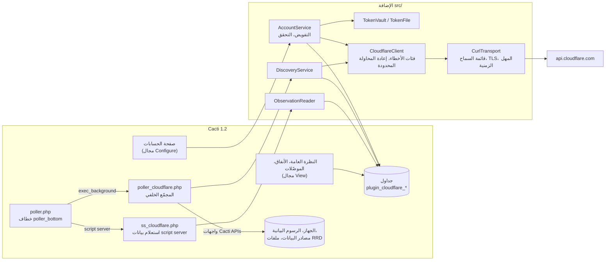

<!-- Source: README.md; SHA256: f8de0e02c5904e15bfa4c71edcaab219e5e5d4f6d9dbe589f4ed16351df6bf4d -->

<!-- translations:start -->
[English](../../../README.md) | [简体中文](../zh-CN/README.md) | [हिन्दी](../hi-IN/README.md) | [Español (España)](../es-ES/README.md) | [Español (Latinoamérica)](../es-419/README.md) | [العربية (السعودية)](../ar-SA/README.md) | [Afrikaans](../af-ZA/README.md) | [አማርኛ](../am-ET/README.md) | [العربية (مصر)](../ar-EG/README.md) | [العربية (المغرب)](README.md) | [বাংলা](../bn-BD/README.md) | [Bosanski](../bs-BA/README.md) | [Deutsch](../de-DE/README.md) | [فارسی](../fa-IR/README.md) | [Filipino](../fil-PH/README.md) | [Français](../fr-FR/README.md) | [Français (Maroc)](../fr-MA/README.md) | [Français (Sénégal)](../fr-SN/README.md) | [Hausa](../ha-NG/README.md) | [עברית](../he-IL/README.md) | [Hrvatski](../hr-HR/README.md) | [Bahasa Indonesia](../id-ID/README.md) | [Igbo](../ig-NG/README.md) | [Italiano](../it-IT/README.md) | [日本語](../ja-JP/README.md) | [한국어](../ko-KR/README.md) | [Malagasy](../mg-MG/README.md) | [मराठी](../mr-IN/README.md) | [Bahasa Melayu](../ms-MY/README.md) | [Nederlands](../nl-NL/README.md) | [Polski](../pl-PL/README.md) | [Português (Brasil)](../pt-BR/README.md) | [Русский](../ru-RU/README.md) | [Kinyarwanda](../rw-RW/README.md) | [Soomaali](../so-SO/README.md) | [Српски](../sr-RS/README.md) | [Svenska](../sv-SE/README.md) | [Kiswahili](../sw-KE/README.md) | [தமிழ்](../ta-IN/README.md) | [తెలుగు](../te-IN/README.md) | [ไทย](../th-TH/README.md) | [Türkçe](../tr-TR/README.md) | [Українська](../uk-UA/README.md) | [اردو](../ur-PK/README.md) | [Tiếng Việt](../vi-VN/README.md) | [isiXhosa](../xh-ZA/README.md) | [Yorùbá](../yo-NG/README.md) | [繁體中文](../zh-TW/README.md) | [isiZulu](../zu-ZA/README.md)
<!-- translations:end -->

<p align="center">
  
</p>

# إضافة Cloudflare لـ Cacti

[](https://github.com/somethingwithproof/plugin_cloudflare/actions/workflows/ci.yml)
[](https://sonarcloud.io/summary/new_code?id=somethingwithproof_plugin_cloudflare)
[](../../../LICENSE)


[](https://sonarcloud.io/summary/new_code?id=somethingwithproof_plugin_cloudflare)
[](https://sonarcloud.io/summary/new_code?id=somethingwithproof_plugin_cloudflare)
[](https://sonarcloud.io/summary/new_code?id=somethingwithproof_plugin_cloudflare)


إضافة لـ Cacti 1.2 قيد التطوير لمراقبة أنفاق Cloudflare (Cloudflare Tunnels) وتحليلات النطاقات (Zone analytics). تقرأ الإضافة البيانات من واجهة برمجة تطبيقات Cloudflare (Cloudflare API) باستعمال رموز API محددة النطاق (scoped API tokens)، ولا تغيّر أي شيء في Cloudflare أبداً، كما تحتفظ ببياناتها في جداولها الخاصة. داخل Cacti، تنسخ ملفات XML الخاصة باستعلامات البيانات (data query) إلى `resource/script_server/` وتنشئ الأجهزة والرسوم البيانية والقوالب عبر واجهات برمجة التطبيقات الخاصة بـ Cacti نفسها، دون أي تعديل على الملفات الأساسية (core files).

**الحالة: 0.4.0-dev، غير منشورة.** آخر إصدار منشور هو 0.3.0. تضيف نسخة التطوير تصدير الجرد بصيغة CSV، والسحب الصريح للأنفاق المحذوفة، وتحليلات النطاقات المخزّنة مؤقتاً (cached zone analytics)، وقوالب Thold اختيارية. لا يزال التأهيل على المزوّد الحيّ والنشر الفعلي قيد الانتظار.

يصف الجدول أسفله الإصدار المستقر 0.3.0. أما الإضافات التطويرية فهي موصوفة ضمن قسمي مسارات عمل المشغّل وتحليلات النطاقات أدناه.

| متاح حالياً | مخطط له |
|---|---|
| التثبيت، الترقية، التعطيل وإزالة التثبيت عبر مدير الإضافات في Cacti | تحليلات GraphQL وتنبيهات Thold (المرحلة 4) |
| صلاحيات Cloudflare: العرض (View)، المشغّل (Operator) والتهيئة (Configure) | حقن الأعطال (Fault injection)، نماذج TLA+ والتوثيق الكامل (المرحلة 5) |
| إضافة، تعديل، حذف، تفعيل وتعطيل حسابات Cloudflare | |
| تخزين الرمز المميز (token) في ملف أو مشفّراً في قاعدة بيانات Cacti | |
| التحقق من الرمز المميز وفحص صلاحيات قراءة الأنفاق والنطاقات | |
| اكتشاف الأنفاق والموصّلات (connectors) في مجمّع خلفي يُطلقه المجمّع الرئيسي (poller) | |
| صفحات النظرة العامة (Overview)، الأنفاق (Tunnels) والموصّلات (Connectors) تحت Management > Cloudflare Tunnels | |
| تتبّع دورة الحياة: `active` و`unavailable` و`deleted` | |
| جهاز Cacti واحد لكل حساب، ينشئه المسؤول، مع اعتبار الأنفاق فهارسَ لاستعلام البيانات (data query) | |
| رسوم بيانية للموصّلات (Connectors) والحالة الصحية (Health) والتجميع (Collection) لكل نفق، مرسومة من ملف RRD واحد لكل نفق | |
| القيم التي لا تستطيع الإضافة الجزم بصحتها تُخزَّن كقيمة غير معروفة (`U`)، ولا تُخزَّن أبداً كـ 0 | |

## أدوار الوصول

| المجال (Realm) | الوصول |
| --- | --- |
| Cloudflare: View | صفحات المراقبة الحالية. |
| Cloudflare: Operator | المراقبة بالإضافة إلى صفحة العمليات (Operations) وإقرارات الفرز الشخصية (personal triage acknowledgments). |
| Cloudflare: Configure | وصول المشغّل (Operator) بالإضافة إلى التهيئة الحالية والإجراءات الإدارية. |

بعد نسخ ملفات الترقية، افتح صفحة الإضافات (Plugins) بصفتك مسؤولاً لتسجيل المجال الجديد. عيّن مجال المشغّل (Operator) صراحةً تحت **Configuration > Users** أو مجموعات المستخدمين. تحتفظ الترقيات بمعرّفات مجالات View وAdmin الحالية ومنح صلاحياتها. يرث وصول Admin وصول Operator، ويرث وصول Operator وصول View عند كل طلب؛ ولا يضيف هذا الأمر منحاً مخزّنة إلى المستخدمين أو المجموعات. كما تتطلب إعدادات الإضافة صلاحية Cloudflare: Configure بالإضافة إلى إذن Settings الخاص بـ Cacti.

تتطابق رؤية حسابات Cloudflare مع مجال View الحالي؛ فهي على مستوى الحساب بالكامل. وتبقى بيانات الاعتماد، التهيئة، الربط (mapping)، الحذف وسائر التغييرات الإدارية ضمن الصفحات الإدارية. وتستمر الإقرارات (Acknowledgments) في جلسة المستخدم الحالية فقط، لمدة ساعة واحدة على الأكثر، وفقط ما دامت الملاحظة نفسها حديثة (fresh). وتُبطِلها الملاحظات الجديدة أو المتغيرة. كما أنها لا تصنّف أبداً قياساً فاشلاً على أنه سليم ولا تكتم التنبيهات.

## لماذا هذه الإضافة

لا يملك مشغّلو Cacti الذين ينشرون خدماتهم عبر Cloudflare Tunnel أي رؤية للنفق داخل Cacti. فقد يفقد النفق جميع موصّلاته بينما تستمر الخوادم الأصلية (origin hosts) في الاستجابة لبروتوكول SNMP، فتبقى الرسوم البيانية الحالية خضراء في حين يواجه المستخدمون أخطاءً. الهدف من هذه الإضافة هو وضع الحالة الصحية للنفق وحركة مرور النطاق بجانب الرسوم البيانية للأجهزة التي يراقبها المشغّلون أصلاً، دون منح Cacti أي قدرة على تعديل Cloudflare.

تحكم التصميم ثلاثة قيود:

- **للقراءة فقط (Read-only).** تستدعي الإضافة نقاط النهاية `GET` وواجهة GraphQL Analytics API فقط. ولا تحتاج إلى أي إذن للتعديل على أي مورد في Cloudflare.
- **اختيارية التأثير (Optional).** يجب ألا تؤدي انقطاعات Cloudflare أو انتهاء صلاحية الرموز أو حدود المعدل (rate limits) إلى إبطاء واجهة Cacti أو تعطيل استطلاع الأجهزة الأخرى. جميع استدعاءات API لها مهل زمنية صارمة (hard timeouts)، ويجري التجميع في عملية خلفية يطلقها المجمّع (poller).
- **دون تعديل الملفات الأساسية.** تعتمد الإضافة على خطافات (hooks) إضافات Cacti 1.2 وجداولها الخاصة. وتنسخ ملف XML واحداً لاستعلام البيانات في `resource/script_server/` وتنشئ الأجهزة والرسوم البيانية والقوالب عبر واجهات برمجة التطبيقات الخاصة بـ Cacti. وبما أنه لا يوجد أي تعديل على الملفات الأساسية، فإن ترقيات Cacti والإضافات الأخرى لا تتأثر.

## كيف تعمل



- **ربط Cacti** (`setup.php` و`includes/` ونصوص الصفحات البرمجية) يسجّل الخطافات والمجالات، ويعرض الصفحات باستخدام مساعدات Cacti نفسها، ويفوّض كل إجراء إلى المكتبة الموجودة في `src/`.
- **المكتبة** (`src/`، نطاق الأسماء `Somethingwithproof\Cloudflare\`) لا تعتمد على المتغيرات العامة لـ Cacti، ولذلك تُختبر أمام قاعدة بيانات حقيقية وناقل HTTP وهمي (fake HTTP transport) دون الحاجة إلى تشغيل Cacti.
- **مسار صادر واحد.** `CurlTransport` هو الشيفرة البرمجية الوحيدة التي تتصل بالشبكة، ولا يقبل سوى `https://api.cloudflare.com`. ويُربَط كل فشل بفئة خطأ واحدة (`auth`، `permission`، `rate_limited`، `transient`، ...)، وهو ما يحدد الحالة المعروضة في الواجهة.
- **التخزين** يمرّ عبر اتصال PDO الخاص بـ Cacti مع عبارات محضّرة (prepared statements). وتُنفَّذ تغييرات المخطط عبر ترحيلات مرقّمة ومتكررة الأثر (idempotent migrations).

قرارات التصميم وأسبابها موثقة في [docs/design.md](../../design.md).

## لقطات الشاشة

تأتي لقطات الشاشة من بيئة اختبار، وليس من حساب Cloudflare حيّ. تشغّل هذه البيئة Cacti 1.2.31 أمام واجهة Cloudflare API وهمية تُرجِع بيانات تجريبية (fixture data)، لذا فإن الحساب ومعرّفه والأنفاق الثلاثة هي بيانات افتراضية.


*قائمة حسابات Cloudflare. تقبل الواجهة الوهمية الرمز المميز، لذا يُبلغ التحقق (Verify) عن الحالة `ok`.*


*تعديل حساب. حقول الرمز المميز تكون فارغة دائماً؛ ولا يُرسَل الرمز المخزّن إلى المتصفح أبداً. خيارا Collect Tunnels وCreate Graphs مفعّلان وخيار Collect Analytics معطّل. يعرض Connection Status نتيجة آخر تحقق (Verify): `ok`، مع منح صلاحية قراءة الأنفاق وغياب صلاحية قراءة النطاقات.*


*Settings > Cloudflare.*


*Management > Cloudflare Tunnels > Overview. تمثل الحالة أسوأ حالة Cloudflare بين الأنفاق النشطة للحساب، وهنا هي `down` لأن أحد الأنفاق التجريبية متوقف. وتأخذ الحالات `Disabled` و`Not collected` و`Collection failing` و`Not yet collected` الأولوية على الحالة الصحية للنفق، بهذا الترتيب، بحيث يعرض الحساب الذي فشل آخر تشغيل له الحالة `Collection failing` مهما كانت تقارير أنفاقه.*


*علامة التبويب Tunnels. يعرض عمودا Connectors وConnections الرمز `-` للنفق old-office، لأن الواجهة الوهمية تجيب عن طلب اتصالاته باعتباره نفقاً غير معروف ولم يُخزَّن شيء، ويعرضان 0 للنفق staging الذي لا يملك أي موصّل قيد التشغيل.*


*رسم Connectors البياني للنفق blog. تكون الخطوط الثلاثة جميعها عند القيمة 1 قبل الفجوة وبعدها في المنتصف، حيث أرجعت الواجهة الوهمية أخطاءً وخزّنت الإضافة قيماً غير معروفة. ولا تهبط الخطوط إلى 0. يأتي الرسم البياني من البيئة التجريبية نفسها (`make screenshots`)، التي تضبط خطوة زمنية (step) مدتها 30 ثانية على مصدر البيانات هذا وحده حتى تكفي سبع دقائق من الاستطلاع لملء الرسم البياني.*

## المتطلبات

- Cacti 1.2.25 إلى غاية 1.2.31. يحتاج Cacti 1.2.31 بدوره إلى PHP 8.0 أو أحدث.
  تختبر بيئة التكامل المستمر (CI) الإصدار 1.2.31 فقط؛ أما 1.2.25 فقد تم اختباره يدوياً آخر مرة بتاريخ 2026-10-22.
- PHP 7.4 إلى غاية 8.4 مع إضافات `curl` و `openssl` و `pdo_mysql`.
  يرفض المكوّن الإضافي التفعيل بدونها.
- MariaDB 10.6 أو أحدث، أو MySQL 8.0 أو أحدث.
- ولوج HTTPS من خادم Cacti إلى `api.cloudflare.com`. الخوادم الوكيلة (Proxies) غير
  مدعومة.

راجع [docs/compatibility.md](../../compatibility.md) لمعرفة ما تم اختباره.

## التثبيت

1. ضع المكوّن الإضافي في مجلد `plugins/cloudflare` الخاص بـ Cacti، إما عبر
   فك ضغط الأرشيف من
   [إصدارات GitHub](https://github.com/somethingwithproof/plugin_cloudflare/releases)
   (تشغيل `make package` في نسخة مستخرجة من وسم الإصدار يبني نفس
   الأرشيف) أو عبر استنساخ git.
   يجب أن يكون اسم المجلد `cloudflare`.
2. قم بتثبيته وتفعيله من Console > Configuration > Plugins، أو عبر
   واجهة سطر الأوامر (CLI) كمستخدم خادم الويب:

   ```sh
   php cli/plugin_manage.php --plugin=cloudflare --install --enable
   ```

3. يحصل المستخدم المسؤول (admin) على صلاحية Cloudflare: Configure عند التثبيت. امنحها
   لمستخدمين أو مجموعات أخرى ضمن Console > Configuration > Users.
4. أنشئ رمزاً (token) بالصلاحيات المذكورة في
   [docs/token-permissions.md](../../token-permissions.md). باختصار:
   Account > Cloudflare Tunnel > Read، واختيارياً Zone > Zone > Read.
5. خزّن الرمز بإحدى الطريقتين أسفله، ثم أضف الحساب ضمن
   Console > Configuration > Cloudflare Accounts وشغّل Verify من
   قائمة الإجراءات.

### الخيار أ: مشفّر في قاعدة البيانات

يشفّر المكوّن الإضافي الرموز بمفتاح من 32 بايت تقوم أنت بإنشائه. لا يقوم أبداً
بإنشاء أو كتابة المفتاح بنفسه. يجب أن يكون الملف قابلاً للقراءة من طرف مستخدمي
خادم الويب والمستطلع (poller)، وألا يكون قابلاً للقراءة من طرف الآخرين، ويجب أن
يسمح مجلده لهذين المستخدمين بالوصول إليه. لخادم ويب يعمل كمستخدم `www-data`:

```sh
sudo mkdir -p /etc/cacti
sudo sh -c 'umask 077 && openssl rand -hex 32 > /etc/cacti/cloudflare.key'
sudo chgrp www-data /etc/cacti/cloudflare.key
sudo chmod 0440 /etc/cacti/cloudflare.key
```

المسار الافتراضي هو `/etc/cacti/cloudflare.key`؛ يمكنك تغييره ضمن Settings >
Cloudflare > Token Vault Key File. عندما يكون المفتاح مفقوداً أو مرفوضاً، يعرض
نموذج التعديل خيار ملف الرمز فقط. احتفظ بنسخة احتياطية للمفتاح:
بدونه، لا يمكن فك تشفير الرموز المخزنة ويجب إدخالها من جديد.

#### تدوير المفتاح

لا يوجد أمر لإعادة التشفير بمفتاح جديد. لا يمكن لمفتاح جديد فك تشفير الرموز المخزنة تحت
المفتاح القديم، لذا فإن التدوير يعني إدخال كل رمز مخزّن من جديد:

1. اجعل قيمة رمز كل حساب في متناول يدك. يعرض Cloudflare قيمة الرمز
   فقط عند إنشائه أو تدويره، لذا قم بتدوير الرمز في لوحة تحكم Cloudflare
   إذا لم تعد تتوفر عليه.
2. أنشئ المفتاح الجديد في مسار جديد بالأوامر أعلاه، على سبيل المثال
   `/etc/cacti/cloudflare.key.new`، بنفس المالك والأذونات.
3. اضبط Settings > Cloudflare > Token Vault Key File على المسار الجديد واحفظ.
   من الآن فصاعداً، سيُبلغ إجراء Verify على حساب لا يزال مشفّراً بالمفتاح القديم
   عن "Stored token cannot be decrypted"، كما سيسجّل كل تشغيل للمجمّع (collector)
   `discovery token unavailable` مع `reason=decrypt_failed` بالنسبة له.
4. لكل حساب يخزّن رمزه في قاعدة البيانات، افتحه ضمن
   Console > Configuration > Cloudflare Accounts، والصق الرمز في كلا
   حقلي الرمز، واحفظ، وشغّل Verify. يجب أن يُبلغ عن `ok`.
5. عندما يتم التحقق من كل حساب من هذا النوع، احذف ملف المفتاح القديم ونسخه
   الاحتياطية.

ما بين الخطوتين 3 و 4 لا يتم تحديث أنفاق الحساب وتسجّل رسومها البيانية
الخاصة بالصحة والموصّل والاتصال القيمة U. الحسابات المعتمدة على ملف الرمز
لا تتأثر.

### الخيار ب: ملف الرمز

اكتب الرمز، ولا شيء غيره، في ملف يستطيع مستخدما خادم الويب والمستطلع (poller)
قراءته ولا يستطيع الآخرون ذلك، ثم أدخل مساره المطلق في نموذج التعديل:

```sh
sudo sh -c 'umask 077 && cat > /etc/cacti/cloudflare-account.token'   # paste the token, then Ctrl-D
sudo chgrp www-data /etc/cacti/cloudflare-account.token
sudo chmod 0440 /etc/cacti/cloudflare-account.token
```

يتم فحص الملف عند قراءته، أثناء Verify، وليس عند الحفظ. الروابط الرمزية،
والملفات التي يتجاوز حجمها 4 KiB، والملفات القابلة للقراءة أو الكتابة من طرف الآخرين
يتم رفضها.

يمكن لأي شخص يملك صلاحية Cloudflare: Configure إدخال أي مسار، ويقوم مستخدم
المستطلع بقراءته. للاحتفاظ بملفات الرموز في مكان واحد، اضبط Settings > Cloudflare >
Token File Directory، مثلاً على `/etc/cacti`؛ عندها يُرفض أي مسار خارجه.
راجع [docs/security.md](../../security.md#token-file).

## الترقية

1. استبدل الملفات الموجودة في `plugins/cloudflare` بالإصدار الجديد، مع الحفاظ
   على اسم المجلد.
2. افتح Console > Configuration > Plugins، أو Console > Configuration >
   Cloudflare Accounts، مرة واحدة بصفتك مسؤولاً (admin). يؤدي ذلك إلى تشغيل ترحيلات
   المكوّن الإضافي، واستيراد قوالب Cloudflare، ونسخ ملف استعلام البيانات (راجع
   [مقاييس الأنفاق والرسوم البيانية](#tunnel-metrics-and-graphs))، وعند
   الترقية من 0.1.0، تسجيل خطاف `poller_bottom`.

لا يشغّل `poller.php` ترقية المكوّن الإضافي، لذا حتى الخطوة 2 تكون البنية الجديدة
(schema) مفقودة. حينها لا يفعل كل تشغيل للمجمّع شيئاً ويسجّل
`CLOUDFLARE: collector skipped; plugin upgrade pending, open Console > Plugins`.
تحتاج صفحات Cloudflare Tunnels فقط إلى صلاحية Cloudflare: View، لذا لا تشغّل
أبداً الترقية، وحتى الخطوة 2 قد تعرض "The Cloudflare tunnels could not be read".

## حالة الحساب

يحدد Verify حالة الحساب:

| الحالة | المعنى |
|---|---|
| `unknown` | لم يتم التحقق منه منذ إضافة الحساب أو تغيير بيانات اعتماده |
| `ok` | الرمز نشط ويمكنه قراءة الأنفاق |
| `token_inactive` | يُبلغ Cloudflare أن الرمز معطّل أو منتهي الصلاحية |
| `auth_failed` | رفض Cloudflare الرمز باعتباره غير صالح أو منتهي الصلاحية (HTTP 401) |
| `permission_denied` | الرمز نشط لكنه لا يستطيع قراءة الأنفاق، أو تنقصه الصلاحيات لاستدعاء نقاط نهاية التحقق من الرمز (HTTP 403) |
| `unreachable` | تعذر الوصول إلى واجهة API، أو انتهت مهلة الاتصال، أو أعادت خطأ خادم |
| `rate_limited` | أعاد Cloudflare رمز الحالة HTTP 429 |
| `error` | أي فشل آخر، بما في ذلك ملف رمز مفقود أو غير آمن، أو ملف مفتاح خزنة الرموز مفقود أو غير صالح للاستخدام، أو رمز مخزّن يتعذر فك تشفيره |

تُظهر صفحة التعديل أيضاً ما إذا تم منح صلاحيتي قراءة الأنفاق وقراءة المناطق.

## اكتشاف الأنفاق

بعد كل دورة استطلاع على المستطلع الرئيسي، يبدأ خطاف `poller_bottom`
مجمّعاً في الخلفية عبر `exec_background` عندما يكون لدى حساب مفعّل واحد على الأقل
خيار Collect Tunnels مفعّلاً. لا يعمل المجمّع أبداً داخل عملية المستطلع،
لذا فإن بطء واجهة Cloudflare API لا يؤخر `poller.php`. المستطلعات البعيدة
لا تشغّله أبداً.

لكل حساب حان موعده، يسرد المجمّع أنفاق الحساب، ثم يقرأ اتصالات أنفاقه النشطة،
مما يعطي موصّلات كل نفق، وإصداراتها، ومراكز البيانات، وعناوين الأصل.
يحل موعد الحسابات كل Discovery Interval (الافتراضي 300 ثانية). لا يبدأ التشغيل أي
حساب جديد بعد 50 ثانية ويجري بحد أقصى 200 طلب اتصال. يمكن لأي من الحدين أيضاً
إيقاف حساب في منتصف قراءة اتصالاته؛ يُسجّل ذلك الحساب كـ `partial`، ويواصل
التشغيل التالي بالأنفاق التي تمّت محاولتها منذ أطول مدة. تبقى الحسابات التي لم تبدأ
مستحقة للتشغيل التالي.

يمتلك النفق دورة حياة، تُحفظ بشكل منفصل عن الحالة التي يُبلغ عنها Cloudflare
(`healthy` أو `degraded` أو `down` أو `inactive`):

| دورة الحياة | المعنى |
|---|---|
| `active` | كان النفق ضمن آخر لائحة كاملة |
| `deleted` | لم تتضمنه لائحة كاملة، ويشمل ذلك اللائحة الفارغة. يبقى السجل وتاريخه، ويعود النفق ليصبح `active` إذا ظهر مجدداً |
| `unavailable` | ثلاثة انقطاعات محتسبة دون وجود لائحة كاملة بينها تترك حالة النفق غير معروفة |

وحدها اللائحة الكاملة والناجحة تضيف أو تحدّث أو تحذف الأنفاق، واللائحة الفاشلة
لا تحذف أي نفق أبداً. أي فشل في قراءة Cloudflare إطلاقاً
(`transient` أو `rate_limited` أو `auth` أو `permission`) يُحتسب ضمن الانقطاع؛
بعد ثلاثة انقطاعات محتسبة دون لائحة كاملة بينها، تصبح الأنفاق النشطة للحساب
`unavailable`. تعيدها اللائحة الكاملة التالية وتعيد ضبط العداد. النفق الذي لم يعد
Cloudflare يعرفه عند قراءة اتصالاته يتم تخطيه دون إفشال الحساب. الإخفاقات
الأخرى لا تزيد عداد الانقطاع ولا تعيد ضبطه.

في `cacti.log`، تبدأ أسطر الاكتشاف بـ `CLOUDFLARE: discovery` وملخص التشغيل
بـ `CLOUDFLARE: collector`. تُسجّل الإخفاقات وتغييرات دورة الحياة، مثل فشل سرد
اللائحة أو تعليم الأنفاق بـ `unavailable`، في مستوى `LOW` الافتراضي في Cacti؛
بينما تُسجّل نتيجة كل حساب وملخص التشغيل في مستوى `MEDIUM`. قد تفشل قراءات
الاتصال في كل نفق، لذا لكل حساب يُسجّل فقط أول فشل من كل فئة خطأ في مستوى `LOW`،
والباقي في مستوى `MEDIUM`، متبوعاً بسطر `LOW` واحد لكل فئة يتضمن عدد الأنفاق
التي فشلت.

تحتاج صفحة Management > Cloudflare Tunnels إلى صلاحية Cloudflare: View وهي
للقراءة فقط:

- **Overview** تسرد كل حساب مع حالته، وعدد الأنفاق حسب دورة الحياة،
  وآخر اكتشاف ناجح، وعدد الإخفاقات المتتالية.
- **Tunnels** تسرد الأنفاق عبر الحسابات أو لحساب واحد، مع مرشحات
  للحساب ودورة الحياة والحالة والاسم، وأعمدة قابلة للفرز.
- **Connectors** تعرض موصّلات النفق المختار في تبويب Tunnels.

## مقاييس الأنفاق والرسوم البيانية

يقرأ Cacti حالة النفق عبر استعلام بيانات من نوع خادم السكربت (script server data query)،
`ss_cloudflare.php`. يجيب من جداول المكوّن الإضافي فقط ولا يستدعي Cloudflare أبداً،
لذا لا يمكن لانقطاع Cloudflare أن يبطئ المستطلع. يعطي كل نفق ست قيم:
الصحة (healthy 3، degraded 2، down 1، inactive 0)، والموصّلات، والاتصالات،
وإصدارات الموصّلات، والثواني منذ آخر قراءة لاتصالاته، والإخفاقات المتتالية لمهمة
الاكتشاف. لا تُطبع الصحة والموصّلات والاتصالات والإصدارات إلا عندما يستطيع المكوّن
الإضافي ضمان صحتها، مما يعني أن آخر اكتشاف نجح، والنفق `active` والقراءة حديثة.
وإلا فتكون `U`، ويُظهر الرسم البياني فجوة بدلاً من صفر قد يبدو كأنه انقطاع.
تبقى قيمتا الجمع مطبوعتين أثناء الانقطاع، حتى يُظهره الرسم البياني Collection؛
وتكونان `U` فقط لنفق محذوف أو نفق لم يتم تحديث اتصالاته أبداً. القواعد
موجودة في [docs/metrics.md](../../metrics.md).

### إنشاء الجهاز

يرتبط الحساب بجهاز Cacti واحد على الأكثر. يحتفظ الجهاز بأنفاق الحساب
كفهارس لاستعلام بيانات Cloudflare Tunnels. لا شيء ينشئه تلقائياً:

1. افتح Console > Configuration > Cloudflare Accounts.
2. حدد الحساب، واختر Create Cacti Device من قائمة الإجراءات، ثم
   أكّد.

يحتاج الإجراء كلاً من نطاق صلاحية Cloudflare: Configure ونطاق صلاحية
Sites/Devices/Data في Cacti (الخاص بـ `host.php`). لا يظهر عنصر القائمة إلا
للمستخدمين الذين يملكون كليهما، ويرفض الخادم الطلب من أي شخص آخر.
يُسمّى الجهاز `Cloudflare: <account name>`، ويستخدم قالب المضيف Cloudflare Account
والمستطلع الرئيسي، وله إصدار SNMP يساوي 0 ودون فحص التوفر،
ويحصل على اسم المضيف `<account ID>.cloudflare.invalid`. هذا الاسم محجوز ولا يتم
تحليله (resolve) أبداً؛ ولا يتصل Cacti به. إذا كان الحساب يتوفر مسبقاً على جهاز،
يُبلغ الإجراء بذلك ولا يغيّر شيئاً. وإذا حذف مسؤول الجهاز في Cacti، لا ينشئ
المكوّن الإضافي جهازاً آخر حتى يتم تشغيل Create Cacti Device من جديد.

### إنشاء الرسوم البيانية

يكون خيار Create Graphs في نموذج الحساب معطّلاً افتراضياً. عندما يكون مفعّلاً،
في كل مرة ينتهي فيها اكتشاف الحساب بحالة `ok` أو `partial`، يعيد المجمّع فهرسة
الجهاز وينشئ أي رسوم بيانية ناقصة لأنفاق الحساب ذات الحالة `active`:
Connectors و Health و Collection، ثلاثة لكل نفق. تتشارك الرسوم البيانية الثلاثة
للنفق في ملف RRD واحد. ينشئ التشغيل الواحد 50 رسماً بيانياً كحد أقصى ويتوقف بعد
20 ثانية، ويواصل التشغيل التالي. لا يحذف المكوّن الإضافي أي كائن Cacti أبداً.
الرسم البياني الذي يحذفه مسؤول لا يتم إنشاؤه مجدداً، والنفق الذي لم يعد Cloudflare
يسرده يحتفظ برسمه البياني وملف RRD الخاص به، واللذين يعرضان `U`.

يتطلب تفعيل Create Graphs كلا النطاقين. ويتطلب تعطيله Configure فقط. المستخدم الذي
لا يملك نطاق Sites/Devices/Data ويحفظ النموذج يترك الإعداد كما كان، مع تحذير.
عند تعطيل Create Graphs، يستمر إعادة فهرسة الجهاز بعد كل اكتشاف، فتظهر
الأنفاق الجديدة كفهارس لاستعلام البيانات.

### ملف استعلام البيانات

يقرأ Cacti 1.2.31 ملف XML لاستعلام البيانات فقط من داخل مجلد `resource`
الخاص به. لذلك ينسخ المكوّن الإضافي عند التثبيت والترقية ملفاً واحداً،
`templates/resource/cloudflare_tunnels.xml`، إلى
`<Cacti>/resource/script_server/cloudflare_tunnels.xml`. إنه الملف الوحيد الذي
يكتبه المكوّن الإضافي خارج مجلده الخاص، لذا يجب أن يكون المستخدم الذي يثبّت أو
يرقّي المكوّن الإضافي قادراً على الكتابة في ذلك المجلد.
تحتفظ إزالة التثبيت بالملف، إلى جانب الأجهزة والرسوم البيانية وملفات RRD
والقوالب. إذا فشل النسخ أو استيراد القالب، يسجّل المكوّن الإضافي ذلك وتحاول
عملية Create Cacti Device مرة أخرى.

## الإعدادات

تحتوي القائمة Settings > Cloudflare على:

- **ملف مفتاح خزنة الرموز (Token Vault Key File)**: مسار مفتاح الخزنة.
- **مجلد ملفات الرموز (Token File Directory)**: عند تحديده، يُرفض أي ملف رمز موجود خارجه. يكون فارغاً بشكل افتراضي، مما يسمح بأي مسار. راجع [docs/security.md](../../security.md#token-file).
- **مهلة الطلب التفاعلي (Interactive Request Timeout)**: إجمالي الثواني لطلب يُنفَّذ من واجهة الويب، مثل Verify. القيمة الافتراضية 10؛ والقيم خارج النطاق من 5 إلى 60 تعود تلقائياً إلى 10.
- **مهلة طلب المجمّع (Collector Request Timeout)**: إجمالي الثواني لطلب يُنفَّذ بواسطة المجمّع في الخلفية. القيمة الافتراضية 20؛ والقيم خارج النطاق من 5 إلى 60 تعود تلقائياً إلى 20.
- **مستوى السجل (Log Level)**: يُخزَّن فقط، ولا يقرؤه أي جزء حالياً.

في استمارة الحساب، يتحكم الخياران Collect Tunnels وDiscovery Interval في عملية الاكتشاف، بينما يتحكم Create Graphs في إنشاء المبيانات. أما الخيار Collect Analytics فيُخزَّن دون أي تأثير في هذا الإصدار.

## اللغات

يتضمن الملحق ترجمات إلى الإسبانية (إسبانيا، `es-ES`) والفرنسية (`fr-FR`) والألمانية (`de-DE`) والصينية المبسطة (`zh-CN`) والهندية (`hi-IN`) والعربية (`ar-SA`) واليابانية (`ja-JP`). يعرضها Cacti بمجرد تفعيل دعم اللغات (Configuration > Settings > General > Language Support) واختيار المستخدم للغة. كما يتضمن الملحق فهرساً للإسبانية في أمريكا اللاتينية (`es-419`)، غير أن Cacti 1.2 لا يتوفر على إعداد محلي لإسبانية أمريكا اللاتينية لاختياره، لذا لن يصبح ساري المفعول إلا عندما يضيف Cacti هذا الإعداد؛ وحتى ذلك الحين، يُرجى اختيار الإسبانية (`es-ES`).

تبقى بعض النصوص باللغة الإنجليزية: قيم الحالة التي يخزنها الملحق ويعرضها كما هي (`ok` و`active` و`unavailable` و`deleted` وحالة النفق التي يبلغ عنها Cloudflare)، وكل ما يكتبه الملحق في سجل Cacti.

## إلغاء التثبيت والاحتفاظ بالبيانات

يحذف إلغاء التثبيت الجداول الخاصة بالملحق، التي تحتوي على الحسابات والرموز المشفرة والأنفاق المكتشفة وحالة المهام وسجل عناصر Cacti التي أنشأها، كما يحذف إعداداته التي تبدأ بـ `cloudflare_`. ولا يزيل ملف المفتاح، ولا ملفات الرموز، ولا الملف المنسوخ `resource/script_server/cloudflare_tunnels.xml`، ولا أي أجهزة أو مبيانات أو مصادر بيانات أو ملفات RRD أو قوالب خاصة بـ Cacti. فهذه العناصر تحتوي على بيانات مراقبة تاريخية، وإزالتها تبقى إجراءً صريحاً يقوم به المسؤول داخل Cacti.

يتوقف الجهاز المحتفَظ به عن استقبال البيانات. بعد إلغاء التثبيت، أو بعد حذف حسابه، لا يعود أي حساب يملك المضيف، لذا تحافظ مبياناته على سجلها التاريخي لكنها تطبع `U` منذ تلك اللحظة فصاعداً. يؤدي تفعيل Create Cacti Device في الحساب المعاد تثبيته أو المعاد إضافته إلى إنشاء جهاز جديد؛ إذ لا يعيد استخدام الجهاز القديم، لذا احذف الجهاز القديم في Cacti بمجرد أن تصبح بياناته التاريخية غير مطلوبة.

## القيود المعروفة

- يُنفِّذ كل تشغيل 200 طلب اتصال على الأكثر. تُحدَّث الأنفاق التي تتجاوز هذا الحد بوتيرة أقل من نافذة المراقبة، مما يؤدي إلى ظهور فجوات في مبيانات الاتصال الخاصة بها.
- يستبدل الملحق تعديلات المسؤول على القوالب المستوردة عندما يُغيِّر أحد التحديثات ملف XML للقالب المرفق.
- يجب أن يبقى جهاز الحساب على المجمّع الرئيسي (main poller). تقع جداول الملحق في قاعدة البيانات الرئيسية ويقرؤها السكربت من هناك.
- تبقى الأنفاق المحذوفة في فهرس استعلام البيانات وتطبع `U` إلى أن يقوم المسؤول بسحبها (تقاعدها) صراحةً. تزيل عملية السحب المبيانات المسجلة بواسطة الملحق ومصادر البيانات غير المشتركة فقط عبر Cacti؛ بينما يبقى صف الجرد مرئياً. ويتحكم Cacti في تنظيف ملفات RRD.
- يعطّل Cacti أي ملحق ينتهي كوده بخطأ فادح حقيقي، مثل نفاد الذاكرة. راجع [docs/security.md](../../security.md).

## الأمان

- تُرفض مفاتيح API العامة (Global API Keys)؛ ولا تُقبل سوى رموز API محددة النطاق.
- تُخزَّن الرموز في ملف توفره أنت أو تُشفَّر بخوارزمية AES-256-GCM باستخدام ملف مفتاح لا يدخل قاعدة البيانات أبداً. ولا تُعرض أبداً في أي صفحة، ولا تُكتب في أي سجل، ولا تُضمَّن في أي رسالة خطأ.
- لا تحمل أخطاء قاعدة البيانات سوى رمز SQLSTATE ورمز خطأ المشغّل، ولا تحمل أبداً قيم العبارة.
- كل تغيير هو طلب POST محمي برمز CSRF الخاص بـ Cacti. تتطلب التغييرات الإدارية للحساب والتكوين صلاحية Cloudflare: Configure؛ بينما تتطلب إقرارات الفرز الشخصية صلاحية Cloudflare: Operator. كما يتطلب إنشاء جهاز Cacti أو تفعيل Create Graphs صلاحية Sites/Devices/Data في Cacti. ويرفض الملحق المعطّل عرض صفحاته.

التفاصيل والقيود المعروفة متوفرة في [docs/security.md](../../security.md).
يُرجى الإبلاغ عن الثغرات الأمنية بشكل خاص كما هو موضح في [SECURITY.md](../../../SECURITY.md).

## مسارات عمل المشغّل وتحليلات النطاقات

تشمل إضافات التطوير السحب الصريح للأنفاق المحذوفة، وتحليلات النطاقات الواعية بالإمكانات، وقوالب Thold القابلة للاستيراد. لا تحمل هذه الإضافات بعد وسم إصدار أو تأهيلاً على حساب فعلي. راجع [docs/analytics-and-alerting.md](../../analytics-and-alerting.md) للاطلاع على الإعداد ودلالات المقاييس وحدود التحقق.

### تصدير الجرد

تتيح صفحتا Tunnels وConnectors خيار Export لصلاحية Cloudflare: View. تتضمن ملفات CSV للأنفاق كل صف مطابق، باستخدام إعدادات الحساب النشط ودورة الحياة والحالة والبحث والفرز عبر جميع الصفحات. وتتضمن ملفات CSV للموصلات الإصدارات والمعمارية ومراكز البيانات وعناوين الأصل للنفق المحدد. تقرأ التنزيلات من السجلات المخزنة مؤقتاً فقط. وتُترك الإحصاءات غير المعروفة فارغة؛ كما تُسبق الخلايا الشبيهة بالصيغ بفاصلة عليا (apostrophe) لضمان استيراد آمن في جداول البيانات.

## خارطة الطريق

يصدر كل معلم (Milestone) كإصدار 0.x يحمل رقمه: المعلم 3 هو 0.3.0، والمعلم 4 سيكون 0.4.0. لم يُصدر المعلمان 1 و2 بشكل مستقل بل هما جزء من 0.3.0. أما الإصدار 1.0.0 فمخصص للإصدار الذي يُكمل جميع المعالم أدناه.

| المعلم | النطاق | الحالة |
|---|---|---|
| 1. الأساس | دورة حياة الملحق، الصلاحيات، تكوين الحساب، اختبار الاتصال | صدر في 0.3.0 ([#2](https://github.com/somethingwithproof/plugin_cloudflare/pull/2) إلى [#5](https://github.com/somethingwithproof/plugin_cloudflare/pull/5)) |
| 2. الاكتشاف | اكتشاف الأنفاق والموصلات في مجمّع بالخلفية، صفحات Overview وTunnels وConnectors | صدر في 0.3.0 ([#6](https://github.com/somethingwithproof/plugin_cloudflare/pull/6)) |
| 3. المقاييس | مصادر بيانات صحة النفق، قوالب المبيانات، معالجة الانقطاع دون تسجيل قيمة صفر مختلقة أبداً | صدر في 0.3.0 ([#7](https://github.com/somethingwithproof/plugin_cloudflare/pull/7)) |
| 4. التحليلات والتنبيه | تحليلات GraphQL مراعية للخطة لكل نطاق، عتبات Thold مع كتم التنبيهات أثناء الانقطاع | مخطط له |
| 5. التصليب | حقن الأعطال، نماذج TLA+ للاكتشاف والجمع، توثيق كامل | مخطط له |

## التطوير

تتطلب الأدوات PHP 8.x وComposer؛ بينما يظل كود الملحق نفسه متوافقاً مع PHP 7.4. وتحتاج اختبارات التكامل وBDD إلى قاعدة بيانات، يشغّلها `make db-up` داخل Docker على المنفذ 33061.

```sh
composer install
make db-up
make ci            # unit, integration, BDD, PHPStan, php-cs-fixer, php -l on PHP 7.4
make smoke         # installs the plugin into Cacti 1.2.31 in Docker and walks its lifecycle
make package       # builds build/cloudflare-<version>.tar.gz and checks its contents
make db-down
```

يحتاج `make smoke` و`make screenshots` إلى نسخة محلية من مستودع Cacti؛ عيِّن `CACTI_REPO` على مسارها. وتقرأ اختبارات التكامل المتغيرات `CF_TEST_DSN` و`CF_TEST_DB_USER` و`CF_TEST_DB_PASS`، وتتخطى الاختبار عندما يتعذر الوصول إلى قاعدة البيانات ما لم يكن `CI` مضبوطاً.

## المساهمة

طلبات السحب (Pull requests) مرحب بها. يحتاج كل إيداع (commit) إلى توقيع DCO (`git commit -s`). اكتب الاختبار أولاً؛ يجب أن ينجح `make ci`، كما يجب أن تنجح التعديلات على طبقة الربط مع Cacti في `make smoke`. ويجب أن يظل كود الملحق متوافقاً مع PHP 7.4 وأن يتبع أسلوب كتابة الكود الخاص بـ Cacti (استخدام علامات الجدولة tabs، وعلامات الاقتباس المفردة، والأقواس المعقوفة في السطر نفسه).

### الترجمات

تُوسَم الرسائل بـ `__('...', 'cloudflare')`. يقوم `locales/build_gettext.sh` (`make i18n`، الذي يتطلب GNU gettext) بإعادة توليد القالب `locales/po/cacti.pot`، ودمجه في كل فهرس `locales/po/<locale>.po`، وتصريفه إلى `locales/LC_MESSAGES/<locale>.mo`؛ لذا أودع الملفات الثلاثة جميعها. يشغّل CI الأمر `make i18n-check` الذي يفشل إذا افتقد أحد الفهارس إلى مدخل أو احتوى على مدخل تقريبي (fuzzy)، أو اختلفت سلسلة التنسيق، أو كان الملف المصرّف قديماً، كما تتحقق مجموعة اختبارات الوحدة من العناصر النائبة (placeholders) ووسوم HTML والمسافات البيضاء الطرفية لكل مدخل. وبناءً عليه، فإن أي رسالة يتم تغييرها تستلزم تحديث ترجماتها في طلب السحب نفسه. ولإضافة لغة جديدة، يُنشأ ملف `<locale>.po` جديد مسمّى وفق تسمية Cacti للغات المحلية (مثل `pt-BR`)، ويُضاف إلى `CatalogTest::LOCALES` وإلى فحص الأرشيف في `tests/build/package.sh`. احتفظ بأسماء المنتجات Cloudflare وCacti وThold، وكذلك API وGraphQL، وأسماء الصلاحيات مثل `Account Cloudflare Tunnel Read` كما هي.

## التوثيق

- [docs/security.md](../../security.md): الضوابط الأمنية والقيود المعروفة
- [docs/token-permissions.md](../../token-permissions.md): صلاحيات الرموز
- [docs/compatibility.md](../../compatibility.md): الإصدارات المدعومة والواجهات المستخدمة
- [docs/metrics.md](../../metrics.md): دليل المقاييس ومتى تكون القيمة غير معروفة
- [docs/collector-protocol.md](../../collector-protocol.md): ما يقرؤه `ss_cloudflare.php` وما يطبعه
- [docs/schema.md](../../schema.md): جداول قاعدة البيانات
- [docs/design.md](../../design.md): قرارات التصميم
- [CHANGELOG.md](../../../CHANGELOG.md)

## الترخيص

GPL-2.0-or-later. راجع [LICENSE](../../../LICENSE).

## العلامات التجارية

Cloudflare علامة تجارية مسجلة لشركة Cloudflare, Inc. هذا المشروع أداة مستقلة مفتوحة المصدر وغير تابع لشركة Cloudflare, Inc. ولا ترعاه ولا تصادق عليه.

كما أن المشروع غير تابع لمشروع Cacti. راجع
[docs/images/README-logo.md](../../images/README-logo.md) للاطلاع على الشعار.
