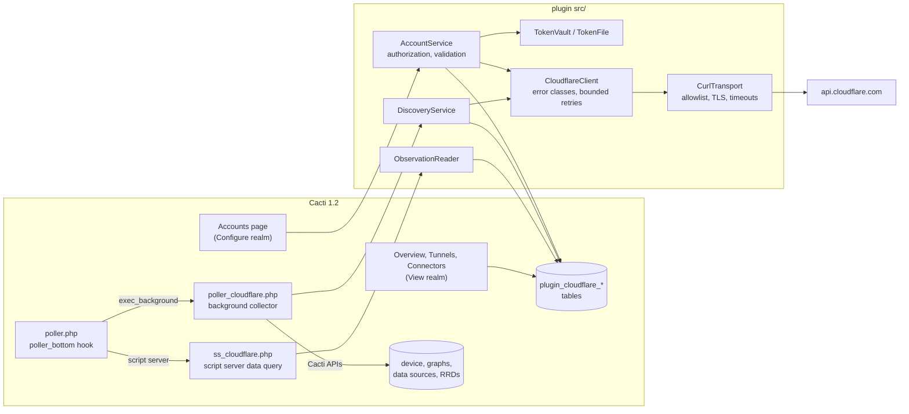

<!-- Source: README.md; SHA256: 813d1c85c236b426b83e42e63c69496f33f8909b5e435d0d45efa6a4ba2f17ca -->

<!-- translations:start -->
[English](../../../README.md) | [简体中文](../zh-CN/README.md) | [हिन्दी](../hi-IN/README.md) | [Español (España)](../es-ES/README.md) | [Español (Latinoamérica)](../es-419/README.md) | [العربية (السعودية)](README.md) | [Afrikaans](../af-ZA/README.md) | [አማርኛ](../am-ET/README.md) | [العربية (مصر)](../ar-EG/README.md) | [العربية (المغرب)](../ar-MA/README.md) | [বাংলা](../bn-BD/README.md) | [Bosanski](../bs-BA/README.md) | [Deutsch](../de-DE/README.md) | [فارسی](../fa-IR/README.md) | [Filipino](../fil-PH/README.md) | [Français](../fr-FR/README.md) | [Français (Maroc)](../fr-MA/README.md) | [Français (Sénégal)](../fr-SN/README.md) | [Hausa](../ha-NG/README.md) | [עברית](../he-IL/README.md) | [Hrvatski](../hr-HR/README.md) | [Bahasa Indonesia](../id-ID/README.md) | [Igbo](../ig-NG/README.md) | [Italiano](../it-IT/README.md) | [日本語](../ja-JP/README.md) | [한국어](../ko-KR/README.md) | [Malagasy](../mg-MG/README.md) | [मराठी](../mr-IN/README.md) | [Bahasa Melayu](../ms-MY/README.md) | [Nederlands](../nl-NL/README.md) | [Polski](../pl-PL/README.md) | [Português (Brasil)](../pt-BR/README.md) | [Русский](../ru-RU/README.md) | [Kinyarwanda](../rw-RW/README.md) | [Soomaali](../so-SO/README.md) | [Српски](../sr-RS/README.md) | [Svenska](../sv-SE/README.md) | [Kiswahili](../sw-KE/README.md) | [தமிழ்](../ta-IN/README.md) | [తెలుగు](../te-IN/README.md) | [ไทย](../th-TH/README.md) | [Türkçe](../tr-TR/README.md) | [Українська](../uk-UA/README.md) | [اردو](../ur-PK/README.md) | [Tiếng Việt](../vi-VN/README.md) | [isiXhosa](../xh-ZA/README.md) | [Yorùbá](../yo-NG/README.md) | [繁體中文](../zh-TW/README.md) | [isiZulu](../zu-ZA/README.md)
<!-- translations:end -->

<p align="center">
  
</p>

<a id="cloudflare-plugin-for-cacti"></a>
# ملحق Cloudflare لمنصة Cacti

[](https://github.com/somethingwithproof/plugin_cloudflare/actions/workflows/ci.yml)
[](https://sonarcloud.io/summary/new_code?id=somethingwithproof_plugin_cloudflare)
[](../../../LICENSE)


[](https://sonarcloud.io/summary/new_code?id=somethingwithproof_plugin_cloudflare)
[](https://sonarcloud.io/summary/new_code?id=somethingwithproof_plugin_cloudflare)
[](https://sonarcloud.io/summary/new_code?id=somethingwithproof_plugin_cloudflare)


ملحق لمنصة Cacti 1.2 يجري تطويره لمراقبة Cloudflare Tunnels وتحليلات المناطق. يقرأ من Cloudflare API باستخدام رموز API محددة النطاق، ولا يغير شيئًا في Cloudflare مطلقًا، ويحتفظ ببياناته في جداول خاصة به. ينسخ داخل Cacti ملف XML واحدًا لاستعلام البيانات إلى `resource/script_server/` وينشئ الأجهزة والرسوم والقوالب عبر واجهات Cacti نفسها، دون تغيير ملفات النواة.

**الحالة: 0.4.0-dev، غير منشور.** أحدث إصدار مستقر هو 0.3.0. يضيف إصدار التطوير تصدير المخزون بصيغة CSV، وإخراج الأنفاق المحذوفة من المراقبة بتأكيد صريح، وتحليلات المناطق المخزنة مؤقتًا، وعميل GraphQL Analytics للقراءة فقط وفق قائمة السماح (`GraphqlAnalyticsClient`) مع مساعدات الملخص الجاهزة لـ Thold (`AnalyticsSummary`)، وواجهة سطر أوامر التكوين كشيفرة (`cli/cloudflare.php`)، وخطافات المنظومة (`abilities_register` و`doctor_register_checks` و`casc_register_providers`)، ودعم المجمّع البعيد المقيد بنطاق المستطلع (`replicate_out`). لا يزال التحقق من المزوّد الحيّ وبيئات النشر الفعلية معلقًا.

يصف الجدول التالي الإصدار المستقر 0.3.0. تظهر إضافات التطوير في `0.4.0-dev` لاحقًا في قسم سير عمل المشغل وتحليلات المناطق.

| متاح الآن | مخطط له |
|---|---|
| التثبيت والترقية والتعطيل والإزالة عبر مدير ملحقات Cacti | تأهيل GraphQL على حساب فعلي وتأهيل النشر (اكتمال المرحلة 4) |
| أذونات Cloudflare: View وOperator وConfigure | حقن الأعطال ونماذج TLA+ ووثائق كاملة (المرحلة 5) |
| إضافة حسابات Cloudflare وتحريرها وحذفها وتمكينها وتعطيلها | |
| تخزين الرمز في ملف أو مشفرًا في قاعدة بيانات Cacti | |
| التحقق من الرمز وفحص أذونات قراءة الأنفاق والمناطق | |
| اكتشاف الأنفاق والموصلات في أداة جمع خلفية (`poller_cloudflare.php`) | |
| صفحات Overview وTunnels وConnectors ضمن Management > Cloudflare Tunnels | |
| تتبع دورة الحياة: `active` و`unavailable` و`deleted` | |
| جهاز Cacti واحد لكل حساب ينشئه مسؤول، وتكون الأنفاق فهارس استعلام بيانات | |
| رسوم Connectors وHealth وCollection لكل نفق، مستمدة من ملف RRD واحد لكل نفق | |
| القيم التي لا يستطيع الملحق تأكيدها تُخزن كمجهولة (`U`)، ولا تُخزن صفرًا مطلقًا | |

<a id="access-roles"></a>
## أدوار الوصول

| نطاق الصلاحية | الوصول |
| --- | --- |
| Cloudflare: View | صفحات المراقبة الحالية. |
| Cloudflare: Operator | المراقبة وصفحة Operations وإقرارات الفرز الشخصية. |
| Cloudflare: Configure | وصول Operator إضافة إلى إجراءات الضبط والإدارة الحالية. |

بعد نسخ ملفات الترقية، افتح صفحة Plugins بصفتك مسؤولًا لتسجيل نطاق الصلاحية الجديد. امنح Operator صراحةً ضمن **Configuration > Users** أو مجموعات المستخدمين. تحتفظ الترقيات بمعرّفات نطاقي View وAdmin والأذونات الممنوحة لهما. يرث Admin وصول Operator ويرث Operator وصول View في كل طلب؛ ولا يضيف ذلك أذونات مخزنة للمستخدمين أو المجموعات. تحتاج إعدادات الملحق أيضًا إلى Cloudflare: Configure إلى جانب إذن Settings في Cacti.

تطابق رؤية حسابات Cloudflare نطاق View الحالي وتشمل الحساب كاملًا. تبقى بيانات الاعتماد والضبط والربط والحذف والتغييرات الإدارية الأخرى في صفحات الإدارة. لا تدوم الإقرارات إلا في جلسة المستخدم الحالي، لمدة أقصاها ساعة واحدة وما دامت الملاحظة نفسها حديثة. تُبطلها الملاحظات الجديدة أو المتغيرة. ولا تجعل القياس الفاشل سليمًا ولا تكتم التنبيهات مطلقًا.

<a id="why-this-plugin"></a>
## سبب إنشاء الملحق

لا يرى مشغلو Cacti الذين ينشرون خدمات عبر Cloudflare Tunnel حالة النفق الداخلية في Cacti. قد يفقد النفق جميع موصلاته بينما تظل المضيفات الأصلية تستجيب لـ SNMP، فتبقى الرسوم الحالية خضراء بينما يرى المستخدمون أخطاء. هدف الملحق وضع سلامة الأنفاق وحركة المناطق بجوار رسوم الأجهزة التي يراقبها المشغلون بالفعل، دون منح Cacti القدرة على تغيير Cloudflare.

تحدد ثلاثة قيود التصميم:

- **للقراءة فقط.** لا يستدعي الملحق إلا نقاط `GET` وواجهة GraphQL Analytics API، ولا يحتاج إلى إذن تحرير أي مورد في Cloudflare.
- **اختياري.** يجب ألا تبطئ انقطاعات Cloudflare والرموز المنتهية وحدود المعدل واجهة Cacti أو تعطل استطلاع الأجهزة الأخرى. لكل استدعاء API مهلة صارمة، ويعمل الجمع في عملية خلفية تبدأها أداة الاستطلاع.
- **دون تغيير النواة.** يستخدم الملحق خطافات Cacti 1.2 وجداوله الخاصة. ينسخ ملف XML لاستعلام البيانات إلى `resource/script_server/` وينشئ الأجهزة والرسوم والقوالب عبر واجهات Cacti. لا تتغير ملفات النواة، لذا لا تتأثر ترقيات Cacti أو الملحقات الأخرى.

<a id="how-it-works"></a>
## آلية العمل



- **طبقة دمج Cacti** (`setup.php` و`includes/` وبرامج الصفحات) تسجل الخطافات ونطاقات الصلاحية، وتعرض الصفحات بمساعدات Cacti، وتفوض كل إجراء إلى المكتبة في `src/`.
- **المكتبة** (`src/`، مساحة الأسماء `Somethingwithproof\Cloudflare\`) لا تعتمد على المتغيرات العامة في Cacti، لذا تُختبر مع قاعدة بيانات حقيقية ووسيلة نقل HTTP وهمية دون تشغيل Cacti.
- **مسار خروج واحد.** `CurlTransport` هو الكود الوحيد الذي يتصل بالشبكة، ولا يقبل إلا `https://api.cloudflare.com`. تُصنف كل حالة فشل ضمن فئة خطأ واحدة (`auth` و`permission` و`rate_limited` و`transient` وغيرها)، فتحدد الحالة الظاهرة في الواجهة.
- **التخزين** يمر عبر اتصال PDO الخاص بـ Cacti وبعبارات محضرة. تغييرات المخطط ترحيلات مرقمة يمكن تكرارها دون تغيير النتيجة.

قرارات التصميم وأسبابها في [docs/design.md](../../design.md).

<a id="screenshots"></a>
## لقطات الشاشة

تأتي اللقطات من بيئة اختبار لا من حساب Cloudflare فعلي. تشغّل البيئة Cacti 1.2.31 مع Cloudflare API وهمية تعيد بيانات اختبار ثابتة، لذا فالحساب ومعرّفه والأنفاق الثلاثة أمثلة توضيحية.


*قائمة Cloudflare Accounts. تقبل الواجهة الوهمية الرمز، لذلك يعرض Verify الحالة `ok`.*


*تحرير حساب. تبقى حقول الرمز فارغة دائمًا، ولا يُعاد الرمز المخزن إلى المتصفح مطلقًا. Collect Tunnels وCreate Graphs مفعّلان وCollect Analytics معطل. يعرض Connection Status نتيجة آخر Verify: `ok`، وقراءة الأنفاق مسموحة وقراءة المناطق غير ممنوحة.*


*Settings > Cloudflare.*


*Management > Cloudflare Tunnels > Overview. الحالة هي أسوأ حالة Cloudflare بين الأنفاق النشطة للحساب؛ هنا `down` لأن نفق اختبار واحدًا متوقف. تتقدم `Disabled` و`Not collected` و`Collection failing` و`Not yet collected` على سلامة الأنفاق بهذا الترتيب، لذا يعرض الحساب الذي فشل تشغيله الأخير `Collection failing` مهما قالت أنفاقه.*


*تبويب Tunnels. يعرض Connectors وConnections الرمز `-` للنفق old-office، لأن الواجهة الوهمية تعتبر طلب اتصالاته لنفق مجهول فلم يُخزن شيء؛ ويعرضان 0 للنفق staging الذي ليس له موصل يعمل.*


*رسم Connectors للنفق blog. الخطوط الثلاثة عند 1 قبل الفجوة الوسطى وبعدها، حين أعادت الواجهة الوهمية أخطاء وخزن الملحق قيمًا مجهولة. لا تهبط الخطوط إلى 0. يأتي الرسم من بيئة الاختبار نفسها (`make screenshots`) التي تضبط خطوة 30 ثانية لمصدر البيانات هذا كي تملأ سبع دقائق من الاستطلاع الرسم.*

<a id="requirements"></a>
## المتطلبات

- Cacti من 1.2.25 إلى 1.2.31. يحتاج Cacti 1.2.31 نفسه إلى PHP 8.0 أو أحدث. تختبر CI الإصدار 1.2.31 فقط؛ وآخر اختبار يدوي لـ 1.2.25 كان بتاريخ 2026-10-22.
- PHP من 7.4 إلى 8.4 مع امتدادات `curl` و`openssl` و`pdo_mysql`. يرفض الملحق التمكين دونها.
- MariaDB 10.6 أو أحدث، أو MySQL 8.0 أو أحدث.
- وصول HTTPS من خادم Cacti إلى `api.cloudflare.com`. الوكلاء غير مدعومين.

راجع نطاق الاختبارات في [docs/compatibility.md](docs/compatibility.md).

<a id="install"></a>
## التثبيت

1. ضع الملحق في مجلد `plugins/cloudflare` داخل Cacti، إما بفك أرشيف [GitHub Releases](https://github.com/somethingwithproof/plugin_cloudflare/releases) (يشكل `make package` داخل نسخة عمل لوسم الإصدار الأرشيف نفسه)، أو باستنساخ git. يجب تسمية المجلد `cloudflare`.
2. ثبته ومكّنه من Console > Configuration > Plugins، أو عبر CLI بصفتك مستخدم خادم الويب:

   ```sh
   php cli/plugin_manage.php --plugin=cloudflare --install --enable
   ```

3. يحصل المستخدم المسؤول على Cloudflare: Configure عند التثبيت. امنحه لغيره من المستخدمين أو المجموعات في Console > Configuration > Users.
4. أنشئ رمزًا بالأذونات في [docs/token-permissions.md](docs/token-permissions.md): Account > Cloudflare Tunnel > Read، واختياريًا Zone > Zone > Read.
5. خزّن الرمز بإحدى الطريقتين أدناه، ثم أضف الحساب في Console > Configuration > Cloudflare Accounts وشغّل Verify من قائمة الإجراءات.

<a id="option-a-encrypted-in-the-database"></a>
### الخيار A: التشفير في قاعدة البيانات

يشفر الملحق الرموز بمفتاح من 32 بايت تنشئه أنت. لا ينشئ المفتاح أو يكتبه بنفسه مطلقًا. يجب أن يكون الملف قابلًا للقراءة لمستخدمَي خادم الويب والاستطلاع، وغير قابل للقراءة للآخرين، وأن يسمح مجلده بوصولهما إليه. لخادم ويب يعمل باسم `www-data`:

```sh
sudo mkdir -p /etc/cacti
sudo sh -c 'umask 077 && openssl rand -hex 32 > /etc/cacti/cloudflare.key'
sudo chgrp www-data /etc/cacti/cloudflare.key
sudo chmod 0440 /etc/cacti/cloudflare.key
```

المسار الافتراضي `/etc/cacti/cloudflare.key`؛ غيّره ضمن Settings > Cloudflare > Token Vault Key File. عند فقدان المفتاح أو رفضه، لا يقدم نموذج التحرير إلا خيار ملف الرمز. احتفظ بنسخة احتياطية من المفتاح: بدونه لا يمكن فك الرموز المخزنة ويجب إدخالها مجددًا.

<a id="rotating-the-key"></a>
#### تدوير المفتاح

لا يوجد أمر لإعادة التشفير بمفتاح جديد. لا يستطيع المفتاح الجديد فك الرموز المخزنة بالقديم، لذا يتطلب التدوير إعادة إدخال كل رمز مخزن:

1. جهّز قيمة رمز كل حساب. لا تعرض Cloudflare قيمة الرمز إلا عند إنشائه أو تدويره؛ دوّره في لوحة Cloudflare إذا لم تعد تملكه.
2. أنشئ المفتاح الجديد بمسار جديد بالأوامر أعلاه، مثل `/etc/cacti/cloudflare.key.new`، بالمالك ونمط الأذونات نفسيهما.
3. اضبط Settings > Cloudflare > Token Vault Key File على المسار الجديد واحفظ. من الآن، يعرض Verify للحساب الذي ما زال مشفرًا بالقديم “Stored token cannot be decrypted”، وتسجل كل جولة جمع `discovery token unavailable` مع `reason=decrypt_failed` لذلك الحساب.
4. افتح كل حساب يخزن رمزه في قاعدة البيانات ضمن Console > Configuration > Cloudflare Accounts، والصق الرمز في حقلي الرمز، ثم احفظ وشغّل Verify. ينبغي أن يعرض `ok`.
5. بعد نجاح التحقق لجميع تلك الحسابات، احذف ملف المفتاح القديم ونسخه الاحتياطية.

بين الخطوتين 3 و4 لا تتجدد أنفاق الحساب، وتسجل رسوم السلامة والموصلات والاتصالات القيمة U. لا تتأثر حسابات ملفات الرموز.

<a id="option-b-token-file"></a>
### الخيار B: ملف الرمز

اكتب الرمز وحده في ملف يستطيع مستخدما خادم الويب والاستطلاع قراءته دون الآخرين، ثم أدخل مساره المطلق في نموذج التحرير:

```sh
sudo sh -c 'umask 077 && cat > /etc/cacti/cloudflare-account.token'   # paste the token, then Ctrl-D
sudo chgrp www-data /etc/cacti/cloudflare-account.token
sudo chmod 0440 /etc/cacti/cloudflare-account.token
```

يُفحص الملف عند قراءته في Verify، لا عند الحفظ. تُرفض الروابط الرمزية والملفات الأكبر من 4 KiB والملفات التي يستطيع الآخرون قراءتها أو كتابتها.

يمكن لأي شخص يملك Cloudflare: Configure إدخال أي مسار، ويقرؤه مستخدم الاستطلاع. لحصر ملفات الرموز في مكان واحد، اضبط Settings > Cloudflare > Token File Directory، مثلًا على `/etc/cacti`؛ عندها يُرفض أي مسار خارجه. راجع [docs/security.md](docs/security.md#token-file).

<a id="upgrade"></a>
## الترقية

1. استبدل الملفات في `plugins/cloudflare` بالإصدار الجديد مع إبقاء اسم المجلد.
2. افتح Console > Configuration > Plugins أو Console > Configuration > Cloudflare Accounts مرة واحدة بصفتك مسؤولًا. يشغّل ذلك ترحيلات الملحق ويستورد قوالب Cloudflare وينسخ ملف استعلام البيانات (راجع [مقاييس الأنفاق ورسومها](#tunnel-metrics-and-graphs))، ويسجّل خطافات المنظومة `abilities_register` و`doctor_register_checks` و`casc_register_providers` و`replicate_out` (`includes/ecosystem.php`)، ويسجل الخطاف `poller_bottom` عند الترقية من 0.1.0.

لا يشغّل `poller.php` ترقية الملحق، لذا يظل المخطط الجديد مفقودًا حتى الخطوة 2. لا تفعل جولات الجمع حينئذ شيئًا وتسجل `CLOUDFLARE: collector skipped; plugin upgrade pending, open Console > Plugins`. لا تحتاج صفحات Cloudflare Tunnels إلا إلى Cloudflare: View، ولذلك لا تنفذ الترقية مطلقًا وقد تعرض “The Cloudflare tunnels could not be read” حتى الخطوة 2.

<a id="account-status"></a>
## حالة الحساب

يضبط Verify حالة الحساب:

| الحالة | المعنى |
|---|---|
| `unknown` | لم يُتحقق منذ إضافة الحساب أو تغيير بيانات اعتماده |
| `ok` | الرمز نشط ويمكنه قراءة الأنفاق |
| `token_inactive` | تبلغ Cloudflare بأن الرمز معطل أو منتهي |
| `auth_failed` | رفضت Cloudflare الرمز لعدم صلاحيته أو انتهائه (HTTP 401) |
| `permission_denied` | الرمز نشط لكنه لا يستطيع قراءة الأنفاق، أو يفتقر لأذونات نقاط التحقق من الرمز (HTTP 403) |
| `unreachable` | تعذر الوصول إلى API أو انتهت المهلة أو أعادت خطأ خادم |
| `rate_limited` | أعادت Cloudflare الرمز HTTP 429 |
| `error` | أي فشل آخر، بما فيه ملف رمز مفقود أو غير آمن، أو ملف مفتاح خزنة مفقود أو غير صالح للاستخدام، أو رمز مخزن يتعذر فك تشفيره |

تعرض صفحة التحرير أيضًا ما إذا كانت قراءة الأنفاق والمناطق قد سُمح بها.

<a id="tunnel-discovery"></a>
## اكتشاف الأنفاق

بعد كل دورة استطلاع على مستطلع الجمع المُكوَّن (`cloudflare_poller_id`، الافتراضي `1`)، يبدأ الخطاف `poller_bottom` أداة جمع خلفية باستخدام `exec_background` إذا كان حساب مفعّل واحد على الأقل قد شغّل Collect Tunnels. لا تعمل أداة الجمع داخل عملية الاستطلاع مطلقًا، لذا لا تؤخر Cloudflare API البطيئة `poller.php`. ويعلن `INFO` عن `remote_collect:1`، ويدفع الخطاف `replicate_out` (`RemoteReplication`) جداول البيانات الوصفية غير السرية (`plugin_cloudflare_accounts` مع مسح `token_ciphertext` إلى `NULL`، و`plugin_cloudflare_tunnels` و`plugin_cloudflare_connectors` و`plugin_cloudflare_zones` و`plugin_cloudflare_metric_mappings` و`plugin_cloudflare_resources`) إلى المستطلعات البعيدة (`poller_id > 1`) مع استبعاد مادة مفتاح الخزنة.

لكل حساب مستحق، تسرد أداة الجمع أنفاق الحساب ثم تقرأ اتصالات أنفاقه النشطة، لتحصل على موصلات كل نفق وإصداراتها ومراكز البيانات وعناوين الأصل. يستحق الحساب الجمع كل Discovery Interval، وافتراضيًا كل 300 ثانية. لا يبدأ التشغيل حسابًا جديدًا بعد 50 ثانية، ويجري 200 طلب اتصالات كحد أقصى. قد يوقف أي حد الحساب في منتصف قراءة اتصالاته؛ يُسجل حينها `partial` وتتابع الجولة التالية من الأنفاق الأقدم محاولةً. تبقى الحسابات التي لم تبدأ مستحقة للجولة التالية.

للنفق دورة حياة مستقلة عن الحالة التي تبلغها Cloudflare (`healthy` أو`degraded` أو`down` أو`inactive`):

| دورة الحياة | المعنى |
|---|---|
| `active` | ظهر النفق في آخر قائمة كاملة |
| `deleted` | لم تتضمنه قائمة كاملة، بما فيها القائمة الفارغة. يبقى الصف وتاريخه ويعود النفق `active` إذا ظهر مجددًا |
| `unavailable` | تجعل ثلاثة انقطاعات محتسبة دون قائمة كاملة بينها حالة النفق مجهولة |

القائمة الكاملة الناجحة وحدها تضيف الأنفاق أو تحدثها أو تحذفها، ولا تحذف القائمة الفاشلة نفقًا مطلقًا. يُحسب تعذر قراءة Cloudflare كليًا (`transient` أو`rate_limited` أو`auth` أو`permission`) ضمن الانقطاع؛ بعد ثلاثة انقطاعات محتسبة دون قائمة كاملة بينها تصبح أنفاق الحساب النشطة `unavailable`. تعيدها القائمة الكاملة التالية وتصفّر العدد. يُتجاوز النفق الذي لم تعد Cloudflare تعرفه عند قراءة اتصالاته دون إفشال الحساب. لا تزيد الإخفاقات الأخرى عدّاد الانقطاع ولا تصفّره.

في `cacti.log` تبدأ أسطر الاكتشاف بـ `CLOUDFLARE: discovery` وملخص الجولة بـ `CLOUDFLARE: collector`. تُسجل الإخفاقات وتغييرات دورة الحياة، كفشل السرد أو وسم أنفاق `unavailable`، بمستوى Cacti الافتراضي `LOW`؛ وتُسجل نتيجة كل حساب والملخص بمستوى `MEDIUM`. قد تفشل قراءة اتصالات جميع الأنفاق، لذا يُسجل لكل حساب أول فشل من كل فئة عند `LOW` والبقية عند `MEDIUM`، ثم سطر `LOW` لكل فئة بعدد الأنفاق التي فشلت.

يتطلب Management > Cloudflare Tunnels إذن Cloudflare: View وهو للقراءة فقط:

- **Overview** يسرد الحسابات مع الحالة وأعداد الأنفاق حسب دورة الحياة وآخر اكتشاف ناجح وعدد الإخفاقات المتتالية.
- **Tunnels** يسرد أنفاق جميع الحسابات أو حساب واحد، بفلاتر للحساب ودورة الحياة والحالة والاسم وأعمدة قابلة للفرز.
- **Connectors** يعرض موصلات النفق المحدد في تبويب Tunnels.

<a id="tunnel-metrics-and-graphs"></a>
## مقاييس الأنفاق ورسومها

يقرأ Cacti حالة الأنفاق عبر استعلام بيانات خادم البرامج النصية `ss_cloudflare.php`. لا يجيب إلا من جداول الملحق ولا يستدعي Cloudflare مطلقًا، فلا يمكن لانقطاع Cloudflare إبطاء الاستطلاع. يقدم كل نفق ست قيم: السلامة (healthy 3، degraded 2، down 1، inactive 0)، والموصلات، والاتصالات، وإصدارات الموصلات، والثواني منذ آخر قراءة للاتصالات، وإخفاقات مهمة الاكتشاف المتتالية. لا تُطبع السلامة والموصلات والاتصالات والإصدارات إلا عندما يؤكدها الملحق: نجح الاكتشاف الأخير، والنفق `active`، والقراءة حديثة. وإلا تكون `U` ويظهر فراغ في الرسم بدل صفر يبدو كانقطاع. تستمر قيمتا الجمع في الظهور أثناء الانقطاع ليعرضه رسم Collection؛ ولا تكونان `U` إلا لنفق محذوف أو لم تُحدث اتصالاته مطلقًا. القواعد في [docs/metrics.md](docs/metrics.md).

<a id="create-the-device"></a>
### إنشاء الجهاز

يرتبط الحساب بجهاز Cacti واحد كحد أقصى. يحمل الجهاز أنفاق الحساب كفهارس لاستعلام Cloudflare Tunnels. لا يُنشأ تلقائيًا:

1. افتح Console > Configuration > Cloudflare Accounts.
2. حدد الحساب واختر Create Cacti Device من قائمة الإجراءات وأكد.

يتطلب الإجراء نطاقي Cloudflare: Configure وSites/Devices/Data في Cacti (الخاص بـ `host.php`). يظهر الخيار فقط لمن يملكهما معًا، ويرفض الخادم طلب غيره. يُسمى الجهاز `Cloudflare: <account name>` ويستخدم قالب المضيف Cloudflare Account وأداة الاستطلاع الرئيسية، بإصدار SNMP 0 ودون فحص توفر، ويحصل على اسم المضيف `<account ID>.cloudflare.invalid`. الاسم محجوز ولا يُحل مطلقًا؛ لا يتصل به Cacti. إذا كان للحساب جهاز بالفعل، يوضح الإجراء ذلك دون تغيير. وإذا حذف المسؤول الجهاز في Cacti، فلا ينشئ الملحق بديلًا حتى تشغيل Create Cacti Device مجددًا.

<a id="create-graphs"></a>
### إنشاء الرسوم

خيار Create Graphs في نموذج الحساب معطل افتراضيًا. عند تمكينه، تعيد أداة الجمع فهرسة الجهاز بعد كل اكتشاف ينتهي بـ `ok` أو`partial`، وتنشئ الرسوم الناقصة لأنفاق الحساب `active`: Connectors وHealth وCollection، ثلاثة لكل نفق تشترك في ملف RRD واحد. تنشئ الجولة 50 رسمًا كحد أقصى وتتوقف بعد 20 ثانية، وتتابع التالية. لا يزيل الملحق كائن Cacti مطلقًا. لا يُعاد إنشاء رسم حذفه المسؤول، ويحتفظ النفق الذي لم تعد Cloudflare تسرده برسمه وملف RRD ويعرضان `U`.

يتطلب تمكين Create Graphs النطاقين؛ تعطيله يحتاج إلى Configure فقط. المستخدم الذي لا يملك Sites/Devices/Data ويحفظ النموذج يترك الإعداد كما هو مع تحذير. حتى مع تعطيل Create Graphs، يُعاد فهرسة الجهاز بعد كل اكتشاف فتظهر الأنفاق الجديدة كفهارس للاستعلام.

<a id="the-data-query-file"></a>
### ملف استعلام البيانات

لا يقرأ Cacti 1.2.31 ملفات XML لاستعلام البيانات إلا من داخل مجلده `resource`. لذلك ينسخ الملحق عند التثبيت والترقية `templates/resource/cloudflare_tunnels.xml` إلى `<Cacti>/resource/script_server/cloudflare_tunnels.xml`. هذا الملف الوحيد الذي يكتبه خارج مجلده، لذا يجب أن يستطيع مستخدم التثبيت أو الترقية الكتابة إلى ذلك المجلد. تحتفظ الإزالة بالملف وبالأجهزة والرسوم وملفات RRD والقوالب. إذا فشل النسخ أو استيراد القالب، يسجل الملحق ذلك ويعيد Create Cacti Device المحاولة.

<a id="settings"></a>
## الإعدادات

يحتوي Settings > Cloudflare على:

- **Token Vault Key File**: مسار مفتاح الخزنة.
- **Token File Directory**: عند تحديده تُرفض ملفات الرموز خارجه. فارغ افتراضيًا، مما يسمح بأي مسار. راجع [docs/security.md](docs/security.md#token-file).
- **Interactive Request Timeout**: إجمالي ثواني طلب من واجهة الويب، مثل Verify. الافتراضي 10، والقيم خارج 5 إلى 60 تعود إلى 10.
- **Collector Request Timeout**: إجمالي ثواني طلب من أداة الجمع الخلفية. الافتراضي 20، والقيم خارج 5 إلى 60 تعود إلى 20.
- **Log Level**: يُخزن، ولا يقرأه شيء بعد.

في نموذج الحساب يتحكم Collect Tunnels وDiscovery Interval في الاكتشاف، ويتحكم Create Graphs في إنشاء الرسوم. يُخزن Collect Analytics دون أثر في هذا الإصدار.

<a id="languages"></a>
## اللغات

يوفر الملحق الإسبانية (إسبانيا، `es-ES`) والفرنسية (`fr-FR`) والألمانية (`de-DE`) والصينية المبسطة (`zh-CN`) واليابانية (`ja-JP`) والهندية (`hi-IN`) والعربية (`ar-SA`). يعرضها Cacti بعد تمكين دعم اللغات ضمن Configuration > Settings > General > Language Support واختيار المستخدم لغته. يوجد أيضًا كتالوج الإسبانية لأمريكا اللاتينية (`es-419`)، لكن Cacti 1.2 لا يوفر هذه اللغة الإقليمية للاختيار؛ لا يصبح فعالًا حتى يضيفها Cacti. إلى ذلك الحين اختر الإسبانية (`es-ES`).

تبقى بعض النصوص بالإنجليزية: قيم الحالة التي يخزنها الملحق ويعرضها كما هي (`ok` و`active` و`unavailable` و`deleted` وحالة النفق التي تبلغها Cloudflare)، وكل ما يكتبه الملحق في سجل Cacti.

<a id="uninstall-and-data-retention"></a>
## الإزالة والاحتفاظ بالبيانات

تحذف الإزالة جداول الملحق الخاصة التي تضم الحسابات والرموز المشفرة والأنفاق المكتشفة وحالة المهام وسجل كائنات Cacti التي أنشأها، وتحذف إعدادات `cloudflare_`. لا تحذف ملف المفتاح أو ملفات الرموز أو النسخة من `resource/script_server/cloudflare_tunnels.xml` أو أي جهاز أو رسم أو مصدر بيانات أو ملف RRD أو قالب في Cacti. تحتوي هذه على تاريخ المراقبة، وحذفها إجراء صريح للمسؤول في Cacti.

يتوقف الجهاز المحتفظ به عن تلقي البيانات. بعد الإزالة أو حذف حسابه لا يعود أي حساب يملك المضيف، فتحتفظ الرسوم بالتاريخ لكنها تطبع `U` من ذلك الحين. ينشئ Create Cacti Device في الحساب المعاد تثبيته أو إضافته جهازًا جديدًا ولا يعيد استخدام القديم؛ احذف الجهاز القديم في Cacti حين لا تحتاج إلى تاريخه.

<a id="known-limitations"></a>
## القيود المعروفة

- تجري الجولة 200 طلب اتصالات كحد أقصى. تتجدد الأنفاق التي تتجاوز الحد بوتيرة أقل من نافذة الملاحظة، فتظهر فجوات في رسوم اتصالاتها.
- يستبدل الملحق تعديلات المسؤول على القوالب المستوردة عندما تغير الترقية XML القالب الموزع.
- تتلقى المستطلعات البعيدة بيانات وصفية منسوخة دون بيانات اعتماد (يُمسح `token_ciphertext` إلى `NULL` ولا تُنسخ مفاتيح الخزنة أبدًا). عند تشغيل أداة الجمع على مستطلع بعيد مخصّص (`cloudflare_poller_id`)، وفّر ملفات الرموز أو مفتاح خزنة مباشرةً على مضيف أداة الجمع ذلك.
- تبقى الأنفاق المحذوفة في فهرس استعلام البيانات مع رسومها وملفات RRD وتطبع `U`.
- يعطل Cacti الملحق الذي ينتهي كوده بخطأ فادح حقيقي، مثل نفاد الذاكرة. راجع [docs/security.md](docs/security.md).

<a id="security"></a>
## الأمان

- تُرفض مفاتيح API العامة، ولا تُقبل إلا رموز API محددة النطاق.
- تُخزن الرموز في ملف تُعده أنت أو مشفرة بـ AES-256-GCM بمفتاح ملف لا يدخل قاعدة البيانات أبدًا. لا تُعرض الرموز في صفحة ولا تُكتب في سجل ولا تُدرج في رسالة خطأ.
- لا تحمل أخطاء قاعدة البيانات إلا SQLSTATE ورمز خطأ برنامج التشغيل، ولا تحمل قيم العبارة مطلقًا.
- كل تغيير طلب POST محمي برمز CSRF في Cacti. تتطلب التغييرات الإدارية للحسابات والإعدادات صلاحية Cloudflare: Configure؛ وتتطلب إقرارات الفرز الشخصية صلاحية Cloudflare: Operator. إنشاء جهاز Cacti أو تمكين Create Graphs يتطلب أيضًا صلاحية Sites/Devices/Data في Cacti. يرفض الملحق المعطل صفحاته.
- لا تقبل أداة التكوين كشيفرة (`cli/cloudflare.php` و`casc_register_providers`) إلا مراجع الأسرار `vault:<account_id>` أو `file:<absolute_path>`، وترفض الرموز الخام ونصوص الخزنة المشفرة وتصريحات XML `DOCTYPE`، وتطلب قيمة `--confirm=<PLAN_HASH>` دقيقة قبل الكتابة.
- القدرات المسجلة (`cloudflare-list-tunnels` و`cloudflare-get-health`) للقراءة فقط بشكل صارم، وتقيّم نطاق Cloudflare: View مباشرةً مقابل جداول مصادقة Cacti لمعرّف مستخدم المستدعي (وليس حالة الجلسة أبدًا)، ولا تعيد أي رموز أو مادة مفاتيح.

التفاصيل والقيود المعروفة في [docs/security.md](docs/security.md). أبلغ عن الثغرات على نحو خاص وفق [SECURITY.md](../../../SECURITY.md).

<a id="roadmap"></a>
## سير عمل المشغل وتحليلات المناطق

تشمل إضافات التطوير في `0.4.0-dev` إخراج الأنفاق المحذوفة صراحةً، وتحليلات GraphQL للمناطق والأنفاق المراعية للإمكانات، ومساعدات الملخص الجاهزة لـ Thold والقوالب القابلة للاستيراد، وواجهة سطر أوامر CasC والصحة، وخطافات المنظومة، والنسخ المتماثل للمجمّع البعيد. لم تحصل هذه الإضافات على وسم إصدار أو تأهيل على حساب فعلي بعد. راجع [docs/analytics-and-alerting.md](../../analytics-and-alerting.md) لمعرفة الإعداد ودلالات المقاييس وحدود التحقق.

- **عميل GraphQL Analytics وملخص Thold (`src/Api/GraphqlAnalyticsClient.php` و`src/Metrics/AnalyticsSummary.php`)**: لا ينفّذ `GraphqlAnalyticsClient` سوى استعلامات القراءة فقط المدرجة في قائمة السماح وقت الترجمة (`zone_settings` و`zone_http_metrics` و`zone_edge_latency` و`tunnel_analytics`) عبر `CloudflareClient` (مع التحقق من TLS والتثبيت على `api.cloudflare.com` والاستجابات المحدودة وتراجع حدود المعدل عبر `RetryPolicy`) لجمع حجم طلبات المنطقة والنفق ومعدلات أخطاء HTTP 5xx وبايتات الاستجابة وزمن استجابة الحافة (المتوسط وp95). ويوفر `AnalyticsSummary` دوال `recommendedThresholds()` المتوافقة مع أسماء DS في ملفات RRD الخاصة بالملحق (`health` و`collect_age` و`error_pct` و`age`) و`summarizeZones()` و`evaluateSample()`.
- **واجهة سطر أوامر المشغل وCasC (`cli/cloudflare.php`)**: مدعومة بـ `ConfigCodec` (`src/Config/ConfigCodec.php`) و`ConfigService` (`src/Config/ConfigService.php`)، وتدعم `cli/cloudflare.php export [--format=yaml|xml] [--file=PATH]` (تُصدر مراجع الأسرار `vault:` / `file:` فقط) و`cli/cloudflare.php validate --file=PATH [--format=yaml|xml]` و`cli/cloudflare.php plan --file=PATH [--format=yaml|xml]` و`cli/cloudflare.php apply --file=PATH --confirm=<PLAN_HASH> [--format=yaml|xml]` و`cli/cloudflare.php health [--format=text|json]`.
- **خطافات تكامل المنظومة (`includes/ecosystem.php` و`setup.php`)**:
  - `abilities_register` (`AbilitiesProvider`): يسجّل القدرتين للقراءة فقط `cloudflare-list-tunnels` و`cloudflare-get-health` المقيدتين بنطاق Cloudflare: View (المنح المباشرة ومنح المجموعات) دون أي رموز أو أسرار في المخرجات.
  - `doctor_register_checks` (`DoctorChecks`): يعرض فحوصات `cloudflare_vault_key` (التحقق من الأذونات والروابط الرمزية والطول) و`cloudflare_token_dir` (فحوصات المسار المطلق والروابط الرمزية وإتاحة الكتابة للجميع) و`cloudflare_tunnel_freshness` و`cloudflare_api_failure_rate`.
  - `casc_register_providers` (`CascProvider`): يعرض مزوّد CasC باسم `cloudflare` (`export` و`validate` و`plan` و`apply`) للحسابات (مراجع الأسرار فقط) والمناطق والأنفاق وتعيينات المقاييس.
  - `replicate_out` (`RemoteReplication`): ينسخ جداول البيانات الوصفية غير السرية إلى المستطلعات البعيدة (`poller_id > 1`) مع مسح `token_ciphertext` إلى `NULL` واستبعاد مادة مفتاح الخزنة.

### تصدير المخزون

توفر صفحتا الأنفاق والموصلات خيار التصدير لمستخدمي Cloudflare: View. يشمل ملف CSV للأنفاق جميع الصفحات المطابقة ويحافظ على عوامل تصفية الحساب ودورة الحياة والحالة والبحث والترتيب. ويشمل ملف الموصلات الإصدار والبنية ومراكز البيانات وعناوين المصدر للنفق المحدد. تقرأ التنزيلات السجلات المخزنة مؤقتًا فقط. تُترك الأعداد غير المعروفة فارغة وتُسبق الخلايا الشبيهة بالصيغ بعلامة اقتباس مفردة لاستيرادها بأمان.

## خارطة الطريق

تُنشر كل مرحلة بإصدار 0.x مطابق لرقمها: المرحلة 3 هي 0.3.0 والمرحلة 4 ستكون 0.4.0. لم تُنشر المرحلتان 1 و2 منفصلتين وهما ضمن 0.3.0. يُحجز الإصدار 1.0.0 للإصدار الذي يكمل جميع المراحل التالية.

| المرحلة | النطاق | الحالة |
|---|---|---|
| 1. الأساس | دورة حياة الملحق والأذونات وضبط الحساب واختبار الاتصال | منشور في 0.3.0 ([#2](https://github.com/somethingwithproof/plugin_cloudflare/pull/2) إلى [#5](https://github.com/somethingwithproof/plugin_cloudflare/pull/5)) |
| 2. الاكتشاف | اكتشاف الأنفاق والموصلات في أداة خلفية وصفحات Overview وTunnels وConnectors | منشور في 0.3.0 ([#6](https://github.com/somethingwithproof/plugin_cloudflare/pull/6)) |
| 3. المقاييس | مصادر بيانات سلامة الأنفاق وقوالب الرسوم ومعالجة الانقطاع دون تسجيل صفر مختلق | منشور في 0.3.0 ([#7](https://github.com/somethingwithproof/plugin_cloudflare/pull/7)) |
| 4. التحليلات والتنبيهات | تحليلات GraphQL المراعية للخطة (`GraphqlAnalyticsClient`)، وملخص وقوالب Thold (`AnalyticsSummary`)، وواجهة CasC (`cli/cloudflare.php`)، وخطافات المنظومة، والنسخ المتماثل البعيد | منفّذ في 0.4.0-dev؛ التأهيل على حساب فعلي قيد الانتظار |
| 5. التقوية | حقن الأعطال ونماذج TLA+ للاكتشاف والجمع ووثائق كاملة | مخطط |

<a id="development"></a>
## التطوير

تحتاج الأدوات إلى PHP 8.x وComposer، بينما يبقى كود الملحق متوافقًا مع PHP 7.4. تحتاج اختبارات التكامل وBDD إلى قاعدة بيانات يبدأها `make db-up` في Docker على المنفذ 33061.

```sh
composer install
make db-up
make ci            # unit, integration, BDD, PHPStan, php-cs-fixer, php -l on PHP 7.4
make smoke         # installs the plugin into Cacti 1.2.31 in Docker and walks its lifecycle
make package       # builds build/cloudflare-<version>.tar.gz and checks its contents
make db-down
```

يحتاج `make smoke` و`make screenshots` إلى نسخة عمل من Cacti؛ اضبط `CACTI_REPO` على مسارها. تقرأ اختبارات التكامل `CF_TEST_DSN` و`CF_TEST_DB_USER` و`CF_TEST_DB_PASS`، وتتخطى التنفيذ إذا تعذر الوصول إلى قاعدة البيانات، إلا إذا ضُبط `CI`.

<a id="contributing"></a>
## المساهمة

طلبات السحب مرحب بها. يحتاج كل commit إلى توقيع DCO (`git commit -s`). اكتب الاختبار أولًا؛ يجب نجاح `make ci`، ويجب أن تنجح تغييرات طبقة دمج Cacti في `make smoke` أيضًا. حافظ على توافق PHP 7.4 وأسلوب Cacti: علامات جدولة، واقتباسات مفردة، وأقواس في السطر نفسه.

<a id="translations"></a>
### الترجمات

تُعلّم الرسائل بـ `__('...', 'cloudflare')`. يعيد `locales/build_gettext.sh` (`make i18n`، ويتطلب GNU gettext) توليد `locales/po/cacti.pot` ويدمجه في كل `locales/po/<locale>.po` ويترجم `locales/LC_MESSAGES/<locale>.mo`؛ أدرج الثلاثة في commit. تشغّل CI الأمر `make i18n-check` الذي يفشل عند غياب إدخال أو وجود إدخال fuzzy أو اختلاف صيغة تنسيق أو تقادم الملف المترجم. وتفحص اختبارات الوحدة العناصر النائبة ووسوم HTML والمسافات الطرفية لكل إدخال. لذا يجب تحديث الترجمات مع الرسالة في طلب السحب نفسه. تتطلب اللغة الجديدة ملف `<locale>.po` باسم Cacti للغة الإقليمية، مثل `pt-BR`، وإضافته إلى `CatalogTest::LOCALES` وفحص الأرشيف في `tests/build/package.sh`. أبقِ أسماء Cloudflare وCacti وThold وAPI وGraphQL وأسماء الأذونات مثل `Account Cloudflare Tunnel Read` دون تغيير.

<a id="documentation"></a>
## الوثائق

- [docs/security.md](docs/security.md): ضوابط الأمان والقيود المعروفة
- [docs/token-permissions.md](docs/token-permissions.md): أذونات الرموز
- [docs/compatibility.md](docs/compatibility.md): الإصدارات المدعومة والواجهات المستخدمة
- [docs/metrics.md](docs/metrics.md): فهرس المقاييس ومتى تكون القيمة مجهولة
- [docs/collector-protocol.md](../../collector-protocol.md): ما يقرؤه ويطبعه `ss_cloudflare.php`
- [docs/schema.md](../../schema.md): جداول قاعدة البيانات
- [docs/design.md](../../design.md): قرارات التصميم
- [CHANGELOG.md](../../../CHANGELOG.md)

<a id="license"></a>
## الترخيص

GPL-2.0-or-later. راجع [LICENSE](../../../LICENSE).

<a id="trademarks"></a>
## العلامات التجارية

Cloudflare علامة تجارية مسجلة لشركة Cloudflare, Inc. هذا المشروع أداة مستقلة مفتوحة المصدر، وليس تابعًا لشركة Cloudflare, Inc. أو برعايتها أو معتمدًا منها.

كما أن المشروع غير تابع لمشروع Cacti. راجع [docs/images/README-logo.md](../../images/README-logo.md) بشأن الشعار.
