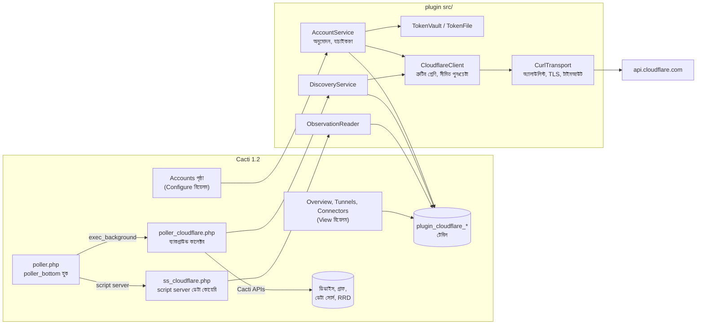

<!-- Source: README.md; SHA256: 813d1c85c236b426b83e42e63c69496f33f8909b5e435d0d45efa6a4ba2f17ca -->

<!-- translations:start -->
[English](../../../README.md) | [简体中文](../zh-CN/README.md) | [हिन्दी](../hi-IN/README.md) | [Español (España)](../es-ES/README.md) | [Español (Latinoamérica)](../es-419/README.md) | [العربية (السعودية)](../ar-SA/README.md) | [Afrikaans](../af-ZA/README.md) | [አማርኛ](../am-ET/README.md) | [العربية (مصر)](../ar-EG/README.md) | [العربية (المغرب)](../ar-MA/README.md) | [বাংলা](README.md) | [Bosanski](../bs-BA/README.md) | [Deutsch](../de-DE/README.md) | [فارسی](../fa-IR/README.md) | [Filipino](../fil-PH/README.md) | [Français](../fr-FR/README.md) | [Français (Maroc)](../fr-MA/README.md) | [Français (Sénégal)](../fr-SN/README.md) | [Hausa](../ha-NG/README.md) | [עברית](../he-IL/README.md) | [Hrvatski](../hr-HR/README.md) | [Bahasa Indonesia](../id-ID/README.md) | [Igbo](../ig-NG/README.md) | [Italiano](../it-IT/README.md) | [日本語](../ja-JP/README.md) | [한국어](../ko-KR/README.md) | [Malagasy](../mg-MG/README.md) | [मराठी](../mr-IN/README.md) | [Bahasa Melayu](../ms-MY/README.md) | [Nederlands](../nl-NL/README.md) | [Polski](../pl-PL/README.md) | [Português (Brasil)](../pt-BR/README.md) | [Русский](../ru-RU/README.md) | [Kinyarwanda](../rw-RW/README.md) | [Soomaali](../so-SO/README.md) | [Српски](../sr-RS/README.md) | [Svenska](../sv-SE/README.md) | [Kiswahili](../sw-KE/README.md) | [தமிழ்](../ta-IN/README.md) | [తెలుగు](../te-IN/README.md) | [ไทย](../th-TH/README.md) | [Türkçe](../tr-TR/README.md) | [Українська](../uk-UA/README.md) | [اردو](../ur-PK/README.md) | [Tiếng Việt](../vi-VN/README.md) | [isiXhosa](../xh-ZA/README.md) | [Yorùbá](../yo-NG/README.md) | [繁體中文](../zh-TW/README.md) | [isiZulu](../zu-ZA/README.md)
<!-- translations:end -->

<p align="center">
  
</p>

# Cacti-এর জন্য Cloudflare প্লাগইন

[](https://github.com/somethingwithproof/plugin_cloudflare/actions/workflows/ci.yml)
[](https://sonarcloud.io/summary/new_code?id=somethingwithproof_plugin_cloudflare)
[](../../../LICENSE)


[](https://sonarcloud.io/summary/new_code?id=somethingwithproof_plugin_cloudflare)
[](https://sonarcloud.io/summary/new_code?id=somethingwithproof_plugin_cloudflare)
[](https://sonarcloud.io/summary/new_code?id=somethingwithproof_plugin_cloudflare)


Cloudflare Tunnels এবং জোন অ্যানালিটিক্স মনিটর করার জন্য নির্মিতব্য একটি Cacti 1.2 প্লাগইন। এটি স্কোপড API টোকেন ব্যবহার করে Cloudflare API থেকে তথ্য পাঠ করে, Cloudflare-এ কখনোই কোনো পরিবর্তন করে না এবং নিজস্ব টেবিলে ডেটা সংরক্ষণ করে। Cacti-তে এটি মূল ফাইলে কোনো পরিবর্তন না করেই `resource/script_server/`-এ ডেটা কোয়েরি XML ফাইল কপি করে এবং Cacti-র নিজস্ব API-এর মাধ্যমে ডিভাইস, গ্রাফ ও টেমপ্লেট তৈরি করে।

**অবস্থা: 0.4.0-dev, অপ্রকাশিত।** সর্বশেষ প্রকাশিত সংস্করণ হলো 0.3.0। ডেভেলপমেন্ট সংস্করণটিতে CSV ইনভেন্টরি এক্সপোর্ট, মুছে ফেলা টানেলের সুস্পষ্ট অপসারণ, ক্যাশড জোন অ্যানালিটিক্স এবং ঐচ্ছিক Thold টেমপ্লেট যুক্ত করা হয়েছে। লাইভ-প্রোভাইডার এবং ডিপ্লয়মেন্ট যাচাইকরণ এখনো বাকি রয়েছে।

নিচের সারণিটি 0.3.0 স্থিতিশীল রিলিজের বিবরণ তুলে ধরে। ডেভেলপমেন্ট সংস্করণের সংযোজনগুলো নিচে অপারেটর ওয়ার্কফ্লো এবং জোন অ্যানালিটিক্স অংশে বর্ণনা করা হয়েছে।

| বর্তমানে উপলব্ধ | পরিকল্পিত |
|---|---|
| Cacti-র প্লাগইন ম্যানেজারের মাধ্যমে ইনস্টল, আপগ্রেড, নিষ্ক্রিয় ও আনইনস্টল করা | GraphQL অ্যানালিটিক্স এবং Thold সতর্কবার্তা (মাইলস্টোন ৪) |
| Cloudflare: View, Operator এবং Configure অনুমতি | ফল্ট ইনজেকশন, TLA+ মডেল এবং সম্পূর্ণ ডকুমেন্টেশন (মাইলস্টোন ৫) |
| Cloudflare অ্যাকাউন্ট যোগ, সম্পাদনা, মুছে ফেলা, সক্রিয় ও নিষ্ক্রিয় করা | |
| কোনো ফাইলে অথবা Cacti ডেটাবেসে এনক্রিপ্টেড অবস্থায় টোকেন সংরক্ষণ করা | |
| টোকেন যাচাই করা এবং এর টানেল ও জোন রিড অনুমতি পরীক্ষা করা | |
| মূল পোলার দ্বারা শুরু হওয়া একটি ব্যাকগ্রাউন্ড কালেক্টরে টানেল ও কানেক্টর অনুসন্ধান | |
| Management > Cloudflare Tunnels-এর অধীনে Overview, Tunnels এবং Connectors পৃষ্ঠা | |
| লাইফসাইকেল ট্র্যাকিং: `active`, `unavailable` এবং `deleted` | |
| প্রশাসকের মাধ্যমে তৈরি প্রতিটি অ্যাকাউন্টের জন্য একটি Cacti ডিভাইস, যেখানে টানেলগুলো ডেটা কোয়েরির ইনডেক্স হিসেবে থাকে | |
| প্রতিটি টানেলের জন্য একটি RRD ফাইল থেকে অঙ্কিত Connectors, Health এবং Collection গ্রাফ | |
| যে মানগুলোর সত্যতা প্লাগইন নিশ্চিত করতে পারে না, সেগুলো কখনো 0 হিসেবে নয় বরং অজানা (`U`) হিসেবে সংরক্ষিত হয় | |

## অ্যাক্সেস ভূমিকা

| রিয়েলম | অ্যাক্সেস |
| --- | --- |
| Cloudflare: View | বিদ্যমান মনিটরিং পৃষ্ঠাগুলো। |
| Cloudflare: Operator | মনিটরিংয়ের পাশাপাশি Operations পৃষ্ঠা এবং ব্যক্তিগত ট্রায়াজ স্বীকৃতি। |
| Cloudflare: Configure | Operator অ্যাক্সেসের পাশাপাশি বিদ্যমান কনফিগারেশন এবং প্রশাসনিক কার্যক্রম। |

আপগ্রেড ফাইল কপি করার পর নতুন রিয়েলমটি নিবন্ধন করতে প্রশাসক হিসেবে Plugins পৃষ্ঠাটি খুলুন। **Configuration > Users** অথবা ইউজার গ্রুপের অধীনে Operator রিয়েলমটি স্পষ্টভাবে নির্ধারণ করে দিন। আপগ্রেডের ফলে বিদ্যমান View এবং Admin রিয়েলম আইডি ও অনুমোদন অপরিবর্তিত থাকে। প্রতিটি রিকোয়েস্টে Admin অ্যাক্সেস স্বয়ংক্রিয়ভাবে Operator অ্যাক্সেস পায় এবং Operator অ্যাক্সেস স্বয়ংক্রিয়ভাবে View অ্যাক্সেস পায়; এর ফলে ব্যবহারকারী বা গ্রুপে কোনো সংরক্ষিত অনুমোদন যোগ হয় না। এছাড়া প্লাগইন সেটিংসের জন্য Cacti-র Settings অনুমতির পাশাপাশি Cloudflare: Configure অ্যাক্সেসও প্রয়োজন হয়।

Cloudflare অ্যাকাউন্টের দৃশ্যমানতা বিদ্যমান View রিয়েলমের অনুরূপ; এটি অ্যাকাউন্ট-ব্যাপী কার্যকর। ক্রেডেনশিয়াল, কনফিগারেশন, ম্যাপিং, মুছে ফেলা এবং অন্যান্য প্রশাসনিক পরিবর্তনগুলো প্রশাসনিক পৃষ্ঠাগুলোতে সীমাবদ্ধ থাকে। অ্যাকনলেজমেন্ট কেবল বর্তমান ব্যবহারকারীর সেশনেই টিকে থাকে—সর্বোচ্চ এক ঘণ্টার জন্য এবং কেবল ততক্ষণই যতক্ষণ একই পর্যবেক্ষণ সতেজ থাকে। নতুন বা পরিবর্তিত পর্যবেক্ষণ এগুলোকে বাতিল করে দেয়। এগুলো কখনোই কোনো ব্যর্থ পরিমাপকে সুস্থ হিসেবে চিহ্নিত করে না বা সতর্কবার্তা বন্ধ করে না।

## এই প্লাগইনটি কেন

যেসব Cacti অপারেটর Cloudflare Tunnel-এর মাধ্যমে সেবা প্রকাশ করেন, তারা Cacti-র ভেতরে টানেলের অবস্থা দেখতে পান না। অরিজিন হোস্টগুলো তখনো SNMP-তে সাড়া দিলেও একটি টানেলের সব কানেক্টর বিচ্ছিন্ন হয়ে যেতে পারে; ফলে ব্যবহারকারীরা ত্রুটি দেখলেও বিদ্যমান গ্রাফগুলো সবুজ থাকে। এই প্লাগইনের লক্ষ্য হলো Cacti-কে Cloudflare পরিবর্তনের কোনো ক্ষমতা না দিয়েই অপারেটররা যে ডিভাইস গ্রাফগুলো নিয়মিত দেখেন তার পাশেই টানেলের স্বাস্থ্য ও জোন ট্র্যাফিক উপস্থাপন করা।

তিনটি সীমাবদ্ধতা এই নকশাকে রূপ দিয়েছে:

- **শুধুমাত্র পাঠযোগ্য।** প্লাগইনটি কেবল `GET` এন্ডপয়েন্ট এবং GraphQL Analytics API কল করে। কোনো Cloudflare রিসোর্সে এটির সম্পাদনার অনুমতির প্রয়োজন হয় না।
- **ঐচ্ছিক।** Cloudflare-এর বিভ্রাট, মেয়াদোত্তীর্ণ টোকেন এবং রেট লিমিট যেন Cacti UI-কে ধীর না করে বা অন্যান্য ডিভাইসের পোলিং আটকে না দেয়। সব API কলের জন্য নির্দিষ্ট হার্ড টাইমআউট রয়েছে এবং সংগ্রহের কাজটি পোলারের চালু করা একটি ব্যাকগ্রাউন্ড প্রক্রিয়ায় চলে।
- **কোরে কোনো পরিবর্তন নয়।** প্লাগইনটি Cacti 1.2 প্লাগইন হুক এবং নিজস্ব টেবিল ব্যবহার করে। এটি `resource/script_server/`-এ একটি ডেটা কোয়েরি XML কপি করে এবং Cacti-র নিজস্ব API-এর মাধ্যমে ডিভাইস, গ্রাফ ও টেমপ্লেট তৈরি করে। মূল ফাইলে কোনো পরিবর্তন না হওয়ায় Cacti আপগ্রেড ও অন্যান্য প্লাগইন প্রভাবিত হয় না।

## এটি যেভাবে কাজ করে



- **Cacti সংযোগস্তর** (`setup.php`, `includes/`, এবং পেজ স্ক্রিপ্টগুলো) হুক ও রিয়েলম নিবন্ধন করে, Cacti-র নিজস্ব হেল্পারের মাধ্যমে পৃষ্ঠা রেন্ডার করে এবং প্রতিটি কাজ `src/`-এর লাইব্রেরির ওপর ন্যস্ত করে।
- **লাইব্রেরি** (`src/`, নেমস্পেস `Somethingwithproof\Cloudflare\`) Cacti-র গ্লোবাল ভেরিয়েবলের ওপর নির্ভরশীল নয়, তাই চলমান Cacti ছাড়াই একটি প্রকৃত ডেটাবেস এবং একটি কৃত্রিম HTTP ট্রান্সপোর্টের বিপরীতে এটি পরীক্ষা করা হয়।
- **একটিমাত্র বহির্গামী পথ।** `CurlTransport` হলো একমাত্র কোড যা নেটওয়ার্কের সাথে যোগাযোগ করে এবং এটি কেবল `https://api.cloudflare.com` গ্রহণ করে। প্রতিটি ব্যর্থতাকে একটি করে ত্রুটির শ্রেণিতে (`auth`, `permission`, `rate_limited`, `transient`, ...) ম্যাপ করা হয়, যা UI-তে প্রদর্শিত অবস্থা নির্ধারণ করে।
- **সংরক্ষণ** প্রিপেয়ার্ড স্টেটমেন্টসহ Cacti-র নিজস্ব PDO সংযোগের মাধ্যমে সম্পন্ন হয়। স্কিমা পরিবর্তনগুলো সংখ্যাঙ্কিত ও আইডেমপোটেন্ট মাইগ্রেশন হিসেবে থাকে।

নকশা সংক্রান্ত সিদ্ধান্ত এবং সেগুলোর কারণ [docs/design.md](../../design.md)-এ রয়েছে।

## স্ক্রিনশট

স্ক্রিনশটগুলো কোনো লাইভ Cloudflare অ্যাকাউন্ট থেকে নয়, বরং একটি টেস্ট স্ট্যাক থেকে নেওয়া হয়েছে। স্ট্যাকটি ফিক্সচার ডেটা প্রদানকারী একটি কৃত্রিম Cloudflare API-এর বিপরীতে Cacti 1.2.31 চালায়, তাই অ্যাকাউন্ট, এর আইডি এবং তিনটি টানেলই নমুনা।


*Cloudflare Accounts তালিকা। কৃত্রিম API টোকেনটি গ্রহণ করায় Verify ফলাফল `ok` দেখাচ্ছে।*


*একটি অ্যাকাউন্ট সম্পাদনা করা হচ্ছে। টোকেন ফিল্ডগুলো সবসময় খালি থাকে; সংরক্ষিত টোকেন কখনোই ব্রাউজারে ফেরত পাঠানো হয় না। Collect Tunnels এবং Create Graphs চালু রয়েছে এবং Collect Analytics বন্ধ রয়েছে। Connection Status সর্বশেষ Verify-এর ফলাফল দেখাচ্ছে: `ok`, টানেল রিড অনুমোদিত এবং জোন রিড অনুপস্থিত।*


*Settings > Cloudflare.*


*Management > Cloudflare Tunnels > Overview। এখানে অবস্থাটি হলো অ্যাকাউন্টের সক্রিয় টানেলগুলোর মধ্যে সবচেয়ে খারাপ Cloudflare অবস্থা—যেহেতু একটি ফিক্সচার টানেল ডাউন রয়েছে, তাই এখানে `down` দেখাচ্ছে। `Disabled`, `Not collected`, `Collection failing` এবং `Not yet collected` অবস্থাগুলো এই ক্রমানুসারে টানেলের স্বাস্থ্যের চেয়ে অগ্রাধিকার পায়; তাই কোনো অ্যাকাউন্টের সর্বশেষ রান ব্যর্থ হলে টানেল যাই রিপোর্ট করুক না কেন, সেখানে `Collection failing` দেখায়।*


*Tunnels ট্যাব। old-office-এর জন্য Connectors এবং Connections-এ `-` দেখাচ্ছে, কারণ কৃত্রিম API এর কানেকশন রিকোয়েস্টে অজানা টানেল হিসেবে উত্তর দিয়েছে এবং কোনো কিছুই সংরক্ষিত হয়নি; আর staging-এর জন্য 0 দেখাচ্ছে, কারণ এর কোনো চলমান কানেক্টর নেই।*


*blog টানেলের Connectors গ্রাফ। মাঝখানের বিরতিটির আগে ও পরে তিনটি লাইনই 1-এ রয়েছে; বিরতির সময় কৃত্রিম API ত্রুটি ফেরত দেওয়ায় প্লাগইনটি অজানা মান সংরক্ষণ করেছে। লাইনগুলো 0-তে নেমে যায়নি। গ্রাফটি একই ফিক্সচার স্ট্যাক (`make screenshots`) থেকে নেওয়া হয়েছে, যা এই একটি ডেটা সোর্সে ৩০ সেকেন্ডের ধাপ নির্ধারণ করে যাতে সাত মিনিটের পোলিংয়েই গ্রাফটি পূর্ণ হয়।*

## প্রয়োজনীয়তা

- Cacti 1.2.25 থেকে 1.2.31। Cacti 1.2.31-এর জন্যই PHP 8.0 বা তার পরবর্তী সংস্করণ প্রয়োজন।
  CI শুধুমাত্র 1.2.31 পরীক্ষা করে; 1.2.25 সর্বশেষ হাতে-কলমে পরীক্ষা করা হয়েছিল 2026-10-22 তারিখে।
- `curl`, `openssl` এবং `pdo_mysql` এক্সটেনশনসহ PHP 7.4 থেকে 8.4।
  এগুলো ছাড়া প্লাগইনটি সক্রিয় হতে অস্বীকৃতি জানায়।
- MariaDB 10.6 বা তার পরবর্তী সংস্করণ, অথবা MySQL 8.0 বা তার পরবর্তী সংস্করণ।
- Cacti সার্ভার থেকে `api.cloudflare.com`-এ HTTPS অ্যাক্সেস। প্রক্সি সমর্থিত নয়।

কী কী পরীক্ষা করা হয়েছে তা জানতে [docs/compatibility.md](../../compatibility.md) দেখুন।

## ইনস্টল

1. [গিটহাব রিলিজ](https://github.com/somethingwithproof/plugin_cloudflare/releases)
   থেকে আর্কাইভ এক্সট্র্যাক্ট করে (রিলিজ ট্যাগের একটি চেকআউটে `make package` চালালে
   একই আর্কাইভ তৈরি হয়) অথবা git clone-এর মাধ্যমে প্লাগইনটি Cacti-এর
   `plugins/cloudflare` ডিরেক্টরিতে রাখুন। ডিরেক্টরিটির নাম অবশ্যই `cloudflare` হতে হবে।
2. Console > Configuration > Plugins থেকে অথবা ওয়েব সার্ভার ব্যবহারকারী হিসেবে
   CLI ব্যবহার করে এটি ইনস্টল ও সক্রিয় করুন:

   ```sh
   php cli/plugin_manage.php --plugin=cloudflare --install --enable
   ```

3. ইনস্টলের সময় অ্যাডমিন ব্যবহারকারী Cloudflare: Configure অনুমতি পায়।
   Console > Configuration > Users-এর অধীনে অন্যান্য ব্যবহারকারী বা গ্রুপকে এটি প্রদান করুন।
4. [docs/token-permissions.md](../../token-permissions.md)-এ উল্লিখিত অনুমতিসহ
   একটি টোকেন তৈরি করুন। সংক্ষেপে:
   Account > Cloudflare Tunnel > Read, এবং ঐচ্ছিকভাবে Zone > Zone > Read।
5. নিচের দুটি উপায়ের যেকোনো একটিতে টোকেনটি সংরক্ষণ করুন, তারপর
   Console > Configuration > Cloudflare Accounts-এর অধীনে অ্যাকাউন্টটি যোগ করুন
   এবং অ্যাকশন মেনু থেকে Verify চালান।

### বিকল্প A: ডেটাবেজে এনক্রিপ্ট করা

প্লাগইনটি আপনার তৈরি করা একটি 32-বাইট কী দিয়ে টোকেন এনক্রিপ্ট করে। এটি কখনোই
নিজে থেকে কী তৈরি বা লেখে না। ফাইলটি অবশ্যই ওয়েব সার্ভার এবং পোলার ব্যবহারকারীদের
জন্য পাঠযোগ্য হতে হবে, অন্যদের জন্য পাঠযোগ্য হওয়া যাবে না, এবং এর ডিরেক্টরিটি যেন
ওই ব্যবহারকারীদের সেখানে পৌঁছাতে দেয়। `www-data` হিসেবে চলমান একটি ওয়েব সার্ভারের জন্য:

```sh
sudo mkdir -p /etc/cacti
sudo sh -c 'umask 077 && openssl rand -hex 32 > /etc/cacti/cloudflare.key'
sudo chgrp www-data /etc/cacti/cloudflare.key
sudo chmod 0440 /etc/cacti/cloudflare.key
```

ডিফল্ট পাথ হলো `/etc/cacti/cloudflare.key`; Settings > Cloudflare > Token Vault Key File-এর
অধীনে এটি পরিবর্তন করুন। কী অনুপস্থিত থাকলে বা প্রত্যাখ্যাত হলে, সম্পাদনা ফর্মে
শুধুমাত্র টোকেন ফাইলের বিকল্পটি দেখানো হয়। কী-টির একটি ব্যাকআপ রাখুন:
এটি ছাড়া সংরক্ষিত টোকেন ডিক্রিপ্ট করা যাবে না এবং পুনরায় প্রবেশ করাতে হবে।

#### কী রোটেট করা

কোনো রি-কী কমান্ড নেই। একটি নতুন কী পুরনো কী-এর অধীনে সংরক্ষিত টোকেন ডিক্রিপ্ট
করতে পারে না, তাই রোটেশন মানে হলো প্রতিটি সংরক্ষিত টোকেন পুনরায় প্রবেশ করানো:

1. প্রতিটি অ্যাকাউন্টের টোকেন মান হাতের কাছে রাখুন। Cloudflare শুধুমাত্র টোকেন তৈরি বা
   রোল করার সময় এর মান দেখায়, তাই আপনার কাছে আর না থাকলে Cloudflare ড্যাশবোর্ডে
   টোকেনটি রোল করুন।
2. উপরের কমান্ডগুলো দিয়ে একই মালিকানা এবং মোডসহ একটি নতুন পাথে নতুন কী তৈরি করুন,
   যেমন `/etc/cacti/cloudflare.key.new`।
3. Settings > Cloudflare > Token Vault Key File-এ নতুন পাথটি সেট করে সংরক্ষণ করুন।
   এখন থেকে, পুরনো কী দিয়ে এখনো এনক্রিপ্ট করা কোনো অ্যাকাউন্টে Verify চালালে
   "Stored token cannot be decrypted" বার্তা দেখাবে, এবং প্রতিটি কালেক্টর রান সেটির জন্য
   `reason=decrypt_failed`-সহ `discovery token unavailable` লগ করবে।
4. ডেটাবেজে টোকেন সংরক্ষণ করে এমন প্রতিটি অ্যাকাউন্টের জন্য,
   Console > Configuration > Cloudflare Accounts-এর অধীনে সেটি খুলুন, উভয় টোকেন
   ফিল্ডে টোকেনটি পেস্ট করুন, সংরক্ষণ করুন এবং Verify চালান। এটি `ok` রিপোর্ট করা উচিত।
5. এ ধরনের প্রতিটি অ্যাকাউন্ট যাচাই হয়ে গেলে, পুরনো কী ফাইল এবং এর ব্যাকআপগুলো
   মুছে ফেলুন।

ধাপ ৩ এবং ৪-এর মধ্যে একটি অ্যাকাউন্টের টানেলগুলো রিফ্রেশ হয় না এবং সেগুলোর
হেলথ, কানেক্টর ও কানেকশন গ্রাফগুলোতে U রেকর্ড হয়। টোকেন ফাইল অ্যাকাউন্টগুলো এতে
প্রভাবিত হয় না।

### বিকল্প B: টোকেন ফাইল

ওয়েব সার্ভার এবং পোলার ব্যবহারকারীরা পড়তে পারে কিন্তু অন্যরা পড়তে পারে না এমন একটি
ফাইলে শুধুমাত্র টোকেনটি (এবং অন্য কিছু নয়) লিখুন, তারপর সম্পাদনা ফর্মে এর সম্পূর্ণ
পাথ প্রবেশ করান:

```sh
sudo sh -c 'umask 077 && cat > /etc/cacti/cloudflare-account.token'   # paste the token, then Ctrl-D
sudo chgrp www-data /etc/cacti/cloudflare-account.token
sudo chmod 0440 /etc/cacti/cloudflare-account.token
```

ফাইলটি সংরক্ষণের সময় নয়, বরং Verify-এর সময় পড়ার মুহূর্তে পরীক্ষা করা হয়।
সিম্বলিক লিংক, 4 KiB-এর বেশি আকারের ফাইল এবং অন্যদের দ্বারা পাঠযোগ্য বা লিখনযোগ্য
ফাইলগুলো প্রত্যাখ্যাত হয়।

Cloudflare: Configure অনুমতি থাকা যে কেউ যেকোনো পাথ প্রবেশ করাতে পারেন, এবং
পোলার ব্যবহারকারী সেটি পড়ে। টোকেন ফাইলগুলো এক জায়গায় রাখতে
Settings > Cloudflare > Token File Directory সেট করুন, উদাহরণস্বরূপ `/etc/cacti`;
তখন এর বাইরের কোনো পাথ প্রত্যাখ্যাত হয়। [docs/security.md](../../security.md#token-file) দেখুন।

## আপগ্রেড

1. ডিরেক্টরির নাম অপরিবর্তিত রেখে `plugins/cloudflare`-এর ফাইলগুলো নতুন রিলিজ দিয়ে
   প্রতিস্থাপন করুন।
2. অ্যাডমিন হিসেবে একবার Console > Configuration > Plugins অথবা
   Console > Configuration > Cloudflare Accounts খুলুন। এটি প্লাগইনের মাইগ্রেশনগুলো
   চালায়, Cloudflare টেমপ্লেটগুলো ইমপোর্ট করে, ডেটা কোয়েরি ফাইল কপি করে
   ([টানেল মেট্রিক্স ও গ্রাফ](#tunnel-metrics-and-graphs) দেখুন),
   `abilities_register`, `doctor_register_checks`, `casc_register_providers` এবং
   `replicate_out` ইকোসিস্টেম হুকসমূহ (`includes/ecosystem.php`) নিবন্ধন করে, এবং
   0.1.0 থেকে আপগ্রেডের ক্ষেত্রে `poller_bottom` হুক নিবন্ধন করে।

`poller.php` প্লাগইনের আপগ্রেড চালায় না, তাই ধাপ ২ সম্পন্ন না হওয়া পর্যন্ত নতুন
স্কিমা অনুপস্থিত থাকে। তখন প্রতিটি কালেক্টর রান কোনো কাজ না করেই
`CLOUDFLARE: collector skipped; plugin upgrade pending, open Console > Plugins` লগ করে।
Cloudflare Tunnels পৃষ্ঠাগুলোর জন্য শুধুমাত্র Cloudflare: View প্রয়োজন হয়, তাই সেগুলো
কখনোই আপগ্রেড চালায় না, এবং ধাপ ২-এর আগে সেগুলো "The Cloudflare tunnels could not
be read" দেখাতে পারে।

## অ্যাকাউন্টের অবস্থা

Verify অ্যাকাউন্টের অবস্থা নির্ধারণ করে:

| অবস্থা | অর্থ |
|---|---|
| `unknown` | অ্যাকাউন্ট যোগ করার পর বা এর ক্রেডেনশিয়াল পরিবর্তনের পর থেকে যাচাই করা হয়নি |
| `ok` | টোকেনটি সক্রিয় এবং টানেল পড়তে পারে |
| `token_inactive` | Cloudflare রিপোর্ট করছে যে টোকেনটি নিষ্ক্রিয় বা মেয়াদোত্তীর্ণ |
| `auth_failed` | Cloudflare টোকেনটিকে অবৈধ বা মেয়াদোত্তীর্ণ হিসেবে প্রত্যাখ্যান করেছে (HTTP 401) |
| `permission_denied` | টোকেনটি সক্রিয় কিন্তু টানেল পড়তে পারে না, অথবা টোকেন যাচাইয়ের এন্ডপয়েন্টগুলোতে কল করার অনুমতি এর নেই (HTTP 403) |
| `unreachable` | API-তে পৌঁছানো যায়নি, টাইমআউট হয়েছে বা সার্ভার ত্রুটি ফিরিয়ে দিয়েছে |
| `rate_limited` | Cloudflare HTTP 429 ফিরিয়ে দিয়েছে |
| `error` | অন্য যেকোনো ব্যর্থতা, যার মধ্যে রয়েছে অনুপস্থিত বা অনিরাপদ টোকেন ফাইল, অনুপস্থিত বা অব্যবহারযোগ্য টোকেন ভল্ট কী ফাইল, অথবা এমন কোনো সংরক্ষিত টোকেন যা ডিক্রিপ্ট করা যাচ্ছে না |

সম্পাদনা পৃষ্ঠাটি এটিও দেখায় যে টানেল পড়া এবং জোন পড়ার অনুমতি দেওয়া হয়েছে কি না।

## টানেল ডিসকভারি

কনফিগার করা কালেক্টর পোলারে (`cloudflare_poller_id`, ডিফল্ট `1`) প্রতিটি পোলিং চক্রের পর, অন্তত একটি সক্রিয় অ্যাকাউন্টে Collect Tunnels
চালু থাকলে `poller_bottom` হুকটি `exec_background` দিয়ে একটি ব্যাকগ্রাউন্ড কালেক্টর
চালু করে। কালেক্টরটি কখনোই পোলারের প্রসেসে চলে না, তাই ধীরগতির Cloudflare API
`poller.php`-কে বিলম্বিত করে না। `INFO` `remote_collect:1` ঘোষণা করে, এবং `replicate_out`
হুক (`RemoteReplication`) ভল্ট কী উপাদান বাদ রেখে অ-গোপন মেটাডেটা টেবিলগুলো
(`token_ciphertext` মুছে `NULL` করা `plugin_cloudflare_accounts`, `plugin_cloudflare_tunnels`,
`plugin_cloudflare_connectors`, `plugin_cloudflare_zones`, `plugin_cloudflare_metric_mappings`,
এবং `plugin_cloudflare_resources`) রিমোট পোলারগুলোতে (`poller_id > 1`) পাঠায়।

সময় হয়েছে এমন প্রতিটি অ্যাকাউন্টের জন্য, কালেক্টর অ্যাকাউন্টের টানেলগুলো তালিকাভুক্ত করে,
তারপর এর সক্রিয় টানেলগুলোর সংযোগ পড়ে, যা প্রতিটি টানেলের কানেক্টর, সেগুলোর সংস্করণ,
ডেটা সেন্টার এবং অরিজিন ঠিকানা প্রদান করে। প্রতি Discovery Interval (ডিফল্ট ৩০০
সেকেন্ড) পরপর অ্যাকাউন্টগুলোর সময় হয়। একটি রান ৫০ সেকেন্ড পর কোনো নতুন অ্যাকাউন্ট
শুরু করে না এবং সর্বোচ্চ ২০০টি সংযোগ অনুরোধ পাঠায়। এই দুটি সীমার যেকোনো একটি সংযোগ
পড়ার মাঝপথে কোনো অ্যাকাউন্টকে থামিয়ে দিতে পারে; সেই অ্যাকাউন্টটি `partial` হিসেবে
রেকর্ড হয়, এবং পরবর্তী রানটি সবচেয়ে দীর্ঘ সময় আগে চেষ্টা করা টানেলগুলো দিয়ে কাজ
চালিয়ে যায়। শুরু না হওয়া অ্যাকাউন্টগুলো পরবর্তী রানের জন্য বাকি থাকে।

একটি টানেলের একটি জীবনচক্র থাকে, যা Cloudflare-এর রিপোর্ট করা অবস্থা
(`healthy`, `degraded`, `down` বা `inactive`) থেকে আলাদা রাখা হয়:

| জীবনচক্র | অর্থ |
|---|---|
| `active` | সর্বশেষ সম্পূর্ণ তালিকায় টানেলটি ছিল |
| `deleted` | একটি সম্পূর্ণ তালিকায় এটি অন্তর্ভুক্ত ছিল না, যার মধ্যে একটি খালি তালিকাও অন্তর্ভুক্ত। সারিটি এবং এর ইতিহাস থেকে যায়, এবং টানেলটি পুনরায় দেখা দিলে এটি আবার `active` হয় |
| `unavailable` | মাঝখানে কোনো সম্পূর্ণ তালিকা ছাড়া পরপর তিনটি গণনাযোগ্য বিভ্রাট ঘটলে টানেলের অবস্থা অজানা হয়ে যায় |

শুধুমাত্র একটি সম্পূর্ণ, সফল তালিকাভুক্তি টানেল যোগ, হালনাগাদ বা অপসারণ করে, এবং
একটি ব্যর্থ তালিকাভুক্তি কখনোই কোনো টানেল মুছে ফেলে না। Cloudflare মোটেও পড়তে না
পারার ব্যর্থতা (`transient`, `rate_limited`, `auth` বা `permission`) বিভ্রাট হিসেবে
গণনা হয়; মাঝখানে কোনো সম্পূর্ণ তালিকাভুক্তি ছাড়া পরপর তিনটি গণনাযোগ্য বিভ্রাটের পর,
অ্যাকাউন্টের সক্রিয় টানেলগুলো `unavailable` হয়ে যায়। পরবর্তী সম্পূর্ণ তালিকাভুক্তি
সেগুলোকে পুনরুদ্ধার করে এবং গণনা রিসেট করে। সংযোগ পড়ার সময় Cloudflare যে
টানেলটিকে আর চেনে না, সেটি অ্যাকাউন্টকে ব্যর্থ না করেই এড়িয়ে যাওয়া হয়। অন্যান্য
ব্যর্থতা বিভ্রাটের গণনা বাড়ায়ও না আবার রিসেটও করে না।

`cacti.log`-এ, ডিসকভারি লাইনগুলো `CLOUDFLARE: discovery` দিয়ে এবং রানের সারসংক্ষেপ
`CLOUDFLARE: collector` দিয়ে শুরু হয়। ব্যর্থতা এবং জীবনচক্রের পরিবর্তন, যেমন কোনো
ব্যর্থ তালিকাভুক্তি বা `unavailable` হিসেবে চিহ্নিত টানেলগুলো Cacti-এর ডিফল্ট `LOW`
স্তরে লগ করা হয়; প্রতিটি অ্যাকাউন্টের ফলাফল এবং রানের সারসংক্ষেপ `MEDIUM` স্তরে লগ
করা হয়। প্রতিটি টানেলেই সংযোগ পড়া ব্যর্থ হতে পারে, তাই প্রতিটি অ্যাকাউন্টের জন্য
প্রতিটি ত্রুটি শ্রেণির শুধুমাত্র প্রথম ব্যর্থতাটি `LOW` স্তরে লগ করা হয়, বাকিগুলো `MEDIUM`
স্তরে, এবং এর পরে ব্যর্থ হওয়া টানেলের সংখ্যাসহ প্রতি শ্রেণির জন্য একটি করে `LOW` লাইন
লগ করা হয়।

Management > Cloudflare Tunnels-এর জন্য Cloudflare: View অনুমতি প্রয়োজন এবং এটি
শুধুমাত্র পাঠযোগ্য:

- **Overview** প্রতিটি অ্যাকাউন্টকে তার অবস্থা, জীবনচক্র অনুযায়ী টানেলের সংখ্যা,
  সর্বশেষ সফল ডিসকভারি এবং পরপর ব্যর্থতার সংখ্যাসহ তালিকাভুক্ত করে।
- **Tunnels** অ্যাকাউন্ট, জীবনচক্র, অবস্থা ও নামের ফিল্টার এবং সাজানো যায় এমন
  কলামসহ সব অ্যাকাউন্ট জুড়ে অথবা একটি অ্যাকাউন্টের জন্য টানেলগুলো তালিকাভুক্ত করে।
- **Connectors** Tunnels ট্যাবে নির্বাচিত টানেলটির কানেক্টরগুলো দেখায়।

<a name="tunnel-metrics-and-graphs"></a>

## টানেল মেট্রিক্স ও গ্রাফ

Cacti একটি স্ক্রিপ্ট সার্ভার ডেটা কোয়েরি `ss_cloudflare.php`-এর মাধ্যমে টানেলের
অবস্থা পড়ে। এটি শুধুমাত্র প্লাগইনের টেবিলগুলো থেকেই উত্তর দেয় এবং কখনোই Cloudflare-এ
কল করে না, তাই Cloudflare-এর কোনো বিভ্রাট পোলারকে ধীর করতে পারে না। প্রতিটি টানেল
ছয়টি মান দেয়: হেলথ (healthy 3, degraded 2, down 1, inactive 0), কানেক্টর,
কানেকশন, কানেক্টরের সংস্করণ, সর্বশেষ সংযোগ পড়ার পর থেকে অতিবাহিত সেকেন্ড এবং
ডিসকভারি জবের পরপর ব্যর্থতার সংখ্যা। হেলথ, কানেক্টর, কানেকশন এবং সংস্করণ শুধুমাত্র
তখনই প্রিন্ট করা হয় যখন প্লাগইন এগুলোর নির্ভরযোগ্যতা নিশ্চিত করতে পারে, যার অর্থ হলো
সর্বশেষ ডিসকভারি সফল হয়েছে, টানেলটি `active` আছে এবং রিডিংটি সাম্প্রতিক। অন্যথায়
এগুলো `U` হয়, এবং গ্রাফটি বিভ্রাটের মতো দেখানো শূন্যের পরিবর্তে একটি ফাঁকা অংশ
দেখায়। দুটি সংগ্রহ মান বিভ্রাটের সময়ও প্রিন্ট হতে থাকে, যাতে Collection গ্রাফটি তা
দেখাতে পারে; এগুলো শুধুমাত্র অপসারিত টানেল অথবা যার সংযোগ কখনোই রিফ্রেশ করা হয়নি
এমন টানেলের ক্ষেত্রে `U` হয়। নিয়মগুলো [docs/metrics.md](../../metrics.md)-এ রয়েছে।

### ডিভাইস তৈরি করা

একটি অ্যাকাউন্ট সর্বোচ্চ একটি Cacti ডিভাইসের সাথে যুক্ত হয়। ডিভাইসটি অ্যাকাউন্টের
টানেলগুলোকে Cloudflare Tunnels ডেটা কোয়েরির সূচক হিসেবে ধারণ করে। কোনো কিছুই
এটি স্বয়ংক্রিয়ভাবে তৈরি করে না:

1. Console > Configuration > Cloudflare Accounts খুলুন।
2. অ্যাকাউন্টটি নির্বাচন করুন, অ্যাকশন মেনু থেকে Create Cacti Device বেছে নিন এবং
   নিশ্চিত করুন।

এই কাজের জন্য Cloudflare: Configure রিয়েল্ম এবং Cacti-এর Sites/Devices/Data রিয়েল্ম
(`host.php`-এর জন্য যেটি) উভয়ই প্রয়োজন। মেনু এন্ট্রিটি শুধুমাত্র উভয় অনুমতিপ্রাপ্ত
ব্যবহারকারীদের কাছেই দৃশ্যমান হয়, এবং সার্ভার অন্য যেকোনো কারো অনুরোধ প্রত্যাখ্যান করে।
ডিভাইসটির নাম হয় `Cloudflare: <account name>`, এটি Cloudflare Account হোস্ট টেমপ্লেট ও
মূল পোলার ব্যবহার করে, এতে SNMP সংস্করণ 0 থাকে এবং কোনো প্রাপ্যতা পরীক্ষা থাকে না,
এবং এর হোস্টনাম হয় `<account ID>.cloudflare.invalid`। এই নামটি সংরক্ষিত এবং কখনোই
রিজলভ হয় না; Cacti এতে সংযোগ করে না। অ্যাকাউন্টটির আগে থেকেই কোনো ডিভাইস থাকলে,
কাজটি তা জানিয়ে দেয় এবং কোনো পরিবর্তন করে না। কোনো অ্যাডমিনিস্ট্রেটর Cacti-তে
ডিভাইসটি মুছে ফেললে, পুনরায় Create Cacti Device না চালানো পর্যন্ত প্লাগইনটি আরেকটি
তৈরি করে না।

### গ্রাফ তৈরি করা

অ্যাকাউন্ট ফর্মে Create Graphs ডিফল্টভাবে বন্ধ থাকে। এটি চালু থাকলে, প্রতিবার
অ্যাকাউন্টের ডিসকভারি `ok` বা `partial` অবস্থায় শেষ হলে, কালেক্টর ডিভাইসটিকে পুনরায়
ইনডেক্স করে এবং অ্যাকাউন্টের `active` টানেলগুলোর জন্য অনুপস্থিত যেকোনো গ্রাফ তৈরি করে:
প্রতিটি টানেলের জন্য তিনটি করে—Connectors, Health এবং Collection। একটি টানেলের
তিনটি গ্রাফ একটি RRD ফাইল শেয়ার করে। একটি রান সর্বোচ্চ ৫০টি গ্রাফ তৈরি করে এবং ২০
সেকেন্ড পর থেমে যায়, এবং পরবর্তী রানটি বাকি কাজ চালিয়ে যায়। প্লাগইনটি কখনোই কোনো
Cacti অবজেক্ট অপসারণ করে না। কোনো অ্যাডমিনিস্ট্রেটর যে গ্রাফ মুছে ফেলেন তা আর তৈরি
করা হয় না, এবং Cloudflare যে টানেলটি আর তালিকাভুক্ত করে না সেটির গ্রাফ ও RRD ফাইল
থেকে যায়, যা `U` দেখায়।

Create Graphs চালু করতে উভয় রিয়েল্মের প্রয়োজন হয়। এটি বন্ধ করতে শুধুমাত্র
Configure প্রয়োজন। Sites/Devices/Data রিয়েল্ম ছাড়া কোনো ব্যবহারকারী ফর্মটি
সংরক্ষণ করলে একটি সতর্কবার্তাসহ সেটিংসটি আগের মতোই থেকে যায়। Create Graphs বন্ধ
থাকলেও, প্রতিটি ডিসকভারির পর ডিভাইসটি পুনরায় ইনডেক্স করা হয়, ফলে নতুন টানেলগুলো
ডেটা কোয়েরির সূচক হিসেবে প্রদর্শিত হয়।

### ডেটা কোয়েরি ফাইল

Cacti 1.2.31 শুধুমাত্র এর `resource` ডিরেক্টরির ভেতর থেকেই একটি ডেটা কোয়েরি XML পড়ে।
তাই ইনস্টল এবং আপগ্রেডের সময় প্লাগইনটি `templates/resource/cloudflare_tunnels.xml`
ফাইলটি কপি করে `<Cacti>/resource/script_server/cloudflare_tunnels.xml`-এ রাখে।
নিজস্ব ডিরেক্টরির বাইরে এটিই একমাত্র ফাইল যা প্লাগইনটি লেখে, তাই যে ব্যবহারকারী
প্লাগইনটি ইনস্টল বা আপগ্রেড করেন তার ওই ডিরেক্টরিতে লেখার অনুমতি থাকতে হবে।
আনইনস্টল করার সময় ডিভাইস, গ্রাফ, RRD ফাইল এবং টেমপ্লেটগুলোর পাশাপাশি এই ফাইলটিও
থেকে যায়। কপি বা টেমপ্লেট ইমপোর্ট ব্যর্থ হলে, প্লাগইনটি তা লগ করে এবং
Create Cacti Device পুনরায় চেষ্টা করে।

## সেটিংস

সেটিংস > Cloudflare-এ নিচের অপশনগুলো থাকে:

- **টোকেন ভল্ট কী ফাইল**: ভল্ট কী-এর পাথ।
- **টোকেন ফাইল ডিরেক্টরি**: এটি নির্ধারণ করা থাকলে এর বাইরের কোনো টোকেন ফাইল প্রত্যাখ্যান করা হয়। ডিফল্টভাবে এটি খালি থাকে, যা যেকোনো পাথ ব্যবহারের অনুমতি দেয়। [docs/security.md](../../security.md#token-file) দেখুন।
- **ইন্টারঅ্যাক্টিভ রিকোয়েস্ট টাইমআউট**: ওয়েব ইন্টারফেস থেকে করা রিকোয়েস্টের (যেমন ভেরিফাই) জন্য মোট সময় (সেকেন্ডে)। ডিফল্ট 10; 5 থেকে 60-এর বাইরের মান দিলে তা 10-এ ফিরে যায়।
- **কালেক্টর রিকোয়েস্ট টাইমআউট**: ব্যাকগ্রাউন্ড কালেক্টর থেকে করা রিকোয়েস্টের জন্য মোট সময় (সেকেন্ডে)। ডিফল্ট 20; 5 থেকে 60-এর বাইরের মান দিলে তা 20-এ ফিরে যায়।
- **লগ লেভেল**: সংরক্ষণ করা হয়। এখনো কোনো কিছু এটি পড়ে না।

অ্যাকাউন্ট ফর্মে 'টানেল সংগ্রহ' এবং 'ডিসকভারি ইন্টারভ্যাল' ডিসকভারি নিয়ন্ত্রণ করে, এবং 'গ্রাফ তৈরি' গ্রাফ তৈরি নিয়ন্ত্রণ করে। 'অ্যানালিটিক্স সংগ্রহ' সংরক্ষণ করা হয়, তবে এই রিলিজে এর কোনো প্রভাব নেই।

## ভাষাসমূহ

প্লাগইনটিতে স্প্যানিশ (স্পেন, `es-ES`), ফরাসি (`fr-FR`), জার্মান (`de-DE`), সরলীকৃত চীনা (`zh-CN`), হিন্দি (`hi-IN`), আরবি (`ar-SA`) এবং জাপানি (`ja-JP`) ভাষার অনুবাদ অন্তর্ভুক্ত রয়েছে। ভাষা সহায়তা চালু করলে (কনফিগারেশন > সেটিংস > সাধারণ > ভাষা সহায়তা) এবং ব্যবহারকারী ভাষা নির্বাচন করলে Cacti সেগুলো প্রদর্শন করে। একটি লাতিন আমেরিকান স্প্যানিশ ক্যাটালগও (`es-419`) দেওয়া আছে, তবে Cacti 1.2-এ নির্বাচন করার মতো কোনো লাতিন আমেরিকান স্প্যানিশ লোকেল নেই; তাই Cacti সেটি যুক্ত করলে তবেই তা কার্যকর হবে—তার আগ পর্যন্ত স্প্যানিশ (`es-ES`) নির্বাচন করুন।

কিছু লেখা ইংরেজিতেই থেকে যায়: প্লাগইনটি যে স্ট্যাটাস মানগুলো সংরক্ষণ করে এবং অপরিবর্তিতভাবে দেখায় (`ok`, `active`, `unavailable`, `deleted`, এবং Cloudflare যে টানেল স্ট্যাটাস জানায়), এবং প্লাগইনটি Cacti লগে যা কিছু লেখে।

## আনইনস্টল ও ডেটা সংরক্ষণ

আনইনস্টল করলে প্লাগইনটির নিজস্ব টেবিলগুলো মুছে ফেলা হয়—যেগুলোতে অ্যাকাউন্ট, এনক্রিপ্ট করা টোকেন, ডিসকভার করা টানেল, জব স্টেট এবং প্লাগইনটি কোন কোন Cacti অবজেক্ট তৈরি করেছে তার রেকর্ড থাকে—এবং এর `cloudflare_` সেটিংস মুছে ফেলা হয়। তবে এটি কী ফাইল, টোকেন ফাইল, কপি করা `resource/script_server/cloudflare_tunnels.xml`, কিংবা কোনো Cacti ডিভাইস, গ্রাফ, ডেটা সোর্স, RRD ফাইল বা টেমপ্লেট মুছে ফেলে না। সেগুলোতে ঐতিহাসিক মনিটরিং ডেটা সংরক্ষিত থাকে, এবং সেগুলো মোছা Cacti-তে অ্যাডমিনিস্ট্রেটরের একটি সুনির্দিষ্ট পদক্ষেপের মাধ্যমেই করতে হয়।

রেখে দেওয়া ডিভাইসটিতে আর ডেটা আসা বন্ধ হয়ে যায়। আনইনস্টলের পর, অথবা এর অ্যাকাউন্ট মুছে ফেলার পর, কোনো অ্যাকাউন্টই ওই হোস্টের মালিক থাকে না; ফলে এর গ্রাফগুলোতে আগের ইতিহাস থেকে গেলেও এরপর থেকে `U` প্রিন্ট করে। পুনরায় ইনস্টল করা বা পুনরায় যোগ করা অ্যাকাউন্টে 'Cacti ডিভাইস তৈরি করুন' ব্যবহার করলে একটি নতুন ডিভাইস তৈরি হয়; এটি পুরোনোটি পুনর্ব্যবহার করে না, তাই পুরোনো ডিভাইসটির ইতিহাস আর প্রয়োজন না হলে Cacti থেকে সেটি মুছে ফেলুন।

## পরিচিত সীমাবদ্ধতা

- প্রতিটি রান সর্বোচ্চ 200টি কানেকশন রিকোয়েস্ট পাঠায়। এই সীমার বাইরের টানেলগুলো অবজারভেশন উইন্ডোর তুলনায় কম ঘন ঘন রিফ্রেশ হয়, তাই সেগুলোর কানেকশন গ্রাফে ফাঁকা অংশ দেখা যায়।
- আপগ্রেডের সময় সরবরাহকৃত টেমপ্লেট XML পরিবর্তিত হলে প্লাগইনটি ইমপোর্ট করা টেমপ্লেটে অ্যাডমিনিস্ট্রেটরের করা সম্পাদনাগুলো ওভাররাইট করে।
- রিমোট পোলারগুলো কোনো ক্রেডেনশিয়াল ছাড়াই প্রতিলিপিকৃত মেটাডেটা পায় (`token_ciphertext` মুছে `NULL` করা হয় এবং ভল্ট কী কখনোই প্রতিলিপি করা হয় না)। কোনো নির্দিষ্ট রিমোট পোলারে (`cloudflare_poller_id`) কালেক্টর চালানোর সময় সরাসরি ওই কালেক্টর হোস্টে টোকেন ফাইল বা একটি ভল্ট কী সরবরাহ করুন।
- মুছে ফেলা টানেলগুলো ডেটা কোয়েরি ইনডেক্সে থেকে যায় এবং অ্যাডমিনিস্ট্রেটর সুনির্দিষ্টভাবে সেগুলো রিটায়ার না করা পর্যন্ত `U` প্রিন্ট করে। রিটায়ারমেন্ট কেবল Cacti-এর মাধ্যমে প্লাগইন-রেকর্ডকৃত গ্রাফ এবং আনশেয়ার্ড ডেটা সোর্সগুলো সরিয়ে ফেলে; ইনভেন্টরি সারিটি দৃশ্যমান থাকে। RRD পরিষ্কার করার বিষয়টি Cacti নিয়ন্ত্রণ করে।
- কোনো প্লাগইনের কোড প্রকৃত ফ্যাটাল এররে (যেমন মেমোরি শেষ হয়ে যাওয়া) শেষ হলে Cacti সেই প্লাগইনটি নিষ্ক্রিয় করে দেয়। [docs/security.md](../../security.md) দেখুন।

## নিরাপত্তা

- গ্লোবাল API কী গ্রহণ করা হয় না; কেবল স্কোপড API টোকেনই গৃহীত হয়।
- টোকেনগুলো আপনার সরবরাহ করা একটি ফাইলে সংরক্ষিত থাকে অথবা এমন একটি কী ফাইলের অধীনে AES-256-GCM দিয়ে এনক্রিপ্ট করা হয় যা কখনোই ডেটাবেসে প্রবেশ করে না। এগুলো কখনোই কোনো পেজে দেখানো হয় না, লগে লেখা হয় না বা এরর মেসেজে অন্তর্ভুক্ত করা হয় না।
- ডেটাবেস এররে কেবল SQLSTATE এবং ড্রাইভার এরর কোড থাকে, স্টেটমেন্টের মান কখনোই থাকে না।
- প্রতিটি পরিবর্তনই Cacti-এর CSRF টোকেন দ্বারা সুরক্ষিত একটি POST রিকোয়েস্ট। অ্যাডমিনিস্ট্রেটিভ অ্যাকাউন্ট এবং কনফিগারেশন পরিবর্তনের জন্য Cloudflare: Configure অনুমতি প্রয়োজন; ব্যক্তিগত ট্রায়াজ স্বীকৃতির জন্য Cloudflare: Operator প্রয়োজন। Cacti ডিভাইস তৈরি করা বা 'গ্রাফ তৈরি' চালু করার জন্য Cacti-এর Sites/Devices/Data অনুমতিও প্রয়োজন হয়। নিষ্ক্রিয় থাকা অবস্থায় প্লাগইনটি এর পেজগুলোতে প্রবেশাধিকার প্রত্যাখ্যান করে।
- Configuration-as-Code (`cli/cloudflare.php` এবং `casc_register_providers`) শুধুমাত্র `vault:<account_id>` বা `file:<absolute_path>` গোপন রেফারেন্স গ্রহণ করে, কাঁচা টোকেন, ভল্ট সাইফারটেক্সট এবং XML `DOCTYPE` ঘোষণা প্রত্যাখ্যান করে এবং লেখার আগে সঠিক `--confirm=<PLAN_HASH>` দাবি করে।
- নিবন্ধিত Abilities (`cloudflare-list-tunnels`, `cloudflare-get-health`) কঠোরভাবে কেবল পাঠযোগ্য, কলারের ব্যবহারকারী আইডির জন্য সরাসরি Cacti auth টেবিলের বিপরীতে Cloudflare: View রিয়েল্ম মূল্যায়ন করে (কখনোই সেশন অবস্থা নয়), এবং কোনো টোকেন বা কী উপাদান ফেরত দেয় না।

বিস্তারিত তথ্য ও পরিচিত সীমাবদ্ধতা [docs/security.md](../../security.md)-এ রয়েছে।
নিরাপত্তা দুর্বলতা গোপনে রিপোর্ট করতে [SECURITY.md](../../../SECURITY.md)-এর নির্দেশনা অনুসরণ করুন।

## অপারেটর ওয়ার্কফ্লো এবং জোন অ্যানালিটিক্স

`0.4.0-dev`-এর ডেভেলপমেন্ট সংযোজনগুলোর মধ্যে রয়েছে মুছে ফেলা টানেলের সুস্পষ্ট রিটায়ারমেন্ট, ক্যাপাবিলিটি-সচেতন GraphQL জোন ও টানেল অ্যানালিটিক্স, Thold-প্রস্তুত সারাংশ সহায়ক ও ইমপোর্টযোগ্য টেমপ্লেট, একটি CasC ও হেলথ CLI, ইকোসিস্টেম হুক এবং রিমোট কালেক্টর রেপ্লিকেশন। এই সংযোজনগুলোর এখনো কোনো রিলিজ ট্যাগ বা লাইভ-অ্যাকাউন্ট যোগ্যতা নেই। সেটআপ, মেট্রিকের অর্থ এবং যাচাইয়ের সীমাবদ্ধতা জানতে [docs/analytics-and-alerting.md](../../analytics-and-alerting.md) দেখুন।

- **GraphQL অ্যানালিটিক্স ক্লায়েন্ট ও Thold সারাংশ (`src/Api/GraphqlAnalyticsClient.php`, `src/Metrics/AnalyticsSummary.php`)**: `GraphqlAnalyticsClient` জোন ও টানেল রিকোয়েস্টের পরিমাণ, HTTP 5xx ত্রুটির হার, রেসপন্স বাইট এবং এজ ল্যাটেন্সি (গড় ও p95) সংগ্রহ করতে `CloudflareClient`-এর মাধ্যমে (TLS যাচাইকৃত, `api.cloudflare.com`-এ পিন করা, সীমিত রেসপন্স এবং `RetryPolicy` রেট-লিমিট ব্যাকঅফসহ) কেবল কম্পাইল-টাইম অনুমোদিত-তালিকাভুক্ত রিড-অনলি কোয়েরি (`zone_settings`, `zone_http_metrics`, `zone_edge_latency`, `tunnel_analytics`) চালায়। `AnalyticsSummary` প্লাগইনের RRD DS নামের (`health`, `collect_age`, `error_pct`, `age`) সাথে সামঞ্জস্যপূর্ণ `recommendedThresholds()`, `summarizeZones()` এবং `evaluateSample()` প্রদান করে।
- **অপারেটর ও CasC CLI (`cli/cloudflare.php`)**: `ConfigCodec` (`src/Config/ConfigCodec.php`) এবং `ConfigService` (`src/Config/ConfigService.php`) দ্বারা চালিত, যা `cli/cloudflare.php export [--format=yaml|xml] [--file=PATH]` (কেবল `vault:` / `file:` গোপন রেফারেন্স নির্গত করে), `cli/cloudflare.php validate --file=PATH [--format=yaml|xml]`, `cli/cloudflare.php plan --file=PATH [--format=yaml|xml]`, `cli/cloudflare.php apply --file=PATH --confirm=<PLAN_HASH> [--format=yaml|xml]` এবং `cli/cloudflare.php health [--format=text|json]` সমর্থন করে।
- **ইকোসিস্টেম ইন্টিগ্রেশন হুক (`includes/ecosystem.php`, `setup.php`)**:
  - `abilities_register` (`AbilitiesProvider`): আউটপুটে কোনো টোকেন বা গোপন তথ্য ছাড়াই Cloudflare: View রিয়েল্মে (সরাসরি এবং গ্রুপ অনুদান) সীমাবদ্ধ রিড-অনলি `cloudflare-list-tunnels` এবং `cloudflare-get-health` নিবন্ধন করে।
  - `doctor_register_checks` (`DoctorChecks`): `cloudflare_vault_key` (মোড, সিমলিংক এবং দৈর্ঘ্য যাচাই), `cloudflare_token_dir` (অ্যাবসোলিউট পাথ, সিমলিংক এবং সবার জন্য লিখনযোগ্য কি না পরীক্ষা), `cloudflare_tunnel_freshness`, এবং `cloudflare_api_failure_rate` প্রকাশ করে।
  - `casc_register_providers` (`CascProvider`): অ্যাকাউন্ট (কেবল গোপন রেফারেন্স), জোন, টানেল এবং মেট্রিক ম্যাপিংয়ের জন্য `cloudflare` CasC প্রোভাইডার (`export`, `validate`, `plan`, `apply`) প্রকাশ করে।
  - `replicate_out` (`RemoteReplication`): `token_ciphertext` মুছে `NULL` করে এবং ভল্ট কী উপাদান বাদ রেখে অ-গোপন মেটাডেটা টেবিলগুলোকে রিমোট পোলারে (`poller_id > 1`) প্রতিলিপি করে।

### ইনভেন্টরি এক্সপোর্ট

Cloudflare: View রেলমের জন্য টানেলস ও কানেক্টরস পেজে এক্সপোর্ট সুবিধা রয়েছে। টানেল CSV ফাইলে সব পেজ জুড়ে সক্রিয় অ্যাকাউন্ট, লাইফসাইকেল, স্ট্যাটাস, সার্চ এবং সর্ট সেটিংস অনুযায়ী মিলে যাওয়া প্রতিটি সারি অন্তর্ভুক্ত থাকে। কানেক্টর CSV ফাইলে নির্বাচিত টানেলের সংস্করণ, আর্কিটেকচার, ডেটা সেন্টার এবং অরিজিন ঠিকানা অন্তর্ভুক্ত থাকে। ডাউনলোড কেবল ক্যাশ করা রেকর্ড থেকেই ডেটা পড়ে। অজানা গণনাগুলো ফাঁকা থাকে; নিরাপদ স্প্রেডশিট ইমপোর্টের জন্য ফর্মুলা-সদৃশ সেলের শুরুতে একটি অ্যাপোস্ট্রফি যোগ করা হয়।

## রোডম্যাপ

প্রতিটি মাইলস্টোন তার নম্বর অনুযায়ী একটি 0.x রিলিজ হিসেবে প্রকাশিত হয়: মাইলস্টোন 3 হলো 0.3.0, মাইলস্টোন 4 হবে 0.4.0। মাইলস্টোন 1 এবং 2 আলাদাভাবে প্রকাশিত হয়নি এবং এগুলো 0.3.0-এর অংশ। নিচের প্রতিটি মাইলস্টোন সম্পন্নকারী রিলিজের জন্য সংস্করণ 1.0.0 সংরক্ষিত রয়েছে।

| মাইলস্টোন | পরিধি | অবস্থা |
|---|---|---|
| 1. ভিত্তি | প্লাগইন লাইফসাইকেল, অনুমতি, অ্যাকাউন্ট কনফিগারেশন, কানেকশন টেস্ট | 0.3.0-এ প্রকাশিত ([#2](https://github.com/somethingwithproof/plugin_cloudflare/pull/2) থেকে [#5](https://github.com/somethingwithproof/plugin_cloudflare/pull/5)) |
| 2. ডিসকভারি | ব্যাকগ্রাউন্ড কালেক্টরে টানেল ও কানেক্টর ডিসকভারি, ওভারভিউ, টানেলস এবং কানেক্টরস পেজ | 0.3.0-এ প্রকাশিত ([#6](https://github.com/somethingwithproof/plugin_cloudflare/pull/6)) |
| 3. মেট্রিক্স | টানেল হেলথ ডেটা সোর্স, গ্রাফ টেমপ্লেট, বিভ্রাট ব্যবস্থাপনা যা কখনোই কাল্পনিক শূন্য রেকর্ড করে না | 0.3.0-এ প্রকাশিত ([#7](https://github.com/somethingwithproof/plugin_cloudflare/pull/7)) |
| ৪. অ্যানালিটিক্স ও সতর্কতা | প্ল্যান-সচেতন GraphQL অ্যানালিটিক্স (`GraphqlAnalyticsClient`), Thold সারাংশ ও টেমপ্লেট (`AnalyticsSummary`), CasC CLI (`cli/cloudflare.php`), ইকোসিস্টেম হুক এবং রিমোট রেপ্লিকেশন | 0.4.0-dev-এ বাস্তবায়িত; লাইভ-অ্যাকাউন্ট যোগ্যতা যাচাই বাকি |
| 5. হার্ডেনিং | ফল্ট ইনজেকশন, ডিসকভারি ও সংগ্রহের TLA+ মডেল, পূর্ণাঙ্গ ডকুমেন্টেশন | পরিকল্পিত |

## ডেভেলপমেন্ট

টুলগুলোর জন্য PHP 8.x এবং Composer প্রয়োজন; প্লাগইন কোড নিজে PHP 7.4 সামঞ্জস্যপূর্ণ থাকে। ইন্টিগ্রেশন এবং BDD টেস্টের জন্য একটি ডেটাবেস প্রয়োজন, যা `make db-up` Docker-এ 33061 পোর্টে চালু করে।

```sh
composer install
make db-up
make ci            # unit, integration, BDD, PHPStan, php-cs-fixer, php -l on PHP 7.4
make smoke         # installs the plugin into Cacti 1.2.31 in Docker and walks its lifecycle
make package       # builds build/cloudflare-<version>.tar.gz and checks its contents
make db-down
```

`make smoke` এবং `make screenshots`-এর জন্য একটি Cacti চেকআউট প্রয়োজন; `CACTI_REPO`-তে এর পাথ নির্ধারণ করুন। ইন্টিগ্রেশন টেস্টগুলো `CF_TEST_DSN`, `CF_TEST_DB_USER` এবং `CF_TEST_DB_PASS` পড়ে এবং `CI` নির্ধারিত না থাকলে ডেটাবেসে পৌঁছানো না গেলে টেস্টগুলো এড়িয়ে যায়।

## অবদান

পুল রিকোয়েস্ট স্বাগতম। প্রতিটি কমিটে DCO সাইন-অফ (`git commit -s`) থাকতে হবে। আগে টেস্ট লিখুন; `make ci` অবশ্যই পাস করতে হবে, এবং Cacti গ্লু কোডে পরিবর্তন আনলে `make smoke`-ও পাস করতে হবে। প্লাগইন কোড অবশ্যই PHP 7.4 সামঞ্জস্যপূর্ণ থাকতে হবে এবং Cacti-এর কোড স্টাইল (ট্যাব, সিঙ্গেল কোট, একই লাইনে ব্রেস) অনুসরণ করতে হবে।

### অনুবাদ

বার্তাগুলো `__('...', 'cloudflare')` দিয়ে চিহ্নিত করা হয়। `locales/build_gettext.sh` (`make i18n`, যার জন্য GNU gettext প্রয়োজন) `locales/po/cacti.pot` টেমপ্লেট পুনরায় তৈরি করে, প্রতিটি ক্যাটালগ `locales/po/<locale>.po`-এর সাথে মার্জ করে এবং `locales/LC_MESSAGES/<locale>.mo` কম্পাইল করে; তিনটিই কমিট করুন। CI `make i18n-check` চালায়, যা কোনো ক্যাটালগে কোনো এন্ট্রি বাদ পড়লে বা ফাজি এন্ট্রি থাকলে, ফরম্যাট স্ট্রিং ভিন্ন হলে বা কম্পাইল করা ফাইল হালনাগাদ না থাকলে ব্যর্থ হয়; পাশাপাশি ইউনিট স্যুটও প্রতিটি এন্ট্রির প্লেসহোল্ডার, HTML ট্যাগ এবং প্রান্তের হোয়াইটস্পেস পরীক্ষা করে। তাই কোনো বার্তা পরিবর্তন করলে একই পুল রিকোয়েস্টে তার অনুবাদও হালনাগাদ করতে হবে। নতুন ভাষা যোগ করার জন্য Cacti যেভাবে লোকেল নামকরণ করে সেভাবে একটি নতুন `<locale>.po` (উদাহরণস্বরূপ `pt-BR`) তৈরি করে `CatalogTest::LOCALES` এবং `tests/build/package.sh`-এর আর্কাইভ চেকে যোগ করতে হয়। Cloudflare, Cacti এবং Thold পণ্যের নাম, API এবং GraphQL, এবং `Account Cloudflare Tunnel Read`-এর মতো অনুমতির নাম অপরিবর্তিত রাখুন।

## ডকুমেন্টেশন

- [docs/security.md](../../security.md): নিরাপত্তা নিয়ন্ত্রণ এবং পরিচিত সীমাবদ্ধতা
- [docs/token-permissions.md](../../token-permissions.md): টোকেন অনুমতি
- [docs/compatibility.md](../../compatibility.md): সমর্থিত সংস্করণ এবং ব্যবহৃত ইন্টারফেস
- [docs/metrics.md](../../metrics.md): মেট্রিক ক্যাটালগ এবং কখন কোনো মান অজানা থাকে
- [docs/collector-protocol.md](../../collector-protocol.md): `ss_cloudflare.php` কী পড়ে এবং কী প্রিন্ট করে
- [docs/schema.md](../../schema.md): ডেটাবেস টেবিল
- [docs/design.md](../../design.md): ডিজাইন সংক্রান্ত সিদ্ধান্ত
- [CHANGELOG.md](../../../CHANGELOG.md)

## লাইসেন্স

GPL-2.0-or-later। [LICENSE](../../../LICENSE) দেখুন।

## ট্রেডমার্ক

Cloudflare হলো Cloudflare, Inc.-এর একটি নিবন্ধিত ট্রেডমার্ক। এই প্রকল্পটি একটি স্বাধীন ওপেন-সোর্স টুল এবং এটি Cloudflare, Inc.-এর সাথে সম্পর্কিত, পৃষ্ঠপোষকতাপ্রাপ্ত বা অনুমোদিত নয়।

এই প্রকল্পটি Cacti প্রকল্পের সাথেও সম্পর্কিত নয়। লোগোর জন্য [docs/images/README-logo.md](../../images/README-logo.md) দেখুন।
