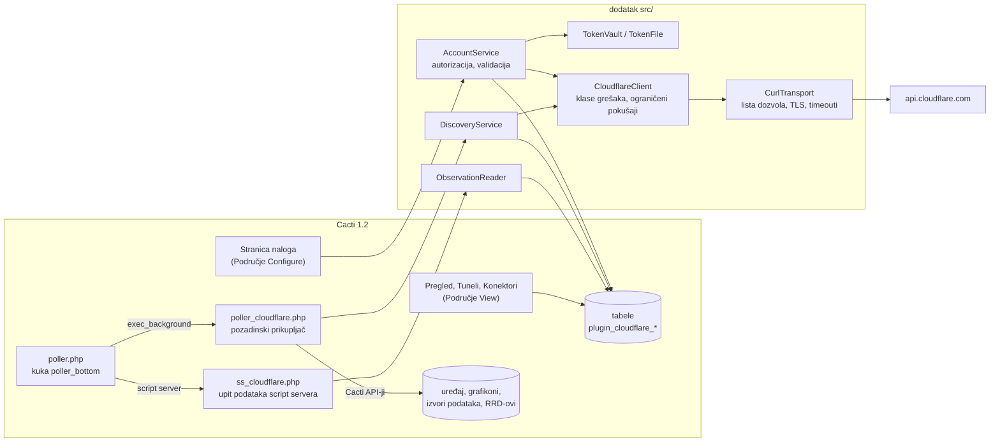

<!-- Source: README.md; SHA256: 813d1c85c236b426b83e42e63c69496f33f8909b5e435d0d45efa6a4ba2f17ca -->

<!-- translations:start -->
[English](../../../README.md) | [简体中文](../zh-CN/README.md) | [हिन्दी](../hi-IN/README.md) | [Español (España)](../es-ES/README.md) | [Español (Latinoamérica)](../es-419/README.md) | [العربية (السعودية)](../ar-SA/README.md) | [Afrikaans](../af-ZA/README.md) | [አማርኛ](../am-ET/README.md) | [العربية (مصر)](../ar-EG/README.md) | [العربية (المغرب)](../ar-MA/README.md) | [বাংলা](../bn-BD/README.md) | [Bosanski](README.md) | [Deutsch](../de-DE/README.md) | [فارسی](../fa-IR/README.md) | [Filipino](../fil-PH/README.md) | [Français](../fr-FR/README.md) | [Français (Maroc)](../fr-MA/README.md) | [Français (Sénégal)](../fr-SN/README.md) | [Hausa](../ha-NG/README.md) | [עברית](../he-IL/README.md) | [Hrvatski](../hr-HR/README.md) | [Bahasa Indonesia](../id-ID/README.md) | [Igbo](../ig-NG/README.md) | [Italiano](../it-IT/README.md) | [日本語](../ja-JP/README.md) | [한국어](../ko-KR/README.md) | [Malagasy](../mg-MG/README.md) | [मराठी](../mr-IN/README.md) | [Bahasa Melayu](../ms-MY/README.md) | [Nederlands](../nl-NL/README.md) | [Polski](../pl-PL/README.md) | [Português (Brasil)](../pt-BR/README.md) | [Русский](../ru-RU/README.md) | [Kinyarwanda](../rw-RW/README.md) | [Soomaali](../so-SO/README.md) | [Српски](../sr-RS/README.md) | [Svenska](../sv-SE/README.md) | [Kiswahili](../sw-KE/README.md) | [தமிழ்](../ta-IN/README.md) | [తెలుగు](../te-IN/README.md) | [ไทย](../th-TH/README.md) | [Türkçe](../tr-TR/README.md) | [Українська](../uk-UA/README.md) | [اردو](../ur-PK/README.md) | [Tiếng Việt](../vi-VN/README.md) | [isiXhosa](../xh-ZA/README.md) | [Yorùbá](../yo-NG/README.md) | [繁體中文](../zh-TW/README.md) | [isiZulu](../zu-ZA/README.md)
<!-- translations:end -->

<p align="center">
  
</p>

# Cloudflare dodatak za Cacti

[](https://github.com/somethingwithproof/plugin_cloudflare/actions/workflows/ci.yml)
[](https://sonarcloud.io/summary/new_code?id=somethingwithproof_plugin_cloudflare)
[](../../../LICENSE)


[](https://sonarcloud.io/summary/new_code?id=somethingwithproof_plugin_cloudflare)
[](https://sonarcloud.io/summary/new_code?id=somethingwithproof_plugin_cloudflare)
[](https://sonarcloud.io/summary/new_code?id=somethingwithproof_plugin_cloudflare)


Dodatak za Cacti 1.2 koji se razvija za nadzor Cloudflare tunela i analitike
zona. Čita podatke iz Cloudflare API-ja koristeći ograničene API tokene,
nikada ništa ne mijenja u Cloudflare sistemu i čuva svoje podatke u vlastitim
tabelama. U Cacti sistemu kopira XML datoteke upita podataka u
`resource/script_server/` te kreira uređaje, grafikone i šablone putem
Cacti-jevih vlastitih API-ja, bez ikakvih izmjena u osnovnim datotekama.

**Status: 0.4.0-dev, neobjavljena verzija.** Posljednja objavljena verzija je 0.3.0. Razvojna verzija dodaje CSV izvoz inventara, izričito povlačenje obrisanih tunela, keširanu analitiku zona i opcione Thold šablone. Kvalifikacija prema stvarnom provajderu i za produkcijsko postavljanje još je u toku.

Tabela u nastavku opisuje stabilno izdanje 0.3.0. Razvojni dodaci opisani su niže u odjeljku o tokovima rada operatera i analitici zona.

| Dostupno sada | Planirano |
|---|---|
| Instalacija, nadogradnja, onemogućavanje i deinstalacija kroz Cacti menadžer dodataka | GraphQL analitika i Thold upozorenja (Prekretnica 4) |
| Dozvole Cloudflare: View, Operator i Configure | Ubrizgavanje grešaka, TLA+ modeli i potpuna dokumentacija (Prekretnica 5) |
| Dodavanje, uređivanje, brisanje, omogućavanje i onemogućavanje Cloudflare naloga | |
| Čuvanje tokena u datoteci ili šifrovano u Cacti bazi podataka | |
| Verifikacija tokena i provjera njegovih dozvola za čitanje tunela i zona | |
| Otkrivanje tunela i konektora u pozadinskom prikupljaču koji pokreće glavni poller | |
| Stranice Pregled, Tuneli i Konektori pod Upravljanje > Cloudflare tuneli | |
| Praćenje životnog ciklusa: `active`, `unavailable` i `deleted` | |
| Jedan Cacti uređaj po nalogu, koji kreira administrator, sa tunelima kao indeksima upita podataka | |
| Grafikoni Konektori, Zdravlje i Prikupljanje po tunelu, nacrtani iz jedne RRD datoteke po tunelu | |
| Vrijednosti za koje dodatak ne može garantovati čuvaju se kao nepoznate (`U`), nikada kao 0 | |

## Uloge pristupa

| Područje (Realm) | Pristup |
| --- | --- |
| Cloudflare: View | Postojeće stranice za nadzor. |
| Cloudflare: Operator | Nadzor plus stranica Operacije i lične potvrde trijaže. |
| Cloudflare: Configure | Pristup operatera plus postojeće konfiguracijske i administrativne radnje. |

Nakon kopiranja datoteka za nadogradnju, otvorite stranicu Plugins kao administrator
da biste registrovali novo područje. Izričito dodijelite područje Operator pod
**Configuration > Users** ili korisničkim grupama. Nadogradnje zadržavaju postojeće
ID-ove i dodjele područja View i Admin. Pristup Admin nasljeđuje pristup Operator,
a pristup Operator nasljeđuje pristup View pri svakom zahtjevu; ovo ne dodaje
sačuvane dodjele korisnicima ni grupama. Postavke dodatka dodatno zahtijevaju
pristup Cloudflare: Configure uz Cacti-jevu dozvolu Settings.

Vidljivost Cloudflare naloga odgovara postojećem području View i važi na nivou
cijelog naloga. Pristupni podaci, konfiguracija, mapiranje, brisanje i ostale
administrativne izmjene ostaju na administrativnim stranicama. Potvrde traju
samo tokom trenutne korisničke sesije, najduže jedan sat i samo dok isto zapažanje
ostaje svježe. Nova ili izmijenjena zapažanja ih poništavaju. One nikada ne označavaju
neuspjelo mjerenje kao ispravno niti potiskuju upozorenja.

## Zašto ovaj dodatak

Cacti operateri koji objavljuju servise putem Cloudflare tunela nemaju uvid u
tunel unutar Cacti sistema. Tunel može izgubiti sve svoje konektore dok izvorni
računari i dalje odgovaraju na SNMP, pa postojeći grafikoni ostaju zeleni dok
korisnici vide greške. Cilj ovog dodatka je da postavi stanje tunela i saobraćaj
zona odmah uz grafikone uređaja koje operateri već prate, a da pritom Cacti-ju
ne da nikakvu mogućnost mijenjanja bilo čega u Cloudflare sistemu.

Tri uslova oblikuju dizajn:

- **Samo za čitanje.** Dodatak poziva samo `GET` krajnje tačke i GraphQL
  Analytics API. Ne treba mu nikakva dozvola za izmjenu bilo kojeg Cloudflare resursa.
- **Opcioni rad.** Ispadi Cloudflare servisa, istekli tokeni i ograničenja broja
  zahtjeva ne smiju usporavati Cacti web interfejs niti zaustavljati ispitivanje
  drugih uređaja. Svi API pozivi imaju stroga vremenska ograničenja, a prikupljanje
  se izvršava u pozadinskom procesu koji pokreće poller.
- **Bez izmjena jezgra.** Dodatak koristi kuke (hooks) za dodatke u Cacti 1.2 i
  vlastite tabele. Kopira jednu XML datoteku upita podataka u `resource/script_server/`
  i kreira uređaje, grafikone i šablone putem Cacti-jevih vlastitih API-ja. Nema
  izmjena osnovnih datoteka, pa nadogradnje Cacti sistema i drugi dodaci ostaju
  netaknuti.

## Kako funkcioniše



- **Cacti integracijski sloj** (`setup.php`, `includes/`, skripte stranica)
  registruje kuke i područja, iscrtava stranice pomoću Cacti-jevih vlastitih
  pomoćnih funkcija i prosljeđuje svaku radnju biblioteci u `src/`.
- **Biblioteka** (`src/`, imenski prostor `Somethingwithproof\Cloudflare\`) ne
  zavisi od globalnih varijabli Cacti sistema, pa se testira nad stvarnom bazom
  podataka i lažnim HTTP transportom bez pokrenute Cacti instance.
- **Jedna izlazna putanja.** `CurlTransport` je jedini kod koji pristupa mreži i
  prihvata isključivo `https://api.cloudflare.com`. Svaki neuspjeh se mapira na
  jednu klasu greške (`auth`, `permission`, `rate_limited`, `transient`, ...), što
  određuje status prikazan u korisničkom interfejsu.
- **Skladištenje** ide kroz Cacti-jevu vlastitu PDO konekciju sa pripremljenim
  izrazima (prepared statements). Promjene šeme su numerisane, idempotentne migracije.

Odluke o dizajnu i njihovi razlozi opisani su u
[docs/design.md](../../design.md).

## Snimci ekrana

Snimci ekrana potiču iz testnog okruženja, a ne iz produkcijskog Cloudflare naloga.
Okruženje pokreće Cacti 1.2.31 protiv lažnog Cloudflare API-ja koji vraća testne
podatke, pa su nalog, njegov ID i tri tunela samo zamjenski primjeri.


*Spisak Cloudflare naloga. Lažni API prihvata token, pa Verifikuj prijavljuje `ok`.*


*Uređivanje naloga. Polja za token su uvijek prazna; sačuvani token se nikada ne
šalje nazad u preglednik. Prikupljaj tunele i Kreiraj grafikone su uključeni, a
Prikupljaj analitiku je isključen. Status veze prikazuje rezultat posljednje
verifikacije: `ok`, dodijeljena dozvola za čitanje tunela i nedostajuća dozvola za
čitanje zona.*


*Postavke > Cloudflare.*


*Upravljanje > Cloudflare tuneli > Pregled. Status je najlošiji Cloudflare status
među aktivnim tunelima naloga, ovdje `down` jer je jedan testni tunel u prekidu.
`Disabled`, `Not collected`, `Collection failing` i `Not yet collected` imaju
prednost nad zdravljem tunela, tim redoslijedom, pa nalog čije je posljednje
izvršavanje propalo prikazuje `Collection failing` bez obzira na to šta njegovi
tuneli prijavljuju.*


*Kartica Tuneli. Konektori i Veze prikazuju `-` za old-office jer lažni API na
njegov zahtjev za veze odgovara kao za nepoznat tunel pa ništa nije sačuvano,
dok za staging prikazuju 0 jer nema pokrenutog konektora.*


*Grafikon Konektori tunela blog. Sve tri linije imaju vrijednost 1 prije i poslije
prekida u sredini, gdje je lažni API vratio greške a dodatak sačuvao nepoznate
vrijednosti. Linije ne padaju na 0. Grafikon potiče iz istog testnog okruženja
(`make screenshots`), koje postavlja korak od 30 sekundi na ovaj jedan izvor
podataka kako bi sedam minuta ispitivanja popunilo grafikon.*

## Zahtjevi

- Cacti 1.2.25 do 1.2.31. Sam Cacti 1.2.31 zahtijeva PHP 8.0 ili noviji.
  CI testira samo 1.2.31; verzija 1.2.25 posljednji put je ručno testirana 2026-10-22.
- PHP 7.4 do 8.4 sa ekstenzijama `curl`, `openssl` i `pdo_mysql`.
  Dodatak odbija da se omogući bez njih.
- MariaDB 10.6 ili noviji, ili MySQL 8.0 ili noviji.
- HTTPS pristup sa Cacti servera do `api.cloudflare.com`. Proxy serveri nisu podržani.

Pogledajte [docs/compatibility.md](../../compatibility.md) za pregled testiranih kombinacija.

## Instalacija

1. Postavite dodatak u Cacti direktorij `plugins/cloudflare`, bilo raspakivanjem
   arhive sa stranice
   [GitHub Releases](https://github.com/somethingwithproof/plugin_cloudflare/releases)
   (`make package` pokrenut u kopiji oznake izdanja pravi istu arhivu) ili putem
   git kloniranja. Direktorij mora nositi naziv `cloudflare`.
2. Instalirajte i omogućite dodatak iz Console > Configuration > Plugins, ili putem
   komandne linije kao korisnik web servera:

   ```sh
   php cli/plugin_manage.php --plugin=cloudflare --install --enable
   ```

3. Administratorski korisnik dobija dozvolu Cloudflare: Configure pri instalaciji.
   Dodijelite je drugim korisnicima ili grupama pod Console > Configuration > Users.
4. Kreirajte token sa dozvolama navedenim u
   [docs/token-permissions.md](../../token-permissions.md). Ukratko:
   Account > Cloudflare Tunnel > Read, i opciono Zone > Zone > Read.
5. Sačuvajte token na jedan od dva načina u nastavku, zatim dodajte nalog pod
   Console > Configuration > Cloudflare Accounts i pokrenite Verifikuj iz menija radnji.

### Opcija A: šifrovano u bazi podataka

Dodatak šifruje tokene pomoću 32-bajtnog ključa koji sami kreirate. Nikada sam
ne kreira niti upisuje taj ključ. Datoteka mora biti čitljiva za korisnike web
servera i pollera, ne smije biti čitljiva za ostale, a njen direktorij mora
dozvoljavati tim korisnicima pristup. Za web server koji radi kao `www-data`:

```sh
sudo mkdir -p /etc/cacti
sudo sh -c 'umask 077 && openssl rand -hex 32 > /etc/cacti/cloudflare.key'
sudo chgrp www-data /etc/cacti/cloudflare.key
sudo chmod 0440 /etc/cacti/cloudflare.key
```

Podrazumijevana putanja je `/etc/cacti/cloudflare.key`; možete je promijeniti pod
Settings > Cloudflare > Token Vault Key File. Kada ključ nedostaje ili bude odbijen,
obrazac za uređivanje nudi samo opciju datoteke tokena. Čuvajte sigurnosnu kopiju
ključa: bez njega sačuvani tokeni ne mogu biti dešifrovani i moraju se ponovo unijeti.

#### Rotacija ključa

Ne postoji komanda za ponovno šifrovanje. Novi ključ ne može dešifrovati tokene
sačuvane pod starim ključem, pa rotacija podrazumijeva ponovni unos svakog
sačuvanog tokena:

1. Imajte pri ruci vrijednost tokena za svaki nalog. Cloudflare prikazuje
   vrijednost tokena samo prilikom kreiranja ili obnavljanja, pa obnovite token u
   Cloudflare kontrolnoj tabli ako ga više nemate.
2. Kreirajte novi ključ na novoj putanji pomoću gornjih komandi, na primjer
   `/etc/cacti/cloudflare.key.new`, sa istim vlasnikom i dozvolama.
3. Postavite Settings > Cloudflare > Token Vault Key File na novu putanju i
   sačuvajte. Od tog trenutka Verifikuj na nalogu koji je još šifrovan starim
   ključem prijavljuje "Stored token cannot be decrypted", a svako pokretanje
   prikupljača zapisuje `discovery token unavailable` sa `reason=decrypt_failed`.
4. Za svaki nalog koji čuva svoj token u bazi podataka otvorite ga pod
   Console > Configuration > Cloudflare Accounts, zalijepite token u oba polja za
   token, sačuvajte i pokrenite Verifikuj. Trebao bi prijaviti `ok`.
5. Kada svaki takav nalog prođe verifikaciju, uklonite staru datoteku ključa i
   njene sigurnosne kopije.

Između koraka 3 i 4 tuneli naloga se ne osvježavaju, a njihovi grafikoni zdravlja,
konektora i veza bilježe U. Nalozi koji koriste datoteku tokena nisu pogođeni.

### Opcija B: datoteka tokena

Upišite token, i ništa drugo, u datoteku koju mogu čitati korisnici web servera i
pollera, a ostali ne mogu, zatim unesite njenu apsolutnu putanju u obrazac za
uređivanje:

```sh
sudo sh -c 'umask 077 && cat > /etc/cacti/cloudflare-account.token'   # paste the token, then Ctrl-D
sudo chgrp www-data /etc/cacti/cloudflare-account.token
sudo chmod 0440 /etc/cacti/cloudflare-account.token
```

Datoteka se provjerava kada se čita, prilikom verifikacije, a ne pri čuvanju.
Simboličke veze, datoteke veće od 4 KiB i datoteke koje mogu čitati ili mijenjati
ostali korisnici se odbijaju.

Svako ko ima dozvolu Cloudflare: Configure može unijeti bilo koju putanju, a
korisnik pollera je čita. Da biste sve datoteke tokena držali na jednom mjestu,
postavite Settings > Cloudflare > Token File Directory, na primjer na `/etc/cacti`;
putanja izvan tog direktorija tada biva odbijena. Pogledajte
[docs/security.md](../../security.md#token-file).

## Nadogradnja

1. Zamijenite datoteke u `plugins/cloudflare` novim izdanjem, zadržavajući naziv
   direktorija.
2. Otvorite Console > Configuration > Plugins ili Console > Configuration >
   Cloudflare Accounts jednom kao administrator. Time se pokreću migracije dodatka,
   uvoze Cloudflare šabloni i kopira datoteka upita podataka (pogledajte
   [Metrike i grafikoni tunela](#tunnel-metrics-and-graphs)), a pri nadogradnji sa
   verzije 0.1.0 registruje se kuka `poller_bottom`.

`poller.php` ne izvršava nadogradnju dodatka, pa do koraka 2 nova šema nedostaje.
Svako pokretanje prikupljača tada ne radi ništa i zapisuje
`CLOUDFLARE: collector skipped; plugin upgrade pending, open Console > Plugins`.
Stranicama Cloudflare Tunnels potrebna je samo dozvola Cloudflare: View, pa one
nikada ne pokreću nadogradnju i do koraka 2 mogu prikazivati "The Cloudflare
tunnels could not be read".

## Status naloga

Verifikuj postavlja status naloga:

| Status | Značenje |
|---|---|
| `unknown` | Nije verifikovano otkako je nalog dodat ili su mu pristupni podaci izmijenjeni |
| `ok` | Token je aktivan i može čitati tunele |
| `token_inactive` | Cloudflare prijavljuje da je token onemogućen ili istekao |
| `auth_failed` | Cloudflare je odbio token kao neispravan ili istekao (HTTP 401) |
| `permission_denied` | Token je aktivan ali ne može čitati tunele, ili mu nedostaju dozvole za pozivanje krajnjih tačaka za verifikaciju tokena (HTTP 403) |
| `unreachable` | API nije bilo moguće dosegnuti, isteklo je vrijeme ili je vraćena serverska greška |
| `rate_limited` | Cloudflare je vratio HTTP 429 |
| `error` | Bilo koji drugi neuspjeh, uključujući datoteku tokena koja nedostaje ili nije sigurna, datoteku ključa trezora tokena koja nedostaje ili je neupotrebljiva, ili sačuvani token koji se ne može dešifrovati |

Stranica za uređivanje također prikazuje jesu li odobrene dozvole za čitanje tunela
i čitanje zona.

## Otkrivanje tunela

Nakon svakog ciklusa ispitivanja na glavnom polleru, kuka `poller_bottom` pokreće
pozadinski prikupljač pomoću `exec_background` kada je barem za jedan omogućeni
nalog uključena opcija Prikupljaj tunele. Prikupljač se nikada ne izvršava u
procesu pollera, pa spor Cloudflare API ne usporava `poller.php`. Udaljeni polleri
ga nikada ne pokreću.

Za svaki nalog koji je na redu, prikupljač izlistava tunele naloga, a zatim čita
veze njegovih aktivnih tunela, čime dobija konektore svakog tunela, njihove
verzije, podatkovne centre i izvorne adrese. Nalozi dolaze na red svakog Intervala
otkrivanja (podrazumijevano 300 sekundi). Jedno pokretanje ne započinje nijedan
novi nalog nakon 50 sekundi i šalje najviše 200 zahtjeva za veze. Bilo koje od ta
dva ograničenja može zaustaviti nalog na pola čitanja njegovih veza; taj nalog se
bilježi kao `partial`, a sljedeće pokretanje nastavlja sa tunelima koji su najdavnije
pokušani. Nalozi koji nisu započeti ostaju na čekanju za sljedeće pokretanje.

Tunel ima životni ciklus koji se vodi odvojeno od statusa koji prijavljuje Cloudflare
(`healthy`, `degraded`, `down` ili `inactive`):

| Životni ciklus | Značenje |
|---|---|
| `active` | Tunel je bio prisutan u posljednjem potpunom spisku |
| `deleted` | Potpuni spisak ga nije sadržavao, što uključuje i prazan spisak. Red i njegova historija ostaju, a tunel ponovo postaje `active` ako se opet pojavi |
| `unavailable` | Tri uračunata ispada bez potpunog spiska između njih ostavljaju stanje tunela nepoznatim |

Samo potpun i uspješan spisak dodaje, ažurira ili briše tunele, dok neuspjelo
dohvatanje spiska nikada ne briše tunel. Neuspjeh u čitanju Cloudflare servisa
uopšte (`transient`, `rate_limited`, `auth` ili `permission`) računa se kao ispad;
nakon tri uračunata ispada bez potpunog spiska između njih, aktivni tuneli naloga
postaju `unavailable`. Sljedeći potpuni spisak ih vraća u aktivno stanje i poništava
brojač. Tunel za koji Cloudflare više ne zna prilikom čitanja njegovih veza se
preskače bez izazivanja greške na nivou naloga. Ostali neuspjesi niti povećavaju
niti poništavaju brojač ispada.

U `cacti.log` linije otkrivanja počinju sa `CLOUDFLARE: discovery`, a sažetak
pokretanja sa `CLOUDFLARE: collector`. Neuspjesi i promjene životnog ciklusa,
poput neuspjelog spiska ili tunela označenih kao `unavailable`, zapisuju se na
podrazumijevanom Cacti nivou `LOW`; rezultat svakog naloga i sažetak pokretanja
zapisuju se na nivou `MEDIUM`. Čitanje veza može zakazati na svakom tunelu, pa se
za svaki nalog samo prvi neuspjeh svake klase greške zapisuje na nivou `LOW`, a
ostali na nivou `MEDIUM`, nakon čega slijedi jedna `LOW` linija po klasi sa brojem
tunela koji nisu uspjeli.

Upravljanje > Cloudflare tuneli zahtijeva dozvolu Cloudflare: View i služi samo za čitanje:

- **Pregled** prikazuje spisak svih naloga sa njihovim statusom, brojem tunela po
  životnom ciklusu, vremenom posljednjeg uspješnog otkrivanja i brojem uzastopnih
  neuspjeha.
- **Tuneli** prikazuje spisak tunela kroz sve naloge ili za jedan nalog, sa
  filterima za nalog, životni ciklus, status i naziv te kolonama koje se mogu sortirati.
- **Konektori** prikazuje konektore tunela odabranog na kartici Tuneli.

<a id="tunnel-metrics-and-graphs"></a>
## Metrike i grafikoni tunela

Cacti čita stanje tunela kroz upit podataka script servera, `ss_cloudflare.php`.
On odgovara isključivo iz tabela dodatka i nikada ne poziva Cloudflare, pa ispad
Cloudflare servisa ne može usporiti poller. Svaki tunel daje šest vrijednosti:
zdravlje (healthy 3, degraded 2, down 1, inactive 0), konektore, veze, verzije
konektora, sekunde od posljednjeg čitanja veza i uzastopne neuspjehe zadatka
otkrivanja. Zdravlje, konektori, veze i verzije ispisuju se samo kada dodatak može
garantovati za njih, što znači da je posljednje otkrivanje uspjelo, tunel je `active`
i očitanje je svježe. U suprotnom su `U`, a grafikon prikazuje prekid umjesto nule
koja bi izgledala kao ispad. Dvije vrijednosti prikupljanja ostaju ispisane tokom
ispada kako bi ih grafikon Prikupljanje prikazao; one su `U` samo za obrisani tunel
ili tunel čije veze nikada nisu osvježene. Pravila su definisana u
[docs/metrics.md](../../metrics.md).

### Kreiranje uređaja

Jedan nalog odgovara najviše jednom Cacti uređaju. Uređaj sadrži tunele naloga kao
indekse upita podataka Cloudflare Tunnels. Ništa ga ne kreira automatski:

1. Otvorite Console > Configuration > Cloudflare Accounts.
2. Odaberite nalog, izaberite Create Cacti Device iz menija radnji i potvrdite.

Ova radnja zahtijeva i područje Cloudflare: Configure i Cacti-jevo područje
Sites/Devices/Data (ono za `host.php`). Stavka menija prikazuje se samo korisnicima
koji imaju oba područja, a server odbija zahtjev od svakog drugog. Uređaj dobija
naziv `Cloudflare: <naziv naloga>`, koristi šablon domaćina Cloudflare Account i
glavni poller, ima SNMP verziju 0 bez provjere dostupnosti te dobija naziv domaćina
`<ID naloga>.cloudflare.invalid`. Taj naziv je rezervisan i nikada se ne razrješava;
Cacti se na njega ne povezuje. Ako nalog već ima uređaj, radnja to prijavljuje i ne
mijenja ništa. Ako administrator obriše uređaj u Cacti sistemu, dodatak neće
kreirati novi sve dok se ponovo ne pokrene Create Cacti Device.

### Kreiranje grafikona

Opcija Kreiraj grafikone na obrascu naloga podrazumijevano je isključena. Kada je
uključena, svaki put kada se otkrivanje naloga završi sa `ok` ili `partial`,
prikupljač ponovo indeksira uređaj i kreira sve nedostajuće grafikone za aktivne
(`active`) tunele naloga: Connectors, Health i Collection, po tri za svaki tunel.
Tri grafikona jednog tunela dijele jednu RRD datoteku. Jedno pokretanje kreira
najviše 50 grafikona i staje nakon 20 sekundi, a sljedeće pokretanje nastavlja.
Dodatak nikada ne uklanja Cacti objekat. Grafikon koji administrator obriše ne
kreira se ponovo, a tunel koji Cloudflare više ne navodi zadržava svoj grafikon i
RRD datoteku, koji prikazuju `U`.

Uključivanje opcije Kreiraj grafikone zahtijeva oba područja. Isključivanje
zahtijeva samo Configure. Korisnik bez područja Sites/Devices/Data koji sačuva
obrazac ostavlja postavku nepromijenjenom, uz upozorenje. Kada je Kreiraj grafikone
isključeno, uređaj se i dalje ponovo indeksira nakon svakog otkrivanja, tako da se
novi tuneli pojavljuju kao indeksi upita podataka.

### Datoteka upita podataka

Cacti 1.2.31 čita XML datoteku upita podataka samo iz svog direktorija `resource`.
Prilikom instalacije i nadogradnje dodatak stoga kopira jednu datoteku,
`templates/resource/cloudflare_tunnels.xml`, u
`<Cacti>/resource/script_server/cloudflare_tunnels.xml`. To je jedina datoteka koju
dodatak upisuje izvan vlastitog direktorija, pa korisnik koji instalira ili
nadograđuje dodatak mora imati pravo pisanja u taj direktorij. Deinstalacija
zadržava ovu datoteku, zajedno sa uređajima, grafikonima, RRD datotekama i
šablonima. Ako kopiranje ili uvoz šablona ne uspije, dodatak to zapisuje u
zapisnik, a Create Cacti Device pokušava ponovo.

## Postavke

Settings > Cloudflare sadrži:

- **Token Vault Key File**: putanja do ključa trezora.
- **Token File Directory**: kada je postavljeno, datoteka tokena izvan ovog
  direktorija se odbija. Podrazumijevano je prazno, što dopušta bilo koju putanju.
  Pogledajte [docs/security.md](../../security.md#token-file).
- **Interactive Request Timeout**: ukupno sekundi za zahtjev poslat iz web
  interfejsa, kao što je Verifikuj. Podrazumijevano 10; vrijednosti izvan raspona
  od 5 do 60 vraćaju se na 10.
- **Collector Request Timeout**: ukupno sekundi za zahtjev koji šalje pozadinski
  prikupljač. Podrazumijevano 20; vrijednosti izvan raspona od 5 do 60 vraćaju se na 20.
- **Log Level**: čuva se, ali ga još ništa ne očitava.

Na obrascu naloga opcije Prikupljaj tunele i Interval otkrivanja upravljaju
otkrivanjem, a Kreiraj grafikone upravlja kreiranjem grafikona. Opcija Prikupljaj
analitiku se čuva i nema učinka u ovom izdanju.

## Jezici

Dodatak isporučuje prijevode na španski (Španija, `es-ES`), francuski (`fr-FR`),
njemački (`de-DE`), pojednostavljeni kineski (`zh-CN`), hindi (`hi-IN`), arapski
(`ar-SA`) i japanski (`ja-JP`). Cacti ih prikazuje kada je jezička podrška
uključena (Configuration > Settings > General > Language Support) i kada korisnik
odabere jezik. Isporučuje se i katalog za latinoamerički španski (`es-419`), ali
Cacti 1.2 nema odabirljivu lokalizaciju za latinoamerički španski, pa će postati
aktivan tek kada ga Cacti doda; do tada odaberite španski (`es-ES`).

Neki tekstovi ostaju na engleskom: vrijednosti statusa koje dodatak čuva i
prikazuje kakve jesu (`ok`, `active`, `unavailable`, `deleted` i status tunela koji
prijavljuje Cloudflare) te sve što dodatak upisuje u Cacti zapisnik.

## Deinstalacija i zadržavanje podataka

Deinstalacija briše vlastite tabele dodatka, koje čuvaju naloge, šifrovane tokene,
otkrivene tunele, stanje zadataka i evidenciju koje je Cacti objekte dodatak
kreirao, te briše njegove `cloudflare_` postavke. Ne uklanja datoteku ključa,
datoteke tokena, kopiranu datoteku `resource/script_server/cloudflare_tunnels.xml`
niti bilo koje Cacti uređaje, grafikone, izvore podataka, RRD datoteke ili šablone.
Oni čuvaju historijske podatke nadzora i njihovo uklanjanje predstavlja izričitu
administrativnu radnju u Cacti sistemu.

Zadržani uređaj prestaje primati podatke. Nakon deinstalacije ili nakon brisanja
njegovog naloga, nijedan nalog ne posjeduje taj domaćin, pa njegovi grafikoni
zadržavaju svoju historiju ali od tada nadalje ispisuju `U`. Create Cacti Device na
ponovo instaliranom ili ponovo dodatom nalogu kreira novi uređaj; ne koristi stari
ponovo, pa obrišite stari uređaj u Cacti sistemu kada njegova historija više ne
bude potrebna.

## Poznata ograničenja

- Jedno pokretanje šalje najviše 200 zahtjeva za veze. Tuneli izvan tog ograničenja
  osvježavaju se rjeđe od prozora posmatranja, pa njihovi grafikoni veza pokazuju
  prekide.
- Dodatak prepisuje administratorske izmjene na uvezenim šablonima kada nadogradnja
  promijeni isporučeni XML šablona.
- Uređaj naloga mora ostati na glavnom polleru. Tabele dodatka nalaze se u glavnoj
  bazi podataka i skripta ih čita odatle.
- Obrisani tuneli ostaju u indeksu upita podataka i ispisuju `U` sve dok ih
  administrator izričito ne povuče iz upotrebe. Povlačenje uklanja samo grafikone
  koje je evidentirao dodatak i nedijeljene izvore podataka putem Cacti sistema;
  red u inventaru ostaje vidljiv. Cacti upravlja čišćenjem RRD datoteka.
- Cacti onemogućava dodatak čiji kod završi pravom fatalnom greškom, kao što je
  nestanak memorije. Pogledajte [docs/security.md](../../security.md).

## Sigurnost

- Global API Keys se odbijaju; prihvataju se samo ograničeni API tokeni.
- Tokeni se čuvaju u datoteci koju sami obezbijedite ili šifrovani algoritmom
  AES-256-GCM pomoću datoteke ključa koja nikada ne ulazi u bazu podataka. Nikada
  se ne prikazuju na stranici, ne upisuju u zapisnik niti uključuju u poruku o grešci.
- Greške baze podataka nose samo SQLSTATE i kod greške drajvera, nikada vrijednosti
  samog iskaza.
- Svaka izmjena je POST zahtjev zaštićen Cacti-jevim CSRF tokenom. Administrativne
  izmjene naloga i konfiguracije zahtijevaju Cloudflare: Configure; lične potvrde
  trijaže zahtijevaju Cloudflare: Operator. Kreiranje Cacti uređaja ili uključivanje
  opcije Kreiraj grafikone dodatno zahtijeva Cacti dozvolu Sites/Devices/Data.
  Onemogućen dodatak odbija pristup svojim stranicama.

Detalji i poznata ograničenja nalaze se u [docs/security.md](../../security.md).
Sigurnosne ranjivosti prijavite privatno kako je opisano u
[SECURITY.md](../../../SECURITY.md).

## Tokovi rada operatera i analitika zona

Razvojni dodaci uključuju izričito povlačenje obrisanih tunela, analitiku zona
svjesnu mogućnosti plana i Thold šablone spremne za uvoz. Ovi dodaci još nemaju
oznaku izdanja niti kvalifikaciju na produkcijskom nalogu. Pogledajte
[docs/analytics-and-alerting.md](../../analytics-and-alerting.md) za podešavanje,
semantiku metrika i ograničenja verifikacije.

### Izvoz inventara

Stranice Tuneli i Konektori nude Izvezi za područje Cloudflare: View. CSV datoteke
tunela sadrže svaki odgovarajući red, koristeći aktivne postavke naloga, životnog
ciklusa, statusa, pretrage i sortiranja na svim stranicama. CSV datoteke konektora
sadrže verzije, arhitekturu, podatkovne centre i izvorne adrese za odabrani tunel.
Preuzimanja čitaju isključivo keširane zapise. Nepoznati brojevi su prazni; ćelije
koje liče na formule dobijaju prefiks apostrofa radi sigurnog uvoza u tabelarne
programe.

## Plan razvoja

Svaka prekretnica izlazi kao 0.x izdanje numerisano prema njoj: Prekretnica 3 je
0.3.0, Prekretnica 4 bit će 0.4.0. Prekretnice 1 i 2 nisu objavljene zasebno i dio
su izdanja 0.3.0. Verzija 1.0.0 rezervisana je za izdanje koje dovršava svaku
prekretnicu navedenu u nastavku.

| Prekretnica | Opseg | Stanje |
|---|---|---|
| 1. Osnova | Životni ciklus dodatka, dozvole, konfiguracija naloga, test veze | Objavljeno u 0.3.0 ([#2](https://github.com/somethingwithproof/plugin_cloudflare/pull/2) do [#5](https://github.com/somethingwithproof/plugin_cloudflare/pull/5)) |
| 2. Otkrivanje | Otkrivanje tunela i konektora u pozadinskom prikupljaču, stranice Pregled, Tuneli i Konektori | Objavljeno u 0.3.0 ([#6](https://github.com/somethingwithproof/plugin_cloudflare/pull/6)) |
| 3. Metrike | Izvori podataka o zdravlju tunela, šabloni grafikona, obrada ispada koja nikada ne bilježi izmišljenu nulu | Objavljeno u 0.3.0 ([#7](https://github.com/somethingwithproof/plugin_cloudflare/pull/7)) |
| 4. Analitika i upozoravanje | GraphQL analitika po zoni prilagođena planu, Thold pragovi sa potiskivanjem ispada | Planirano |
| 5. Učvršćivanje | Ubrizgavanje grešaka, TLA+ modeli otkrivanja i prikupljanja, potpuna dokumentacija | Planirano |

## Razvoj

Alati zahtijevaju PHP 8.x i Composer; sam kod dodatka ostaje kompatibilan sa
PHP 7.4. Integracijski i BDD testovi zahtijevaju bazu podataka koju `make db-up`
pokreće u Dockeru na portu 33061.

```sh
composer install
make db-up
make ci            # unit, integration, BDD, PHPStan, php-cs-fixer, php -l on PHP 7.4
make smoke         # installs the plugin into Cacti 1.2.31 in Docker and walks its lifecycle
make package       # builds build/cloudflare-<version>.tar.gz and checks its contents
make db-down
```

`make smoke` i `make screenshots` zahtijevaju lokalnu kopiju Cacti repozitorija;
postavite `CACTI_REPO` na njenu putanju. Integracijski testovi čitaju `CF_TEST_DSN`,
`CF_TEST_DB_USER` i `CF_TEST_DB_PASS`, te se preskaču kada je baza podataka
nedostupna osim ako je postavljen `CI`.

## Doprinos projektu

Pull zahtjevi su dobrodošli. Svaki commit zahtijeva DCO potpis (`git commit -s`).
Prvo napišite test; `make ci` mora proći, a izmjene u Cacti integracijskom sloju
trebaju proći i `make smoke`. Kod dodatka mora ostati kompatibilan sa PHP 7.4 i
slijediti Cacti stil koda (tabovi, jednostruki navodnici, vitičaste zagrade u istom
redu).

### Prijevodi

Poruke su označene sa `__('...', 'cloudflare')`. Skripta `locales/build_gettext.sh`
(`make i18n`, koja zahtijeva GNU gettext) ponovo generiše šablon
`locales/po/cacti.pot`, spaja ga u svaki katalog `locales/po/<locale>.po` i
kompajlira `locales/LC_MESSAGES/<locale>.mo`; commitujte sve tri datoteke. CI
pokreće `make i18n-check`, koji pada ako katalogu nedostaje unos ili ima fuzzy
unos, ako se formatni string razlikuje ili je kompajlirana datoteka zastarjela,
a jedinični testovi dodatno provjeravaju zamjenske oznake, HTML oznake i rubne
razmake svakog unosa. Izmijenjena poruka stoga zahtijeva ažuriranje svojih prijevoda
u istom pull zahtjevu. Novi jezik predstavlja novu datoteku `<locale>.po` nazvanu
onako kako Cacti imenuje svoje lokalizacije (na primjer `pt-BR`), dodatu u
`CatalogTest::LOCALES` i u provjeru arhive u `tests/build/package.sh`. Zadržite
nazive proizvoda Cloudflare, Cacti i Thold, pojmove API i GraphQL te nazive dozvola
kao što je `Account Cloudflare Tunnel Read` u izvornom obliku.

## Dokumentacija

- [docs/security.md](../../security.md): sigurnosne kontrole i poznata ograničenja
- [docs/token-permissions.md](../../token-permissions.md): dozvole tokena
- [docs/compatibility.md](../../compatibility.md): podržane verzije i korišteni interfejsi
- [docs/metrics.md](../../metrics.md): katalog metrika i kada je vrijednost nepoznata
- [docs/collector-protocol.md](../../collector-protocol.md): šta `ss_cloudflare.php` čita i ispisuje
- [docs/schema.md](../../schema.md): tabele baze podataka
- [docs/design.md](../../design.md): odluke o dizajnu
- [CHANGELOG.md](../../../CHANGELOG.md)

## Licenca

GPL-2.0-or-later. Pogledajte [LICENSE](../../../LICENSE).

## Zaštitni znakovi

Cloudflare je registrovani zaštitni znak kompanije Cloudflare, Inc. Ovaj projekat
je nezavisan alat otvorenog koda i nije povezan sa kompanijom Cloudflare, Inc., niti
ga ona sponzoriše ili podržava.

Projekat također nije povezan sa projektom Cacti. Pogledajte
[docs/images/README-logo.md](../../images/README-logo.md) za informacije o logu.
