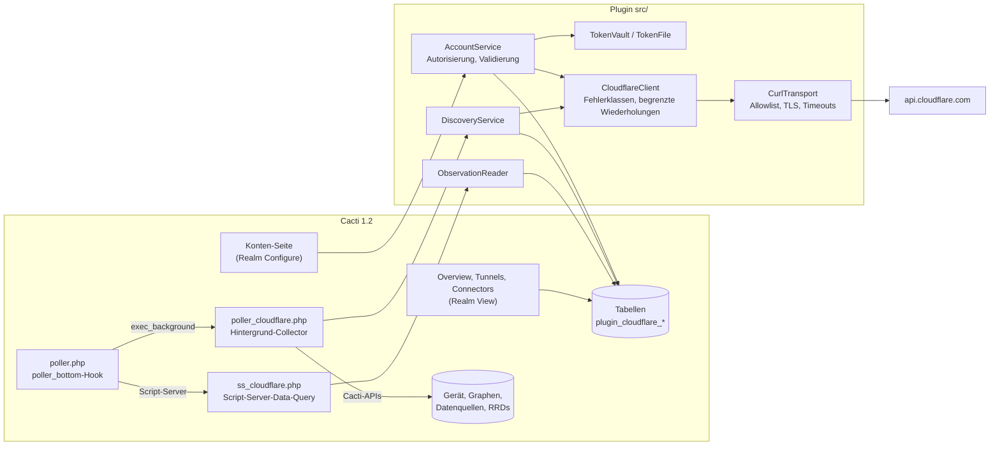

<!-- Source: README.md; SHA256: f8de0e02c5904e15bfa4c71edcaab219e5e5d4f6d9dbe589f4ed16351df6bf4d -->

<!-- translations:start -->
[English](../../../README.md) | [简体中文](../zh-CN/README.md) | [हिन्दी](../hi-IN/README.md) | [Español (España)](../es-ES/README.md) | [Español (Latinoamérica)](../es-419/README.md) | [العربية (السعودية)](../ar-SA/README.md) | [Afrikaans](../af-ZA/README.md) | [አማርኛ](../am-ET/README.md) | [العربية (مصر)](../ar-EG/README.md) | [العربية (المغرب)](../ar-MA/README.md) | [বাংলা](../bn-BD/README.md) | [Bosanski](../bs-BA/README.md) | [Deutsch](README.md) | [فارسی](../fa-IR/README.md) | [Filipino](../fil-PH/README.md) | [Français](../fr-FR/README.md) | [Français (Maroc)](../fr-MA/README.md) | [Français (Sénégal)](../fr-SN/README.md) | [Hausa](../ha-NG/README.md) | [עברית](../he-IL/README.md) | [Hrvatski](../hr-HR/README.md) | [Bahasa Indonesia](../id-ID/README.md) | [Igbo](../ig-NG/README.md) | [Italiano](../it-IT/README.md) | [日本語](../ja-JP/README.md) | [한국어](../ko-KR/README.md) | [Malagasy](../mg-MG/README.md) | [मराठी](../mr-IN/README.md) | [Bahasa Melayu](../ms-MY/README.md) | [Nederlands](../nl-NL/README.md) | [Polski](../pl-PL/README.md) | [Português (Brasil)](../pt-BR/README.md) | [Русский](../ru-RU/README.md) | [Kinyarwanda](../rw-RW/README.md) | [Soomaali](../so-SO/README.md) | [Српски](../sr-RS/README.md) | [Svenska](../sv-SE/README.md) | [Kiswahili](../sw-KE/README.md) | [தமிழ்](../ta-IN/README.md) | [తెలుగు](../te-IN/README.md) | [ไทย](../th-TH/README.md) | [Türkçe](../tr-TR/README.md) | [Українська](../uk-UA/README.md) | [اردو](../ur-PK/README.md) | [Tiếng Việt](../vi-VN/README.md) | [isiXhosa](../xh-ZA/README.md) | [Yorùbá](../yo-NG/README.md) | [繁體中文](../zh-TW/README.md) | [isiZulu](../zu-ZA/README.md)
<!-- translations:end -->

<p align="center">
  
</p>

# Cloudflare-Plugin für Cacti

[](https://github.com/somethingwithproof/plugin_cloudflare/actions/workflows/ci.yml)
[](https://sonarcloud.io/summary/new_code?id=somethingwithproof_plugin_cloudflare)
[](../../../LICENSE)


[](https://sonarcloud.io/summary/new_code?id=somethingwithproof_plugin_cloudflare)
[](https://sonarcloud.io/summary/new_code?id=somethingwithproof_plugin_cloudflare)
[](https://sonarcloud.io/summary/new_code?id=somethingwithproof_plugin_cloudflare)


Ein Plugin für Cacti 1.2, das für die Überwachung von Cloudflare Tunnels und
Zone Analytics entwickelt wird. Es liest mit bereichsbeschränkten API-Tokens
aus der Cloudflare-API, nimmt niemals Änderungen in Cloudflare vor und speichert
seine Daten in eigenen Tabellen. In Cacti kopiert es XML-Dateien für Data
Queries nach `resource/script_server/` und erstellt Geräte, Graphen und Vorlagen
über die Cacti-eigenen APIs, ohne Kerndateien zu verändern.

**Status: 0.4.0-dev, unveröffentlicht.** Die letzte veröffentlichte Version ist 0.3.0. Die Entwicklungsversion ergänzt CSV-Inventarexporte, die explizite Ausmusterung gelöschter Tunnel, zwischengespeicherte Zone Analytics sowie optionale Thold-Vorlagen. Die Qualifizierung gegen einen Live-Anbieter und für den Produktiveinsatz steht noch aus.

Die folgende Tabelle beschreibt das stabile Release 0.3.0. Ergänzungen aus der Entwicklung sind weiter unten im Abschnitt zu Operator-Workflows und Zone Analytics beschrieben.

| Jetzt verfügbar | Geplant |
|---|---|
| Installation, Aktualisierung, Deaktivierung und Deinstallation über den Plugin-Manager von Cacti | GraphQL-Analytics und Thold-Alarme (Meilenstein 4) |
| Berechtigungen „Cloudflare: View“, „Operator“ und „Configure“ | Fehlerinjektion, TLA+-Modelle und vollständige Dokumentation (Meilenstein 5) |
| Cloudflare-Konten hinzufügen, bearbeiten, löschen, aktivieren und deaktivieren | |
| Token in einer Datei oder verschlüsselt in der Cacti-Datenbank speichern | |
| Token verifizieren und dessen Leseberechtigungen für Tunnel und Zonen prüfen | |
| Tunnel- und Connector-Erkennung in einem vom Haupt-Poller gestarteten Hintergrund-Collector | |
| Seiten „Overview“, „Tunnels“ und „Connectors“ unter Management > Cloudflare Tunnels | |
| Lebenszyklus-Nachverfolgung: `active`, `unavailable` und `deleted` | |
| Ein Cacti-Gerät pro Konto, erstellt durch einen Administrator, mit den Tunneln als Indizes einer Data Query | |
| Pro Tunnel Graphen für „Connectors“, „Health“ und „Collection“, gezeichnet aus einer RRD-Datei pro Tunnel | |
| Werte, für die das Plugin nicht bürgen kann, werden als unbekannt (`U`) gespeichert, niemals als 0 | |

## Zugriffsrollen

| Realm | Zugriff |
| --- | --- |
| Cloudflare: View | Bestehende Monitoring-Seiten. |
| Cloudflare: Operator | Monitoring sowie die Operations-Seite und persönliche Triage-Bestätigungen. |
| Cloudflare: Configure | Operator-Zugriff sowie die bestehenden Konfigurations- und Verwaltungsaktionen. |

Öffnen Sie nach dem Kopieren der Upgrade-Dateien als Administrator die Seite „Plugins“,
um das neue Realm zu registrieren. Weisen Sie das Operator-Realm explizit unter
**Configuration > Users** oder über Benutzergruppen zu. Bei Upgrades bleiben die
bestehenden IDs und Zuweisungen der Realms „View“ und „Admin“ erhalten. Der
Admin-Zugriff erbt bei jeder Anfrage den Operator-Zugriff und der Operator-Zugriff
erbt den View-Zugriff; dadurch werden keine zusätzlichen Berechtigungen dauerhaft
bei Benutzern oder Gruppen gespeichert. Für Plugin-Einstellungen ist zusätzlich zur
Cacti-Berechtigung „Settings“ auch der Zugriff „Cloudflare: Configure“ erforderlich.

Die Sichtbarkeit von Cloudflare-Konten entspricht dem bestehenden View-Realm;
sie gilt kontoweit. Zugangsdaten, Konfiguration, Zuordnung, Löschung und weitere
administrative Änderungen verbleiben auf den Verwaltungsseiten. Bestätigungen
gelten nur in der aktuellen Benutzersitzung, für höchstens eine Stunde und nur
solange dieselbe Beobachtung aktuell bleibt. Neue oder geänderte Beobachtungen
machen sie ungültig. Sie kennzeichnen eine fehlgeschlagene Messung niemals als
fehlerfrei und unterdrücken keine Alarme.

## Warum dieses Plugin

Cacti-Betreiber, die Dienste über Cloudflare Tunnel bereitstellen, haben in
Cacti keine Sicht auf den Tunnel. Ein Tunnel kann alle seine Connectors verlieren,
während die Ursprungs-Hosts weiterhin auf SNMP antworten – die bestehenden Graphen
bleiben also grün, während Benutzer Fehler sehen. Ziel dieses Plugins ist es, den
Tunnel-Status und den Zonen-Datenverkehr neben den Gerätegraphen anzuzeigen, die
Betreiber ohnehin beobachten, ohne Cacti irgendeine Möglichkeit zu geben,
Änderungen in Cloudflare vorzunehmen.

Drei Rahmenbedingungen prägen das Design:

- **Nur lesend (Read-only).** Das Plugin ruft ausschließlich `GET`-Endpunkte
  und die GraphQL Analytics API auf. Es benötigt für keine Cloudflare-Ressource
  Schreib- oder Bearbeitungsrechte.
- **Optional.** Ausfälle von Cloudflare, abgelaufene Tokens und Rate-Limits
  dürfen weder die Cacti-Oberfläche verlangsamen noch das Polling anderer Geräte
  blockieren. Alle API-Aufrufe verfügen über harte Timeouts, und die
  Datenerfassung läuft in einem Hintergrundprozess, der vom Poller gestartet wird.
- **Keine Änderungen am Kern.** Das Plugin nutzt die Plugin-Hooks von Cacti 1.2
  sowie eigene Tabellen. Es kopiert eine Data-Query-XML-Datei nach
  `resource/script_server/` und erstellt Geräte, Graphen und Vorlagen über die
  Cacti-eigenen APIs. Da keine Kerndateien verändert werden, bleiben
  Cacti-Upgrades und andere Plugins unberührt.

## Funktionsweise



- **Cacti-Anbindung** (`setup.php`, `includes/`, die Seitenskripte) registriert
  Hooks und Realms, rendert Seiten mit den Cacti-eigenen Hilfsfunktionen und
  delegiert jede Aktion an die Bibliothek in `src/`.
- **Die Bibliothek** (`src/`, Namespace `Somethingwithproof\Cloudflare\`) hat keine
  Abhängigkeit von Cacti-Globals und wird daher gegen eine echte Datenbank und
  einen simulierten HTTP-Transport ohne laufende Cacti-Instanz getestet.
- **Ein einziger ausgehender Pfad.** `CurlTransport` ist der einzige Code, der auf
  das Netzwerk zugreift, und akzeptiert ausschließlich `https://api.cloudflare.com`.
  Jeder Fehler wird genau einer Fehlerklasse zugeordnet (`auth`, `permission`,
  `rate_limited`, `transient`, ...), die den in der Oberfläche angezeigten Status
  bestimmt.
- **Die Speicherung** erfolgt über Cactis eigene PDO-Verbindung mit Prepared
  Statements. Schemaänderungen sind nummerierte, idempotente Migrationen.

Die Designentscheidungen und deren Hintergründe sind in
[docs/design.md](../../design.md) dokumentiert.

## Screenshots

Die Screenshots stammen aus einer Testumgebung, nicht von einem produktiven
Cloudflare-Konto. In dieser Umgebung läuft Cacti 1.2.31 gegen eine simulierte
Cloudflare-API, die Testdaten (Fixtures) zurückgibt; daher sind das Konto,
dessen ID und die drei Tunnel Platzhalter.


*Die Liste der Cloudflare-Konten. Die simulierte API akzeptiert das Token, sodass „Verify“ den Status `ok` meldet.*


*Bearbeitung eines Kontos. Die Token-Felder sind immer leer; das gespeicherte Token wird
niemals an den Browser zurückgesendet. „Collect Tunnels“ und „Create Graphs“ sind
aktiviert, „Collect Analytics“ ist deaktiviert. „Connection Status“ zeigt das Ergebnis
des letzten „Verify“-Laufs: `ok`, Leseberechtigung für Tunnel vorhanden und
Leseberechtigung für Zonen fehlt.*


*Settings > Cloudflare.*


*Management > Cloudflare Tunnels > Overview. Der Status entspricht dem schlechtesten
Cloudflare-Status unter den aktiven Tunneln des Kontos – hier `down`, da ein
Test-Tunnel ausgefallen ist. `Disabled`, `Not collected`, `Collection failing` und
`Not yet collected` haben in dieser Reihenfolge Vorrang vor dem Tunnel-Status,
sodass ein Konto, dessen letzter Durchlauf fehlgeschlagen ist, unabhängig von den
Tunnel-Meldungen `Collection failing` anzeigt.*


*Der Tab „Tunnels“. Bei „Connectors“ und „Connections“ wird für „old-office“ `-`
angezeigt, da die simulierte API die Verbindungsanfrage als unbekannten Tunnel
beantwortet und nichts gespeichert wurde, sowie 0 für „staging“, für den kein
Connector läuft.*


*Der Connectors-Graph des Tunnels „blog“. Alle drei Linien liegen vor und nach einer
Lücke in der Mitte bei 1; dort hat die simulierte API Fehler zurückgegeben und das
Plugin unbekannte Werte gespeichert. Die Linien fallen nicht auf 0 ab. Der Graph
stammt aus derselben Testumgebung (`make screenshots`), die für diese eine
Datenquelle ein 30-Sekunden-Intervall setzt, sodass sieben Minuten Polling den
Graphen füllen.*

## Voraussetzungen

- Cacti 1.2.25 bis 1.2.31. Cacti 1.2.31 selbst erfordert PHP 8.0 oder neuer.
  In der CI wird nur 1.2.31 getestet; 1.2.25 wurde zuletzt am 2026-10-22 manuell
  getestet.
- PHP 7.4 bis 8.4 mit den Erweiterungen `curl`, `openssl` und `pdo_mysql`.
  Ohne diese Erweiterungen lässt sich das Plugin nicht aktivieren.
- MariaDB 10.6 oder neuer bzw. MySQL 8.0 oder neuer.
- HTTPS-Zugriff vom Cacti-Server auf `api.cloudflare.com`. Proxys werden nicht
  unterstützt.

Informationen zu den getesteten Konfigurationen finden Sie unter
[docs/compatibility.md](../../compatibility.md).

## Installation

1. Legen Sie das Plugin im Cacti-Verzeichnis `plugins/cloudflare` ab – entweder
   durch Entpacken des Archivs von
   [GitHub Releases](https://github.com/somethingwithproof/plugin_cloudflare/releases)
   (`make package` in einem Checkout des Release-Tags erstellt dasselbe Archiv)
   oder über einen Git-Klon. Das Verzeichnis muss den Namen `cloudflare` tragen.
2. Installieren und aktivieren Sie es über Console > Configuration > Plugins
   oder per CLI als Webserver-Benutzer:

   ```sh
   php cli/plugin_manage.php --plugin=cloudflare --install --enable
   ```

3. Der Admin-Benutzer erhält bei der Installation die Berechtigung
   „Cloudflare: Configure“. Sie können diese weiteren Benutzern oder Gruppen
   unter Console > Configuration > Users zuweisen.
4. Erstellen Sie ein Token mit den in
   [docs/token-permissions.md](../../token-permissions.md) beschriebenen
   Berechtigungen. Kurz gesagt: Account > Cloudflare Tunnel > Read sowie
   optional Zone > Zone > Read.
5. Speichern Sie das Token auf eine der beiden nachfolgend beschriebenen Arten,
   fügen Sie das Konto anschließend unter Console > Configuration >
   Cloudflare Accounts hinzu und führen Sie im Aktionsmenü „Verify“ aus.

### Option A: Verschlüsselt in der Datenbank

Das Plugin verschlüsselt Tokens mit einem 32-Byte-Schlüssel, den Sie selbst
erstellen. Es erstellt oder schreibt diesen Schlüssel niemals eigenständig. Die
Datei muss für den Webserver- und den Poller-Benutzer lesbar sein, darf für
andere Benutzer nicht lesbar sein, und ihr Verzeichnis muss für diese Benutzer
erreichbar sein. Für einen Webserver, der als `www-data` läuft:

```sh
sudo mkdir -p /etc/cacti
sudo sh -c 'umask 077 && openssl rand -hex 32 > /etc/cacti/cloudflare.key'
sudo chgrp www-data /etc/cacti/cloudflare.key
sudo chmod 0440 /etc/cacti/cloudflare.key
```

Der Standardpfad lautet `/etc/cacti/cloudflare.key`; Sie können ihn unter
Settings > Cloudflare > Token Vault Key File ändern. Wenn der Schlüssel fehlt
oder abgelehnt wird, bietet das Bearbeitungsformular nur die Option über eine
Token-Datei an. Bewahren Sie ein Backup des Schlüssels auf: Ohne ihn können
gespeicherte Tokens nicht entschlüsselt werden und müssen erneut eingegeben
werden.

#### Schlüsselrotation

Es gibt keinen Befehl zur Neuschlüsselung (Rekey). Ein neuer Schlüssel kann
keine Tokens entschlüsseln, die mit dem alten Schlüssel gespeichert wurden; eine
Rotation erfordert daher die erneute Eingabe jedes gespeicherten Tokens:

1. Halten Sie den Token-Wert jedes Kontos bereit. Cloudflare zeigt den Wert
   eines Tokens nur beim Erstellen oder Rotieren (Roll) an; rotieren Sie das
   Token im Cloudflare-Dashboard, falls Sie es nicht mehr vorliegen haben.
2. Erstellen Sie den neuen Schlüssel unter einem neuen Pfad mit den oben
   genannten Befehlen, beispielsweise `/etc/cacti/cloudflare.key.new`, mit
   demselben Eigentümer und denselben Dateiberechtigungen.
3. Setzen Sie Settings > Cloudflare > Token Vault Key File auf den neuen Pfad
   und speichern Sie. Ab diesem Zeitpunkt meldet „Verify“ bei einem noch mit
   dem alten Schlüssel verschlüsselten Konto „Stored token cannot be decrypted“,
   und jeder Collector-Lauf protokolliert dafür `discovery token unavailable`
   mit `reason=decrypt_failed`.
4. Öffnen Sie für jedes Konto, dessen Token in der Datenbank gespeichert ist,
   den Eintrag unter Console > Configuration > Cloudflare Accounts, fügen Sie
   das Token in beide Token-Felder ein, speichern Sie und führen Sie „Verify“
   aus. Es sollte `ok` gemeldet werden.
5. Sobald alle betreffenden Konten erfolgreich verifiziert wurden, entfernen Sie
   die alte Schlüsseldatei sowie deren Backups.

Zwischen den Schritten 3 und 4 werden die Tunnel eines Kontos nicht
aktualisiert, und die zugehörigen Health-, Connector- und Connection-Graphen
zeichnen U auf. Konten mit Token-Datei sind davon nicht betroffen.

### Option B: Token-Datei

Schreiben Sie das Token – und nichts weiter – in eine Datei, die der Webserver-
und der Poller-Benutzer lesen können und andere nicht, und geben Sie
anschließend ihren absoluten Pfad im Bearbeitungsformular ein:

```sh
sudo sh -c 'umask 077 && cat > /etc/cacti/cloudflare-account.token'   # paste the token, then Ctrl-D
sudo chgrp www-data /etc/cacti/cloudflare-account.token
sudo chmod 0440 /etc/cacti/cloudflare-account.token
```

Die Datei wird beim Auslesen – also bei „Verify“ – geprüft, nicht beim
Speichern. Symbolische Links, Dateien über 4 KiB sowie Dateien, die für andere
les- oder schreibbar sind, werden abgelehnt.

Jeder mit der Berechtigung „Cloudflare: Configure“ kann einen beliebigen Pfad
eingeben, den der Poller-Benutzer dann ausliest. Um Token-Dateien an einem
zentralen Ort zu halten, setzen Sie Settings > Cloudflare > Token File
Directory beispielsweise auf `/etc/cacti`; ein Pfad außerhalb dieses
Verzeichnisses wird dann abgelehnt. Siehe
[docs/security.md](../../security.md#token-file).

## Upgrade

1. Ersetzen Sie die Dateien in `plugins/cloudflare` durch das neue Release und
   behalten Sie dabei den Verzeichnisnamen bei.
2. Öffnen Sie einmalig als Administrator Console > Configuration > Plugins oder
   Console > Configuration > Cloudflare Accounts. Dadurch werden die Migrationen
   des Plugins ausgeführt, die Cloudflare-Vorlagen importiert, die
   Data-Query-Datei kopiert (siehe
   [Tunnel-Metriken und -Graphen](#tunnel-metrics-and-graphs)) sowie bei einem
   Upgrade von 0.1.0 der `poller_bottom`-Hook registriert.

`poller.php` führt das Upgrade des Plugins nicht aus, sodass bis zu Schritt 2
das neue Schema fehlt. Jeder Collector-Lauf tut bis dahin nichts und
protokolliert
`CLOUDFLARE: collector skipped; plugin upgrade pending, open Console > Plugins`.
Die Seiten unter „Cloudflare Tunnels“ benötigen nur „Cloudflare: View“, führen
also niemals das Upgrade aus und zeigen bis zu Schritt 2 möglicherweise „The
Cloudflare tunnels could not be read“ an.

## Kontostatus

„Verify“ setzt den Status des Kontos:

| Status | Bedeutung |
|---|---|
| `unknown` | Seit dem Hinzufügen des Kontos oder der Änderung seiner Zugangsdaten nicht verifiziert |
| `ok` | Das Token ist aktiv und kann Tunnel auslesen |
| `token_inactive` | Cloudflare meldet das Token als deaktiviert oder abgelaufen |
| `auth_failed` | Cloudflare hat das Token als ungültig oder abgelaufen abgelehnt (HTTP 401) |
| `permission_denied` | Das Token ist aktiv, kann aber keine Tunnel auslesen, oder es fehlen die Berechtigungen zum Aufrufen der Token-Verifizierungsendpunkte (HTTP 403) |
| `unreachable` | Die API war nicht erreichbar, hat das Zeitlimit überschritten oder einen Serverfehler zurückgegeben |
| `rate_limited` | Cloudflare hat HTTP 429 zurückgegeben |
| `error` | Jeder andere Fehler, einschließlich einer fehlenden oder unsicheren Token-Datei, einer fehlenden oder unbrauchbaren Token-Vault-Schlüsseldatei oder eines gespeicherten Tokens, das nicht entschlüsselt werden kann |

Die Bearbeitungsseite zeigt außerdem an, ob Leserechte für Tunnel und Zonen
erteilt wurden.

## Tunnel-Erkennung

Nach jedem Polling-Zyklus auf dem Haupt-Poller startet der `poller_bottom`-Hook
über `exec_background` einen Hintergrund-Collector, sofern bei mindestens einem
aktivierten Konto „Collect Tunnels“ eingeschaltet ist. Der Collector läuft
niemals im Prozess des Pollers, sodass eine langsame Cloudflare-API
`poller.php` nicht verzögert. Remote-Poller starten ihn nie.

Für jedes fällige Konto listet der Collector die Tunnel des Kontos auf und
liest anschließend die Verbindungen seiner aktiven Tunnel aus, was die
Connectors jedes Tunnels, deren Versionen, Rechenzentren und Origin-Adressen
liefert. Konten sind jeweils nach Ablauf des „Discovery Interval“ (Standard:
300 Sekunden) fällig. Ein Durchlauf startet nach 50 Sekunden kein neues Konto
mehr und führt maximal 200 Verbindungsanfragen aus. Beide Grenzwerte können ein
Konto auch mitten beim Auslesen seiner Verbindungen anhalten; dieses Konto wird
dann als `partial` vermerkt, und der nächste Durchlauf fährt mit den Tunneln
fort, deren letzter Versuch am längsten zurückliegt. Nicht gestartete Konten
bleiben für den nächsten Durchlauf fällig.

Ein Tunnel besitzt einen Lebenszyklus (Lifecycle), der getrennt von dem von
Cloudflare gemeldeten Status (`healthy`, `degraded`, `down` oder `inactive`)
geführt wird:

| Lebenszyklus | Bedeutung |
|---|---|
| `active` | Der Tunnel war in der letzten vollständigen Auflistung enthalten |
| `deleted` | Eine vollständige Auflistung enthielt ihn nicht – das gilt auch für eine leere Auflistung. Der Datensatz und seine Historie bleiben erhalten, und der Tunnel wird wieder `active`, falls er erneut erscheint |
| `unavailable` | Drei gezählte Ausfälle ohne eine vollständige Auflistung dazwischen lassen den Zustand des Tunnels unbekannt werden |

Nur eine vollständige, erfolgreiche Auflistung fügt Tunnel hinzu, aktualisiert
sie oder markiert sie als gelöscht; eine fehlgeschlagene Auflistung löscht
niemals einen Tunnel. Ein grundsätzlicher Fehler beim Auslesen von Cloudflare
(`transient`, `rate_limited`, `auth` oder `permission`) wird als Ausfall
gezählt; nach drei gezählten Ausfällen ohne eine vollständige Auflistung
dazwischen wechseln die aktiven Tunnel des Kontos in den Zustand
`unavailable`. Die nächste vollständige Auflistung stellt sie wieder her und
setzt den Zähler zurück. Ein Tunnel, den Cloudflare beim Auslesen seiner
Verbindungen nicht mehr kennt, wird übersprungen, ohne dass das Konto als
fehlgeschlagen gilt. Andere Fehler erhöhen den Ausfallzähler weder noch setzen
sie ihn zurück.

In `cacti.log` beginnen Zeilen der Erkennung mit `CLOUDFLARE: discovery` und
die Zusammenfassung des Durchlaufs mit `CLOUDFLARE: collector`. Fehler und
Lebenszyklusänderungen, etwa eine fehlgeschlagene Auflistung oder als
`unavailable` markierte Tunnel, werden auf dem Cacti-Standardlevel `LOW`
protokolliert; das Ergebnis jedes Kontos sowie die Zusammenfassung des
Durchlaufs werden auf `MEDIUM` protokolliert. Da Verbindungsabfragen bei jedem
Tunnel fehlschlagen können, wird pro Konto und Fehlerklasse nur der erste
Fehler auf `LOW` protokolliert, alle weiteren auf `MEDIUM`, gefolgt von jeweils
einer `LOW`-Zeile pro Klasse mit der Anzahl der fehlgeschlagenen Tunnel.

Management > Cloudflare Tunnels erfordert die Berechtigung „Cloudflare: View“
und ist schreibgeschützt:

- **Overview** listet jedes Konto mit seinem Status, der Tunnelanzahl nach
  Lebenszyklus, der letzten erfolgreichen Erkennung sowie der Anzahl
  aufeinanderfolgender Fehler auf.
- **Tunnels** listet Tunnel über alle Konten hinweg oder für ein einzelnes Konto
  auf, mit Filtern für Konto, Lebenszyklus, Status und Name sowie sortierbaren
  Spalten.
- **Connectors** zeigt die Connectors des auf dem Tab „Tunnels“ ausgewählten
  Tunnels an.

## Tunnel-Metriken und -Graphen

Cacti liest den Tunnelzustand über eine Script-Server-Data-Query,
`ss_cloudflare.php`, aus. Diese antwortet ausschließlich aus den Tabellen des
Plugins und kontaktiert niemals Cloudflare, sodass ein Cloudflare-Ausfall den
Poller nicht verlangsamen kann. Jeder Tunnel liefert sechs Werte: Health
(healthy 3, degraded 2, down 1, inactive 0), Connectors, Connections,
Connector-Versionen, die Sekunden seit dem letzten Auslesen der Verbindungen
sowie die aufeinanderfolgenden Fehler des Erkennungsjobs. Health, Connectors,
Connections und Versionen werden nur ausgegeben, wenn das Plugin für deren
Aktualität bürgen kann – also wenn die letzte Erkennung erfolgreich war, der
Tunnel `active` ist und der Messwert aktuell ist. Andernfalls lauten sie `U`,
und der Graph zeigt eine Lücke statt einer Null, die wie ein Ausfall aussehen
würde. Die beiden Collection-Werte werden während eines Ausfalls weiterhin
ausgegeben, sodass der Collection-Graph diesen abbildet; sie sind nur bei einem
gelöschten Tunnel oder bei einem Tunnel, dessen Verbindungen nie aktualisiert
wurden, `U`. Die Regeln hierzu stehen in [docs/metrics.md](../../metrics.md).

### Gerät erstellen

Ein Konto wird höchstens einem Cacti-Gerät zugeordnet. Das Gerät enthält die
Tunnel des Kontos als Indizes der Data Query „Cloudflare Tunnels“. Es wird
nichts automatisch erstellt:

1. Öffnen Sie Console > Configuration > Cloudflare Accounts.
2. Wählen Sie das Konto aus, wählen Sie im Aktionsmenü „Create Cacti Device“
   und bestätigen Sie.

Für diese Aktion sind sowohl der Bereich „Cloudflare: Configure“ als auch der
Cacti-Bereich „Sites/Devices/Data“ (der Bereich für `host.php`) erforderlich.
Der Menüeintrag erscheint nur für Benutzer, die über beide Berechtigungen
verfügen, und der Server weist Anfragen aller anderen Benutzer ab. Das Gerät
erhält den Namen `Cloudflare: <account name>`, verwendet das Host-Template
„Cloudflare Account“ und den Haupt-Poller, hat die SNMP-Version 0 sowie keine
Verfügbarkeitsprüfung und bekommt den Hostnamen
`<account ID>.cloudflare.invalid`. Dieser Name ist reserviert und wird niemals
aufgelöst; Cacti stellt keine Verbindung dorthin her. Besitzt das Konto bereits
ein Gerät, weist die Aktion darauf hin und nimmt keine Änderungen vor. Löscht
ein Administrator das Gerät in Cacti, legt das Plugin kein neues an, bis
„Create Cacti Device“ erneut ausgeführt wird.

### Graphen erstellen

Die Option „Create Graphs“ im Kontoformular ist standardmäßig deaktiviert. Wenn
sie aktiviert ist, indiziert der Collector nach jeder Erkennung des Kontos mit
dem Ergebnis `ok` oder `partial` das Gerät neu und erstellt alle fehlenden
Graphen für die `active`-Tunnel des Kontos: Connectors, Health und Collection –
also drei pro Tunnel. Die drei Graphen eines Tunnels teilen sich eine
RRD-Datei. Ein Durchlauf erstellt maximal 50 Graphen und bricht nach 20 Sekunden
ab; der nächste Durchlauf setzt dies fort. Das Plugin entfernt niemals ein
Cacti-Objekt. Ein von einem Administrator gelöschter Graph wird nicht erneut
erstellt, und ein Tunnel, den Cloudflare nicht mehr aufführt, behält seinen
Graphen sowie seine RRD-Datei, die dann `U` anzeigen.

Zum Aktivieren von „Create Graphs“ sind beide Berechtigungsbereiche
erforderlich. Zum Deaktivieren genügt „Configure“. Wenn ein Benutzer ohne den
Bereich „Sites/Devices/Data“ das Formular speichert, bleibt die Einstellung
unter Ausgabe einer Warnung unverändert. Bei deaktiviertem „Create Graphs“ wird
das Gerät dennoch nach jeder Erkennung neu indiziert, sodass neue Tunnel als
Indizes der Data Query erscheinen.

### Die Data-Query-Datei

Cacti 1.2.31 liest eine Data-Query-XML-Datei nur aus seinem `resource`-Verzeichnis
heraus. Bei der Installation und beim Upgrade kopiert das Plugin daher eine
Datei, `templates/resource/cloudflare_tunnels.xml`, nach
`<Cacti>/resource/script_server/cloudflare_tunnels.xml`. Dies ist die einzige
Datei, die das Plugin außerhalb seines eigenen Verzeichnisses schreibt; der
Benutzer, der das Plugin installiert oder aktualisiert, muss daher
Schreibrechte für dieses Verzeichnis besitzen. Bei der Deinstallation bleibt die
Datei zusammen mit den Geräten, Graphen, RRD-Dateien und Vorlagen erhalten.
Schlägt das Kopieren oder der Vorlagenimport fehl, protokolliert das Plugin
dies, und „Create Cacti Device“ unternimmt einen erneuten Versuch.

## Einstellungen

Unter „Einstellungen > Cloudflare“ befinden sich folgende Optionen:

- **Token-Vault-Schlüsseldatei** (Token Vault Key File): Pfad zum Vault-Schlüssel.
- **Token-Dateiverzeichnis** (Token File Directory): Wenn festgelegt, wird eine
  Token-Datei außerhalb dieses Verzeichnisses abgelehnt. Standardmäßig leer,
  wodurch jeder Pfad zulässig ist. Siehe [docs/security.md](../../security.md#token-file).
- **Timeout für interaktive Anfragen** (Interactive Request Timeout): Gesamtzeit
  in Sekunden für eine Anfrage über die Weboberfläche, z. B. beim Überprüfen.
  Standardwert 10; Werte außerhalb von 5 bis 60 fallen auf 10 zurück.
- **Timeout für Collector-Anfragen** (Collector Request Timeout): Gesamtzeit in
  Sekunden für eine Anfrage des Hintergrund-Collectors. Standardwert 20; Werte
  außerhalb von 5 bis 60 fallen auf 20 zurück.
- **Protokollierungsstufe** (Log Level): Wird gespeichert, aber noch von nichts
  ausgewertet.

Im Kontoformular steuern „Tunnel erfassen“ (Collect Tunnels) und
„Erkennungsintervall“ (Discovery Interval) die Erkennung, während „Graphen
erstellen“ (Create Graphs) die Graphenerstellung steuert. „Analysen erfassen“
(Collect Analytics) wird gespeichert und hat in dieser Version keine Wirkung.

## Sprachen

Das Plugin wird mit Übersetzungen ins Spanische (Spanien, `es-ES`),
Französische (`fr-FR`), Deutsche (`de-DE`), vereinfachte Chinesische (`zh-CN`),
Hindi (`hi-IN`), Arabische (`ar-SA`) und Japanische (`ja-JP`) ausgeliefert. Cacti
zeigt sie an, sobald die Sprachunterstützung aktiviert ist (Konfiguration >
Einstellungen > Allgemein > Sprachunterstützung) und ein Benutzer die jeweilige
Sprache auswählt. Ein Sprachkatalog für lateinamerikanisches Spanisch (`es-419`)
wird ebenfalls mitgeliefert, jedoch bietet Cacti 1.2 keine auswählbare Locale
für lateinamerikanisches Spanisch; er wird daher erst wirksam, wenn Cacti eine
solche hinzufügt. Wählen Sie bis dahin Spanisch (`es-ES`).

Einige Texte bleiben auf Englisch: die Statuswerte, die das Plugin unverändert
speichert und anzeigt (`ok`, `active`, `unavailable`, `deleted` sowie der von
Cloudflare gemeldete Tunnelstatus), und alles, was das Plugin in das
Cacti-Protokoll schreibt.

## Deinstallation und Datenspeicherung

Bei der Deinstallation werden die eigenen Tabellen des Plugins gelöscht, die
Konten, verschlüsselte Tokens, erkannte Tunnel, den Auftragsstatus sowie die
Zuordnung der vom Plugin erstellten Cacti-Objekte enthalten, und seine
`cloudflare_`-Einstellungen werden entfernt. Die Schlüsseldatei, Token-Dateien,
die kopierte Datei `resource/script_server/cloudflare_tunnels.xml` sowie
sämtliche Cacti-Geräte, Graphen, Datenquellen, RRD-Dateien oder Vorlagen bleiben
erhalten. Diese enthalten historische Monitoring-Daten; deren Entfernung
erfordert eine ausdrückliche Aktion durch den Administrator in Cacti.

Das beibehaltene Gerät erhält keine Daten mehr. Nach einer Deinstallation oder
nach dem Löschen des zugehörigen Kontos ist kein Konto mehr Eigentümer des
Hosts, sodass dessen Graphen zwar ihre Historie behalten, ab diesem Zeitpunkt
jedoch `U` ausgeben. „Cacti-Gerät erstellen“ (Create Cacti Device) legt beim
neu installierten oder erneut hinzugefügten Konto ein neues Gerät an und
verwendet das alte nicht wieder; löschen Sie das alte Gerät daher in Cacti,
sobald dessen Historie nicht mehr benötigt wird.

## Bekannte Einschränkungen

- Ein Durchlauf führt höchstens 200 Verbindungsanfragen aus. Tunnel oberhalb
  dieses Limits werden seltener als im Beobachtungsfenster aktualisiert, sodass
  ihre Verbindungsgraphen Lücken aufweisen.
- Wenn ein Upgrade die mitgelieferte Vorlagen-XML ändert, überschreibt das
  Plugin Änderungen, die Administratoren an den importierten Vorlagen
  vorgenommen haben.
- Das Gerät des Kontos muss auf dem Haupt-Poller verbleiben. Die Tabellen des
  Plugins liegen in der Hauptdatenbank, aus der das Skript sie liest.
- Gelöschte Tunnel verbleiben im Data-Query-Index und geben `U` aus, bis ein
  Administrator sie ausdrücklich ausmustert (retire). Bei der Ausmusterung
  werden über Cacti nur die vom Plugin erfassten Graphen und nicht gemeinsam
  genutzten Datenquellen entfernt; die Bestandszeile bleibt sichtbar. Cacti
  steuert die Bereinigung der RRD-Dateien.
- Cacti deaktiviert ein Plugin, dessen Code in einem echten schwerwiegenden
  Fehler (Fatal Error) endet, etwa bei erschöpftem Arbeitsspeicher. Siehe
  [docs/security.md](../../security.md).

## Sicherheit

- Globale API-Schlüssel (Global API Keys) werden abgelehnt; es werden nur
  bereichsbezogene API-Tokens (Scoped API Tokens) akzeptiert.
- Tokens werden entweder in einer von Ihnen bereitgestellten Datei gespeichert
  oder mit AES-256-GCM unter Verwendung einer Schlüsseldatei verschlüsselt, die
  niemals in die Datenbank gelangt. Sie werden niemals auf einer Seite
  angezeigt, in ein Protokoll geschrieben oder in eine Fehlermeldung aufgenommen.
- Datenbankfehler enthalten ausschließlich den SQLSTATE und den Treiber-Fehlercode,
  jedoch niemals die Werte der Anweisung.
- Jede Änderung erfolgt als POST-Anfrage, die durch das CSRF-Token von Cacti
  geschützt ist. Administrative Konto- und Konfigurationsänderungen erfordern
  die Berechtigung „Cloudflare: Configure“; persönliche
  Triage-Bestätigungen erfordern „Cloudflare: Operator“. Das Erstellen eines
  Cacti-Geräts oder das Aktivieren von „Graphen erstellen“ (Create Graphs)
  erfordert zusätzlich die Cacti-Berechtigung „Sites/Devices/Data“. Ein
  deaktiviertes Plugin verweigert den Zugriff auf seine Seiten.

Einzelheiten und bekannte Einschränkungen finden Sie unter
[docs/security.md](../../security.md). Melden Sie Sicherheitslücken vertraulich
wie in [SECURITY.md](../../../SECURITY.md) beschrieben.

## Operator-Workflows und Zonen-Analysen

Zu den Erweiterungen aus der Entwicklung gehören die explizite Ausmusterung
gelöschter Tunnel, funktionsbewusste Zonen-Analysen (Capability-aware Zone
Analytics) sowie importierbare Thold-Vorlagen. Für diese Ergänzungen liegen
noch kein Release-Tag und keine Qualifizierung gegen ein Produktivkonto vor.
Siehe [docs/analytics-and-alerting.md](../../analytics-and-alerting.md) für
Einrichtung, Metrik-Semantik und Verifizierungsgrenzen.

### Bestandsexporte

Die Seiten „Tunnels“ und „Connectors“ bieten für die Berechtigungsstufe
„Cloudflare: View“ einen Export an. Tunnel-CSV-Dateien enthalten jede passende
Zeile über alle Seiten hinweg gemäß dem aktiven Konto sowie den Einstellungen
für Lebenszyklus, Status, Suche und Sortierung. Connector-CSV-Dateien enthalten
Versionen, Architektur, Rechenzentren und Ursprungsadressen für den ausgewählten
Tunnel. Downloads lesen ausschließlich zwischengespeicherte Datensätze.
Unbekannte Anzahlen bleiben leer; formelähnliche Zellen erhalten für einen
sicheren Tabellenkalkulationsimport ein vorangestelltes Apostroph.

## Roadmap

Jeder Meilenstein wird als entsprechend nummerierte 0.x-Version veröffentlicht:
Meilenstein 3 ist 0.3.0, Meilenstein 4 wird 0.4.0 sein. Die Meilensteine 1
und 2 wurden nicht eigenständig veröffentlicht und sind Teil von 0.3.0. Version
1.0.0 ist dem Release vorbehalten, das alle unten aufgeführten Meilensteine
abschließt.

| Meilenstein | Umfang | Status |
|---|---|---|
| 1. Grundlagen | Plugin-Lebenszyklus, Berechtigungen, Kontokonfiguration, Verbindungstest | Veröffentlicht in 0.3.0 ([#2](https://github.com/somethingwithproof/plugin_cloudflare/pull/2) bis [#5](https://github.com/somethingwithproof/plugin_cloudflare/pull/5)) |
| 2. Erkennung | Tunnel- und Connector-Erkennung in einem Hintergrund-Collector, Seiten „Overview“, „Tunnels“ und „Connectors“ | Veröffentlicht in 0.3.0 ([#6](https://github.com/somethingwithproof/plugin_cloudflare/pull/6)) |
| 3. Metriken | Datenquellen für den Tunnelzustand, Graphenvorlagen, Ausfallbehandlung ohne erfundene Nullwerte | Veröffentlicht in 0.3.0 ([#7](https://github.com/somethingwithproof/plugin_cloudflare/pull/7)) |
| 4. Analysen und Alarmierung | Tarifabhängige GraphQL-Analysen pro Zone, Thold-Schwellenwerte mit Ausfallunterdrückung | Geplant |
| 5. Härtung | Fault Injection, TLA+-Modelle für Erkennung und Datenerfassung, vollständige Dokumentation | Geplant |

## Entwicklung

Die Werkzeuge benötigen PHP 8.x und Composer; der Plugin-Code selbst bleibt
kompatibel zu PHP 7.4. Integrations- und BDD-Tests benötigen eine Datenbank, die
`make db-up` in Docker auf Port 33061 startet.

```sh
composer install
make db-up
make ci            # unit, integration, BDD, PHPStan, php-cs-fixer, php -l on PHP 7.4
make smoke         # installs the plugin into Cacti 1.2.31 in Docker and walks its lifecycle
make package       # builds build/cloudflare-<version>.tar.gz and checks its contents
make db-down
```

`make smoke` und `make screenshots` benötigen einen Cacti-Checkout; setzen Sie
`CACTI_REPO` auf dessen Pfad. Die Integrationstests lesen `CF_TEST_DSN`,
`CF_TEST_DB_USER` und `CF_TEST_DB_PASS` und werden übersprungen, wenn die
Datenbank nicht erreichbar ist, sofern `CI` nicht gesetzt ist.

## Mitwirken

Pull Requests sind willkommen. Jeder Commit benötigt eine DCO-Signatur
(`git commit -s`). Schreiben Sie zuerst den Test; `make ci` muss erfolgreich
durchlaufen, und Änderungen an der Cacti-Anbindung sollten ebenfalls `make smoke`
bestehen. Der Plugin-Code muss mit PHP 7.4 kompatibel bleiben und dem
Code-Stil von Cacti folgen (Tabulatoren, einfache Anführungszeichen, geschweifte
Klammern in derselben Zeile).

### Übersetzungen

Meldungen sind mit `__('...', 'cloudflare')` gekennzeichnet.
`locales/build_gettext.sh` (`make i18n`, wofür GNU gettext erforderlich ist)
erzeugt die Vorlage `locales/po/cacti.pot` neu, führt sie in jeden Katalog
`locales/po/<locale>.po` zusammen und kompiliert
`locales/LC_MESSAGES/<locale>.mo`; committen Sie alle drei Dateien. Die CI
führt `make i18n-check` aus, was fehlschlägt, wenn einem Katalog ein Eintrag
fehlt, ein Eintrag als „fuzzy“ markiert ist, eine Formatzeichenkette abweicht
oder eine kompilierte Datei veraltet ist. Die Unit-Testsuite prüft außerdem
Platzhalter, HTML-Tags und führende bzw. nachfolgende Leerzeichen jedes
Eintrags. Eine geänderte Meldung erfordert daher eine Aktualisierung ihrer
Übersetzungen im selben Pull Request. Eine neue Sprache besteht aus einer neuen
Datei `<locale>.po`, benannt nach der Locale-Benennung von Cacti (zum Beispiel
`pt-BR`), die zu `CatalogTest::LOCALES` sowie zur Archivprüfung in
`tests/build/package.sh` hinzugefügt wird. Belassen Sie die Produktnamen
Cloudflare, Cacti und Thold, API und GraphQL sowie Berechtigungsnamen wie
`Account Cloudflare Tunnel Read` unverändert.

## Dokumentation

- [docs/security.md](../../security.md): Sicherheitskontrollen und bekannte Einschränkungen
- [docs/token-permissions.md](../../token-permissions.md): Token-Berechtigungen
- [docs/compatibility.md](../../compatibility.md): unterstützte Versionen und verwendete Schnittstellen
- [docs/metrics.md](../../metrics.md): Metrikkatalog und wann ein Wert unbekannt ist
- [docs/collector-protocol.md](../../collector-protocol.md): was `ss_cloudflare.php` liest und ausgibt
- [docs/schema.md](../../schema.md): Datenbanktabellen
- [docs/design.md](../../design.md): Designentscheidungen
- [CHANGELOG.md](../../../CHANGELOG.md)

## Lizenz

GPL-2.0-or-later. Siehe [LICENSE](../../../LICENSE).

## Marken

Cloudflare ist eine eingetragene Marke von Cloudflare, Inc. Dieses Projekt ist
ein unabhängiges Open-Source-Werkzeug und steht in keiner Verbindung zu
Cloudflare, Inc. und wird von Cloudflare, Inc. weder gesponsert noch
unterstützt.

Das Projekt steht ebenfalls in keiner Verbindung zum Cacti-Projekt.
Informationen zum Logo finden Sie unter
[docs/images/README-logo.md](../../images/README-logo.md).
