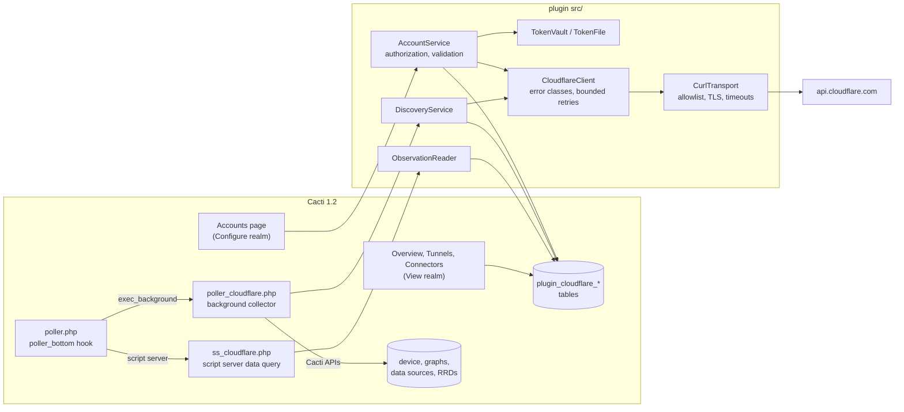

<!-- Source: README.md; SHA256: 813d1c85c236b426b83e42e63c69496f33f8909b5e435d0d45efa6a4ba2f17ca -->

<!-- translations:start -->
[English](../../../README.md) | [简体中文](../zh-CN/README.md) | [हिन्दी](../hi-IN/README.md) | [Español (España)](../es-ES/README.md) | [Español (Latinoamérica)](README.md) | [العربية (السعودية)](../ar-SA/README.md) | [Afrikaans](../af-ZA/README.md) | [አማርኛ](../am-ET/README.md) | [العربية (مصر)](../ar-EG/README.md) | [العربية (المغرب)](../ar-MA/README.md) | [বাংলা](../bn-BD/README.md) | [Bosanski](../bs-BA/README.md) | [Deutsch](../de-DE/README.md) | [فارسی](../fa-IR/README.md) | [Filipino](../fil-PH/README.md) | [Français](../fr-FR/README.md) | [Français (Maroc)](../fr-MA/README.md) | [Français (Sénégal)](../fr-SN/README.md) | [Hausa](../ha-NG/README.md) | [עברית](../he-IL/README.md) | [Hrvatski](../hr-HR/README.md) | [Bahasa Indonesia](../id-ID/README.md) | [Igbo](../ig-NG/README.md) | [Italiano](../it-IT/README.md) | [日本語](../ja-JP/README.md) | [한국어](../ko-KR/README.md) | [Malagasy](../mg-MG/README.md) | [मराठी](../mr-IN/README.md) | [Bahasa Melayu](../ms-MY/README.md) | [Nederlands](../nl-NL/README.md) | [Polski](../pl-PL/README.md) | [Português (Brasil)](../pt-BR/README.md) | [Русский](../ru-RU/README.md) | [Kinyarwanda](../rw-RW/README.md) | [Soomaali](../so-SO/README.md) | [Српски](../sr-RS/README.md) | [Svenska](../sv-SE/README.md) | [Kiswahili](../sw-KE/README.md) | [தமிழ்](../ta-IN/README.md) | [తెలుగు](../te-IN/README.md) | [ไทย](../th-TH/README.md) | [Türkçe](../tr-TR/README.md) | [Українська](../uk-UA/README.md) | [اردو](../ur-PK/README.md) | [Tiếng Việt](../vi-VN/README.md) | [isiXhosa](../xh-ZA/README.md) | [Yorùbá](../yo-NG/README.md) | [繁體中文](../zh-TW/README.md) | [isiZulu](../zu-ZA/README.md)
<!-- translations:end -->

<p align="center">
  
</p>

<a id="cloudflare-plugin-for-cacti"></a>
# Complemento Cloudflare para Cacti

[](https://github.com/somethingwithproof/plugin_cloudflare/actions/workflows/ci.yml)
[](https://sonarcloud.io/summary/new_code?id=somethingwithproof_plugin_cloudflare)
[](../../../LICENSE)


[](https://sonarcloud.io/summary/new_code?id=somethingwithproof_plugin_cloudflare)
[](https://sonarcloud.io/summary/new_code?id=somethingwithproof_plugin_cloudflare)
[](https://sonarcloud.io/summary/new_code?id=somethingwithproof_plugin_cloudflare)


Un complemento de Cacti 1.2 en desarrollo para supervisar Cloudflare Tunnels y la analítica de zonas. Lee la API de Cloudflare con tokens de API de ámbito limitado, nunca modifica Cloudflare y guarda sus datos en tablas propias. En Cacti copia un XML de consulta de datos a `resource/script_server/` y crea dispositivos, gráficos y plantillas mediante las API de Cacti, sin modificar archivos del núcleo.

**Estado: 0.4.0-dev, sin publicar.** La última versión estable es 0.3.0. La versión de desarrollo agrega exportación CSV del inventario, retiro explícito de túneles eliminados, analítica de zonas en caché y plantillas opcionales de Thold. Falta validar proveedores y despliegues reales.

La siguiente tabla describe la versión estable 0.3.0. Los cambios de desarrollo se describen más adelante, en Flujos de operación y analítica de zonas.

| Disponible ahora | Previsto |
|---|---|
| Instalación, actualización, desactivación y desinstalación mediante el gestor de complementos de Cacti | Analítica GraphQL y alertas de Thold (hito 4) |
| Permisos Cloudflare: View, Operator y Configure | Inyección de fallos, modelos TLA+ y documentación completa (hito 5) |
| Agregar, editar, eliminar, activar y desactivar cuentas de Cloudflare | |
| Guardar un token en un archivo o cifrado en la base de datos de Cacti | |
| Verificar un token y comprobar sus permisos de lectura de túneles y zonas | |
| Descubrimiento de túneles y conectores en un recolector en segundo plano iniciado por el sondeador principal | |
| Páginas Overview, Tunnels y Connectors en Management > Cloudflare Tunnels | |
| Seguimiento del ciclo de vida: `active`, `unavailable` y `deleted` | |
| Un dispositivo de Cacti por cuenta, creado por un administrador, con los túneles como índices de una consulta de datos | |
| Gráficos Connectors, Health y Collection por túnel, a partir de un archivo RRD por túnel | |
| Los valores que el complemento no puede garantizar se guardan como desconocidos (`U`), nunca como 0 | |

<a id="access-roles"></a>
## Roles de acceso

| Ámbito de permisos | Acceso |
| --- | --- |
| Cloudflare: View | Páginas de supervisión existentes. |
| Cloudflare: Operator | Supervisión, página Operations y confirmaciones personales de clasificación. |
| Cloudflare: Configure | Acceso de operador más las acciones de configuración y administración existentes. |

Tras copiar los archivos de actualización, abra Plugins como administrador para registrar el nuevo ámbito de permisos. Asigne explícitamente Operator en **Configuration > Users** o en los grupos de usuarios. Las actualizaciones conservan los ID y las concesiones existentes de View y Admin. En cada solicitud, Admin hereda Operator y Operator hereda View; esto no agrega concesiones almacenadas a usuarios ni grupos. Los ajustes del complemento también requieren Cloudflare: Configure además del permiso Settings de Cacti.

La visibilidad de cuentas de Cloudflare coincide con el ámbito View existente y abarca toda la cuenta. Las credenciales, la configuración, las asignaciones, la eliminación y otros cambios administrativos siguen en las páginas administrativas. Las confirmaciones solo duran durante la sesión del usuario actual, como máximo una hora y únicamente mientras siga vigente la misma observación. Las observaciones nuevas o modificadas las invalidan. Nunca convierten una medición fallida en saludable ni suprimen alertas.

<a id="why-this-plugin"></a>
## Motivo del complemento

Los operadores de Cacti que publican servicios mediante Cloudflare Tunnel no ven el estado interno del túnel en Cacti. Un túnel puede perder todos sus conectores mientras los hosts de origen siguen respondiendo a SNMP, de modo que los gráficos existentes permanecen en verde aunque los usuarios vean errores. Este complemento pretende situar la salud del túnel y el tráfico de zonas junto a los gráficos de dispositivos que los operadores ya consultan, sin dar a Cacti capacidad para modificar Cloudflare.

Tres restricciones determinan el diseño:

- **Solo lectura.** El complemento solo llama a endpoints `GET` y a la API GraphQL Analytics. No necesita permisos de edición sobre ningún recurso de Cloudflare.
- **Opcional.** Las interrupciones de Cloudflare, los tokens caducados y los límites de solicitudes no deben ralentizar la interfaz de Cacti ni detener el sondeo de otros dispositivos. Todas las llamadas a la API tienen tiempos de espera estrictos y la recopilación se ejecuta en un proceso en segundo plano iniciado por el sondeador.
- **Sin cambios en el núcleo.** El complemento utiliza los hooks de Cacti 1.2 y sus propias tablas. Copia un XML de consulta de datos a `resource/script_server/` y crea dispositivos, gráficos y plantillas mediante las API de Cacti. No modifica archivos del núcleo, por lo que no afecta a las actualizaciones de Cacti ni a otros complementos.

<a id="how-it-works"></a>
## Funcionamiento



- **Integración con Cacti** (`setup.php`, `includes/` y los scripts de página): registra hooks y ámbitos de permisos, representa las páginas mediante los ayudantes de Cacti y delega todas las acciones en la biblioteca de `src/`.
- **La biblioteca** (`src/`, espacio de nombres `Somethingwithproof\Cloudflare\`) no depende de variables globales de Cacti, por lo que se prueba con una base de datos real y un transporte HTTP simulado sin ejecutar Cacti.
- **Una única ruta de salida.** `CurlTransport` es el único código que accede a la red y solo acepta `https://api.cloudflare.com`. Cada fallo se asigna a una clase de error (`auth`, `permission`, `rate_limited`, `transient`, etc.), que determina el estado mostrado en la interfaz.
- **Almacenamiento** mediante la conexión PDO de Cacti con sentencias preparadas. Los cambios de esquema son migraciones numeradas e idempotentes.

Las decisiones de diseño y sus motivos están en [docs/design.md](../../design.md).

<a id="screenshots"></a>
## Capturas de pantalla

Las capturas proceden de un entorno de pruebas, no de una cuenta real de Cloudflare. El entorno ejecuta Cacti 1.2.31 con una API simulada de Cloudflare que devuelve datos de prueba, por lo que la cuenta, su ID y los tres túneles son ejemplos.


*Lista Cloudflare Accounts. La API simulada acepta el token, por lo que Verify informa de `ok`.*


*Edición de una cuenta. Los campos del token siempre están vacíos; el token guardado nunca se devuelve al navegador. Collect Tunnels y Create Graphs están activados y Collect Analytics desactivado. Connection Status muestra el resultado del último Verify: `ok`, lectura de túneles autorizada y lectura de zonas ausente.*


*Settings > Cloudflare.*


*Management > Cloudflare Tunnels > Overview. El estado es el peor estado de Cloudflare entre los túneles activos de la cuenta: aquí `down` porque un túnel de prueba está caído. `Disabled`, `Not collected`, `Collection failing` y `Not yet collected` tienen prioridad sobre la salud del túnel, en ese orden; por tanto, una cuenta cuya última ejecución haya fallado muestra `Collection failing`, independientemente de lo que indiquen sus túneles.*


*Pestaña Tunnels. Connectors y Connections muestran `-` para old-office, porque la API simulada responde a su solicitud de conexiones como si fuera un túnel desconocido y no se ha almacenado nada, y 0 para staging, que no tiene ningún conector en ejecución.*


*Gráfico Connectors del túnel blog. Las tres líneas valen 1 antes y después del hueco central, durante el cual la API simulada devolvió errores y el complemento guardó valores desconocidos. Las líneas no bajan a 0. El gráfico procede del mismo entorno de prueba (`make screenshots`), que establece un paso de 30 segundos para esta fuente de datos, de modo que siete minutos de sondeo llenen el gráfico.*

<a id="requirements"></a>
## Requisitos

- Cacti de 1.2.25 a 1.2.31. Cacti 1.2.31 requiere PHP 8.0 o posterior. CI solo prueba 1.2.31; la última prueba manual de 1.2.25 fue el 2026-10-22.
- PHP de 7.4 a 8.4 con las extensiones `curl`, `openssl` y `pdo_mysql`. El complemento no permite activarse sin ellas.
- MariaDB 10.6 o posterior, o MySQL 8.0 o posterior.
- Acceso HTTPS desde el servidor Cacti a `api.cloudflare.com`. No se admiten proxies.

Consulte las pruebas realizadas en [docs/compatibility.md](docs/compatibility.md).

<a id="install"></a>
## Instalación

1. Coloque el complemento en `plugins/cloudflare` de Cacti, extrayendo el archivo de [GitHub Releases](https://github.com/somethingwithproof/plugin_cloudflare/releases) (`make package` ejecutado en una copia de trabajo de la etiqueta de publicación genera el mismo archivo) o clonándolo con git. El directorio debe llamarse `cloudflare`.
2. Instálelo y actívelo desde Console > Configuration > Plugins, o mediante la CLI como usuario del servidor web:

   ```sh
   php cli/plugin_manage.php --plugin=cloudflare --install --enable
   ```

3. El usuario administrador recibe el permiso Cloudflare: Configure durante la instalación. Concédalo a otros usuarios o grupos en Console > Configuration > Users.
4. Cree un token con los permisos de [docs/token-permissions.md](docs/token-permissions.md): Account > Cloudflare Tunnel > Read y, opcionalmente, Zone > Zone > Read.
5. Guarde el token de una de las dos maneras siguientes, agregue la cuenta en Console > Configuration > Cloudflare Accounts y ejecute Verify desde el menú de acciones.

<a id="option-a-encrypted-in-the-database"></a>
### Opción A: cifrado en la base de datos

El complemento cifra los tokens con una clave de 32 bytes que usted crea. Nunca crea ni escribe la clave por sí mismo. El archivo debe ser legible por los usuarios del servidor web y del sondeador, pero no por otros, y el directorio debe permitir que dichos usuarios accedan a él. Para un servidor web que se ejecute como `www-data`:

```sh
sudo mkdir -p /etc/cacti
sudo sh -c 'umask 077 && openssl rand -hex 32 > /etc/cacti/cloudflare.key'
sudo chgrp www-data /etc/cacti/cloudflare.key
sudo chmod 0440 /etc/cacti/cloudflare.key
```

La ruta predeterminada es `/etc/cacti/cloudflare.key`; cámbiela en Settings > Cloudflare > Token Vault Key File. Cuando la clave falta o se rechaza, el formulario de edición solo ofrece la opción de archivo de token. Guarde una copia de seguridad de la clave: sin ella, los tokens almacenados no pueden descifrarse y deben introducirse de nuevo.

<a id="rotating-the-key"></a>
#### Rotación de la clave

No existe una orden para renovar la clave. Una clave nueva no puede descifrar tokens guardados con la anterior, por lo que la rotación exige introducir de nuevo cada token almacenado:

1. Tenga a mano el valor del token de cada cuenta. Cloudflare solo muestra el valor al crearlo o renovarlo; si ya no lo tiene, renueve el token en el panel de Cloudflare.
2. Cree la nueva clave en una ruta nueva mediante las órdenes anteriores, por ejemplo `/etc/cacti/cloudflare.key.new`, con el mismo propietario y modo.
3. Cambie Settings > Cloudflare > Token Vault Key File a la nueva ruta y guarde. Desde ese momento, Verify informa «Stored token cannot be decrypted» para una cuenta aún cifrada con la clave antigua, y cada ejecución del recolector registra `discovery token unavailable` con `reason=decrypt_failed` para ella.
4. Para cada cuenta que guarde su token en la base de datos, ábrala en Console > Configuration > Cloudflare Accounts, pegue el token en ambos campos, guarde y ejecute Verify. Debe informar `ok`.
5. Cuando todas esas cuentas se verifiquen correctamente, elimine el archivo de la clave antigua y sus copias de seguridad.

Entre los pasos 3 y 4 no se actualizan los túneles de la cuenta y sus gráficos de salud, conectores y conexiones registran U. Las cuentas con archivo de token no se ven afectadas.

<a id="option-b-token-file"></a>
### Opción B: archivo de token

Escriba únicamente el token en un archivo que puedan leer los usuarios del servidor web y del sondeador, pero no otros, e introduzca su ruta absoluta en el formulario:

```sh
sudo sh -c 'umask 077 && cat > /etc/cacti/cloudflare-account.token'   # paste the token, then Ctrl-D
sudo chgrp www-data /etc/cacti/cloudflare-account.token
sudo chmod 0440 /etc/cacti/cloudflare-account.token
```

El archivo se comprueba al leerlo durante Verify, no al guardar. Se rechazan enlaces simbólicos, archivos de más de 4 KiB y archivos que otros usuarios puedan leer o escribir.

Cualquiera con Cloudflare: Configure puede introducir cualquier ruta, que leerá el usuario del sondeador. Para mantener los archivos de token en una ubicación, configure Settings > Cloudflare > Token File Directory, por ejemplo como `/etc/cacti`; se rechazará cualquier ruta exterior. Consulte [docs/security.md](docs/security.md#token-file).

<a id="upgrade"></a>
## Actualización

1. Sustituya los archivos de `plugins/cloudflare` por la nueva publicación, manteniendo el nombre del directorio.
2. Abra una vez como administrador Console > Configuration > Plugins o Console > Configuration > Cloudflare Accounts. Esto ejecuta las migraciones, importa las plantillas Cloudflare y copia el archivo de consulta de datos (véase [Métricas y gráficos de túneles](#tunnel-metrics-and-graphs)); al actualizar desde 0.1.0 también registra el hook `poller_bottom`.

`poller.php` no ejecuta la actualización del complemento, por lo que falta el esquema nuevo hasta completar el paso 2. Entretanto, cada ejecución del recolector no hace nada y registra `CLOUDFLARE: collector skipped; plugin upgrade pending, open Console > Plugins`. Las páginas Cloudflare Tunnels solo necesitan Cloudflare: View, de modo que nunca ejecutan la actualización y pueden mostrar «The Cloudflare tunnels could not be read» hasta completar el paso 2.

<a id="account-status"></a>
## Estado de la cuenta

Verify establece el estado de la cuenta:

| Estado | Significado |
|---|---|
| `unknown` | No se ha verificado desde que se agregó la cuenta o se cambiaron sus credenciales |
| `ok` | El token está activo y puede leer túneles |
| `token_inactive` | Cloudflare informa que el token está desactivado o caducado |
| `auth_failed` | Cloudflare ha rechazado el token por ser inválido o haber caducado (HTTP 401) |
| `permission_denied` | El token está activo pero no puede leer túneles, o carece de permisos para llamar a los endpoints de verificación (HTTP 403) |
| `unreachable` | No se ha podido acceder a la API, se ha agotado el tiempo de espera o ha devuelto un error de servidor |
| `rate_limited` | Cloudflare ha devuelto HTTP 429 |
| `error` | Cualquier otro fallo, incluido un archivo de token ausente o inseguro, un archivo de clave de bóveda ausente o inutilizable, o un token almacenado que no pueda descifrarse |

La página de edición también muestra si se han autorizado las lecturas de túneles y zonas.

<a id="tunnel-discovery"></a>
## Descubrimiento de túneles

Tras cada ciclo de sondeo del sondeador principal, el hook `poller_bottom` inicia un recolector en segundo plano mediante `exec_background` cuando al menos una cuenta activada tiene Collect Tunnels activado. El recolector nunca se ejecuta dentro del proceso del sondeador, por lo que una API lenta de Cloudflare no retrasa `poller.php`. Los sondeadores remotos nunca lo inician.

Para cada cuenta pendiente, el recolector enumera los túneles y después lee las conexiones de los túneles activos, obteniendo los conectores, sus versiones, centros de datos y direcciones de origen. Las cuentas vencen cada Discovery Interval (300 segundos de forma predeterminada). Una ejecución no inicia cuentas nuevas pasados 50 segundos y hace como máximo 200 solicitudes de conexiones. Cualquiera de los límites puede detener una cuenta a mitad de lectura; esa cuenta queda como `partial` y la próxima ejecución continúa con los túneles cuyo último intento sea más antiguo. Las cuentas no iniciadas siguen pendientes para la siguiente ejecución.

Un túnel tiene un ciclo de vida independiente del estado de Cloudflare (`healthy`, `degraded`, `down` o `inactive`):

| Ciclo de vida | Significado |
|---|---|
| `active` | El túnel aparecía en la última enumeración completa |
| `deleted` | Una enumeración completa no lo incluía, también si estaba vacía. La fila y su historial se conservan, y el túnel vuelve a `active` si reaparece |
| `unavailable` | Tres interrupciones contabilizadas sin una enumeración completa intermedia dejan desconocido el estado del túnel |

Solo una enumeración completa y correcta agrega, actualiza o elimina túneles; una enumeración fallida nunca elimina ninguno. La imposibilidad de leer Cloudflare (`transient`, `rate_limited`, `auth` o `permission`) cuenta como interrupción; después de tres interrupciones contabilizadas sin una enumeración completa intermedia, los túneles activos pasan a `unavailable`. La siguiente enumeración completa los restaura y reinicia el contador. Si Cloudflare ya no conoce un túnel al leer sus conexiones, se omite sin hacer fallar la cuenta. Los demás fallos no incrementan ni reinician el contador de interrupciones.

En `cacti.log`, las líneas de descubrimiento empiezan por `CLOUDFLARE: discovery` y el resumen de ejecución por `CLOUDFLARE: collector`. Los fallos y cambios de ciclo de vida, como una enumeración fallida o túneles marcados `unavailable`, se registran al nivel predeterminado `LOW` de Cacti; el resultado de cada cuenta y el resumen se registran en `MEDIUM`. Como la lectura de conexiones puede fallar en todos los túneles, por cada cuenta solo se registra el primer fallo de cada clase en `LOW`, el resto en `MEDIUM`, seguido de una línea `LOW` por clase con el número de túneles fallidos.

Management > Cloudflare Tunnels requiere Cloudflare: View y es de solo lectura:

- **Overview** enumera cada cuenta con su estado, recuentos de túneles por ciclo de vida, último descubrimiento correcto y número de fallos consecutivos.
- **Tunnels** enumera túneles de todas las cuentas o de una, con filtros por cuenta, ciclo de vida, estado y nombre, y columnas ordenables.
- **Connectors** muestra los conectores del túnel seleccionado en Tunnels.

<a id="tunnel-metrics-and-graphs"></a>
## Métricas y gráficos de túneles

Cacti lee el estado mediante una consulta de datos del servidor de scripts, `ss_cloudflare.php`. Solo responde desde las tablas del complemento y nunca llama a Cloudflare, por lo que una interrupción de Cloudflare no puede ralentizar el sondeador. Cada túnel proporciona seis valores: salud (healthy 3, degraded 2, down 1, inactive 0), conectores, conexiones, versiones de conectores, segundos desde la última lectura de conexiones y fallos consecutivos de la tarea de descubrimiento. Salud, conectores, conexiones y versiones solo se imprimen cuando el complemento puede garantizarlos: el último descubrimiento tuvo éxito, el túnel está `active` y la lectura es reciente. En caso contrario son `U` y el gráfico muestra un hueco, en lugar de un cero que parecería una interrupción. Los dos valores de recopilación siguen imprimiéndose durante una interrupción, para reflejarla en Collection; solo son `U` si el túnel está eliminado o sus conexiones nunca se han actualizado. Las reglas están en [docs/metrics.md](docs/metrics.md).

<a id="create-the-device"></a>
### Creación del dispositivo

Una cuenta se asigna como máximo a un dispositivo de Cacti. El dispositivo contiene los túneles como índices de la consulta Cloudflare Tunnels. No se crea automáticamente:

1. Abra Console > Configuration > Cloudflare Accounts.
2. Seleccione la cuenta, elija Create Cacti Device en el menú de acciones y confirme.

La acción requiere Cloudflare: Configure y el ámbito Sites/Devices/Data de Cacti (el de `host.php`). La entrada solo aparece para quienes tienen ambos y el servidor rechaza las solicitudes de los demás. El dispositivo se llama `Cloudflare: <account name>`, utiliza la plantilla de host Cloudflare Account y el sondeador principal, tiene versión SNMP 0, no comprueba disponibilidad y recibe el nombre de host `<account ID>.cloudflare.invalid`. Ese nombre está reservado y nunca se resuelve; Cacti no se conecta a él. Si la cuenta ya tiene dispositivo, la acción lo indica y no cambia nada. Si un administrador elimina el dispositivo en Cacti, el complemento no crea otro hasta volver a ejecutar Create Cacti Device.

<a id="create-graphs"></a>
### Creación de gráficos

Create Graphs está desactivado de forma predeterminada en el formulario de cuenta. Si está activado, cuando un descubrimiento termina en `ok` o `partial`, el recolector reindexa el dispositivo y crea los gráficos que falten para sus túneles `active`: Connectors, Health y Collection, tres por túnel. Los tres comparten un archivo RRD. Cada ejecución crea como máximo 50 gráficos y se detiene pasados 20 segundos; la siguiente continúa. El complemento nunca elimina objetos de Cacti. No recrea un gráfico eliminado por un administrador y los túneles que Cloudflare deja de enumerar conservan su gráfico y RRD, que muestran `U`.

Activar Create Graphs requiere ambos ámbitos; desactivarlo solo requiere Configure. Si un usuario sin Sites/Devices/Data guarda el formulario, el ajuste queda como estaba y se muestra una advertencia. Con Create Graphs desactivado, el dispositivo sigue reindexándose tras cada descubrimiento, por lo que los túneles nuevos aparecen como índices de la consulta.

<a id="the-data-query-file"></a>
### Archivo de consulta de datos

Cacti 1.2.31 solo lee XML de consulta de datos dentro de su directorio `resource`. Por ello, al instalar y actualizar, el complemento copia `templates/resource/cloudflare_tunnels.xml` a `<Cacti>/resource/script_server/cloudflare_tunnels.xml`. Es el único archivo que escribe fuera de su directorio, por lo que el usuario que instala o actualiza debe poder escribir allí. La desinstalación conserva el archivo, junto con dispositivos, gráficos, RRD y plantillas. Si falla la copia o la importación de plantillas, el complemento lo registra y Create Cacti Device vuelve a intentarlo.

<a id="settings"></a>
## Ajustes

Settings > Cloudflare contiene:

- **Token Vault Key File**: ruta a la clave de la bóveda.
- **Token File Directory**: si se establece, se rechazan archivos de token externos. Vacío de forma predeterminada, lo que permite cualquier ruta. Véase [docs/security.md](docs/security.md#token-file).
- **Interactive Request Timeout**: segundos totales para una solicitud desde la interfaz web, como Verify. Predeterminado 10; los valores fuera de 5 a 60 vuelven a 10.
- **Collector Request Timeout**: segundos totales para una solicitud del recolector en segundo plano. Predeterminado 20; los valores fuera de 5 a 60 vuelven a 20.
- **Log Level**: se guarda, pero todavía no lo lee ningún componente.

En el formulario de cuenta, Collect Tunnels y Discovery Interval controlan el descubrimiento, y Create Graphs la creación de gráficos. Collect Analytics se guarda y no tiene efecto en esta publicación.

<a id="languages"></a>
## Idiomas

El complemento incluye traducciones al español de España (`es-ES`), francés (`fr-FR`), alemán (`de-DE`), chino simplificado (`zh-CN`), japonés (`ja-JP`), hindi (`hi-IN`) y árabe (`ar-SA`). Cacti las muestra al activar la compatibilidad de idiomas en Configuration > Settings > General > Language Support y seleccionar un idioma en el usuario. También incluye un catálogo de español latinoamericano (`es-419`), pero Cacti 1.2 no ofrece esa configuración regional; solo tendrá efecto cuando Cacti la agregue. Mientras tanto, seleccione español (`es-ES`).

Parte del texto permanece en inglés: los estados que el complemento guarda y muestra sin cambios (`ok`, `active`, `unavailable`, `deleted` y el estado de túnel indicado por Cloudflare), y todo lo que escribe en el registro de Cacti.

<a id="uninstall-and-data-retention"></a>
## Desinstalación y conservación de datos

La desinstalación elimina las tablas propias, que contienen cuentas, tokens cifrados, túneles descubiertos, estado de tareas y el registro de objetos de Cacti creados, y borra los ajustes `cloudflare_`. No elimina el archivo de clave, los archivos de token, la copia de `resource/script_server/cloudflare_tunnels.xml` ni dispositivos, gráficos, fuentes de datos, RRD o plantillas de Cacti. Estos contienen datos históricos de supervisión, cuya eliminación es una acción explícita del administrador en Cacti.

El dispositivo conservado deja de recibir datos. Tras desinstalar o eliminar su cuenta, ninguna cuenta posee el host, por lo que sus gráficos conservan el historial pero imprimen `U` desde ese momento. Create Cacti Device en una cuenta reinstalada o agregada de nuevo crea un dispositivo nuevo; no reutiliza el anterior. Elimine el dispositivo antiguo en Cacti cuando ya no necesite su historial.

<a id="known-limitations"></a>
## Limitaciones conocidas

- Cada ejecución hace como máximo 200 solicitudes de conexiones. Los túneles que superan ese límite se actualizan con menos frecuencia que la ventana de observación y sus gráficos de conexiones muestran huecos.
- El complemento sobrescribe los cambios administrativos en las plantillas importadas cuando una actualización cambia el XML distribuido.
- El dispositivo de la cuenta debe permanecer en el sondeador principal. Las tablas del complemento están en la base de datos principal y el script las lee allí.
- Los túneles eliminados permanecen en el índice de consulta con sus gráficos y RRD e imprimen `U`.
- Cacti desactiva un complemento cuyo código termina con un error fatal real, como agotar la memoria. Véase [docs/security.md](docs/security.md).

<a id="security"></a>
## Seguridad

- Se rechazan las claves de API globales; solo se aceptan tokens de ámbito limitado.
- Los tokens se guardan en un archivo que usted prepara o cifrados con AES-256-GCM mediante una clave de archivo que nunca entra en la base de datos. Nunca se muestran en páginas, se escriben en registros ni se incluyen en mensajes de error.
- Los errores de base de datos solo incluyen SQLSTATE y el código del controlador, nunca los valores de la sentencia.
- Cada cambio es un POST protegido por el token CSRF de Cacti. Los cambios administrativos de cuentas y configuración requieren Cloudflare: Configure; los reconocimientos personales de triaje requieren Cloudflare: Operator. Crear un dispositivo Cacti o activar Create Graphs también exige Sites/Devices/Data de Cacti. Un complemento desactivado rechaza sus páginas.

Los detalles y limitaciones están en [docs/security.md](docs/security.md). Comunique vulnerabilidades de forma privada como se indica en [SECURITY.md](../../../SECURITY.md).

<a id="roadmap"></a>
## Flujos de operación y analítica de zonas

La versión de desarrollo permite retirar explícitamente túneles eliminados, recopilar analítica según las capacidades de cada zona y utilizar plantillas de Cacti y Thold. Estas novedades todavía no se publicaron ni se validaron con cuentas reales. La configuración, el significado de las métricas y los límites de validación están en la [guía en inglés](../../analytics-and-alerting.md).

### Exportación del inventario

Las páginas de túneles y conectores ofrecen Exportar a los usuarios de Cloudflare: View. El CSV de túneles incluye todas las páginas que coinciden y conserva los filtros de cuenta, ciclo de vida, estado y búsqueda, además del orden. El CSV de conectores incluye versión, arquitectura, centros de datos y direcciones de origen del túnel seleccionado. Solo se leen registros en caché. Los conteos desconocidos quedan vacíos y las celdas similares a fórmulas llevan un apóstrofo inicial para importarlas de forma segura.

## Hoja de ruta

Cada hito se publica como una versión 0.x con su número: el hito 3 es 0.3.0 y el 4 será 0.4.0. Los hitos 1 y 2 no se publicaron por separado y forman parte de 0.3.0. La versión 1.0.0 se reserva para la publicación que complete todos los hitos siguientes.

| Hito | Alcance | Estado |
|---|---|---|
| 1. Base | Ciclo de vida del complemento, permisos, configuración de cuentas y prueba de conexión | Publicado en 0.3.0 ([#2](https://github.com/somethingwithproof/plugin_cloudflare/pull/2) a [#5](https://github.com/somethingwithproof/plugin_cloudflare/pull/5)) |
| 2. Descubrimiento | Descubrimiento de túneles y conectores en segundo plano, páginas Overview, Tunnels y Connectors | Publicado en 0.3.0 ([#6](https://github.com/somethingwithproof/plugin_cloudflare/pull/6)) |
| 3. Métricas | Fuentes de datos de salud de túneles, plantillas de gráficos y gestión de interrupciones sin registrar ceros inventados | Publicado en 0.3.0 ([#7](https://github.com/somethingwithproof/plugin_cloudflare/pull/7)) |
| 4. Analítica y alertas | Analítica GraphQL por zona adaptada al plan, umbrales de Thold con supresión durante interrupciones | Previsto |
| 5. Refuerzo | Inyección de fallos, modelos TLA+ del descubrimiento y la recopilación, documentación completa | Previsto |

<a id="development"></a>
## Desarrollo

Las herramientas requieren PHP 8.x y Composer; el código del complemento sigue siendo compatible con PHP 7.4. Las pruebas de integración y BDD necesitan una base de datos, que `make db-up` inicia en Docker en el puerto 33061.

```sh
composer install
make db-up
make ci            # unit, integration, BDD, PHPStan, php-cs-fixer, php -l on PHP 7.4
make smoke         # installs the plugin into Cacti 1.2.31 in Docker and walks its lifecycle
make package       # builds build/cloudflare-<version>.tar.gz and checks its contents
make db-down
```

`make smoke` y `make screenshots` necesitan una copia de trabajo de Cacti; establezca `CACTI_REPO` con su ruta. Las pruebas de integración leen `CF_TEST_DSN`, `CF_TEST_DB_USER` y `CF_TEST_DB_PASS` y se omiten cuando la base de datos no está disponible, salvo que esté definido `CI`.

<a id="contributing"></a>
## Contribuciones

Se aceptan solicitudes de incorporación. Cada commit necesita una firma DCO (`git commit -s`). Escriba primero la prueba; `make ci` debe pasar y los cambios de integración con Cacti también deben superar `make smoke`. El código debe seguir siendo compatible con PHP 7.4 y respetar el estilo de Cacti: tabuladores, comillas simples y llaves en la misma línea.

<a id="translations"></a>
### Traducciones

Los mensajes se marcan con `__('...', 'cloudflare')`. `locales/build_gettext.sh` (`make i18n`, que necesita GNU gettext) regenera `locales/po/cacti.pot`, lo fusiona con cada catálogo `locales/po/<locale>.po` y compila `locales/LC_MESSAGES/<locale>.mo`; incluya los tres en el commit. CI ejecuta `make i18n-check`, que falla si falta una entrada, hay una entrada fuzzy, difiere una cadena de formato o el compilado está desactualizado; las pruebas unitarias también comprueban los marcadores, las etiquetas HTML y los espacios al principio y al final de cada entrada. Por ello, cambiar un mensaje exige actualizar sus traducciones en la misma solicitud. Un idioma nuevo requiere un `<locale>.po` con el nombre de configuración regional de Cacti (por ejemplo `pt-BR`), agregado a `CatalogTest::LOCALES` y a la comprobación del archivo en `tests/build/package.sh`. Conserve los nombres Cloudflare, Cacti y Thold, API y GraphQL, y los nombres de permisos como `Account Cloudflare Tunnel Read`.

<a id="documentation"></a>
## Documentación

- [docs/security.md](docs/security.md): controles de seguridad y limitaciones conocidas
- [docs/token-permissions.md](docs/token-permissions.md): permisos de tokens
- [docs/compatibility.md](docs/compatibility.md): versiones compatibles e interfaces utilizadas
- [docs/metrics.md](docs/metrics.md): catálogo de métricas y cuándo un valor es desconocido
- [docs/collector-protocol.md](../../collector-protocol.md): qué lee e imprime `ss_cloudflare.php`
- [docs/schema.md](../../schema.md): tablas de base de datos
- [docs/design.md](../../design.md): decisiones de diseño
- [CHANGELOG.md](../../../CHANGELOG.md)

<a id="license"></a>
## Licencia

GPL-2.0-or-later. Consulte [LICENSE](../../../LICENSE).

<a id="trademarks"></a>
## Marcas comerciales

Cloudflare es una marca registrada de Cloudflare, Inc. Este proyecto es una herramienta independiente de código abierto y no está afiliado a Cloudflare, Inc., ni patrocinado ni respaldado por dicha empresa.

El proyecto tampoco está afiliado al proyecto Cacti. Consulte [docs/images/README-logo.md](../../images/README-logo.md) para obtener información sobre el logotipo.
