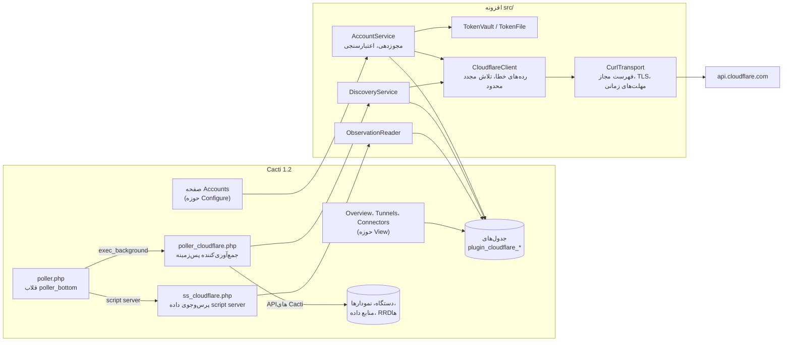

<!-- Source: README.md; SHA256: f8de0e02c5904e15bfa4c71edcaab219e5e5d4f6d9dbe589f4ed16351df6bf4d -->

<!-- translations:start -->
[English](../../../README.md) | [简体中文](../zh-CN/README.md) | [हिन्दी](../hi-IN/README.md) | [Español (España)](../es-ES/README.md) | [Español (Latinoamérica)](../es-419/README.md) | [العربية (السعودية)](../ar-SA/README.md) | [Afrikaans](../af-ZA/README.md) | [አማርኛ](../am-ET/README.md) | [العربية (مصر)](../ar-EG/README.md) | [العربية (المغرب)](../ar-MA/README.md) | [বাংলা](../bn-BD/README.md) | [Bosanski](../bs-BA/README.md) | [Deutsch](../de-DE/README.md) | [فارسی](README.md) | [Filipino](../fil-PH/README.md) | [Français](../fr-FR/README.md) | [Français (Maroc)](../fr-MA/README.md) | [Français (Sénégal)](../fr-SN/README.md) | [Hausa](../ha-NG/README.md) | [עברית](../he-IL/README.md) | [Hrvatski](../hr-HR/README.md) | [Bahasa Indonesia](../id-ID/README.md) | [Igbo](../ig-NG/README.md) | [Italiano](../it-IT/README.md) | [日本語](../ja-JP/README.md) | [한국어](../ko-KR/README.md) | [Malagasy](../mg-MG/README.md) | [मराठी](../mr-IN/README.md) | [Bahasa Melayu](../ms-MY/README.md) | [Nederlands](../nl-NL/README.md) | [Polski](../pl-PL/README.md) | [Português (Brasil)](../pt-BR/README.md) | [Русский](../ru-RU/README.md) | [Kinyarwanda](../rw-RW/README.md) | [Soomaali](../so-SO/README.md) | [Српски](../sr-RS/README.md) | [Svenska](../sv-SE/README.md) | [Kiswahili](../sw-KE/README.md) | [தமிழ்](../ta-IN/README.md) | [తెలుగు](../te-IN/README.md) | [ไทย](../th-TH/README.md) | [Türkçe](../tr-TR/README.md) | [Українська](../uk-UA/README.md) | [اردو](../ur-PK/README.md) | [Tiếng Việt](../vi-VN/README.md) | [isiXhosa](../xh-ZA/README.md) | [Yorùbá](../yo-NG/README.md) | [繁體中文](../zh-TW/README.md) | [isiZulu](../zu-ZA/README.md)
<!-- translations:end -->

<p align="center">
  
</p>

# افزونه Cloudflare برای Cacti

[](https://github.com/somethingwithproof/plugin_cloudflare/actions/workflows/ci.yml)
[](https://sonarcloud.io/summary/new_code?id=somethingwithproof_plugin_cloudflare)
[](../../../LICENSE)


[](https://sonarcloud.io/summary/new_code?id=somethingwithproof_plugin_cloudflare)
[](https://sonarcloud.io/summary/new_code?id=somethingwithproof_plugin_cloudflare)
[](https://sonarcloud.io/summary/new_code?id=somethingwithproof_plugin_cloudflare)


یک افزونه برای Cacti 1.2 که برای پایش Cloudflare Tunnelها و تحلیل‌های ناحیه (zone analytics) ساخته می‌شود. این افزونه با توکن‌های API دارای دسترسی محدود از API کلودفلر می‌خواند، هرگز چیزی را در Cloudflare تغییر نمی‌دهد و داده‌های خود را در جدول‌های اختصاصی خودش نگه می‌دارد. در Cacti، فایل‌های XML پرس‌وجوی داده را در `resource/script_server/` کپی می‌کند و دستگاه‌ها، نمودارها و قالب‌ها را از طریق APIهای خود Cacti، بدون تغییر در فایل‌های هسته، ایجاد می‌کند.

**وضعیت: 0.4.0-dev، منتشرنشده.** آخرین نسخه منتشرشده 0.3.0 است. نسخه توسعه‌ای، خروجی CSV فهرست موجودی، بازنشستگی صریح تونل‌های حذف‌شده، تحلیل‌های ناحیه ذخیره‌شده در حافظه نهان و قالب‌های اختیاری Thold را اضافه می‌کند. ارزیابی ارائه‌دهنده زنده و استقرار همچنان در انتظار انجام است.

جدول زیر نسخه پایدار 0.3.0 را توصیف می‌کند. موارد اضافه‌شده در نسخه توسعه‌ای در بخش‌های گردش‌کار اپراتور و تحلیل‌های ناحیه در زیر توضیح داده شده‌اند.

| اکنون در دسترس | برنامه‌ریزی‌شده |
|---|---|
| نصب، ارتقا، غیرفعال‌سازی و حذف از طریق مدیر افزونه‌های Cacti | تحلیل‌های GraphQL و هشدارهای Thold (نقطه عطف ۴) |
| مجوزهای Cloudflare: View، Operator و Configure | تزریق خطا، مدل‌های TLA+ و مستندات کامل (نقطه عطف ۵) |
| افزودن، ویرایش، حذف، فعال‌سازی و غیرفعال‌سازی حساب‌های Cloudflare | |
| ذخیره توکن در یک فایل یا به صورت رمزنگاری‌شده در پایگاه داده Cacti | |
| اعتبارسنجی توکن و بررسی مجوزهای خواندن تونل و ناحیه آن | |
| کشف تونل و اتصال‌دهنده در یک جمع‌آوری‌کننده پس‌زمینه که توسط poller اصلی آغاز می‌شود | |
| صفحه‌های Overview، Tunnels و Connectors در مسیر Management > Cloudflare Tunnels | |
| ردیابی چرخه حیات: `active`، `unavailable` و `deleted` | |
| یک دستگاه Cacti به ازای هر حساب، ایجادشده توسط مدیر، با تونل‌ها به عنوان اندیس‌های یک پرس‌وجوی داده | |
| نمودارهای Connectors، Health و Collection به ازای هر تونل، رسم‌شده از یک فایل RRD برای هر تونل | |
| مقادیری که افزونه نمی‌تواند صحت آن‌ها را تایید کند به صورت نامشخص (`U`) ذخیره می‌شوند و هرگز به عنوان 0 ذخیره نمی‌شوند | |

## نقش‌های دسترسی

| حوزه (Realm) | دسترسی |
| --- | --- |
| Cloudflare: View | صفحه‌های پایش موجود. |
| Cloudflare: Operator | پایش به علاوه صفحه Operations و تاییدیه‌های شخصی تریاژ. |
| Cloudflare: Configure | دسترسی Operator به علاوه پیکربندی موجود و اقدام‌های مدیریتی. |

پس از کپی کردن فایل‌های ارتقا، صفحه Plugins را به عنوان مدیر باز کنید تا حوزه جدید ثبت شود. حوزه Operator را به صورت صریح در بخش **Configuration > Users** یا گروه‌های کاربری تخصیص دهید. ارتقاها شناسه‌ها و مجوزهای موجود حوزه‌های View و Admin را حفظ می‌کنند. دسترسی Admin دسترسی Operator را به ارث می‌برد و دسترسی Operator در هر درخواست دسترسی View را به ارث می‌برد؛ این کار مجوز ذخیره‌شده‌ای به کاربران یا گروه‌ها اضافه نمی‌کند. تنظیمات افزونه نیز علاوه بر مجوز Settings در Cacti، به دسترسی Cloudflare: Configure نیاز دارند.

نمایانی حساب‌های Cloudflare با حوزه View موجود مطابقت دارد؛ این سطح در مقیاس کل حساب است. گواهی‌نامه‌ها، پیکربندی، نگاشت، حذف و سایر تغییرات مدیریتی در صفحه‌های مدیریتی باقی می‌مانند. تاییدیه‌ها فقط در نشست فعلی کاربر، حداکثر به مدت یک ساعت و تنها تا زمانی که همان مشاهده تازه باقی بماند، دوام دارند. مشاهدات جدید یا تغییریافته آن‌ها را نامعتبر می‌کنند. این تاییدیه‌ها هرگز یک اندازه‌گیری ناموفق را سالم علامت‌گذاری نمی‌کنند یا هشدارها را سرکوب نمی‌کنند.

## چرا این افزونه

اپراتورهای Cacti که سرویس‌ها را از طریق Cloudflare Tunnel منتشر می‌کنند، هیچ دیدی نسبت به تونل در داخل Cacti ندارند. یک تونل می‌تواند تمام اتصال‌دهنده‌های خود را از دست بدهد در حالی که میزبان‌های مبدا همچنان به SNMP پاسخ می‌دهند؛ بنابراین نمودارهای موجود سبز می‌مانند در حالی که کاربران با خطا مواجه می‌شوند. هدف این افزونه قرار دادن وضعیت سلامت تونل و ترافیک ناحیه در کنار نمودارهای دستگاهی است که اپراتورها از قبل رصد می‌کنند، بدون آنکه به Cacti هیچ توانایی برای تغییر Cloudflare بدهد.

سه محدودیت طراحی را شکل می‌دهند:

- **فقط خواندنی.** افزونه فقط نقاط پایانی `GET` و API تحلیل GraphQL را فراخوانی می‌کند. به هیچ مجوز ویرایشی روی هیچ منبع Cloudflare نیازی ندارد.
- **اختیاری.** قطعی‌های Cloudflare، توکن‌های منقضی‌شده و محدودیت‌های نرخ نباید رابط کاربری Cacti را کند کنند یا polling سایر دستگاه‌ها را متوقف سازند. تمام فراخوانی‌های API مهلت زمانی سخت دارند و جمع‌آوری در یک پردازش پس‌زمینه که توسط poller راه‌اندازی می‌شود اجرا می‌گردد.
- **بدون تغییر هسته.** افزونه از قلاب‌های افزونه Cacti 1.2 و جدول‌های خودش استفاده می‌کند. یک فایل XML پرس‌وجوی داده را در `resource/script_server/` کپی می‌کند و دستگاه‌ها، نمودارها و قالب‌ها را از طریق APIهای خود Cacti می‌سازد. هیچ تغییری در فایل‌های هسته داده نمی‌شود، بنابراین ارتقاهای Cacti و سایر افزونه‌ها تحت تاثیر قرار نمی‌گیرند.

## نحوه کارکرد



- **بخش اتصال به Cacti** (`setup.php`، `includes/`، اسکریپت‌های صفحه) قلاب‌ها و حوزه‌ها را ثبت می‌کند، صفحه‌ها را با توابع کمکی خود Cacti رندر می‌کند و هر اقدامی را به کتابخانه موجود در `src/` واگذار می‌کند.
- **کتابخانه** (`src/`، فضای نام `Somethingwithproof\Cloudflare\`) هیچ وابستگی به متغیرهای سراسری Cacti ندارد، بنابراین در برابر یک پایگاه داده واقعی و یک لایه انتقال HTTP ساختگی بدون نیاز به اجرای Cacti آزمایش می‌شود.
- **یک مسیر خروجی واحد.** `CurlTransport` تنها کدی است که با شبکه در ارتباط است و فقط `https://api.cloudflare.com` را می‌پذیرد. هر خطا به یک رده خطا (`auth`، `permission`، `rate_limited`، `transient`، ...) نگاشت می‌شود که وضعیت نمایش‌داده‌شده در رابط کاربری را تعیین می‌کند.
- **ذخیره‌سازی** از طریق اتصال PDO خود Cacti با دستورات آماده‌شده انجام می‌شود. تغییرات طرحواره به صورت مهاجرت‌های شماره‌گذاری‌شده و تکرارپذیر (idempotent) هستند.

تصمیم‌های طراحی و دلایل آن‌ها در [docs/design.md](../../design.md) آمده است.

## تصاویر صفحه

تصاویر صفحه از یک پشته آزمایشی گرفته شده‌اند، نه از یک حساب زنده Cloudflare. این پشته Cacti 1.2.31 را در برابر یک API ساختگی Cloudflare اجرا می‌کند که داده‌های ثابت آزمایشی (fixture) برمی‌گرداند؛ بنابراین حساب، شناسه آن و سه تونل نمونه‌های جایگزین هستند.


*فهرست حساب‌های Cloudflare. API ساختگی توکن را می‌پذیرد، بنابراین Verify وضعیت `ok` را گزارش می‌دهد.*


*ویرایش یک حساب. فیلدهای توکن همیشه خالی هستند؛ توکن ذخیره‌شده هرگز به مرورگر بازگردانده نمی‌شود. Collect Tunnels و Create Graphs روشن و Collect Analytics خاموش است. Connection Status نتیجه آخرین Verify را نشان می‌دهد: `ok`، مجوز خواندن تونل اعطاشده و مجوز خواندن ناحیه ناموجود.*


*Settings > Cloudflare.*


*Management > Cloudflare Tunnels > Overview. این وضعیت بدترین وضعیت Cloudflare در میان تونل‌های فعال حساب است؛ در اینجا `down` است زیرا یکی از تونل‌های آزمایشی از کار افتاده است. وضعیت‌های `Disabled`، `Not collected`، `Collection failing` و `Not yet collected` به همین ترتیب بر سلامت تونل اولویت دارند، بنابراین حسابی که آخرین اجرای آن ناموفق بوده است، صرف‌نظر از گزارشی که تونل‌هایش می‌دهند، وضعیت `Collection failing` را نشان می‌دهد.*


*زبانه Tunnels. ستون‌های Connectors و Connections برای old-office مقدار `-` را نشان می‌دهند، زیرا API ساختگی به درخواست اتصال‌های آن به عنوان یک تونل ناشناخته پاسخ می‌دهد و چیزی ذخیره نشده است، و برای staging مقدار 0 را نشان می‌دهند که هیچ اتصال‌دهنده در حال اجرایی ندارد.*


*نمودار Connectors برای تونل blog. هر سه خط قبل و بعد از یک شکاف در میانه نمودار روی ۱ هستند؛ در آن شکاف API ساختگی خطا برگردانده و افزونه مقادیر نامشخص ذخیره کرده است. خطوط به 0 سقوط نمی‌کنند. این نمودار از همان پشته آزمایشی (`make screenshots`) گرفته شده است که یک گام ۳۰ ثانیه‌ای برای این منبع داده تعیین می‌کند تا هفت دقیقه polling نمودار را پر کند.*

## پیش‌نیازها

- نسخه ۱.۲.۲۵ تا ۱.۲.۳۱ از Cacti. خود Cacti نسخه ۱.۲.۳۱ به PHP نسخه ۸.۰ یا جدیدتر نیاز دارد.
  سامانه CI فقط نسخه ۱.۲.۳۱ را آزمایش می‌کند؛ نسخه ۱.۲.۲۵ آخرین بار در تاریخ ۲۰۲۶-۱۰-۲۲ به صورت دستی آزمایش شده است.
- نسخه ۷.۴ تا ۸.۴ از PHP به همراه افزونه‌های `curl`، `openssl` و `pdo_mysql`.
  افزونه بدون وجود این موارد اجازه فعال‌سازی نمی‌دهد.
- نسخه ۱۰.۶ یا جدیدتر از MariaDB، یا نسخه ۸.۰ یا جدیدتر از MySQL.
- دسترسی HTTPS از سرور Cacti به `api.cloudflare.com`. پراکسی‌ها پشتیبانی
  نمی‌شوند.

برای مشاهده مواردی که آزمایش شده‌اند، [docs/compatibility.md](../../compatibility.md) را ببینید.

## نصب

۱. افزونه را در دایرکتوری `plugins/cloudflare` مربوط به Cacti قرار دهید؛ این کار را می‌توانید با
   استخراج آرشیو از
   [انتشارهای GitHub](https://github.com/somethingwithproof/plugin_cloudflare/releases)
   (اجرای `make package` در یک نسخه دریافت‌شده از برچسب انتشار، همین آرشیو را
   می‌سازد) یا با کلون کردن مخزن git انجام دهید. نام دایرکتوری باید حتماً `cloudflare` باشد.
۲. آن را از مسیر Console > Configuration > Plugins یا از طریق
   خط فرمان به عنوان کاربر وب‌سرور نصب و فعال کنید:

   ```sh
   php cli/plugin_manage.php --plugin=cloudflare --install --enable
   ```

۳. کاربر مدیر در هنگام نصب، مجوز Cloudflare: Configure را دریافت می‌کند. این مجوز را
   در مسیر Console > Configuration > Users به سایر کاربران یا گروه‌ها اعطا کنید.
۴. یک توکن با مجوزهای ذکرشده در
   [docs/token-permissions.md](../../token-permissions.md) بسازید. به طور خلاصه:
   Account > Cloudflare Tunnel > Read و به صورت اختیاری Zone > Zone > Read.
۵. توکن را به یکی از دو روش زیر ذخیره کنید، سپس حساب را در مسیر
   Console > Configuration > Cloudflare Accounts اضافه کرده و گزینه Verify را از
   منوی عملیات اجرا کنید.

### روش الف: رمزنگاری‌شده در پایگاه داده

افزونه توکن‌ها را با یک کلید ۳۲ بایتی که خودتان می‌سازید رمزنگاری می‌کند. این افزونه هرگز
خودش کلید را نمی‌سازد یا نمی‌نویسد. فایل باید برای کاربران وب‌سرور و
پویشگر (poller) قابل خواندن باشد، برای دیگران قابل خواندن نباشد و دایرکتوری آن
باید امکان دسترسی آن کاربران را فراهم کند. برای وب‌سروری که با کاربر `www-data` اجرا می‌شود:

```sh
sudo mkdir -p /etc/cacti
sudo sh -c 'umask 077 && openssl rand -hex 32 > /etc/cacti/cloudflare.key'
sudo chgrp www-data /etc/cacti/cloudflare.key
sudo chmod 0440 /etc/cacti/cloudflare.key
```

مسیر پیش‌فرض `/etc/cacti/cloudflare.key` است؛ آن را در مسیر Settings >
Cloudflare > Token Vault Key File تغییر دهید. وقتی کلید وجود نداشته باشد یا رد شود،
فرم ویرایش فقط گزینه فایل توکن را نمایش می‌دهد. از کلید یک نسخه پشتیبان نگه دارید:
بدون آن، توکن‌های ذخیره‌شده رمزگشایی نمی‌شوند و باید دوباره وارد شوند.

#### چرخش کلید

دستوری برای تغییر کلید (rekey) وجود ندارد. کلید جدید نمی‌تواند توکن‌های ذخیره‌شده با
کلید قدیمی را رمزگشایی کند، بنابراین چرخش کلید به معنای وارد کردن دوباره هر توکن ذخیره‌شده است:

۱. مقدار توکن هر حساب را در دسترس داشته باشید. Cloudflare مقدار توکن را
   فقط هنگام ایجاد یا چرخش آن نمایش می‌دهد، بنابراین اگر دیگر آن را ندارید، توکن را در
   داشبورد Cloudflare بچرخانید.
۲. کلید جدید را در یک مسیر جدید با دستورات بالا بسازید، برای مثال
   `/etc/cacti/cloudflare.key.new`، با همان مالک و سطح دسترسی.
۳. مقدار Settings > Cloudflare > Token Vault Key File را روی مسیر جدید تنظیم و ذخیره کنید.
   از این پس، اجرای Verify روی حسابی که هنوز با کلید قدیمی رمزنگاری شده است،
   پیام «Stored token cannot be decrypted» را گزارش می‌دهد و هر اجرای جمع‌آورنده خطای
   `discovery token unavailable` را با `reason=decrypt_failed` برای آن ثبت می‌کند.
۴. برای هر حسابی که توکن خود را در پایگاه داده ذخیره می‌کند، آن را در مسیر
   Console > Configuration > Cloudflare Accounts باز کنید، توکن را در هر دو
   فیلد توکن جای‌گذاری کنید، ذخیره کنید و Verify را اجرا کنید. باید `ok` را گزارش دهد.
۵. وقتی همه این حساب‌ها با موفقیت تایید شدند، فایل کلید قدیمی و نسخه‌های
   پشتیبان آن را حذف کنید.

بین مراحل ۳ و ۴، تانل‌های یک حساب بازآوری نمی‌شوند و نمودارهای
سلامت، رابط (connector) و اتصال آن‌ها مقدار U را ثبت می‌کنند. حساب‌های دارای فایل توکن تحت
تاثیر قرار نمی‌گیرند.

### روش ب: فایل توکن

توکن و نه هیچ چیز دیگری را در فایلی بنویسید که کاربران وب‌سرور و پویشگر
بتوانند آن را بخوانند و دیگران نتوانند، سپس مسیر مطلق آن را در فرم ویرایش وارد کنید:

```sh
sudo sh -c 'umask 077 && cat > /etc/cacti/cloudflare-account.token'   # paste the token, then Ctrl-D
sudo chgrp www-data /etc/cacti/cloudflare-account.token
sudo chmod 0440 /etc/cacti/cloudflare-account.token
```

فایل هنگام خواندن، یعنی در زمان Verify، بررسی می‌شود نه هنگام ذخیره. پیوندهای نمادین (Symbolic links)،
فایل‌های بزرگ‌تر از ۴ کیبی‌بایت و فایل‌هایی که برای دیگران قابل خواندن یا نوشتن باشند،
رد می‌شوند.

هر کسی که مجوز Cloudflare: Configure را داشته باشد می‌تواند هر مسیری را وارد کند و کاربر پویشگر
آن را می‌خواند. برای نگه داشتن فایل‌های توکن در یک مکان، مسیر Settings > Cloudflare >
Token File Directory را برای مثال روی `/etc/cacti` تنظیم کنید؛ در این صورت هر مسیری خارج از آن
رد می‌شود. [docs/security.md](../../security.md#token-file) را ببینید.

## ارتقا

۱. فایل‌های موجود در `plugins/cloudflare` را با نسخه انتشار جدید جایگزین کنید و
   نام دایرکتوری را حفظ کنید.
۲. یک بار به عنوان مدیر وارد Console > Configuration > Plugins یا Console > Configuration >
   Cloudflare Accounts شوید. این کار مهاجرت‌های (migrations) افزونه را اجرا می‌کند،
   قالب‌های Cloudflare را وارد کرده و فایل پرس‌وجوی داده را کپی می‌کند (ببینید:
   [سنجه‌ها و نمودارهای تانل](#tunnel-metrics-and-graphs))، و در ارتقا از نسخه ۰.۱.۰،
   قلاب (hook) `poller_bottom` را ثبت می‌کند.

اسکریپت `poller.php` ارتقای افزونه را اجرا نمی‌کند، بنابراین تا پیش از مرحله ۲،
طرحواره (schema) جدید وجود ندارد. در این حالت هر اجرای جمع‌آورنده کاری انجام نمی‌دهد و پیام
`CLOUDFLARE: collector skipped; plugin upgrade pending, open Console > Plugins` را در گزارش ثبت می‌کند.
صفحات Cloudflare Tunnels فقط به مجوز Cloudflare: View نیاز دارند، بنابراین هرگز
ارتقا را اجرا نمی‌کنند و تا پیش از مرحله ۲ ممکن است پیام «The Cloudflare tunnels could not be read» را نشان دهند.

## وضعیت حساب

عملیات Verify وضعیت حساب را تنظیم می‌کند:

| وضعیت | معنا |
|---|---|
| `unknown` | از زمان افزودن حساب یا تغییر اطلاعات احراز هویت آن، تایید نشده است |
| `ok` | توکن فعال است و می‌تواند تانل‌ها را بخواند |
| `token_inactive` | کلودفلر گزارش می‌دهد که توکن غیرفعال یا منقضی شده است |
| `auth_failed` | کلودفلر توکن را به عنوان نامعتبر یا منقضی‌شده رد کرده است (HTTP 401) |
| `permission_denied` | توکن فعال است اما نمی‌تواند تانل‌ها را بخواند، یا مجوزهای لازم برای فراخوانی نقاط پایانی تایید توکن را ندارد (HTTP 403) |
| `unreachable` | دسترسی به API ممکن نبود، زمان درخواست به پایان رسید یا خطای سرور بازگردانده شد |
| `rate_limited` | کلودفلر کد HTTP 429 بازگردانده است |
| `error` | هر خطای دیگری، از جمله فایل توکنی که وجود ندارد یا ناامن است، فایل کلید گاوصندوق توکن که وجود ندارد یا قابل استفاده نیست، یا توکن ذخیره‌شده‌ای که قابل رمزگشایی نیست |

صفحه ویرایش همچنین نشان می‌دهد که آیا دسترسی خواندن تانل و خواندن ناحیه (zone) اعطا شده است یا خیر.

## کشف تانل‌ها

پس از هر چرخه پویش در پویشگر اصلی، قلاب `poller_bottom` در صورت فعال بودن گزینه
Collect Tunnels برای دست‌کم یک حساب فعال، یک جمع‌آورنده پس‌زمینه را با `exec_background` شروع می‌کند.
جمع‌آورنده هرگز در فرایند پویشگر اجرا نمی‌شود، بنابراین کندی API کلودفلر باعث تاخیر در `poller.php` نمی‌شود.
پویشگرهای راه‌دور هرگز آن را اجرا نمی‌کنند.

برای هر حسابی که موعد آن فرا رسیده باشد، جمع‌آورنده فهرست تانل‌های حساب را دریافت کرده و سپس
اتصالات تانل‌های فعال آن را می‌خواند که اطلاعات رابط‌ها (connectors)، نسخه‌ها، مراکز داده و
آدرس‌های مبدا (origin) هر تانل را به دست می‌دهد. موعد حساب‌ها بر اساس بازه کشف
(Discovery Interval، به صورت پیش‌فرض ۳۰۰ ثانیه) فرا می‌رسد. یک اجرا پس از ۵۰ ثانیه حساب جدیدی را
شروع نمی‌کند و حداکثر ۲۰۰ درخواست اتصال ارسال می‌کند. هر یک از این دو محدودیت می‌تواند حسابی را
در میانه خواندن اتصالاتش متوقف کند؛ آن حساب به عنوان `partial` ثبت می‌شود و اجرای بعدی با تانل‌هایی
ادامه می‌یابد که دیرتر از همه تلاش شده‌اند. حساب‌هایی که شروع نشده‌اند برای اجرای بعدی در نوبت می‌مانند.

یک تانل دارای چرخه حیات است که جدا از وضعیتی که Cloudflare گزارش می‌دهد
(`healthy`، `degraded`، `down` یا `inactive`) نگهداری می‌شود:

| چرخه حیات | معنا |
|---|---|
| `active` | تانل در آخرین فهرست کامل حضور داشته است |
| `deleted` | یک فهرست کامل شامل آن نبوده است که شامل فهرست خالی نیز می‌شود. ردیف و تاریخچه آن باقی می‌ماند و در صورت ظاهر شدن دوباره، تانل مجدداً `active` می‌شود |
| `unavailable` | سه قطعی شمارش‌شده بدون یک فهرست کامل در میان آن‌ها، وضعیت تانل را نامشخص باقی می‌گذارد |

فقط یک فهرست‌گیری کامل و موفق باعث افزودن، به‌روزرسانی یا حذف تانل‌ها می‌شود و یک
فهرست‌گیری ناموفق هرگز تانلی را حذف نمی‌کند. ناتوانی کامل در خواندن از Cloudflare
(`transient`، `rate_limited`، `auth` یا `permission`) به عنوان یک قطعی شمارش می‌شود؛
پس از سه قطعی شمارش‌شده بدون فهرست‌گیری کامل در میان آن‌ها، تانل‌های فعال حساب به وضعیت
`unavailable` در می‌آیند. فهرست‌گیری کامل بعدی آن‌ها را بازیابی کرده و شمارنده را بازنشانی می‌کند.
تانلی که هنگام خواندن اتصالاتش دیگر برای Cloudflare شناخته‌شده نباشد، بدون ناموفق کردن حساب نادیده گرفته می‌شود.
سایر خطاها شمارنده قطعی را نه افزایش می‌دهند و نه بازنشانی می‌کنند.

در `cacti.log`، خطوط مربوط به کشف با `CLOUDFLARE: discovery` و خلاصه اجرا
با `CLOUDFLARE: collector` شروع می‌شوند. خطاها و تغییرات چرخه حیات، مانند
فهرست‌گیری ناموفق یا تانل‌هایی که `unavailable` علامت‌گذاری شده‌اند، در سطح پیش‌فرض `LOW` در Cacti
ثبت می‌شوند؛ نتیجه هر حساب و خلاصه اجرا در سطح `MEDIUM` ثبت می‌شوند. خواندن اتصالات ممکن است
روی هر تانلی با خطا مواجه شود، بنابراین برای هر حساب فقط اولین خطای هر کلاس خطا در سطح `LOW` و بقیه
در سطح `MEDIUM` ثبت می‌شوند و به دنبال آن یک خط `LOW` برای هر کلاس با تعداد تانل‌های ناموفق ثبت می‌شود.

بخش Management > Cloudflare Tunnels به مجوز Cloudflare: View نیاز دارد و
فقط‌خواندنی است:

- **Overview** هر حساب را همراه با وضعیت آن، تعداد تانل‌ها بر اساس چرخه حیات،
  آخرین کشف موفق و تعداد خطاهای متوالی فهرست می‌کند.
- **Tunnels** تانل‌ها را در سطح همه حساب‌ها یا برای یک حساب، همراه با فیلترهایی
  برای حساب، چرخه حیات، وضعیت و نام و ستون‌های قابل مرتب‌سازی فهرست می‌کند.
- **Connectors** رابط‌های تانل انتخاب‌شده در تب Tunnels را نمایش می‌دهد.

## سنجه‌ها و نمودارهای تانل

Cacti وضعیت تانل را از طریق یک پرس‌وجوی داده سرور اسکریپت به نام
`ss_cloudflare.php` می‌خواند. این اسکریپت فقط از جداول افزونه پاسخ می‌دهد و هرگز
Cloudflare را فراخوانی نمی‌کند، بنابراین قطعی Cloudflare نمی‌تواند پویشگر را کند کند. هر تانل
شش مقدار ارائه می‌دهد: سلامت (healthy برابر ۳، degraded برابر ۲، down برابر ۱، inactive برابر ۰)،
رابط‌ها، اتصالات، نسخه‌های رابط، ثانیه‌های سپری‌شده از آخرین خواندن اتصالات آن، و
تعداد خطاهای متوالی کار کشف. مقادیر سلامت، رابط‌ها، اتصالات و نسخه‌ها فقط زمانی چاپ می‌شوند
که افزونه بتواند صحت آن‌ها را تایید کند، یعنی آخرین کشف موفق بوده، تانل `active` باشد و
خوانش اخیر باشد. در غیر این صورت مقدار آن‌ها `U` خواهد بود و نمودار به جای صفر که شبیه یک قطعی
به نظر می‌رسد، یک شکاف نشان می‌دهد. دو مقدار مربوط به جمع‌آوری در طول یک قطعی همچنان چاپ می‌شوند
تا نمودار Collection آن را نشان دهد؛ این دو مقدار فقط برای یک تانل حذف‌شده یا تانلی که اتصالاتش
هرگز بازآوری نشده‌اند، `U` خواهند بود. قوانین در [docs/metrics.md](../../metrics.md) آمده است.

### ایجاد دستگاه

یک حساب حداکثر به یک دستگاه Cacti نگاشت می‌شود. این دستگاه تانل‌های حساب را
به عنوان اندیس‌های پرس‌وجوی داده Cloudflare Tunnels نگه می‌دارد. هیچ فرایندی آن را
به صورت خودکار ایجاد نمی‌کند:

۱. مسیر Console > Configuration > Cloudflare Accounts را باز کنید.
۲. حساب را انتخاب کنید، گزینه Create Cacti Device را از منوی عملیات برگزینید و
   تایید کنید.

این عملیات هم به قلمرو Cloudflare: Configure و هم به قلمرو Sites/Devices/Data در Cacti
(همان قلمرو مربوط به `host.php`) نیاز دارد. این گزینه منو فقط برای کاربرانی نمایش داده می‌شود
که هر دو را داشته باشند و سرور درخواست هر کس دیگری را رد می‌کند.
نام دستگاه `Cloudflare: <account name>` است، از قالب میزبان Cloudflare Account و پویشگر اصلی
استفاده می‌کند، نسخه SNMP آن ۰ است و بررسی در دسترس بودن ندارد، و نام میزبان
`<account ID>.cloudflare.invalid` را دریافت می‌کند. این نام رزرو شده است و هرگز ترجمه (resolve) نمی‌شود؛
Cacti به آن متصل نمی‌شود. اگر حساب از پیش یک دستگاه داشته باشد، این عملیات آن را اعلام کرده و
تغییری ایجاد نمی‌کند. اگر مدیری دستگاه را در Cacti حذف کند، افزونه دستگاه دیگری نمی‌سازد
مگر اینکه Create Cacti Device دوباره اجرا شود.

### ایجاد نمودارها

گزینه Create Graphs در فرم حساب به صورت پیش‌فرض خاموش است. وقتی روشن باشد، هر بار
که کشف حساب با وضعیت `ok` یا `partial` به پایان می‌رسد، جمع‌آورنده اندیس‌های دستگاه را بازسازی کرده
و هر نمودار جاافتاده‌ای را برای تانل‌های `active` حساب ایجاد می‌کند:
Connectors، Health و Collection، یعنی سه نمودار برای هر تانل. سه نمودار یک تانل
یک فایل RRD مشترک دارند. هر اجرا حداکثر ۵۰ نمودار می‌سازد و پس از ۲۰ ثانیه متوقف می‌شود و
اجرای بعدی ادامه کار را انجام می‌دهد. افزونه هرگز هیچ شیئی را در Cacti حذف نمی‌کند.
نموداری که توسط مدیر حذف شود دوباره ساخته نمی‌شود، و تانلی که Cloudflare دیگر فهرست نکند،
نمودار و فایل RRD خود را حفظ می‌کند که مقدار `U` را نشان می‌دهند.

روشن کردن Create Graphs به هر دو قلمرو نیاز دارد. خاموش کردن آن فقط به
Configure نیاز دارد. کاربری که بدون قلمرو Sites/Devices/Data فرم را ذخیره کند،
این تنظیم را با یک هشدار به همان شکل قبلی باقی می‌گذارد. وقتی Create Graphs خاموش باشد،
دستگاه همچنان پس از هر کشف بازاندیس‌گذاری (reindex) می‌شود، بنابراین تانل‌های جدید به عنوان
اندیس‌های پرس‌وجوی داده ظاهر می‌شوند.

### فایل پرس‌وجوی داده

Cacti نسخه ۱.۲.۳۱ یک فایل XML پرس‌وجوی داده را فقط از داخل دایرکتوری `resource` خود
می‌خواند. بنابراین افزونه در زمان نصب و ارتقا یک فایل یعنی
`templates/resource/cloudflare_tunnels.xml` را در مسیر
`<Cacti>/resource/script_server/cloudflare_tunnels.xml` کپی می‌کند. این تنها فایلی است
که افزونه خارج از دایرکتوری خودش می‌نویسد، بنابراین کاربری که افزونه را نصب یا ارتقا می‌دهد
باید بتواند در آن دایرکتوری بنویسد.
حذف نصب (Uninstall)، این فایل را به همراه دستگاه‌ها، نمودارها، فایل‌های RRD و
قالب‌ها نگه می‌دارد. اگر کپی کردن یا وارد کردن قالب با خطا مواجه شود، افزونه آن را ثبت می‌کند و
Create Cacti Device دوباره تلاش می‌کند.

## تنظیمات

بخش Settings > Cloudflare شامل موارد زیر است:

- **Token Vault Key File**: مسیر فایل کلید گاوصندوق (vault key).
- **Token File Directory**: در صورت تنظیم، فایل توکن خارج از این مسیر رد می‌شود. به صورت پیش‌فرض خالی است که اجازه استفاده از هر مسیری را می‌دهد. [docs/security.md](../../security.md#token-file) را ببینید.
- **Interactive Request Timeout**: کل زمان بر حسب ثانیه برای درخواستی که از رابط وب ارسال می‌شود، مانند Verify. مقدار پیش‌فرض 10 است؛ مقادیر خارج از بازه 5 تا 60 به 10 برمی‌گردند.
- **Collector Request Timeout**: کل زمان بر حسب ثانیه برای درخواستی که توسط جمع‌آوری‌کننده پس‌زمینه ارسال می‌شود. مقدار پیش‌فرض 20 است؛ مقادیر خارج از بازه 5 تا 60 به 20 برمی‌گردند.
- **Log Level**: ذخیره می‌شود. هنوز هیچ بخشی آن را نمی‌خواند.

در فرم حساب، گزینه‌های Collect Tunnels و Discovery Interval عملیات کشف را کنترل می‌کنند و Create Graphs ساخت گراف‌ها را کنترل می‌کند. گزینه Collect Analytics ذخیره می‌شود اما در این نسخه تأثیری ندارد.

## زبان‌ها

این افزونه ترجمه‌هایی را به زبان‌های اسپانیایی (اسپانیا، `es-ES`)، فرانسوی (`fr-FR`)، آلمانی (`de-DE`)، چینی ساده‌شده (`zh-CN`)، هندی (`hi-IN`)، عربی (`ar-SA`) و ژاپنی (`ja-JP`) ارائه می‌دهد. هنگامی که پشتیبانی زبان در Cacti فعال باشد (Configuration > Settings > General > Language Support) و کاربر زبان مورد نظر را انتخاب کند، Cacti آن‌ها را نمایش می‌دهد. یک کاتالوگ اسپانیایی آمریکای لاتین (`es-419`) نیز همراه افزونه عرضه می‌شود، اما Cacti 1.2 محلی‌سازی اسپانیایی آمریکای لاتین برای انتخاب ندارد، بنابراین تنها زمانی فعال می‌شود که Cacti آن را اضافه کند؛ تا آن زمان، اسپانیایی (`es-ES`) را انتخاب کنید.

برخی متن‌ها به زبان انگلیسی باقی می‌مانند: مقادیر وضعیتی که افزونه ذخیره کرده و عیناً نمایش می‌دهد (`ok`، `active`، `unavailable`، `deleted`، و وضعیت تونل که Cloudflare گزارش می‌دهد)، و هر چیزی که افزونه در گزارش (log) سیستم Cacti می‌نویسد.

## حذف نصب و نگهداری داده‌ها

حذف نصب جداول اختصاصی افزونه را که شامل حساب‌ها، توکن‌های رمزنگاری‌شده، تونل‌های کشف‌شده، وضعیت کارها و سابقه اشیای ایجادشده در Cacti است پاک می‌کند و تنظیمات `cloudflare_` آن را حذف می‌نماید. این کار فایل کلید، فایل‌های توکن، فایل کپی‌شده `resource/script_server/cloudflare_tunnels.xml`، یا هیچ‌یک از دستگاه‌ها، گراف‌ها، منابع داده، فایل‌های RRD یا قالب‌های Cacti را حذف نمی‌کند. این موارد حاوی داده‌های تاریخی پایش هستند و حذف آن‌ها یک اقدام صریح توسط مدیر در Cacti است.

دستگاه باقی‌مانده دیگر داده‌ای دریافت نمی‌کند. پس از حذف نصب یا پس از حذف حساب مربوطه، هیچ حسابی مالک میزبان نیست، بنابراین گراف‌های آن تاریخچه خود را نگه می‌دارند اما از آن پس مقدار `U` چاپ می‌کنند. گزینه Create Cacti Device در حسابی که دوباره نصب یا اضافه شده باشد، یک دستگاه جدید می‌سازد؛ از دستگاه قبلی دوباره استفاده نمی‌کند، بنابراین پس از اینکه تاریخچه دستگاه قدیمی دیگر نیاز نبود، آن را در Cacti حذف کنید.

## محدودیت‌های شناخته‌شده

- هر اجرا حداکثر 200 درخواست اتصال انجام می‌دهد. تونل‌هایی که فراتر از این سقف باشند کمتر از بازه مشاهده به‌روزرسانی می‌شوند، بنابراین گراف‌های اتصال آن‌ها دارای شکاف خواهند بود.
- هنگامی که یک ارتقا فایل XML قالب عرضه‌شده را تغییر دهد، افزونه ویرایش‌های مدیر روی قالب‌های واردشده را بازنویسی می‌کند.
- دستگاه مربوط به حساب باید روی poller اصلی باقی بماند. جداول افزونه در پایگاه داده اصلی قرار دارند و اسکریپت آن‌ها را از همان‌جا می‌خواند.
- تونل‌های حذف‌شده در فهرست data query باقی می‌مانند و تا زمانی که مدیر به صراحت آن‌ها را بازنشسته (retire) نکند مقدار `U` چاپ می‌کنند. بازنشستگی تنها گراف‌های ثبت‌شده توسط افزونه و منابع داده غیرمشترک را از طریق Cacti حذف می‌کند؛ ردیف موجودی (inventory) همچنان قابل مشاهده باقی می‌ماند. Cacti پاک‌سازی فایل‌های RRD را کنترل می‌کند.
- اگر کد افزونه‌ای به یک خطای مهلک واقعی مانند تمام شدن حافظه دچار شود، Cacti آن افزونه را غیرفعال می‌کند. [docs/security.md](../../security.md) را ببینید.

## امنیت

- کلیدهای API سراسری (Global API Keys) رد می‌شوند؛ فقط توکن‌های API دارای محدوده دسترسی (scoped) پذیرفته می‌شوند.
- توکن‌ها در فایلی که شما فراهم می‌کنید ذخیره می‌شوند یا با AES-256-GCM تحت یک فایل کلید که هرگز وارد پایگاه داده نمی‌شود رمزنگاری می‌شوند. آن‌ها هرگز در هیچ صفحه‌ای نمایش داده نمی‌شوند، در هیچ گزارشی نوشته نمی‌شوند و در هیچ پیام خطایی گنجانده نمی‌شوند.
- خطاهای پایگاه داده فقط شامل SQLSTATE و کد خطای درایور هستند و هرگز مقادیر دستور را شامل نمی‌شوند.
- هر تغییر یک درخواست POST است که با توکن CSRF مربوط به Cacti محافظت می‌شود. تغییرات مدیریتی حساب و پیکربندی نیازمند دسترسی Cloudflare: Configure هستند؛ تأییدیه‌های شخصی بررسی اولیه نیازمند Cloudflare: Operator هستند. ایجاد یک دستگاه Cacti یا روشن کردن Create Graphs همچنین به دسترسی Sites/Devices/Data در Cacti نیاز دارد. افزونه غیرفعال‌شده صفحات خود را رد می‌کند.

جزئیات و محدودیت‌های شناخته‌شده در [docs/security.md](../../security.md) آمده است.
آسیب‌پذیری‌ها را به صورت خصوصی مطابق آنچه در [SECURITY.md](../../../SECURITY.md) شرح داده شده گزارش دهید.

## گردش‌کارهای اپراتور و تحلیل‌های منطقه

افزودنی‌های در حال توسعه شامل بازنشستگی صریح تونل‌های حذف‌شده، تحلیل‌های منطقه آگاه از قابلیت‌ها (capability-aware) و قالب‌های قابل وارد کردن Thold هستند. این افزودنی‌ها هنوز برچسب انتشار یا ارزیابی روی حساب زنده ندارند. برای راه‌اندازی، معنای معیارها و محدودیت‌های راستی‌آزمایی، [docs/analytics-and-alerting.md](../../analytics-and-alerting.md) را ببینید.

### خروجی‌های موجودی

صفحات Tunnels و Connectors گزینه Export را برای سطح دسترسی Cloudflare: View ارائه می‌دهند. فایل‌های CSV تونل شامل هر ردیف منطبق با استفاده از تنظیمات حساب فعال، چرخه حیات، وضعیت، جستجو و مرتب‌سازی در تمام صفحات هستند. فایل‌های CSV اتصال‌دهنده شامل نسخه‌ها، معماری، مراکز داده و آدرس‌های مبدأ برای تونل انتخاب‌شده هستند. دانلودها فقط رکوردهای کش‌شده را می‌خوانند. مقادیر نامشخص خالی هستند؛ سلول‌های شبیه فرمول برای وارد کردن ایمن به صفحه‌گسترده با یک آپاستروف پیشوندگذاری می‌شوند.

## نقشه راه

هر نقطه عطف به عنوان یک نسخه 0.x با شماره پس از آن منتشر می‌شود: نقطه عطف 3 نسخه 0.3.0 است و نقطه عطف 4 نسخه 0.4.0 خواهد بود. نقاط عطف 1 و 2 به صورت مستقل منتشر نشدند و بخشی از 0.3.0 هستند. نسخه 1.0.0 برای انتشاری در نظر گرفته شده است که تمام نقاط عطف زیر را تکمیل کند.

| نقطه عطف | محدوده | وضعیت |
|---|---|---|
| 1. زیرساخت (Foundation) | چرخه حیات افزونه، دسترسی‌ها، پیکربندی حساب، آزمون اتصال | منتشرشده در 0.3.0 ([#2](https://github.com/somethingwithproof/plugin_cloudflare/pull/2) تا [#5](https://github.com/somethingwithproof/plugin_cloudflare/pull/5)) |
| 2. کشف (Discovery) | کشف تونل و اتصال‌دهنده در جمع‌آوری‌کننده پس‌زمینه، صفحات Overview، Tunnels و Connectors | منتشرشده در 0.3.0 ([#6](https://github.com/somethingwithproof/plugin_cloudflare/pull/6)) |
| 3. معیارها (Metrics) | منابع داده سلامت تونل، قالب‌های گراف، مدیریت قطعی که هرگز صفر ساختگی ثبت نمی‌کند | منتشرشده در 0.3.0 ([#7](https://github.com/somethingwithproof/plugin_cloudflare/pull/7)) |
| 4. تحلیل‌ها و هشداردهی | تحلیل‌های GraphQL آگاه از طرح برای هر منطقه، آستانه‌های Thold همراه با سرکوب قطعی | برنامه‌ریزی‌شده |
| 5. مقاوم‌سازی (Hardening) | تزریق خطا، مدل‌های TLA+ برای کشف و جمع‌آوری، مستندات کامل | برنامه‌ریزی‌شده |

## توسعه

ابزارها به PHP 8.x و Composer نیاز دارند؛ خود کد افزونه با PHP 7.4 سازگار باقی می‌ماند. آزمون‌های یکپارچه‌سازی و BDD به یک پایگاه داده نیاز دارند که `make db-up` آن را در Docker روی پورت 33061 راه‌اندازی می‌کند.

```sh
composer install
make db-up
make ci            # unit, integration, BDD, PHPStan, php-cs-fixer, php -l on PHP 7.4
make smoke         # installs the plugin into Cacti 1.2.31 in Docker and walks its lifecycle
make package       # builds build/cloudflare-<version>.tar.gz and checks its contents
make db-down
```

دستورهای `make smoke` و `make screenshots` به یک نسخه دریافت‌شده از Cacti نیاز دارند؛ `CACTI_REPO` را روی مسیر آن تنظیم کنید. آزمون‌های یکپارچه‌سازی متغیرهای `CF_TEST_DSN`، `CF_TEST_DB_USER` و `CF_TEST_DB_PASS` را می‌خوانند و در صورتی که پایگاه داده در دسترس نباشد از اجرا صرف‌نظر می‌کنند، مگر اینکه `CI` تنظیم شده باشد.

## مشارکت

درخواست‌های کشش (Pull requests) مورد استقبال هستند. هر کامیت به امضای DCO (`git commit -s`) نیاز دارد. ابتدا آزمون را بنویسید؛ `make ci` باید با موفقیت بگذرد، و تغییرات در بخش اتصال به Cacti نیز باید `make smoke` را بگذرانند. کد افزونه باید با PHP 7.4 سازگار بماند و از سبک کدنویسی Cacti (تب‌ها، تک‌نقل‌قول‌ها، آکولادها در همان خط) پیروی کند.

### ترجمه‌ها

پیام‌ها با `__('...', 'cloudflare')` علامت‌گذاری می‌شوند. اسکریپت `locales/build_gettext.sh` (یعنی `make i18n` که به GNU gettext نیاز دارد) قالب `locales/po/cacti.pot` را بازتولید می‌کند، آن را در هر کاتالوگ `locales/po/<locale>.po` ادغام می‌کند و `locales/LC_MESSAGES/<locale>.mo` را کامپایل می‌نماید؛ هر سه مورد را کامیت کنید. CI دستور `make i18n-check` را اجرا می‌کند که در صورت نبود یک مدخل یا داشتن مدخل fuzzy، تفاوت رشته قالب‌بندی، یا قدیمی بودن فایل کامپایل‌شده با شکست مواجه می‌شود، و مجموعه آزمون‌های واحد نیز جایگزین‌ها، تگ‌های HTML و فاصله‌های ابتدا و انتهای هر مدخل را بررسی می‌کند. بنابراین یک پیام تغییریافته نیازمند به‌روزرسانی ترجمه‌هایش در همان درخواست کشش است. یک زبان جدید عبارت است از یک فایل `<locale>.po` جدید نام‌گذاری‌شده مطابق نام‌گذاری محلی‌سازی Cacti (برای مثال `pt-BR`)، که به `CatalogTest::LOCALES` و به بررسی آرشیو در `tests/build/package.sh` اضافه می‌شود. نام محصولات Cloudflare، Cacti و Thold، و عبارت‌های API و GraphQL و نام دسترسی‌هایی مانند `Account Cloudflare Tunnel Read` را همان‌طور که هستند حفظ کنید.

## مستندات

- [docs/security.md](../../security.md): کنترل‌های امنیتی و محدودیت‌های شناخته‌شده
- [docs/token-permissions.md](../../token-permissions.md): دسترسی‌های توکن
- [docs/compatibility.md](../../compatibility.md): نسخه‌های پشتیبانی‌شده و رابط‌های استفاده‌شده
- [docs/metrics.md](../../metrics.md): کاتالوگ معیارها و زمان‌هایی که یک مقدار نامشخص است
- [docs/collector-protocol.md](../../collector-protocol.md): مواردی که `ss_cloudflare.php` می‌خواند و چاپ می‌کند
- [docs/schema.md](../../schema.md): جداول پایگاه داده
- [docs/design.md](../../design.md): تصمیم‌های طراحی
- [CHANGELOG.md](../../../CHANGELOG.md)

## مجوز

GPL-2.0-or-later. [LICENSE](../../../LICENSE) را ببینید.

## علائم تجاری

Cloudflare یک علامت تجاری ثبت‌شده شرکت Cloudflare, Inc. است. این پروژه یک ابزار متن‌باز مستقل است و به Cloudflare, Inc. وابسته، مورد حمایت یا تأیید‌شده توسط آن نیست.

این پروژه همچنین به پروژه Cacti وابسته نیست. برای لوگو [docs/images/README-logo.md](../../images/README-logo.md) را ببینید.
