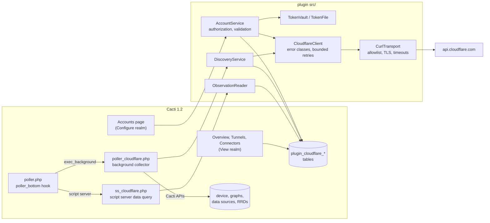
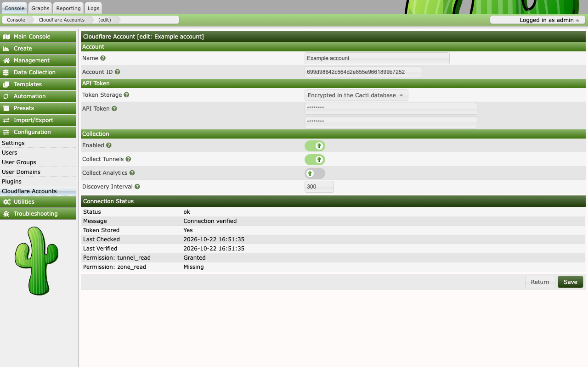

<!-- Source: README.md; SHA256: 813d1c85c236b426b83e42e63c69496f33f8909b5e435d0d45efa6a4ba2f17ca -->

<!-- translations:start -->
[English](../../../README.md) | [简体中文](../zh-CN/README.md) | [हिन्दी](../hi-IN/README.md) | [Español (España)](../es-ES/README.md) | [Español (Latinoamérica)](../es-419/README.md) | [العربية (السعودية)](../ar-SA/README.md) | [Afrikaans](../af-ZA/README.md) | [አማርኛ](../am-ET/README.md) | [العربية (مصر)](../ar-EG/README.md) | [العربية (المغرب)](../ar-MA/README.md) | [বাংলা](../bn-BD/README.md) | [Bosanski](../bs-BA/README.md) | [Deutsch](../de-DE/README.md) | [فارسی](../fa-IR/README.md) | [Filipino](README.md) | [Français](../fr-FR/README.md) | [Français (Maroc)](../fr-MA/README.md) | [Français (Sénégal)](../fr-SN/README.md) | [Hausa](../ha-NG/README.md) | [עברית](../he-IL/README.md) | [Hrvatski](../hr-HR/README.md) | [Bahasa Indonesia](../id-ID/README.md) | [Igbo](../ig-NG/README.md) | [Italiano](../it-IT/README.md) | [日本語](../ja-JP/README.md) | [한국어](../ko-KR/README.md) | [Malagasy](../mg-MG/README.md) | [मराठी](../mr-IN/README.md) | [Bahasa Melayu](../ms-MY/README.md) | [Nederlands](../nl-NL/README.md) | [Polski](../pl-PL/README.md) | [Português (Brasil)](../pt-BR/README.md) | [Русский](../ru-RU/README.md) | [Kinyarwanda](../rw-RW/README.md) | [Soomaali](../so-SO/README.md) | [Српски](../sr-RS/README.md) | [Svenska](../sv-SE/README.md) | [Kiswahili](../sw-KE/README.md) | [தமிழ்](../ta-IN/README.md) | [తెలుగు](../te-IN/README.md) | [ไทย](../th-TH/README.md) | [Türkçe](../tr-TR/README.md) | [Українська](../uk-UA/README.md) | [اردو](../ur-PK/README.md) | [Tiếng Việt](../vi-VN/README.md) | [isiXhosa](../xh-ZA/README.md) | [Yorùbá](../yo-NG/README.md) | [繁體中文](../zh-TW/README.md) | [isiZulu](../zu-ZA/README.md)
<!-- translations:end -->

<p align="center">
  
</p>

# Plugin ng Cloudflare para sa Cacti

[](https://github.com/somethingwithproof/plugin_cloudflare/actions/workflows/ci.yml)
[](https://sonarcloud.io/summary/new_code?id=somethingwithproof_plugin_cloudflare)
[](../../../LICENSE)


[](https://sonarcloud.io/summary/new_code?id=somethingwithproof_plugin_cloudflare)
[](https://sonarcloud.io/summary/new_code?id=somethingwithproof_plugin_cloudflare)
[](https://sonarcloud.io/summary/new_code?id=somethingwithproof_plugin_cloudflare)


Isang plugin para sa Cacti 1.2 na ginagawa upang subaybayan ang mga Cloudflare Tunnel at
analytics ng zone. Nagbabasa ito mula sa Cloudflare API gamit ang mga may-saklaw na API token,
hindi kailanman nagbabago ng anuman sa Cloudflare, at nag-iimbak ng datos nito sa sarili nitong mga talahanayan.
Sa Cacti, kinokopya nito ang mga data query XML file sa `resource/script_server/` at
lumilikha ng mga device, graph, at template sa pamamagitan ng sariling mga API ng Cacti, nang walang
pagbabago sa mga core file.

**Katayuan: 0.4.0-dev, hindi pa nailalabas.** Ang huling nailabas na bersyon ay 0.3.0. Nagdaragdag ang bersyong pang-development ng mga pag-export ng imbentaryo sa CSV, tahasang pagreretiro ng mga tinanggal na tunnel, naka-cache na analytics ng zone, isang allowlisted na read-only na GraphQL Analytics client (`GraphqlAnalyticsClient`) na may mga helper sa buod na handa para sa Thold (`AnalyticsSummary`), isang Configuration-as-Code CLI (`cli/cloudflare.php`), mga ecosystem hook (`abilities_register`, `doctor_register_checks`, `casc_register_providers`), at suporta sa remote collector na naka-scope sa poller (`replicate_out`). Nakabinbin pa rin ang kwalipikasyon sa live provider at deployment.

Inilalarawan ng talahanayan sa ibaba ang matatag na bersyong 0.3.0. Inilalarawan ang mga karagdagan sa development sa 0.4.0-dev sa ilalim ng mga daloy ng trabaho ng Operator at analytics ng zone sa ibaba.

| Magagamit na ngayon | Nakaplano |
|---|---|
| Mag-install, mag-upgrade, mag-disable, at mag-uninstall sa pamamagitan ng plugin manager ng Cacti | Live-account GraphQL at kwalipikasyon sa deployment (pagtatapos ng Milestone 4) |
| Mga pahintulot na Cloudflare: View, Operator, at Configure | Fault injection, mga modelong TLA+, at kumpletong dokumentasyon (Milestone 5) |
| Magdagdag, mag-edit, magtanggal, mag-enable, at mag-disable ng mga Cloudflare account | |
| Mag-imbak ng token sa isang file o naka-encrypt sa database ng Cacti | |
| Mag-verify ng token at suriin ang mga pahintulot nitong magbasa ng tunnel at zone | |
| Pagtuklas ng tunnel at connector sa isang background collector (`poller_cloudflare.php`) | |
| Mga pahinang Overview, Tunnels, at Connectors sa ilalim ng Management > Cloudflare Tunnels | |
| Pagsubaybay sa lifecycle: `active`, `unavailable`, at `deleted` | |
| Isang Cacti device bawat account, na nilikha ng isang administrator, kung saan ang mga tunnel ang mga index ng isang data query | |
| Mga graph na Connectors, Health, at Collection bawat tunnel, na iginuguhit mula sa isang RRD file bawat tunnel | |
| Ang mga halagang hindi mapatutunayan ng plugin ay iniimbak bilang unknown (`U`), hindi kailanman bilang 0 | |

## Mga tungkulin sa pag-access

| Realm | Pag-access |
| --- | --- |
| Cloudflare: View | Mga kasalukuyang pahina ng pagsubaybay. |
| Cloudflare: Operator | Pagsubaybay kasama ang pahina ng Operations at mga personal na pagkilala sa triage. |
| Cloudflare: Configure | Pag-access ng Operator kasama ang kasalukuyang konfigurasyon at mga pagkilos na administratibo. |

Pagkatapos kopyahin ang mga upgrade file, buksan ang pahina ng Plugins bilang administrator upang irehistro
ang bagong realm. Italaga nang tahasan ang realm ng Operator sa ilalim ng **Configuration > Users** o mga pangkat ng gumagamit.
Pinananatili ng mga upgrade ang mga kasalukuyang ID at pahintulot ng mga realm na View at Admin. Minamana ng pag-access ng Admin
ang pag-access ng Operator, at minamana ng pag-access ng Operator ang pag-access ng View sa bawat kahilingan;
hindi ito nagdaragdag ng mga nakaimbak na pahintulot sa mga gumagamit o pangkat. Nangangailangan din ang mga setting ng plugin ng
pag-access na Cloudflare: Configure bukod pa sa pahintulot sa Settings ng Cacti.

Ang kakayahang makita ang Cloudflare account ay tumutugma sa kasalukuyang realm na View; ito ay para sa buong account.
Ang mga kredensyal, konfigurasyon, pagmamapa, pagtanggal, at iba pang administratibong pagbabago
ay nananatili sa mga pahinang administratibo. Ang mga pagkilala ay tumatagal lamang sa kasalukuyang
sesyon ng gumagamit, nang hindi hihigit sa isang oras at hangga't nananatiling bago ang parehong
obserbasyon. Pinawawalang-bisa ang mga ito ng mga bago o nabagong obserbasyon. Hindi nila kailanman minamarkahan ang isang nabigong
pagsusukat bilang malusog o pinipigilan ang mga alerto.

## Bakit ang plugin na ito

Walang nakikitang impormasyon tungkol sa tunnel sa loob ng Cacti ang mga operator ng Cacti na naglalathala ng mga serbisyo sa pamamagitan ng Cloudflare Tunnel. Maaaring mawalan ng lahat ng connector ang isang tunnel habang
sumasagot pa rin sa SNMP ang mga origin host, kaya nananatiling berde ang mga kasalukuyang graph habang
nakakakita ng mga error ang mga gumagamit. Ang layunin ng plugin na ito ay ilagay ang kalusugan ng tunnel at trapiko ng zone
sa tabi ng mga graph ng device na binabantayan na ng mga operator, nang hindi binibigyan
ang Cacti ng anumang kakayahang magbago sa Cloudflare.

Tatlong limitasyon ang humuhubog sa disenyo:

- **Read-only.** Tumatawag lamang ang plugin ng mga endpoint na `GET` at ng GraphQL
  Analytics API. Hindi ito nangangailangan ng pahintulot sa pag-edit sa anumang mapagkukunan ng Cloudflare.
- **Opsyonal.** Ang mga pagkawala ng serbisyo ng Cloudflare, mga nag-expire na token, at mga rate limit ay hindi dapat
  magpabagal sa UI ng Cacti o magpatigil sa pag-poll ng iba pang mga device. Ang lahat ng pagtawag sa API ay may
  mahihigpit na timeout, at tumatakbo ang pagkolekta sa isang background process na inilulunsad ng
  poller.
- **Walang pagbabago sa core.** Ginagamit ng plugin ang mga plugin hook ng Cacti 1.2 at ang sarili
  nitong mga talahanayan. Kinokopya nito ang isang data query XML sa `resource/script_server/` at
  lumilikha ng mga device, graph, at template sa pamamagitan ng sariling mga API ng Cacti. Walang pagbabago sa core
  file, kaya hindi naaapektuhan ang mga upgrade ng Cacti at iba pang mga plugin.

## Paano ito gumagana



- **Cacti glue** (`setup.php`, `includes/`, ang mga script ng pahina) ay nagrerehistro
  ng mga hook at realm, nag-rerender ng mga pahina gamit ang sariling mga helper ng Cacti, at nagtatalaga
  ng bawat pagkilos sa library sa `src/`.
- **Ang library** (`src/`, namespace `Somethingwithproof\Cloudflare\`) ay walang
  pagdepende sa mga global ng Cacti, kaya sinusubok ito laban sa isang totoong database at
  isang pekeng HTTP transport nang walang tumatakbong Cacti.
- **Isang palabas na landas.** Ang `CurlTransport` lamang ang code na humahawak sa
  network, at tumatanggap lamang ito ng `https://api.cloudflare.com`. Ang bawat pagkabigo
  ay nakamapa sa isang klase ng error (`auth`, `permission`, `rate_limited`,
  `transient`, ...), na nagtatakda ng katayuang ipinapakita sa UI.
- **Imbakan** ay dumadaan sa sariling koneksyon ng PDO ng Cacti na may mga prepared
  statement. Ang mga pagbabago sa schema ay mga may-bilang at idempotent na migration.

Ang mga desisyon sa disenyo at ang mga dahilan nito ay nasa
[docs/design.md](../../design.md).

## Mga Screenshot

Ang mga screenshot ay nagmula sa isang test stack, hindi sa isang live na Cloudflare account. Ang
stack ay nagpapatakbo ng Cacti 1.2.31 laban sa isang pekeng Cloudflare API na nagbabalik ng fixture
data, kaya ang account, ang ID nito, at ang tatlong tunnel ay mga placeholder lamang.


*Ang listahan ng mga Cloudflare Account. Tinatanggap ng pekeng API ang token, kaya iniuulat ng Verify ang `ok`.*



*Pag-edit ng isang account. Palaging walang laman ang mga field ng token; hindi kailanman ibinabalik sa browser ang nakaimbak na token. Naka-on ang Collect Tunnels at Create Graphs at naka-off ang Collect Analytics. Ipinapakita ng Connection Status ang resulta ng huling Verify: `ok`, ipinagkaloob ang pagbasa ng tunnel at nawawala ang pagbasa ng zone.*


*Settings > Cloudflare.*


*Management > Cloudflare Tunnels > Overview. Ang katayuan ay ang pinakamalalang katayuan ng Cloudflare sa mga aktibong tunnel ng account, dito ay `down` dahil down ang isang fixture tunnel. Ang `Disabled`, `Not collected`, `Collection failing`, at `Not yet collected` ay mas inuuna kaysa sa kalusugan ng tunnel, sa ganoong pagkakasunod-sunod, kaya ang isang account na nabigo ang huling pagpapatakbo ay nagpapakita ng `Collection failing` anuman ang iulat ng mga tunnel nito.*


*Ang tab na Tunnels. Nagpapakita ng `-` ang Connectors at Connections para sa old-office, dahil sinasagot ng pekeng API ang kahilingan nito sa mga koneksyon bilang hindi kilalang tunnel at walang naimbak, at 0 para sa staging, na walang tumatakbong connector.*


*Ang graph na Connectors ng blog tunnel. Ang lahat ng tatlong linya ay 1 bago at pagkatapos ng isang puwang sa gitna, kung saan nagbalik ng mga error ang pekeng API at nag-imbak ang plugin ng mga hindi kilalang halaga. Hindi bumabagsak sa 0 ang mga linya. Ang graph ay nagmula sa parehong fixture stack (`make screenshots`), na nagtatakda ng 30-segundong step sa iisang data source na ito upang mapunan ng pitong minutong pag-poll ang graph.*

## Mga Kinakailangan

- Cacti 1.2.25 hanggang 1.2.31. Ang Cacti 1.2.31 mismo ay nangangailangan ng PHP 8.0 o mas bago.
  Sinusubok lamang ng CI ang 1.2.31; ang 1.2.25 ay huling sinubukan nang manu-mano noong 2026-10-22.
- PHP 7.4 hanggang 8.4 na may mga extension na `curl`, `openssl` at `pdo_mysql`.
  Tumatanggi ang plugin na ma-enable kung wala ang mga ito.
- MariaDB 10.6 o mas bago, o MySQL 8.0 o mas bago.
- Access sa HTTPS mula sa server ng Cacti patungo sa `api.cloudflare.com`. Hindi sinusuportahan ang mga proxy.

Tingnan ang [docs/compatibility.md](../../compatibility.md) para sa kung ano ang mga sinubukan.

## Pag-install

1. Ilagay ang plugin sa direktoryong `plugins/cloudflare` ng Cacti, sa pamamagitan ng pag-extract ng archive mula sa
   [Mga Release sa GitHub](https://github.com/somethingwithproof/plugin_cloudflare/releases)
   (ang pagpapatakbo ng `make package` sa isang checkout ng release tag ay bumubuo ng parehong archive) o sa pamamagitan ng git clone. Dapat na `cloudflare` ang pangalan ng direktoryo.
2. I-install at i-enable ito mula sa Console > Configuration > Plugins, o gamit ang
   CLI bilang user ng web server:

   ```sh
   php cli/plugin_manage.php --plugin=cloudflare --install --enable
   ```

3. Nakukuha ng admin user ang pahintulot na Cloudflare: Configure sa pag-install. Ibigay
   ito sa ibang mga user o grupo sa ilalim ng Console > Configuration > Users.
4. Gumawa ng token na may mga pahintulot na nakasaad sa
   [docs/token-permissions.md](../../token-permissions.md). Sa madaling salita:
   Account > Cloudflare Tunnel > Read, at opsyonal na Zone > Zone > Read.
5. I-imbak ang token sa isa sa dalawang paraan sa ibaba, pagkatapos ay idagdag ang account sa ilalim ng
   Console > Configuration > Cloudflare Accounts at patakbuhin ang Verify mula sa
   menu ng mga aksyon.

### Opsyon A: naka-encrypt sa database

Ine-encrypt ng plugin ang mga token gamit ang isang 32-byte na key na ikaw ang gumagawa. Hindi ito
kailanman gumagawa o nagsusulat ng key mismo. Ang file ay dapat na mababasa ng mga user ng web
server at poller, hindi dapat mababasa ng iba, at dapat pahintulutan ng direktoryo nito
ang mga user na iyon na maabot ito. Para sa isang web server na tumatakbo bilang `www-data`:

```sh
sudo mkdir -p /etc/cacti
sudo sh -c 'umask 077 && openssl rand -hex 32 > /etc/cacti/cloudflare.key'
sudo chgrp www-data /etc/cacti/cloudflare.key
sudo chmod 0440 /etc/cacti/cloudflare.key
```

Ang default na path ay `/etc/cacti/cloudflare.key`; baguhin ito sa ilalim ng Settings >
Cloudflare > Token Vault Key File. Kapag nawawala o tinanggihan ang key, ang
opsyon ng token file lamang ang iniaalok ng edit form. Magtago ng backup ng key:
kung wala ito, hindi made-decrypt ang mga nakaimbak na token at dapat itong ilagay muli.

#### Pag-rotate ng key

Walang rekey command. Hindi made-decrypt ng bagong key ang mga token na nakaimbak sa ilalim ng
luma, kaya ang pag-rotate ay nangangahulugan ng muling paglalagay ng bawat nakaimbak na token:

1. Ihanda ang halaga ng token ng bawat account. Ipinapakita lamang ng Cloudflare ang halaga ng isang token
   kapag ito ay ginawa o ni-roll, kaya i-roll ang token sa dashboard ng Cloudflare
   kung wala ka na nito.
2. Gumawa ng bagong key sa isang bagong path gamit ang mga command sa itaas, halimbawa
   `/etc/cacti/cloudflare.key.new`, na may parehong owner at mode.
3. Itakda ang Settings > Cloudflare > Token Vault Key File sa bagong path at i-save.
   Mula ngayon, ang Verify sa isang account na naka-encrypt pa rin gamit ang lumang key
   ay mag-uulat ng "Stored token cannot be decrypted", at ang bawat pagtakbo ng collector ay maglo-log ng
   `discovery token unavailable` na may `reason=decrypt_failed` para rito.
4. Para sa bawat account na nag-iimbak ng token nito sa database, buksan ito sa ilalim ng
   Console > Configuration > Cloudflare Accounts, i-paste ang token sa parehong mga
   field ng token, i-save, at patakbuhin ang Verify. Dapat itong mag-ulat ng `ok`.
5. Kapag na-verify na ang bawat ganoong account, alisin ang lumang key file at ang mga
   backup nito.

Sa pagitan ng mga hakbang 3 at 4, hindi nare-refresh ang mga tunnel ng isang account at ang kanilang mga
graph ng health, connector at connection ay nagtatala ng U. Hindi apektado ang mga token file account.

### Opsyon B: token file

Isulat ang token, at wala nang iba pa, sa isang file na mababasa ng mga user ng web server at poller
at hindi mababasa ng iba, pagkatapos ay ilagay ang absolute path nito sa edit form:

```sh
sudo sh -c 'umask 077 && cat > /etc/cacti/cloudflare-account.token'   # paste the token, then Ctrl-D
sudo chgrp www-data /etc/cacti/cloudflare-account.token
sudo chmod 0440 /etc/cacti/cloudflare-account.token
```

Sinusuri ang file kapag binabasa ito, sa Verify, hindi kapag nag-save ka. Tinatanggihan ang mga symbolic
link, mga file na lampas sa 4 KiB at mga file na mababasa o maisusulat ng iba.

Sinumang may Cloudflare: Configure ay maaaring maglagay ng anumang path, at binabasa ito ng poller user.
Upang panatilihin ang mga token file sa isang lugar, itakda ang Settings > Cloudflare >
Token File Directory, halimbawa sa `/etc/cacti`; ang isang path sa labas nito ay
tatanggihan. Tingnan ang [docs/security.md](../../security.md#token-file).

## Pag-upgrade

1. Palitan ang mga file sa `plugins/cloudflare` ng bagong release, habang pinapanatili
   ang pangalan ng direktoryo.
2. Buksan ang Console > Configuration > Plugins, o Console > Configuration >
   Cloudflare Accounts, nang isang beses bilang isang admin. Pinapatakbo nito ang mga migration ng plugin,
   ini-import ang mga template ng Cloudflare at kinokopya ang data query file (tingnan ang
   [Mga sukatan at graph ng tunnel](#tunnel-metrics-and-graphs)), inirerehistro ang mga ecosystem hook na
   `abilities_register`, `doctor_register_checks`, `casc_register_providers`,
   at `replicate_out` (`includes/ecosystem.php`), at, sa isang
   pag-upgrade mula sa 0.1.0, inirerehistro ang `poller_bottom` hook.

Hindi pinapatakbo ng `poller.php` ang pag-upgrade ng plugin, kaya hanggang sa hakbang 2, nawawala ang bagong
schema. Ang bawat pagtakbo ng collector ay walang gagawin at maglo-log ng
`CLOUDFLARE: collector skipped; plugin upgrade pending, open Console > Plugins`.
Ang mga pahina ng Cloudflare Tunnels ay nangangailangan lamang ng Cloudflare: View, kaya hindi nila kailanman pinapatakbo
ang pag-upgrade, at hanggang sa hakbang 2 ay maaari silang magpakita ng "The Cloudflare tunnels could not
be read".

## Status ng account

Itinatakda ng Verify ang status ng account:

| Status | Kahulugan |
|---|---|
| `unknown` | Hindi pa na-verify mula nang idagdag ang account o baguhin ang mga kredensyal nito |
| `ok` | Aktibo ang token at nakakabasa ng mga tunnel |
| `token_inactive` | Iniuulat ng Cloudflare na naka-disable o nag-expire na ang token |
| `auth_failed` | Tinanggihan ng Cloudflare ang token bilang invalid o nag-expire na (HTTP 401) |
| `permission_denied` | Aktibo ang token ngunit hindi makapagbasa ng mga tunnel, o kulang ito sa mga pahintulot upang tawagan ang mga token verify endpoint (HTTP 403) |
| `unreachable` | Hindi maabot ang API, nag-time out o nagbalik ng server error |
| `rate_limited` | Nagbalik ang Cloudflare ng HTTP 429 |
| `error` | Anumang iba pang pagkabigo, kabilang ang isang token file na nawawala o hindi secure, isang token vault key file na nawawala o hindi magamit, o isang nakaimbak na token na hindi ma-decrypt |

Ipinapakita rin ng edit page kung ipinagkaloob ang tunnel read at zone read.

## Pagtuklas ng tunnel

Pagkatapos ng bawat polling cycle sa naka-configure na collector poller (`cloudflare_poller_id`, default `1`), sinisimulan ng `poller_bottom` hook
ang isang background collector gamit ang `exec_background` kapag kahit isang naka-enable na
account ay naka-on ang Collect Tunnels. Hindi kailanman tumatakbo ang collector sa proseso ng poller,
kaya ang isang mabagal na Cloudflare API ay hindi nagpapaantala sa `poller.php`. Nagdedeklara ang `INFO` ng
`remote_collect:1`, at itinutulak ng `replicate_out` hook (`RemoteReplication`) ang mga
hindi lihim na talahanayan ng metadata (`plugin_cloudflare_accounts` na may `token_ciphertext`
na ginawang `NULL`, `plugin_cloudflare_tunnels`, `plugin_cloudflare_connectors`,
`plugin_cloudflare_zones`, `plugin_cloudflare_metric_mappings`, at
`plugin_cloudflare_resources`) sa mga remote poller (`poller_id > 1`) habang
hindi isinasama ang vault key material.

Para sa bawat account na nakatakda, inililista ng collector ang mga tunnel ng account, pagkatapos ay
binabasa ang mga koneksyon ng mga aktibong tunnel nito, na nagbibigay ng mga connector ng bawat tunnel,
ang kanilang mga bersyon, data center at origin address. Nakatakda ang mga account
bawat Discovery Interval (default 300 segundo). Ang isang pagtakbo ay hindi nagsisimula ng bagong
account pagkatapos ng 50 segundo at gumagawa ng hindi hihigit sa 200 kahilingan sa koneksyon. Maaari ring
ihinto ng alinmang limitasyon ang isang account sa kalagitnaan ng pagbabasa ng mga koneksyon nito; ang account na iyon
ay itinatala bilang `partial`, at ang susunod na pagtakbo ay nagpapatuloy sa mga tunnel na
pinakahuling sinubukan nang mas matagal na ang nakalipas. Ang mga account na hindi nasimulan ay nananatiling nakatakda para sa susunod na pagtakbo.

Ang isang tunnel ay may lifecycle, na hiwalay na pinapanatili mula sa status na iniuulat ng Cloudflare
(`healthy`, `degraded`, `down` o `inactive`):

| Lifecycle | Kahulugan |
|---|---|
| `active` | Ang tunnel ay nasa huling kumpletong listahan |
| `deleted` | Hindi ito isinama ng isang kumpletong listahan, na kinabibilangan ng isang walang lamang listahan. Nananatili ang row at ang kasaysayan nito, at muling nagiging `active` ang tunnel kung lilitaw itong muli |
| `unavailable` | Tatlong binibilang na outage na walang kumpletong listahan sa pagitan nila ang nag-iiwan sa estado ng tunnel na hindi alam |

Isang kumpleto at matagumpay na listahan lamang ang nagdaragdag, nag-a-update o nagtatanggal ng mga tunnel, at hindi
kailanman nagtatanggal ang isang nabigong listahan. Ang pagkabigong basahin ang Cloudflare nang tuluyan
(`transient`, `rate_limited`, `auth` o `permission`) ay binibilang bilang isang outage;
pagkatapos ng tatlong binibilang na outage na walang kumpletong listahan sa pagitan nila, nagiging
`unavailable` ang mga aktibong tunnel ng account. Ibinabalik sila ng susunod na kumpletong listahan
at nire-reset ang bilang. Ang isang tunnel na hindi na kilala ng Cloudflare
kapag binabasa ang mga koneksyon nito ay nilalaktawan nang hindi binibigo ang account. Ang ibang mga
pagkabigo ay hindi nagdaragdag o nagre-reset ng outage counter.

Sa `cacti.log`, ang mga linya ng pagtuklas ay nagsisimula sa `CLOUDFLARE: discovery` at ang buod ng pagtakbo
sa `CLOUDFLARE: collector`. Ang mga pagkabigo at pagbabago sa lifecycle, tulad ng
isang nabigong listahan o mga tunnel na minarkahang `unavailable`, ay nilo-log sa default na
antas na `LOW` ng Cacti; ang resulta ng bawat account at ang buod ng pagtakbo ay nilo-log sa
`MEDIUM`. Maaaring mabigo ang mga pagbabasa ng koneksyon sa bawat tunnel, kaya para sa bawat account tanging
ang unang pagkabigo ng bawat klase ng error ang nilo-log sa `LOW`, ang natitira sa
`MEDIUM`, na sinusundan ng isang linyang `LOW` bawat klase na may bilang ng mga tunnel na
nabigo.

Ang Management > Cloudflare Tunnels ay nangangailangan ng pahintulot na Cloudflare: View at
read-only lamang:

- **Overview** ay naglilista ng bawat account kasama ang status nito, mga bilang ng tunnel ayon sa lifecycle,
  ang huling matagumpay na pagtuklas at ang bilang ng magkakasunod na pagkabigo.
- **Tunnels** ay naglilista ng mga tunnel sa mga account o para sa isang account, na may mga filter
  para sa account, lifecycle, status at pangalan, at mga sortable na column.
- **Connectors** ay nagpapakita ng mga connector ng tunnel na pinili sa tab na Tunnels.

<a name="tunnel-metrics-and-graphs"></a>

## Mga sukatan at graph ng tunnel

Binabasa ng Cacti ang estado ng tunnel sa pamamagitan ng isang script server data query,
`ss_cloudflare.php`. Sumasagot lamang ito mula sa mga talahanayan ng plugin at hindi kailanman tumatawag
sa Cloudflare, kaya ang isang outage sa Cloudflare ay hindi makakapagpabagal sa poller. Ang bawat tunnel ay nagbibigay ng
anim na halaga: health (healthy 3, degraded 2, down 1, inactive 0), mga connector,
mga koneksyon, mga bersyon ng connector, ang mga segundo mula nang huling binasa ang mga koneksyon nito,
at ang magkakasunod na pagkabigo ng discovery job. Ang health, mga connector,
mga koneksyon at mga bersyon ay ini-print lamang kapag mapapatunayan ng plugin ang mga ito,
na nangangahulugang nagtagumpay ang huling pagtuklas, `active` ang tunnel at ang
pagbasa ay kamakailan lamang. Kung hindi, ang mga ito ay `U`, at ang graph ay nagpapakita ng puwang sa halip
na zero na magmumukhang isang outage. Ang dalawang halaga ng koleksyon ay nananatiling
naka-print sa panahon ng outage, kaya ipinapakita ito ng graph ng Collection; ang mga ito ay `U` lamang
para sa isang tinanggal na tunnel o isa na ang mga koneksyon ay hindi kailanman na-refresh. Ang mga panuntunan
ay nasa [docs/metrics.md](../../metrics.md).

### Paggawa ng device

Ang isang account ay nakamapa sa hindi hihigit sa isang Cacti device. Pinanghahawakan ng device ang mga
tunnel ng account bilang mga index ng data query na Cloudflare Tunnels. Walang awtomatikong gumagawa
nito:

1. Buksan ang Console > Configuration > Cloudflare Accounts.
2. Piliin ang account, piliin ang Create Cacti Device mula sa menu ng mga aksyon, at
   kumpirmahin.

Ang aksyon ay nangangailangan ng parehong Cloudflare: Configure realm at Sites/Devices/Data
realm ng Cacti (ang para sa `host.php`). Lumilitaw lamang ang entry sa menu
sa mga user na may hawak ng pareho, at tinatanggihan ng server ang kahilingan mula sa sinumang iba pa.
Ang device ay pinangalanang `Cloudflare: <account name>`, gumagamit ng host template na Cloudflare Account
at ng main poller, may bersyon ng SNMP na 0 at walang pagsusuri ng availability,
at nakakakuha ng hostname na `<account ID>.cloudflare.invalid`. Ang pangalang iyon ay
nakalaan at hindi kailanman nagre-resolve; hindi kumokonekta ang Cacti rito. Kung mayroon nang device
ang account, sinasabi ito ng aksyon at walang binabago. Kung tatanggalin ng isang
administrator ang device sa Cacti, hindi gagawa ng isa pa ang plugin
hanggang sa muling patakbuhin ang Create Cacti Device.

### Create Graphs

Ang Create Graphs sa form ng account ay naka-off bilang default. Kapag ito ay naka-on, sa tuwing
matatapos ang isang pagtuklas ng account na `ok` o `partial`, muling ini-index ng collector ang
device at gumagawa ng anumang nawawalang graph para sa mga `active` na tunnel ng account:
Connectors, Health at Collection, tatlo bawat tunnel. Ang tatlong graph ng isang tunnel ay
nagbabahagi ng isang RRD file. Ang isang pagtakbo ay gumagawa ng hindi hihigit sa 50 graph at humihinto pagkatapos ng 20
segundo, at nagpapatuloy ang susunod na pagtakbo. Hindi kailanman nagtatanggal ang plugin ng isang Cacti object.
Ang isang graph na tinanggal ng administrator ay hindi na gagawing muli, at ang isang tunnel na
hindi na inililista ng Cloudflare ay nagpapanatili ng graph at RRD file nito, na nagpapakita ng `U`.

Ang pag-on ng Create Graphs ay nangangailangan ng parehong realm. Ang pag-off nito ay nangangailangan lamang ng
Configure. Ang isang user na walang Sites/Devices/Data realm na nagse-save ng form
ay iniiwan ang setting kung ano ito dati, na may babala. Kapag naka-off ang Create Graphs, ang
device ay muling ini-index pa rin pagkatapos ng bawat pagtuklas, kaya lumilitaw ang mga bagong tunnel bilang
mga index ng data query.

### Ang data query file

Binabasa lamang ng Cacti 1.2.31 ang isang data query XML mula sa loob ng direktoryo nitong `resource`.
Sa pag-install at pag-upgrade, kinokopya ng plugin ang isang file,
`templates/resource/cloudflare_tunnels.xml`, sa
`<Cacti>/resource/script_server/cloudflare_tunnels.xml`. Ito lamang ang file
na isinusulat ng plugin sa labas ng sarili nitong direktoryo, kaya ang user na nag-i-install o
nag-a-upgrade ng plugin ay dapat na makapagsulat sa direktoryong iyon.
Pinapanatili ng pag-uninstall ang file, kasama ang mga device, graph, RRD file at
template. Kung mabigo ang pagkopya o ang pag-import ng template, nilo-log ito ng plugin at
susubukang muli ng Create Cacti Device.

## Mga Setting

Naglalaman ang Settings > Cloudflare ng:

- **Token Vault Key File**: path papunta sa vault key.
- **Token File Directory**: kapag nakatakda, tinatanggihan ang isang token file na nasa labas nito. Walang laman bilang default, na nagpapahintulot sa anumang path. Tingnan ang [docs/security.md](../../security.md#token-file).
- **Interactive Request Timeout**: kabuuang segundo para sa isang kahilingang ginawa mula sa web interface, tulad ng Verify. Default ay 10; ang mga halagang wala sa pagitan ng 5 hanggang 60 ay babalik sa 10.
- **Collector Request Timeout**: kabuuang segundo para sa isang kahilingang ginawa ng background collector. Default ay 20; ang mga halagang wala sa pagitan ng 5 hanggang 60 ay babalik sa 20.
- **Log Level**: nakaimbak. Wala pang bumabasa nito sa ngayon.

Sa form ng account, kinokontrol ng Collect Tunnels at Discovery Interval ang discovery, at kinokontrol ng Create Graphs ang paggawa ng graph. Nakaimbak ang Collect Analytics at walang epekto sa release na ito.

## Mga Wika

Naglalaman ang plugin ng mga pagsasalin sa Spanish (Spain, `es-ES`), French (`fr-FR`), German (`de-DE`), Simplified Chinese (`zh-CN`), Hindi (`hi-IN`), Arabic (`ar-SA`), at Japanese (`ja-JP`). Ipinapakita ng Cacti ang mga ito kapag naka-on ang suporta sa wika (Configuration > Settings > General > Language Support) at pumili ng wika ang isang user. Kasama rin sa ipinapadala ang isang Latin American Spanish na catalog (`es-419`), ngunit walang Latin American Spanish na locale sa Cacti 1.2 na mapipili, kaya magkakabisa lamang ito kapag nagdagdag ang Cacti; hanggang sa panahong iyon, piliin ang Spanish (`es-ES`).

Nananatili sa English ang ilang teksto: ang mga halaga ng status na iniimbak at ipinapakita ng plugin kung ano man ang mga ito (`ok`, `active`, `unavailable`, `deleted`, at ang status ng tunnel na iniuulat ng Cloudflare), at lahat ng isinusulat ng plugin sa Cacti log.

## Pag-uninstall at pagpapanatili ng data

Tinatanggal ng pag-uninstall ang mga sariling talahanayan ng plugin, na naglalaman ng mga account, naka-encrypt na token, natuklasang tunnel, status ng job, at ang tala kung aling mga Cacti object ang ginawa nito, at binubura ang mga setting nitong `cloudflare_`. Hindi nito inaalis ang key file, mga token file, ang kinopyang `resource/script_server/cloudflare_tunnels.xml`, o anumang mga Cacti device, graph, data source, RRD file, o template. Naglalaman ang mga iyon ng historikal na data ng pagsubaybay, at ang pag-aalis sa mga ito ay isang tahasang pagkilos ng administrator sa Cacti.

Hihinto sa pagtanggap ng data ang pinanatiling device. Pagkatapos ng pag-uninstall, o pagkatapos mabura ang account nito, walang account na nagmamay-ari sa host, kaya pinapanatili ng mga graph nito ang kasaysayan ng mga ito ngunit nagpi-print ng `U` mula noon. Gumagawa ng bagong device ang Create Cacti Device sa muling na-install o muling idinagdag na account; hindi nito ginagamit muli ang luma, kaya burahin ang lumang device sa Cacti kapag hindi na kailangan ang kasaysayan nito.

## Mga kilalang limitasyon

- Gumagawa ang isang pagtakbo ng hanggang 200 na kahilingan sa koneksyon. Ang mga tunnel na lampas sa limitasyong iyon ay mas madalang ma-refresh kaysa sa observation window, kaya nagpapakita ng mga puwang ang mga graph ng koneksyon ng mga ito.
- Pinapatungan ng plugin ang mga pag-edit ng administrator sa mga na-import na template kapag binago ng isang upgrade ang kasamang template XML.
- Tumatanggap ang mga remote poller ng na-replicate na metadata nang walang mga kredensyal (ginagawang `NULL` ang `token_ciphertext` at hindi kailanman nire-replicate ang mga vault key). Kapag pinapatakbo ang collector sa isang itinalagang remote poller (`cloudflare_poller_id`), direktang mag-provision ng mga token file o vault key sa collector host na iyon.
- Nananatili sa data query index ang mga naburang tunnel at nagpi-print ng `U` hanggang sa tahasang i-retire ang mga ito ng isang administrator. Inaalis lamang ng pag-retire ang mga graph na nakatala sa plugin at ang mga hindi nakabahaging data source sa pamamagitan ng Cacti; nananatiling nakikita ang row ng imbentaryo. Kinokontrol ng Cacti ang paglilinis ng RRD.
- Hindi pinapagana ng Cacti ang isang plugin na ang code ay nagtatapos sa isang tunay na fatal error, tulad ng pagkaubos ng memory. Tingnan ang [docs/security.md](../../security.md).

## Seguridad

- Tinatanggihan ang mga Global API Key; mga scoped API token lamang ang tinatanggap.
- Iniimbak ang mga token sa isang file na iyong ipinoprovide o ine-encrypt gamit ang AES-256-GCM sa ilalim ng isang key file na hindi kailanman pumapasok sa database. Hindi kailanman ipinapakita ang mga ito sa isang pahina, isinusulat sa isang log, o isinasama sa isang mensahe ng error.
- Nagdadala lamang ang mga error sa database ng SQLSTATE at ng driver error code, hindi kailanman ang mga halaga ng statement.
- Ang bawat pagbabago ay isang POST na pinoprotektahan ng CSRF token ng Cacti. Ang mga pagbabago sa administratibong account at configuration ay nangangailangan ng Cloudflare: Configure; ang mga personal na pagkilala sa triage ay nangangailangan ng Cloudflare: Operator. Ang paggawa ng Cacti device o pag-on ng Create Graphs ay nangangailangan din ng pahintulot na Sites/Devices/Data ng Cacti. Tinatanggihan ng hindi pinaganang plugin ang mga pahina nito.
- Ang Configuration-as-Code (`cli/cloudflare.php` at `casc_register_providers`) ay tumatanggap lamang ng mga lihim na sanggunian na `vault:<account_id>` o `file:<absolute_path>`, tinatanggihan ang mga hilaw na token, vault ciphertext, at mga deklarasyon ng XML `DOCTYPE`, at nangangailangan ng eksaktong `--confirm=<PLAN_HASH>` bago magsulat.
- Ang mga nakarehistrong Ability (`cloudflare-list-tunnels`, `cloudflare-get-health`) ay mahigpit na read-only, sinusuri nang direkta ang Cloudflare: View realm laban sa mga talahanayan ng auth ng Cacti para sa user ID ng tumatawag (hindi kailanman ang estado ng session), at walang ibinabalik na mga token o key material.

Nasa [docs/security.md](../../security.md) ang mga detalye at kilalang limitasyon. Mag-ulat ng mga kahinaan nang pribado tulad ng inilalarawan sa [SECURITY.md](../../../SECURITY.md).

## Mga workflow ng operator at analytics ng zone

Kabilang sa mga karagdagan sa development sa `0.4.0-dev` ang tahasang pag-retire ng mga naburang tunnel, capability-aware na GraphQL analytics ng zone at tunnel, mga helper ng buod na handa para sa Thold at mga mai-import na template, isang CasC at health CLI, mga ecosystem hook, at replikasyon ng remote collector. Wala pang release tag o live-account qualification ang mga karagdagang ito. Tingnan ang [docs/analytics-and-alerting.md](../../analytics-and-alerting.md) para sa pag-setup, kahulugan ng mga sukatan, at mga limitasyon sa pagberipika.

- **GraphQL Analytics client at buod ng Thold (`src/Api/GraphqlAnalyticsClient.php`, `src/Metrics/AnalyticsSummary.php`)**: Ang `GraphqlAnalyticsClient` ay nagpapatakbo lamang ng mga read-only na query na nasa allowlist sa oras ng compile (`zone_settings`, `zone_http_metrics`, `zone_edge_latency`, `tunnel_analytics`) sa pamamagitan ng `CloudflareClient` (naka-verify ang TLS, naka-pin sa `api.cloudflare.com`, may hangganang tugon, at `RetryPolicy` rate-limit backoff) upang mangolekta ng dami ng kahilingan sa zone at tunnel, mga rate ng error na HTTP 5xx, mga byte ng tugon, at edge latency (karaniwan at p95). Nagbibigay ang `AnalyticsSummary` ng `recommendedThresholds()` na nakaayon sa mga pangalan ng RRD DS ng plugin (`health`, `collect_age`, `error_pct`, `age`), `summarizeZones()`, at `evaluateSample()`.
- **Operator at CasC CLI (`cli/cloudflare.php`)**: sinusuportahan ng `ConfigCodec` (`src/Config/ConfigCodec.php`) at `ConfigService` (`src/Config/ConfigService.php`), na sumusuporta sa `cli/cloudflare.php export [--format=yaml|xml] [--file=PATH]` (naglalabas lamang ng mga lihim na sanggunian na `vault:` / `file:`), `cli/cloudflare.php validate --file=PATH [--format=yaml|xml]`, `cli/cloudflare.php plan --file=PATH [--format=yaml|xml]`, `cli/cloudflare.php apply --file=PATH --confirm=<PLAN_HASH> [--format=yaml|xml]`, at `cli/cloudflare.php health [--format=text|json]`.
- **Mga ecosystem integration hook (`includes/ecosystem.php`, `setup.php`)**:
  - `abilities_register` (`AbilitiesProvider`): nagrerehistro ng read-only na `cloudflare-list-tunnels` at `cloudflare-get-health` na naka-gate sa Cloudflare: View realm (direkta at pangkatang pahintulot) na walang mga token o lihim sa output.
  - `doctor_register_checks` (`DoctorChecks`): naglalantad ng `cloudflare_vault_key` (pagpapatunay ng mode, symlink, at haba), `cloudflare_token_dir` (mga pagsusuri ng absolute path, symlink, at world-writable), `cloudflare_tunnel_freshness`, at `cloudflare_api_failure_rate`.
  - `casc_register_providers` (`CascProvider`): naglalantad ng `cloudflare` CasC provider (`export`, `validate`, `plan`, `apply`) para sa mga account (mga lihim na sanggunian lamang), mga zone, mga tunnel, at mga metric mapping.
  - `replicate_out` (`RemoteReplication`): nire-replicate ang mga hindi lihim na talahanayan ng metadata sa mga remote poller (`poller_id > 1`) kung saan ginagawang `NULL` ang `token_ciphertext` at hindi isinasama ang vault key material.

### Mga pag-export ng imbentaryo

Nag-aalok ang mga pahina ng Tunnels at Connectors ng Export para sa realm na Cloudflare: View. Isinasama ng mga CSV file ng Tunnel ang bawat tumutugmang row, gamit ang aktibong account, lifecycle, status, paghahanap, at mga setting ng pag-uuri sa lahat ng pahina. Isinasama ng mga CSV file ng Connector ang mga bersyon, arkitektura, data center, at mga origin address para sa napiling tunnel. Binabasa lamang ng mga download ang mga naka-cache na tala. Blangko ang mga hindi alam na bilang; nilalagyan ng kudlit sa unahan ang mga cell na mukhang formula para sa ligtas na pag-import sa spreadsheet.

## Roadmap

Ipinapadala ang bawat milestone bilang isang 0.x release na nakapangalan dito: ang Milestone 3 ay 0.3.0, ang Milestone 4 ay magiging 0.4.0. Hindi inilabas nang mag-isa ang Milestones 1 at 2 at bahagi ang mga ito ng 0.3.0. Nakalaan ang Bersyon 1.0.0 para sa release na kukumpleto sa bawat milestone sa ibaba.

| Milestone | Saklaw | Estado |
|---|---|---|
| 1. Foundation | Lifecycle ng plugin, mga pahintulot, configuration ng account, pagsubok ng koneksyon | Inilabas sa 0.3.0 ([#2](https://github.com/somethingwithproof/plugin_cloudflare/pull/2) hanggang [#5](https://github.com/somethingwithproof/plugin_cloudflare/pull/5)) |
| 2. Discovery | Pagkatuklas ng tunnel at connector sa isang background collector, mga pahina ng Overview, Tunnels, at Connectors | Inilabas sa 0.3.0 ([#6](https://github.com/somethingwithproof/plugin_cloudflare/pull/6)) |
| 3. Metrics | Mga data source ng kalusugan ng tunnel, mga graph template, paghawak ng outage na hindi kailanman nagtatala ng gawa-gawang zero | Inilabas sa 0.3.0 ([#7](https://github.com/somethingwithproof/plugin_cloudflare/pull/7)) |
| 4. Analytics and alerting | Plan-aware na GraphQL analytics (`GraphqlAnalyticsClient`), buod at mga template ng Thold (`AnalyticsSummary`), CasC CLI (`cli/cloudflare.php`), mga ecosystem hook, at remote replication | Ipinatupad sa 0.4.0-dev; nakabinbin ang live-account qualification |
| 5. Hardening | Fault injection, mga modelong TLA+ ng discovery at collection, buong dokumentasyon | Nakaplano |

## Development

Nangangailangan ng PHP 8.x at Composer ang mga tool; nananatiling compatible sa PHP 7.4 ang code ng plugin mismo. Nangangailangan ng database ang mga integration at BDD test, na sinisimulan ng `make db-up` sa Docker sa port 33061.

```sh
composer install
make db-up
make ci            # unit, integration, BDD, PHPStan, php-cs-fixer, php -l on PHP 7.4
make smoke         # installs the plugin into Cacti 1.2.31 in Docker and walks its lifecycle
make package       # builds build/cloudflare-<version>.tar.gz and checks its contents
make db-down
```

Nangangailangan ng isang Cacti checkout ang `make smoke` at `make screenshots`; itakda ang `CACTI_REPO` sa path nito. Binabasa ng mga integration test ang `CF_TEST_DSN`, `CF_TEST_DB_USER`, at `CF_TEST_DB_PASS`, at nilalaktawan ang mga ito kapag hindi maabot ang database maliban kung nakatakda ang `CI`.

## Pag-ambag

Malugod na tinatanggap ang mga pull request. Nangangailangan ang bawat commit ng isang DCO sign-off (`git commit -s`). Isulat muna ang test; dapat pumasa ang `make ci`, at ang mga pagbabago sa Cacti glue ay dapat ding pumasa sa `make smoke`. Dapat manatiling compatible sa PHP 7.4 ang code ng plugin at sumunod sa estilo ng code ng Cacti (mga tab, single quotes, at mga brace sa parehong linya).

### Mga Pagsasalin

Minamarkahan ang mga mensahe ng `__('...', 'cloudflare')`. Muling binubuo ng `locales/build_gettext.sh` (`make i18n`, na nangangailangan ng GNU gettext) ang template na `locales/po/cacti.pot`, isinasama ito sa bawat catalog na `locales/po/<locale>.po`, at kino-compile ang `locales/LC_MESSAGES/<locale>.mo`; i-commit ang lahat ng tatlo. Pinapatakbo ng CI ang `make i18n-check`, na nabibigo kapag may kulang o may fuzzy entry sa isang catalog, naiiba ang format string, o luma na ang na-compile na file, at sinusuri rin ng unit suite ang mga placeholder, HTML tag, at edge whitespace ng bawat entry. Samakatuwid, ang isang binagong mensahe ay nangangailangan ng na-update na mga pagsasalin nito sa parehong pull request. Ang isang bagong wika ay isang bagong `<locale>.po` na pinangalanan ayon sa pagpapangalan ng Cacti sa mga locale nito (halimbawa `pt-BR`), idinagdag sa `CatalogTest::LOCALES` at sa pagsusuri ng archive sa `tests/build/package.sh`. Panatilihin kung ano ang mga ito ang mga pangalan ng produkto na Cloudflare, Cacti, at Thold, ang API at GraphQL, at ang mga pangalan ng pahintulot tulad ng `Account Cloudflare Tunnel Read`.

## Dokumentasyon

- [docs/security.md](../../security.md): mga kontrol sa seguridad at mga kilalang limitasyon
- [docs/token-permissions.md](../../token-permissions.md): mga pahintulot ng token
- [docs/compatibility.md](../../compatibility.md): mga sinusuportahang bersyon at ang mga interface na ginamit
- [docs/metrics.md](../../metrics.md): catalog ng sukatan at kung kailan hindi alam ang isang halaga
- [docs/collector-protocol.md](../../collector-protocol.md): kung ano ang binabasa at ipini-print ng `ss_cloudflare.php`
- [docs/schema.md](../../schema.md): mga talahanayan ng database
- [docs/design.md](../../design.md): mga desisyon sa disenyo
- [CHANGELOG.md](../../../CHANGELOG.md)

## Lisensya

GPL-2.0-or-later. Tingnan ang [LICENSE](../../../LICENSE).

## Mga Trademark

Ang Cloudflare ay isang rehistradong trademark ng Cloudflare, Inc. Ang proyektong ito ay isang hiwalay na open-source na tool at hindi kaakibat, itinataguyod, o ineendorso ng Cloudflare, Inc.

Hindi rin kaakibat ang proyekto sa proyektong Cacti. Tingnan ang [docs/images/README-logo.md](../../images/README-logo.md) para sa logo.
