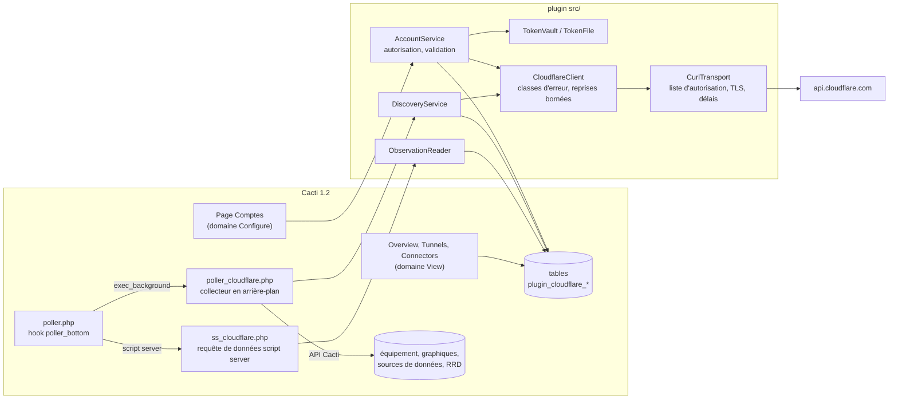

<!-- Source: README.md; SHA256: f8de0e02c5904e15bfa4c71edcaab219e5e5d4f6d9dbe589f4ed16351df6bf4d -->

<!-- translations:start -->
[English](../../../README.md) | [简体中文](../zh-CN/README.md) | [हिन्दी](../hi-IN/README.md) | [Español (España)](../es-ES/README.md) | [Español (Latinoamérica)](../es-419/README.md) | [العربية (السعودية)](../ar-SA/README.md) | [Afrikaans](../af-ZA/README.md) | [አማርኛ](../am-ET/README.md) | [العربية (مصر)](../ar-EG/README.md) | [العربية (المغرب)](../ar-MA/README.md) | [বাংলা](../bn-BD/README.md) | [Bosanski](../bs-BA/README.md) | [Deutsch](../de-DE/README.md) | [فارسی](../fa-IR/README.md) | [Filipino](../fil-PH/README.md) | [Français](README.md) | [Français (Maroc)](../fr-MA/README.md) | [Français (Sénégal)](../fr-SN/README.md) | [Hausa](../ha-NG/README.md) | [עברית](../he-IL/README.md) | [Hrvatski](../hr-HR/README.md) | [Bahasa Indonesia](../id-ID/README.md) | [Igbo](../ig-NG/README.md) | [Italiano](../it-IT/README.md) | [日本語](../ja-JP/README.md) | [한국어](../ko-KR/README.md) | [Malagasy](../mg-MG/README.md) | [मराठी](../mr-IN/README.md) | [Bahasa Melayu](../ms-MY/README.md) | [Nederlands](../nl-NL/README.md) | [Polski](../pl-PL/README.md) | [Português (Brasil)](../pt-BR/README.md) | [Русский](../ru-RU/README.md) | [Kinyarwanda](../rw-RW/README.md) | [Soomaali](../so-SO/README.md) | [Српски](../sr-RS/README.md) | [Svenska](../sv-SE/README.md) | [Kiswahili](../sw-KE/README.md) | [தமிழ்](../ta-IN/README.md) | [తెలుగు](../te-IN/README.md) | [ไทย](../th-TH/README.md) | [Türkçe](../tr-TR/README.md) | [Українська](../uk-UA/README.md) | [اردو](../ur-PK/README.md) | [Tiếng Việt](../vi-VN/README.md) | [isiXhosa](../xh-ZA/README.md) | [Yorùbá](../yo-NG/README.md) | [繁體中文](../zh-TW/README.md) | [isiZulu](../zu-ZA/README.md)
<!-- translations:end -->

<p align="center">
  
</p>

# Plugin Cloudflare pour Cacti

[](https://github.com/somethingwithproof/plugin_cloudflare/actions/workflows/ci.yml)
[](https://sonarcloud.io/summary/new_code?id=somethingwithproof_plugin_cloudflare)
[](../../../LICENSE)


[](https://sonarcloud.io/summary/new_code?id=somethingwithproof_plugin_cloudflare)
[](https://sonarcloud.io/summary/new_code?id=somethingwithproof_plugin_cloudflare)
[](https://sonarcloud.io/summary/new_code?id=somethingwithproof_plugin_cloudflare)


Un plugin Cacti 1.2 en cours de développement destiné à superviser les tunnels
Cloudflare et les analyses de zones. Il interroge l'API Cloudflare à l'aide de
jetons d'API à portée restreinte, ne modifie jamais rien dans Cloudflare et
conserve ses données dans ses propres tables. Dans Cacti, il copie des fichiers
XML de requête de données dans `resource/script_server/` et crée des
équipements, des graphiques et des modèles via les propres API de Cacti, sans
modifier aucun fichier du cœur.

**Statut : 0.4.0-dev, non publiée.** La dernière version publiée est la 0.3.0. La version de développement ajoute l'exportation de l'inventaire au format CSV, la mise hors service explicite des tunnels supprimés, la mise en cache des analyses de zones et des modèles Thold facultatifs. La qualification auprès du fournisseur réel et en conditions de déploiement reste en attente.

Le tableau ci-dessous décrit la version stable 0.3.0. Les ajouts en cours de développement sont décrits ci-après dans les sections dédiées aux workflows d'exploitation et aux analyses de zones.

| Disponible dès maintenant | Prévu |
|---|---|
| Installation, mise à niveau, désactivation et désinstallation via le gestionnaire de plugins de Cacti | Analyses GraphQL et alertes Thold (jalon 4) |
| Permissions Cloudflare : View, Operator et Configure | Injection de pannes, modèles TLA+ et documentation complète (jalon 5) |
| Ajout, modification, suppression, activation et désactivation de comptes Cloudflare | |
| Stockage d'un jeton dans un fichier ou de façon chiffrée dans la base de données Cacti | |
| Vérification d'un jeton et contrôle de ses permissions de lecture sur les tunnels et les zones | |
| Découverte des tunnels et des connecteurs dans un collecteur en arrière-plan lancé par le poller principal | |
| Pages Overview, Tunnels et Connectors sous Management > Cloudflare Tunnels | |
| Suivi du cycle de vie : `active`, `unavailable` et `deleted` | |
| Un équipement Cacti par compte, créé par un administrateur, avec les tunnels comme index d'une requête de données | |
| Graphiques Connectors, Health et Collection par tunnel, tracés à partir d'un fichier RRD par tunnel | |
| Les valeurs que le plugin ne peut pas garantir sont enregistrées comme inconnues (`U`), jamais comme 0 | |

## Rôles d'accès

| Domaine | Accès |
| --- | --- |
| Cloudflare: View | Pages de supervision existantes. |
| Cloudflare: Operator | Supervision plus la page Operations et les acquittements personnels de triage. |
| Cloudflare: Configure | Accès Operator plus la configuration existante et les actions d'administration. |

Après avoir copié les fichiers de mise à niveau, ouvrez la page Plugins en tant
qu'administrateur pour enregistrer le nouveau domaine. Attribuez explicitement le
domaine Operator sous **Configuration > Users** ou via les groupes
d'utilisateurs. Les mises à niveau conservent les identifiants et droits
existants des domaines View et Admin. L'accès Admin hérite de l'accès Operator,
et l'accès Operator hérite de l'accès View à chaque requête ; cela n'ajoute pas
de droits enregistrés aux utilisateurs ou aux groupes. Les paramètres du plugin
requièrent également l'accès Cloudflare: Configure en plus de la permission
Settings de Cacti.

La visibilité des comptes Cloudflare correspond au domaine View existant ; elle
s'applique à l'ensemble du compte. Les identifiants, la configuration, le
mappage, la suppression et les autres modifications d'administration restent
dans les pages d'administration. Les acquittements ne durent que le temps de la
session de l'utilisateur courant, pendant une heure au maximum et uniquement tant
que la même observation reste récente. Toute observation nouvelle ou modifiée les
invalide. Ils ne marquent jamais une mesure en échec comme saine et ne
suppriment pas les alertes.

## Pourquoi ce plugin

Les opérateurs Cacti qui publient des services via Cloudflare Tunnel ne
disposent d'aucune visibilité sur le tunnel dans Cacti. Un tunnel peut perdre
tous ses connecteurs alors que les hôtes d'origine répondent toujours en SNMP :
les graphiques existants restent donc au vert tandis que les utilisateurs
rencontrent des erreurs. L'objectif de ce plugin est de placer l'état de santé
des tunnels et le trafic des zones à côté des graphiques d'équipements que les
opérateurs surveillent déjà, sans donner à Cacti la moindre capacité de modifier
Cloudflare.

Trois contraintes façonnent la conception :

- **Lecture seule.** Le plugin n'appelle que des points de terminaison `GET` et
  l'API GraphQL Analytics. Il n'a besoin d'aucune permission de modification sur
  aucune ressource Cloudflare.
- **Facultatif.** Les pannes de Cloudflare, les jetons expirés et les limites de
  débit ne doivent ni ralentir l'interface de Cacti ni bloquer la collecte des
  autres équipements. Tous les appels d'API ont des délais d'expiration stricts
  et la collecte s'exécute dans un processus en arrière-plan lancé par le poller.
- **Aucune modification du cœur.** Le plugin utilise les hooks de plugins de
  Cacti 1.2 et ses propres tables. Il copie un fichier XML de requête de données
  dans `resource/script_server/` et crée des équipements, des graphiques et des
  modèles via les propres API de Cacti. Aucun fichier du cœur n'est modifié, de
  sorte que les mises à niveau de Cacti et les autres plugins ne sont pas
  affectés.

## Fonctionnement



- **L'intégration Cacti** (`setup.php`, `includes/`, les scripts de pages)
  enregistre les hooks et les domaines, génère le rendu des pages avec les
  assistants propres à Cacti et délègue chaque action à la bibliothèque dans
  `src/`.
- **La bibliothèque** (`src/`, espace de noms `Somethingwithproof\Cloudflare\`)
  n'a aucune dépendance envers les variables globales de Cacti ; elle est donc
  testée sur une véritable base de données et un transport HTTP simulé sans
  instance Cacti en cours d'exécution.
- **Un seul chemin sortant.** `CurlTransport` est le seul code qui touche au
  réseau et il n'accepte que `https://api.cloudflare.com`. Chaque échec est
  associé à une classe d'erreur (`auth`, `permission`, `rate_limited`,
  `transient`, ...), qui détermine le statut affiché dans l'interface.
- **Le stockage** passe par la propre connexion PDO de Cacti avec des requêtes
  préparées. Les évolutions du schéma sont des migrations numérotées et
  idempotentes.

Les choix de conception et leurs justifications figurent dans
[docs/design.md](../../design.md).

## Captures d'écran

Les captures d'écran proviennent d'une pile de test et non d'un compte
Cloudflare en production. La pile exécute Cacti 1.2.31 avec une fausse API
Cloudflare qui renvoie des données de test ; le compte, son identifiant et les
trois tunnels sont donc factices.


*La liste des comptes Cloudflare. La fausse API accepte le jeton, de sorte que
Verify renvoie `ok`.*


*Modification d'un compte. Les champs de jeton sont toujours vides ; le jeton
enregistré n'est jamais renvoyé au navigateur. Collect Tunnels et Create Graphs
sont activés et Collect Analytics est désactivé. Connection Status affiche le
résultat de la dernière vérification : `ok`, lecture des tunnels accordée et
lecture des zones manquante.*


*Settings > Cloudflare.*


*Management > Cloudflare Tunnels > Overview. Le statut correspond au pire état
Cloudflare parmi les tunnels actifs du compte, ici `down` car un tunnel de test
est hors service. `Disabled`, `Not collected`, `Collection failing` et `Not yet
collected` ont priorité sur l'état de santé du tunnel, dans cet ordre, si bien
qu'un compte dont la dernière exécution a échoué affiche `Collection failing`,
quel que soit l'état signalé par ses tunnels.*


*L'onglet Tunnels. Connectors et Connections affichent `-` pour old-office, car
la fausse API répond à sa requête de connexions comme pour un tunnel inconnu et
rien n'a été enregistré, et 0 pour staging, qui n'a aucun connecteur actif.*


*Le graphique Connectors du tunnel blog. Les trois courbes valent 1 avant et
après une interruption au milieu, là où la fausse API a renvoyé des erreurs et
où le plugin a enregistré des valeurs inconnues. Les courbes ne tombent pas à 0.
Le graphique provient de la même pile de test (`make screenshots`), qui définit
un pas de 30 secondes sur cette source de données afin que sept minutes de
collecte remplissent le graphique.*

## Prérequis

- Cacti 1.2.25 à 1.2.31. Cacti 1.2.31 nécessite lui-même PHP 8.0 ou ultérieur.
  L'intégration continue (CI) teste uniquement la version 1.2.31 ; la version 1.2.25 a été testée manuellement pour la dernière fois le 2026-10-22.
- PHP 7.4 à 8.4 avec les extensions `curl`, `openssl` et `pdo_mysql`.
  Le plugin refuse de s'activer sans elles.
- MariaDB 10.6 ou ultérieur, ou MySQL 8.0 ou ultérieur.
- Accès HTTPS depuis le serveur Cacti vers `api.cloudflare.com`. Les proxys ne sont pas pris en charge.

Consultez [docs/compatibility.md](../../compatibility.md) pour connaître les versions testées.

## Installation

1. Placez le plugin dans le répertoire `plugins/cloudflare` de Cacti, soit en
   extrayant l'archive depuis
   [GitHub Releases](https://github.com/somethingwithproof/plugin_cloudflare/releases)
   (`make package` exécuté dans un clone du tag de version génère la même
   archive), soit via un clone git. Le répertoire doit être nommé `cloudflare`.
2. Installez-le et activez-le depuis Console > Configuration > Plugins, ou avec
   l'interface en ligne de commande en tant qu'utilisateur du serveur web :

   ```sh
   php cli/plugin_manage.php --plugin=cloudflare --install --enable
   ```

3. L'utilisateur administrateur reçoit la permission Cloudflare: Configure lors
   de l'installation. Accordez-la à d'autres utilisateurs ou groupes sous
   Console > Configuration > Users.
4. Créez un jeton avec les permissions indiquées dans
   [docs/token-permissions.md](../../token-permissions.md). En bref :
   Account > Cloudflare Tunnel > Read, et éventuellement Zone > Zone > Read.
5. Enregistrez le jeton selon l'une des deux méthodes ci-dessous, puis ajoutez
   le compte sous Console > Configuration > Cloudflare Accounts et exécutez
   Verify depuis le menu d'actions.

### Option A : chiffrement en base de données

Le plugin chiffre les jetons avec une clé de 32 octets que vous créez. Il ne
crée ni n'écrit jamais la clé lui-même. Le fichier doit être lisible par les
utilisateurs du serveur web et du poller, ne doit pas être lisible par les
autres utilisateurs, et son répertoire doit permettre à ces utilisateurs d'y
accéder. Pour un serveur web s'exécutant en tant que `www-data` :

```sh
sudo mkdir -p /etc/cacti
sudo sh -c 'umask 077 && openssl rand -hex 32 > /etc/cacti/cloudflare.key'
sudo chgrp www-data /etc/cacti/cloudflare.key
sudo chmod 0440 /etc/cacti/cloudflare.key
```

Le chemin par défaut est `/etc/cacti/cloudflare.key` ; vous pouvez le modifier
sous Settings > Cloudflare > Token Vault Key File. Lorsque la clé est absente
ou refusée, le formulaire d'édition ne propose que l'option de fichier de
jeton. Conservez une sauvegarde de la clé : sans elle, les jetons enregistrés
ne peuvent pas être déchiffrés et doivent être saisis à nouveau.

#### Rotation de la clé

Il n'existe aucune commande de rechiffrement. Une nouvelle clé ne peut pas
déchiffrer les jetons enregistrés avec l'ancienne ; la rotation consiste donc
à saisir à nouveau chaque jeton enregistré :

1. Munissez-vous de la valeur du jeton de chaque compte. Cloudflare n'affiche
   la valeur d'un jeton que lors de sa création ou de son renouvellement ;
   renouvelez donc le jeton dans le tableau de bord Cloudflare si vous ne
   l'avez plus.
2. Créez la nouvelle clé à un nouvel emplacement à l'aide des commandes
   ci-dessus, par exemple `/etc/cacti/cloudflare.key.new`, avec le même
   propriétaire et les mêmes droits.
3. Définissez Settings > Cloudflare > Token Vault Key File sur le nouveau chemin
   et enregistrez. Désormais, l'action Verify sur un compte encore chiffré
   avec l'ancienne clé signale « Stored token cannot be decrypted », et chaque
   exécution du collecteur journalise `discovery token unavailable` avec
   `reason=decrypt_failed` pour ce compte.
4. Pour chaque compte dont le jeton est enregistré en base de données,
   ouvrez-le sous Console > Configuration > Cloudflare Accounts, collez le
   jeton dans les deux champs de jeton, enregistrez et exécutez Verify. L'état
   retourné doit être `ok`.
5. Une fois que tous ces comptes sont vérifiés avec succès, supprimez l'ancien
   fichier de clé et ses sauvegardes.

Entre les étapes 3 et 4, les tunnels d'un compte ne sont pas actualisés et
leurs graphiques d'état de santé, de connecteurs et de connexions enregistrent
U. Les comptes utilisant un fichier de jeton ne sont pas affectés.

### Option B : fichier de jeton

Écrivez le jeton, et rien d'autre, dans un fichier que les utilisateurs du
serveur web et du poller peuvent lire mais pas les autres utilisateurs, puis
saisissez son chemin absolu dans le formulaire d'édition :

```sh
sudo sh -c 'umask 077 && cat > /etc/cacti/cloudflare-account.token'   # paste the token, then Ctrl-D
sudo chgrp www-data /etc/cacti/cloudflare-account.token
sudo chmod 0440 /etc/cacti/cloudflare-account.token
```

Le fichier est vérifié lors de sa lecture, au moment de l'action Verify, et non
lors de l'enregistrement. Les liens symboliques, les fichiers de plus de 4 Kio
et les fichiers accessibles en lecture ou en écriture par d'autres utilisateurs
sont refusés.

Toute personne disposant de la permission Cloudflare: Configure peut saisir
n'importe quel chemin, et l'utilisateur du poller le lit. Pour regrouper les
fichiers de jetons au même endroit, définissez Settings > Cloudflare >
Token File Directory, par exemple sur `/etc/cacti` ; tout chemin en dehors de
ce répertoire est alors refusé. Consultez [docs/security.md](../../security.md#token-file).

## Mise à niveau

1. Remplacez les fichiers dans `plugins/cloudflare` par ceux de la nouvelle
   version, en conservant le nom du répertoire.
2. Ouvrez Console > Configuration > Plugins ou Console > Configuration >
   Cloudflare Accounts une fois en tant qu'administrateur. Cela exécute les
   migrations du plugin, importe les modèles Cloudflare, copie le fichier de
   requête de données (voir
   [Métriques et graphiques des tunnels](#tunnel-metrics-and-graphs)) et, lors
   d'une mise à niveau depuis la version 0.1.0, enregistre le hook
   `poller_bottom`.

`poller.php` n'exécute pas la mise à niveau du plugin ; par conséquent, tant
que l'étape 2 n'est pas effectuée, le nouveau schéma est absent. Chaque
exécution du collecteur ne fait alors rien et journalise
`CLOUDFLARE: collector skipped; plugin upgrade pending, open Console > Plugins`.
Les pages Cloudflare Tunnels ne nécessitent que la permission Cloudflare: View ;
elles ne déclenchent donc jamais la mise à niveau et, jusqu'à l'étape 2, elles
peuvent afficher « The Cloudflare tunnels could not be read ».

## État du compte

L'action Verify définit l'état du compte :

| État | Signification |
|---|---|
| `unknown` | Non vérifié depuis l'ajout du compte ou la modification de ses identifiants |
| `ok` | Le jeton est actif et peut lire les tunnels |
| `token_inactive` | Cloudflare signale le jeton comme désactivé ou expiré |
| `auth_failed` | Cloudflare a rejeté le jeton comme invalide ou expiré (HTTP 401) |
| `permission_denied` | Le jeton est actif mais ne peut pas lire les tunnels, ou ne dispose pas des permissions nécessaires pour appeler les points de terminaison de vérification du jeton (HTTP 403) |
| `unreachable` | L'API n'a pas pu être jointe, a dépassé le délai d'attente ou a renvoyé une erreur serveur |
| `rate_limited` | Cloudflare a renvoyé le code HTTP 429 |
| `error` | Toute autre défaillance, y compris un fichier de jeton manquant ou non sécurisé, un fichier de clé de coffre de jetons manquant ou inutilisable, ou un jeton enregistré qui ne peut pas être déchiffré |

La page d'édition indique également si la lecture des tunnels et la lecture
des zones ont été accordées.

## Découverte des tunnels

Après chaque cycle de collecte sur le poller principal, le hook `poller_bottom`
démarre un collecteur en arrière-plan via `exec_background` lorsqu'au moins un
compte activé a l'option Collect Tunnels activée. Le collecteur ne s'exécute
jamais dans le processus du poller, de sorte qu'une API Cloudflare lente ne
retarde pas `poller.php`. Les pollers distants ne le démarrent jamais.

Pour chaque compte arrivé à échéance, le collecteur liste les tunnels du
compte, puis lit les connexions de ses tunnels actifs, ce qui fournit les
connecteurs de chaque tunnel, leurs versions, leurs centres de données et leurs
adresses d'origine. Les comptes arrivent à échéance à chaque Discovery Interval
(300 secondes par défaut). Une exécution ne démarre aucun nouveau compte après
50 secondes et effectue au maximum 200 requêtes de connexion. L'une ou l'autre
de ces limites peut également interrompre un compte en cours de lecture de ses
connexions ; ce compte est alors enregistré comme `partial`, et l'exécution
suivante reprend par les tunnels dont la dernière tentative est la plus
ancienne. Les comptes qui n'ont pas été démarrés restent dus pour l'exécution
suivante.

Un tunnel possède un cycle de vie, distinct du statut rapporté par Cloudflare
(`healthy`, `degraded`, `down` ou `inactive`) :

| Cycle de vie | Signification |
|---|---|
| `active` | Le tunnel figurait dans le dernier listage complet |
| `deleted` | Un listage complet ne l'incluait pas, ce qui inclut un listage vide. La ligne et son historique sont conservés, et le tunnel redevient `active` s'il réapparaît |
| `unavailable` | Trois pannes comptabilisées sans listage complet entre elles laissent l'état du tunnel inconnu |

Seul un listage complet et réussi ajoute, met à jour ou supprime des tunnels,
et un listage échoué n'en supprime jamais aucun. Une impossibilité totale de
lire Cloudflare (`transient`, `rate_limited`, `auth` ou `permission`) compte
comme une panne ; après trois pannes comptabilisées sans listage complet entre
elles, les tunnels actifs du compte passent à `unavailable`. Le listage complet
suivant les rétablit et remet le compteur à zéro. Un tunnel que Cloudflare ne
connaît plus lors de la lecture de ses connexions est ignoré sans mettre le
compte en échec. Les autres erreurs n'incrémentent ni ne réinitialisent le
compteur de pannes.

Dans `cacti.log`, les lignes de découverte commencent par
`CLOUDFLARE: discovery` et le résumé d'exécution par `CLOUDFLARE: collector`.
Les échecs et les changements de cycle de vie, tels qu'un listage échoué ou des
tunnels marqués `unavailable`, sont journalisés au niveau par défaut `LOW` de
Cacti ; le résultat de chaque compte et le résumé d'exécution sont journalisés
au niveau `MEDIUM`. La lecture des connexions pouvant échouer sur chaque
tunnel, pour chaque compte seule la première défaillance de chaque classe
d'erreur est journalisée au niveau `LOW`, les suivantes au niveau `MEDIUM`,
suivies d'une ligne `LOW` par classe indiquant le nombre de tunnels en échec.

Management > Cloudflare Tunnels nécessite la permission Cloudflare: View et est
en lecture seule :

- **Overview** liste chaque compte avec son état, le nombre de tunnels par
  cycle de vie, la dernière découverte réussie et le nombre d'échecs
  consécutifs.
- **Tunnels** liste les tunnels de tous les comptes ou d'un compte donné, avec
  des filtres par compte, cycle de vie, statut et nom, ainsi que des colonnes
  triables.
- **Connectors** affiche les connecteurs du tunnel sélectionné dans l'onglet
  Tunnels.

## Métriques et graphiques des tunnels

Cacti lit l'état des tunnels via une requête de données script server,
`ss_cloudflare.php`. Elle répond uniquement à partir des tables du plugin et
n'appelle jamais Cloudflare, de sorte qu'une panne de Cloudflare ne peut pas
ralentir le poller. Chaque tunnel fournit six valeurs : la santé (healthy 3,
degraded 2, down 1, inactive 0), les connecteurs, les connexions, les versions
des connecteurs, le nombre de secondes depuis la dernière lecture de ses
connexions et le nombre d'échecs consécutifs de la tâche de découverte. La
santé, les connecteurs, les connexions et les versions ne sont affichés que
lorsque le plugin peut les garantir, c'est-à-dire lorsque la dernière
découverte a réussi, que le tunnel est `active` et que la mesure est récente.
Dans le cas contraire, ces valeurs valent `U`, et le graphique affiche une
interruption plutôt qu'un zéro qui ressemblerait à une panne. Les deux valeurs
de collecte restent affichées pendant une panne afin que le graphique
Collection la reflète ; elles ne valent `U` que pour un tunnel supprimé ou un
tunnel dont les connexions n'ont jamais été actualisées. Les règles sont
détaillées dans [docs/metrics.md](../../metrics.md).

### Création de l'équipement

Un compte correspond au maximum à un équipement Cacti. L'équipement contient
les tunnels du compte en tant qu'index de la requête de données Cloudflare
Tunnels. Rien ne le crée automatiquement :

1. Ouvrez Console > Configuration > Cloudflare Accounts.
2. Sélectionnez le compte, choisissez Create Cacti Device dans le menu
   d'actions et confirmez.

Cette action nécessite à la fois le domaine Cloudflare: Configure et le domaine
Sites/Devices/Data de Cacti (celui de `host.php`). L'entrée de menu n'apparaît
qu'aux utilisateurs qui détiennent les deux, et le serveur refuse la requête de
toute autre personne. L'équipement est nommé `Cloudflare: <account name>`,
utilise le modèle d'hôte Cloudflare Account et le poller principal, a une
version SNMP 0 sans vérification de disponibilité, et reçoit le nom d'hôte
`<account ID>.cloudflare.invalid`. Ce nom est réservé et ne se résout jamais ;
Cacti ne s'y connecte pas. Si le compte possède déjà un équipement, l'action
l'indique et ne modifie rien. Si un administrateur supprime l'équipement dans
Cacti, le plugin n'en recrée pas d'autre tant que Create Cacti Device n'est
pas exécuté à nouveau.

### Création des graphiques

L'option Create Graphs du formulaire de compte est désactivée par défaut.
Lorsqu'elle est activée, chaque fois qu'une découverte du compte se termine avec
l'état `ok` ou `partial`, le collecteur réindexe l'équipement et crée les
éventuels graphiques manquants pour les tunnels `active` du compte :
Connectors, Health et Collection, soit trois par tunnel. Les trois graphiques
d'un tunnel partagent un même fichier RRD. Une exécution crée au maximum 50
graphiques et s'arrête après 20 secondes, puis l'exécution suivante reprend. Le
plugin ne supprime jamais d'objet Cacti. Un graphique supprimé par un
administrateur n'est pas recréé, et un tunnel que Cloudflare ne liste plus
conserve son graphique et son fichier RRD, qui affichent `U`.

L'activation de Create Graphs nécessite les deux domaines. Sa désactivation ne
nécessite que Configure. Si un utilisateur ne disposant pas du domaine
Sites/Devices/Data enregistre le formulaire, le paramètre reste inchangé et un
avertissement est affiché. Lorsque Create Graphs est désactivée, l'équipement
est tout de même réindexé après chaque découverte, de sorte que les nouveaux
tunnels apparaissent comme index de la requête de données.

### Le fichier de requête de données

Cacti 1.2.31 lit un fichier XML de requête de données uniquement depuis son
répertoire `resource`. Lors de l'installation et de la mise à niveau, le plugin
copie donc un fichier, `templates/resource/cloudflare_tunnels.xml`, vers
`<Cacti>/resource/script_server/cloudflare_tunnels.xml`. C'est le seul fichier
que le plugin écrit en dehors de son propre répertoire ; l'utilisateur qui
installe ou met à niveau le plugin doit donc disposer des droits d'écriture
dans ce répertoire.
La désinstallation conserve ce fichier, ainsi que les équipements, les
graphiques, les fichiers RRD et les modèles. Si la copie ou l'importation du
modèle échoue, le plugin le journalise et Create Cacti Device réessaie.

## Paramètres

Paramètres > Cloudflare contient :

- **Fichier de clé du coffre de jetons** : chemin vers la clé du coffre.
- **Répertoire des fichiers de jetons** : lorsqu'il est défini, tout fichier de jeton situé en dehors de ce répertoire est refusé. Vide par défaut, ce qui autorise n'importe quel chemin. Consultez [docs/security.md](../../security.md#token-file).
- **Délai d'expiration des requêtes interactives** : durée totale en secondes pour une requête effectuée depuis l'interface web, telle que la vérification. Valeur par défaut : 10 ; toute valeur en dehors de la plage 5 à 60 revient à 10.
- **Délai d'expiration des requêtes du collecteur** : durée totale en secondes pour une requête effectuée par le collecteur en arrière-plan. Valeur par défaut : 20 ; toute valeur en dehors de la plage 5 à 60 revient à 20.
- **Niveau de journalisation** : enregistré. Aucun composant ne le lit encore.

Dans le formulaire du compte, les options Collecter les tunnels et Intervalle de découverte contrôlent la découverte, tandis que Créer les graphiques contrôle la création des graphiques. L'option Collecter les analyses est enregistrée mais n'a aucun effet dans cette version.

## Langues

Le plugin inclut des traductions en espagnol (Espagne, `es-ES`), français (`fr-FR`), allemand (`de-DE`), chinois simplifié (`zh-CN`), hindi (`hi-IN`), arabe (`ar-SA`) et japonais (`ja-JP`). Cacti les affiche dès que la prise en charge des langues est activée (Configuration > Paramètres > Général > Prise en charge des langues) et qu'un utilisateur choisit sa langue. Un catalogue en espagnol d'Amérique latine (`es-419`) est également fourni, mais Cacti 1.2 ne propose pas de paramètre régional pour l'espagnol d'Amérique latine ; il ne prendra donc effet que lorsque Cacti en ajoutera un. D'ici là, choisissez l'espagnol (`es-ES`).

Certains textes restent en anglais : les valeurs d'état que le plugin enregistre et affiche telles quelles (`ok`, `active`, `unavailable`, `deleted`, ainsi que l'état du tunnel renvoyé par Cloudflare) et tout ce que le plugin écrit dans le journal de Cacti.

## Désinstallation et conservation des données

La désinstallation supprime les tables propres au plugin — qui contiennent les comptes, les jetons chiffrés, les tunnels découverts, l'état des tâches et l'historique des objets Cacti créés — ainsi que ses paramètres `cloudflare_`. Elle ne supprime ni le fichier de clé, ni les fichiers de jetons, ni le fichier copié `resource/script_server/cloudflare_tunnels.xml`, ni aucun équipement, graphique, source de données, fichier RRD ou modèle Cacti. Ces éléments conservent les données historiques de supervision, et leur suppression relève d'une action explicite de l'administrateur dans Cacti.

L'équipement conservé cesse de recevoir des données. Après une désinstallation, ou après la suppression de son compte, plus aucun compte n'est propriétaire de l'hôte : ses graphiques conservent donc leur historique mais affichent `U` à partir de ce moment. L'action Créer un équipement Cacti sur le compte réinstallé ou rajouté crée un nouvel équipement ; elle ne réutilise pas l'ancien. Supprimez donc l'ancien équipement dans Cacti une fois que son historique n'est plus nécessaire.

## Limitations connues

- Une exécution effectue au maximum 200 requêtes de connexion. Les tunnels au-delà de cette limite sont actualisés moins souvent que la fenêtre d'observation, ce qui provoque des discontinuités dans leurs graphiques de connexion.
- Le plugin écrase les modifications apportées par l'administrateur aux modèles importés lorsqu'une mise à niveau modifie le fichier XML du modèle fourni.
- L'équipement du compte doit rester sur le collecteur principal (main poller). Les tables du plugin se trouvent dans la base de données principale et le script les y lit.
- Les tunnels supprimés restent dans l'index de la requête de données et affichent `U` jusqu'à ce qu'un administrateur les retire explicitement. Le retrait ne supprime via Cacti que les graphiques et les sources de données non partagées enregistrés par le plugin ; la ligne d'inventaire reste visible. Cacti gère le nettoyage des fichiers RRD.
- Cacti désactive un plugin dont le code se termine par une véritable erreur fatale, comme un dépassement de mémoire. Consultez [docs/security.md](../../security.md).

## Sécurité

- Les clés API globales (Global API Keys) sont refusées ; seuls les jetons API à portée limitée sont acceptés.
- Les jetons sont stockés dans un fichier que vous provisionnez ou chiffrés avec AES-256-GCM à l'aide d'un fichier de clé qui n'entre jamais dans la base de données. Ils ne sont jamais affichés sur une page, écrits dans un journal ou inclus dans un message d'erreur.
- Les erreurs de base de données ne contiennent que le SQLSTATE et le code d'erreur du pilote, jamais les valeurs de la requête.
- Chaque modification passe par une requête POST protégée par le jeton CSRF de Cacti. Les modifications d'administration des comptes et de la configuration nécessitent la permission Cloudflare: Configure ; les acquittements personnels de triage nécessitent Cloudflare: Operator. La création d'un équipement Cacti ou l'activation de la création de graphiques requiert également la permission Sites/Devices/Data de Cacti. Un plugin désactivé refuse l'accès à ses pages.

Les détails et les limitations connues figurent dans [docs/security.md](../../security.md).
Signalez toute vulnérabilité en privé conformément à [SECURITY.md](../../../SECURITY.md).

## Flux de travail opérateur et analyses de zone

Les ajouts en cours de développement incluent le retrait explicite des tunnels supprimés, des analyses de zone tenant compte des capacités du forfait et des modèles Thold importables. Ces ajouts ne disposent pas encore d'étiquette de version ni de qualification sur un compte réel. Consultez [docs/analytics-and-alerting.md](../../analytics-and-alerting.md) pour la configuration, la sémantique des métriques et les limites de vérification.

### Exports d'inventaire

Les pages Tunnels et Connecteurs proposent une fonction d'exportation pour le domaine Cloudflare: View. Les fichiers CSV des tunnels incluent toutes les lignes correspondantes, selon le compte actif, le cycle de vie, l'état, la recherche et les paramètres de tri sur l'ensemble des pages. Les fichiers CSV des connecteurs incluent les versions, l'architecture, les centres de données et les adresses d'origine pour le tunnel sélectionné. Les téléchargements lisent uniquement les enregistrements en cache. Les compteurs inconnus sont laissés vides ; les cellules ressemblant à des formules sont préfixées par une apostrophe pour une importation sécurisée dans un tableur.

## Feuille de route

Chaque jalon est livré sous la forme d'une version 0.x portant son numéro : le jalon 3 correspond à la version 0.3.0, le jalon 4 correspondra à la 0.4.0. Les jalons 1 et 2 n'ont pas fait l'objet de versions distinctes et font partie de la 0.3.0. La version 1.0.0 est réservée à la publication qui achèvera l'ensemble des jalons ci-dessous.

| Jalon | Périmètre | État |
|---|---|---|
| 1. Fondations | Cycle de vie du plugin, permissions, configuration du compte, test de connexion | Publié dans la 0.3.0 ([#2](https://github.com/somethingwithproof/plugin_cloudflare/pull/2) à [#5](https://github.com/somethingwithproof/plugin_cloudflare/pull/5)) |
| 2. Découverte | Découverte des tunnels et des connecteurs par un collecteur en arrière-plan, pages Vue d'ensemble, Tunnels et Connecteurs | Publié dans la 0.3.0 ([#6](https://github.com/somethingwithproof/plugin_cloudflare/pull/6)) |
| 3. Métriques | Sources de données de santé des tunnels, modèles de graphiques, gestion des pannes n'enregistrant jamais de zéro fabriqué | Publié dans la 0.3.0 ([#7](https://github.com/somethingwithproof/plugin_cloudflare/pull/7)) |
| 4. Analyses et alertes | Analyses GraphQL par zone adaptées au forfait, seuils Thold avec suppression en cas de panne | Planifié |
| 5. Durcissement | Injection de fautes, modèles TLA+ pour la découverte et la collecte, documentation complète | Planifié |

## Développement

Les outils nécessitent PHP 8.x et Composer ; le code du plugin lui-même reste compatible avec PHP 7.4. Les tests d'intégration et BDD nécessitent une base de données, que `make db-up` démarre dans Docker sur le port 33061.

```sh
composer install
make db-up
make ci            # unit, integration, BDD, PHPStan, php-cs-fixer, php -l on PHP 7.4
make smoke         # installs the plugin into Cacti 1.2.31 in Docker and walks its lifecycle
make package       # builds build/cloudflare-<version>.tar.gz and checks its contents
make db-down
```

`make smoke` et `make screenshots` nécessitent un dépôt Cacti local ; définissez `CACTI_REPO` sur son chemin. Les tests d'intégration lisent `CF_TEST_DSN`, `CF_TEST_DB_USER` et `CF_TEST_DB_PASS`, et sont ignorés lorsque la base de données est inaccessible, sauf si `CI` est défini.

## Contribution

Les pull requests sont les bienvenues. Chaque commit doit comporter une signature DCO (`git commit -s`). Écrivez d'abord le test ; `make ci` doit réussir, et les modifications apportées à l'intégration avec Cacti doivent également passer `make smoke`. Le code du plugin doit rester compatible avec PHP 7.4 et suivre le style de code de Cacti (tabulations, guillemets simples, accolades sur la même ligne).

### Traductions

Les messages sont marqués avec `__('...', 'cloudflare')`. Le script `locales/build_gettext.sh` (`make i18n`, qui nécessite GNU gettext) régénère le modèle `locales/po/cacti.pot`, le fusionne dans chaque catalogue `locales/po/<locale>.po` et compile `locales/LC_MESSAGES/<locale>.mo` ; validez ces trois fichiers dans votre commit. L'intégration continue exécute `make i18n-check`, qui échoue si une entrée est manquante ou marquée comme floue dans un catalogue, si une chaîne de formatage diffère ou si un fichier compilé est obsolète ; la suite de tests unitaires vérifie également les marqueurs de substitution, les balises HTML et les espaces en début et fin de chaque entrée. Tout message modifié nécessite donc la mise à jour de ses traductions dans la même pull request. Pour ajouter une nouvelle langue, créez un fichier `<locale>.po` nommé selon la convention de Cacti (par exemple `pt-BR`), ajoutez-le à `CatalogTest::LOCALES` ainsi qu'à la vérification d'archive dans `tests/build/package.sh`. Conservez tels quels les noms de produits Cloudflare, Cacti et Thold, API et GraphQL, ainsi que les noms de permissions tels que `Account Cloudflare Tunnel Read`.

## Documentation

- [docs/security.md](../../security.md) : contrôles de sécurité et limitations connues
- [docs/token-permissions.md](../../token-permissions.md) : permissions des jetons
- [docs/compatibility.md](../../compatibility.md) : versions prises en charge et interfaces utilisées
- [docs/metrics.md](../../metrics.md) : catalogue des métriques et cas où une valeur est inconnue
- [docs/collector-protocol.md](../../collector-protocol.md) : ce que `ss_cloudflare.php` lit et affiche
- [docs/schema.md](../../schema.md) : tables de la base de données
- [docs/design.md](../../design.md) : décisions de conception
- [CHANGELOG.md](../../../CHANGELOG.md)

## Licence

GPL-2.0-or-later. Consultez [LICENSE](../../../LICENSE).

## Marques déposées

Cloudflare est une marque déposée de Cloudflare, Inc. Ce projet est un outil open source indépendant et n'est ni affilié à, ni sponsorisé, ni approuvé par Cloudflare, Inc.

Ce projet n'est pas non plus affilié au projet Cacti. Consultez [docs/images/README-logo.md](../../images/README-logo.md) pour les informations relatives au logo.
