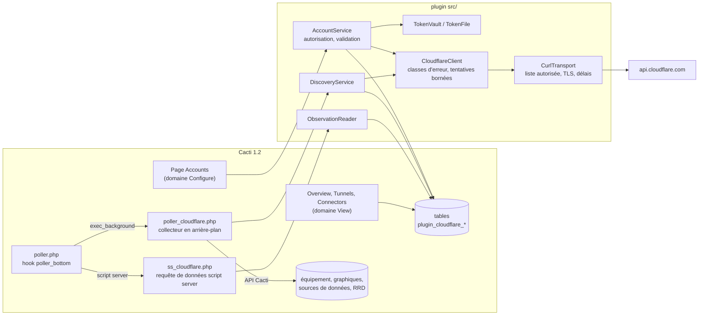

<!-- Source: README.md; SHA256: f8de0e02c5904e15bfa4c71edcaab219e5e5d4f6d9dbe589f4ed16351df6bf4d -->

<!-- translations:start -->
[English](../../../README.md) | [简体中文](../zh-CN/README.md) | [हिन्दी](../hi-IN/README.md) | [Español (España)](../es-ES/README.md) | [Español (Latinoamérica)](../es-419/README.md) | [العربية (السعودية)](../ar-SA/README.md) | [Afrikaans](../af-ZA/README.md) | [አማርኛ](../am-ET/README.md) | [العربية (مصر)](../ar-EG/README.md) | [العربية (المغرب)](../ar-MA/README.md) | [বাংলা](../bn-BD/README.md) | [Bosanski](../bs-BA/README.md) | [Deutsch](../de-DE/README.md) | [فارسی](../fa-IR/README.md) | [Filipino](../fil-PH/README.md) | [Français](../fr-FR/README.md) | [Français (Maroc)](README.md) | [Français (Sénégal)](../fr-SN/README.md) | [Hausa](../ha-NG/README.md) | [עברית](../he-IL/README.md) | [Hrvatski](../hr-HR/README.md) | [Bahasa Indonesia](../id-ID/README.md) | [Igbo](../ig-NG/README.md) | [Italiano](../it-IT/README.md) | [日本語](../ja-JP/README.md) | [한국어](../ko-KR/README.md) | [Malagasy](../mg-MG/README.md) | [मराठी](../mr-IN/README.md) | [Bahasa Melayu](../ms-MY/README.md) | [Nederlands](../nl-NL/README.md) | [Polski](../pl-PL/README.md) | [Português (Brasil)](../pt-BR/README.md) | [Русский](../ru-RU/README.md) | [Kinyarwanda](../rw-RW/README.md) | [Soomaali](../so-SO/README.md) | [Српски](../sr-RS/README.md) | [Svenska](../sv-SE/README.md) | [Kiswahili](../sw-KE/README.md) | [தமிழ்](../ta-IN/README.md) | [తెలుగు](../te-IN/README.md) | [ไทย](../th-TH/README.md) | [Türkçe](../tr-TR/README.md) | [Українська](../uk-UA/README.md) | [اردو](../ur-PK/README.md) | [Tiếng Việt](../vi-VN/README.md) | [isiXhosa](../xh-ZA/README.md) | [Yorùbá](../yo-NG/README.md) | [繁體中文](../zh-TW/README.md) | [isiZulu](../zu-ZA/README.md)
<!-- translations:end -->

<p align="center">
  
</p>

# Plugin Cloudflare pour Cacti

[](https://github.com/somethingwithproof/plugin_cloudflare/actions/workflows/ci.yml)
[](https://sonarcloud.io/summary/new_code?id=somethingwithproof_plugin_cloudflare)
[](../../../LICENSE)


[](https://sonarcloud.io/summary/new_code?id=somethingwithproof_plugin_cloudflare)
[](https://sonarcloud.io/summary/new_code?id=somethingwithproof_plugin_cloudflare)
[](https://sonarcloud.io/summary/new_code?id=somethingwithproof_plugin_cloudflare)


Un plugin pour Cacti 1.2 en cours de développement pour superviser les tunnels Cloudflare et
les statistiques analytiques de zones. Il lit les données depuis l'API Cloudflare à l'aide de jetons API à portée restreinte,
ne modifie jamais rien dans Cloudflare et conserve ses données dans ses propres tables.
Dans Cacti, il copie les fichiers XML de requêtes de données dans `resource/script_server/` et
crée les équipements, graphiques et modèles via les API propres à Cacti, sans aucune modification
des fichiers du cœur.

**Statut : 0.4.0-dev, non publiée.** La dernière version publiée est la 0.3.0. La version de développement ajoute les exports d'inventaire au format CSV, le retrait explicite des tunnels supprimés, la mise en cache des statistiques analytiques de zones et des modèles Thold optionnels. La qualification auprès du fournisseur en conditions réelles et la qualification de déploiement restent en attente.

Le tableau ci-dessous décrit la version stable 0.3.0. Les ajouts de la version de développement sont décrits plus bas dans les sections relatives aux flux de travail opérateur et aux statistiques analytiques de zones.

| Disponible actuellement | Prévu |
|---|---|
| Installation, mise à niveau, désactivation et désinstallation via le gestionnaire de plugins de Cacti | Analytique GraphQL et alertes Thold (Jalon 4) |
| Permissions Cloudflare : View, Operator et Configure | Injection de pannes, modèles TLA+ et documentation complète (Jalon 5) |
| Ajout, modification, suppression, activation et désactivation de comptes Cloudflare | |
| Stockage d'un jeton dans un fichier ou chiffré dans la base de données Cacti | |
| Vérification d'un jeton et contrôle de ses permissions de lecture des tunnels et des zones | |
| Découverte des tunnels et des connecteurs par un collecteur en arrière-plan lancé par le poller principal | |
| Pages Overview, Tunnels et Connectors sous Management > Cloudflare Tunnels | |
| Suivi du cycle de vie : `active`, `unavailable` et `deleted` | |
| Un équipement Cacti par compte, créé par un administrateur, avec les tunnels comme index d'une requête de données | |
| Graphiques Connectors, Health et Collection par tunnel, tracés à partir d'un fichier RRD par tunnel | |
| Les valeurs que le plugin ne peut pas garantir sont enregistrées comme inconnues (`U`), jamais comme 0 | |

## Rôles d'accès

| Domaine (Realm) | Accès |
| --- | --- |
| Cloudflare: View | Pages de supervision existantes. |
| Cloudflare: Operator | Supervision plus la page Operations et les acquittements personnels de triage. |
| Cloudflare: Configure | Accès Operator plus les actions existantes de configuration et d'administration. |

Après avoir copié les fichiers de mise à niveau, ouvrez la page Plugins en tant qu'administrateur pour enregistrer
le nouveau domaine. Attribuez explicitement le domaine Operator sous **Configuration > Users** ou aux groupes d'utilisateurs.
Les mises à niveau conservent les identifiants et les droits existants des domaines View et Admin. L'accès Admin
hérite de l'accès Operator, et l'accès Operator hérite de l'accès View à chaque requête ;
cela n'ajoute pas de droits stockés aux utilisateurs ou aux groupes. Les paramètres du plugin exigent également
l'accès Cloudflare: Configure en plus de l'autorisation Settings de Cacti.

La visibilité des comptes Cloudflare correspond au domaine View existant ; elle s'applique à l'ensemble du compte.
Les identifiants, la configuration, le mappage, la suppression et les autres modifications administratives
restent dans les pages d'administration. Les acquittements ne durent que pendant la session de l'utilisateur
courant, pendant une heure au maximum et uniquement tant que la même observation reste fraîche.
Toute observation nouvelle ou modifiée les invalide. Ils ne marquent jamais une mesure en échec
comme saine et ne suppriment jamais les alertes.

## Pourquoi ce plugin

Les opérateurs Cacti qui publient des services via Cloudflare Tunnel n'ont aucune visibilité
sur le tunnel dans Cacti. Un tunnel peut perdre l'ensemble de ses connecteurs alors que
les hôtes d'origine répondent toujours en SNMP ; les graphiques existants restent ainsi verts tandis que
les utilisateurs rencontrent des erreurs. L'objectif de ce plugin est d'afficher l'état de santé du tunnel et le trafic
de la zone à côté des graphiques d'équipements que les opérateurs surveillent déjà, sans donner
à Cacti la moindre possibilité de modifier Cloudflare.

Trois contraintes guident la conception :

- **Lecture seule.** Le plugin appelle uniquement des points de terminaison `GET` et l'API GraphQL
  Analytics. Il n'a besoin d'aucune permission de modification sur quelque ressource Cloudflare que ce soit.
- **Optionnel.** Les pannes de Cloudflare, les jetons expirés et les limites de débit ne doivent ni
  ralentir l'interface Web de Cacti ni bloquer la collecte des autres équipements. Tous les appels API disposent
  de délais d'expiration stricts, et la collecte s'exécute dans un processus en arrière-plan lancé par
  le poller.
- **Aucune modification du cœur.** Le plugin s'appuie sur les hooks de plugins de Cacti 1.2 et sur ses
  propres tables. Il copie un fichier XML de requête de données dans `resource/script_server/` et
  crée les équipements, graphiques et modèles via les API propres à Cacti. Aucune modification
  des fichiers du cœur n'est effectuée, de sorte que les mises à niveau de Cacti et les autres plugins ne sont pas affectés.

## Fonctionnement



- **L'intégration Cacti** (`setup.php`, `includes/`, les scripts de pages) enregistre les
  hooks et les domaines, génère le rendu des pages à l'aide des fonctions utilitaires de Cacti et délègue
  chaque action à la bibliothèque dans `src/`.
- **La bibliothèque** (`src/`, espace de noms `Somethingwithproof\Cloudflare\`) n'a aucune
  dépendance envers les variables globales de Cacti ; elle est donc testée sur une véritable base de données et
  un transport HTTP simulé, sans instance Cacti en cours d'exécution.
- **Un seul chemin sortant.** `CurlTransport` est le seul code qui accède au
  réseau, et il n'accepte que `https://api.cloudflare.com`. Chaque échec
  est associé à une classe d'erreur (`auth`, `permission`, `rate_limited`,
  `transient`, ...), qui détermine le statut affiché dans l'interface.
- **Le stockage** passe par la connexion PDO propre à Cacti avec des requêtes
  préparées. Les évolutions du schéma sont des migrations numérotées et idempotentes.

Les choix de conception et leurs justifications se trouvent dans
[docs/design.md](../../design.md).

## Captures d'écran

Les captures d'écran proviennent d'une pile de test et non d'un compte Cloudflare en production. La
pile exécute Cacti 1.2.31 face à une API Cloudflare simulée qui renvoie des données
de test ; le compte, son identifiant et les trois tunnels sont donc des valeurs fictives.


*La liste des comptes Cloudflare. L'API simulée accepte le jeton, donc Verify
indique `ok`.*


*Édition d'un compte. Les champs de jeton sont toujours vides ; le jeton stocké n'est
jamais renvoyé au navigateur. Collect Tunnels et Create Graphs sont activés et
Collect Analytics est désactivé. Connection Status affiche le résultat de la dernière
vérification (Verify) : `ok`, lecture des tunnels accordée et lecture des zones manquante.*


*Settings > Cloudflare.*


*Management > Cloudflare Tunnels > Overview. Le statut correspond au pire statut Cloudflare
parmi les tunnels actifs du compte, ici `down` car un tunnel de test
est hors service. `Disabled`, `Not collected`, `Collection failing` et `Not yet
collected` ont priorité sur l'état de santé des tunnels, dans cet ordre ; ainsi, un compte
dont la dernière exécution a échoué affiche `Collection failing` quel que soit l'état signalé par ses tunnels.*


*L'onglet Tunnels. Connectors et Connections affichent `-` pour old-office, car
l'API simulée répond à sa requête de connexions comme pour un tunnel inconnu et rien
n'a été stocké, et 0 pour staging, qui ne dispose d'aucun connecteur actif.*


*Le graphique Connectors du tunnel blog. Les trois courbes sont à 1 avant et
après une interruption au milieu, moment où l'API simulée a renvoyé des erreurs et où le plugin
a enregistré des valeurs inconnues. Les courbes ne retombent pas à 0. Le graphique provient de la
même pile de test (`make screenshots`), qui définit un pas de 30 secondes sur cette
source de données afin que sept minutes de collecte remplissent le graphique.*

## Prérequis

- Cacti 1.2.25 à 1.2.31. Cacti 1.2.31 nécessite lui-même PHP 8.0 ou ultérieur.
  L'intégration continue (CI) teste uniquement la version 1.2.31 ; la version 1.2.25 a été testée manuellement pour la dernière fois le 2026-10-22.
- PHP 7.4 à 8.4 avec les extensions `curl`, `openssl` et `pdo_mysql`.
  Le plugin refuse de s'activer sans ces extensions.
- MariaDB 10.6 ou ultérieur, ou MySQL 8.0 ou ultérieur.
- Accès HTTPS depuis le serveur Cacti vers `api.cloudflare.com`. Les proxys ne sont pas
  pris en charge.

Consultez [docs/compatibility.md](../../compatibility.md) pour connaître les versions testées.

## Installation

1. Placez le plugin dans le répertoire `plugins/cloudflare` de Cacti, soit en
   extrayant l'archive depuis
   [GitHub Releases](https://github.com/somethingwithproof/plugin_cloudflare/releases)
   (`make package` exécuté dans une copie locale du tag de version génère la même
   archive), soit par un clonage
   Git. Le répertoire doit obligatoirement se nommer `cloudflare`.
2. Installez-le et activez-le depuis Console > Configuration > Plugins, ou en
   ligne de commande en tant qu'utilisateur du serveur web :

   ```sh
   php cli/plugin_manage.php --plugin=cloudflare --install --enable
   ```

3. L'utilisateur admin reçoit l'autorisation Cloudflare: Configure lors de l'installation.
   Accordez-la à d'autres utilisateurs ou groupes sous Console > Configuration > Users.
4. Créez un jeton avec les autorisations indiquées dans
   [docs/token-permissions.md](../../token-permissions.md). En résumé :
   Account > Cloudflare Tunnel > Read, et éventuellement Zone > Zone > Read.
5. Enregistrez le jeton selon l'une des deux méthodes ci-dessous, puis ajoutez le compte sous
   Console > Configuration > Cloudflare Accounts et lancez Verify depuis le
   menu d'actions.

### Option A : chiffrement dans la base de données

Le plugin chiffre les jetons à l'aide d'une clé de 32 octets que vous créez. Il ne
crée ni n'écrit jamais la clé lui-même. Le fichier doit être lisible par les utilisateurs
du serveur web et du poller, ne doit pas être lisible par les autres utilisateurs, et son répertoire
doit permettre à ces utilisateurs d'y accéder. Pour un serveur web exécuté sous `www-data` :

```sh
sudo mkdir -p /etc/cacti
sudo sh -c 'umask 077 && openssl rand -hex 32 > /etc/cacti/cloudflare.key'
sudo chgrp www-data /etc/cacti/cloudflare.key
sudo chmod 0440 /etc/cacti/cloudflare.key
```

Le chemin par défaut est `/etc/cacti/cloudflare.key` ; vous pouvez le modifier sous Settings >
Cloudflare > Token Vault Key File. Lorsque la clé est manquante ou refusée, le
formulaire d'édition propose uniquement l'option de fichier de jeton. Conservez une sauvegarde de la clé :
sans elle, les jetons enregistrés ne peuvent pas être déchiffrés et doivent être saisis à nouveau.

#### Rotation de la clé

Il n'existe aucune commande de rechiffrement. Une nouvelle clé ne peut pas déchiffrer les jetons enregistrés avec
l'ancienne ; la rotation consiste donc à saisir à nouveau chaque jeton enregistré :

1. Ayez la valeur du jeton de chaque compte à portée de main. Cloudflare n'affiche la valeur d'un jeton
   qu'au moment de sa création ou de son renouvellement ; renouvelez donc le jeton dans le tableau de bord
   Cloudflare si vous ne l'avez plus.
2. Créez la nouvelle clé à un nouvel emplacement avec les commandes ci-dessus, par exemple
   `/etc/cacti/cloudflare.key.new`, avec le même propriétaire et les mêmes droits.
3. Définissez Settings > Cloudflare > Token Vault Key File sur le nouveau chemin et enregistrez.
   À partir de ce moment, Verify sur un compte encore chiffré avec l'ancienne clé
   signale "Stored token cannot be decrypted", et chaque exécution du collecteur journalise
   `discovery token unavailable` avec `reason=decrypt_failed` pour ce compte.
4. Pour chaque compte qui enregistre son jeton dans la base de données, ouvrez-le sous
   Console > Configuration > Cloudflare Accounts, collez le jeton dans les deux
   champs de jeton, enregistrez et lancez Verify. Il doit indiquer `ok`.
5. Lorsque tous ces comptes sont vérifiés avec succès, supprimez l'ancien fichier de clé et ses
   sauvegardes.

Entre les étapes 3 et 4, les tunnels d'un compte ne sont pas actualisés et leurs
graphiques de santé, de connecteurs et de connexions enregistrent U. Les comptes utilisant un fichier de jeton ne sont
pas affectés.

### Option B : fichier de jeton

Écrivez le jeton, et rien d'autre, dans un fichier que les utilisateurs du serveur web et du poller
peuvent lire mais pas les autres utilisateurs, puis saisissez son chemin absolu dans le formulaire d'édition :

```sh
sudo sh -c 'umask 077 && cat > /etc/cacti/cloudflare-account.token'   # paste the token, then Ctrl-D
sudo chgrp www-data /etc/cacti/cloudflare-account.token
sudo chmod 0440 /etc/cacti/cloudflare-account.token
```

Le fichier est vérifié lors de sa lecture, au moment de Verify, et non lors de l'enregistrement. Les liens
symboliques, les fichiers de plus de 4 KiB et les fichiers accessibles en lecture ou en écriture par d'autres utilisateurs sont
refusés.

Toute personne disposant de Cloudflare: Configure peut saisir n'importe quel chemin, et l'utilisateur du poller
le lit. Pour regrouper les fichiers de jeton au même endroit, définissez Settings > Cloudflare >
Token File Directory, par exemple sur `/etc/cacti` ; tout chemin en dehors de ce répertoire est alors
refusé. Consultez [docs/security.md](../../security.md#token-file).

## Mise à niveau

1. Remplacez les fichiers dans `plugins/cloudflare` par ceux de la nouvelle version, en conservant
   le nom du répertoire.
2. Ouvrez Console > Configuration > Plugins, ou Console > Configuration >
   Cloudflare Accounts, une fois en tant qu'administrateur. Cela exécute les migrations du plugin,
   importe les modèles Cloudflare et copie le fichier de requête de données (voir
   [Métriques et graphiques des tunnels](#tunnel-metrics-and-graphs)), et, lors d'une
   mise à niveau depuis la version 0.1.0, enregistre le hook `poller_bottom`.

`poller.php` n'exécute pas la mise à niveau du plugin ; ainsi, jusqu'à l'étape 2, le nouveau
schéma est absent. Chaque exécution du collecteur ne fait alors rien et journalise
`CLOUDFLARE: collector skipped; plugin upgrade pending, open Console > Plugins`.
Les pages Cloudflare Tunnels nécessitent uniquement Cloudflare: View ; elles n'exécutent donc jamais
la mise à niveau et, jusqu'à l'étape 2, elles peuvent afficher "The Cloudflare tunnels could not
be read".

## Statut du compte

Verify définit le statut du compte :

| Statut | Signification |
|---|---|
| `unknown` | Non vérifié depuis l'ajout du compte ou la modification de ses identifiants |
| `ok` | Le jeton est actif et peut lire les tunnels |
| `token_inactive` | Cloudflare signale le jeton comme désactivé ou expiré |
| `auth_failed` | Cloudflare a rejeté le jeton comme invalide ou expiré (HTTP 401) |
| `permission_denied` | Le jeton est actif mais ne peut pas lire les tunnels, ou il ne dispose pas des autorisations nécessaires pour appeler les points de terminaison de vérification du jeton (HTTP 403) |
| `unreachable` | L'API n'a pas pu être jointe, a dépassé le délai d'attente ou a renvoyé une erreur serveur |
| `rate_limited` | Cloudflare a renvoyé HTTP 429 |
| `error` | Tout autre échec, y compris un fichier de jeton manquant ou non sécurisé, un fichier de clé du coffre de jetons manquant ou inutilisable, ou un jeton enregistré qui ne peut pas être déchiffré |

La page d'édition indique également si les droits de lecture des tunnels et de lecture des zones ont été accordés.

## Découverte des tunnels

Après chaque cycle de collecte sur le poller principal, le hook `poller_bottom` démarre
un collecteur en arrière-plan via `exec_background` lorsqu'au moins un compte activé
a l'option Collect Tunnels activée. Le collecteur ne s'exécute jamais dans le processus
du poller, afin qu'une API Cloudflare lente ne retarde pas `poller.php`. Les pollers distants
ne le démarrent jamais.

Pour chaque compte arrivé à échéance, le collecteur liste les tunnels du compte, puis
lit les connexions de ses tunnels actifs, ce qui fournit les connecteurs de chaque tunnel,
leurs versions, leurs centres de données et leurs adresses d'origine. Les comptes arrivent à
échéance à chaque Discovery Interval (300 secondes par défaut). Une exécution ne démarre aucun nouveau
compte après 50 secondes et effectue au maximum 200 requêtes de connexion. L'une ou l'autre
limite peut également interrompre un compte en cours de lecture de ses connexions ; ce
compte est enregistré comme `partial`, et l'exécution suivante reprend avec les tunnels
tentés le moins récemment. Les comptes non démarrés restent dus pour l'exécution suivante.

Un tunnel possède un cycle de vie, distinct du statut signalé par Cloudflare
(`healthy`, `degraded`, `down` ou `inactive`) :

| Cycle de vie | Signification |
|---|---|
| `active` | Le tunnel figurait dans le dernier listage complet |
| `deleted` | Un listage complet ne l'incluait pas, ce qui inclut un listage vide. La ligne et son historique sont conservés, et le tunnel redevient `active` s'il réapparaît |
| `unavailable` | Trois pannes comptabilisées sans listage complet entre elles laissent l'état du tunnel inconnu |

Seul un listage complet et réussi ajoute, met à jour ou supprime des tunnels, et un
listage échoué n'en supprime jamais aucun. Une impossibilité totale de lire Cloudflare
(`transient`, `rate_limited`, `auth` ou `permission`) compte comme une panne ;
après trois pannes comptabilisées sans listage complet entre elles, les
tunnels actifs du compte deviennent `unavailable`. Le listage complet suivant
les restaure et réinitialise le compteur. Un tunnel que Cloudflare ne connaît plus
lors de la lecture de ses connexions est ignoré sans faire échouer le compte. Les autres
échecs n'incrémentent ni ne réinitialisent le compteur de pannes.

Dans `cacti.log`, les lignes de découverte commencent par `CLOUDFLARE: discovery` et le résumé
d'exécution par `CLOUDFLARE: collector`. Les échecs et les changements de cycle de vie, tels qu'un
listage échoué ou des tunnels marqués `unavailable`, sont journalisés au niveau `LOW` par défaut de Cacti ;
le résultat de chaque compte et le résumé d'exécution sont journalisés au niveau `MEDIUM`.
Les lectures de connexion pouvant échouer sur chaque tunnel, pour chaque compte seule
la première erreur de chaque classe d'erreur est journalisée au niveau `LOW`, les suivantes au niveau
`MEDIUM`, suivies d'une ligne `LOW` par classe indiquant le nombre de tunnels en
échec.

Management > Cloudflare Tunnels nécessite l'autorisation Cloudflare: View et est en
lecture seule :

- **Overview** liste chaque compte avec son statut, le nombre de tunnels par cycle de vie,
  la dernière découverte réussie et le nombre d'échecs consécutifs.
- **Tunnels** liste les tunnels sur l'ensemble des comptes ou pour un seul compte, avec des filtres
  par compte, cycle de vie, statut et nom, ainsi que des colonnes triables.
- **Connectors** affiche les connecteurs du tunnel sélectionné dans l'onglet Tunnels.

<a name="tunnel-metrics-and-graphs"></a>

## Métriques et graphiques des tunnels

Cacti lit l'état des tunnels via une requête de données de serveur de script,
`ss_cloudflare.php`. Elle répond uniquement à partir des tables du plugin et n'appelle jamais
Cloudflare, de sorte qu'une panne de Cloudflare ne puisse pas ralentir le poller. Chaque tunnel fournit
six valeurs : santé (healthy 3, degraded 2, down 1, inactive 0), connecteurs,
connexions, versions des connecteurs, nombre de secondes depuis la dernière lecture de ses
connexions, et échecs consécutifs de la tâche de découverte. La santé, les connecteurs,
les connexions et les versions ne sont affichés que lorsque le plugin peut en garantir la fiabilité,
ce qui signifie que la dernière découverte a réussi, que le tunnel est `active` et que la
lecture est récente. Dans le cas contraire, ils valent `U`, et le graphique affiche une interruption au lieu
d'un zéro qui ressemblerait à une panne. Les deux valeurs de collecte restent
affichées pendant une panne afin que le graphique Collection la reflète ; elles ne valent `U`
que pour un tunnel supprimé ou un tunnel dont les connexions n'ont jamais été actualisées. Les règles
sont détaillées dans [docs/metrics.md](../../metrics.md).

### Création de l'équipement

Un compte correspond au maximum à un équipement Cacti. L'équipement contient les tunnels
du compte en tant qu'index de la requête de données Cloudflare Tunnels. Rien ne le crée
automatiquement :

1. Ouvrez Console > Configuration > Cloudflare Accounts.
2. Sélectionnez le compte, choisissez Create Cacti Device dans le menu d'actions, puis
   confirmez.

L'action nécessite à la fois le domaine (realm) Cloudflare: Configure et le domaine
Sites/Devices/Data de Cacti (celui de `host.php`). L'entrée de menu n'apparaît
qu'aux utilisateurs disposant des deux, et le serveur refuse la requête de toute autre personne.
L'équipement est nommé `Cloudflare: <account name>`, utilise le modèle d'hôte Cloudflare Account
et le poller principal, possède une version SNMP 0 sans vérification de disponibilité,
et reçoit le nom d'hôte `<account ID>.cloudflare.invalid`. Ce nom est
réservé et ne se résout jamais ; Cacti ne s'y connecte pas. Si le compte
possède déjà un équipement, l'action le signale et ne modifie rien. Si un
administrateur supprime l'équipement dans Cacti, le plugin n'en recrée pas d'autre
tant que Create Cacti Device n'est pas relancé.

### Création des graphiques

Create Graphs dans le formulaire du compte est désactivé par défaut. Lorsqu'il est activé, chaque fois
qu'une découverte du compte se termine avec `ok` ou `partial`, le collecteur réindexe
l'équipement et crée les graphiques manquants pour les tunnels `active` du compte :
Connectors, Health et Collection, soit trois par tunnel. Les trois graphiques d'un tunnel
partagent un seul fichier RRD. Une exécution crée au maximum 50 graphiques et s'arrête après 20
secondes, et l'exécution suivante reprend là où elle s'est arrêtée. Le plugin ne supprime jamais d'objet Cacti.
Un graphique qu'un administrateur supprime n'est pas recréé, et un tunnel que
Cloudflare ne liste plus conserve son graphique et son fichier RRD, qui affichent `U`.

L'activation de Create Graphs nécessite les deux domaines. Sa désactivation nécessite uniquement
Configure. Un utilisateur sans le domaine Sites/Devices/Data qui enregistre le formulaire
laisse le paramètre inchangé, avec un avertissement. Lorsque Create Graphs est désactivé,
l'équipement est tout de même réindexé après chaque découverte, afin que les nouveaux tunnels apparaissent comme
index de la requête de données.

### Le fichier de requête de données

Cacti 1.2.31 lit un fichier XML de requête de données uniquement depuis l'intérieur de son répertoire
`resource`. Lors de l'installation et de la mise à niveau, le plugin copie donc un fichier,
`templates/resource/cloudflare_tunnels.xml`, vers
`<Cacti>/resource/script_server/cloudflare_tunnels.xml`. C'est le seul fichier
que le plugin écrit en dehors de son propre répertoire ; l'utilisateur qui installe ou
met à niveau le plugin doit donc pouvoir écrire dans ce répertoire.
La désinstallation conserve ce fichier, ainsi que les équipements, les graphiques, les fichiers RRD et les
modèles. Si la copie ou l'importation du modèle échoue, le plugin le journalise et
Create Cacti Device réessaie.

## Paramètres

Paramètres > Cloudflare contient :

- **Fichier de clé du coffre de jetons** : chemin vers la clé du coffre.
- **Répertoire des fichiers de jetons** : lorsqu'il est défini, tout fichier de jeton situé en dehors de ce répertoire est refusé. Vide par défaut, ce qui autorise n'importe quel chemin. Voir [docs/security.md](../../security.md#token-file).
- **Délai d'expiration des requêtes interactives** : durée totale en secondes pour une requête effectuée depuis l'interface web, telle que Vérifier. Valeur par défaut : 10 ; les valeurs en dehors de l'intervalle de 5 à 60 reviennent à 10.
- **Délai d'expiration des requêtes du collecteur** : durée totale en secondes pour une requête effectuée par le collecteur en arrière-plan. Valeur par défaut : 20 ; les valeurs en dehors de l'intervalle de 5 à 60 reviennent à 20.
- **Niveau de journalisation** : enregistré. Aucun composant ne le lit encore.

Dans le formulaire du compte, Collecter les tunnels et Intervalle de découverte contrôlent la découverte, et Créer les graphiques contrôle la création des graphiques. Collecter les analyses est enregistré et n'a aucun effet dans cette version.

## Langues

L'extension inclut des traductions en espagnol (Espagne, `es-ES`), français (`fr-FR`), allemand (`de-DE`), chinois simplifié (`zh-CN`), hindi (`hi-IN`), arabe (`ar-SA`) et japonais (`ja-JP`). Cacti les affiche dès que la prise en charge des langues est activée (Configuration > Paramètres > Général > Prise en charge des langues) et qu'un utilisateur sélectionne la langue. Un catalogue en espagnol d'Amérique latine (`es-419`) est également fourni, mais Cacti 1.2 ne propose pas de paramètre régional pour l'espagnol d'Amérique latine ; il ne prendra donc effet que lorsque Cacti en ajoutera un. D'ici là, choisissez l'espagnol (`es-ES`).

Certains textes restent en anglais : les valeurs d'état que l'extension enregistre et affiche telles quelles (`ok`, `active`, `unavailable`, `deleted`, ainsi que l'état du tunnel signalé par Cloudflare), et tout ce que l'extension écrit dans le journal Cacti.

## Désinstallation et conservation des données

La désinstallation supprime les propres tables de l'extension, qui contiennent les comptes, les jetons chiffrés, les tunnels découverts, l'état des tâches et l'historique des objets Cacti qu'elle a créés, et supprime ses paramètres `cloudflare_`. Elle ne supprime pas le fichier de clé, les fichiers de jetons, le fichier copié `resource/script_server/cloudflare_tunnels.xml`, ni aucun périphérique, graphique, source de données, fichier RRD ou modèle Cacti. Ceux-ci contiennent des données historiques de supervision, et leur suppression relève d'une action explicite de l'administrateur dans Cacti.

Le périphérique conservé cesse de recevoir des données. Après une désinstallation, ou après la suppression de son compte, aucun compte ne possède l'hôte ; ses graphiques conservent donc leur historique mais affichent `U` à partir de ce moment. L'action Créer un périphérique Cacti sur le compte réinstallé ou ajouté à nouveau crée un nouveau périphérique ; elle ne réutilise pas l'ancien. Supprimez donc l'ancien périphérique dans Cacti dès que son historique n'est plus nécessaire.

## Limitations connues

- Une exécution effectue au maximum 200 requêtes de connexion. Les tunnels au-delà de ce plafond sont actualisés moins souvent que la fenêtre d'observation, de sorte que leurs graphiques de connexion présentent des lacunes.
- L'extension écrase les modifications apportées par l'administrateur aux modèles importés lorsqu'une mise à niveau modifie le fichier XML de modèle fourni.
- Le périphérique du compte doit rester sur le collecteur principal. Les tables de l'extension se trouvent dans la base de données principale et le script les y lit.
- Les tunnels supprimés restent dans l'index de la requête de données et affichent `U` jusqu'à ce qu'un administrateur les retire explicitement. Le retrait supprime uniquement les graphiques enregistrés par l'extension et les sources de données non partagées via Cacti ; la ligne d'inventaire reste visible. Cacti contrôle le nettoyage des fichiers RRD.
- Cacti désactive une extension dont le code se termine par une véritable erreur fatale, telle qu'un épuisement de la mémoire. Voir [docs/security.md](../../security.md).

## Sécurité

- Les clés API globales sont refusées ; seuls les jetons API à portée limitée sont acceptés.
- Les jetons sont stockés dans un fichier que vous provisionnez ou chiffrés avec AES-256-GCM à l'aide d'un fichier de clé qui n'entre jamais dans la base de données. Ils ne sont jamais affichés dans une page, écrits dans un journal ni inclus dans un message d'erreur.
- Les erreurs de base de données ne contiennent que le SQLSTATE et le code d'erreur du pilote, jamais les valeurs de la requête.
- Chaque modification est une requête POST protégée par le jeton CSRF de Cacti. Les modifications de configuration et de compte administratif nécessitent la permission Cloudflare : Configurer ; les acquittements de triage personnels nécessitent Cloudflare : Opérateur. La création d'un périphérique Cacti ou l'activation de Créer les graphiques nécessite également la permission Sites/Périphériques/Données de Cacti. Une extension désactivée refuse l'accès à ses pages.

Les détails et les limitations connues figurent dans [docs/security.md](../../security.md).
Signalez les vulnérabilités de manière privée comme décrit dans [SECURITY.md](../../../SECURITY.md).

## Flux de travail opérateur et analytique de zone

Les ajouts en cours de développement incluent le retrait explicite des tunnels supprimés, l'analytique de zone sensible aux capacités et des modèles Thold importables. Ces ajouts ne disposent pas encore d'étiquette de version ni de qualification sur compte réel. Voir [docs/analytics-and-alerting.md](../../analytics-and-alerting.md) pour la configuration, la sémantique des métriques et les limites de vérification.

### Exportations d'inventaire

Les pages Tunnels et Connecteurs proposent l'action Exporter pour le domaine Cloudflare : Afficher. Les fichiers CSV des tunnels incluent chaque ligne correspondante, en utilisant le compte actif, le cycle de vie, l'état, ainsi que les paramètres de recherche et de tri sur l'ensemble des pages. Les fichiers CSV des connecteurs incluent les versions, l'architecture, les centres de données et les adresses d'origine pour le tunnel sélectionné. Les téléchargements lisent uniquement les enregistrements en cache. Les décomptes inconnus sont laissés vides ; les cellules ressemblant à des formules sont préfixées par une apostrophe pour une importation sécurisée dans un tableur.

## Feuille de route

Chaque jalon est publié sous forme de version 0.x numérotée d'après lui : le jalon 3 correspond à la version 0.3.0, le jalon 4 sera la version 0.4.0. Les jalons 1 et 2 n'ont pas été publiés séparément et font partie de la version 0.3.0. La version 1.0.0 est réservée à la publication qui achève l'ensemble des jalons ci-dessous.

| Jalon | Périmètre | État |
|---|---|---|
| 1. Fondations | Cycle de vie de l'extension, permissions, configuration du compte, test de connexion | Publié dans 0.3.0 ([#2](https://github.com/somethingwithproof/plugin_cloudflare/pull/2) à [#5](https://github.com/somethingwithproof/plugin_cloudflare/pull/5)) |
| 2. Découverte | Découverte des tunnels et connecteurs via un collecteur en arrière-plan, pages Vue d'ensemble, Tunnels et Connecteurs | Publié dans 0.3.0 ([#6](https://github.com/somethingwithproof/plugin_cloudflare/pull/6)) |
| 3. Métriques | Sources de données de santé des tunnels, modèles de graphiques, gestion des pannes n'enregistrant jamais de zéro fabriqué | Publié dans 0.3.0 ([#7](https://github.com/somethingwithproof/plugin_cloudflare/pull/7)) |
| 4. Analytique et alertes | Analytique GraphQL par zone selon le forfait, seuils Thold avec suppression en cas de panne | Planifié |
| 5. Durcissement | Injection de pannes, modèles TLA+ de la découverte et de la collecte, documentation complète | Planifié |

## Développement

Les outils nécessitent PHP 8.x et Composer ; le code de l'extension lui-même reste compatible avec PHP 7.4. Les tests d'intégration et BDD nécessitent une base de données, que `make db-up` démarre dans Docker sur le port 33061.

```sh
composer install
make db-up
make ci            # unit, integration, BDD, PHPStan, php-cs-fixer, php -l on PHP 7.4
make smoke         # installs the plugin into Cacti 1.2.31 in Docker and walks its lifecycle
make package       # builds build/cloudflare-<version>.tar.gz and checks its contents
make db-down
```

`make smoke` et `make screenshots` nécessitent une copie locale de Cacti ; définissez `CACTI_REPO` sur son chemin. Les tests d'intégration lisent `CF_TEST_DSN`, `CF_TEST_DB_USER` et `CF_TEST_DB_PASS`, et sont ignorés lorsque la base de données est inaccessible, sauf si `CI` est défini.

## Contribution

Les pull requests sont les bienvenues. Chaque commit nécessite une signature DCO (`git commit -s`). Écrivez le test en premier ; `make ci` doit réussir, et les modifications apportées à la couche d'intégration Cacti doivent également réussir `make smoke`. Le code de l'extension doit rester compatible avec PHP 7.4 et suivre le style de code de Cacti (tabulations, guillemets simples, accolades sur la même ligne).

### Traductions

Les messages sont marqués avec `__('...', 'cloudflare')`. `locales/build_gettext.sh` (`make i18n`, qui nécessite GNU gettext) régénère le modèle `locales/po/cacti.pot`, le fusionne dans chaque catalogue `locales/po/<locale>.po` et compile `locales/LC_MESSAGES/<locale>.mo` ; validez les trois dans votre commit. L'intégration continue exécute `make i18n-check`, qui échoue lorsqu'un catalogue comporte une entrée manquante ou approximative (fuzzy), qu'une chaîne de formatage diffère ou qu'un fichier compilé est obsolète ; la suite de tests unitaires vérifie également les espaces réservés, les balises HTML et les espaces de début et de fin de chaque entrée. Un message modifié nécessite donc la mise à jour de ses traductions dans la même pull request. Une nouvelle langue correspond à un nouveau fichier `<locale>.po` nommé selon la convention de Cacti (par exemple `pt-BR`), ajouté à `CatalogTest::LOCALES` et à la vérification d'archive dans `tests/build/package.sh`. Conservez tels quels les noms de produits Cloudflare, Cacti et Thold, API et GraphQL, ainsi que les noms de permissions tels que `Account Cloudflare Tunnel Read`.

## Documentation

- [docs/security.md](../../security.md) : contrôles de sécurité et limitations connues
- [docs/token-permissions.md](../../token-permissions.md) : permissions des jetons
- [docs/compatibility.md](../../compatibility.md) : versions prises en charge et interfaces utilisées
- [docs/metrics.md](../../metrics.md) : catalogue des métriques et cas où une valeur est inconnue
- [docs/collector-protocol.md](../../collector-protocol.md) : ce que `ss_cloudflare.php` lit et affiche
- [docs/schema.md](../../schema.md) : tables de la base de données
- [docs/design.md](../../design.md) : choix de conception
- [CHANGELOG.md](../../../CHANGELOG.md)

## Licence

GPL-2.0-or-later. Voir [LICENSE](../../../LICENSE).

## Marques déposées

Cloudflare est une marque déposée de Cloudflare, Inc. Ce projet est un outil open source indépendant et n'est ni affilié à, ni parrainé, ni approuvé par Cloudflare, Inc.

Ce projet n'est également pas affilié au projet Cacti. Voir [docs/images/README-logo.md](../../images/README-logo.md) pour le logo.
