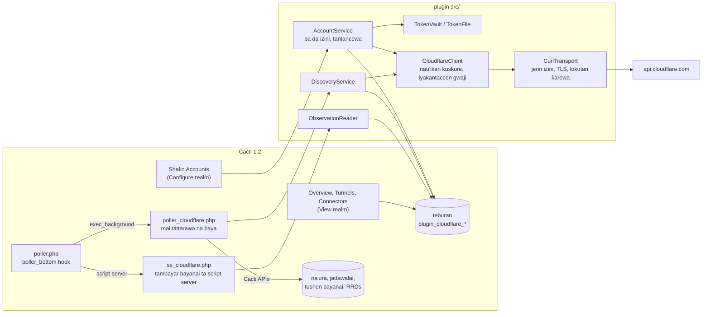

<!-- Source: README.md; SHA256: 813d1c85c236b426b83e42e63c69496f33f8909b5e435d0d45efa6a4ba2f17ca -->

<!-- translations:start -->
[English](../../../README.md) | [简体中文](../zh-CN/README.md) | [हिन्दी](../hi-IN/README.md) | [Español (España)](../es-ES/README.md) | [Español (Latinoamérica)](../es-419/README.md) | [العربية (السعودية)](../ar-SA/README.md) | [Afrikaans](../af-ZA/README.md) | [አማርኛ](../am-ET/README.md) | [العربية (مصر)](../ar-EG/README.md) | [العربية (المغرب)](../ar-MA/README.md) | [বাংলা](../bn-BD/README.md) | [Bosanski](../bs-BA/README.md) | [Deutsch](../de-DE/README.md) | [فارسی](../fa-IR/README.md) | [Filipino](../fil-PH/README.md) | [Français](../fr-FR/README.md) | [Français (Maroc)](../fr-MA/README.md) | [Français (Sénégal)](../fr-SN/README.md) | [Hausa](README.md) | [עברית](../he-IL/README.md) | [Hrvatski](../hr-HR/README.md) | [Bahasa Indonesia](../id-ID/README.md) | [Igbo](../ig-NG/README.md) | [Italiano](../it-IT/README.md) | [日本語](../ja-JP/README.md) | [한국어](../ko-KR/README.md) | [Malagasy](../mg-MG/README.md) | [मराठी](../mr-IN/README.md) | [Bahasa Melayu](../ms-MY/README.md) | [Nederlands](../nl-NL/README.md) | [Polski](../pl-PL/README.md) | [Português (Brasil)](../pt-BR/README.md) | [Русский](../ru-RU/README.md) | [Kinyarwanda](../rw-RW/README.md) | [Soomaali](../so-SO/README.md) | [Српски](../sr-RS/README.md) | [Svenska](../sv-SE/README.md) | [Kiswahili](../sw-KE/README.md) | [தமிழ்](../ta-IN/README.md) | [తెలుగు](../te-IN/README.md) | [ไทย](../th-TH/README.md) | [Türkçe](../tr-TR/README.md) | [Українська](../uk-UA/README.md) | [اردو](../ur-PK/README.md) | [Tiếng Việt](../vi-VN/README.md) | [isiXhosa](../xh-ZA/README.md) | [Yorùbá](../yo-NG/README.md) | [繁體中文](../zh-TW/README.md) | [isiZulu](../zu-ZA/README.md)
<!-- translations:end -->

<p align="center">
  
</p>

# Ƙarin manhajar Cloudflare na Cacti

[](https://github.com/somethingwithproof/plugin_cloudflare/actions/workflows/ci.yml)
[](https://sonarcloud.io/summary/new_code?id=somethingwithproof_plugin_cloudflare)
[](../../../LICENSE)


[](https://sonarcloud.io/summary/new_code?id=somethingwithproof_plugin_cloudflare)
[](https://sonarcloud.io/summary/new_code?id=somethingwithproof_plugin_cloudflare)
[](https://sonarcloud.io/summary/new_code?id=somethingwithproof_plugin_cloudflare)


Ƙarin manhajar Cacti 1.2 da ake ginawa don sa ido kan Cloudflare Tunnels da
nazarin yankuna. Tana karantawa daga Cloudflare API ta amfani da scoped API tokens,
ba ta taɓa canza komai a Cloudflare, kuma tana adana bayananta a cikin teburanta na kanta.
A cikin Cacti tana kwafar fayilolin XML na tambayar bayanai zuwa `resource/script_server/` kuma
tana ƙirƙirar na'urori, jadawalai da samfura ta hanyar APIs na Cacti da kanta, ba tare da canza
ainihin fayilolin tsarin ba.

**Matsayi: 0.4.0-dev, ba a sake shi ba tukuna.** Sigar ƙarshe da aka saki ita ce 0.3.0. Sigar haɓakawa tana ƙara fitar da lissafin kaya na CSV, cire tunnels da aka goge kai tsaye, nazarin yankuna da aka adana a cache, klayint ɗin GraphQL Analytics mai karantawa kawai a cikin jerin izini (`GraphqlAnalyticsClient`) tare da mataimakan taƙaitawa na Thold (`AnalyticsSummary`), CLI na Configuration-as-Code (`cli/cloudflare.php`), ƙugiyoyin tsari (`abilities_register`, `doctor_register_checks`, `casc_register_providers`), da tallafin mai tattarawa na nesa mai iyaka ga poller (`replicate_out`). Tabbatar da aiki da mai samar da sabis na zahiri da tantancewar tura tsari har yanzu suna jiran kammala.

Teburin da ke ƙasa yana bayyana tsayayyiyar sigar 0.3.0 da aka saki. An bayyana ƙarin abubuwan da aka haɓaka a cikin 0.4.0-dev a ƙarƙashin ayyukan Operator da nazarin yankuna a ƙasa.

| Yana samuwa yanzu | Abubuwan da aka tsara |
|---|---|
| Shigarwa, haɓakawa, kashewa da cirewa ta manajan ƙarin manhaja na Cacti | GraphQL na asusun zahiri da tantancewar tura tsari (fita daga Mataki na 4) |
| Izinin Cloudflare: View, Operator da Configure | Gwaji na kuskure, samfuran TLA+ da cikakkun bayanai (Mataki na 5) |
| Ƙarawa, gyarawa, gogewa, kunnawa da kashe asusun Cloudflare | |
| Adana token a cikin fayil ko a ɓoye a cikin rumbun adana bayanai na Cacti | |
| Tabbatar da token da duba izinin karanta tunnel da zone | |
| Gano tunnel da connector a cikin mai tattarawa na baya (`poller_cloudflare.php`) | |
| Shafukan Overview, Tunnels da Connectors a ƙarƙashin Management > Cloudflare Tunnels | |
| Bin diddigin rayuwar aiki: `active`, `unavailable` da `deleted` | |
| Na'urar Cacti guda ɗaya a kowane asusu, wanda mai gudanarwa ya ƙirƙira, tare da tunnels a matsayin fihirisar tambayar bayanai | |
| Jadawalan Connectors, Health da Collection na kowane tunnel, waɗanda aka zana daga fayil ɗin RRD guda ɗaya a kowane tunnel | |
| Darajojin da ƙarin manhajar ba za ta iya tabbatarwa ba ana adana su a matsayin wanda ba a sani ba (`U`), ba a matsayin 0 ba | |

## Matsayin samun dama

| Realm | Samun dama |
| --- | --- |
| Cloudflare: View | Shafukan sa ido da ke akwai. |
| Cloudflare: Operator | Sa ido haɗe da shafin Operations da amincewar tantancewa ta sirri. |
| Cloudflare: Configure | Damar Operator haɗe da saitunan da ke akwai da ayyukan gudanarwa. |

Bayan kwafar fayilolin haɓakawa, buɗe shafin Plugins a matsayin mai gudanarwa don yin rajistar
sabon realm ɗin. Sanya Operator realm kai tsaye a ƙarƙashin **Configuration > Users** ko rukunin masu amfani.
Haɓakawa tana riƙe lambobin ID da izinin View da Admin realm da ke akwai. Damar Admin
tana gadar damar Operator, kuma damar Operator tana gadar damar View a kowace buƙata;
wannan ba ya ƙara izini da aka adana ga masu amfani ko ƙungiyoyi. Saitunan ƙarin manhaja su ma suna buƙatar
damar Cloudflare: Configure ban da izinin Settings na Cacti.

Ganin asusun Cloudflare ya dace da View realm da ke akwai; yana shafar dukkan asusun.
Bayanan sirri, saiti, haɗawa, gogewa da sauran canje-canjen gudanarwa
suna ci gaba da kasancewa a cikin shafukan gudanarwa. Amincewar tantancewa suna aiki ne kawai a cikin zaman
mai amfani na yanzu, na tsawon awa ɗaya a mafi yawa kuma kawai yayin da wannan lura ta kasance
sabuwa. Sabbin abubuwan lura ko waɗanda suka canza suna soke su. Ba sa taɓa nuna ma'aunin da ya gaza
a matsayin lafiyayye ko hana faɗakarwa.

## Dalilin wannan ƙarin manhaja

Masu gudanarwa na Cacti da ke wallafa ayyuka ta hanyar Cloudflare Tunnel ba su da damar ganin
yanayin tunnel a cikin Cacti. Tunnel na iya rasa dukkan connectors ɗinsa yayin da
ainihin uwar garken har yanzu ke amsa SNMP, don haka jadawalan da ke akwai su ci gaba da nuna kore yayin da
masu amfani ke ganin kurakurai. Manufar wannan ƙarin manhaja ita ce sanya lafiyar tunnel da zirga-zirgar
zone kusa da jadawalan na'urori da masu gudanarwa ke kallo tuni, ba tare da bai wa
Cacti wani ikon canza Cloudflare ba.

Sharudda uku ne suka tsara ƙirar:

- **Karantawa kawai.** Ƙarin manhajar tana kiran `GET` endpoints da GraphQL
  Analytics API ne kawai. Ba ta buƙatar izinin gyara kowace albarkatar Cloudflare ba.
- **Na zaɓi.** Katsewar Cloudflare, ƙarewar wa'adin tokens da ƙayyadaddun yawan kira ba za su
  jinkirta shafin Cacti ko dakatar da tattara bayanai na sauran na'urori ba. Dukkan kiran API suna da
  ƙayyadadden lokacin ƙarewa, kuma tattara bayanai yana gudana a cikin tsarin baya da
  poller ke farawa.
- **Babu canji ga ainihin fayiloli.** Ƙarin manhajar tana amfani da hooks na ƙarin manhajar Cacti 1.2 da
  teburanta na kanta. Tana kwafar fayil ɗin XML na tambayar bayanai guda ɗaya zuwa `resource/script_server/` kuma
  tana ƙirƙirar na'urori, jadawalai da samfura ta hanyar APIs na Cacti da kanta. Babu canji ga ainihin
  fayilolin tsari, don haka haɓaka Cacti da sauran ƙarin manhajoji ba sa samun matsala.

## Yadda yake aiki



- **Haɗin Cacti** (`setup.php`, `includes/`, rubutun shafuka) yana yin rajistar
  hooks da realms, yana nuna shafuka da mataimakan Cacti da kanta, kuma yana tura
  kowane aiki zuwa ɗakin karatu a cikin `src/`.
- **Ɗakin karatu** (`src/`, namespace `Somethingwithproof\Cloudflare\`) ba shi da
  dogaro ga masu canji na duniya na Cacti, don haka ana gwada shi a kan rumbun adana bayanai na zahiri da
  kuma hanyar sadarwar HTTP ta jabu ba tare da Cacti da ke aiki ba.
- **Hanyar fita guda ɗaya.** `CurlTransport` ita ce kaɗai lambar da ke taɓa
  hanyar sadarwa, kuma tana karɓar `https://api.cloudflare.com` ne kawai. Ana haɗa kowace matsala
  zuwa nau'in kuskure guda ɗaya (`auth`, `permission`, `rate_limited`,
  `transient`, ...), wanda ke sarrafa matsayin da ake nunawa a cikin UI.
- **Adana bayanai** yana wucewa ta hanyar haɗin PDO na Cacti da kanta tare da prepared
  statements. Canje-canjen tsarin rumbun adana bayanai su ne ƙaura masu lamba da za a iya maimaitawa ba tare da matsala ba.

Shawarwarin ƙira da dalilansu suna cikin
[docs/design.md](../../design.md).

## Hotunan allo

Hotunan allon sun fito ne daga tsarin gwaji, ba daga asusun Cloudflare na zahiri ba. Tsarin
yana gudanar da Cacti 1.2.31 a kan Cloudflare API na jabu wanda ke dawo da bayanan
gwaji, don haka asusun, lambar ID ɗinsa da tunnels guda uku misalai ne kawai.


*Jerin Asusun Cloudflare. API na jabu ya karɓi token ɗin, don haka Verify
yana ba da rahoton `ok`.*


*Gyara asusu. Filayen token koyaushe suna zama fanko; ba a taɓa
mayar da token da aka adana zuwa burauza ba. Collect Tunnels da Create Graphs suna kunne kuma
Collect Analytics yana kashe. Connection Status yana nuna sakamakon Verify na ƙarshe:
`ok`, an ba da izinin karanta tunnel kuma ba a sami izinin karanta zone ba.*


*Settings > Cloudflare.*


*Management > Cloudflare Tunnels > Overview. Matsayin shi ne mafi munin matsayin Cloudflare
a tsakanin active tunnels na asusun, a nan `down` saboda ɗaya daga cikin tunnel na gwaji
ya faɗi. `Disabled`, `Not collected`, `Collection failing` da `Not yet
collected` suna da fifiko kan lafiyar tunnel, a wannan tsari, don haka asusun
da gudanarwarsa ta ƙarshe ta gaza yana nuna `Collection failing` ko da mene ne tunnels ɗinsa suka ba da rahoto.*


*Shafin Tunnels. Connectors da Connections suna nuna `-` ga old-office, saboda
API na jabu yana amsa buƙatar haɗinsa a matsayin tunnel da ba a sani ba kuma ba a adana komai
ba, da kuma 0 ga staging, wanda ba shi da connector da ke gudana.*


*Jadawalin Connectors na tunnel ɗin blog. Dukkan layukan uku suna 1 kafin da
bayan giɓin da ke tsakiya, inda API na jabu ya dawo da kurakurai kuma ƙarin manhajar
ta adana darajojin da ba a sani ba. Layukan ba sa faɗowa zuwa 0. Jadawalin ya fito ne daga
wannan tsarin gwaji (`make screenshots`), wanda ke saita matakin daƙiƙa 30 a kan wannan
tushen bayanai guda ɗaya don tattara bayanai na mintuna bakwai su cika jadawalin.*

## Abubuwan da ake buƙata

- Cacti 1.2.25 zuwa 1.2.31. Cacti 1.2.31 da kanta tana buƙatar PHP 8.0 ko sama da haka.
  CI tana gwada 1.2.31 kawai; an gwada 1.2.25 da hannu a ƙarshe a ranar 2026-10-22.
- PHP 7.4 zuwa 8.4 tare da ƙarin fasaloli na `curl`, `openssl` da `pdo_mysql`.
  Ƙarin manhajar yana ƙin kunnawa ba tare da su ba.
- MariaDB 10.6 ko sama da haka, ko MySQL 8.0 ko sama da haka.
- Samun damar HTTPS daga uwar garken Cacti zuwa `api.cloudflare.com`. Ba a tallafawa
  wakilan haɗi ba.

Duba [docs/compatibility.md](../../compatibility.md) don abin da ake gwadawa.

## Shigarwa

1. Sanya ƙarin manhajar a cikin babban fayil ɗin `plugins/cloudflare` na Cacti, ko dai ta hanyar
   fitar da fakitin daga
   [Sake-saken GitHub](https://github.com/somethingwithproof/plugin_cloudflare/releases)
   (`make package` da aka gudanar a cikin kwafin alamar saki yana gina irin wannan
   fakitin) ko kuma ta hanyar kwafin git. Dole ne a sanya wa babban fayil ɗin suna `cloudflare`.
2. Shigar kuma ka kunna shi daga Console > Configuration > Plugins, ko ta hanyar
   CLI a matsayin mai amfani da uwar garken yanar gizo:

   ```sh
   php cli/plugin_manage.php --plugin=cloudflare --install --enable
   ```

3. Mai amfani na admin yana samun izinin Cloudflare: Configure lokacin shigarwa. Ba da
   shi ga sauran masu amfani ko ƙungiyoyi ƙarƙashin Console > Configuration > Users.
4. Ƙirƙiri alamar sirri tare da izini a cikin
   [docs/token-permissions.md](../../token-permissions.md). A taƙaice:
   Account > Cloudflare Tunnel > Read, da kuma na zaɓi Zone > Zone > Read.
5. Ajiye alamar sirrin a ɗaya daga cikin hanyoyi biyu na ƙasa, sannan ka ƙara asusun ƙarƙashin
   Console > Configuration > Cloudflare Accounts kuma ka gudanar da Verify daga
   menu na ayyuka.

### Zaɓi na A: rufaffiya a cikin rumbun adana bayanai

Ƙarin manhajar yana rufe alamun sirri da mabuɗin byte 32 da kake ƙirƙira. Ba ya taɓa
ƙirƙira ko rubuta mabuɗin da kansa. Dole ne fayil ɗin ya kasance mai karantawa ga masu amfani da uwar garken
yanar gizo da poller, kada ya zama mai karantawa ga wasu, kuma dole ne babban fayil ɗinsa
ya bar waɗannan masu amfani su isa gare shi. Ga uwar garken yanar gizo da ke aiki a matsayin `www-data`:

```sh
sudo mkdir -p /etc/cacti
sudo sh -c 'umask 077 && openssl rand -hex 32 > /etc/cacti/cloudflare.key'
sudo chgrp www-data /etc/cacti/cloudflare.key
sudo chmod 0440 /etc/cacti/cloudflare.key
```

Hanyar asali ita ce `/etc/cacti/cloudflare.key`; canza ta ƙarƙashin Settings >
Cloudflare > Token Vault Key File. Lokacin da mabuɗin ya ɓace ko aka ƙi shi,
fom ɗin gyara yana ba da zaɓin fayil ɗin alamar sirri kawai. Ajiye madadin mabuɗin:
ba tare da shi ba, ba za a iya buɗe alamun sirrin da aka adana ba kuma dole ne a sake shigar da su.

#### Canza mabuɗin

Babu umarnin sake rufe mabuɗi. Sabon mabuɗi ba zai iya buɗe alamun sirrin da aka adana ƙarƙashin
tsohon ba, don haka canza mabuɗi yana nufin sake shigar da kowace alamar sirri da aka adana:

1. Samun ƙimar alamar sirrin kowane asusu a hannu. Cloudflare tana nuna ƙimar alamar sirri
   lokacin da aka ƙirƙire ta ko aka sake ta kawai, don haka ka sake alamar sirrin a cikin
   dashboard na Cloudflare idan ba ka da ita.
2. Ƙirƙiri sabon mabuɗin a sabuwar hanya tare da umarnin da ke sama, misali
   `/etc/cacti/cloudflare.key.new`, tare da mai shi iri ɗaya da yanayi iri ɗaya.
3. Saita Settings > Cloudflare > Token Vault Key File zuwa sabuwar hanyar kuma ka adana.
   Daga yanzu, Verify akan asusun da har yanzu yake rufe da tsohon mabuɗin
   yana ba da rahoton "Stored token cannot be decrypted", kuma kowane gudanarwar mai tattarawa yana rubutawa a log
   `discovery token unavailable` tare da `reason=decrypt_failed` a kansa.
4. Ga kowane asusu da ke adana alamar sirrinsa a cikin rumbun adana bayanai, buɗe shi ƙarƙashin
   Console > Configuration > Cloudflare Accounts, liƙa alamar sirrin a cikin duka
   filayen alamar sirri, ka adana, kuma ka gudanar da Verify. Ya kamata ya ba da rahoton `ok`.
5. Lokacin da kowane irin wannan asusun ya tabbata, cire tsohon fayil ɗin mabuɗin da
   madadansa.

Tsakanin matakai na 3 da 4 ba a sabunta tunnel na asusu ba kuma zane-zanen
lafiya, mai haɗawa da haɗin suna rubuta U. Asusun fayil ɗin alamar sirri ba sa
tasiri.

### Zaɓi na B: fayil ɗin alamar sirri

Rubuta alamar sirrin, ba komai bayan ita ba, zuwa fayil ɗin da masu amfani da uwar garken yanar gizo da poller
za su iya karantawa kuma wasu ba za su iya ba, sannan ka shigar da cikakkiyar hanyarsa a cikin fom ɗin gyara:

```sh
sudo sh -c 'umask 077 && cat > /etc/cacti/cloudflare-account.token'   # paste the token, then Ctrl-D
sudo chgrp www-data /etc/cacti/cloudflare-account.token
sudo chmod 0440 /etc/cacti/cloudflare-account.token
```

Ana duba fayil ɗin lokacin da aka karanta shi, a lokacin Verify, ba lokacin da ka adana ba. Haɗin alama,
fayilolin da suka fi 4 KiB da fayilolin da wasu za su iya karantawa ko rubutawa ana
ƙin su.

Duk wanda ke da Cloudflare: Configure zai iya shigar da kowace hanya, kuma mai amfani da poller
yana karanta ta. Don ajiye fayilolin alamar sirri a wuri guda, saita Settings > Cloudflare >
Token File Directory, misali zuwa `/etc/cacti`; hanyar da ke wajensa za a
ƙi ta. Duba [docs/security.md](../../security.md#token-file).

## Ɗaukaka

1. Sauya fayilolin da ke cikin `plugins/cloudflare` da sabon sakin, tare da kiyaye
   sunan babban fayil ɗin.
2. Buɗe Console > Configuration > Plugins, ko Console > Configuration >
   Cloudflare Accounts, sau ɗaya a matsayin admin. Wannan yana gudanar da ƙaura na ƙarin manhajar,
   yana shigo da samfuran Cloudflare, yana kwafin fayil ɗin tambayar bayanai (duba
   [Auna da zane-zanen tunnel](#tunnel-metrics-and-graphs)), yana yin rajistar ƙugiyoyin tsari na
   `abilities_register`, `doctor_register_checks`, `casc_register_providers`,
   da `replicate_out` (`includes/ecosystem.php`), kuma, akan
   ɗaukaka daga 0.1.0, yana yin rajistar ƙugiyar `poller_bottom`.

`poller.php` ba ya gudanar da ɗaukaka ƙarin manhajar, don haka har sai mataki na 2 sabon
tsarin ba ya nan. Kowane gudanarwar mai tattarawa ba ya yin komai kuma yana rubuta a log
`CLOUDFLARE: collector skipped; plugin upgrade pending, open Console > Plugins`.
Shafukan Cloudflare Tunnels suna buƙatar Cloudflare: View kawai, don haka ba sa taɓa gudanar da
ɗaukakar, kuma har sai mataki na 2 za su iya nuna "The Cloudflare tunnels could not
be read".

## Matsayin asusu

Verify yana saita matsayin asusun:

| Matsayi | Ma'ana |
|---|---|
| `unknown` | Ba a tabbatar ba tun lokacin da aka ƙara asusun ko aka canza takardun shaidarsa |
| `ok` | Alamar sirrin tana aiki kuma tana iya karanta tunnels |
| `token_inactive` | Cloudflare tana ba da rahoton cewa an kashe alamar sirrin ko ta ƙare |
| `auth_failed` | Cloudflare ta ƙi alamar sirrin a matsayin marar inganci ko wadda ta ƙare (HTTP 401) |
| `permission_denied` | Alamar sirrin tana aiki amma ba za ta iya karanta tunnels ba, ko kuma ba ta da izinin kiran wuraren tabbatar da alamar sirri (HTTP 403) |
| `unreachable` | Ba a iya isa ga API ba, lokaci ya ƙure ko ta dawo da kuskuren uwar garke |
| `rate_limited` | Cloudflare ta dawo da HTTP 429 |
| `error` | Duk wani gazawar daban, gami da fayil ɗin alamar sirri da ya ɓace ko ba shi da tsaro, fayil ɗin mabuɗin ma'ajiyar alamar sirri da ya ɓace ko ba ya amfani, ko alamar sirrin da aka adana wadda ba za a iya buɗe ta ba |

Shafin gyara yana kuma nuna ko an ba da izinin karanta tunnel da karanta zone.

## Gano tunnel

Bayan kowane zagayen polling akan poller na tattarawa da aka saita (`cloudflare_poller_id`, asali `1`), ƙugiyar `poller_bottom` tana fara
mai tattarawa na baya tare da `exec_background` lokacin da aƙalla asusu ɗaya da aka kunna
yake da Collect Tunnels a kunne. Mai tattarawar ba ya taɓa gudu a cikin tsarin poller,
saboda haka jinkirin Cloudflare API ba zai jinkirta `poller.php` ba. `INFO` yana bayyana
`remote_collect:1`, kuma ƙugiyar `replicate_out` (`RemoteReplication`) tana tura
teburan metadata marasa sirri (`plugin_cloudflare_accounts` tare da mayar da `token_ciphertext`
zuwa `NULL`, `plugin_cloudflare_tunnels`, `plugin_cloudflare_connectors`,
`plugin_cloudflare_zones`, `plugin_cloudflare_metric_mappings`, da
`plugin_cloudflare_resources`) zuwa masu poller na nesa (`poller_id > 1`) yayin
banda kayan mabuɗin vault.

Ga kowane asusu da lokacinsa ya yi, mai tattarawar yana jera tunnels na asusun, sannan
yana karanta haɗin tunnels ɗinsa masu aiki, wanda ke ba da masu haɗawa na kowane tunnel,
sigogin su, cibiyoyin bayanai da adiresoshin asali. Asusun suna
cika lokaci kowane Discovery Interval (asali daƙiƙa 300). Gudanarwa ɗaya ba ya fara sabon
asusu bayan daƙiƙa 50 kuma yana yin buƙatun haɗi mafi yawa 200. Kowanne iyaka
na iya dakatar da asusu a tsakiyar karanta haɗinsa; wannan
asusun ana rubuta shi a matsayin `partial`, kuma gudanarwa na gaba yana ci gaba da tunnels
da aka gwada da daɗewa. Asusun da ba a fara ba suna kasancewa a shirye don gudanarwa na gaba.

Tunnel yana da tsarin rayuwa, wanda aka ware shi daban da matsayin da Cloudflare ke ba da rahoto
(`healthy`, `degraded`, `down` ko `inactive`):

| Tsarin rayuwa | Ma'ana |
|---|---|
| `active` | Tunnel ɗin yana cikin jerin cikakken bincike na ƙarshe |
| `deleted` | Cikakken jeri bai haɗa da shi ba, wanda ya haɗa da jeri fanko. Layin da tarihinsa suna nan, kuma tunnel ɗin yana sake zama `active` idan ya sake bayyana |
| `unavailable` | Katsewar aiki guda uku da aka ƙidaya ba tare da cikakken jeri a tsakaninsu ba suna barin yanayin tunnel ɗin ba a san shi ba |

Cikakken jeri mai nasara kawai ke ƙarawa, sabuntawa ko goge tunnels, kuma
jeri da ya gaza ba ya taɓa goge ɗaya. Gazawar karanta Cloudflare gaba ɗaya
(`transient`, `rate_limited`, `auth` ko `permission`) ana ƙidaya ta zuwa katsewar aiki;
bayan katsewar aiki guda uku da aka ƙidaya ba tare da cikakken jeri a tsakaninsu ba,
tunnels masu aiki na asusun suna zama `unavailable`. Cikakken jeri na gaba
yana dawo da su kuma yana sake saita ƙidayar. Tunnel ɗin da Cloudflare ba ta ƙara sanin shi ba
lokacin da aka karanta haɗinsa ana tsallake shi ba tare da sa asusun ya gaza ba. Sauran
gazawar ba sa ƙara ko sake saita ma'aunin katsewar aiki.

A cikin `cacti.log`, layukan ganowa suna farawa da `CLOUDFLARE: discovery` kuma taƙaitaccen
gudanarwar yana farawa da `CLOUDFLARE: collector`. Gazawa da sauye-sauyen tsarin rayuwa, kamar
jeri da ya gaza ko tunnels da aka yi wa alama `unavailable`, ana rubuta su a matakin asali
`LOW` na Cacti; sakamakon kowane asusu da taƙaitaccen gudanarwar ana rubuta su a
`MEDIUM`. Karatun haɗi na iya gazawa akan kowane tunnel, don haka ga kowane asusu
gazawar farko ta kowane nau'in kuskure kawai ake rubutawa a `LOW`, sauran a
`MEDIUM`, sai layi ɗaya na `LOW` ga kowane nau'i tare da adadin tunnels da suka
gaza.

Management > Cloudflare Tunnels yana buƙatar izinin Cloudflare: View kuma
karantawa ne kawai:

- **Overview** yana jera kowane asusu tare da matsayinsa, adadin tunnel ta tsarin rayuwa,
  ganowa mai nasara na ƙarshe da adadin gazawar da ke biye da juna.
- **Tunnels** yana jera tunnels a cikin asusai ko don asusu guda ɗaya, tare da masu tacewa
  don asusu, tsarin rayuwa, matsayi da suna, da ginshiƙai masu daidaitawa.
- **Connectors** yana nuna masu haɗawa na tunnel ɗin da aka zaɓa a shafin Tunnels.

<a name="tunnel-metrics-and-graphs"></a>

## Auna da zane-zanen tunnel

Cacti tana karanta yanayin tunnel ta hanyar tambayar bayanai ta script server,
`ss_cloudflare.php`. Yana amsawa daga teburan ƙarin manhajar kawai kuma ba ya taɓa kiran
Cloudflare, don haka katsewar Cloudflare ba za ta iya jinkirta poller ba. Kowane tunnel yana ba da
ƙimomi shida: lafiya (healthy 3, degraded 2, down 1, inactive 0), masu haɗawa,
haɗe-haɗe, sigogin masu haɗawa, daƙiƙoƙi tun lokacin da aka karanta haɗinsa na ƙarshe,
da gazawar aikin ganowa da ke biye da juna. Lafiya, masu haɗawa,
haɗe-haɗe da sigogi ana fitar da su ne kawai lokacin da ƙarin manhajar zai iya tabbatar da su,
wanda ke nufin gano na ƙarshe ya yi nasara, tunnel ɗin `active` ne kuma
karatun na baya-bayan nan ne. In ba haka ba su `U` ne, kuma zane yana nuna gibi
maimakon sifili wanda zai yi kama da katsewar aiki. Ƙimomin tattarawa biyu suna ci gaba da
fitowa yayin katsewar aiki, don haka zanen Collection yana nuna shi; su `U` ne kawai
don tunnel da aka goge ko wanda ba a taɓa sabunta haɗinsa ba. Dokokin
suna cikin [docs/metrics.md](../../metrics.md).

### Ƙirƙiri na'urar

Asusu yana dacewa da na'urar Cacti guda ɗaya mafi yawa. Na'urar tana riƙe tunnels na asusun
a matsayin fihirisa na tambayar bayanai ta Cloudflare Tunnels. Babu abin da ke ƙirƙira
ta kai tsaye:

1. Buɗe Console > Configuration > Cloudflare Accounts.
2. Zaɓi asusun, zaɓi Create Cacti Device daga menu na ayyuka, kuma
   ka tabbatar.

Aikin yana buƙatar duka yankin izini na Cloudflare: Configure da yankin izini na
Sites/Devices/Data na Cacti (wanda yake na `host.php`). Abin menu yana bayyana ne kawai
ga masu amfani da ke riƙe da duka biyun, kuma uwar garken yana ƙin buƙatar daga kowa da kowa.
Ana sanya wa na'urar suna `Cloudflare: <account name>`, tana amfani da samfurin uwar garke na Cloudflare Account
da babban poller, tana da sigar SNMP 0 kuma ba ta da binciken
samuwa, kuma tana samun sunan uwar garke `<account ID>.cloudflare.invalid`. Wannan sunan
an keɓe shi kuma ba ya taɓa warwarewa; Cacti ba ta haɗuwa da shi. Idan asusun
yana da na'ura tuni, aikin yana faɗin hakan kuma ba ya canza komai. Idan
mai gudanarwa ya goge na'urar a cikin Cacti, ƙarin manhajar ba ya yin wata
har sai an sake gudanar da Create Cacti Device.

### Ƙirƙiri Zane-zane

Create Graphs akan fom ɗin asusun yana a kashe ta asali. Lokacin da yake a kunne, kowane lokaci
da gano asusun ya ƙare `ok` ko `partial`, mai tattarawar yana sake fihirisa
na'urar kuma yana ƙirƙirar duk wani zane-zanen da suka ɓace don tunnels `active` na asusun:
Connectors, Health da Collection, uku ga kowane tunnel. Zane-zane uku na tunnel ɗaya
suna raba fayil ɗin RRD guda ɗaya. Gudanarwa ɗaya yana ƙirƙirar zane-zane mafi yawa 50 kuma yana tsayawa bayan daƙiƙa 20,
kuma gudanarwa na gaba yana ci gaba. Ƙarin manhajar ba ya taɓa cire abin Cacti.
Zanen da mai gudanarwa ya goge ba a sake yin sa ba, kuma tunnel ɗin da
Cloudflare ba ta ƙara jerawa ba yana riƙe zanensa da fayil ɗin RRD, waɗanda ke nuna `U`.

Kunna Create Graphs yana buƙatar duka yankunan izini biyu. Kashe shi yana buƙatar
Configure kawai. Mai amfani da ba shi da yankin Sites/Devices/Data wanda ya adana fom ɗin
yana barin saitin yadda yake, tare da gargaɗi. Idan Create Graphs yana a kashe,
har yanzu ana sake fihirisa na'urar bayan kowane ganowa, don haka sabbin tunnels suna bayyana a matsayin
fihirisar tambayar bayanai.

### Fayil ɗin tambayar bayanai

Cacti 1.2.31 tana karanta XML na tambayar bayanai daga cikin babban fayil ɗinta na `resource`
kawai. A lokacin shigarwa da ɗaukaka ƙarin manhajar yana kwafin fayil guda ɗaya,
`templates/resource/cloudflare_tunnels.xml`, zuwa
`<Cacti>/resource/script_server/cloudflare_tunnels.xml`. Shi ne kawai fayil ɗin da
ƙarin manhajar yake rubutawa a wajen babban fayil ɗinsa, don haka dole ne mai amfani da ke shigarwa ko
ɗaukaka ƙarin manhajar ya iya rubutawa zuwa wannan babban fayil ɗin.
Cire shigarwa yana riƙe fayil ɗin, tare da na'urori, zane-zane, fayilolin RRD da
samfura. Idan kwafin ko shigo da samfurin ya gaza, ƙarin manhajar yana rubutawa a log kuma
Create Cacti Device yana sake gwadawa.

## Saituna

Settings > Cloudflare yana ƙunshe da:

- **Token Vault Key File**: hanyar zuwa maɓallin ma'ajiya (vault key).
- **Token File Directory**: idan an saita shi, ana ƙin fayil ɗin alama (token) da ke wajensa. Yana da fanko ta tsoho, wanda ke ba da izinin kowace hanya. Duba [docs/security.md](../../security.md#token-file).
- **Interactive Request Timeout**: jimillar daƙiƙoƙi don buƙatar da aka yi daga fuskar yanar gizo, kamar Verify. Tsoho shine 10; ƙimomin da ke wajen 5 zuwa 60 suna komawa zuwa 10.
- **Collector Request Timeout**: jimillar daƙiƙoƙi don buƙatar da mai tattara bayanan baya (background collector) ya yi. Tsoho shine 20; ƙimomin da ke wajen 5 zuwa 60 suna komawa zuwa 20.
- **Log Level**: an adana shi. Babu abin da ke karanta shi tukuna.

A kan fom ɗin asusu, Collect Tunnels da Discovery Interval suna sarrafa bincike (discovery), kuma Create Graphs yana sarrafa ƙirƙirar zane-zane (graphs). Ana adana Collect Analytics kuma ba shi da wani tasiri a cikin wannan sakin.

## Harsuna

Plugin ɗin yana zuwa da fassarori zuwa Sifaniyanci (Spain, `es-ES`), Faransanci (`fr-FR`), Jamusanci (`de-DE`), Sinanci mai sauƙi (`zh-CN`), Hindi (`hi-IN`), Larabci (`ar-SA`) da Jafananci (`ja-JP`). Cacti yana nuna su da zarar an kunna tallafin harshe (Configuration > Settings > General > Language Support) kuma mai amfani ya zaɓi harshen. Kundin Sifaniyanci na Latin Amurka (`es-419`) shima yana zuwa tare, amma Cacti 1.2 ba shi da yankin Sifaniyanci na Latin Amurka da za a zaɓa, don haka zai yi aiki ne kawai idan Cacti ya ƙara ɗaya; har zuwa lokacin, zaɓi Sifaniyanci (`es-ES`).

Wasu rubutun suna kasancewa a Turanci: ƙimomin matsayi da plugin ɗin ke adanawa da nunawa yadda suke (`ok`, `active`, `unavailable`, `deleted`, da matsayin rami da Cloudflare ke bayarwa), da duk abin da plugin ɗin ke rubutawa zuwa log ɗin Cacti.

## Cirewa da riƙe bayanai

Cirewa (Uninstall) yana goge teburan plugin ɗin nasa, waɗanda ke riƙe da asusai, rufaffun alamomi (encrypted tokens), ramuka da aka gano, yanayin aiki da tarihin waɗanne abubuwan Cacti ya ƙirƙira, kuma yana goge saitunansa na `cloudflare_`. Ba ya cire fayil ɗin maɓalli, fayilolin alama (token), kwafin `resource/script_server/cloudflare_tunnels.xml`, ko kowane na'urorin Cacti, zane-zane (graphs), tushen bayanai (data sources), fayilolin RRD ko samfura (templates). Waɗannan suna riƙe da tsofaffin bayanan sa ido, kuma cire su aiki ne na musamman da mai gudanarwa ke yi a cikin Cacti.

Na'urar da aka bari tana daina karɓar bayanai. Bayan an cirewa, ko bayan an goge asusunta, babu wani asusu da ke da mallakar host ɗin, don haka zane-zanenta suna ci gaba da riƙe tarihinsu amma suna buga `U` daga nan gaba. Create Cacti Device akan asusun da aka sake sakawa ko aka sake ƙarawa yana yin sabuwar na'ura; ba ya sake amfani da tsohuwar ba, don haka a goge tsohuwar na'urar a Cacti da zarar ba a buƙatar tarihinta.

## Sanannun iyakoki

- Zagaye ɗaya yana yin buƙatun haɗi guda 200 a mafi yawa. Ramukan da suka wuce wannan iyaka ana sabunta su ƙasa da lokacin lura, don haka zane-zanen haɗinsu suna nuna giɓi.
- Plugin ɗin yana maye gurbin gyare-gyaren da mai gudanarwa ya yi wa samfuran da aka shigo da su lokacin da haɓakawa ya canza XML na samfurin da aka aiko.
- Masu poller na nesa suna karɓar metadata da aka kwaikwaya ba tare da takardun shaidar sirri ba (ana mayar da `token_ciphertext` zuwa `NULL` kuma ba a taɓa kwaikwayon mabuɗan vault ba). Lokacin gudanar da mai tattarawa a kan wani keɓaɓɓen poller na nesa (`cloudflare_poller_id`), a samar da fayilolin token ko mabuɗin vault kai tsaye a kan wannan uwar garken tattarawa.
- Ramukan da aka goge suna ci gaba da kasancewa a cikin fihirisar tambayar bayanai (data query index) kuma suna buga `U` har sai mai gudanarwa ya yi ritayar su da gangan. Ritaya tana cire zane-zanen da plugin ɗin ya rubuta da tushen bayanan da ba a raba su ba kaɗai ta hanyar Cacti; layin lissafin kaya (inventory row) yana ci gaba da kasancewa a bayyane. Cacti yana sarrafa tsaftacewar RRD.
- Cacti yana kashe plugin ɗin da lambar sa ta ƙare da mummunan kuskure na gaske (fatal error), kamar ƙarewar ƙwaƙwalwa (memory). Duba [docs/security.md](../../security.md).

## Tsaro

- Ana ƙin Global API Keys; ana karɓar iyakantattun alamomin API (scoped API tokens) ne kawai.
- Ana adana alamomi (tokens) a cikin fayil ɗin da kuka tanada ko a rufe su da AES-256-GCM ƙarƙashin fayil ɗin maɓalli wanda ba ya taɓa shiga rumbun bayanai. Ba a taɓa nuna su a shafi, ko rubuta su a log, ko haɗa su a cikin saƙon kuskure.
- Kurakuran rumbun bayanai suna ɗauke da SQLSTATE da lambar kuskuren direba kaɗai, ba ƙimomin umarnin ba.
- Kowane canji POST ne da aka kare da alamar CSRF ta Cacti. Canje-canjen asusu na gudanarwa da tsari suna buƙatar Cloudflare: Configure; amincewar tacewa ta sirri (personal triage acknowledgments) suna buƙatar Cloudflare: Operator. Ƙirƙirar na'urar Cacti ko kunna Create Graphs shima yana buƙatar izinin Sites/Devices/Data na Cacti. Plugin ɗin da aka kashe yana ƙin shafukansa.
- Configuration-as-Code (`cli/cloudflare.php` da `casc_register_providers`) yana karɓar abubuwan nuni na sirri na `vault:<account_id>` ko `file:<absolute_path>` kaɗai, yana ƙin ɗanyun token, rufaffun rubutun vault, da sanarwar XML `DOCTYPE`, kuma yana buƙatar takamaiman `--confirm=<PLAN_HASH>` kafin ya rubuta.
- Ƙwarewar da aka yi wa rajista (`cloudflare-list-tunnels`, `cloudflare-get-health`) na karantawa ne kawai, suna kimanta yankin Cloudflare: View kai tsaye a kan teburan tantancewa na Cacti don ID na mai amfani mai kira (ba yanayin zama ba), kuma ba sa dawo da kowace alama (token) ko kayan mabuɗi.

Cikakkun bayanai da sanannun iyakoki suna cikin [docs/security.md](../../security.md). A ba da rahoton raunin tsaro a asirce kamar yadda aka bayyana a [SECURITY.md](../../../SECURITY.md).

## Tsarin aikin mai aiki da nazarin yanki

Ƙarin haɓakawa a cikin `0.4.0-dev` sun haɗa da ritayar ramukan da aka goge a bayyane, nazarin GraphQL na yanki da rami mai lura da iyawa, mataimakan taƙaitawa na Thold da samfuran Thold da za a iya shigo da su, CLI na CasC da lafiya, ƙugiyoyin tsari, da kwafin mai tattarawa na nesa. Waɗannan ƙarin ba su da alamar saki (release tag) ko cancantar asusu na gaske tukuna. Duba [docs/analytics-and-alerting.md](../../analytics-and-alerting.md) don saiti, ma'anar ma'auni da iyakokin tabbatarwa.

- **Klayint ɗin GraphQL Analytics da taƙaitawar Thold (`src/Api/GraphqlAnalyticsClient.php`, `src/Metrics/AnalyticsSummary.php`)**: `GraphqlAnalyticsClient` yana gudanar da tambayoyin karantawa kawai da ke cikin jerin izini na lokacin haɗa lamba (`zone_settings`, `zone_http_metrics`, `zone_edge_latency`, `tunnel_analytics`) ta hanyar `CloudflareClient` (an tabbatar da TLS, an liƙa zuwa `api.cloudflare.com`, amsoshi masu iyaka, da jinkirin ƙimar kira na `RetryPolicy`) don tattara adadin buƙatun yanki da rami, ƙimar kurakuran HTTP 5xx, bytes na amsa, da jinkirin gefe (matsakaici da p95). `AnalyticsSummary` yana ba da `recommendedThresholds()` daidai da sunayen RRD DS na plugin (`health`, `collect_age`, `error_pct`, `age`), `summarizeZones()`, da `evaluateSample()`.
- **CLI na mai aiki da CasC (`cli/cloudflare.php`)**: yana samun goyon bayan `ConfigCodec` (`src/Config/ConfigCodec.php`) da `ConfigService` (`src/Config/ConfigService.php`), yana tallafawa `cli/cloudflare.php export [--format=yaml|xml] [--file=PATH]` (yana fitar da nuni na sirri na `vault:` / `file:` kaɗai), `cli/cloudflare.php validate --file=PATH [--format=yaml|xml]`, `cli/cloudflare.php plan --file=PATH [--format=yaml|xml]`, `cli/cloudflare.php apply --file=PATH --confirm=<PLAN_HASH> [--format=yaml|xml]`, da `cli/cloudflare.php health [--format=text|json]`.
- **Ƙugiyoyin haɗin tsari (`includes/ecosystem.php`, `setup.php`)**:
  - `abilities_register` (`AbilitiesProvider`): yana yin rajistar `cloudflare-list-tunnels` da `cloudflare-get-health` na karantawa kawai waɗanda aka killace a yankin Cloudflare: View (izini kai tsaye da na ƙungiya) ba tare da wani token ko sirri a sakamakon ba.
  - `doctor_register_checks` (`DoctorChecks`): yana fallasa `cloudflare_vault_key` (tantance yanayi, symlink, da tsayi), `cloudflare_token_dir` (binciken cikakkiyar hanya, symlink, da rubutawa ga kowa), `cloudflare_tunnel_freshness`, da `cloudflare_api_failure_rate`.
  - `casc_register_providers` (`CascProvider`): yana fallasa mai ba da CasC na `cloudflare` (`export`, `validate`, `plan`, `apply`) don asusai (nuni na sirri kaɗai), yankuna, ramuka, da haɗin ma'auni.
  - `replicate_out` (`RemoteReplication`): yana kwaikwayon teburan metadata marasa sirri zuwa masu poller na nesa (`poller_id > 1`) tare da mayar da `token_ciphertext` zuwa `NULL` da cire kayan mabuɗin vault.

### Fitar da lissafin kaya

Shafukan Tunnels da Connectors suna ba da Export don yankin Cloudflare: View. Fayilolin CSV na Tunnel sun haɗa da kowane layi da ya dace, ta amfani da asusu mai aiki, zagayowar rayuwa (lifecycle), matsayi, bincike da saitunan tsarawa a duk shafuka. Fayilolin CSV na Connector sun haɗa da nau'ika, tsarin gine-gine, cibiyoyin bayanai da adiresoshin asali na ramin da aka zaɓa. Zazzagewa suna karanta bayanan da aka adana a cache ne kawai. Ƙididdigar da ba a sani ba suna zama fanko; sel masu kama da dabara (formula-like cells) ana sanya musu alamar apostrophe a gaba don shigar da su cikin shafin lissafi (spreadsheet) cikin aminci.

## Taswirar hanya

Kowane mataki (milestone) yana fitowa a matsayin sakin 0.x mai lamba bayansa: Mataki na 3 shine 0.3.0, Mataki na 4 zai kasance 0.4.0. Mataki na 1 da na 2 ba a sake su da kansu ba kuma suna cikin 0.3.0. Sigar 1.0.0 an tanade ta ne don sakin da ya kammala kowane mataki a ƙasa.

| Mataki | Faɗi | Matsayi |
|---|---|---|
| 1. Tushe (Foundation) | Zagayowar rayuwar plugin, izini, saitin asusu, gwajin haɗi | An sake shi a 0.3.0 ([#2](https://github.com/somethingwithproof/plugin_cloudflare/pull/2) zuwa [#5](https://github.com/somethingwithproof/plugin_cloudflare/pull/5)) |
| 2. Bincike (Discovery) | Binciken rami da haɗi (connector) a cikin mai tattara bayanan baya, shafukan Overview, Tunnels da Connectors | An sake shi a 0.3.0 ([#6](https://github.com/somethingwithproof/plugin_cloudflare/pull/6)) |
| 3. Ma'auni (Metrics) | Tushen bayanan lafiyar rami, samfuran zane-zane, sarrafa katsewa wanda ba ya taɓa rubuta sifili na ƙarya | An sake shi a 0.3.0 ([#7](https://github.com/somethingwithproof/plugin_cloudflare/pull/7)) |
| 4. Nazari da faɗakarwa | Nazarin GraphQL mai lura da tsari (`GraphqlAnalyticsClient`), taƙaitawa da samfuran Thold (`AnalyticsSummary`), CasC CLI (`cli/cloudflare.php`), ƙugiyoyin tsari, da kwafin nesa | An aiwatar a 0.4.0-dev; tantancewar asusun zahiri tana jira |
| 5. Ƙarfafawa (Hardening) | Saka kuskure (fault injection), samfuran TLA+ na bincike da tattarawa, cikakkun takardu | An tsara |

## Haɓakawa

Kayan aikin suna buƙatar PHP 8.x da Composer; lambar plugin ɗin kanta tana ci gaba da dacewa da PHP 7.4. Gwajin haɗin kai da BDD suna buƙatar rumbun bayanai, wanda `make db-up` ke farawa a Docker akan tashar jiragen ruwa (port) 33061.

```sh
composer install
make db-up
make ci            # unit, integration, BDD, PHPStan, php-cs-fixer, php -l on PHP 7.4
make smoke         # installs the plugin into Cacti 1.2.31 in Docker and walks its lifecycle
make package       # builds build/cloudflare-<version>.tar.gz and checks its contents
make db-down
```

`make smoke` da `make screenshots` suna buƙatar kwafin Cacti (Cacti checkout); saita `CACTI_REPO` zuwa hanyarsa. Gwajin haɗin kai suna karanta `CF_TEST_DSN`, `CF_TEST_DB_USER` da `CF_TEST_DB_PASS`, kuma suna tsallakewa lokacin da ba a iya samun rumbun bayanai ba sai dai idan an saita `CI`.

## Ba da gudummawa

Ana maraba da pull requests. Kowane commit yana buƙatar sa hannun DCO (`git commit -s`). Rubuta gwajin da farko; dole ne `make ci` ya wuce, kuma canje-canje ga haɗin Cacti su ma ya kamata su wuce `make smoke`. Dole ne lambar plugin ɗin ta ci gaba da dacewa da PHP 7.4 kuma ta bi salon lambar Cacti (tabs, single quotes, braces a kan layi ɗaya).

### Fassarori

Ana yi wa saƙonni alama da `__('...', 'cloudflare')`. `locales/build_gettext.sh` (`make i18n`, wanda ke buƙatar GNU gettext) yana sake ƙirƙirar samfurin `locales/po/cacti.pot`, yana haɗa shi cikin kowane kundi `locales/po/<locale>.po` kuma yana haɗa `locales/LC_MESSAGES/<locale>.mo`; yi commit ɗin duka ukun. CI tana gudanar da `make i18n-check`, wanda ke kasawa idan kundi ya rasa ko yana da shigarwa mara tabbas (fuzzy entry), tsarin rubutu (format string) ya bambanta, ko fayil ɗin da aka haɗa ya tsufa, kuma rukunin gwajin unit shima yana duba masu riƙe wuri (placeholders), alamun HTML da sararin gefe na kowane shigarwa. Saboda haka, saƙon da aka canza yana buƙatar a sabunta fassarorinsa a cikin wannan pull request ɗin. Sabon harshe sabon `<locale>.po` ne da aka ba shi suna kamar yadda Cacti ke ba wa yankunansa suna (misali `pt-BR`), wanda aka ƙara zuwa `CatalogTest::LOCALES` da kuma zuwa binciken rumbun ajiya (archive check) a cikin `tests/build/package.sh`. A bar sunayen samfuran Cloudflare, Cacti da Thold, API da GraphQL, da sunayen izini kamar `Account Cloudflare Tunnel Read`, yadda suke.

## Takardu

- [docs/security.md](../../security.md): sarrafawar tsaro da sanannun iyakoki
- [docs/token-permissions.md](../../token-permissions.md): izinin alama (token)
- [docs/compatibility.md](../../compatibility.md): sigogin da ake tallafawa da hanyoyin haɗi da aka yi amfani da su
- [docs/metrics.md](../../metrics.md): kundin ma'auni da lokacin da ƙima ba a san ta ba
- [docs/collector-protocol.md](../../collector-protocol.md): abin da `ss_cloudflare.php` ke karantawa da bugawa
- [docs/schema.md](../../schema.md): teburan rumbun bayanai
- [docs/design.md](../../design.md): shawarwarin ƙira
- [CHANGELOG.md](../../../CHANGELOG.md)

## Lasisi

GPL-2.0-or-later. Duba [LICENSE](../../../LICENSE).

## Alamomin kasuwanci

Cloudflare alamar kasuwanci ce mai rijista ta Cloudflare, Inc. Wannan aikin kayan aiki ne mai zaman kansa na buɗaɗɗen tushe (open-source) kuma ba shi da alaƙa da, ko ɗaukar nauyi daga, ko amincewa daga Cloudflare, Inc.

Har ila yau, aikin ba shi da alaƙa da aikin Cacti. Duba [docs/images/README-logo.md](../../images/README-logo.md) don tambarin.
