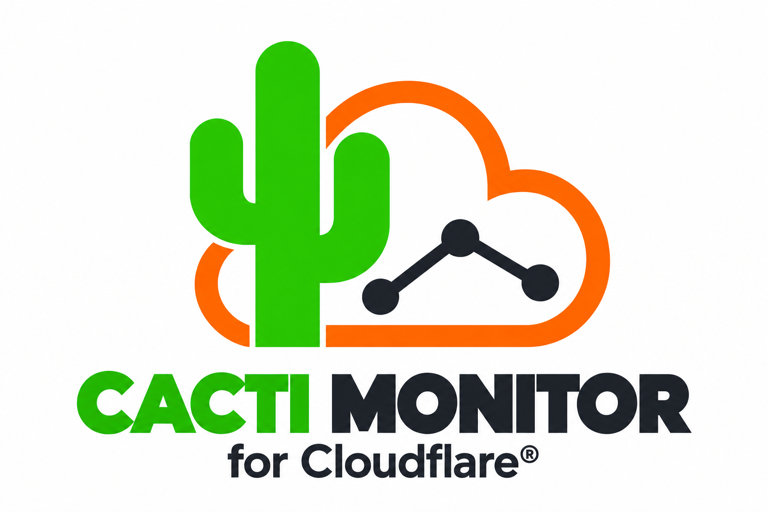
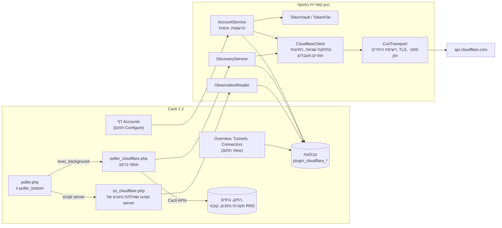

<!-- Source: README.md; SHA256: f8de0e02c5904e15bfa4c71edcaab219e5e5d4f6d9dbe589f4ed16351df6bf4d -->

<!-- translations:start -->
[English](../../../README.md) | [简体中文](../zh-CN/README.md) | [हिन्दी](../hi-IN/README.md) | [Español (España)](../es-ES/README.md) | [Español (Latinoamérica)](../es-419/README.md) | [العربية (السعودية)](../ar-SA/README.md) | [Afrikaans](../af-ZA/README.md) | [አማርኛ](../am-ET/README.md) | [العربية (مصر)](../ar-EG/README.md) | [العربية (المغرب)](../ar-MA/README.md) | [বাংলা](../bn-BD/README.md) | [Bosanski](../bs-BA/README.md) | [Deutsch](../de-DE/README.md) | [فارسی](../fa-IR/README.md) | [Filipino](../fil-PH/README.md) | [Français](../fr-FR/README.md) | [Français (Maroc)](../fr-MA/README.md) | [Français (Sénégal)](../fr-SN/README.md) | [Hausa](../ha-NG/README.md) | [עברית](README.md) | [Hrvatski](../hr-HR/README.md) | [Bahasa Indonesia](../id-ID/README.md) | [Igbo](../ig-NG/README.md) | [Italiano](../it-IT/README.md) | [日本語](../ja-JP/README.md) | [한국어](../ko-KR/README.md) | [Malagasy](../mg-MG/README.md) | [मराठी](../mr-IN/README.md) | [Bahasa Melayu](../ms-MY/README.md) | [Nederlands](../nl-NL/README.md) | [Polski](../pl-PL/README.md) | [Português (Brasil)](../pt-BR/README.md) | [Русский](../ru-RU/README.md) | [Kinyarwanda](../rw-RW/README.md) | [Soomaali](../so-SO/README.md) | [Српски](../sr-RS/README.md) | [Svenska](../sv-SE/README.md) | [Kiswahili](../sw-KE/README.md) | [தமிழ்](../ta-IN/README.md) | [తెలుగు](../te-IN/README.md) | [ไทย](../th-TH/README.md) | [Türkçe](../tr-TR/README.md) | [Українська](../uk-UA/README.md) | [اردو](../ur-PK/README.md) | [Tiếng Việt](../vi-VN/README.md) | [isiXhosa](../xh-ZA/README.md) | [Yorùbá](../yo-NG/README.md) | [繁體中文](../zh-TW/README.md) | [isiZulu](../zu-ZA/README.md)
<!-- translations:end -->

<p align="center">
  
</p>

# תוסף Cloudflare עבור Cacti

[](https://github.com/somethingwithproof/plugin_cloudflare/actions/workflows/ci.yml)
[](https://sonarcloud.io/summary/new_code?id=somethingwithproof_plugin_cloudflare)
[](../../../LICENSE)


[](https://sonarcloud.io/summary/new_code?id=somethingwithproof_plugin_cloudflare)
[](https://sonarcloud.io/summary/new_code?id=somethingwithproof_plugin_cloudflare)
[](https://sonarcloud.io/summary/new_code?id=somethingwithproof_plugin_cloudflare)


תוסף Cacti 1.2 הנבנה לניטור Cloudflare Tunnels וניתוח נתוני אזורים. התוסף קורא מ-Cloudflare API באמצעות אסימוני API מוגדרי היקף, לעולם אינו משנה דבר ב-Cloudflare, ושומר את נתוניו בטבלאות משלו. ב-Cacti הוא מעתיק קובצי XML של שאילתות נתונים אל `resource/script_server/` ויוצר התקנים, גרפים ותבניות דרך ממשקי ה-API של Cacti עצמה, ללא שינויים בקובצי הליבה.

**סטטוס: 0.4.0-dev, טרם שוחררה.** הגרסה האחרונה ששוחררה היא 0.3.0. גרסת הפיתוח מוסיפה ייצוא מלאי ל-CSV, הוצאה מפורשת משימוש של מנהרות שנמחקו, נתוני ניתוח אזורים השמורים במטמון ותבניות Thold אופציונליות. הכשירות מול ספק חי ובסביבת פריסה עדיין ממתינה לביצוע.

הטבלה שלהלן מתארת את הגרסה היציבה 0.3.0. תוספות הפיתוח מתוארות להלן תחת תהליכי עבודה של מפעיל וניתוח נתוני אזורים.

| זמין כעת | מתוכנן |
|---|---|
| התקנה, שדרוג, השבתה והסרה דרך מנהל התוספים של Cacti | ניתוח נתוני GraphQL והתראות Thold (אבן דרך 4) |
| הרשאות Cloudflare: View, Operator ו-Configure | הזרקת תקלות, מודלים של TLA+ ותיעוד מלא (אבן דרך 5) |
| הוספה, עריכה, מחיקה, הפעלה והשבתה של חשבונות Cloudflare | |
| אחסון אסימון בקובץ או באופן מוצפן במסד הנתונים של Cacti | |
| אימות אסימון ובדיקת הרשאות הקריאה שלו למנהרות ולאזורים | |
| גילוי מנהרות ומחברים באוסף רקע המופעל על ידי ה-poller הראשי | |
| דפי Overview, Tunnels ו-Connectors תחת Management > Cloudflare Tunnels | |
| מעקב מחזור חיים: `active`, `unavailable` ו-`deleted` | |
| התקן Cacti אחד לכל חשבון, הנוצר על ידי מנהל מערכת, כאשר המנהרות משמשות כאינדקסים של שאילתת נתונים | |
| גרפים של Connectors, Health ו-Collection לכל מנהרה, המצוירים מקובץ RRD אחד לכל מנהרה | |
| ערכים שהתוסף אינו יכול לערוב להם נשמרים כבלתי ידועים (`U`), ולעולם לא כ-0 | |

## תפקידי גישה

| תחום | גישה |
| --- | --- |
| Cloudflare: View | דפי הניטור הקיימים. |
| Cloudflare: Operator | ניטור בתוספת דף Operations ואישורי מיון ראשוני אישיים. |
| Cloudflare: Configure | גישת Operator בתוספת פעולות ההגדרה והניהול הקיימות. |

לאחר העתקת קובצי השדרוג, פתחו את דף Plugins כמנהלי מערכת כדי לרשום את התחום החדש. הקצו את תחום Operator במפורש תחת **Configuration > Users** או קבוצות משתמשים. שדרוגים שומרים על מזהי התחומים והמענקים הקיימים של View ו-Admin. גישת Admin יורשת גישת Operator, וגישת Operator יורשת גישת View בכל בקשה; פעולה זו אינה מוסיפה מענקים שמורים למשתמשים או לקבוצות. הגדרות התוסף דורשות גם גישת Cloudflare: Configure בנוסף להרשאת Settings של Cacti.

נראות חשבון Cloudflare תואמת לתחום View הקיים; היא חלה ברמת החשבון כולו. פרטי הזדהות, תצורה, מיפוי, מחיקה ושינויים מנהלתיים אחרים נשארים בדפי הניהול. אישורים תקפים רק בהפעלה הנוכחית של המשתמש, למשך שעה אחת לכל היותר ורק כל עוד אותה תצפית נשארת עדכנית. תצפיות חדשות או שונות מבטלות אותם. הם לעולם אינם מסמנים מדידה שנכשלה כתקינה ואינם משתיקים התראות.

## מדוע תוסף זה

למפעילי Cacti המפרסמים שירותים דרך Cloudflare Tunnel אין ראות של המנהרה בתוך Cacti. מנהרה עלולה לאבד את כל המחברים שלה בעוד שרתי המקור ממשיכים להשיב ל-SNMP, כך שהגרפים הקיימים נשארים ירוקים בזמן שהמשתמשים רואים שגיאות. מטרת תוסף זה היא להציב את תקינות המנהרה ותעבורת האזור לצד גרפי ההתקנים שהמפעילים כבר עוקבים אחריהם, מבלי לתת ל-Cacti שום יכולת לבצע שינויים ב-Cloudflare.

שלושה אילוצים מעצבים את התכנון:

- **קריאה בלבד.** התוסף קורא רק לנקודות קצה מסוג `GET` ול-GraphQL Analytics API. הוא אינו זקוק להרשאת עריכה על אף משאב של Cloudflare.
- **אופציונלי.** השבתות ב-Cloudflare, אסימונים שפג תוקפם ומגבלות קצב אסור שיאטו את ממשק המשתמש של Cacti או יעכבו דגימה של התקנים אחרים. לכל קריאות ה-API יש פסקי זמן קשיחים, והאיסוף רץ בתהליך רקע המופעל על ידי ה-poller.
- **ללא שינויים בליבה.** התוסף משתמש בווים של תוספי Cacti 1.2 ובטבלאות משלו. הוא מעתיק קובץ XML אחד של שאילתת נתונים אל `resource/script_server/` ויוצר התקנים, גרפים ותבניות דרך ממשקי ה-API של Cacti עצמה. אין שינויים בקובצי הליבה, כך ששדרוגי Cacti ותוספים אחרים אינם מושפעים.

## איך זה עובד



- **שכבת החיבור ל-Cacti** (`setup.php`, `includes/`, סקריפטי הדפים) רושמת ווים ותחומים, מציגה דפים באמצעות פונקציות העזר של Cacti עצמה, ומעבירה כל פעולה לספרייה שבתיקייה `src/`.
- **הספרייה** (`src/`, מרחב השמות `Somethingwithproof\Cloudflare\`) אינה תלויה במשתנים הגלובליים של Cacti, ולכן היא נבדקת מול מסד נתונים אמיתי ומול תעבורת HTTP מדומה ללא מופע Cacti פעיל.
- **נתיב יציאה יחיד.** `CurlTransport` הוא הקוד היחיד שנוגע ברשת, והוא מקבל רק את `https://api.cloudflare.com`. כל כשל ממופה למחלקת שגיאה אחת (`auth`, `permission`, `rate_limited`, `transient`, ...), המכתיבה את הסטטוס המוצג בממשק המשתמש.
- **האחסון** עובר דרך חיבור ה-PDO של Cacti עצמה עם פקודות מוכנות מראש. שינויי סכימה הם מיגרציות ממוספרות ואידמפוטנטיות.

החלטות התכנון והסיבות להן נמצאות בקובץ
[docs/design.md](../../design.md).

## צילומי מסך

צילומי המסך מגיעים מסביבת בדיקות, ולא מחשבון Cloudflare חי. הסביבה מריצה Cacti 1.2.31 מול API מדומה של Cloudflare המחזיר נתוני דמה, כך שהחשבון, המזהה שלו ושלוש המנהרות הם ערכי מילוי מקום.


*רשימת Cloudflare Accounts. ה-API המדומה מקבל את האסימון, ולכן Verify מדווח `ok`.*


*עריכת חשבון. שדות האסימון תמיד ריקים; האסימון השמור לעולם אינו נשלח בחזרה לדפדפן. Collect Tunnels ו-Create Graphs פעילים ו-Collect Analytics כבוי. Connection Status מציג את תוצאת ה-Verify האחרון: `ok`, קריאת מנהרות מאושרת וקריאת אזורים חסרה.*


*Settings > Cloudflare.*


*Management > Cloudflare Tunnels > Overview. הסטטוס הוא סטטוס Cloudflare הגרוע ביותר מבין המנהרות הפעילות של החשבון, כאן `down` מפני שמנהרת דמה אחת מושבתת. `Disabled`, `Not collected`, `Collection failing` ו-`Not yet collected` קודמים לתקינות המנהרה, בסדר הזה, כך שחשבון שההרצה האחרונה שלו נכשלה מציג `Collection failing` ללא קשר למה שמנהרותיו מדווחות.*


*הלשונית Tunnels. Connectors ו-Connections מציגים `-` עבור old-office, מפני שה-API המדומה עונה לבקשת החיבורים שלה כמנהרה לא ידועה ודבר לא נשמר, ו-0 עבור staging, שאין לה מחבר פעיל.*


*גרף ה-Connectors של מנהרת blog. שלושת הקווים נמצאים על 1 לפני ואחרי הפער שבאמצע, שבו ה-API המדומה החזיר שגיאות והתוסף שמר ערכים בלתי ידועים. הקווים אינם יורדים ל-0. הגרף מגיע מאותה סביבת בדיקות (`make screenshots`), המגדירה צעד של 30 שניות על מקור נתונים יחיד זה כך ששבע דקות של דגימה ממלאות את הגרף.*

## דרישות

- Cacti בגרסאות 1.2.25 עד 1.2.31. גרסה 1.2.31 של Cacti עצמה דורשת PHP 8.0 ואילך.
  מערכת ה-CI בודקת את גרסה 1.2.31 בלבד; גרסה 1.2.25 נבדקה ידנית לאחרונה בתאריך 2026-10-22.
- PHP בגרסאות 7.4 עד 8.4 עם ההרחבות `curl`, `openssl` ו-`pdo_mysql`.
  התוסף מסרב להיות מופעל בלעדיהן.
- MariaDB 10.6 ואילך, או MySQL 8.0 ואילך.
- גישת HTTPS משרת ה-Cacti אל `api.cloudflare.com`. שרתי Proxy אינם נתמכים.

ראו [docs/compatibility.md](../../compatibility.md) לפירוט מה שנבדק.

## התקנה

1. מקמו את התוסף בתיקיית `plugins/cloudflare` של Cacti, על ידי חילוץ הארכיון מתוך
   [מהדורות GitHub](https://github.com/somethingwithproof/plugin_cloudflare/releases)
   (הרצת `make package` בעותק מקומי של תג המהדורה בונה את אותו ארכיון) או באמצעות שיבוט git.
   שם התיקייה חייב להיות `cloudflare`.
2. התקינו והפעילו אותו דרך Console > Configuration > Plugins, או באמצעות שורת הפקודה (CLI) בתור משתמש שרת האינטרנט:

   ```sh
   php cli/plugin_manage.php --plugin=cloudflare --install --enable
   ```

3. משתמש המנהל (admin) מקבל את ההרשאה Cloudflare: Configure בעת ההתקנה. העניקו אותה למשתמשים או לקבוצות נוספים תחת Console > Configuration > Users.
4. צרו אסימון (token) עם ההרשאות המפורטות ב-[docs/token-permissions.md](../../token-permissions.md). בקצרה:
   Account > Cloudflare Tunnel > Read, ובאופן אופציונלי Zone > Zone > Read.
5. שמרו את האסימון באחת משתי הדרכים להלן, ולאחר מכן הוסיפו את החשבון תחת Console > Configuration > Cloudflare Accounts והריצו Verify מתפריט הפעולות.

### אפשרות א': מוצפן במסד הנתונים

התוסף מצפין אסימונים באמצעות מפתח בן 32 בתים שאתם יוצרים. הוא לעולם אינו יוצר או כותב את המפתח בעצמו. הקובץ חייב להיות קריא עבור משתמש שרת האינטרנט ומשתמש ה-poller, אסור שיהיה קריא לאחרים, והתיקייה שלו חייבת לאפשר למשתמשים אלה להגיע אליו. עבור שרת אינטרנט הרץ תחת המשתמש `www-data`:

```sh
sudo mkdir -p /etc/cacti
sudo sh -c 'umask 077 && openssl rand -hex 32 > /etc/cacti/cloudflare.key'
sudo chgrp www-data /etc/cacti/cloudflare.key
sudo chmod 0440 /etc/cacti/cloudflare.key
```

נתיב ברירת המחדל הוא `/etc/cacti/cloudflare.key`; ניתן לשנות אותו תחת Settings > Cloudflare > Token Vault Key File. כאשר המפתח חסר או נדחה, טופס העריכה מציע רק את אפשרות קובץ האסימון. שמרו גיבוי של המפתח: בלעדיו לא ניתן לפענח אסימונים שמורים ויש להזין אותם מחדש.

#### החלפת המפתח (רוטציה)

אין פקודה להחלפת מפתח (rekey). מפתח חדש אינו יכול לפענח אסימונים שנשמרו תחת המפתח הישן, ולכן החלפת מפתח משמעותה הזנה מחדש של כל אסימון שמור:

1. הכינו מראש את ערך האסימון של כל חשבון. Cloudflare מציגה את ערך האסימון רק בעת יצירתו או חידושו (roll), לכן חדשו את האסימון בלוח הבקרה של Cloudflare אם אינו שמור בידכם.
2. צרו את המפתח החדש בנתיב חדש באמצעות הפקודות שלמעלה, למשל `/etc/cacti/cloudflare.key.new`, עם אותם בעלים והרשאות (mode).
3. הגדירו את Settings > Cloudflare > Token Vault Key File לנתיב החדש ושמרו. מעתה ואילך, פעולת Verify בחשבון שעדיין מוצפן במפתח הישן תדווח על "Stored token cannot be decrypted", וכל ריצה של האספן (collector) תתעד ביומן `discovery token unavailable` עם `reason=decrypt_failed` עבורו.
4. עבור כל חשבון ששומר את האסימון שלו במסד הנתונים, פתחו אותו תחת Console > Configuration > Cloudflare Accounts, הדביקו את האסימון בשני שדות האסימון, שמרו, והריצו Verify. הפעולה אמורה לדווח `ok`.
5. לאחר שכל החשבונות מסוג זה עברו אימות בהצלחה, הסירו את קובץ המפתח הישן ואת הגיבויים שלו.

בין שלב 3 לשלב 4 המנהרות של החשבון אינן מתרעננות, והגרפים של תקינותן, המחברים והחיבורים מתעדים U. חשבונות המשתמשים בקובץ אסימון אינם מושפעים.

### אפשרות ב': קובץ אסימון

כתבו את האסימון, ושום דבר מלבדו, לקובץ שמשתמש שרת האינטרנט ומשתמש ה-poller יכולים לקרוא ואחרים אינם יכולים, ולאחר מכן הזינו את הנתיב המוחלט שלו בטופס העריכה:

```sh
sudo sh -c 'umask 077 && cat > /etc/cacti/cloudflare-account.token'   # paste the token, then Ctrl-D
sudo chgrp www-data /etc/cacti/cloudflare-account.token
sudo chmod 0440 /etc/cacti/cloudflare-account.token
```

הקובץ נבדק בעת קריאתו, בזמן פעולת Verify, ולא בעת השמירה. קישורים סימבוליים (symbolic links), קבצים שגודלם מעל 4 KiB וקבצים הקריאים או ניתנים לכתיבה על ידי אחרים נדחים.

כל משתמש בעל ההרשאה Cloudflare: Configure יכול להזין כל נתיב, ומשתמש ה-poller קורא אותו. כדי לשמור את קבצי האסימון במקום אחד, הגדירו את Settings > Cloudflare > Token File Directory, לדוגמה אל `/etc/cacti`; נתיב מחוץ לתיקייה זו יידחה. ראו [docs/security.md](../../security.md#token-file).

## שדרוג

1. החליפו את הקבצים בתיקייה `plugins/cloudflare` בגרסה החדשה, תוך שמירה על שם התיקייה.
2. פתחו פעם אחת את Console > Configuration > Plugins, או את Console > Configuration > Cloudflare Accounts, כמשתמש מנהל (admin). פעולה זו מריצה את המיגרציות של התוסף, מייבאת את תבניות Cloudflare ומעתיקה את קובץ שאילתת הנתונים (ראו [מדדי מנהרות ותרשימים](#tunnel-metrics-and-graphs)), ובשדרוג מגרסה 0.1.0, רושמת את ה-hook מסוג `poller_bottom`.

`poller.php` אינו מריץ את השדרוג של התוסף, ולכן עד ביצוע שלב 2 הסכמה החדשה חסרה. כל ריצה של האספן אינה עושה דבר ורושמת ביומן `CLOUDFLARE: collector skipped; plugin upgrade pending, open Console > Plugins`. דפי Cloudflare Tunnels דורשים רק את ההרשאה Cloudflare: View, ולכן הם לעולם אינם מריצים את השדרוג, ועד שלב 2 הם עשויים להציג "The Cloudflare tunnels could not be read".

## מצב חשבון

פעולת Verify קובעת את מצב החשבון:

| מצב | משמעות |
|---|---|
| `unknown` | לא אומת מאז שהחשבון נוסף או שפרטי ההזדהות שלו שונו |
| `ok` | האסימון פעיל ויכול לקרוא מנהרות |
| `token_inactive` | Cloudflare מדווחת שהאסימון מושבת או שפג תוקפו |
| `auth_failed` | Cloudflare דחתה את האסימון כבלתי תקין או כפג תוקף (HTTP 401) |
| `permission_denied` | האסימון פעיל אך אינו יכול לקרוא מנהרות, או שחסרות לו ההרשאות לקרוא לנקודות הקצה לאימות אסימון (HTTP 403) |
| `unreachable` | לא ניתן היה להגיע אל ה-API, תם הזמן הקצוב (timeout) או הוחזרה שגיאת שרת |
| `rate_limited` | Cloudflare החזירה HTTP 429 |
| `error` | כל כשל אחר, כולל קובץ אסימון חסר או לא מאובטח, קובץ מפתח כספת אסימונים (token vault key) חסר או לא שמיש, או אסימון שמור שלא ניתן לפענח |

דף העריכה מציג גם אם ניתנו הרשאות קריאת מנהרות וקריאת אזורים (zone read).

## גילוי מנהרות

לאחר כל מחזור דגימה (polling) ב-poller הראשי, ה-hook מסוג `poller_bottom` מפעיל אספן (collector) ברקע באמצעות `exec_background` כאשר לפחות בחשבון מופעל אחד האפשרות Collect Tunnels דלוקה. האספן לעולם אינו רץ בתהליך של ה-poller, כך ש-Cloudflare API איטי אינו מעכב את `poller.php`. שרתי poller מרוחקים לעולם אינם מפעילים אותו.

עבור כל חשבון שהגיע זמנו, האספן מפרט את מנהרות החשבון, ולאחר מכן קורא את החיבורים של המנהרות הפעילות שלו, מה שמספק עבור כל מנהרה את המחברים (connectors) שלה, גרסאותיהם, מרכזי הנתונים וכתובות המקור (origin). חשבונות נבדקים מדי Discovery Interval (ברירת מחדל: 300 שניות). ריצה אינה מתחילה חשבון חדש לאחר 50 שניות ומבצעת לכל היותר 200 בקשות חיבורים. כל אחת משתי המגבלות עשויה גם לעצור חשבון באמצע קריאת החיבורים שלו; חשבון זה נרשם כ-`partial`, והריצה הבאה ממשיכה עם המנהרות שנוסו לפני הזמן הרב ביותר. חשבונות שלא הוחל בטיפול בהם נשארים בתור לריצה הבאה.

למנהרה יש מחזור חיים (lifecycle), הנשמר בנפרד מהמצב ש-Cloudflare מדווחת (`healthy`, `degraded`, `down` או `inactive`):

| מחזור חיים | משמעות |
|---|---|
| `active` | המנהרה הופיעה ברשימה המלאה האחרונה |
| `deleted` | רשימה מלאה לא כללה אותה, כולל רשימה ריקה. השורה וההיסטוריה שלה נשמרות, והמנהרה הופכת שוב ל-`active` אם היא מופיעה מחדש |
| `unavailable` | שלוש תקלות נספרות (counted outages) ללא רשימה מלאה ביניהן מותירות את מצב המנהרה לא ידוע |

רק רשימה מלאה ומוצלחת מוסיפה, מעדכנת או מוחקת מנהרות, ורשימה שנכשלה לעולם אינה מוחקת מנהרה. כשל בקריאה מ-Cloudflare כלל (`transient`, `rate_limited`, `auth` או `permission`) נספר כתַקלה (outage); לאחר שלוש תקלות נספרות ללא רשימה מלאה ביניהן, המנהרות הפעילות של החשבון הופכות ל-`unavailable`. הרשימה המלאה הבאה משחזרת אותן ומאפסת את הספירה. מנהרה ש-Cloudflare אינה מכירה עוד בעת קריאת החיבורים שלה מדולגת מבלי להכשיל את החשבון. כשלים אחרים אינם מגדילים ואינם מאפסים את מונה התקלות.

בקובץ `cacti.log`, שורות הגילוי מתחילות ב-`CLOUDFLARE: discovery` וסיכום הריצה ב-`CLOUDFLARE: collector`. כשלים ושינויים במחזור החיים, כגון רשימה שנכשלה או מנהרות שסומנו כ-`unavailable`, נרשמים ברמת ברירת המחדל `LOW` של Cacti; התוצאה של כל חשבון וסיכום הריצה נרשמים ברמה `MEDIUM`. קריאות חיבורים עלולות להיכשל בכל מנהרה, ולכן עבור כל חשבון רק הכשל הראשון מכל סוג שגיאה נרשם ברמה `LOW`, והשאר ברמה `MEDIUM`, ולאחריהם שורה אחת ברמה `LOW` לכל סוג שגיאה עם מספר המנהרות שנכשלו.

Management > Cloudflare Tunnels דורש את ההרשאה Cloudflare: View והוא לקריאה בלבד:

- **Overview** מציג כל חשבון עם מצבו, ספירת מנהרות לפי מחזור חיים, הגילוי המוצלח האחרון ומספר הכשלים הרצופים.
- **Tunnels** מציג מנהרות על פני חשבונות או עבור חשבון אחד, עם מסננים לפי חשבון, מחזור חיים, מצב ושם, ועמודות הניתנות למיון.
- **Connectors** מציג את המחברים של המנהרה שנבחרה בלשונית Tunnels.

## מדדי מנהרות ותרשימים

Cacti קוראת את מצב המנהרות באמצעות שאילתת נתונים מסוג script server, `ss_cloudflare.php`. היא משיבה מטבלאות התוסף בלבד ולעולם אינה קוראת ל-Cloudflare, כך שהשבתה של Cloudflare אינה יכולה להאט את ה-poller. כל מנהרה מספקת שישה ערכים: תקינות (healthy 3, degraded 2, down 1, inactive 0), מחברים, חיבורים, גרסאות מחברים, השניות שחלפו מאז שחיבוריה נקראו לאחרונה, ומספר הכשלים הרצופים של משימת הגילוי. ערכי תקינות, מחברים, חיבורים וגרסאות מודפסים רק כאשר התוסף יכול לערוב להם, כלומר הגילוי האחרון הצליח, המנהרה היא `active` והקריאה עדכנית. אחרת הם `U`, והתרשים מציג פער במקום אפס שהיה נראה כהשבתה. שני ערכי האיסוף ממשיכים להיות מודפסים במהלך השבתה, כך שתרשים Collection מציג אותה; הם מקבלים `U` רק עבור מנהרה מחוקה או מנהרה שחיבוריה מעולם לא רועננו. הכללים מפורטים ב-[docs/metrics.md](../../metrics.md).

### יצירת ההתקן

חשבון ממופה לכל היותר להתקן Cacti אחד. ההתקן מחזיק את מנהרות החשבון כאינדקסים של שאילתת הנתונים Cloudflare Tunnels. שום דבר אינו יוצר אותו באופן אוטומטי:

1. פתחו את Console > Configuration > Cloudflare Accounts.
2. בחרו את החשבון, בחרו Create Cacti Device מתפריט הפעולות ואשרו.

הפעולה דורשת הן את ההרשאה Cloudflare: Configure והן את ההרשאה Sites/Devices/Data של Cacti (זו של `host.php`). פריט התפריט מופיע רק למשתמשים המחזיקים בשתיהן, והשרת דוחה את הבקשה מכל אחד אחר. שם ההתקן הוא `Cloudflare: <account name>`, הוא משתמש בתבנית המארח Cloudflare Account וב-poller הראשי, יש לו SNMP בגרסה 0 וללא בדיקת זמינות, והוא מקבל את שם המארח `<account ID>.cloudflare.invalid`. שם זה שמור ולעולם אינו נפתר (resolve); Cacti אינה מתחברת אליו. אם לחשבון כבר יש התקן, הפעולה מציינת זאת ואינה משנה דבר. אם מנהל מוחק את ההתקן ב-Cacti, התוסף אינו יוצר אחר עד להרצה חוזרת של Create Cacti Device.

### יצירת תרשימים

האפשרות Create Graphs בטופס החשבון כבויה כברירת מחדל. כאשר היא דלוקה, בכל פעם שגילוי של החשבון מסתיים ב-`ok` או ב-`partial`, האספן מאנדקס מחדש את ההתקן ויוצר תרשימים חסרים עבור המנהרות מסוג `active` של החשבון: Connectors, Health ו-Collection, שלושה לכל מנהרה. שלושת התרשימים של מנהרה חולקים קובץ RRD אחד. ריצה אחת יוצרת לכל היותר 50 תרשימים ועוצרת לאחר 20 שניות, והריצה הבאה ממשיכה. התוסף לעולם אינו מסיר אובייקט של Cacti. תרשים שמנהל מוחק אינו נוצר מחדש, ומנהרה ש-Cloudflare אינה מפרטת עוד שומרת על התרשים ועל קובץ ה-RRD שלה, המציגים `U`.

הדלקת Create Graphs דורשת את שתי ההרשאות. כיבויה דורש רק את Configure. משתמש ללא ההרשאה Sites/Devices/Data ששומר את הטופס משאיר את ההגדרה כפי שהייתה, עם אזהרה. כאשר Create Graphs כבויה, ההתקן עדיין מאונדקס מחדש לאחר כל גילוי, כך שמנהרות חדשות מופיעות כאינדקסים של שאילתת הנתונים.

### קובץ שאילתת הנתונים

Cacti 1.2.31 קוראת קובץ XML של שאילתת נתונים רק מתוך תיקיית `resource` שלה. לכן, בעת ההתקנה והשדרוג התוסף מעתיק קובץ אחד, `templates/resource/cloudflare_tunnels.xml`, אל `<Cacti>/resource/script_server/cloudflare_tunnels.xml`. זהו הקובץ היחיד שהתוסף כותב מחוץ לתיקייה שלו, ולכן המשתמש שמתקין או משדרג את התוסף חייב להיות מסוגל לכתוב לתיקייה זו.
הסרת ההתקנה שומרת את הקובץ, יחד עם ההתקנים, התרשימים, קבצי ה-RRD והתבניות. אם ההעתקה או ייבוא התבניות נכשלים, התוסף מתעד זאת ביומן ו-Create Cacti Device מנסה שוב.

## הגדרות

המסך Settings > Cloudflare כולל:

- **Token Vault Key File**: נתיב אל קובץ המפתח של הכספת.
- **Token File Directory**: כאשר הגדרה זו מוגדרת, קובץ אסימון שנמצא מחוץ לתיקייה זו נדחה. ריקה כברירת מחדל, מה שמאפשר כל נתיב. ראו [docs/security.md](../../security.md#token-file).
- **Interactive Request Timeout**: סך השניות עבור בקשה המתבצעת מממשק האינטרנט, כגון Verify. ברירת המחדל היא 10; ערכים מחוץ לטווח 5 עד 60 חוזרים לברירת המחדל 10.
- **Collector Request Timeout**: סך השניות עבור בקשה המתבצעת על ידי האוסף ברקע. ברירת המחדל היא 20; ערכים מחוץ לטווח 5 עד 60 חוזרים לברירת המחדל 20.
- **Log Level**: נשמר בהגדרות. דבר עדיין אינו קורא הגדרה זו.

בטופס החשבון, האפשרויות Collect Tunnels ו-Discovery Interval שולטות בגילוי, ו-Create Graphs שולטת ביצירת הגרפים. האפשרות Collect Analytics נשמרת אך אין לה השפעה במהדורה זו.

## שפות

התוסף מופץ עם תרגומים לספרדית (ספרד, `es-ES`), צרפתית (`fr-FR`), גרמנית (`de-DE`), סינית פשוטה (`zh-CN`), הינדית (`hi-IN`), ערבית (`ar-SA`) ויפנית (`ja-JP`). Cacti מציג אותם לאחר שתמיכת השפות מופעלת (Configuration > Settings > General > Language Support) והמשתמש בוחר את השפה. קטלוג ספרדית של אמריקה הלטינית (`es-419`) כלול אף הוא, אך ל-Cacti 1.2 אין אזור (locale) של ספרדית אמריקה הלטינית לבחירה, ולכן הוא ייכנס לתוקף רק כאשר Cacti יוסיף תמיכה כזו; עד אז, יש לבחור בספרדית (`es-ES`).

טקסט מסוים נשאר באנגלית: ערכי המצב שהתוסף שומר ומציג כפי שהם (`ok`, `active`, `unavailable`, `deleted`, ומצב המנהרה ש-Cloudflare מדווחת עליו), וכל מה שהתוסף כותב ליומן של Cacti.

## הסרת התקנה ושמירת נתונים

הסרת ההתקנה מסירה את הטבלאות של התוסף עצמו, המחזיקות חשבונות, אסימונים מוצפנים, מנהרות שהתגלו, מצב משימות ורישום של אילו אובייקטים של Cacti הוא יצר, ומוחקת את ההגדרות שלו המתחילות ב-`cloudflare_`. היא אינה מסירה את קובץ המפתח, קובצי האסימונים, הקובץ המועתק `resource/script_server/cloudflare_tunnels.xml`, או התקנים, גרפים, מקורות נתונים, קובצי RRD או תבניות של Cacti. אלה מחזיקים נתוני ניטור היסטוריים, והסרתם היא פעולה מפורשת של מנהל המערכת ב-Cacti.

ההתקן שנשמר מפסיק לקבל נתונים. לאחר הסרת התקנה, או לאחר שהחשבון שלו נמחק, אף חשבון אינו הבעלים של המארח, כך שהגרפים שלו שומרים על ההיסטוריה שלהם אך מדפיסים `U` מאותו רגע והלאה. הפעלת Create Cacti Device בחשבון שהותקן מחדש או נוסף מחדש יוצרת התקן חדש; היא אינה עושה שימוש חוזר בהתקן הישן, ולכן יש למחוק את ההתקן הישן ב-Cacti ברגע שההיסטוריה שלו אינה נדרשת עוד.

## מגבלות ידועות

- ריצה אחת מבצעת לכל היותר 200 בקשות חיבור. מנהרות מעבר למכסה זו מתרעננות בתדירות נמוכה יותר מחלון התצפית, ולכן גרפי החיבורים שלהן מציגים פערים.
- התוסף דורס עריכות של מנהל המערכת בתבניות המיובאות כאשר שדרוג משנה את קובץ ה-XML של התבנית המופצת.
- ההתקן של החשבון חייב להישאר על הדוגם הראשי. הטבלאות של התוסף נמצאות במסד הנתונים הראשי והסקריפט קורא אותן משם.
- מנהרות שנמחקו נשארות באינדקס של שאילתת הנתונים ומדפיסות `U` עד שמנהל מערכת מוציא אותן משימוש במפורש. הוצאה משימוש מסירה רק את הגרפים המתועדים של התוסף ואת מקורות הנתונים שאינם משותפים דרך Cacti; שורת המלאי נשארת גלויה. Cacti שולט בניקוי קובצי RRD.
- Cacti משבית תוסף שהקוד שלו מסתיים בשגיאה קריטית אמיתית, כגון אזילת זיכרון. ראו [docs/security.md](../../security.md).

## אבטחה

- מפתחות API גלובליים נדחים; רק אסימוני API בעלי הרשאות מוגדרות מתקבלים.
- אסימונים נשמרים בקובץ שאתם מספקים או מוצפנים באמצעות AES-256-GCM תחת קובץ מפתח שלעולם אינו נכנס למסד הנתונים. הם לעולם אינם מוצגים בדף, נכתבים ליומן או נכללים בהודעת שגיאה.
- שגיאות מסד נתונים מכילות רק את ה-SQLSTATE ואת קוד השגיאה של מנהל ההתקן, ולעולם לא את ערכי השאילתה.
- כל שינוי הוא בקשת POST המוגנת על ידי אסימון ה-CSRF של Cacti. שינויי חשבון ותצורה ניהוליים דורשים את ההרשאה Cloudflare: Configure; אישורי מיון אישיים דורשים את ההרשאה Cloudflare: Operator. יצירת התקן Cacti או הפעלת Create Graphs דורשות גם את ההרשאה Sites/Devices/Data של Cacti. תוסף מושבת מסרב להגיש את הדפים שלו.

פרטים ומגבלות ידועות נמצאים ב-[docs/security.md](../../security.md).
דווחו על פגיעויות באופן פרטי כמתואר ב-[SECURITY.md](../../../SECURITY.md).

## תהליכי עבודה של מפעילים וניתוח אזורים

תוספות בפיתוח כוללות הוצאה מפורשת משימוש של מנהרות שנמחקו, ניתוח אזורים מודע-יכולות ותבניות Thold הניתנות לייבוא. לתוספות אלו אין עדיין תג גרסה או אימות מול חשבון חי. ראו [docs/analytics-and-alerting.md](../../analytics-and-alerting.md) להוראות הגדרה, סמנטיקה של מדדים ומגבלות אימות.

### ייצוא מלאי

הדפים Tunnels ו-Connectors מציעים אפשרות Export עבור תחום ההרשאות Cloudflare: View. קובצי ה-CSV של המנהרות כוללים כל שורה תואמת, תוך שימוש בהגדרות החשבון הפעיל, מחזור החיים, המצב, החיפוש והמיון בכל הדפים. קובצי ה-CSV של המחברים כוללים גרסאות, ארכיטקטורה, מרכזי נתונים וכתובות מקור עבור המנהרה שנבחרה. ההורדות קוראות רשומות שמורות במטמון בלבד. ספירות לא ידועות נשארות ריקות; תאים הדומים לנוסחאות מקבלים גרש בתחילתם לייבוא בטוח לגיליונות אלקטרוניים.

## מפת דרכים

כל אבן דרך מופצת כמהדורת 0.x הממוספרת לפיה: אבן דרך 3 היא 0.3.0, אבן דרך 4 תהיה 0.4.0. אבני דרך 1 ו-2 לא הופצו בנפרד והן חלק מ-0.3.0. גרסה 1.0.0 שמורה למהדורה שמשלימה את כל אבני הדרך שלהלן.

| אבן דרך | היקף | מצב |
|---|---|---|
| 1. תשתית | מחזור חיי התוסף, הרשאות, הגדרת חשבון, בדיקת חיבור | שוחרר ב-0.3.0 ([#2](https://github.com/somethingwithproof/plugin_cloudflare/pull/2) עד [#5](https://github.com/somethingwithproof/plugin_cloudflare/pull/5)) |
| 2. גילוי | גילוי מנהרות ומחברים באוסף רקע, דפי Overview, Tunnels ו-Connectors | שוחרר ב-0.3.0 ([#6](https://github.com/somethingwithproof/plugin_cloudflare/pull/6)) |
| 3. מדדים | מקורות נתונים לתקינות מנהרות, תבניות גרפים, טיפול בהשבתות שלעולם אינו רושם אפס מפוברק | שוחרר ב-0.3.0 ([#7](https://github.com/somethingwithproof/plugin_cloudflare/pull/7)) |
| 4. ניתוח והתראות | ניתוח GraphQL מותאם-תוכנית לכל אזור, ספי Thold עם השתקת השבתות | מתוכנן |
| 5. הקשחה | הזרקת תקלות, מודלי TLA+ של גילוי ואיסוף, תיעוד מלא | מתוכנן |

## פיתוח

הכלים דורשים PHP 8.x ו-Composer; קוד התוסף עצמו נשאר תואם ל-PHP 7.4. בדיקות אינטגרציה ו-BDD דורשות מסד נתונים, שהפקודה `make db-up` מפעילה ב-Docker על פורט 33061.

```sh
composer install
make db-up
make ci            # unit, integration, BDD, PHPStan, php-cs-fixer, php -l on PHP 7.4
make smoke         # installs the plugin into Cacti 1.2.31 in Docker and walks its lifecycle
make package       # builds build/cloudflare-<version>.tar.gz and checks its contents
make db-down
```

הפקודות `make smoke` ו-`make screenshots` דורשות עותק של Cacti; הגדירו את `CACTI_REPO` לנתיב שלו. בדיקות האינטגרציה קוראות את `CF_TEST_DSN`, `CF_TEST_DB_USER` ו-`CF_TEST_DB_PASS`, ומדלגות כאשר מסד הנתונים אינו נגיש אלא אם `CI` מוגדר.

## תרומה לפרויקט

בקשות משיכה מתקבלות בברכה. כל commit צריך לכלול חתימת DCO (`git commit -s`). כתבו את הבדיקה תחילה; `make ci` חייב לעבור, ושינויים בקוד החיבור ל-Cacti צריכים לעבור גם את `make smoke`. קוד התוסף חייב להישאר תואם ל-PHP 7.4 ולעקוב אחר סגנון הקוד של Cacti (טאבים, מירכאות בודדות, סוגריים מסולסלים באותה שורה).

### תרגומים

הודעות מסומנות באמצעות `__('...', 'cloudflare')`. הסקריפט `locales/build_gettext.sh` (`make i18n`, הדורש GNU gettext) מייצר מחדש את התבנית `locales/po/cacti.pot`, ממזג אותה לתוך כל קטלוג `locales/po/<locale>.po` ומהדר את `locales/LC_MESSAGES/<locale>.mo`; יש לבצע commit לכל השלושה. מערכת ה-CI מריצה את `make i18n-check`, שנכשלת כאשר קטלוג חסר או מכיל רשומת fuzzy, כאשר מחרוזת פורמט שונה, או כאשר קובץ מהודר אינו מעודכן, וחבילת בדיקות היחידה בודקת גם ממלאי מקום, תגי HTML ורווחים בקצוות של כל רשומה. לכן, הודעה שהשתנתה מחייבת עדכון של התרגומים שלה באותה בקשת משיכה. שפה חדשה היא קובץ `<locale>.po` חדש שנקרא כפי ש-Cacti מכנה את האזורים שלו (לדוגמה `pt-BR`), נוסף ל-`CatalogTest::LOCALES` ולבדיקת הארכיון ב-`tests/build/package.sh`. יש לשמור על שמות המוצרים Cloudflare, Cacti ו-Thold, על API ו-GraphQL, ועל שמות הרשאות כגון `Account Cloudflare Tunnel Read`, כפי שהם.

## תיעוד

- [docs/security.md](../../security.md): בקרות אבטחה ומגבלות ידועות
- [docs/token-permissions.md](../../token-permissions.md): הרשאות אסימונים
- [docs/compatibility.md](../../compatibility.md): גרסאות נתמכות והממשקים שבשימוש
- [docs/metrics.md](../../metrics.md): קטלוג מדדים ומתי ערך אינו ידוע
- [docs/collector-protocol.md](../../collector-protocol.md): מה `ss_cloudflare.php` קורא ומדפיס
- [docs/schema.md](../../schema.md): טבלאות מסד הנתונים
- [docs/design.md](../../design.md): החלטות תכנון
- [CHANGELOG.md](../../../CHANGELOG.md)

## רישיון

GPL-2.0-or-later. ראו [LICENSE](../../../LICENSE).

## סימנים מסחריים

Cloudflare הוא סימן מסחרי רשום של Cloudflare, Inc. פרויקט זה הוא כלי קוד פתוח עצמאי ואינו קשור ל-Cloudflare, Inc., אינו ממומן על ידה ואינו נתמך על ידה.

הפרויקט גם אינו קשור לפרויקט Cacti. ראו [docs/images/README-logo.md](../../images/README-logo.md) עבור הלוגו.
