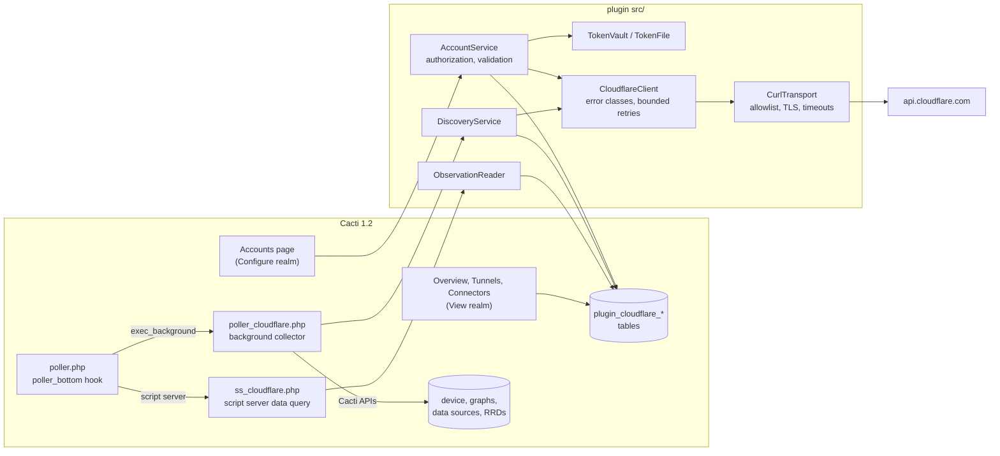
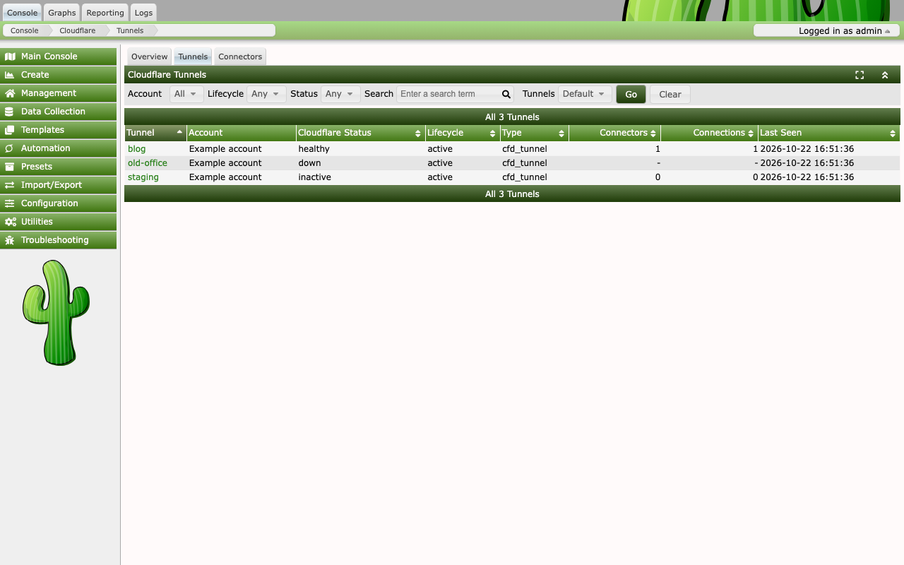

<!-- Source: README.md; SHA256: 813d1c85c236b426b83e42e63c69496f33f8909b5e435d0d45efa6a4ba2f17ca -->

<!-- translations:start -->
[English](../../../README.md) | [简体中文](../zh-CN/README.md) | [हिन्दी](README.md) | [Español (España)](../es-ES/README.md) | [Español (Latinoamérica)](../es-419/README.md) | [العربية (السعودية)](../ar-SA/README.md) | [Afrikaans](../af-ZA/README.md) | [አማርኛ](../am-ET/README.md) | [العربية (مصر)](../ar-EG/README.md) | [العربية (المغرب)](../ar-MA/README.md) | [বাংলা](../bn-BD/README.md) | [Bosanski](../bs-BA/README.md) | [Deutsch](../de-DE/README.md) | [فارسی](../fa-IR/README.md) | [Filipino](../fil-PH/README.md) | [Français](../fr-FR/README.md) | [Français (Maroc)](../fr-MA/README.md) | [Français (Sénégal)](../fr-SN/README.md) | [Hausa](../ha-NG/README.md) | [עברית](../he-IL/README.md) | [Hrvatski](../hr-HR/README.md) | [Bahasa Indonesia](../id-ID/README.md) | [Igbo](../ig-NG/README.md) | [Italiano](../it-IT/README.md) | [日本語](../ja-JP/README.md) | [한국어](../ko-KR/README.md) | [Malagasy](../mg-MG/README.md) | [मराठी](../mr-IN/README.md) | [Bahasa Melayu](../ms-MY/README.md) | [Nederlands](../nl-NL/README.md) | [Polski](../pl-PL/README.md) | [Português (Brasil)](../pt-BR/README.md) | [Русский](../ru-RU/README.md) | [Kinyarwanda](../rw-RW/README.md) | [Soomaali](../so-SO/README.md) | [Српски](../sr-RS/README.md) | [Svenska](../sv-SE/README.md) | [Kiswahili](../sw-KE/README.md) | [தமிழ்](../ta-IN/README.md) | [తెలుగు](../te-IN/README.md) | [ไทย](../th-TH/README.md) | [Türkçe](../tr-TR/README.md) | [Українська](../uk-UA/README.md) | [اردو](../ur-PK/README.md) | [Tiếng Việt](../vi-VN/README.md) | [isiXhosa](../xh-ZA/README.md) | [Yorùbá](../yo-NG/README.md) | [繁體中文](../zh-TW/README.md) | [isiZulu](../zu-ZA/README.md)
<!-- translations:end -->

<p align="center">
  
</p>

<a id="cloudflare-plugin-for-cacti"></a>
# Cacti के लिए Cloudflare प्लगइन

[](https://github.com/somethingwithproof/plugin_cloudflare/actions/workflows/ci.yml)
[](https://sonarcloud.io/summary/new_code?id=somethingwithproof_plugin_cloudflare)
[](../../../LICENSE)


[](https://sonarcloud.io/summary/new_code?id=somethingwithproof_plugin_cloudflare)
[](https://sonarcloud.io/summary/new_code?id=somethingwithproof_plugin_cloudflare)
[](https://sonarcloud.io/summary/new_code?id=somethingwithproof_plugin_cloudflare)


Cloudflare Tunnels और ज़ोन विश्लेषिकी की निगरानी के लिए बनाया जा रहा Cacti 1.2 प्लगइन। यह सीमित दायरे के API टोकन से Cloudflare API पढ़ता है, Cloudflare में कभी बदलाव नहीं करता और डेटा अपनी तालिकाओं में रखता है। Cacti में यह एक डेटा क्वेरी XML को `resource/script_server/` में कॉपी करता है और Cacti की अपनी API से डिवाइस, ग्राफ़ और टेम्पलेट बनाता है; कोर फ़ाइलें नहीं बदलता।

**स्थिति: 0.4.0-dev, अप्रकाशित।** नवीनतम स्थिर संस्करण 0.3.0 है। विकास संस्करण में CSV इन्वेंट्री निर्यात, हटाए गए टनल को स्पष्ट स्वीकृति से निगरानी से हटाना, कैश की गई ज़ोन विश्लेषिकी, अनुमति-सूची वाला केवल-पठन GraphQL Analytics क्लाइंट (`GraphqlAnalyticsClient`) और Thold-तैयार सारांश सहायक (`AnalyticsSummary`), Configuration-as-Code CLI (`cli/cloudflare.php`), पारिस्थितिकी हुक (`abilities_register`, `doctor_register_checks`, `casc_register_providers`), तथा पोलर-सीमित दूरस्थ संग्राहक समर्थन (`replicate_out`) शामिल हैं। वास्तविक प्रदाता और परिनियोजन पर योग्यता जाँच बाकी है।

नीचे की तालिका स्थिर संस्करण 0.3.0 का वर्णन करती है। 0.4.0-dev के विकास परिवर्धन आगे दिए गए संचालक कार्यप्रवाह और ज़ोन विश्लेषिकी अनुभाग में हैं।

| अभी उपलब्ध | नियोजित |
|---|---|
| Cacti प्लगइन प्रबंधक से इंस्टॉल, अपग्रेड, अक्षम और अनइंस्टॉल करना | वास्तविक खाते पर GraphQL और परिनियोजन योग्यता जाँच (पड़ाव 4 समाप्ति) |
| Cloudflare: View, Operator और Configure अनुमतियाँ | दोष प्रविष्टि, TLA+ मॉडल और संपूर्ण दस्तावेज़ (पड़ाव 5) |
| Cloudflare खाते जोड़ना, संपादित करना, हटाना, सक्षम और अक्षम करना | |
| टोकन फ़ाइल में या Cacti डेटाबेस में एन्क्रिप्ट करके रखना | |
| टोकन सत्यापित करना और टनल तथा ज़ोन पढ़ने की अनुमतियाँ जाँचना | |
| पृष्ठभूमि संग्राहक (`poller_cloudflare.php`) में टनल और कनेक्टर खोज | |
| Management > Cloudflare Tunnels में Overview, Tunnels और Connectors पृष्ठ | |
| जीवनचक्र ट्रैकिंग: `active`, `unavailable` और `deleted` | |
| प्रति खाता एक Cacti डिवाइस, जिसे प्रशासक बनाए और जिसके टनल डेटा क्वेरी के इंडेक्स हों | |
| प्रति टनल एक RRD फ़ाइल से Connectors, Health और Collection ग्राफ़ | |
| जिन मानों की पुष्टि प्लगइन नहीं कर सकता उन्हें अज्ञात (`U`) रखा जाता है, कभी 0 नहीं | |

<a id="access-roles"></a>
## पहुँच भूमिकाएँ

| अनुमति क्षेत्र | पहुँच |
| --- | --- |
| Cloudflare: View | मौजूदा निगरानी पृष्ठ। |
| Cloudflare: Operator | निगरानी के साथ Operations पृष्ठ और व्यक्तिगत प्राथमिक जाँच की स्वीकृतियाँ। |
| Cloudflare: Configure | Operator पहुँच के साथ मौजूदा कॉन्फ़िगरेशन और प्रशासनिक कार्रवाइयाँ। |

अपग्रेड फ़ाइलें कॉपी करने के बाद नए अनुमति क्षेत्र को पंजीकृत करने के लिए प्रशासक के रूप में Plugins पृष्ठ खोलें। **Configuration > Users** या उपयोगकर्ता समूहों में Operator क्षेत्र स्पष्ट रूप से दें। अपग्रेड मौजूदा View और Admin क्षेत्र ID तथा अनुमतियाँ बनाए रखते हैं। हर अनुरोध पर Admin को Operator और Operator को View पहुँच विरासत में मिलती है; इससे उपयोगकर्ताओं या समूहों में संग्रहीत अनुमतियाँ नहीं जुड़तीं। प्लगइन सेटिंग के लिए Cacti की Settings अनुमति के साथ Cloudflare: Configure भी चाहिए।

Cloudflare खाते की दृश्यता मौजूदा View क्षेत्र जैसी है और पूरे खाते पर लागू होती है। क्रेडेंशियल, कॉन्फ़िगरेशन, मैपिंग, हटाना और अन्य प्रशासनिक बदलाव प्रशासनिक पृष्ठों में रहते हैं। स्वीकृतियाँ केवल वर्तमान उपयोगकर्ता के सत्र में, अधिकतम एक घंटे तक और उसी अवलोकन के ताज़ा रहने तक रहती हैं। नया या बदला अवलोकन उन्हें अमान्य करता है। वे कभी विफल मापन को स्वस्थ नहीं बतातीं और अलर्ट नहीं दबातीं।

<a id="why-this-plugin"></a>
## इस प्लगइन की आवश्यकता

Cloudflare Tunnel से सेवाएँ प्रकाशित करने वाले Cacti संचालक Cacti में टनल का अंदरूनी हाल नहीं देख पाते। मूल होस्ट SNMP का उत्तर देते रह सकते हैं, जबकि टनल अपने सभी कनेक्टर खो चुका हो; मौजूदा ग्राफ़ हरे रहते हैं लेकिन उपयोगकर्ताओं को त्रुटियाँ मिलती हैं। इस प्लगइन का उद्देश्य टनल स्वास्थ्य और ज़ोन ट्रैफ़िक को उन डिवाइस ग्राफ़ के साथ रखना है जिन्हें संचालक पहले से देखते हैं, बिना Cacti को Cloudflare बदलने की क्षमता दिए।

डिज़ाइन तीन सीमाओं पर आधारित है:

- **केवल पढ़ना।** प्लगइन केवल `GET` एंडपॉइंट और GraphQL Analytics API बुलाता है। किसी Cloudflare संसाधन पर संपादन अनुमति नहीं चाहिए।
- **वैकल्पिक।** Cloudflare बाधा, समाप्त टोकन और दर सीमाएँ Cacti UI को धीमा या दूसरे डिवाइसों का पोलिंग बंद नहीं कर सकतीं। सभी API कॉल के सख्त टाइमआउट हैं और संग्रह पोलर द्वारा शुरू पृष्ठभूमि प्रक्रिया में चलता है।
- **कोर में बदलाव नहीं।** प्लगइन Cacti 1.2 के hooks और अपनी तालिकाएँ उपयोग करता है। एक डेटा क्वेरी XML `resource/script_server/` में कॉपी करता है और Cacti की API से डिवाइस, ग्राफ़ और टेम्पलेट बनाता है। कोर फ़ाइलें नहीं बदलतीं, इसलिए Cacti अपग्रेड और अन्य प्लगइन प्रभावित नहीं होते।

<a id="how-it-works"></a>
## यह कैसे काम करता है



- **Cacti एकीकरण** (`setup.php`, `includes/`, पृष्ठ स्क्रिप्ट) hooks और अनुमति क्षेत्र पंजीकृत करता है, Cacti के सहायक फ़ंक्शन से पृष्ठ दिखाता है और हर कार्रवाई `src/` की लाइब्रेरी को देता है।
- **लाइब्रेरी** (`src/`, namespace `Somethingwithproof\Cloudflare\`) Cacti के global पर निर्भर नहीं है, इसलिए चल रहे Cacti के बिना वास्तविक डेटाबेस और नकली HTTP transport के साथ जाँची जाती है।
- **एक बाहरी मार्ग।** `CurlTransport` ही नेटवर्क तक पहुँचता है और केवल `https://api.cloudflare.com` स्वीकार करता है। हर विफलता एक त्रुटि वर्ग (`auth`, `permission`, `rate_limited`, `transient` आदि) में बदलती है, जो UI में दिखाई जाने वाली स्थिति तय करता है।
- **भंडारण** Cacti के PDO कनेक्शन और prepared statements से होता है। स्कीमा बदलाव क्रमांकित, दोबारा चलाने पर समान परिणाम देने वाले migrations हैं।

डिज़ाइन निर्णय और उनके कारण [docs/design.md](../../design.md) में हैं।

<a id="screenshots"></a>
## स्क्रीनशॉट

स्क्रीनशॉट परीक्षण वातावरण के हैं, वास्तविक Cloudflare खाते के नहीं। वातावरण Cacti 1.2.31 को नकली Cloudflare API के साथ चलाता है जो तय परीक्षण डेटा लौटाती है; खाता, उसका ID और तीन टनल उदाहरण हैं।


*Cloudflare Accounts सूची। नकली API टोकन स्वीकार करती है, इसलिए Verify `ok` बताता है।*


*खाता संपादन। टोकन फ़ील्ड हमेशा खाली रहते हैं; सहेजा टोकन ब्राउज़र को कभी नहीं लौटता। Collect Tunnels और Create Graphs चालू हैं और Collect Analytics बंद है। Connection Status अंतिम Verify का परिणाम दिखाता है: `ok`, टनल पढ़ने की अनुमति मिली और ज़ोन पढ़ने की अनुमति नहीं मिली।*


*Settings > Cloudflare।*


*Management > Cloudflare Tunnels > Overview। स्थिति खाते के सक्रिय टनलों की सबसे खराब Cloudflare स्थिति है; यहाँ `down`, क्योंकि एक परीक्षण टनल बंद है। `Disabled`, `Not collected`, `Collection failing` और `Not yet collected` इसी क्रम में टनल स्वास्थ्य से पहले आते हैं। इसलिए पिछला रन विफल होने पर खाता `Collection failing` दिखाता है, चाहे टनल कुछ भी बताएँ।*



*Tunnels टैब। old-office के Connectors और Connections में `-` है क्योंकि नकली API उसके कनेक्शन अनुरोध को अज्ञात टनल बताती है और कुछ सहेजा नहीं गया; staging में 0 है क्योंकि उसका कोई कनेक्टर नहीं चल रहा।*


*blog टनल का Connectors ग्राफ़। बीच के अंतराल से पहले और बाद में तीनों रेखाएँ 1 हैं; अंतराल में नकली API ने त्रुटियाँ दीं और प्लगइन ने अज्ञात मान सहेजे। रेखाएँ 0 पर नहीं गिरतीं। ग्राफ़ उसी परीक्षण वातावरण (`make screenshots`) से है, जो इस डेटा स्रोत पर 30 सेकंड का step रखता है ताकि सात मिनट की पोलिंग ग्राफ़ भर दे।*

<a id="requirements"></a>
## आवश्यकताएँ

- Cacti 1.2.25 से 1.2.31। Cacti 1.2.31 को स्वयं PHP 8.0 या नया चाहिए। CI केवल 1.2.31 जाँचता है; 1.2.25 की अंतिम मैनुअल जाँच 2026-10-22 को हुई थी।
- PHP 7.4 से 8.4, साथ में `curl`, `openssl` और `pdo_mysql` extensions। इनके बिना प्लगइन सक्षम नहीं होता।
- MariaDB 10.6 या नया, अथवा MySQL 8.0 या नया।
- Cacti सर्वर से `api.cloudflare.com` तक HTTPS पहुँच। प्रॉक्सी समर्थित नहीं हैं।

क्या जाँचा जाता है, इसके लिए [docs/compatibility.md](docs/compatibility.md) देखें।

<a id="install"></a>
## इंस्टॉल करना

1. प्लगइन Cacti के `plugins/cloudflare` में रखें, या तो [GitHub Releases](https://github.com/somethingwithproof/plugin_cloudflare/releases) का आर्काइव निकालकर (release tag के checkout में `make package` वही आर्काइव बनाता है) या git clone करके। डायरेक्टरी का नाम `cloudflare` होना चाहिए।
2. Console > Configuration > Plugins से इंस्टॉल और सक्षम करें, या वेब सर्वर उपयोगकर्ता के रूप में CLI चलाएँ:

   ```sh
   php cli/plugin_manage.php --plugin=cloudflare --install --enable
   ```

3. इंस्टॉल पर admin उपयोगकर्ता को Cloudflare: Configure मिलता है। Console > Configuration > Users में अन्य उपयोगकर्ताओं या समूहों को दें।
4. [docs/token-permissions.md](docs/token-permissions.md) की अनुमतियों वाला टोकन बनाएँ: Account > Cloudflare Tunnel > Read, और वैकल्पिक Zone > Zone > Read।
5. नीचे के दो तरीकों में से एक से टोकन रखें, फिर Console > Configuration > Cloudflare Accounts में खाता जोड़ें और actions मेनू से Verify चलाएँ।

<a id="option-a-encrypted-in-the-database"></a>
### विकल्प A: डेटाबेस में एन्क्रिप्टेड

प्लगइन आपके द्वारा बनाई गई 32-बाइट कुंजी से टोकन एन्क्रिप्ट करता है। यह स्वयं कुंजी कभी बनाता या लिखता नहीं। फ़ाइल वेब सर्वर और पोलर उपयोगकर्ताओं के लिए पठनीय होनी चाहिए, दूसरों के लिए नहीं, और उसकी डायरेक्टरी उन्हें वहाँ पहुँचने दे। `www-data` के रूप में चल रहे वेब सर्वर के लिए:

```sh
sudo mkdir -p /etc/cacti
sudo sh -c 'umask 077 && openssl rand -hex 32 > /etc/cacti/cloudflare.key'
sudo chgrp www-data /etc/cacti/cloudflare.key
sudo chmod 0440 /etc/cacti/cloudflare.key
```

डिफ़ॉल्ट पथ `/etc/cacti/cloudflare.key` है; Settings > Cloudflare > Token Vault Key File में बदलें। कुंजी न मिले या अस्वीकार हो तो फ़ॉर्म केवल टोकन फ़ाइल विकल्प देता है। कुंजी का बैकअप रखें: उसके बिना सहेजे टोकन डिक्रिप्ट नहीं हो सकते और फिर दर्ज करने पड़ते हैं।

<a id="rotating-the-key"></a>
#### कुंजी बदलना

rekey कमांड नहीं है। नई कुंजी पुरानी से सहेजे टोकन नहीं खोल सकती, इसलिए कुंजी बदलते समय हर सहेजा टोकन फिर दर्ज करना होगा:

1. प्रत्येक खाते का टोकन मान तैयार रखें। Cloudflare केवल बनाते या बदलते समय टोकन मान दिखाता है; आपके पास न हो तो Cloudflare डैशबोर्ड में टोकन बदलें।
2. ऊपर के कमांड से नए पथ, जैसे `/etc/cacti/cloudflare.key.new`, पर नई कुंजी बनाएँ, समान स्वामी और mode के साथ।
3. Settings > Cloudflare > Token Vault Key File को नए पथ पर सेट करके सहेजें। इसके बाद पुरानी कुंजी से एन्क्रिप्ट खाते पर Verify “Stored token cannot be decrypted” बताता है, और हर संग्राहक रन उसके लिए `reason=decrypt_failed` के साथ `discovery token unavailable` लॉग करता है।
4. डेटाबेस में टोकन रखने वाले प्रत्येक खाते को Console > Configuration > Cloudflare Accounts में खोलें, दोनों टोकन फ़ील्ड में टोकन पेस्ट करें, सहेजें और Verify चलाएँ। परिणाम `ok` होना चाहिए।
5. ऐसे सभी खाते सत्यापित हो जाएँ तो पुरानी कुंजी फ़ाइल और उसके बैकअप हटाएँ।

चरण 3 और 4 के बीच खाते के टनल रीफ़्रेश नहीं होते और स्वास्थ्य, कनेक्टर तथा कनेक्शन ग्राफ़ U दर्ज करते हैं। टोकन फ़ाइल वाले खाते प्रभावित नहीं होते।

<a id="option-b-token-file"></a>
### विकल्प B: टोकन फ़ाइल

केवल टोकन ऐसी फ़ाइल में लिखें जिसे वेब सर्वर और पोलर उपयोगकर्ता पढ़ सकें, अन्य नहीं; फिर संपादन फ़ॉर्म में उसका पूर्ण पथ दर्ज करें:

```sh
sudo sh -c 'umask 077 && cat > /etc/cacti/cloudflare-account.token'   # paste the token, then Ctrl-D
sudo chgrp www-data /etc/cacti/cloudflare-account.token
sudo chmod 0440 /etc/cacti/cloudflare-account.token
```

फ़ाइल की जाँच Verify में पढ़ते समय होती है, सहेजते समय नहीं। symbolic link, 4 KiB से बड़ी फ़ाइलें और दूसरों द्वारा पढ़ी या लिखी जा सकने वाली फ़ाइलें अस्वीकार होती हैं।

Cloudflare: Configure वाला कोई भी उपयोगकर्ता कोई भी पथ दर्ज कर सकता है और पोलर उपयोगकर्ता उसे पढ़ता है। टोकन फ़ाइलों को एक जगह रखने के लिए Settings > Cloudflare > Token File Directory, जैसे `/etc/cacti`, सेट करें; फिर बाहर का पथ अस्वीकार होता है। [docs/security.md](docs/security.md#token-file) देखें।

<a id="upgrade"></a>
## अपग्रेड

1. `plugins/cloudflare` की फ़ाइलें नए रिलीज़ से बदलें, डायरेक्टरी का नाम वही रखें।
2. प्रशासक के रूप में Console > Configuration > Plugins या Console > Configuration > Cloudflare Accounts एक बार खोलें। इससे migrations चलते हैं, Cloudflare टेम्पलेट आयात होते हैं, डेटा क्वेरी फ़ाइल कॉपी होती है ([टनल मेट्रिक और ग्राफ़](#tunnel-metrics-and-graphs) देखें), `abilities_register`, `doctor_register_checks`, `casc_register_providers`, और `replicate_out` पारिस्थितिकी हुक (`includes/ecosystem.php`) पंजीकृत होते हैं, तथा 0.1.0 से अपग्रेड पर `poller_bottom` hook भी पंजीकृत होता है।

`poller.php` प्लगइन अपग्रेड नहीं चलाता, इसलिए चरण 2 तक नया स्कीमा उपलब्ध नहीं होता। तब हर संग्राहक रन कुछ नहीं करता और `CLOUDFLARE: collector skipped; plugin upgrade pending, open Console > Plugins` लॉग करता है। Cloudflare Tunnels पृष्ठों को केवल Cloudflare: View चाहिए, इसलिए वे अपग्रेड कभी नहीं चलाते और चरण 2 तक “The Cloudflare tunnels could not be read” दिखा सकते हैं।

<a id="account-status"></a>
## खाते की स्थिति

Verify खाते की स्थिति सेट करता है:

| स्थिति | अर्थ |
|---|---|
| `unknown` | खाता जोड़ने या क्रेडेंशियल बदलने के बाद सत्यापन नहीं हुआ |
| `ok` | टोकन सक्रिय है और टनल पढ़ सकता है |
| `token_inactive` | Cloudflare टोकन अक्षम या समाप्त बताता है |
| `auth_failed` | Cloudflare ने अमान्य या समाप्त टोकन अस्वीकार किया (HTTP 401) |
| `permission_denied` | टोकन सक्रिय है लेकिन टनल नहीं पढ़ सकता, या सत्यापन एंडपॉइंट बुलाने की अनुमति नहीं है (HTTP 403) |
| `unreachable` | API तक नहीं पहुँचे, टाइमआउट हुआ या सर्वर त्रुटि मिली |
| `rate_limited` | Cloudflare ने HTTP 429 दिया |
| `error` | अन्य विफलता, जैसे गुम या असुरक्षित टोकन फ़ाइल, गुम या अनुपयोगी vault कुंजी फ़ाइल, या डिक्रिप्ट न होने वाला सहेजा टोकन |

संपादन पृष्ठ यह भी बताता है कि टनल और ज़ोन पढ़ने की अनुमति मिली या नहीं।

<a id="tunnel-discovery"></a>
## टनल खोज

कॉन्फ़िगर किए गए संग्राहक पोलर (`cloudflare_poller_id`, डिफ़ॉल्ट `1`) के हर चक्र के बाद, कम-से-कम एक सक्षम खाते में Collect Tunnels चालू होने पर `poller_bottom` hook, `exec_background` से पृष्ठभूमि संग्राहक शुरू करता है। संग्राहक पोलर की प्रक्रिया में कभी नहीं चलता, इसलिए धीमी Cloudflare API `poller.php` को विलंबित नहीं करती। `INFO` में `remote_collect:1` घोषित है, और `replicate_out` हुक (`RemoteReplication`) गोपनीय-रहित मेटाडेटा तालिकाएँ (`plugin_cloudflare_accounts` जिसमें `token_ciphertext` को `NULL` कर दिया जाता है, `plugin_cloudflare_tunnels`, `plugin_cloudflare_connectors`, `plugin_cloudflare_zones`, `plugin_cloudflare_metric_mappings`, और `plugin_cloudflare_resources`) दूरस्थ पोलरों (`poller_id > 1`) को भेजता है जबकि vault कुंजी सामग्री को बाहर रखता है।

हर देय खाते के लिए संग्राहक टनल सूची लेता है, फिर सक्रिय टनलों के कनेक्शन पढ़ता है, जिससे कनेक्टर, संस्करण, डेटा केंद्र और मूल पते मिलते हैं। खाते हर Discovery Interval पर देय होते हैं, डिफ़ॉल्ट 300 सेकंड। रन 50 सेकंड बाद नया खाता शुरू नहीं करता और अधिकतम 200 कनेक्शन अनुरोध करता है। कोई भी सीमा खाते के कनेक्शन पढ़ते बीच में रोक सकती है; खाता `partial` दर्ज होता है और अगला रन उन टनलों से आगे बढ़ता है जिनका प्रयास सबसे पहले हुआ था। शुरू न हुए खाते अगले रन के लिए देय रहते हैं।

टनल का जीवनचक्र Cloudflare की स्थिति (`healthy`, `degraded`, `down` या `inactive`) से अलग रखा जाता है:

| जीवनचक्र | अर्थ |
|---|---|
| `active` | टनल अंतिम पूर्ण सूची में था |
| `deleted` | पूर्ण सूची में टनल नहीं था, जिसमें खाली सूची भी शामिल है। पंक्ति और इतिहास रहते हैं; फिर दिखने पर टनल `active` हो जाता है |
| `unavailable` | बीच में पूर्ण सूची मिले बिना गिनी गई तीन बाधाओं से टनल स्थिति अज्ञात है |

केवल पूर्ण सफल सूची टनल जोड़ती, अपडेट करती या हटाती है; विफल सूची कभी टनल नहीं हटाती। Cloudflare बिल्कुल न पढ़ पाना (`transient`, `rate_limited`, `auth` या `permission`) बाधा में गिना जाता है; बीच में पूर्ण सूची मिले बिना ऐसी तीन गिनी गई बाधाओं पर सक्रिय टनल `unavailable` होते हैं। अगली पूर्ण सूची उन्हें लौटाती है और गिनती रीसेट करती है। कनेक्शन पढ़ते समय Cloudflare को अज्ञात टनल छोड़ दिया जाता है, खाते को विफल नहीं किया जाता। अन्य विफलताएँ बाधा काउंटर को न बढ़ाती हैं, न रीसेट करती हैं।

`cacti.log` में खोज पंक्तियाँ `CLOUDFLARE: discovery` और रन सारांश `CLOUDFLARE: collector` से शुरू होते हैं। विफलताएँ और जीवनचक्र बदलाव, जैसे विफल सूची या `unavailable` टनल, Cacti के डिफ़ॉल्ट `LOW` स्तर पर लॉग होते हैं; प्रत्येक खाते का परिणाम और रन सारांश `MEDIUM` पर। सभी टनलों के कनेक्शन पठन विफल हो सकते हैं, इसलिए प्रति खाता हर त्रुटि वर्ग की केवल पहली विफलता `LOW`, बाकी `MEDIUM` पर लिखी जाती हैं; फिर हर वर्ग के लिए विफल टनलों की संख्या वाली एक `LOW` पंक्ति आती है।

Management > Cloudflare Tunnels केवल पढ़ने के लिए है और Cloudflare: View चाहिए:

- **Overview** प्रत्येक खाते की स्थिति, जीवनचक्र के अनुसार टनल संख्या, अंतिम सफल खोज और लगातार विफलताओं की संख्या दिखाता है।
- **Tunnels** सभी खातों या एक खाते के टनल दिखाता है; खाता, जीवनचक्र, स्थिति और नाम फ़िल्टर तथा क्रमबद्ध कॉलम हैं।
- **Connectors** Tunnels टैब पर चुने टनल के कनेक्टर दिखाता है।

<a id="tunnel-metrics-and-graphs"></a>
## टनल मेट्रिक और ग्राफ़

Cacti स्क्रिप्ट सर्वर डेटा क्वेरी `ss_cloudflare.php` से टनल स्थिति पढ़ता है। यह केवल प्लगइन तालिकाओं से उत्तर देती है, Cloudflare नहीं बुलाती, इसलिए Cloudflare बाधा पोलर धीमा नहीं करती। हर टनल छह मान देता है: स्वास्थ्य (healthy 3, degraded 2, down 1, inactive 0), कनेक्टर, कनेक्शन, कनेक्टर संस्करण, कनेक्शन के अंतिम पठन से बीते सेकंड और खोज कार्य की लगातार विफलताएँ। स्वास्थ्य, कनेक्टर, कनेक्शन और संस्करण तभी छपते हैं जब प्लगइन पुष्टि कर सके: अंतिम खोज सफल हो, टनल `active` हो और पठन ताज़ा हो। अन्यथा `U` मिलता है और ग्राफ़ में अंतराल दिखता है, ऐसा शून्य नहीं जो बाधा जैसा लगे। दोनों संग्रह मान बाधा के दौरान छपते रहते हैं, जिससे Collection ग्राफ़ उसे दिखाता है; हटे टनल या कभी रीफ़्रेश न हुए कनेक्शन के लिए ही वे `U` होते हैं। नियम [docs/metrics.md](docs/metrics.md) में हैं।

<a id="create-the-device"></a>
### डिवाइस बनाना

खाता अधिकतम एक Cacti डिवाइस से मैप होता है। डिवाइस खाते के टनल को Cloudflare Tunnels डेटा क्वेरी के इंडेक्स रखता है। यह अपने आप नहीं बनता:

1. Console > Configuration > Cloudflare Accounts खोलें।
2. खाता चुनें, actions मेनू में Create Cacti Device चुनें और पुष्टि करें।

कार्रवाई को Cloudflare: Configure और Cacti का Sites/Devices/Data क्षेत्र (`host.php` वाला), दोनों चाहिए। मेनू केवल दोनों रखने वाले उपयोगकर्ताओं को दिखता है और सर्वर अन्य अनुरोध अस्वीकार करता है। डिवाइस का नाम `Cloudflare: <account name>` होता है, Cloudflare Account host template और मुख्य पोलर उपयोग होते हैं, SNMP संस्करण 0 और availability check बंद रहता है, तथा hostname `<account ID>.cloudflare.invalid` होता है। वह नाम आरक्षित है और कभी resolve नहीं होता; Cacti उससे कनेक्ट नहीं करता। खाता पहले से डिवाइस रखता हो तो कार्रवाई बताती है और कुछ नहीं बदलती। प्रशासक Cacti में डिवाइस हटाए तो Create Cacti Device फिर चलाए जाने तक प्लगइन नया नहीं बनाता।

<a id="create-graphs"></a>
### ग्राफ़ बनाना

खाता फ़ॉर्म में Create Graphs डिफ़ॉल्ट रूप से बंद है। चालू होने पर हर `ok` या `partial` खोज के बाद संग्राहक डिवाइस को दोबारा इंडेक्स करता है और खाते के `active` टनलों के गुम ग्राफ़ बनाता है: Connectors, Health और Collection, तीन प्रति टनल। तीनों एक RRD फ़ाइल साझा करते हैं। एक रन अधिकतम 50 ग्राफ़ बनाता है और 20 सेकंड बाद रुकता है; अगला आगे बढ़ता है। प्लगइन कभी Cacti ऑब्जेक्ट नहीं हटाता। प्रशासक द्वारा हटाया ग्राफ़ फिर नहीं बनाया जाता; Cloudflare सूची से हटे टनल के ग्राफ़ और RRD बने रहते हैं और `U` दिखाते हैं।

Create Graphs चालू करने को दोनों क्षेत्र चाहिए; बंद करने को केवल Configure। Sites/Devices/Data बिना उपयोगकर्ता फ़ॉर्म सहेजे तो चेतावनी के साथ सेटिंग अपरिवर्तित रहती है। Create Graphs बंद होने पर भी हर खोज के बाद डिवाइस दोबारा इंडेक्स होता है, इसलिए नए टनल क्वेरी के इंडेक्स बनकर दिखते हैं।

<a id="the-data-query-file"></a>
### डेटा क्वेरी फ़ाइल

Cacti 1.2.31 डेटा क्वेरी XML केवल अपने `resource` डायरेक्टरी में पढ़ता है। इसलिए इंस्टॉल और अपग्रेड पर प्लगइन `templates/resource/cloudflare_tunnels.xml` को `<Cacti>/resource/script_server/cloudflare_tunnels.xml` में कॉपी करता है। अपने डायरेक्टरी से बाहर यही एक फ़ाइल लिखता है, इसलिए इंस्टॉल या अपग्रेड उपयोगकर्ता को वहाँ लिखने की अनुमति चाहिए। अनइंस्टॉल फ़ाइल के साथ डिवाइस, ग्राफ़, RRD और टेम्पलेट बनाए रखता है। कॉपी या टेम्पलेट आयात विफल हो तो प्लगइन लॉग करता है और Create Cacti Device दोबारा प्रयास करता है।

<a id="settings"></a>
## सेटिंग

Settings > Cloudflare में हैं:

- **Token Vault Key File**: vault कुंजी का पथ।
- **Token File Directory**: सेट होने पर बाहर की टोकन फ़ाइल अस्वीकार होती है। डिफ़ॉल्ट खाली है, इसलिए कोई भी पथ स्वीकार्य है। [docs/security.md](docs/security.md#token-file) देखें।
- **Interactive Request Timeout**: वेब इंटरफ़ेस, जैसे Verify, से अनुरोध के कुल सेकंड। डिफ़ॉल्ट 10; 5 से 60 के बाहर मान 10 हो जाते हैं।
- **Collector Request Timeout**: पृष्ठभूमि संग्राहक अनुरोध के कुल सेकंड। डिफ़ॉल्ट 20; 5 से 60 के बाहर मान 20 हो जाते हैं।
- **Log Level**: सहेजा जाता है, अभी कोई पढ़ता नहीं।

खाता फ़ॉर्म में Collect Tunnels और Discovery Interval खोज नियंत्रित करते हैं; Create Graphs ग्राफ़ निर्माण नियंत्रित करता है। Collect Analytics सहेजा जाता है लेकिन इस रिलीज़ में प्रभाव नहीं है।

<a id="languages"></a>
## भाषाएँ

प्लगइन स्पेनिश (स्पेन, `es-ES`), फ़्रेंच (`fr-FR`), जर्मन (`de-DE`), सरलीकृत चीनी (`zh-CN`), जापानी (`ja-JP`), हिंदी (`hi-IN`) और अरबी (`ar-SA`) अनुवाद देता है। Configuration > Settings > General > Language Support चालू करने और उपयोगकर्ता द्वारा भाषा चुनने पर Cacti उन्हें दिखाता है। लैटिन अमेरिकी स्पेनिश कैटलॉग (`es-419`) भी है, लेकिन Cacti 1.2 में यह locale चुना नहीं जा सकता; Cacti इसे जोड़े तभी प्रभावी होगा। तब तक स्पेनिश (`es-ES`) चुनें।

कुछ पाठ अंग्रेज़ी में रहता है: प्लगइन द्वारा ज्यों का त्यों सहेजी और दिखाई गई स्थिति (`ok`, `active`, `unavailable`, `deleted` और Cloudflare की टनल स्थिति) तथा Cacti लॉग में प्लगइन का सारा पाठ।

<a id="uninstall-and-data-retention"></a>
## अनइंस्टॉल और डेटा संरक्षण

अनइंस्टॉल प्लगइन की अपनी तालिकाएँ हटाता है, जिनमें खाते, एन्क्रिप्टेड टोकन, खोजे टनल, कार्य स्थिति और बनाए Cacti ऑब्जेक्टों का रिकॉर्ड है, और `cloudflare_` सेटिंग हटाता है। कुंजी फ़ाइल, टोकन फ़ाइल, कॉपी किया `resource/script_server/cloudflare_tunnels.xml`, या Cacti डिवाइस, ग्राफ़, डेटा स्रोत, RRD और टेम्पलेट नहीं हटाता। उनमें ऐतिहासिक निगरानी डेटा है और उन्हें हटाना Cacti में प्रशासक की स्पष्ट कार्रवाई है।

बचा डिवाइस डेटा लेना बंद कर देता है। अनइंस्टॉल या खाता हटने के बाद कोई खाता होस्ट का मालिक नहीं रहता, इसलिए ग्राफ़ इतिहास रखते हैं लेकिन आगे `U` छापते हैं। दोबारा इंस्टॉल या जोड़े खाते पर Create Cacti Device नया डिवाइस बनाता है, पुराना नहीं अपनाता; इतिहास न चाहिए तो Cacti में पुराना डिवाइस हटाएँ।

<a id="known-limitations"></a>
## ज्ञात सीमाएँ

- एक रन अधिकतम 200 कनेक्शन अनुरोध करता है। इससे आगे के टनल अवलोकन विंडो से कम आवृत्ति पर रीफ़्रेश होते हैं और उनके कनेक्शन ग्राफ़ में अंतराल आते हैं।
- अपग्रेड में वितरित template XML बदले तो प्लगइन आयातित टेम्पलेट पर प्रशासक के बदलाव मिटा देता है।
- दूरस्थ पोलरों को बिना क्रेडेंशियल के प्रतिकृत मेटाडेटा मिलता है (`token_ciphertext` को `NULL` कर दिया जाता है और vault कुंजियाँ कभी प्रतिकृत नहीं होतीं)। किसी निर्दिष्ट दूरस्थ पोलर (`cloudflare_poller_id`) पर संग्राहक चलाते समय, टोकन फ़ाइलें या vault कुंजी सीधे उसी संग्राहक होस्ट पर प्रदान करें।
- हटे टनल डेटा क्वेरी इंडेक्स, ग्राफ़ और RRD में रहते हैं और `U` छापते हैं।
- वास्तविक fatal error, जैसे मेमोरी समाप्त होने पर Cacti प्लगइन अक्षम कर देता है। [docs/security.md](docs/security.md) देखें।

<a id="security"></a>
## सुरक्षा

- Global API Keys अस्वीकार हैं; केवल सीमित दायरे के API टोकन स्वीकार होते हैं।
- टोकन आपकी तैयार फ़ाइल में या AES-256-GCM से एन्क्रिप्ट होकर रहते हैं; कुंजी फ़ाइल डेटाबेस में कभी नहीं जाती। टोकन पृष्ठ, लॉग या त्रुटि संदेश में कभी नहीं आते।
- डेटाबेस त्रुटियों में केवल SQLSTATE और driver error code होते हैं, statement के मान कभी नहीं।
- हर बदलाव Cacti CSRF टोकन से सुरक्षित POST है। खाते के प्रशासन और कॉन्फ़िगरेशन बदलाव के लिए Cloudflare: Configure चाहिए; व्यक्तिगत ट्रायेज़ स्वीकृतियों के लिए Cloudflare: Operator चाहिए। Cacti डिवाइस बनाना या Create Graphs चालू करना Cacti की Sites/Devices/Data अनुमति भी माँगता है। अक्षम प्लगइन अपने पृष्ठ अस्वीकार करता है।
- Configuration-as-Code (`cli/cloudflare.php` और `casc_register_providers`) केवल `vault:<account_id>` या `file:<absolute_path>` गोपनीय संदर्भ स्वीकार करता है, कच्चे टोकन, vault साइफ़रटेक्स्ट और XML `DOCTYPE` घोषणाओं को अस्वीकार करता है, तथा लिखने से पहले सटीक `--confirm=<PLAN_HASH>` माँगता है।
- पंजीकृत Abilities (`cloudflare-list-tunnels`, `cloudflare-get-health`) सख्ती से केवल पढ़ने योग्य हैं, कॉलर की उपयोगकर्ता ID के लिए सीधे Cacti auth तालिकाओं पर Cloudflare: View क्षेत्र का मूल्यांकन करती हैं (कभी सत्र स्थिति का नहीं), और कोई टोकन या कुंजी सामग्री नहीं लौटातीं।

विवरण और ज्ञात सीमाएँ [docs/security.md](docs/security.md) में हैं। कमजोरियाँ [SECURITY.md](../../../SECURITY.md) के अनुसार निजी तौर पर बताएँ।

<a id="roadmap"></a>
## संचालक कार्यप्रवाह और ज़ोन विश्लेषिकी

`0.4.0-dev` के विकास परिवर्धनों में हटाए गए टनल को स्पष्ट रूप से हटाना, क्षमता-सचेत GraphQL ज़ोन और टनल विश्लेषिकी, Thold-तैयार सारांश सहायक और आयात योग्य टेम्पलेट, एक CasC और स्वास्थ्य CLI, पारिस्थितिकी हुक, तथा दूरस्थ संग्राहक प्रतिकृति शामिल हैं। ये सुविधाएँ अभी जारी नहीं हुई हैं और वास्तविक खातों पर जाँची नहीं गई हैं। सेटअप, मेट्रिक अर्थ और सत्यापन सीमाएँ [docs/analytics-and-alerting.md](../../analytics-and-alerting.md) में हैं।

- **GraphQL विश्लेषिकी क्लाइंट और Thold सारांश (`src/Api/GraphqlAnalyticsClient.php`, `src/Metrics/AnalyticsSummary.php`)**: `GraphqlAnalyticsClient` ज़ोन और टनल अनुरोध मात्रा, HTTP 5xx त्रुटि दर, प्रतिक्रिया बाइट्स और एज विलंबता (औसत और p95) एकत्र करने के लिए `CloudflareClient` (TLS सत्यापित, `api.cloudflare.com` पर पिन किया गया, सीमित प्रतिक्रियाएँ, और `RetryPolicy` दर-सीमा बैकऑफ़) पर केवल संकलन-समय अनुमति-सूची वाली केवल-पठन क्वेरीज़ (`zone_settings`, `zone_http_metrics`, `zone_edge_latency`, `tunnel_analytics`) चलाता है। `AnalyticsSummary` प्लगइन के RRD DS नामों (`health`, `collect_age`, `error_pct`, `age`) से संरेखित `recommendedThresholds()`, `summarizeZones()`, और `evaluateSample()` प्रदान करता है।
- **संचालक और CasC CLI (`cli/cloudflare.php`)**: `ConfigCodec` (`src/Config/ConfigCodec.php`) और `ConfigService` (`src/Config/ConfigService.php`) द्वारा समर्थित, जो `cli/cloudflare.php export [--format=yaml|xml] [--file=PATH]` (केवल `vault:` / `file:` गोपनीय संदर्भ उत्सर्जित करते हुए), `cli/cloudflare.php validate --file=PATH [--format=yaml|xml]`, `cli/cloudflare.php plan --file=PATH [--format=yaml|xml]`, `cli/cloudflare.php apply --file=PATH --confirm=<PLAN_HASH> [--format=yaml|xml]`, और `cli/cloudflare.php health [--format=text|json]` का समर्थन करता है।
- **पारिस्थितिकी एकीकरण हुक (`includes/ecosystem.php`, `setup.php`)**:
  - `abilities_register` (`AbilitiesProvider`): शून्य टोकन या गोपनीय मानों के साथ Cloudflare: View क्षेत्र (प्रत्यक्ष और समूह अनुदान) पर नियंत्रित केवल-पठन `cloudflare-list-tunnels` और `cloudflare-get-health` पंजीकृत करता है।
  - `doctor_register_checks` (`DoctorChecks`): `cloudflare_vault_key` (मोड, सिमलिंक और लंबाई सत्यापन), `cloudflare_token_dir` (पूर्ण पथ, सिमलिंक और विश्व-लेखनीय जाँच), `cloudflare_tunnel_freshness`, और `cloudflare_api_failure_rate` उजागर करता है।
  - `casc_register_providers` (`CascProvider`): खातों (केवल गोपनीय संदर्भ), ज़ोन, टनल और मेट्रिक मैपिंग के लिए `cloudflare` CasC प्रदाता (`export`, `validate`, `plan`, `apply`) उजागर करता है।
  - `replicate_out` (`RemoteReplication`): `token_ciphertext` को `NULL` करके और vault कुंजी सामग्री को बाहर रखते हुए दूरस्थ पोलरों (`poller_id > 1`) में गोपनीय-रहित मेटाडेटा तालिकाओं की प्रतिकृति बनाता है।

### इन्वेंट्री निर्यात

टनल और कनेक्टर पृष्ठ Cloudflare: View उपयोगकर्ताओं को निर्यात विकल्प देते हैं। टनल CSV में सभी मेल खाने वाले पृष्ठ शामिल होते हैं और खाते, जीवनचक्र, स्थिति, खोज तथा क्रम की सेटिंग बनी रहती है। कनेक्टर CSV में चुने हुए टनल के संस्करण, आर्किटेक्चर, डेटा सेंटर और मूल पते होते हैं। डाउनलोड केवल कैश रिकॉर्ड पढ़ता है। अज्ञात गिनती खाली रहती है और सूत्र जैसे सेल के आगे एकल उद्धरण लगाया जाता है।

## आगे की योजना

हर पड़ाव अपने नंबर वाला 0.x रिलीज़ है: पड़ाव 3, 0.3.0 है और पड़ाव 4, 0.4.0 होगा। पड़ाव 1 और 2 अलग जारी नहीं हुए, वे 0.3.0 में हैं। 1.0.0 उस रिलीज़ के लिए आरक्षित है जो नीचे के सभी पड़ाव पूरे करे।

| पड़ाव | दायरा | स्थिति |
|---|---|---|
| 1. आधार | प्लगइन जीवनचक्र, अनुमतियाँ, खाता कॉन्फ़िगरेशन, कनेक्शन परीक्षण | 0.3.0 में जारी ([#2](https://github.com/somethingwithproof/plugin_cloudflare/pull/2) से [#5](https://github.com/somethingwithproof/plugin_cloudflare/pull/5)) |
| 2. खोज | पृष्ठभूमि संग्राहक में टनल और कनेक्टर खोज, Overview, Tunnels और Connectors पृष्ठ | 0.3.0 में जारी ([#6](https://github.com/somethingwithproof/plugin_cloudflare/pull/6)) |
| 3. मेट्रिक | टनल स्वास्थ्य डेटा स्रोत, ग्राफ़ टेम्पलेट, ऐसा बाधा प्रबंधन जो काल्पनिक शून्य कभी न लिखे | 0.3.0 में जारी ([#7](https://github.com/somethingwithproof/plugin_cloudflare/pull/7)) |
| 4. विश्लेषिकी और अलर्ट | योजना-सचेत GraphQL विश्लेषिकी (`GraphqlAnalyticsClient`), Thold सारांश और टेम्पलेट (`AnalyticsSummary`), CasC CLI (`cli/cloudflare.php`), पारिस्थितिकी हुक और दूरस्थ प्रतिकृति | 0.4.0-dev में लागू; वास्तविक खाते पर योग्यता जाँच बाकी |
| 5. सुदृढ़ीकरण | दोष प्रविष्टि, खोज और संग्रह के TLA+ मॉडल, संपूर्ण दस्तावेज़ | नियोजित |

<a id="development"></a>
## विकास

उपकरणों को PHP 8.x और Composer चाहिए; प्लगइन कोड PHP 7.4 के अनुकूल रहता है। integration और BDD परीक्षणों को डेटाबेस चाहिए, जिसे `make db-up` Docker में पोर्ट 33061 पर शुरू करता है।

```sh
composer install
make db-up
make ci            # unit, integration, BDD, PHPStan, php-cs-fixer, php -l on PHP 7.4
make smoke         # installs the plugin into Cacti 1.2.31 in Docker and walks its lifecycle
make package       # builds build/cloudflare-<version>.tar.gz and checks its contents
make db-down
```

`make smoke` और `make screenshots` को Cacti checkout चाहिए; `CACTI_REPO` उसका पथ रखें। integration परीक्षण `CF_TEST_DSN`, `CF_TEST_DB_USER` और `CF_TEST_DB_PASS` पढ़ते हैं; डेटाबेस न मिले तो छोड़ दिए जाते हैं, जब तक `CI` सेट न हो।

<a id="contributing"></a>
## योगदान

Pull request स्वागत योग्य हैं। हर commit को DCO sign-off (`git commit -s`) चाहिए। पहले परीक्षण लिखें; `make ci` पास होना चाहिए और Cacti एकीकरण बदलावों को `make smoke` भी पास करना चाहिए। कोड PHP 7.4 संगत रहे और Cacti शैली माने: tabs, single quotes और उसी पंक्ति पर braces।

<a id="translations"></a>
### अनुवाद

संदेश `__('...', 'cloudflare')` से चिह्नित हैं। `locales/build_gettext.sh` (`make i18n`, जिसे GNU gettext चाहिए) `locales/po/cacti.pot` फिर बनाता है, हर `locales/po/<locale>.po` में मिलाता है और `locales/LC_MESSAGES/<locale>.mo` संकलित करता है; तीनों commit करें। CI का `make i18n-check` गुम या fuzzy entry, अलग format string, या पुराने compiled file पर विफल होता है; unit suite प्रत्येक entry के placeholders, HTML tags और किनारे के whitespace भी जाँचती है। इसलिए संदेश बदले तो उसी pull request में अनुवाद अपडेट करें। नई भाषा Cacti नाम वाला नया `<locale>.po` है (जैसे `pt-BR`), जिसे `CatalogTest::LOCALES` और `tests/build/package.sh` की archive जाँच में जोड़ना है। Cloudflare, Cacti, Thold, API, GraphQL और `Account Cloudflare Tunnel Read` जैसे अनुमति नाम अपरिवर्तित रखें।

<a id="documentation"></a>
## दस्तावेज़

- [docs/security.md](docs/security.md): सुरक्षा नियंत्रण और ज्ञात सीमाएँ
- [docs/token-permissions.md](docs/token-permissions.md): टोकन अनुमतियाँ
- [docs/compatibility.md](docs/compatibility.md): समर्थित संस्करण और उपयोग किए इंटरफ़ेस
- [docs/metrics.md](docs/metrics.md): मेट्रिक सूची और मान अज्ञात होने की स्थितियाँ
- [docs/collector-protocol.md](../../collector-protocol.md): `ss_cloudflare.php` क्या पढ़ता और छापता है
- [docs/schema.md](../../schema.md): डेटाबेस तालिकाएँ
- [docs/design.md](../../design.md): डिज़ाइन निर्णय
- [CHANGELOG.md](../../../CHANGELOG.md)

<a id="license"></a>
## लाइसेंस

GPL-2.0-or-later। [LICENSE](../../../LICENSE) देखें।

<a id="trademarks"></a>
## ट्रेडमार्क

Cloudflare, Cloudflare, Inc. का पंजीकृत ट्रेडमार्क है। यह स्वतंत्र ओपन-सोर्स उपकरण है और Cloudflare, Inc. से संबद्ध, प्रायोजित या अनुमोदित नहीं है।

यह परियोजना Cacti परियोजना से भी संबद्ध नहीं है। लोगो के लिए [docs/images/README-logo.md](../../images/README-logo.md) देखें।
