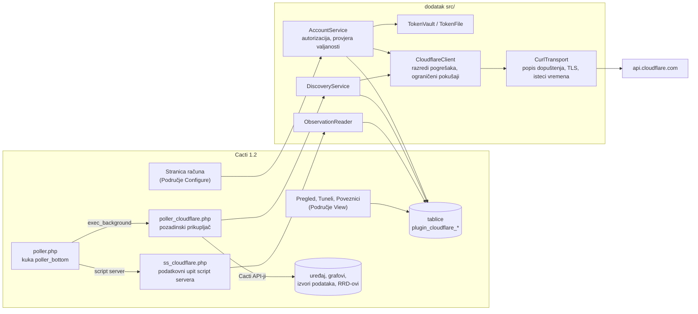

<!-- Source: README.md; SHA256: 813d1c85c236b426b83e42e63c69496f33f8909b5e435d0d45efa6a4ba2f17ca -->

<!-- translations:start -->
[English](../../../README.md) | [简体中文](../zh-CN/README.md) | [हिन्दी](../hi-IN/README.md) | [Español (España)](../es-ES/README.md) | [Español (Latinoamérica)](../es-419/README.md) | [العربية (السعودية)](../ar-SA/README.md) | [Afrikaans](../af-ZA/README.md) | [አማርኛ](../am-ET/README.md) | [العربية (مصر)](../ar-EG/README.md) | [العربية (المغرب)](../ar-MA/README.md) | [বাংলা](../bn-BD/README.md) | [Bosanski](../bs-BA/README.md) | [Deutsch](../de-DE/README.md) | [فارسی](../fa-IR/README.md) | [Filipino](../fil-PH/README.md) | [Français](../fr-FR/README.md) | [Français (Maroc)](../fr-MA/README.md) | [Français (Sénégal)](../fr-SN/README.md) | [Hausa](../ha-NG/README.md) | [עברית](../he-IL/README.md) | [Hrvatski](README.md) | [Bahasa Indonesia](../id-ID/README.md) | [Igbo](../ig-NG/README.md) | [Italiano](../it-IT/README.md) | [日本語](../ja-JP/README.md) | [한국어](../ko-KR/README.md) | [Malagasy](../mg-MG/README.md) | [मराठी](../mr-IN/README.md) | [Bahasa Melayu](../ms-MY/README.md) | [Nederlands](../nl-NL/README.md) | [Polski](../pl-PL/README.md) | [Português (Brasil)](../pt-BR/README.md) | [Русский](../ru-RU/README.md) | [Kinyarwanda](../rw-RW/README.md) | [Soomaali](../so-SO/README.md) | [Српски](../sr-RS/README.md) | [Svenska](../sv-SE/README.md) | [Kiswahili](../sw-KE/README.md) | [தமிழ்](../ta-IN/README.md) | [తెలుగు](../te-IN/README.md) | [ไทย](../th-TH/README.md) | [Türkçe](../tr-TR/README.md) | [Українська](../uk-UA/README.md) | [اردو](../ur-PK/README.md) | [Tiếng Việt](../vi-VN/README.md) | [isiXhosa](../xh-ZA/README.md) | [Yorùbá](../yo-NG/README.md) | [繁體中文](../zh-TW/README.md) | [isiZulu](../zu-ZA/README.md)
<!-- translations:end -->

<p align="center">
  
</p>

# Dodatak Cloudflare za Cacti

[](https://github.com/somethingwithproof/plugin_cloudflare/actions/workflows/ci.yml)
[](https://sonarcloud.io/summary/new_code?id=somethingwithproof_plugin_cloudflare)
[](../../../LICENSE)


[](https://sonarcloud.io/summary/new_code?id=somethingwithproof_plugin_cloudflare)
[](https://sonarcloud.io/summary/new_code?id=somethingwithproof_plugin_cloudflare)
[](https://sonarcloud.io/summary/new_code?id=somethingwithproof_plugin_cloudflare)


Dodatak za Cacti 1.2 koji se izrađuje za nadzor Cloudflare tunela i analitike
zona. Čita podatke iz Cloudflare API-ja s pomoću ograničenih API tokena, nikad
ništa ne mijenja u Cloudflareu te pohranjuje svoje podatke u vlastitim tablicama.
U sustavu Cacti kopira XML datoteke podatkovnih upita u `resource/script_server/`
i izrađuje uređaje, grafove i predloške putem vlastitih Cacti API-ja, bez ikakvih
izmjena jezgrenih datoteka.

**Status: 0.4.0-dev, neobjavljena inačica.** Zadnja objavljena inačica jest 0.3.0. Razvojna inačica dodaje CSV izvoz popisa imovine, izričito povlačenje izbrisanih tunela, predmemoriranu analitiku zona, dopuštenim popisom ograničenog klijenta za GraphQL Analytics samo za čitanje (`GraphqlAnalyticsClient`) sa sažetim pomoćnicima spremnim za Thold (`AnalyticsSummary`), CLI za Configuration-as-Code (`cli/cloudflare.php`), kuke ekosustava (`abilities_register`, `doctor_register_checks`, `casc_register_providers`) i podršku za udaljene prikupljače ograničenu na poller (`replicate_out`). Kvalifikacija sa stvarnim davateljem usluge i za uvođenje u rad još nije dovršena.

Tablica u nastavku opisuje stabilno izdanje 0.3.0. Razvojne dopune u inačici 0.4.0-dev opisane su niže u odjeljku o radnim tokovima operatora i analitici zona.

| Dostupno sada | Planirano |
|---|---|
| Instalacija, nadogradnja, onemogućivanje i deinstalacija putem upravitelja dodataka sustava Cacti | Kvalifikacija GraphQL-a na stvarnom računu i kvalifikacija postavljanja (završetak Etape 4) |
| Dopuštenja Cloudflare: View, Operator i Configure | Ubrizgavanje pogrešaka, TLA+ modeli i cjelovita dokumentacija (Etapa 5) |
| Dodavanje, uređivanje, brisanje, omogućivanje i onemogućivanje Cloudflare računa | |
| Pohrana tokena u datoteku ili kriptirano u Cacti bazu podataka | |
| Provjera tokena te njegovih dopuštenja za čitanje tunela i zona | |
| Otkrivanje tunela i poveznika u pozadinskom prikupljaču (`poller_cloudflare.php`) | |
| Stranice Pregled, Tuneli i Poveznici pod Upravljanje > Cloudflare tuneli | |
| Praćenje životnog ciklusa: `active`, `unavailable` i `deleted` | |
| Jedan Cacti uređaj po računu, koji izrađuje administrator, s tunelima kao indeksima podatkovnog upita | |
| Grafovi Poveznici, Ispravnost i Prikupljanje po tunelu, iscrtani iz jedne RRD datoteke po tunelu | |
| Vrijednosti za koje dodatak ne može jamčiti pohranjuju se kao nepoznate (`U`), nikad kao 0 | |

## Uloge pristupa

| Područje (Realm) | Pristup |
| --- | --- |
| Cloudflare: View | Postojeće nadzorne stranice. |
| Cloudflare: Operator | Nadzor te stranica Operacije i osobne potvrde trijaže. |
| Cloudflare: Configure | Pristup operatora te postojeće konfiguracijske i administrativne radnje. |

Nakon kopiranja datoteka za nadogradnju, otvorite stranicu Plugins kao administrator
kako biste registrirali novo područje. Izričito dodijelite područje Operator pod
**Configuration > Users** ili korisničkim skupinama. Nadogradnje čuvaju postojeće
ID-jeve i dodjele područja View i Admin. Pristup Admin nasljeđuje pristup Operator,
a pristup Operator nasljeđuje pristup View na svakom zahtjevu; time se ne dodaju
pohranjene dodjele korisnicima niti skupinama. Postavke dodatka zahtijevaju i
pristup Cloudflare: Configure povrh Cactijeva dopuštenja Settings.

Vidljivost Cloudflare računa odgovara postojećem području View te se odnosi na
cijeli račun. Vjerodajnice, konfiguriranje, mapiranje, brisanje i ostale
administrativne promjene ostaju na administrativnim stranicama. Potvrde vrijede
isključivo u trenutačnoj korisničkoj sesiji, najviše jedan sat i samo dok isto
opažanje ostaje svježe. Nova ili promijenjena opažanja poništavaju ih. One nikad
ne označuju neuspjelo mjerenje ispravnim niti potiskuju upozorenja.

## Zašto ovaj dodatak

Operatori sustava Cacti koji objavljuju usluge putem Cloudflare tunela nemaju
uvid u sam tunel unutar Cactija. Tunel može izgubiti sve svoje poveznike dok
ishodišna računala i dalje odgovaraju na SNMP, pa postojeći grafovi ostaju zeleni
dok korisnici dobivaju pogreške. Svrha ovog dodatka jest smjestiti stanje tunela
i promet zona uz grafove uređaja koje operatori već prate, bez davanja sustavu
Cacti bilo kakve mogućnosti izmjene postavki u Cloudflareu.

Tri uvjeta određuju oblikovanje rješenja:

- **Samo za čitanje.** Dodatak poziva isključivo `GET` krajnje točke i GraphQL
  Analytics API. Ne treba nikakvo dopuštenje za uređivanje bilo kojeg Cloudflare resursa.
- **Neobaveznost u radu.** Ispadi Cloudflarea, istekli tokeni i ograničenja
  učestalosti zahtjeva ne smiju usporiti Cacti sučelje niti zaustaviti ispitivanje
  drugih uređaja. Svi API pozivi imaju stroga vremenska ograničenja, a prikupljanje
  se izvodi u pozadinskom procesu koji pokreće poller.
- **Bez izmjena jezgre.** Dodatak upotrebljava kuke za dodatke sustava Cacti 1.2 i
  vlastite tablice. Kopira jednu XML datoteku podatkovnog upita u
  `resource/script_server/` te izrađuje uređaje, grafove i predloške putem vlastitih
  Cacti API-ja. Nema izmjena jezgrenih datoteka, stoga nadogradnje sustava Cacti i
  drugi dodaci ostaju nepromijenjeni.

## Kako radi



- **Integracijski sloj za Cacti** (`setup.php`, `includes/`, skripte stranica)
  registrira kuke i područja, iscrtava stranice s pomoću Cactijevih vlastitih
  pomoćnih funkcija i prosljeđuje svaku radnju biblioteci u `src/`.
- **Biblioteka** (`src/`, imenski prostor `Somethingwithproof\Cloudflare\`) ne
  ovisi o globalnim varijablama sustava Cacti pa se testira nad stvarnom bazom
  podataka i lažnim HTTP prijenosom bez pokrenute instance Cactija.
- **Jedan odlazni put.** `CurlTransport` je jedini kod koji pristupa mreži i
  prihvaća isključivo `https://api.cloudflare.com`. Svaka pogreška pridružuje se
  jednom razredu pogreške (`auth`, `permission`, `rate_limited`, `transient`, ...),
  što određuje status prikazan u korisničkom sučelju.
- **Pohrana** se odvija putem Cactijeve vlastite PDO veze s pripremljenim upitima.
  Promjene sheme označene su brojevima kao idempotentne migracije.

Odluke o arhitekturi i njihovi razlozi opisani su u
[docs/design.md](../../design.md).

## Snimke zaslona

Snimke zaslona potječu iz testnog okruženja, a ne sa stvarnog Cloudflare računa.
Okruženje pokreće Cacti 1.2.31 uz lažni Cloudflare API koji vraća ogledne podatke,
tako da su račun, njegov ID i tri tunela samo zamjenski primjeri.


*Popis Cloudflare računa. Lažni API prihvaća token pa Provjeri javlja `ok`.*


*Uređivanje računa. Polja za token uvijek su prazna; pohranjeni token nikad se ne
vraća u preglednik. Prikupljaj tunele i Izradi grafove su uključeni, dok je
Prikupljaj analitiku isključen. Status veze pokazuje ishod zadnje provjere: `ok`,
odobreno dopuštenje za čitanje tunela i nedostajuće dopuštenje za čitanje zona.*


*Postavke > Cloudflare.*


*Upravljanje > Cloudflare tuneli > Pregled. Status predstavlja najgori Cloudflare
status među aktivnim tunelima računa, ovdje `down` jer je jedan ogledni tunel izvan
rada. `Disabled`, `Not collected`, `Collection failing` i `Not yet collected` imaju
prednost pred ispravnošću tunela, tim redoslijedom, pa račun čije zadnje izvođenje
nije uspjelo prikazuje `Collection failing` bez obzira na to što njegovi tuneli javljaju.*


*Kartica Tuneli. Stupci Poveznici i Veze prikazuju `-` za old-office jer lažni API
na zahtjev za njegove veze odgovara kao za nepoznati tunel pa ništa nije pohranjeno,
a 0 za staging koji nema pokrenutog poveznika.*


*Graf Poveznici tunela blog. Sve tri crte iznose 1 prije i nakon praznine u sredini,
gdje je lažni API vratio pogreške, a dodatak pohranio nepoznate vrijednosti. Crte ne
padaju na 0. Graf potječe iz istog oglednog okruženja (`make screenshots`), koje za
ovaj jedan izvor podataka postavlja korak od 30 sekundi kako bi sedam minuta
ispitivanja popunilo graf.*

## Preduvjeti

- Cacti od 1.2.25 do 1.2.31. Sam Cacti 1.2.31 zahtijeva PHP 8.0 ili noviji.
  CI testira samo 1.2.31; inačica 1.2.25 zadnji je put ručno testirana 2026-10-22.
- PHP od 7.4 do 8.4 s proširenjima `curl`, `openssl` i `pdo_mysql`.
  Dodatak se bez njih odbija omogućiti.
- MariaDB 10.6 ili noviji, odnosno MySQL 8.0 ili noviji.
- HTTPS pristup s poslužitelja Cacti na `api.cloudflare.com`. Proxy poslužitelji
  nisu podržani.

Pogledajte [docs/compatibility.md](../../compatibility.md) za popis testiranih okruženja.

## Instalacija

1. Smjestite dodatak u Cacti mapu `plugins/cloudflare`, bilo raspakiranjem arhive sa
   stranice
   [GitHub Releases](https://github.com/somethingwithproof/plugin_cloudflare/releases)
   (`make package` pokrenut na oznaci izdanja izrađuje istu arhivu) ili kloniranjem
   putem Gita. Mapa mora nositi naziv `cloudflare`.
2. Instalirajte i omogućite dodatak iz Console > Configuration > Plugins ili putem
   naredbenog retka kao korisnik web-poslužitelja:

   ```sh
   php cli/plugin_manage.php --plugin=cloudflare --install --enable
   ```

3. Administratorski korisnik pri instalaciji dobiva dopuštenje Cloudflare: Configure.
   Dodijelite ga drugim korisnicima ili skupinama pod Console > Configuration > Users.
4. Izradite token s dopuštenjima navedenima u
   [docs/token-permissions.md](../../token-permissions.md). Ukratko:
   Account > Cloudflare Tunnel > Read te po izboru Zone > Zone > Read.
5. Spremite token na jedan od dvaju načina u nastavku, zatim dodajte račun pod
   Console > Configuration > Cloudflare Accounts i pokrenite Provjeri iz izbornika radnji.

### Opcija A: kriptirano u bazi podataka

Dodatak kriptira tokene s pomoću 32-bajtnog ključa koji sami izrađujete. Nikad sam
ne stvara niti zapisuje ključ. Datoteka mora biti čitljiva korisnicima web-poslužitelja
i pollera, ne smije biti čitljiva drugima, a njezina mapa mora omogućivati pristup
tim korisnicima. Za web-poslužitelj koji radi kao `www-data`:

```sh
sudo mkdir -p /etc/cacti
sudo sh -c 'umask 077 && openssl rand -hex 32 > /etc/cacti/cloudflare.key'
sudo chgrp www-data /etc/cacti/cloudflare.key
sudo chmod 0440 /etc/cacti/cloudflare.key
```

Zadana putanja jest `/etc/cacti/cloudflare.key`; možete je promijeniti pod
Settings > Cloudflare > Token Vault Key File. Kad ključ nedostaje ili je odbijen,
obrazac za uređivanje nudi isključivo mogućnost datoteke tokena. Čuvajte sigurnosnu
kopiju ključa: bez njega pohranjene tokene nije moguće dekriptirati i morat ćete ih
ponovno unijeti.

#### Rotacija ključa

Ne postoji naredba za ponovno kriptiranje. Novi ključ ne može dekriptirati tokene
pohranjene pod starim ključem, pa rotacija znači ponovni unos svakog pohranjenog
tokena:

1. Pripremite vrijednost tokena za svaki račun. Cloudflare prikazuje vrijednost
   tokena samo pri izradi ili rotaciji, pa rotirajte token na Cloudflare nadzornoj
   ploči ako ga više nemate.
2. Izradite novi ključ na novoj putanji s pomoću gornjih naredbi, primjerice
   `/etc/cacti/cloudflare.key.new`, s istim vlasnikom i pravima pristupa.
3. Postavite Settings > Cloudflare > Token Vault Key File na novu putanju i spremite.
   Otad nadalje Provjeri za račun koji je još kriptiran starim ključem javlja
   "Stored token cannot be decrypted", a svako izvođenje prikupljača u dnevnik
   zapisuje `discovery token unavailable` uz `reason=decrypt_failed`.
4. Za svaki račun čiji je token pohranjen u bazi podataka otvorite ga pod
   Console > Configuration > Cloudflare Accounts, zalijepite token u oba polja za
   token, spremite i pokrenite Provjeri. Trebalo bi javiti `ok`.
5. Kad svaki takav račun prođe provjeru, uklonite staru datoteku ključa i njezine
   sigurnosne kopije.

Između koraka 3 i 4 tuneli računa se ne osvježavaju, a njihovi grafovi ispravnosti,
poveznika i veza bilježe U. Računi s datotekom tokena nisu time obuhvaćeni.

### Opcija B: datoteka tokena

Upišite token, i ništa drugo, u datoteku koju mogu čitati korisnici web-poslužitelja
i pollera, a ostali ne mogu, te potom unesite njezinu apsolutnu putanju u obrazac
za uređivanje:

```sh
sudo sh -c 'umask 077 && cat > /etc/cacti/cloudflare-account.token'   # paste the token, then Ctrl-D
sudo chgrp www-data /etc/cacti/cloudflare-account.token
sudo chmod 0440 /etc/cacti/cloudflare-account.token
```

Datoteka se provjerava tek pri čitanju, prilikom provjere (Verify), a ne pri
spremanju. Simboličke veze, datoteke veće od 4 KiB te datoteke koje su čitljive ili
upisive ostalim korisnicima bivaju odbijene.

Svatko s dopuštenjem Cloudflare: Configure može unijeti bilo koju putanju, a čita
je korisnik pollera. Kako biste datoteke tokena držali na jednom mjestu, postavite
Settings > Cloudflare > Token File Directory, primjerice na `/etc/cacti`; putanja
izvan te mape tad se odbija. Pogledajte
[docs/security.md](../../security.md#token-file).

## Nadogradnja

1. Zamijenite datoteke u `plugins/cloudflare` novim izdanjem, zadržavajući naziv mape.
2. Otvorite Console > Configuration > Plugins ili Console > Configuration >
   Cloudflare Accounts jednom kao administrator. Time se pokreću migracije dodatka,
   uvoze Cloudflare predlošci, kopira datoteka podatkovnog upita (pogledajte
   [Metrike i grafovi tunela](#tunnel-metrics-and-graphs)), registriraju se kuke
   ekosustava `abilities_register`, `doctor_register_checks`, `casc_register_providers`
   i `replicate_out` (`includes/ecosystem.php`), a pri nadogradnji s
   inačice 0.1.0 registrira se kuka `poller_bottom`.

`poller.php` ne izvodi nadogradnju dodatka, pa do koraka 2 nedostaje nova shema.
Svako pokretanje prikupljača tad ne radi ništa i u dnevnik zapisuje
`CLOUDFLARE: collector skipped; plugin upgrade pending, open Console > Plugins`.
Stranice Cloudflare Tunnels zahtijevaju samo Cloudflare: View pa nikad ne pokreću
nadogradnju i do koraka 2 mogu prikazivati "The Cloudflare tunnels could not be read".

## Status računa

Provjeri postavlja status računa:

| Status | Značenje |
|---|---|
| `unknown` | Nije provjereno otkad je račun dodan ili su mu promijenjene vjerodajnice |
| `ok` | Token je aktivan i može čitati tunele |
| `token_inactive` | Cloudflare prijavljuje da je token onemogućen ili istekao |
| `auth_failed` | Cloudflare je odbio token kao nevaljan ili istekao (HTTP 401) |
| `permission_denied` | Token je aktivan, ali ne može čitati tunele ili nema dopuštenja za poziv krajnjih točaka provjere tokena (HTTP 403) |
| `unreachable` | API nije bio dostupan, isteklo je vrijeme ili je poslužitelj vratio pogrešku |
| `rate_limited` | Cloudflare je vratio HTTP 429 |
| `error` | Bilo koja druga pogreška, uključujući datoteku tokena koja nedostaje ili je nesigurna, datoteku ključa trezora tokena koja nedostaje ili je neuporabljiva, ili pohranjeni token koji se ne može dekriptirati |

Stranica za uređivanje također prikazuje jesu li odobrena dopuštenja za čitanje
tunela i čitanje zona.

## Otkrivanje tunela

Nakon svakog ciklusa ispitivanja na konfiguriranom polleru prikupljača (`cloudflare_poller_id`, zadano `1`), kuka `poller_bottom` pokreće
pozadinski prikupljač putem `exec_background` kad barem jedan omogućeni račun ima
uključenu opciju Prikupljaj tunele. Prikupljač se nikad ne izvodi u procesu pollera
pa spor Cloudflare API ne usporava `poller.php`. `INFO` deklarira `remote_collect:1`,
a kuka `replicate_out` (`RemoteReplication`) šalje netajne tablice metapodataka
(`plugin_cloudflare_accounts` s `token_ciphertext` postavljenim na `NULL`,
`plugin_cloudflare_tunnels`, `plugin_cloudflare_connectors`,
`plugin_cloudflare_zones`, `plugin_cloudflare_metric_mappings` i
`plugin_cloudflare_resources`) udaljenim pollerima (`poller_id > 1`) dok
isključuje materijal ključa trezora.

Za svaki račun koji je na redu prikupljač dohvaća popis tunela računa, a zatim čita
veze njegovih aktivnih tunela, čime dobiva poveznike svakog tunela, njihove inačice,
podatkovne centre i ishodišne adrese. Računi su na redu svakog Intervala otkrivanja
(zadano 300 sekundi). Jedno izvođenje ne započinje novi račun nakon 50 sekundi i
upućuje najviše 200 zahtjeva za veze. Bilo koje od tih dvaju ograničenja može
prekinuti čitanje veza usred obrade računa; takav se račun bilježi kao `partial`,
a sljedeće izvođenje nastavlja s tunelima koji su najdavnije obrađivani. Računi
koji nisu započeti ostaju na čekanju za sljedeće izvođenje.

Tunel ima životni ciklus koji se prati odvojeno od statusa što ga prijavljuje
Cloudflare (`healthy`, `degraded`, `down` ili `inactive`):

| Životni ciklus | Značenje |
|---|---|
| `active` | Tunel se nalazio u zadnjem potpunom popisu |
| `deleted` | Potpuni popis nije ga sadržavao, što uključuje i prazan popis. Redak i njegova povijest ostaju, a tunel ponovno postaje `active` ako se opet pojavi |
| `unavailable` | Tri ubrojana ispada bez potpunog popisa između njih ostavljaju stanje tunela nepoznatim |

Samo potpun i uspješan popis dodaje, ažurira ili briše tunele, a neuspjelo dohvaćanje
popisa nikad ne briše tunel. Pogreška pri općem čitanju Cloudflarea (`transient`,
`rate_limited`, `auth` ili `permission`) ubraja se u ispad; nakon tri ubrojana ispada
bez potpunog popisa između njih aktivni tuneli računa postaju `unavailable`. Sljedeći
potpuni popis vraća ih u aktivno stanje i poništava brojač. Tunel za koji Cloudflare
više ne zna pri čitanju njegovih veza preskače se bez rušenja obrade računa. Druge
pogreške ne povećavaju niti poništavaju brojač ispada.

U datoteci `cacti.log` retci otkrivanja počinju s `CLOUDFLARE: discovery`, a sažetak
izvođenja s `CLOUDFLARE: collector`. Pogreške i promjene životnog ciklusa, poput
neuspjelog popisa ili tunela označenih kao `unavailable`, zapisuju se na zadanoj
razini sustava Cacti `LOW`; rezultat svakog računa i sažetak izvođenja zapisuju se
na razini `MEDIUM`. Čitanje veza može zakazati za svaki tunel, stoga se za svaki
račun samo prva pogreška svakog razreda zapisuje na razini `LOW`, ostale na razini
`MEDIUM`, nakon čega slijedi jedan redak razine `LOW` po razredu s brojem tunela
koji nisu uspjeli.

Upravljanje > Cloudflare tuneli zahtijeva dopuštenje Cloudflare: View i dostupno je
samo za čitanje:

- **Pregled** prikazuje popis svakog računa s njegovim statusom, brojem tunela po
  životnom ciklusu, vremenom zadnjeg uspješnog otkrivanja i brojem uzastopnih pogrešaka.
- **Tuneli** prikazuje popis tunela svih računa ili pojedinog računa, s filtrima
  za račun, životni ciklus, status i naziv te stupcima koji se mogu razvrstavati.
- **Poveznici** prikazuje poveznike tunela odabranog na kartici Tuneli.

<a id="tunnel-metrics-and-graphs"></a>
## Metrike i grafovi tunela

Cacti čita stanje tunela putem podatkovnog upita script servera `ss_cloudflare.php`.
On odgovara isključivo iz tablica dodatka i nikad ne poziva Cloudflare, pa ispad
Cloudflarea ne može usporiti poller. Svaki tunel daje šest vrijednosti: ispravnost
(healthy 3, degraded 2, down 1, inactive 0), poveznike, veze, inačice poveznika,
sekunde od zadnjeg čitanja veza i broj uzastopnih pogrešaka posla otkrivanja.
Ispravnost, poveznici, veze i inačice ispisuju se samo kad dodatak može jamčiti za
njih, odnosno kad je zadnje otkrivanje uspjelo, tunel je `active` i očitanje je
nedavno. U protivnom su `U`, pa graf prikazuje prekid umjesto nule koja bi nalikovala
ispadu. Dvije vrijednosti prikupljanja ostaju ispisane tijekom ispada kako bi ga
prikazao graf Prikupljanje; one su `U` samo za izbrisani tunel ili tunel čije veze
nikad nisu osvježene. Pravila su definirana u [docs/metrics.md](../../metrics.md).

### Izrada uređaja

Jedan račun povezuje se s najviše jednim Cacti uređajem. Uređaj sadrži tunele računa
kao indekse podatkovnog upita Cloudflare Tunnels. Ništa ga ne izrađuje automatski:

1. Otvorite Console > Configuration > Cloudflare Accounts.
2. Odaberite račun, izaberite Create Cacti Device u izborniku radnji i potvrdite.

Radnja zahtijeva i područje Cloudflare: Configure i Cactijevo područje
Sites/Devices/Data (ono za `host.php`). Stavka izbornika vidljiva je samo korisnicima
koji imaju oba područja, a poslužitelj odbija zahtjev svih ostalih. Uređaj dobiva
naziv `Cloudflare: <naziv računa>`, upotrebljava predložak poslužitelja Cloudflare
Account i glavni poller, ima SNMP inačicu 0 bez provjere dostupnosti te naziv
poslužitelja `<ID računa>.cloudflare.invalid`. Taj je naziv rezerviran i nikad se ne
razrješava; Cacti se s njim ne povezuje. Ako račun već ima uređaj, radnja to javlja
i ništa ne mijenja. Ako administrator izbriše uređaj u Cactiju, dodatak neće izraditi
novi dok se ponovno ne pokrene Create Cacti Device.

### Izrada grafova

Opcija Izradi grafove u obrascu računa zadano je isključena. Kad je uključena,
svaki put kad otkrivanje računa završi s `ok` ili `partial`, prikupljač ponovno
indeksira uređaj i izrađuje sve nedostajuće grafove za aktivne (`active`) tunele
računa: Connectors, Health i Collection, po tri za svaki tunel. Tri grafa jednog
tunela dijele jednu RRD datoteku. Jedno izvođenje izrađuje najviše 50 grafova i
zaustavlja se nakon 20 sekundi, a sljedeće nastavlja. Dodatak nikad ne uklanja
Cacti objekt. Graf koji administrator izbriše neće biti ponovno izrađen, a tunel
koji Cloudflare više ne navodi zadržava svoj graf i RRD datoteku koji prikazuju `U`.

Uključivanje opcije Izradi grafove zahtijeva oba područja. Isključivanje zahtijeva
samo Configure. Korisnik bez područja Sites/Devices/Data koji spremi obrazac
ostavlja postavku nepromijenjenom, uz upozorenje. Kad je Izradi grafove isključeno,
uređaj se i dalje ponovno indeksira nakon svakog otkrivanja, tako da se novi tuneli
pojavljuju kao indeksi podatkovnog upita.

### Datoteka podatkovnog upita

Cacti 1.2.31 čita XML datoteku podatkovnog upita isključivo iz svoje mape `resource`.
Pri instalaciji i nadogradnji dodatak stoga kopira jednu datoteku,
`templates/resource/cloudflare_tunnels.xml`, u
`<Cacti>/resource/script_server/cloudflare_tunnels.xml`. To je jedina datoteka koju
dodatak zapisuje izvan vlastite mape, pa korisnik koji instalira ili nadograđuje
dodatak mora moći pisati u tu mapu. Deinstalacija čuva tu datoteku, zajedno s
uređajima, grafovima, RRD datotekama i predlošcima. Ako kopiranje ili uvoz predloška
ne uspije, dodatak to bilježi u dnevnik, a Create Cacti Device pokušava ponovno.

## Postavke

Settings > Cloudflare sadrži:

- **Token Vault Key File**: putanja do ključa trezora.
- **Token File Directory**: kad je postavljeno, datoteka tokena izvan te mape se
  odbija. Zadano je prazno, što dopušta bilo koju putanju. Pogledajte
  [docs/security.md](../../security.md#token-file).
- **Interactive Request Timeout**: ukupno sekundi za zahtjev iz web-sučelja,
  primjerice Provjeri. Zadano 10; vrijednosti izvan raspona od 5 do 60 vraćaju se na 10.
- **Collector Request Timeout**: ukupno sekundi za zahtjev pozadinskog prikupljača.
  Zadano 20; vrijednosti izvan raspona od 5 do 60 vraćaju se na 20.
- **Log Level**: pohranjeno, no zasad ga ništa ne očitava.

U obrascu računa opcije Prikupljaj tunele i Interval otkrivanja upravljaju
otkrivanjem, a Izradi grafove upravlja izradom grafova. Opcija Prikupljaj analitiku
pohranjuje se i nema učinka u ovom izdanju.

## Jezici

Dodatak uključuje prijevode na španjolski (Španjolska, `es-ES`), francuski (`fr-FR`),
njemački (`de-DE`), pojednostavnjeni kineski (`zh-CN`), hindski (`hi-IN`), arapski
(`ar-SA`) i japanski (`ja-JP`). Cacti ih prikazuje čim je uključena jezična podrška
(Configuration > Settings > General > Language Support) i korisnik odabere jezik.
Isporučuje se i katalog za latinoamerički španjolski (`es-419`), ali Cacti 1.2 nema
odabirljivu lokalizaciju za latinoamerički španjolski pa stupa na snagu tek kad je
Cacti doda; dotad odaberite španjolski (`es-ES`).

Dio teksta ostaje na engleskom: vrijednosti statusa koje dodatak pohranjuje i
prikazuje neizmijenjene (`ok`, `active`, `unavailable`, `deleted` te status tunela
koji javlja Cloudflare) i sve što dodatak zapisuje u Cacti dnevnik.

## Deinstalacija i očuvanje podataka

Deinstalacija uklanja vlastite tablice dodatka koje sadrže račune, kriptirane
tokene, otkrivene tunele, stanje poslova i evidenciju Cacti objekata koje je dodatak
izradio te briše njegove `cloudflare_` postavke. Ne uklanja datoteku ključa, datoteke
tokena, kopiranu datoteku `resource/script_server/cloudflare_tunnels.xml` niti bilo
koje Cacti uređaje, grafove, izvore podataka, RRD datoteke ili predloške. Oni sadrže
povijesne nadzorne podatke te je njihovo uklanjanje izričita administrativna radnja
u sustavu Cacti.

Zadržani uređaj prestaje primati podatke. Nakon deinstalacije ili nakon brisanja
njegova računa nijedan račun više ne posjeduje taj uređaj, pa njegovi grafovi čuvaju
svoju povijest ali otad nadalje ispisuju `U`. Create Cacti Device na ponovno
instaliranom ili ponovno dodanom računu izrađuje novi uređaj; ne upotrebljava stari
ponovno, pa izbrišite stari uređaj u Cactiju kad njegova povijest više nije potrebna.

## Poznata ograničenja

- Jedno izvođenje šalje najviše 200 zahtjeva za veze. Tuneli iznad tog praga
  osvježavaju se rjeđe od vremenskog prozora opažanja, pa njihovi grafovi veza
  pokazuju prekide.
- Dodatak prepisuje administratorske izmjene u uvezenim predlošcima kad nadogradnja
  promijeni isporučeni XML predloška.
- Udaljeni polleri primaju replicirane metapodatke bez vjerodajnica (`token_ciphertext` postavlja se na `NULL`, a ključevi trezora nikad se ne repliciraju). Kad prikupljač izvodite na dodijeljenom udaljenom polleru (`cloudflare_poller_id`), pripremite datoteke tokena ili ključ trezora izravno na tom poslužitelju prikupljača.
- Izbrisani tuneli ostaju u indeksu podatkovnog upita i ispisuju `U` sve dok ih
  administrator izričito ne povuče iz uporabe. Povlačenje putem Cactija uklanja samo
  grafove koje je zabilježio dodatak i nedijeljene izvore podataka; redak u popisu
  ostaje vidljiv. Cacti upravlja čišćenjem RRD datoteka.
- Cacti onemogućuje dodatak čiji kod završi pravom fatalnom pogreškom, primjerice
  iscrpljivanjem memorije. Pogledajte [docs/security.md](../../security.md).

## Sigurnost

- Global API Keys su odbijeni; prihvaćaju se isključivo ograničeni API tokeni.
- Tokeni su pohranjeni u datoteci koju sami pripremite ili kriptirani algoritmom
  AES-256-GCM s pomoću datoteke ključa koja nikad ne ulazi u bazu podataka. Nikad
  se ne prikazuju na stranici, ne upisuju u dnevnik niti navode u poruci o pogrešci.
- Pogreške baze podataka sadrže isključivo SQLSTATE i kod pogreške upravljačkog
  programa, nikad vrijednosti same naredbe.
- Svaka izmjena jest POST zahtjev zaštićen Cactijevim CSRF tokenom. Administrativne
  izmjene računa i konfiguracije zahtijevaju Cloudflare: Configure; osobne potvrde
  trijaže zahtijevaju Cloudflare: Operator. Izrada Cacti uređaja ili uključivanje
  opcije Izradi grafove dodatno zahtijeva Cacti dopuštenje Sites/Devices/Data.
  Onemogućeni dodatak odbija pristup svojim stranicama.
- Configuration-as-Code (`cli/cloudflare.php` i `casc_register_providers`) prihvaća isključivo reference na tajne `vault:<account_id>` ili `file:<absolute_path>`, odbija neobrađene tokene, šifrirane tekstove trezora i XML `DOCTYPE` deklaracije te prije zapisivanja zahtijeva točan `--confirm=<PLAN_HASH>`.
- Registrirane sposobnosti (`cloudflare-list-tunnels`, `cloudflare-get-health`) isključivo su samo za čitanje, provjeravaju područje Cloudflare: View izravno prema Cacti tablicama autentifikacije za ID korisnika pozivatelja (nikad prema stanju sesije) i ne vraćaju tokene ni materijal ključa.

Pojedinosti i poznata ograničenja nalaze se u [docs/security.md](../../security.md).
Sigurnosne ranjivosti prijavite povjerljivo kako je opisano u
[SECURITY.md](../../../SECURITY.md).

## Radni tokovi operatora i analitika zona

Razvojne dopune u inačici `0.4.0-dev` obuhvaćaju izričito povlačenje izbrisanih tunela, GraphQL analitiku zona i tunela prilagođenu mogućnostima, sažete pomoćnike spremne za Thold i uvozive predloške, CasC i zdravstveni CLI, kuke ekosustava te replikaciju na udaljene prikupljače. Te dopune još nemaju oznaku izdanja niti kvalifikaciju na stvarnom računu. Pogledajte [docs/analytics-and-alerting.md](../../analytics-and-alerting.md) za postavljanje, semantiku metrika i granice provjere.

- **Klijent za GraphQL Analytics i sažetak Thold (`src/Api/GraphqlAnalyticsClient.php`, `src/Metrics/AnalyticsSummary.php`)**: `GraphqlAnalyticsClient` izvršava isključivo u vremenu prevođenja dopuštene upite samo za čitanje (`zone_settings`, `zone_http_metrics`, `zone_edge_latency`, `tunnel_analytics`) putem `CloudflareClient` (provjereni TLS, vezan za `api.cloudflare.com`, ograničeni odgovori i `RetryPolicy` odgoda pri ograničenju učestalosti) za prikupljanje broja zahtjeva zona i tunela, stopa HTTP 5xx pogrešaka, bajtova odgovora i rubne latencije (prosjek i p95). `AnalyticsSummary` pruža `recommendedThresholds()` usklađen s nazivima RRD DS-a dodatka (`health`, `collect_age`, `error_pct`, `age`), `summarizeZones()` i `evaluateSample()`.
- **Operatorski i CasC CLI (`cli/cloudflare.php`)**: oslanja se na `ConfigCodec` (`src/Config/ConfigCodec.php`) i `ConfigService` (`src/Config/ConfigService.php`), podržavajući `cli/cloudflare.php export [--format=yaml|xml] [--file=PATH]` (ispisuje isključivo reference na tajne `vault:` / `file:`), `cli/cloudflare.php validate --file=PATH [--format=yaml|xml]`, `cli/cloudflare.php plan --file=PATH [--format=yaml|xml]`, `cli/cloudflare.php apply --file=PATH --confirm=<PLAN_HASH> [--format=yaml|xml]` i `cli/cloudflare.php health [--format=text|json]`.
- **Kuke integracije ekosustava (`includes/ecosystem.php`, `setup.php`)**:
  - `abilities_register` (`AbilitiesProvider`): registrira sposobnosti samo za čitanje `cloudflare-list-tunnels` i `cloudflare-get-health` ograničene na područje Cloudflare: View (izravne i grupne dodjele) bez tokena ili tajni u izlazu.
  - `doctor_register_checks` (`DoctorChecks`): izlaže `cloudflare_vault_key` (provjera načina pristupa, simboličke veze i duljine), `cloudflare_token_dir` (provjera apsolutne putanje, simboličke veze i mogućnosti pisanja za sve), `cloudflare_tunnel_freshness` i `cloudflare_api_failure_rate`.
  - `casc_register_providers` (`CascProvider`): izlaže CasC pružatelja `cloudflare` (`export`, `validate`, `plan`, `apply`) za račune (isključivo reference na tajne), zone, tunele i mapiranja metrika.
  - `replicate_out` (`RemoteReplication`): replicira netajne tablice metapodataka na udaljene pollere (`poller_id > 1`) s `token_ciphertext` postavljenim na `NULL` i isključenim materijalom ključa trezora.

### Izvoz popisa imovine

Stranice Tuneli i Poveznici nude Izvezi za područje Cloudflare: View. CSV datoteke
tunela obuhvaćaju svaki odgovarajući redak prema aktivnim postavkama računa,
životnog ciklusa, statusa, pretrage i razvrstavanja na svim stranicama. CSV datoteke
poveznika sadrže inačice, arhitekturu, podatkovne centre i ishodišne adrese za
odabrani tunel. Preuzimanja čitaju isključivo predmemorirane zapise. Nepoznati
brojevi ostaju prazni; ćelije nalik formulama dobivaju početni apostrof radi
sigurnog uvoza u proračunske tablice.

## Plan razvoja

Svaka etapa isporučuje se kao 0.x izdanje označeno prema njoj: Etapa 3 jest 0.3.0,
Etapa 4 bit će 0.4.0. Etape 1 i 2 nisu izdane samostalno i dio su izdanja 0.3.0.
Inačica 1.0.0 rezervirana je za izdanje koje dovršava svaku etapu u nastavku.

| Etapa | Opseg | Stanje |
|---|---|---|
| 1. Temelji | Životni ciklus dodatka, dopuštenja, konfiguriranje računa, provjera veze | Objavljeno u 0.3.0 ([#2](https://github.com/somethingwithproof/plugin_cloudflare/pull/2) do [#5](https://github.com/somethingwithproof/plugin_cloudflare/pull/5)) |
| 2. Otkrivanje | Otkrivanje tunela i poveznika u pozadinskom prikupljaču, stranice Pregled, Tuneli i Poveznici | Objavljeno u 0.3.0 ([#6](https://github.com/somethingwithproof/plugin_cloudflare/pull/6)) |
| 3. Metrike | Izvori podataka o ispravnosti tunela, predlošci grafova, obrada ispada koja nikad ne zapisuje izmišljenu nulu | Objavljeno u 0.3.0 ([#7](https://github.com/somethingwithproof/plugin_cloudflare/pull/7)) |
| 4. Analitika i upozoravanje | GraphQL analitika prilagođena tarifi (`GraphqlAnalyticsClient`), sažetak i predlošci Thold (`AnalyticsSummary`), CasC CLI (`cli/cloudflare.php`), kuke ekosustava i udaljena replikacija | Implementirano u 0.4.0-dev; kvalifikacija na stvarnom računu na čekanju |
| 5. Očvršćivanje | Ubrizgavanje pogrešaka, TLA+ modeli otkrivanja i prikupljanja, cjelovita dokumentacija | Planirano |

## Razvoj

Alati zahtijevaju PHP 8.x i Composer; sam kod dodatka ostaje kompatibilan s
inačicom PHP 7.4. Integracijski i BDD testovi trebaju bazu podataka koju `make db-up`
pokreće u Dockeru na portu 33061.

```sh
composer install
make db-up
make ci            # unit, integration, BDD, PHPStan, php-cs-fixer, php -l on PHP 7.4
make smoke         # installs the plugin into Cacti 1.2.31 in Docker and walks its lifecycle
make package       # builds build/cloudflare-<version>.tar.gz and checks its contents
make db-down
```

Naredbe `make smoke` i `make screenshots` zahtijevaju lokalnu kopiju repozitorija
Cacti; postavite `CACTI_REPO` na njezinu putanju. Integracijski testovi čitaju
`CF_TEST_DSN`, `CF_TEST_DB_USER` i `CF_TEST_DB_PASS` te se preskaču kad baza
podataka nije dostupna, osim ako je postavljena varijabla `CI`.

## Doprinos

Zahtjevi za povlačenje (pull requests) dobrodošli su. Svaki commit mora imati DCO
potpis (`git commit -s`). Najprije napišite test; `make ci` mora proći, a izmjene
u integracijskom sloju za Cacti trebaju proći i `make smoke`. Kod dodatka mora
ostati kompatibilan s PHP 7.4 i pratiti stil koda sustava Cacti (tabulatori,
jednostruki navodnici, vitičaste zagrade u istom retku).

### Prijevodi

Poruke su označene s `__('...', 'cloudflare')`. Skripta `locales/build_gettext.sh`
(`make i18n`, za koju je potreban GNU gettext) ponovno stvara predložak
`locales/po/cacti.pot`, spaja ga u svaki katalog `locales/po/<locale>.po` te
prevodi `locales/LC_MESSAGES/<locale>.mo`; zabilježite u commit sve tri datoteke.
CI pokreće `make i18n-check`, koji pada ako katalogu nedostaje unos ili sadrži
oznaku fuzzy, ako se niz oblikovanja razlikuje ili je prevedena datoteka zastarjela,
a jedinični testovi dodatno provjeravaju zamjenske oznake, HTML oznake i rubne
razmake svakog unosa. Izmijenjena poruka stoga zahtijeva ažuriranje prijevoda u
istom zahtjevu za povlačenje. Novi jezik jest nova datoteka `<locale>.po` nazvana
kako Cacti imenuje svoje lokalizacije (primjerice `pt-BR`), dodana u
`CatalogTest::LOCALES` i u provjeru arhive u `tests/build/package.sh`. Zadržite
nazive proizvoda Cloudflare, Cacti i Thold, pojmove API i GraphQL te nazive
dopuštenja kao što je `Account Cloudflare Tunnel Read` u izvornom obliku.

## Dokumentacija

- [docs/security.md](../../security.md): sigurnosne kontrole i poznata ograničenja
- [docs/token-permissions.md](../../token-permissions.md): dopuštenja tokena
- [docs/compatibility.md](../../compatibility.md): podržane inačice i korištena sučelja
- [docs/metrics.md](../../metrics.md): katalog metrika i kada je vrijednost nepoznata
- [docs/collector-protocol.md](../../collector-protocol.md): što `ss_cloudflare.php` čita i ispisuje
- [docs/schema.md](../../schema.md): tablice baze podataka
- [docs/design.md](../../design.md): odluke o arhitekturi
- [CHANGELOG.md](../../../CHANGELOG.md)

## Licencija

GPL-2.0-or-later. Pogledajte [LICENSE](../../../LICENSE).

## Zaštitni znakovi

Cloudflare je registrirani zaštitni znak društva Cloudflare, Inc. Ovaj je projekt
neovisan alat otvorenog koda te nije povezan s društvom Cloudflare, Inc., niti ga
ono sponzorira ili podržava.

Projekt također nije povezan s projektom Cacti. Pogledajte
[docs/images/README-logo.md](../../images/README-logo.md) za pojedinosti o logotipu.
