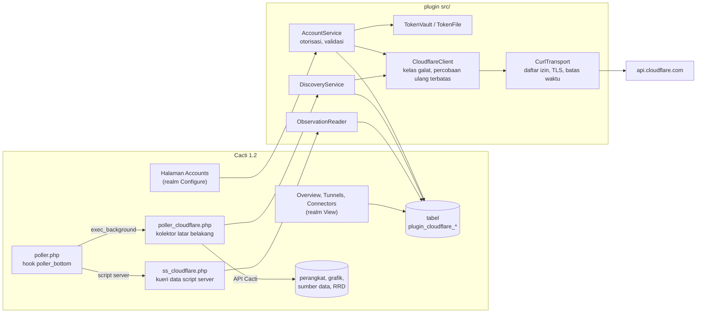

<!-- Source: README.md; SHA256: 813d1c85c236b426b83e42e63c69496f33f8909b5e435d0d45efa6a4ba2f17ca -->

<!-- translations:start -->
[English](../../../README.md) | [简体中文](../zh-CN/README.md) | [हिन्दी](../hi-IN/README.md) | [Español (España)](../es-ES/README.md) | [Español (Latinoamérica)](../es-419/README.md) | [العربية (السعودية)](../ar-SA/README.md) | [Afrikaans](../af-ZA/README.md) | [አማርኛ](../am-ET/README.md) | [العربية (مصر)](../ar-EG/README.md) | [العربية (المغرب)](../ar-MA/README.md) | [বাংলা](../bn-BD/README.md) | [Bosanski](../bs-BA/README.md) | [Deutsch](../de-DE/README.md) | [فارسی](../fa-IR/README.md) | [Filipino](../fil-PH/README.md) | [Français](../fr-FR/README.md) | [Français (Maroc)](../fr-MA/README.md) | [Français (Sénégal)](../fr-SN/README.md) | [Hausa](../ha-NG/README.md) | [עברית](../he-IL/README.md) | [Hrvatski](../hr-HR/README.md) | [Bahasa Indonesia](README.md) | [Igbo](../ig-NG/README.md) | [Italiano](../it-IT/README.md) | [日本語](../ja-JP/README.md) | [한국어](../ko-KR/README.md) | [Malagasy](../mg-MG/README.md) | [मराठी](../mr-IN/README.md) | [Bahasa Melayu](../ms-MY/README.md) | [Nederlands](../nl-NL/README.md) | [Polski](../pl-PL/README.md) | [Português (Brasil)](../pt-BR/README.md) | [Русский](../ru-RU/README.md) | [Kinyarwanda](../rw-RW/README.md) | [Soomaali](../so-SO/README.md) | [Српски](../sr-RS/README.md) | [Svenska](../sv-SE/README.md) | [Kiswahili](../sw-KE/README.md) | [தமிழ்](../ta-IN/README.md) | [తెలుగు](../te-IN/README.md) | [ไทย](../th-TH/README.md) | [Türkçe](../tr-TR/README.md) | [Українська](../uk-UA/README.md) | [اردو](../ur-PK/README.md) | [Tiếng Việt](../vi-VN/README.md) | [isiXhosa](../xh-ZA/README.md) | [Yorùbá](../yo-NG/README.md) | [繁體中文](../zh-TW/README.md) | [isiZulu](../zu-ZA/README.md)
<!-- translations:end -->

<p align="center">
  
</p>

# Plugin Cloudflare untuk Cacti

[](https://github.com/somethingwithproof/plugin_cloudflare/actions/workflows/ci.yml)
[](https://sonarcloud.io/summary/new_code?id=somethingwithproof_plugin_cloudflare)
[](../../../LICENSE)


[](https://sonarcloud.io/summary/new_code?id=somethingwithproof_plugin_cloudflare)
[](https://sonarcloud.io/summary/new_code?id=somethingwithproof_plugin_cloudflare)
[](https://sonarcloud.io/summary/new_code?id=somethingwithproof_plugin_cloudflare)


Plugin Cacti 1.2 yang sedang dibangun untuk memantau Cloudflare Tunnels dan
analitik zona. Plugin ini membaca dari API Cloudflare menggunakan token API
terbatas ruang lingkup (*scoped*), tidak pernah mengubah apa pun di Cloudflare,
dan menyimpan datanya di dalam tabelnya sendiri. Di Cacti, plugin ini menyalin
berkas XML kueri data ke `resource/script_server/` serta membuat perangkat,
grafik, dan templat melalui API Cacti sendiri, tanpa perubahan pada berkas inti.

**Status: 0.4.0-dev, belum dirilis.** Versi rilis terakhir adalah 0.3.0. Versi pengembangan menambahkan ekspor inventaris CSV, penghentian eksplisit untuk tunnel yang dihapus, analitik zona yang di-cache, klien GraphQL Analytics hanya-baca berdaftar izin (`GraphqlAnalyticsClient`) dengan pembantu ringkasan siap-Thold (`AnalyticsSummary`), CLI Configuration-as-Code (`cli/cloudflare.php`), hook ekosistem (`abilities_register`, `doctor_register_checks`, `casc_register_providers`), serta dukungan kolektor jarak jauh tercakup-poller (`replicate_out`). Kualifikasi penyedia langsung dan penerapan masih tertunda.

Tabel di bawah ini menjelaskan rilis stabil 0.3.0. Penambahan pada versi pengembangan di 0.4.0-dev dijelaskan di bagian alur kerja Operator dan analitik zona di bawah ini.

| Tersedia saat ini | Direncanakan |
|---|---|
| Instalasi, peningkatan, penonaktifan, dan penghapusan instalasi melalui pengelola plugin Cacti | Kualifikasi GraphQL akun langsung dan penerapan (keluarnya Milestone 4) |
| Izin Cloudflare: View, Operator, dan Configure | Injeksi kesalahan, model TLA+, dan dokumentasi lengkap (Milestone 5) |
| Menambah, menyunting, menghapus, mengaktifkan, dan menonaktifkan akun Cloudflare | |
| Menyimpan token dalam berkas atau terenkripsi di basis data Cacti | |
| Memverifikasi token dan memeriksa izin baca tunnel serta zona | |
| Penemuan tunnel dan konektor pada kolektor latar belakang (`poller_cloudflare.php`) | |
| Halaman Overview, Tunnels, dan Connectors di bawah Management > Cloudflare Tunnels | |
| Pelacakan siklus hidup: `active`, `unavailable`, dan `deleted` | |
| Satu perangkat Cacti per akun, dibuat oleh administrator, dengan tunnel sebagai indeks kueri data | |
| Grafik Connectors, Health, dan Collection per tunnel, digambar dari satu berkas RRD per tunnel | |
| Nilai yang tidak dapat dipastikan oleh plugin disimpan sebagai unknown (`U`), tidak pernah sebagai 0 | |

## Peran akses

| Realm | Akses |
| --- | --- |
| Cloudflare: View | Halaman pemantauan yang ada. |
| Cloudflare: Operator | Pemantauan ditambah halaman Operations dan pengakuan triase pribadi. |
| Cloudflare: Configure | Akses Operator ditambah tindakan konfigurasi dan administratif yang ada. |

Setelah menyalin berkas peningkatan, buka halaman Plugins sebagai administrator untuk mendaftarkan
realm baru. Tetapkan realm Operator secara eksplisit di bawah **Configuration > Users** atau grup pengguna.
Peningkatan mempertahankan ID realm serta izin View dan Admin yang sudah ada. Akses Admin
mewarisi akses Operator, dan akses Operator mewarisi akses View pada setiap permintaan;
hal ini tidak menambahkan izin tersimpan ke pengguna atau grup. Pengaturan plugin juga memerlukan
akses Cloudflare: Configure selain izin Settings Cacti.

Visibilitas akun Cloudflare sesuai dengan realm View yang sudah ada; cakupannya berlaku untuk seluruh akun.
Kredensial, konfigurasi, pemetaan, penghapusan, dan perubahan administratif lainnya
tetap berada di halaman administratif. Pengakuan hanya bertahan dalam sesi
pengguna saat ini, maksimal selama satu jam dan hanya selama pengamatan yang sama tetap
segar. Pengamatan baru atau yang berubah akan membatalkannya. Pengakuan tidak pernah menandai pengukuran
yang gagal sebagai sehat ataupun menekan peringatan.

## Mengapa plugin ini dibuat

Operator Cacti yang menerbitkan layanan melalui Cloudflare Tunnel tidak memiliki visibilitas
terhadap tunnel tersebut di dalam Cacti. Sebuah tunnel dapat kehilangan seluruh konektornya sementara
host asal masih merespons SNMP, sehingga grafik yang ada tetap hijau sementara
pengguna mengalami galat. Tujuan plugin ini adalah menempatkan kesehatan tunnel dan lalu lintas
zona di samping grafik perangkat yang sudah dipantau operator, tanpa memberi
Cacti kemampuan apa pun untuk mengubah Cloudflare.

Tiga batasan membentuk rancangan ini:

- **Hanya-baca.** Plugin ini hanya memanggil titik akhir `GET` dan GraphQL
  Analytics API. Plugin ini tidak memerlukan izin sunting pada sumber daya Cloudflare mana pun.
- **Opsional.** Gangguan Cloudflare, token kedaluwarsa, dan pembatasan laju tidak boleh
  memperlambat UI Cacti atau menghambat *polling* perangkat lain. Semua panggilan API memiliki
  batas waktu ketat, dan pengumpulan data berjalan dalam proses latar belakang yang diluncurkan oleh
  poller.
- **Tanpa perubahan inti.** Plugin ini menggunakan *hook* plugin Cacti 1.2 dan
  tabelnya sendiri. Plugin ini menyalin satu XML kueri data ke `resource/script_server/` dan
  membuat perangkat, grafik, dan templat melalui API Cacti sendiri. Tidak ada perubahan
  berkas inti, sehingga peningkatan Cacti dan plugin lain tidak terpengaruh.

## Cara kerjanya



- **Perekat Cacti** (`setup.php`, `includes/`, skrip halaman) mendaftarkan
  *hook* dan realm, merender halaman dengan *helper* Cacti sendiri, dan mendelegasikan
  setiap tindakan ke pustaka di `src/`.
- **Pustaka** (`src/`, namespace `Somethingwithproof\Cloudflare\`) tidak memiliki
  ketergantungan pada variabel global Cacti, sehingga diuji terhadap basis data nyata dan
  transpor HTTP tiruan tanpa menjalankan Cacti.
- **Satu jalur keluar.** `CurlTransport` adalah satu-satunya kode yang menyentuh
  jaringan, dan hanya menerima `https://api.cloudflare.com`. Setiap kegagalan
  dipetakan ke satu kelas galat (`auth`, `permission`, `rate_limited`,
  `transient`, ...), yang menentukan status yang ditampilkan di UI.
- **Penyimpanan** melalui koneksi PDO Cacti sendiri dengan *prepared
  statements*. Perubahan skema merupakan migrasi bernomor dan idempoten.

Keputusan rancangan beserta alasannya tersedia di
[docs/design.md](../../design.md).

## Tangkapan layar

Tangkapan layar ini berasal dari *stack* pengujian, bukan akun Cloudflare langsung. *Stack*
tersebut menjalankan Cacti 1.2.31 terhadap API Cloudflare tiruan yang mengembalikan data
*fixture*, sehingga akun, ID akun, dan ketiga tunnel tersebut merupakan contoh pengganti.


*Daftar Cloudflare Accounts. API tiruan menerima token, sehingga Verify
melaporkan `ok`.*


*Menyunting akun. Kolom token selalu kosong; token yang tersimpan tidak pernah
dikirim kembali ke peramban. Collect Tunnels dan Create Graphs aktif serta
Collect Analytics nonaktif. Connection Status menampilkan hasil Verify
terakhir: `ok`, izin baca tunnel diberikan dan izin baca zona tidak ada.*


*Settings > Cloudflare.*


*Management > Cloudflare Tunnels > Overview. Statusnya adalah status Cloudflare
terburuk di antara tunnel aktif milik akun tersebut, di sini `down` karena satu tunnel
fixture sedang mati. `Disabled`, `Not collected`, `Collection failing`, dan `Not yet
collected` lebih diutamakan daripada kesehatan tunnel, sesuai urutan tersebut, sehingga akun
yang proses terakhirnya gagal menampilkan `Collection failing` apa pun laporan tunnelnya.*


*Tab Tunnels. Connectors dan Connections menampilkan `-` untuk old-office, karena
API tiruan menjawab permintaan koneksinya sebagai tunnel tidak dikenal dan tidak ada yang
disimpan, serta 0 untuk staging, yang tidak memiliki konektor yang berjalan.*


*Grafik Connectors dari tunnel blog. Ketiga garis bernilai 1 sebelum dan
sesudah jeda di bagian tengah, saat API tiruan mengembalikan galat dan plugin
menyimpan nilai unknown. Garis tidak turun ke 0. Grafik berasal dari
stack fixture yang sama (`make screenshots`), yang menetapkan langkah 30 detik pada satu
sumber data ini agar tujuh menit polling memenuhi grafik.*

## Persyaratan

- Cacti 1.2.25 hingga 1.2.31. Cacti 1.2.31 sendiri memerlukan PHP 8.0 atau versi yang lebih baru.
  CI hanya menguji 1.2.31; 1.2.25 terakhir kali diuji secara manual pada 2026-10-22.
- PHP 7.4 hingga 8.4 dengan ekstensi `curl`, `openssl`, dan `pdo_mysql`.
  Plugin menolak untuk diaktifkan tanpa ekstensi tersebut.
- MariaDB 10.6 atau versi yang lebih baru, atau MySQL 8.0 atau versi yang lebih baru.
- Akses HTTPS dari server Cacti ke `api.cloudflare.com`. Proksi tidak
  didukung.

Lihat [docs/compatibility.md](../../compatibility.md) untuk daftar konfigurasi yang diuji.

## Instalasi

1. Letakkan plugin di direktori `plugins/cloudflare` milik Cacti, baik dengan
   mengekstrak arsip dari
   [GitHub Releases](https://github.com/somethingwithproof/plugin_cloudflare/releases)
   (`make package` yang dijalankan pada checkout tag rilis akan menghasilkan
   arsip yang sama) maupun dengan git
   clone. Direktori tersebut harus bernama `cloudflare`.
2. Pasang dan aktifkan plugin melalui Console > Configuration > Plugins, atau melalui
   CLI sebagai pengguna web server:

   ```sh
   php cli/plugin_manage.php --plugin=cloudflare --install --enable
   ```

3. Pengguna admin memperoleh izin Cloudflare: Configure saat pemasangan. Berikan
   izin tersebut kepada pengguna atau grup lain di Console > Configuration > Users.
4. Buat token dengan izin sesuai
   [docs/token-permissions.md](../../token-permissions.md). Secara ringkas:
   Account > Cloudflare Tunnel > Read, dan secara opsional Zone > Zone > Read.
5. Simpan token menggunakan salah satu dari dua cara di bawah ini, lalu tambahkan akun di
   Console > Configuration > Cloudflare Accounts dan jalankan Verify dari
   menu tindakan.

### Opsi A: terenkripsi di dalam basis data

Plugin mengenkripsi token menggunakan kunci 32-byte yang Anda buat sendiri. Plugin tidak
pernah membuat atau menulis kunci tersebut secara otomatis. Berkas kunci harus dapat dibaca oleh pengguna
web server dan poller, tidak boleh dapat dibaca oleh pengguna lain, dan direktorinya
harus mengizinkan kedua pengguna tersebut untuk mengaksesnya. Untuk web server yang berjalan sebagai `www-data`:

```sh
sudo mkdir -p /etc/cacti
sudo sh -c 'umask 077 && openssl rand -hex 32 > /etc/cacti/cloudflare.key'
sudo chgrp www-data /etc/cacti/cloudflare.key
sudo chmod 0440 /etc/cacti/cloudflare.key
```

Jalur bawaannya adalah `/etc/cacti/cloudflare.key`; ubah pengaturan ini di Settings >
Cloudflare > Token Vault Key File. Apabila kunci tidak ditemukan atau ditolak,
formulir penyuntingan hanya menyediakan opsi berkas token. Simpan cadangan kunci tersebut:
tanpanya, token yang tersimpan tidak dapat didekripsi dan harus dimasukkan kembali.

#### Merotasi kunci

Tidak tersedia perintah untuk mengganti kunci enkripsi secara langsung. Kunci baru tidak dapat mendekripsi token yang disimpan dengan
kunci lama, sehingga rotasi kunci mengharuskan Anda memasukkan kembali setiap token yang tersimpan:

1. Siapkan nilai token untuk setiap akun. Cloudflare hanya menampilkan nilai token
   saat token dibuat atau diganti, jadi lakukan roll token di dasbor
   Cloudflare apabila Anda tidak lagi menyimpannya.
2. Buat kunci baru di jalur baru menggunakan perintah di atas, misalnya
   `/etc/cacti/cloudflare.key.new`, dengan pemilik dan izin akses yang sama.
3. Atur Settings > Cloudflare > Token Vault Key File ke jalur baru lalu simpan.
   Mulai saat ini, tindakan Verify pada akun yang masih terenkripsi dengan kunci lama
   akan melaporkan "Stored token cannot be decrypted", dan setiap eksekusi kolektor mencatat
   `discovery token unavailable` dengan `reason=decrypt_failed` untuk akun tersebut.
4. Untuk setiap akun yang menyimpan tokennya di basis data, buka akun tersebut di
   Console > Configuration > Cloudflare Accounts, tempelkan token ke kedua
   kolom token, simpan, dan jalankan Verify. Status yang dilaporkan harus `ok`.
5. Setelah seluruh akun tersebut berhasil diverifikasi, hapus berkas kunci lama beserta
   cadangannya.

Di antara langkah 3 dan 4, tunnel milik akun tidak diperbarui dan grafik
health, connector, serta connection mencatat nilai U. Akun yang menggunakan berkas token
tidak terpengaruh.

### Opsi B: berkas token

Tulis token, dan tidak ada teks lain, ke dalam sebuah berkas yang dapat dibaca oleh pengguna web server dan poller
namun tidak dapat dibaca oleh pengguna lain, lalu masukkan jalur absolutnya pada formulir penyuntingan:

```sh
sudo sh -c 'umask 077 && cat > /etc/cacti/cloudflare-account.token'   # paste the token, then Ctrl-D
sudo chgrp www-data /etc/cacti/cloudflare-account.token
sudo chmod 0440 /etc/cacti/cloudflare-account.token
```

Berkas diperiksa saat dibaca, yakni ketika Verify dijalankan, bukan saat Anda menyimpan. Tautan
simbolik, berkas berukuran lebih dari 4 KiB, serta berkas yang dapat dibaca atau ditulis oleh pengguna lain
akan ditolak.

Siapa pun yang memiliki izin Cloudflare: Configure dapat memasukkan jalur mana saja, dan pengguna poller
akan membacanya. Untuk menjaga berkas token tetap berada di satu tempat, atur Settings > Cloudflare >
Token File Directory, misalnya ke `/etc/cacti`; jalur di luar direktori tersebut akan
ditolak. Lihat [docs/security.md](../../security.md#token-file).

## Pembaruan

1. Ganti berkas di dalam `plugins/cloudflare` dengan rilis baru, sambil tetap
   mempertahankan nama direktorinya.
2. Buka Console > Configuration > Plugins, atau Console > Configuration >
   Cloudflare Accounts, satu kali sebagai admin. Tindakan tersebut menjalankan migrasi plugin,
   mengimpor templat Cloudflare, menyalin berkas data query (lihat
   [Metrik dan grafik tunnel](#tunnel-metrics-and-graphs)), mendaftarkan hook ekosistem
   `abilities_register`, `doctor_register_checks`, `casc_register_providers`,
   dan `replicate_out` (`includes/ecosystem.php`), serta pada
   pembaruan dari versi 0.1.0, mendaftarkan hook `poller_bottom`.

`poller.php` tidak menjalankan pembaruan plugin, sehingga sebelum langkah 2
skema baru belum tersedia. Setiap eksekusi kolektor tidak akan melakukan apa pun dan mencatat log
`CLOUDFLARE: collector skipped; plugin upgrade pending, open Console > Plugins`.
Halaman Cloudflare Tunnels hanya memerlukan izin Cloudflare: View sehingga tidak pernah menjalankan
pembaruan, dan sebelum langkah 2 halaman tersebut dapat menampilkan pesan "The Cloudflare tunnels could not
be read".

## Status akun

Verify menetapkan status akun sebagai berikut:

| Status | Arti |
|---|---|
| `unknown` | Belum diverifikasi sejak akun ditambahkan atau kredensialnya diubah |
| `ok` | Token aktif dan dapat membaca tunnel |
| `token_inactive` | Cloudflare melaporkan bahwa token dinonaktifkan atau kedaluwarsa |
| `auth_failed` | Cloudflare menolak token karena tidak valid atau kedaluwarsa (HTTP 401) |
| `permission_denied` | Token aktif tetapi tidak dapat membaca tunnel, atau tidak memiliki izin untuk memanggil endpoint verifikasi token (HTTP 403) |
| `unreachable` | API tidak dapat dijangkau, kehabisan waktu tunggu, atau mengembalikan galat server |
| `rate_limited` | Cloudflare mengembalikan HTTP 429 |
| `error` | Kegagalan lainnya, termasuk berkas token yang tidak ada atau tidak aman, berkas kunci brankas token yang tidak ada atau tidak dapat digunakan, atau token tersimpan yang tidak dapat didekripsi |

Halaman penyuntingan juga menampilkan apakah izin baca tunnel dan izin baca zona telah diberikan.

## Penemuan tunnel

Setelah setiap siklus polling pada poller kolektor yang dikonfigurasi (`cloudflare_poller_id`, default `1`), hook `poller_bottom` menjalankan
kolektor di latar belakang menggunakan `exec_background` apabila setidaknya satu akun yang
aktif mengaktifkan Collect Tunnels. Kolektor tidak pernah berjalan di dalam proses
poller, sehingga API Cloudflare yang lambat tidak akan menunda `poller.php`. `INFO` mendeklarasikan
`remote_collect:1`, dan hook `replicate_out` (`RemoteReplication`) mengirimkan
tabel metadata non-rahasia (`plugin_cloudflare_accounts` dengan `token_ciphertext`
dikosongkan menjadi `NULL`, `plugin_cloudflare_tunnels`, `plugin_cloudflare_connectors`,
`plugin_cloudflare_zones`, `plugin_cloudflare_metric_mappings`, dan
`plugin_cloudflare_resources`) ke poller jarak jauh (`poller_id > 1`) sambil
mengecualikan materi kunci vault.

Untuk setiap akun yang telah jatuh tempo, kolektor mengambil daftar tunnel akun tersebut, lalu
membaca koneksi dari tunnel yang aktif, yang menghasilkan informasi konektor setiap
tunnel, versinya, pusat data, dan alamat origin. Akun
jatuh tempo setiap Discovery Interval (bawaan 300 detik). Satu eksekusi tidak memulai akun baru
setelah 50 detik dan melakukan paling banyak 200 permintaan koneksi. Kedua
batas tersebut juga dapat menghentikan pemrosesan akun di tengah pembacaan koneksinya; akun
tersebut dicatat sebagai `partial`, dan eksekusi berikutnya melanjutkan dari tunnel yang paling lama tidak
dicoba. Akun yang belum dimulai tetap berstatus jatuh tempo untuk eksekusi berikutnya.

Sebuah tunnel memiliki siklus hidup yang dipisahkan dari status yang dilaporkan Cloudflare
(`healthy`, `degraded`, `down`, atau `inactive`):

| Siklus hidup | Arti |
|---|---|
| `active` | Tunnel terdapat dalam daftar lengkap terakhir |
| `deleted` | Daftar lengkap tidak menyertakannya, termasuk daftar kosong. Baris dan riwayatnya tetap disimpan, dan tunnel kembali menjadi `active` apabila muncul lagi |
| `unavailable` | Tiga gangguan terhitung tanpa adanya daftar lengkap di antaranya membuat status tunnel tidak diketahui |

Hanya pengambilan daftar yang lengkap dan berhasil yang dapat menambah, memperbarui, atau menghapus tunnel, dan
pengambilan daftar yang gagal tidak pernah menghapus tunnel. Kegagalan membaca Cloudflare secara keseluruhan
(`transient`, `rate_limited`, `auth`, atau `permission`) dihitung sebagai gangguan;
setelah tiga gangguan terhitung tanpa adanya daftar lengkap di antaranya, tunnel
aktif milik akun menjadi `unavailable`. Pengambilan daftar lengkap berikutnya
akan memulihkannya dan mengatur ulang penghitung. Tunnel yang tidak lagi dikenali Cloudflare
saat koneksinya dibaca akan dilewati tanpa menggagalkan akun. Kegagalan
lain tidak menambah maupun mengatur ulang penghitung gangguan.

Di dalam `cacti.log`, baris penemuan diawali dengan `CLOUDFLARE: discovery` dan ringkasan
eksekusi diawali dengan `CLOUDFLARE: collector`. Kegagalan dan perubahan siklus hidup, seperti
pengambilan daftar yang gagal atau tunnel yang ditandai `unavailable`, dicatat pada tingkat bawaan Cacti
`LOW`; hasil setiap akun dan ringkasan eksekusi dicatat pada tingkat
`MEDIUM`. Pembacaan koneksi dapat gagal pada setiap tunnel, sehingga untuk setiap akun hanya
kegagalan pertama dari masing-masing kelas galat yang dicatat pada tingkat `LOW`, sisanya pada
tingkat `MEDIUM`, diikuti oleh satu baris `LOW` per kelas berisi jumlah tunnel yang
gagal.

Management > Cloudflare Tunnels memerlukan izin Cloudflare: View dan bersifat
hanya-baca:

- **Overview** menampilkan daftar setiap akun beserta statusnya, jumlah tunnel berdasarkan siklus hidup,
  penemuan terakhir yang berhasil, dan jumlah kegagalan berturut-turut.
- **Tunnels** menampilkan daftar tunnel lintas akun atau untuk satu akun, dengan filter
  akun, siklus hidup, status, dan nama, serta kolom yang dapat diurutkan.
- **Connectors** menampilkan konektor dari tunnel yang dipilih pada tab Tunnels.

<a name="tunnel-metrics-and-graphs"></a>

## Metrik dan grafik tunnel

Cacti membaca kondisi tunnel melalui data query script server,
`ss_cloudflare.php`. Skrip ini hanya menjawab dari tabel milik plugin dan tidak pernah memanggil
Cloudflare, sehingga gangguan Cloudflare tidak dapat memperlambat poller. Setiap tunnel menghasilkan
enam nilai: kesehatan (healthy 3, degraded 2, down 1, inactive 0), konektor,
koneksi, versi konektor, jumlah detik sejak koneksinya terakhir
dibaca, dan jumlah kegagalan berturut-turut tugas penemuan. Nilai kesehatan, konektor,
koneksi, dan versi hanya dicetak apabila plugin dapat menjamin keakuratannya,
yang berarti penemuan terakhir berhasil, tunnel berstatus `active`, dan
pembacaannya masih baru. Jika tidak, nilainya adalah `U`, dan grafik akan menampilkan celah alih-alih
angka nol yang dapat terlihat seperti gangguan. Kedua nilai pengumpulan tetap
dicetak selama gangguan, sehingga grafik Collection menampilkannya; keduanya bernilai `U` hanya
untuk tunnel yang dihapus atau tunnel yang koneksinya belum pernah diperbarui. Aturannya
tercantum di [docs/metrics.md](../../metrics.md).

### Membuat perangkat

Satu akun dipetakan ke paling banyak satu perangkat Cacti. Perangkat tersebut menampung tunnel
milik akun sebagai indeks dari data query Cloudflare Tunnels. Tidak ada proses yang membuatnya
secara otomatis:

1. Buka Console > Configuration > Cloudflare Accounts.
2. Pilih akun, pilih Create Cacti Device dari menu tindakan, lalu
   konfirmasi.

Tindakan ini memerlukan realm Cloudflare: Configure dan realm
Sites/Devices/Data milik Cacti (realm untuk `host.php`). Entri menu hanya muncul
bagi pengguna yang memiliki kedua izin tersebut, dan server menolak permintaan dari pihak lain.
Perangkat diberi nama `Cloudflare: <account name>`, menggunakan templat host Cloudflare Account
dan poller utama, memiliki versi SNMP 0 tanpa pemeriksaan ketersediaan,
serta mendapatkan nama host `<account ID>.cloudflare.invalid`. Nama tersebut
dicadangkan dan tidak pernah diresolusi; Cacti tidak terhubung ke sana. Apabila akun
sudah memiliki perangkat, tindakan ini akan memberi tahu hal tersebut dan tidak mengubah apa pun. Apabila
administrator menghapus perangkat di Cacti, plugin tidak akan membuat perangkat baru
sampai Create Cacti Device dijalankan kembali.

### Membuat grafik

Opsi Create Graphs pada formulir akun tidak aktif secara bawaan. Saat diaktifkan, setiap kali
penemuan akun berakhir dengan status `ok` atau `partial`, kolektor mengindeks ulang
perangkat dan membuat grafik yang belum ada untuk tunnel berstatus `active` milik akun tersebut:
Connectors, Health, dan Collection, masing-masing tiga grafik per tunnel. Ketiga grafik milik satu tunnel
berbagi satu berkas RRD. Satu eksekusi membuat paling banyak 50 grafik dan berhenti setelah 20
detik, lalu eksekusi berikutnya melanjutkannya. Plugin tidak pernah menghapus objek Cacti.
Grafik yang dihapus oleh administrator tidak dibuat kembali, dan tunnel yang
tidak lagi tercantum di Cloudflare tetap menyimpan grafik dan berkas RRD-nya dengan nilai `U`.

Mengaktifkan Create Graphs memerlukan kedua realm tersebut. Menonaktifkannya hanya memerlukan
izin Configure. Pengguna tanpa realm Sites/Devices/Data yang menyimpan formulir
akan membiarkan pengaturan tetap seperti semula, disertai peringatan. Saat Create Graphs nonaktif,
perangkat tetap diindeks ulang setelah setiap penemuan, sehingga tunnel baru muncul sebagai
indeks pada data query.

### Berkas data query

Cacti 1.2.31 hanya membaca berkas XML data query dari dalam direktori `resource`
miliknya. Oleh karena itu, saat pemasangan dan pembaruan, plugin menyalin satu berkas,
`templates/resource/cloudflare_tunnels.xml`, ke
`<Cacti>/resource/script_server/cloudflare_tunnels.xml`. Berkas ini adalah satu-satunya berkas
yang ditulis oleh plugin di luar direktorinya sendiri, sehingga pengguna yang memasang atau
memperbarui plugin harus memiliki izin tulis ke direktori tersebut.
Pencopotan plugin tetap mempertahankan berkas ini, beserta perangkat, grafik, berkas RRD, dan
templat. Apabila penyalinan atau pengimporan templat gagal, plugin mencatatnya di log dan
Create Cacti Device akan mencobanya kembali.

## Pengaturan

Settings > Cloudflare berisi:

- **Token Vault Key File**: jalur ke kunci brankas (*vault key*).
- **Token File Directory**: jika diatur, berkas token di luar direktori tersebut akan ditolak. Kosong secara default, yang mengizinkan jalur mana pun. Lihat [docs/security.md](../../security.md#token-file).
- **Interactive Request Timeout**: total detik untuk permintaan yang dibuat dari antarmuka web, seperti Verify. Default 10; nilai di luar rentang 5 hingga 60 akan kembali ke 10.
- **Collector Request Timeout**: total detik untuk permintaan yang dibuat oleh pengumpul latar belakang (*background collector*). Default 20; nilai di luar rentang 5 hingga 60 akan kembali ke 20.
- **Log Level**: tersimpan. Belum ada komponen yang membacanya.

Pada formulir akun, Collect Tunnels dan Discovery Interval mengontrol penemuan (*discovery*), dan Create Graphs mengontrol pembuatan grafik. Collect Analytics tersimpan dan tidak berpengaruh pada rilis ini.

## Bahasa

Plugin ini menyertakan terjemahan ke dalam bahasa Spanyol (Spanyol, `es-ES`), Prancis (`fr-FR`), Jerman (`de-DE`), Tionghoa Sederhana (`zh-CN`), Hindi (`hi-IN`), Arab (`ar-SA`), dan Jepang (`ja-JP`). Cacti menampilkannya setelah dukungan bahasa diaktifkan (Configuration > Settings > General > Language Support) dan pengguna memilih bahasa tersebut. Katalog bahasa Spanyol Amerika Latin (`es-419`) juga disertakan, tetapi Cacti 1.2 belum memiliki lokal bahasa Spanyol Amerika Latin untuk dipilih, sehingga katalog tersebut baru berlaku ketika Cacti menambahkannya; hingga saat itu, pilih bahasa Spanyol (`es-ES`).

Beberapa teks tetap dalam bahasa Inggris: nilai status yang disimpan dan ditampilkan apa adanya oleh plugin (`ok`, `active`, `unavailable`, `deleted`, serta status tunnel yang dilaporkan Cloudflare), dan segala hal yang ditulis plugin ke log Cacti.

## Penghapusan instalasi dan retensi data

Penghapusan instalasi menghapus tabel milik plugin sendiri, yang menyimpan akun, token terenkripsi, tunnel yang ditemukan, status pekerjaan (*job state*), dan catatan objek Cacti mana yang dibuat oleh plugin, serta menghapus pengaturan `cloudflare_` miliknya. Penghapusan instalasi tidak menghapus berkas kunci, berkas token, salinan `resource/script_server/cloudflare_tunnels.xml`, maupun perangkat, grafik, sumber data (*data source*), berkas RRD, atau templat Cacti apa pun. Objek-objek tersebut menyimpan data pemantauan historis, dan penghapusannya merupakan tindakan eksplisit administrator di Cacti.

Perangkat yang dipertahankan akan berhenti menerima data. Setelah penghapusan instalasi, atau setelah akunnya dihapus, tidak ada akun yang memiliki host tersebut, sehingga grafiknya tetap menyimpan riwayatnya tetapi mencetak `U` sejak saat itu. Create Cacti Device pada akun yang diinstal ulang atau ditambahkan kembali akan membuat perangkat baru; fitur ini tidak menggunakan kembali perangkat lama, jadi hapus perangkat lama di Cacti setelah riwayatnya tidak lagi diperlukan.

## Keterbatasan yang diketahui

- Satu kali eksekusi melakukan paling banyak 200 permintaan koneksi. Tunnel yang melampaui batas tersebut diperbarui lebih jarang daripada jendela pengamatan, sehingga grafik koneksinya menampilkan celah (*gap*).
- Plugin akan menimpa suntingan administrator pada templat yang diimpor apabila pemutakhiran mengubah XML templat bawaan.
- Poller jarak jauh menerima metadata tereplikasi tanpa kredensial (`token_ciphertext` dikosongkan menjadi `NULL` dan kunci vault tidak pernah direplikasi). Saat menjalankan kolektor pada poller jarak jauh yang ditunjuk (`cloudflare_poller_id`), sediakan berkas token atau kunci vault secara langsung di host kolektor tersebut.
- Tunnel yang dihapus tetap berada di indeks kueri data dan mencetak `U` hingga administrator menghentikannya (*retire*) secara eksplisit. Penghentian (*retirement*) hanya menghapus grafik yang dicatat plugin dan sumber data yang tidak dibagikan melalui Cacti; baris inventaris tetap terlihat. Cacti mengontrol pembersihan RRD.
- Cacti menonaktifkan plugin yang kodenya berakhir dengan kesalahan fatal (*fatal error*) sejati, seperti kehabisan memori. Lihat [docs/security.md](../../security.md).

## Keamanan

- Global API Keys ditolak; hanya token API dengan cakupan terbatas (*scoped API tokens*) yang diterima.
- Token disimpan dalam berkas yang Anda sediakan atau dienkripsi dengan AES-256-GCM menggunakan berkas kunci yang tidak pernah masuk ke basis data. Token tidak pernah ditampilkan di halaman, ditulis ke log, atau disertakan dalam pesan kesalahan.
- Kesalahan basis data hanya memuat SQLSTATE dan kode kesalahan driver, tidak pernah menyertakan nilai pernyataan (*statement values*).
- Setiap perubahan berupa POST yang dilindungi oleh token CSRF Cacti. Perubahan akun administratif dan konfigurasi memerlukan izin Cloudflare: Configure; pengakuan triase pribadi memerlukan Cloudflare: Operator. Membuat perangkat Cacti atau mengaktifkan Create Graphs juga memerlukan izin Sites/Devices/Data Cacti. Plugin yang dinonaktifkan menolak akses ke halaman-halamannya.
- Configuration-as-Code (`cli/cloudflare.php` dan `casc_register_providers`) hanya menerima referensi rahasia `vault:<account_id>` atau `file:<absolute_path>`, menolak token mentah, ciphertext vault, dan deklarasi XML `DOCTYPE`, serta mewajibkan `--confirm=<PLAN_HASH>` yang persis sebelum menulis.
- Kemampuan terdaftar (`cloudflare-list-tunnels`, `cloudflare-get-health`) sepenuhnya hanya-baca, mengevaluasi ranah Cloudflare: View secara langsung terhadap tabel autentikasi Cacti untuk ID pengguna pemanggil (tidak pernah menggunakan status sesi), dan tidak mengembalikan token maupun materi kunci.

Rincian dan keterbatasan yang diketahui terdapat di [docs/security.md](../../security.md).
Laporkan kerentanan secara privat sebagaimana dijelaskan dalam [SECURITY.md](../../../SECURITY.md).

## Alur kerja operator dan analitik zona

Penambahan pengembangan di `0.4.0-dev` mencakup penghentian eksplisit atas tunnel yang dihapus, analitik zona dan tunnel GraphQL berbasis kapabilitas (*capability-aware*), pembantu ringkasan siap-Thold serta templat yang dapat diimpor, CLI CasC dan kesehatan, hook ekosistem, serta replikasi kolektor jarak jauh. Penambahan ini belum memiliki tag rilis atau kualifikasi akun langsung (*live-account qualification*). Lihat [docs/analytics-and-alerting.md](../../analytics-and-alerting.md) untuk penyiapan, semantik metrik, dan batasan verifikasi.

- **Klien GraphQL Analytics dan ringkasan Thold (`src/Api/GraphqlAnalyticsClient.php`, `src/Metrics/AnalyticsSummary.php`)**: `GraphqlAnalyticsClient` hanya mengeksekusi kueri hanya-baca yang masuk daftar izin waktu kompilasi (`zone_settings`, `zone_http_metrics`, `zone_edge_latency`, `tunnel_analytics`) melalui `CloudflareClient` (TLS terverifikasi, tersemat ke `api.cloudflare.com`, respons terbatas, dan penundaan batas laju `RetryPolicy`) untuk mengumpulkan volume permintaan zona dan tunnel, tingkat galat HTTP 5xx, byte respons, dan latensi tepi (rata-rata dan p95). `AnalyticsSummary` menyediakan `recommendedThresholds()` yang diselaraskan dengan nama DS RRD plugin (`health`, `collect_age`, `error_pct`, `age`), `summarizeZones()`, dan `evaluateSample()`.
- **CLI Operator dan CasC (`cli/cloudflare.php`)**: didukung oleh `ConfigCodec` (`src/Config/ConfigCodec.php`) dan `ConfigService` (`src/Config/ConfigService.php`), yang mendukung `cli/cloudflare.php export [--format=yaml|xml] [--file=PATH]` (hanya mengeluarkan referensi rahasia `vault:` / `file:`), `cli/cloudflare.php validate --file=PATH [--format=yaml|xml]`, `cli/cloudflare.php plan --file=PATH [--format=yaml|xml]`, `cli/cloudflare.php apply --file=PATH --confirm=<PLAN_HASH> [--format=yaml|xml]`, dan `cli/cloudflare.php health [--format=text|json]`.
- **Hook integrasi ekosistem (`includes/ecosystem.php`, `setup.php`)**:
  - `abilities_register` (`AbilitiesProvider`): mendaftarkan `cloudflare-list-tunnels` dan `cloudflare-get-health` hanya-baca yang dibatasi pada ranah Cloudflare: View (izin langsung dan grup) tanpa token atau rahasia apa pun dalam keluaran.
  - `doctor_register_checks` (`DoctorChecks`): mengekspos `cloudflare_vault_key` (validasi mode, symlink, dan panjang), `cloudflare_token_dir` (pemeriksaan jalur absolut, symlink, dan izin tulis publik), `cloudflare_tunnel_freshness`, dan `cloudflare_api_failure_rate`.
  - `casc_register_providers` (`CascProvider`): mengekspos penyedia CasC `cloudflare` (`export`, `validate`, `plan`, `apply`) untuk akun (referensi rahasia saja), zona, tunnel, dan pemetaan metrik.
  - `replicate_out` (`RemoteReplication`): mereplikasi tabel metadata non-rahasia ke poller jarak jauh (`poller_id > 1`) dengan `token_ciphertext` dikosongkan menjadi `NULL` dan materi kunci vault dikecualikan.

### Ekspor inventaris

Halaman Tunnels dan Connectors menyediakan Export untuk ranah (*realm*) Cloudflare: View. Berkas CSV Tunnel mencakup setiap baris yang cocok, menggunakan akun aktif, siklus hidup, status, pencarian, dan pengaturan pengurutan di seluruh halaman. Berkas CSV Connector mencakup versi, arsitektur, pusat data, dan alamat asal (*origin address*) untuk tunnel yang dipilih. Unduhan hanya membaca catatan yang di-cache. Hitungan yang tidak diketahui dibiarkan kosong; sel yang menyerupai rumus diawali dengan tanda apostrof agar aman saat diimpor ke spreadsheet.

## Peta jalan

Setiap tonggak pencapaian (*milestone*) dirilis sebagai rilis 0.x dengan nomor mengikutinya: Tonggak pencapaian 3 adalah 0.3.0, Tonggak pencapaian 4 akan menjadi 0.4.0. Tonggak pencapaian 1 dan 2 tidak dirilis secara terpisah dan merupakan bagian dari 0.3.0. Versi 1.0.0 dicadangkan untuk rilis yang menyelesaikan seluruh tonggak pencapaian di bawah ini.

| Tonggak Pencapaian | Cakupan | Status |
|---|---|---|
| 1. Fondasi | Siklus hidup plugin, izin, konfigurasi akun, pengujian koneksi | Dirilis pada 0.3.0 ([#2](https://github.com/somethingwithproof/plugin_cloudflare/pull/2) hingga [#5](https://github.com/somethingwithproof/plugin_cloudflare/pull/5)) |
| 2. Penemuan | Penemuan tunnel dan connector di pengumpul latar belakang, halaman Overview, Tunnels, dan Connectors | Dirilis pada 0.3.0 ([#6](https://github.com/somethingwithproof/plugin_cloudflare/pull/6)) |
| 3. Metrik | Sumber data kesehatan tunnel, templat grafik, penanganan gangguan (*outage*) yang tidak pernah mencatat nilai nol rekayasa | Dirilis pada 0.3.0 ([#7](https://github.com/somethingwithproof/plugin_cloudflare/pull/7)) |
| 4. Analitik dan peringatan | Analitik GraphQL berbasis paket (`GraphqlAnalyticsClient`), ringkasan dan templat Thold (`AnalyticsSummary`), CLI CasC (`cli/cloudflare.php`), hook ekosistem, dan replikasi jarak jauh | Diimplementasikan di 0.4.0-dev; kualifikasi akun langsung tertunda |
| 5. Penguatan | Injeksi kesalahan (*fault injection*), model TLA+ untuk penemuan dan pengumpulan, dokumentasi lengkap | Direncanakan |

## Pengembangan

Perkakas pengembangan memerlukan PHP 8.x dan Composer; kode plugin itu sendiri tetap kompatibel dengan PHP 7.4. Pengujian integrasi dan BDD memerlukan basis data, yang dijalankan oleh `make db-up` di Docker pada port 33061.

```sh
composer install
make db-up
make ci            # unit, integration, BDD, PHPStan, php-cs-fixer, php -l on PHP 7.4
make smoke         # installs the plugin into Cacti 1.2.31 in Docker and walks its lifecycle
make package       # builds build/cloudflare-<version>.tar.gz and checks its contents
make db-down
```

`make smoke` dan `make screenshots` memerlukan checkout Cacti; atur `CACTI_REPO` ke jalurnya. Pengujian integrasi membaca `CF_TEST_DSN`, `CF_TEST_DB_USER`, dan `CF_TEST_DB_PASS`, serta dilewati apabila basis data tidak dapat dijangkau kecuali `CI` diatur.

## Berkontribusi

Pull request sangat kami sambut. Setiap commit memerlukan tanda tangan DCO (`git commit -s`). Tulis pengujian terlebih dahulu; `make ci` harus lulus, dan perubahan pada penghubung (*glue*) Cacti juga harus lulus `make smoke`. Kode plugin harus tetap kompatibel dengan PHP 7.4 dan mengikuti gaya kode Cacti (tab, tanda kutip tunggal, kurung kurawal di baris yang sama).

### Terjemahan

Pesan ditandai dengan `__('...', 'cloudflare')`. `locales/build_gettext.sh` (`make i18n`, yang memerlukan GNU gettext) membuat ulang templat `locales/po/cacti.pot`, menggabungkannya ke setiap katalog `locales/po/<locale>.po`, dan mengompilasi `locales/LC_MESSAGES/<locale>.mo`; commit ketiganya. CI menjalankan `make i18n-check`, yang gagal apabila suatu katalog kehilangan entri atau memiliki entri fuzzy, string format berbeda, atau berkas terkompilasi kedaluwarsa, dan rangkaian pengujian unit juga memeriksa placeholder, tag HTML, dan spasi tepi (*edge whitespace*) pada setiap entri. Oleh karena itu, pesan yang berubah memerlukan pembaruan terjemahannya dalam pull request yang sama. Bahasa baru berupa berkas `<locale>.po` baru yang dinamai sesuai cara Cacti menamai lokalnya (misalnya `pt-BR`), ditambahkan ke `CatalogTest::LOCALES` dan ke pemeriksaan arsip pada `tests/build/package.sh`. Pertahankan nama produk Cloudflare, Cacti, dan Thold, API dan GraphQL, serta nama izin seperti `Account Cloudflare Tunnel Read` apa adanya.

## Dokumentasi

- [docs/security.md](../../security.md): kontrol keamanan dan keterbatasan yang diketahui
- [docs/token-permissions.md](../../token-permissions.md): izin token
- [docs/compatibility.md](../../compatibility.md): versi yang didukung dan antarmuka yang digunakan
- [docs/metrics.md](../../metrics.md): katalog metrik dan kapan suatu nilai tidak diketahui
- [docs/collector-protocol.md](../../collector-protocol.md): apa yang dibaca dan dicetak oleh `ss_cloudflare.php`
- [docs/schema.md](../../schema.md): tabel basis data
- [docs/design.md](../../design.md): keputusan desain
- [CHANGELOG.md](../../../CHANGELOG.md)

## Lisensi

GPL-2.0-or-later. Lihat [LICENSE](../../../LICENSE).

## Merek dagang

Cloudflare adalah merek dagang terdaftar milik Cloudflare, Inc. Proyek ini adalah alat sumber terbuka independen dan tidak berafiliasi dengan, disponsori oleh, atau didukung oleh Cloudflare, Inc.

Proyek ini juga tidak berafiliasi dengan proyek Cacti. Lihat [docs/images/README-logo.md](../../images/README-logo.md) untuk logo.
