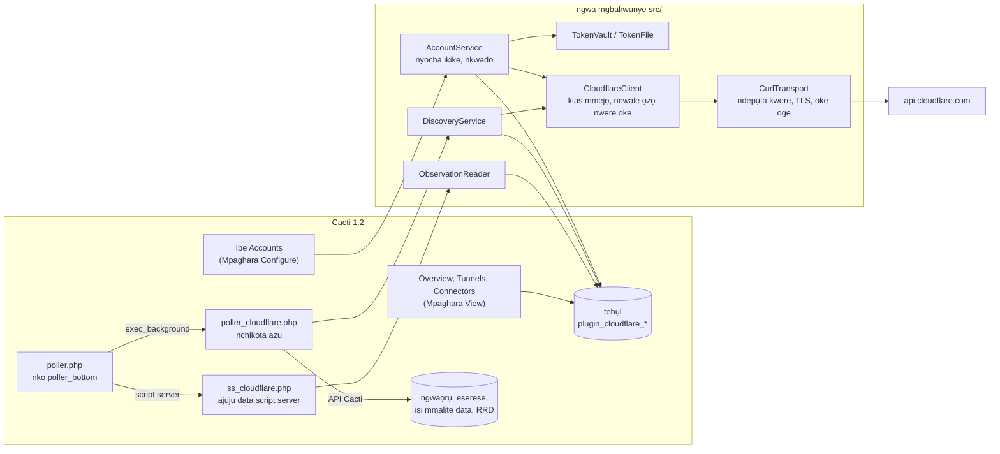

<!-- Source: README.md; SHA256: f8de0e02c5904e15bfa4c71edcaab219e5e5d4f6d9dbe589f4ed16351df6bf4d -->

<!-- translations:start -->
[English](../../../README.md) | [简体中文](../zh-CN/README.md) | [हिन्दी](../hi-IN/README.md) | [Español (España)](../es-ES/README.md) | [Español (Latinoamérica)](../es-419/README.md) | [العربية (السعودية)](../ar-SA/README.md) | [Afrikaans](../af-ZA/README.md) | [አማርኛ](../am-ET/README.md) | [العربية (مصر)](../ar-EG/README.md) | [العربية (المغرب)](../ar-MA/README.md) | [বাংলা](../bn-BD/README.md) | [Bosanski](../bs-BA/README.md) | [Deutsch](../de-DE/README.md) | [فارسی](../fa-IR/README.md) | [Filipino](../fil-PH/README.md) | [Français](../fr-FR/README.md) | [Français (Maroc)](../fr-MA/README.md) | [Français (Sénégal)](../fr-SN/README.md) | [Hausa](../ha-NG/README.md) | [עברית](../he-IL/README.md) | [Hrvatski](../hr-HR/README.md) | [Bahasa Indonesia](../id-ID/README.md) | [Igbo](README.md) | [Italiano](../it-IT/README.md) | [日本語](../ja-JP/README.md) | [한국어](../ko-KR/README.md) | [Malagasy](../mg-MG/README.md) | [मराठी](../mr-IN/README.md) | [Bahasa Melayu](../ms-MY/README.md) | [Nederlands](../nl-NL/README.md) | [Polski](../pl-PL/README.md) | [Português (Brasil)](../pt-BR/README.md) | [Русский](../ru-RU/README.md) | [Kinyarwanda](../rw-RW/README.md) | [Soomaali](../so-SO/README.md) | [Српски](../sr-RS/README.md) | [Svenska](../sv-SE/README.md) | [Kiswahili](../sw-KE/README.md) | [தமிழ்](../ta-IN/README.md) | [తెలుగు](../te-IN/README.md) | [ไทย](../th-TH/README.md) | [Türkçe](../tr-TR/README.md) | [Українська](../uk-UA/README.md) | [اردو](../ur-PK/README.md) | [Tiếng Việt](../vi-VN/README.md) | [isiXhosa](../xh-ZA/README.md) | [Yorùbá](../yo-NG/README.md) | [繁體中文](../zh-TW/README.md) | [isiZulu](../zu-ZA/README.md)
<!-- translations:end -->

<p align="center">
  
</p>

# Ngwa mgbakwunye Cloudflare maka Cacti

[](https://github.com/somethingwithproof/plugin_cloudflare/actions/workflows/ci.yml)
[](https://sonarcloud.io/summary/new_code?id=somethingwithproof_plugin_cloudflare)
[](../../../LICENSE)


[](https://sonarcloud.io/summary/new_code?id=somethingwithproof_plugin_cloudflare)
[](https://sonarcloud.io/summary/new_code?id=somethingwithproof_plugin_cloudflare)
[](https://sonarcloud.io/summary/new_code?id=somethingwithproof_plugin_cloudflare)


Ngwa mgbakwunye Cacti 1.2 a na-ewu iji nyochaa Cloudflare Tunnels na
nchịkọta data mpaghara (zone analytics). Ọ na-agụ site na Cloudflare API site na iji token API nwere oke ikike,
ọ naghị agbanwe ihe ọ bụla na Cloudflare, ma na-edobe data ya na tebụl nke ya.
Na Cacti, ọ na-edepụtagasị faịlụ XML ajụjụ data n'ime `resource/script_server/` ma
na-emepụta ngwaọrụ, eserese na ndebiri site na API nke Cacti n'onwe ya, n'agbanweghị
faịlụ isi.

**Ọnọdụ: 0.4.0-dev, ebipụtabeghị.** Ụdị ikpeazụ e wepụtara bụ 0.3.0. Ụdị mmepe a na-agbakwunye mbupụ ndepụta ngwa ahịa CSV, mwepụ doro anya nke ọwara ndị e hichapụrụ, nchịkọta data mpaghara echekwara na nchekwa nwa oge (cached), na ndebiri Thold nhọrọ. Nnwale na onye na-enye ọrụ dị ndụ na ntinye n'ọrụ ka na-echere.

Tebụl dị n'okpuru na-akọwa ntọhapụ kwụsiri ike 0.3.0. A kọwara mgbakwunye mmepe n'okpuru usoro ọrụ onye njikwa na nchịkọta data mpaghara n'okpuru.

| Dị ugbu a | Atụmatụ |
|---|---|
| Wụnye, kwalite, gbanyụọ ma wepụ site na njikwa ngwa mgbakwunye Cacti | Nchịkọta data GraphQL na ọkwa Thold (Milestone 4) |
| Ikike Cloudflare: View, Operator na Configure | Ntinye mmejọ (fault injection), ụdị TLA+ na akwụkwọ zuru ezu (Milestone 5) |
| Tinye, dezie, hichapụ, gbanye ma gbanyụọ akaụntụ Cloudflare | |
| Chekwaa token n'ime faịlụ ma ọ bụ zoo ya n'ụdị ezoro ezo na nchekwa data Cacti | |
| Nyochaa token ma lelee ikike ọgụgụ ọwara (tunnel) na mpaghara (zone) ya | |
| Nchọpụta ọwara na njikọ na nchịkọta azụ (background collector) nke isi poller malitere | |
| Ibe Overview, Tunnels na Connectors n'okpuru Management > Cloudflare Tunnels | |
| Nleba anya usoro ndụ: `active`, `unavailable` na `deleted` | |
| Otu ngwaọrụ Cacti maka akaụntụ ọ bụla, nke onye nchịkwa mepụtara, ebe ọwara ndị ahụ bụ ndeksi nke ajụjụ data | |
| Eserese Connectors, Health na Collection maka ọwara ọ bụla, esere site n'otu faịlụ RRD maka ọwara ọ bụla | |
| Uru ngwa mgbakwunye na-apụghị ikweta maka ya ka a na-echekwa dị ka amaghị (`U`), ọ dịghị mgbe ọ bụ 0 | |

## Ọrụ nnweta

| Mpaghara ikike (Realm) | Nnweta |
| --- | --- |
| Cloudflare: View | Ibe nleba anya dị adị. |
| Cloudflare: Operator | Nleba anya tinyere ibe Operations na nkwenye nhazi nsogbu nke onwe. |
| Cloudflare: Configure | Nnweta Operator tinyere nhazi dị adị na omume nchịkwa. |

Mgbe ị depụtachara faịlụ nkwalite, meghee ibe Plugins dị ka onye nchịkwa iji debanye aha
mpaghara ikike ọhụrụ ahụ. Nye mpaghara ikike Operator n'ụzọ doro anya n'okpuru **Configuration > Users** ma ọ bụ otu ndị ọrụ.
Nkwalite na-ejigide ID na ikike mpaghara View na Admin dị adị. Nnweta Admin
na-eketa nnweta Operator, nnweta Operator na-eketekwa nnweta View na arịrịọ ọ bụla;
nke a anaghị agbakwunye ikike echekwara na ndị ọrụ ma ọ bụ otu. Ntọala ngwa mgbakwunye chọkwara
nnweta Cloudflare: Configure tinyere ikike Settings nke Cacti.

Nhụta akaụntụ Cloudflare dakọtara na mpaghara View dị adị; ọ gbasara akaụntụ niile.
Asambodo nzuzo, nhazi, njikọta (mapping), nhichapụ na mgbanwe nchịkwa ndị ọzọ
na-anọgide na ibe nchịkwa. Nkwenye na-adịgide naanị na nnọkọ onye ọrụ dị ugbu a,
maka oge kachasị otu elekere na naanị mgbe otu nleba anya ahụ ka dị
ọhụrụ. Nleba anya ọhụrụ ma ọ bụ gbanwere na-eme ka ha ghara ịdị irè. Ha anaghị egosi nha
dara ada dị ka ahụike ma ọ bụ gbochie ọkwa.

## Ihe kpatara ngwa mgbakwunye a

Ndị njikwa Cacti na-ebipụta ọrụ site na Cloudflare Tunnel enweghị ụzọ ha ga-esi hụ
ọwara ahụ n'ime Cacti. Ọwara nwere ike itufu njikọ ya niile mgbe
sava mbụ (origin hosts) ka na-aza SNMP, ya mere eserese ndị dị adị na-anọgide na-acha akwụkwọ ndụ akwụkwọ ndụ mgbe
ndị ọrụ na-ahụ mmejọ. Ebumnuche nke ngwa mgbakwunye a bụ itinye ahụike ọwara na okporo ụzọ
mpaghara n'akụkụ eserese ngwaọrụ ndị njikwa na-elebu, n'enyeghị
Cacti ikike ọ bụla ịgbanwe Cloudflare.

Ihe mgbochi atọ na-akpụzi nhazi ya:

- **Ọgụgụ naanị.** Ngwa mgbakwunye ahụ na-akpọ naanị ebe njedebe `GET` na GraphQL
  Analytics API. Ọ chọghị ikike ndezi na akụrụngwa Cloudflare ọ bụla.
- **Nhọrọ.** Nkwụsị ọrụ Cloudflare, token kubiri ume na oke ọsọ arịrịọ (rate limits) ekwesịghị
  ime ka ihu Cacti jụọ oyi ma ọ bụ kwụsị ịtụle ngwaọrụ ndị ọzọ. Oku API niile nwere
  oke oge siri ike, nchịkọta na-agakwa n'usoro azụ nke
  poller malitere.
- **Enweghị mgbanwe faịlụ isi.** Ngwa mgbakwunye ahụ na-eji nko ngwa mgbakwunye Cacti 1.2 na tebụl
  nke ya. Ọ na-edepụta otu faịlụ XML ajụjụ data n'ime `resource/script_server/` ma
  na-emepụta ngwaọrụ, eserese na ndebiri site na API nke Cacti n'onwe ya. Enweghị mgbanwe
  faịlụ isi, yabụ nkwalite Cacti na ngwa mgbakwunye ndị ọzọ agaghị enwe mmetụta.

## Otu o si arụ ọrụ



- **Njikọ Cacti** (`setup.php`, `includes/`, edemede ibe) na-edebanye aha
  nko na mpaghara ikike, na-egosipụta ibe site na ndị nnyemaaka Cacti n'onwe ya, ma na-enyefe
  ọbá akwụkwọ dị na `src/` omume ọ bụla.
- **Ọbá akwụkwọ** (`src/`, oghere aha `Somethingwithproof\Cloudflare\`) adabereghị
  na mgbanwe zuru ụwa ọnụ nke Cacti, yabụ a na-anwale ya megide nchekwa data n'ezie na
  njem HTTP adịgboroja n'enweghị Cacti na-agba ọsọ.
- **Otu ụzọ mpụga.** `CurlTransport` bụ naanị koodu na-emetụ
  netwọkụ aka, ọ na-anakwere naanị `https://api.cloudflare.com`. A na-ejikọta ọdịda
  ọ bụla na otu klas mmejọ (`auth`, `permission`, `rate_limited`,
  `transient`, ...), nke na-ekpebi ọnọdụ a na-egosi na ihu UI.
- **Nchekwa** na-agafe njikọ PDO nke Cacti n'onwe ya site na okwu a kwadebere (prepared
  statements). Mgbanwe schema bụ mbugharị nwere nọmba nke na-adịghị agbanwe ma ọ bụrụ na e mee ya ugboro ugboro.

Mkpebi nhazi na ihe kpatara ha dị na
[docs/design.md](../../design.md).

## Nseta ihuenyo

Nseta ihuenyo ndị a sitere na ngwugwu nnwale, ọ bụghị akaụntụ Cloudflare dị ndụ. Ngwugwu
ahụ na-agba Cacti 1.2.31 megide API Cloudflare adịgboroja nke na-eweghachi data
nnwale, yabụ akaụntụ, ID ya na ọwara atọ ahụ bụ ihe nnọchi.


*Ndepụta Akaụntụ Cloudflare. API adịgboroja na-anakwere token ahụ, yabụ Verify
na-akọ `ok`.*


*Idezi akaụntụ. Oghere token na-adị oghere mgbe niile; a naghị
ezigachi token echekwara na ihe nchọgharị. Collect Tunnels na Create Graphs gbanyere ebe
Collect Analytics gbanyụrụ. Connection Status na-egosi nsonaazụ Verify
ikpeazụ: `ok`, enyere ikike ọgụgụ ọwara ma ikike ọgụgụ mpaghara adịghị.*


*Settings > Cloudflare.*


*Management > Cloudflare Tunnels > Overview. Ọnọdụ ahụ bụ ọnọdụ Cloudflare kacha njọ
n'etiti ọwara na-arụ ọrụ nke akaụntụ ahụ, ebe a ọ bụ `down` n'ihi na otu ọwara
nnwale dara. `Disabled`, `Not collected`, `Collection failing` na `Not yet
collected` na-ebute ụzọ karịa ahụike ọwara, n'usoro ahụ, yabụ akaụntụ
nke ọsọ ikpeazụ ya dara na-egosi `Collection failing` n'agbanyeghị ihe ọwara ya na-akọ.*


*Taabụ Tunnels. Connectors na Connections na-egosi `-` maka old-office, n'ihi na
API adịgboroja na-aza arịrịọ njikọ ya dị ka ọwara a na-amaghị na e chekwaghị
ihe ọ bụla, na 0 maka staging, nke na-enweghị njikọ na-agba ọsọ.*


*Eserese Connectors nke ọwara blog. Ahịrị atọ ahụ niile bụ 1 tupu na
mgbe oghere dị n'etiti gasịrị, ebe API adịgboroja weghachiri mmejọ ma ngwa mgbakwunye
chekwara uru a na-amaghị. Ahịrị ndị ahụ anaghị ada ruo 0. Eserese ahụ sitere n'otu
ngwugwu nnwale ahụ (`make screenshots`), nke na-edobe nzọụkwụ sekọnd 30 n'otu
isi mmalite data a ka nkeji asaa nke ịtụle wee mejupụta eserese ahụ.*

## Ihe Ndị A Chọrọ

- Cacti 1.2.25 ruo 1.2.31. Cacti 1.2.31 n'onwe ya chọrọ PHP 8.0 ma ọ bụ nke karịrị ya.
  CI na-anwale 1.2.31 naanị; a nwalere 1.2.25 n'aka n'oge ikpeazụ na 2026-10-22.
- PHP 7.4 ruo 8.4 tinyere mgbakwunye `curl`, `openssl` na `pdo_mysql`.
  Ngwa mgbakwunye ahụ na-ajụ ịgbanye ma ọ bụrụ na ha adịghị.
- MariaDB 10.6 ma ọ bụ nke karịrị ya, ma ọ bụ MySQL 8.0 ma ọ bụ nke karịrị ya.
- Ohere HTTPS site na seva Cacti gaa na `api.cloudflare.com`. A naghị akwado
  ndị nnọchiteanya proxy.

Lee [docs/compatibility.md](../../compatibility.md) maka ihe ndị a nwalere.

## Nwụnye

1. Tinye ngwa mgbakwunye ahụ n'ime ndekọ `plugins/cloudflare` nke Cacti, site
   n'ịwepụta faịlụ echekwara site na
   [Mwepụta GitHub](https://github.com/somethingwithproof/plugin_cloudflare/releases)
   (ịgba `make package` n'ime checkout nke akara mwepụta na-ewu otu faịlụ
   echekwara ahụ) ma ọ bụ site na git
   clone. Aha ndekọ ahụ ga-abụrịrị `cloudflare`.
2. Wụnye ma gbanye ya site na Console > Configuration > Plugins, ma ọ bụ jiri
   CLI dị ka onye ọrụ web server:

   ```sh
   php cli/plugin_manage.php --plugin=cloudflare --install --enable
   ```

3. Onye ọrụ admin na-enweta ikike Cloudflare: Configure n'oge nwụnye. Nye
   ya ndị ọrụ ma ọ bụ otu ndị ọzọ n'okpuru Console > Configuration > Users.
4. Mepụta token nwere ikike ndị dị na
   [docs/token-permissions.md](../../token-permissions.md). Na nkenke:
   Account > Cloudflare Tunnel > Read, ma ọ bụkwanụ Zone > Zone > Read dị ka nhọrọ.
5. Chekwaa token ahụ n'otu n'ime ụzọ abụọ dị n'okpuru ebe a, wee tinye akaụntụ ahụ
   n'okpuru Console > Configuration > Cloudflare Accounts ma gbaa Verify site na
   menu omume.

### Nhọrọ A: echekwara n'ụzọ nzuzo n'ime nchekwa data

Ngwa mgbakwunye ahụ na-ezobe token n'ụzọ nzuzo site n'iji igodo 32-byte nke ị
mepụtara. Ọ naghị emepụta ma ọ bụ dee igodo ahụ n'onwe ya. Ndị ọrụ web server
na poller ga-enwerịrị ike ịgụ faịlụ ahụ, ndị ọzọ agaghị enwe ike ịgụ ya, ndekọ
ya ga-ekwekwa ka ndị ọrụ ahụ rute ya. Maka web server na-arụ ọrụ dị ka `www-data`:

```sh
sudo mkdir -p /etc/cacti
sudo sh -c 'umask 077 && openssl rand -hex 32 > /etc/cacti/cloudflare.key'
sudo chgrp www-data /etc/cacti/cloudflare.key
sudo chmod 0440 /etc/cacti/cloudflare.key
```

Ụzọ ndabara bụ `/etc/cacti/cloudflare.key`; gbanwee ya n'okpuru Settings >
Cloudflare > Token Vault Key File. Mgbe igodo ahụ na-adịghị ma ọ bụ mgbe a jụrụ ya,
fọm ndezi na-enye naanị nhọrọ faịlụ token. Debe nchekwa ndabere nke igodo ahụ:
na-enweghị ya, a gaghị enwe ike ịkpọghee token ndị e chekwara ma a ga-etinyekwa ha ọzọ.

#### Ịgbanwe igodo

Enweghị iwu rekey. Igodo ọhụrụ enweghị ike ịkpọghee token ndị e chekwara
n'okpuru igodo ochie, ya mere ịgbanwe igodo pụtara itinye token nke ọ bụla e chekwara ọzọ:

1. Nwee uru token nke akaụntụ nke ọ bụla n'aka. Cloudflare na-egosi uru token
   naanị mgbe e mepụtara ya ma ọ bụ tụgharịa ya, ya mere tụgharịa token ahụ n'ime
   dashboard Cloudflare ma ọ bụrụ na i nweghịzi ya.
2. Mepụta igodo ọhụrụ ahụ n'ụzọ ọhụrụ site n'iji iwu ndị dị n'elu, dị ka
   `/etc/cacti/cloudflare.key.new`, nwee otu onye nwe ya na otu ụkpụrụ ikike (mode).
3. Tọọ Settings > Cloudflare > Token Vault Key File ka ọ bụrụ ụzọ ọhụrụ ahụ ma chekwaa ya.
   Site ugbu a gaa n'ihu, Verify n'akaụntụ ka echekwara n'ụzọ nzuzo site na igodo ochie
   na-akọ "Stored token cannot be decrypted", na njem collector nke ọ bụla na-edekọ
   `discovery token unavailable` nwere `reason=decrypt_failed` maka ya.
4. Maka akaụntụ nke ọ bụla na-echekwa token ya n'ime nchekwa data, meghee ya n'okpuru
   Console > Configuration > Cloudflare Accounts, mado token ahụ n'ime oghere
   token abụọ ahụ, chekwaa ya, ma gbaa Verify. O kwesịrị ịkọ `ok`.
5. Mgbe akaụntụ dị otú ahụ nke ọ bụla kwadoro, wepụ faịlụ igodo ochie ahụ na
   nchekwa ndabere ya niile.

N'etiti nzọụkwụ 3 na 4, a naghị emegharị tunnel nke akaụntụ ma eserese ahụike,
njikọta (connector) na njikọ ha na-edekọ U. O metụtaghị akaụntụ faịlụ token.

### Nhọrọ B: faịlụ token

Dee token ahụ, na ọ dịghị ihe ọzọ, n'ime faịlụ nke ndị ọrụ web server na poller
nwere ike ịgụ ma ndị ọzọ enweghị ike, wee tinye ụzọ zuru oke ya n'elu fọm ndezi:

```sh
sudo sh -c 'umask 077 && cat > /etc/cacti/cloudflare-account.token'   # paste the token, then Ctrl-D
sudo chgrp www-data /etc/cacti/cloudflare-account.token
sudo chmod 0440 /etc/cacti/cloudflare-account.token
```

A na-enyocha faịlụ ahụ mgbe a gụrụ ya, n'oge Verify, ọ bụghị mgbe i chekwara ya.
A na-ajụ njikọ nnọchiteanya (symbolic links), faịlụ ndị karịrị 4 KiB na faịlụ ndị
ndị ọzọ nwere ike ịgụ ma ọ bụ dee.

Onye ọ bụla nwere ikike Cloudflare: Configure nwere ike itinye ụzọ ọ bụla, ma onye
ọrụ poller na-agụ ya. Iji debe faịlụ token n'otu ebe, tọọ Settings > Cloudflare >
Token File Directory, dị ka `/etc/cacti`; a ga-ajụzie ụzọ ọ bụla dị n'èzí ya.
Lee [docs/security.md](../../security.md#token-file).

## Nkwalite

1. Jiri mwepụta ọhụrụ ahụ dochie faịlụ ndị dị na `plugins/cloudflare`, na-edobe
   aha ndekọ ahụ.
2. Meghee Console > Configuration > Plugins, ma ọ bụ Console > Configuration >
   Cloudflare Accounts, otu ugboro dị ka onye nchịkwa. Nke ahụ na-agba mgbanwe (migrations)
   nke ngwa mgbakwunye ahụ, na-ebubata ndebiri Cloudflare ma na-eṅomi faịlụ data query (lee
   [Atụmatụ nha tunnel na eserese](#tunnel-metrics-and-graphs)), ma, na
   nkwalite site na 0.1.0, na-edebanye aha njikọ `poller_bottom`.

`poller.php` anaghị agba nkwalite nke ngwa mgbakwunye ahụ, ya mere ruo nzọụkwụ 2
schema ọhụrụ ahụ adịghị. Njem collector nke ọ bụla agaghị eme ihe ọ bụla ma ọ ga-edekọ
`CLOUDFLARE: collector skipped; plugin upgrade pending, open Console > Plugins`.
Peeji Cloudflare Tunnels chọrọ naanị Cloudflare: View, ya mere ha anaghị agba
nkwalite ahụ, ma ruo nzọụkwụ 2 ha nwere ike igosi "The Cloudflare tunnels could not
be read".

## Ọnọdụ akaụntụ

Verify na-atọ ọnọdụ akaụntụ ahụ:

| Ọnọdụ | Nkọwa |
|---|---|
| `unknown` | A kwadobeghị ya kemgbe e tinyere akaụntụ ahụ ma ọ bụ gbanwee nzere ya |
| `ok` | Token ahụ na-arụ ọrụ ma nwee ike ịgụ tunnel |
| `token_inactive` | Cloudflare kọrọ na a gbanyụrụ token ahụ ma ọ bụ na oge ya agwụla |
| `auth_failed` | Cloudflare jụrụ token ahụ dị ka nke na-abaghị uru ma ọ bụ nke oge ya gwụrụ (HTTP 401) |
| `permission_denied` | Token ahụ na-arụ ọrụ mana ọ pụghị ịgụ tunnel, ma ọ bụ na o nweghị ikike ịkpọ njedebe nkwenye token (HTTP 403) |
| `unreachable` | Enweghị ike irute API ahụ, oge agwụla ma ọ bụ o weghachiri njehie seva |
| `rate_limited` | Cloudflare weghachiri HTTP 429 |
| `error` | Ọdịda ọ bụla ọzọ, gụnyere faịlụ token na-efu efu ma ọ bụ na-enweghị nchekwa, faịlụ igodo nchekwa token na-efu efu ma ọ bụ na-abaghị uru, ma ọ bụ token e chekwara nke a na-enweghị ike ịkpọghee |

Peeji ndezi ahụ na-egosikwa ma e nyere ikike ịgụ tunnel na ịgụ zone.

## Nchọpụta tunnel

Mgbe okirikiri polling nke ọ bụla gasịrị na isi poller, njikọ `poller_bottom`
na-amalite collector dị n'azụ site na `exec_background` mgbe opekata mpe otu
akaụntụ gbanyere nwere Collect Tunnels gbanyere. Collector anaghị agba n'ime
usoro poller ahụ, ya mere Cloudflare API dị nwayọọ anaghị egbu oge `poller.php`.
Ndị poller dị n'ebe dị anya anaghị amalite ya ma ọlị.

Maka akaụntụ nke ọ bụla oge ya ruru, collector na-edepụta tunnel nke akaụntụ ahụ,
wee gụọ njikọ nke tunnel ya ndị na-arụ ọrụ, nke na-enye njikọta (connectors) nke
tunnel nke ọ bụla, ụdị ha, ebe nchekwa data na adreesị mmalite. Oge akaụntụ
na-eru kwa Discovery Interval (ndabara sekọnd 300). Njem anaghị amalite akaụntụ
ọhụrụ mgbe sekọnd 50 gachara ma anaghị eme arịrịọ njikọ karịrị 200. Oke nke ọ bụla
nwere ike ịkwụsị akaụntụ n'etiti ịgụ njikọ ya; a na-edekọ akaụntụ ahụ dị ka
`partial`, njem na-esote na-aga n'ihu site na tunnel ndị a nwara n'oge na-adịbeghị
anya kacha nta. Akaụntụ ndị a na-amaliteghị na-anọgide na-eche njem na-esote.

Tunnel nwere usoro ndụ, nke e debere iche na ọnọdụ Cloudflare na-akọ
(`healthy`, `degraded`, `down` ma ọ bụ `inactive`):

| Usoro ndụ | Nkọwa |
|---|---|
| `active` | Tunnel ahụ nọ na ndepụta zuru oke nke ikpeazụ |
| `deleted` | Ndepụta zuru oke etinyeghị ya, nke gụnyere ndepụta tọgbọ chakoo. Ahịrị ahụ na akụkọ ya na-anọgide, tunnel ahụ na-aghọkwa `active` ọzọ ma ọ bụrụ na ọ pụta ọzọ |
| `unavailable` | Nkwụsị atọ a gụrụ na-enweghị ndepụta zuru oke n'etiti ha na-ahapụ ọnọdụ tunnel ahụ dị ka nke a na-amaghị |

Naanị ndepụta zuru oke nke gara nke ọma na-agbakwunye, na-emelite ma ọ bụ na-ehichapụ
tunnel, na ndepụta dara ada anaghị ehichapụ otu. Ọdịda ịgụ Cloudflare ma ọlị
(`transient`, `rate_limited`, `auth` ma ọ bụ `permission`) na-agụnye n'ime nkwụsị;
mgbe nkwụsị atọ a gụrụ gasịrị na-enweghị ndepụta zuru oke n'etiti ha, tunnel
na-arụ ọrụ nke akaụntụ ahụ na-aghọ `unavailable`. Ndepụta zuru oke na-esote
na-eweghachite ha ma tọgharịa ọnụọgụgụ ahụ. A na-awụfe tunnel nke Cloudflare
na-amaghịzi mgbe a gụrụ njikọ ya n'emeghị ka akaụntụ ahụ daa. Ọdịda ndị ọzọ
anaghị abawanye ma ọ bụ tọgharịa ngụkọ nkwụsị.

N'ime `cacti.log`, ahịrị nchọpụta na-ebido na `CLOUDFLARE: discovery` ma nchịkọta
njem na-ebido na `CLOUDFLARE: collector`. A na-edekọ ọdịda na mgbanwe usoro ndụ,
dị ka ndepụta dara ada ma ọ bụ tunnel e nyere akara `unavailable`, n'ọkwa ndabara
`LOW` nke Cacti; a na-edekọ nsonaazụ akaụntụ nke ọ bụla na nchịkọta njem na `MEDIUM`.
Ọgụgụ njikọ nwere ike ịda na tunnel nke ọ bụla, ya mere maka akaụntụ nke ọ bụla
naanị ọdịda mbụ nke ụdị njehie nke ọ bụla ka a na-edekọ na `LOW`, ndị fọdụrụnụ
na `MEDIUM`, nke otu ahịrị `LOW` kwa ụdị nwere ọnụọgụ tunnel dara ada na-eso.

Management > Cloudflare Tunnels chọrọ ikike Cloudflare: View ma ọ bụ maka naanị ọgụgụ:

- **Overview** na-edepụta akaụntụ nke ọ bụla na ọnọdụ ya, ọnụọgụ tunnel site n'usoro ndụ,
  nchọpụta gara nke ọma ikpeazụ na ọnụọgụ ọdịda na-esote ibe ha.
- **Tunnels** na-edepụta tunnel n'ofe akaụntụ niile ma ọ bụ maka otu akaụntụ, nwere ihe
  nzacha maka akaụntụ, usoro ndụ, ọnọdụ na aha, na kọlụm a na-ahazi.
- **Connectors** na-egosi njikọta (connectors) nke tunnel a họọrọ na taabụ Tunnels.

## Atụmatụ nha tunnel na eserese

Cacti na-agụ ọnọdụ tunnel site na ajụjụ data script server,
`ss_cloudflare.php`. Ọ na-aza site na tebụl ngwa mgbakwunye ahụ naanị ma ọ dịghị
mgbe ọ na-akpọ Cloudflare, ya mere nkwụsị Cloudflare enweghị ike ime ka poller
dị nwayọọ. Tunnel nke ọ bụla na-enye ọnụọgụ isii: ahụike (healthy 3, degraded 2,
down 1, inactive 0), njikọta (connectors), njikọ, ụdị njikọta, sekọnd kemgbe a
gụrụ njikọ ya n'oge ikpeazụ, na ọdịda na-esote ibe ha nke ọrụ nchọpụta. A na-ebipụta
ahụike, njikọta, njikọ na ụdị ha naanị mgbe ngwa mgbakwunye ahụ nwere ike ịkwado ha,
nke pụtara na nchọpụta ikpeazụ gara nke ọma, tunnel ahụ dị `active` ma ọgụgụ ahụ
dị ọhụrụ. Ma ọ bụghị ya, ha bụ `U`, eserese ahụ na-egosikwa oghere kama efu nke
ga-adị ka nkwụsị. Ọnụọgụ nchịkọta abụọ ahụ na-anọgide na-ebipụta n'oge nkwụsị,
ya mere eserese Collection na-egosi ya; ha na-abụ `U` naanị maka tunnel e hichapụrụ
ma ọ bụ nke a na-emeghị ka njikọ ya dị ọhụrụ ma ọlị. Iwu ndị ahụ dị na
[docs/metrics.md](../../metrics.md).

### Mepụta ngwaọrụ ahụ

Otu akaụntụ na-ejikọta na nke kacha otu ngwaọrụ Cacti. Ngwaọrụ ahụ na-ejide
tunnel nke akaụntụ ahụ dị ka ndekọ (indexes) nke ajụjụ data Cloudflare Tunnels.
Ọ dịghị ihe na-emepụta ya na-akpaghị aka:

1. Meghee Console > Configuration > Cloudflare Accounts.
2. Họrọ akaụntụ ahụ, họrọ Create Cacti Device site na menu omume, ma kwado ya.

Omume ahụ chọrọ ma mpaghara ikike Cloudflare: Configure ma mpaghara ikike
Sites/Devices/Data nke Cacti (nke maka `host.php`). Ntinye menu ahụ na-apụta
naanị nye ndị ọrụ nwere ha abụọ, seva na-ajụkwa arịrịọ sitere n'aka onye ọ bụla
ọzọ. Aha ngwaọrụ ahụ bụ `Cloudflare: <account name>`, ọ na-eji ndebiri host
Cloudflare Account na isi poller, nwere ụdị SNMP 0 na enweghị nlele nnweta,
ma na-enweta aha host `<account ID>.cloudflare.invalid`. E debere aha ahụ iche
ma ọ dịghị mgbe ọ na-arụtụ aka; Cacti anaghị ejikọta na ya. Ọ bụrụ na akaụntụ
ahụ enweela ngwaọrụ, omume ahụ na-ekwu otu ahụ ma ọ naghị agbanwe ihe ọ bụla.
Ọ bụrụ na onye nchịkwa ehichapụ ngwaọrụ ahụ na Cacti, ngwa mgbakwunye ahụ anaghị
emepụta ọzọ ruo mgbe a gbara Create Cacti Device ọzọ.

### Mepụta Eserese

Create Graphs na fọm akaụntụ na-agbanyụ na ndabara. Mgbe ọ gbanyere, oge ọ bụla
nchọpụta nke akaụntụ ahụ kwụsịrị na `ok` ma ọ bụ `partial`, collector na-emegharị
ndekọ (reindex) ngwaọrụ ahụ ma mepụta eserese ọ bụla na-efu maka tunnel `active`
nke akaụntụ ahụ: Connectors, Health na Collection, atọ maka tunnel nke ọ bụla.
Eserese atọ nke otu tunnel na-ekekọrịta otu faịlụ RRD. Otu njem anaghị emepụta
eserese karịrị 50 ma na-akwụsị mgbe sekọnd 20 gachara, njem na-esote na-aga n'ihu.
Ngwa mgbakwunye ahụ anaghị ewepụ ihe Cacti ma ọlị. A naghị emepụta eserese nke onye
nchịkwa hichapụrụ ọzọ, ma tunnel nke Cloudflare na-edepụtaghịzi na-edobe eserese
ya na faịlụ RRD ya, nke na-egosi `U`.

Ịgbanye Create Graphs chọrọ mpaghara ikike abụọ ahụ. Ịgbanyụ ya chọrọ naanị
Configure. Onye ọrụ na-enweghị mpaghara ikike Sites/Devices/Data nke na-echekwa
fọm ahụ na-ahapụ ntọala ahụ dị ka ọ dịbu, tinyere ịdọ aka ná ntị. Mgbe Create
Graphs gbanyụrụ, a ka na-emegharị ndekọ ngwaọrụ ahụ mgbe nchọpụta nke ọ bụla
gasịrị, ya mere tunnel ọhụrụ na-apụta dị ka ndekọ nke ajụjụ data ahụ.

### Faịlụ data query

Cacti 1.2.31 na-agụ data query XML naanị site n'ime ndekọ `resource` ya.
Ya mere na nwụnye na nkwalite ngwa mgbakwunye ahụ na-eṅomi otu faịlụ,
`templates/resource/cloudflare_tunnels.xml`, gaa na
`<Cacti>/resource/script_server/cloudflare_tunnels.xml`. Ọ bụ naanị ya bụ
faịlụ ngwa mgbakwunye ahụ na-ede n'èzí ndekọ nke ya, ya mere onye ọrụ na-awụnye
ma ọ bụ na-akwalite ngwa mgbakwunye ahụ ga-enwerịrị ike ide n'ime ndekọ ahụ.
Nwepụ (Uninstall) na-edobe faịlụ ahụ, tinyere ngwaọrụ, eserese, faịlụ RRD na
ndebiri niile. Ọ bụrụ na ṅomi ahụ ma ọ bụ mbubata ndebiri daa, ngwa mgbakwunye
ahụ na-edekọ ya ma Create Cacti Device na-anwa ọzọ.

## Ntọala

Ntọala > Cloudflare nwere:

- **Token Vault Key File**: ụzọ faịlụ gaa na mkpịsị ugodi nke nchekwa.
- **Token File Directory**: mgbe e debere ya, a na-ajụ faịlụ token dị n'èzí ya. Ọ tọgbọ chakoo na
  ndabere, nke na-enye ohere ụzọ ọ bụla. Lee [docs/security.md](../../security.md#token-file).
- **Interactive Request Timeout**: mkpokọta sekọnd maka arịrịọ e mere site na
  ihu weebụ, dị ka Verify. Ndabere bụ 10; ọnụọgụgụ ndị na-abụghị 5 ruo 60 na-alaghachi
  na 10.
- **Collector Request Timeout**: mkpokọta sekọnd maka arịrịọ nke
  onye nnakọta ndabere mere. Ndabere bụ 20; ọnụọgụgụ ndị na-abụghị 5 ruo 60 na-alaghachi na 20.
- **Log Level**: echekwara. Ọ dịghị ihe na-agụ ya ugbu a.

Na fọm akaụntụ, Collect Tunnels na Discovery Interval na-achịkwa nchọpụta,
ebe Create Graphs na-achịkwa imepụta eserese. A na-echekwa Collect Analytics ma ọ
nweghị mmetụta na ntọhapụ a.

## Asụsụ

Ngwa mgbakwunye ahụ na-ezipụ ntụgharị asụsụ gaa na Spanish (Spain, `es-ES`), French
(`fr-FR`), German (`de-DE`), Simplified Chinese (`zh-CN`), Hindi (`hi-IN`),
Arabic (`ar-SA`) na Japanese (`ja-JP`). Cacti na-egosi ha ozugbo nkwado asụsụ dị na (Nhazi >
Ntọala > Izugbe > Nkwado Asụsụ) ma onye ọrụ họrọ asụsụ ahụ. Ndepụta okwu Latin
American Spanish (`es-419`) na-abịakwa, mana Cacti 1.2 enweghị mpaghara asụsụ Latin
American Spanish ịhọrọ, ya mere ọ na-arụ ọrụ naanị mgbe Cacti tinyere
otu; ruo mgbe ahụ, họrọ Spanish (`es-ES`).

Ụfọdụ ederede na-anọgide na Bekee: ọnụọgụgụ ọnọdụ nke ngwa mgbakwunye na-echekwa ma na-egosi
dị ka ha dị (`ok`, `active`, `unavailable`, `deleted`, na ọnọdụ tunnel nke
Cloudflare na-akọ), yana ihe niile ngwa mgbakwunye na-ede na ndekọ Cacti.

## Mwepụ na nchekwa data

Mwepụ na-ehichapụ tebụl nke ngwa mgbakwunye ahụ n'onwe ya, nke na-ejide akaụntụ, token e
zoro ezo, tunnel a chọtara, ọnọdụ ọrụ na ndekọ nke ihe Cacti o
mere, ma na-ehichapụ ntọala `cloudflare_` ya. Ọ naghị ewepụ faịlụ mkpịsị ugodi,
faịlụ token, `resource/script_server/cloudflare_tunnels.xml` eṅomiri, ma ọ bụ
ngwaọrụ Cacti, eserese, isi mmalite data, faịlụ RRD ma ọ bụ ndebiri ọ bụla. Ndị ahụ na-ejide
data nleba anya akụkọ ihe mere eme, iwepụ ha bụkwa omume doro anya nke onye nchịkwa
na Cacti.

Ngwaọrụ e debere na-akwụsị ịnata data. Mgbe e wepụsịrị ya, ma ọ bụ mgbe e
hichapụrụ akaụntụ ya, ọ dịghị akaụntụ nwe host ahụ, ya mere eserese ya na-echekwa akụkọ
ihe mere eme ha mana ha na-ebipụta `U` site mgbe ahụ gaa n'ihu. Create Cacti Device na akaụntụ e tinyere ọzọ ma ọ bụ
tụkwasịrị ọzọ na-eme ngwaọrụ ọhụrụ; ọ naghị eji nke ochie eme ihe ọzọ, ya mere hichapụ
ngwaọrụ ochie ahụ na Cacti ozugbo akụkọ ihe mere eme ya adịghịzi mkpa.

## Oke ndị a maara

- Otu ọsịsọ na-eme nke kachasị arịrịọ njikọ 200. A na-eme ka tunnel ndị gafere oke ahụ
  dị ọhụrụ obere oge karịa windo nleba anya, ya mere eserese njikọ ha
  na-egosi oghere.
- Ngwa mgbakwunye ahụ na-edegharị mgbanwe onye nchịkwa na ndebiri e bubatara mgbe
  nkwalite gbanwere XML ndebiri e zipụrụ.
- Ngwaọrụ akaụntụ ahụ ga-anọrịrị na isi poller. Tebụl ngwa mgbakwunye ahụ dị
  na isi nchekwa data na edemede ahụ na-agụ ha n'ebe ahụ.
- Tunnel e hichapụrụ na-anọgide na ndepụta ajụjụ data ma na-ebipụta `U` ruo mgbe onye nchịkwa lara ha ezumike nká n'ụzọ doro anya. Ila ezumike nká na-ewepụ naanị eserese ndị ngwa mgbakwunye dekọrọ na isi mmalite data a na-ekekọrịtaghị site na Cacti; ahịrị ngwa ahịa na-anọgide na-ahụ anya. Cacti na-achịkwa nhicha RRD.
- Cacti na-agbanyụ ngwa mgbakwunye nke koodu ya kwụsịrị na ezigbo njehie dị egwu, dị ka
  ịgwụ ebe nchekwa. Lee [docs/security.md](../../security.md).

## Nchekwa

- A na-ajụ Global API Keys; naanị API token nwere oke ka a na-anabata.
- A na-echekwa token n'ime faịlụ ị na-enye ma ọ bụ zoo ya site na AES-256-GCM
  n'okpuru faịlụ mkpịsị ugodi nke na-adịghị abanye na nchekwa data. A naghị egosi ha
  na ibe, ede ha na ndekọ, ma ọ bụ tinye ha na ozi njehie.
- Njehie nchekwa data na-ebu naanị SQLSTATE na koodu njehie nke draịva, ọ dịghị mgbe ọ na-ebu
  ụkpụrụ nke nkwupụta ahụ.
- Mgbanwe ọ bụla bụ POST nke token CSRF nke Cacti na-echebe. Mgbanwe
  akaụntụ nchịkwa na nhazi chọrọ Cloudflare: Configure; nkwenye
  nhazi nke onwe chọrọ Cloudflare: Operator. Imepụta ngwaọrụ Cacti
  ma ọ bụ ịgbanye Create Graphs chọkwara ikike Sites/Devices/Data nke Cacti.
  Ngwa mgbakwunye a gbanyụrụ na-ajụ ibe ya.

Nkọwa na oke ndị a maara dị na [docs/security.md](../../security.md).
Kọọ adịghị ike nchekwa na nzuzo dị ka e si kọwaa na [SECURITY.md](../../../SECURITY.md).

## Usoro ọrụ onye njikwa na nyocha mpaghara

Mgbakwunye mmepe gụnyere ila ezumike nká doro anya nke tunnel e hichapụrụ, nyocha mpaghara maara ikike na ndebiri Thold a pụrụ ibubata. Mgbakwunye ndị a enwebeghị akara ntọhapụ ma ọ bụ ntozu akaụntụ dị ndụ ugbu a. Lee [docs/analytics-and-alerting.md](../../analytics-and-alerting.md) maka nhazi, nkọwa nha na oke nkwenye.

### Mbupụ ngwa ahịa

Ibe Tunnels na Connectors na-enye Export maka ngalaba Cloudflare: View. Faịlụ CSV nke tunnel gụnyere ahịrị ọ bụla dabara adaba, na-eji akaụntụ na-arụ ọrụ, usoro ndụ, ọnọdụ, ọchụchọ na ntọala nhazi n'ofe ibe niile. Faịlụ CSV nke njikọ gụnyere ụdị, nhazi ụlọ, ebe data na adreesị mmalite maka tunnel ahọpụtara. Nbudata na-agụ naanị ndekọ e chekwara n'ebe nchekwa nwa oge. Ọnụọgụgụ a na-amaghị na-atọgbọ chakoo; a na-etinye akara apọstrọfị n'ihu mkpụrụokwu ndị dị ka usoro mgbako maka mbubata mpempe akwụkwọ mgbako dị nchebe.

## Ụzọ aga n'ihu

Nzọụkwụ ọ bụla na-abịa dị ka ntọhapụ 0.x nke e nyere nọmba n'aha ya: Nzọụkwụ 3 bụ
0.3.0, Nzọụkwụ 4 ga-abụ 0.4.0. A tọhapụghị Nzọụkwụ 1 na 2 n'onwe ha
ma ha bụ akụkụ nke 0.3.0. E debere ụdị 1.0.0 maka ntọhapụ nke mezuru
nzọụkwụ ọ bụla dị n'okpuru.

| Nzọụkwụ | Oke | Ọnọdụ |
|---|---|---|
| 1. Ntọala | Usoro ndụ ngwa mgbakwunye, ikike, nhazi akaụntụ, ule njikọ | A tọhapụrụ na 0.3.0 ([#2](https://github.com/somethingwithproof/plugin_cloudflare/pull/2) ruo [#5](https://github.com/somethingwithproof/plugin_cloudflare/pull/5)) |
| 2. Nchọpụta | Nchọpụta tunnel na njikọ na onye nnakọta ndabere, ibe Overview, Tunnels na Connectors | A tọhapụrụ na 0.3.0 ([#6](https://github.com/somethingwithproof/plugin_cloudflare/pull/6)) |
| 3. Nha | Isi mmalite data ahụike tunnel, ndebiri eserese, njikwa ọdịda nke na-adịghị edekọ efu e chepụtara | A tọhapụrụ na 0.3.0 ([#7](https://github.com/somethingwithproof/plugin_cloudflare/pull/7)) |
| 4. Nyocha na ịdọ aka ná ntị | Nyocha GraphQL maara atụmatụ maka mpaghara ọ bụla, oke Thold nwere nkwụsị ọdịda | A haziri |
| 5. Ime ka o sie ike | Ntinye mmejọ, ụdị TLA+ nke nchọpụta na nnakọta, akwụkwọ zuru ezu | A haziri |

## Mmepe

Ngwaọrụ ndị ahụ chọrọ PHP 8.x na Composer; koodu ngwa mgbakwunye ahụ n'onwe ya na-anọgide na-adakọ na PHP 7.4.
Ule njikọta na BDD chọrọ nchekwa data, nke
`make db-up` na-amalite na Docker na pọọtụ 33061.

```sh
composer install
make db-up
make ci            # unit, integration, BDD, PHPStan, php-cs-fixer, php -l on PHP 7.4
make smoke         # installs the plugin into Cacti 1.2.31 in Docker and walks its lifecycle
make package       # builds build/cloudflare-<version>.tar.gz and checks its contents
make db-down
```

`make smoke` na `make screenshots` chọrọ checkout Cacti; tọọ `CACTI_REPO`
gaa na ụzọ ya. Ule njikọta na-agụ `CF_TEST_DSN`, `CF_TEST_DB_USER`
na `CF_TEST_DB_PASS`, ma ha na-amafe ya mgbe a na-apụghị iru nchekwa data ahụ belụsọ ma e
debere `CI`.

## Ntinye aka

A na-anabata pull requests. Commit ọ bụla chọrọ mbinye aka DCO
(`git commit -s`). Dee ule ahụ mbụ; `make ci` ga-agafe, ma mgbanwe
na njikọ Cacti kwesịrị ịgafe `make smoke` kwa. Koodu ngwa mgbakwunye ga-anọgide na-adakọ na PHP
7.4 ma soro ụdị koodu nke Cacti (taabụ, otu akara nhota, akara mgbachi n'otu
ahịrị ahụ).

### Ntụgharị asụsụ

A na-eji `__('...', 'cloudflare')` akara ozi. `locales/build_gettext.sh`
(`make i18n`, nke chọrọ GNU gettext) na-emepụtaghachi ndebiri
`locales/po/cacti.pot`, jikọta ya na katalọgụ ọ bụla `locales/po/<locale>.po`
ma chịkọta `locales/LC_MESSAGES/<locale>.mo`; commit ha atọ niile. CI na-agba
`make i18n-check`, nke na-ada mgbe katalọgụ tụfuru ma ọ bụ nwere ntinye na-edochaghị anya, eriri
usoro dị iche, ma ọ bụ faịlụ e chịkọtara gafere oge, ma usoro ule otu
na-enyochakwa ebe ndochi, mkpado HTML na oghere dị n'akụkụ nke ntinye ọ bụla. Ya mere, ozi e
gbanwere chọrọ ka e melite ntụgharị asụsụ ya n'otu pull
request ahụ. Asụsụ ọhụrụ bụ `<locale>.po` ọhụrụ nke a kpọrọ dị ka Cacti si akpọ
mpaghara asụsụ ya (dị ka `pt-BR`), tinyere na `CatalogTest::LOCALES` na na
nlele ebe nchekwa na `tests/build/package.sh`. Debe aha ngwaahịa Cloudflare, Cacti na Thold,
API na GraphQL, yana aha ikike dị ka
`Account Cloudflare Tunnel Read`, dị ka ha dị.

## Akwụkwọ ntụaka

- [docs/security.md](../../security.md): njikwa nchekwa na oke ndị a maara
- [docs/token-permissions.md](../../token-permissions.md): ikike token
- [docs/compatibility.md](../../compatibility.md): ụdị a kwadoro na ihu njikọ e ji mee ihe
- [docs/metrics.md](../../metrics.md): katalọgụ nha na mgbe a na-amaghị ọnụọgụgụ
- [docs/collector-protocol.md](../../collector-protocol.md): ihe `ss_cloudflare.php` na-agụ ma na-ebipụta
- [docs/schema.md](../../schema.md): tebụl nchekwa data
- [docs/design.md](../../design.md): mkpebi imewe
- [CHANGELOG.md](../../../CHANGELOG.md)

## Ikikere

GPL-2.0-or-later. Lee [LICENSE](../../../LICENSE).

## Akara ahịa

Cloudflare bụ akara ahịa edebanyere aha nke Cloudflare, Inc. Ọrụ a bụ ngwaọrụ nwere onwe ya mepere emepe ma enweghị njikọ, nkwado, ma ọ bụ nkwado pụrụ iche site na Cloudflare, Inc.

Ọrụ a enweghịkwa njikọ na ọrụ Cacti. Lee
[docs/images/README-logo.md](../../images/README-logo.md) maka akara ngosi.
