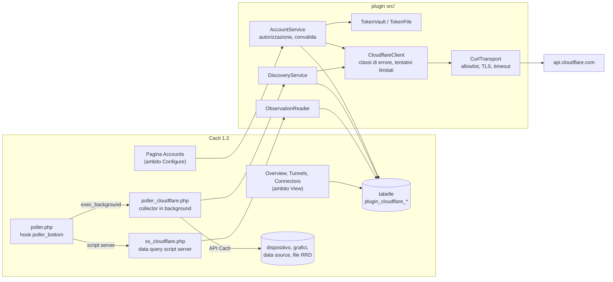
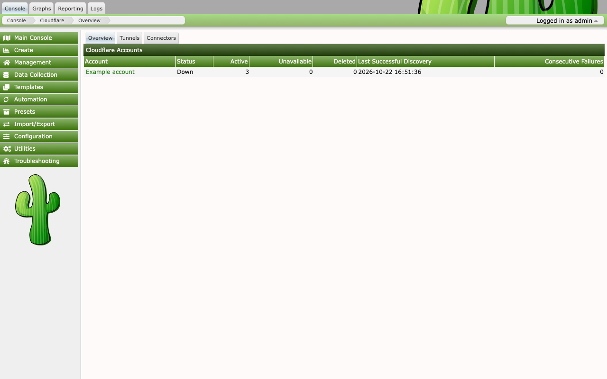

<!-- Source: README.md; SHA256: f8de0e02c5904e15bfa4c71edcaab219e5e5d4f6d9dbe589f4ed16351df6bf4d -->

<!-- translations:start -->
[English](../../../README.md) | [简体中文](../zh-CN/README.md) | [हिन्दी](../hi-IN/README.md) | [Español (España)](../es-ES/README.md) | [Español (Latinoamérica)](../es-419/README.md) | [العربية (السعودية)](../ar-SA/README.md) | [Afrikaans](../af-ZA/README.md) | [አማርኛ](../am-ET/README.md) | [العربية (مصر)](../ar-EG/README.md) | [العربية (المغرب)](../ar-MA/README.md) | [বাংলা](../bn-BD/README.md) | [Bosanski](../bs-BA/README.md) | [Deutsch](../de-DE/README.md) | [فارسی](../fa-IR/README.md) | [Filipino](../fil-PH/README.md) | [Français](../fr-FR/README.md) | [Français (Maroc)](../fr-MA/README.md) | [Français (Sénégal)](../fr-SN/README.md) | [Hausa](../ha-NG/README.md) | [עברית](../he-IL/README.md) | [Hrvatski](../hr-HR/README.md) | [Bahasa Indonesia](../id-ID/README.md) | [Igbo](../ig-NG/README.md) | [Italiano](README.md) | [日本語](../ja-JP/README.md) | [한국어](../ko-KR/README.md) | [Malagasy](../mg-MG/README.md) | [मराठी](../mr-IN/README.md) | [Bahasa Melayu](../ms-MY/README.md) | [Nederlands](../nl-NL/README.md) | [Polski](../pl-PL/README.md) | [Português (Brasil)](../pt-BR/README.md) | [Русский](../ru-RU/README.md) | [Kinyarwanda](../rw-RW/README.md) | [Soomaali](../so-SO/README.md) | [Српски](../sr-RS/README.md) | [Svenska](../sv-SE/README.md) | [Kiswahili](../sw-KE/README.md) | [தமிழ்](../ta-IN/README.md) | [తెలుగు](../te-IN/README.md) | [ไทย](../th-TH/README.md) | [Türkçe](../tr-TR/README.md) | [Українська](../uk-UA/README.md) | [اردو](../ur-PK/README.md) | [Tiếng Việt](../vi-VN/README.md) | [isiXhosa](../xh-ZA/README.md) | [Yorùbá](../yo-NG/README.md) | [繁體中文](../zh-TW/README.md) | [isiZulu](../zu-ZA/README.md)
<!-- translations:end -->

<p align="center">
  
</p>

# Plugin Cloudflare per Cacti

[](https://github.com/somethingwithproof/plugin_cloudflare/actions/workflows/ci.yml)
[](https://sonarcloud.io/summary/new_code?id=somethingwithproof_plugin_cloudflare)
[](../../../LICENSE)


[](https://sonarcloud.io/summary/new_code?id=somethingwithproof_plugin_cloudflare)
[](https://sonarcloud.io/summary/new_code?id=somethingwithproof_plugin_cloudflare)
[](https://sonarcloud.io/summary/new_code?id=somethingwithproof_plugin_cloudflare)


Plugin per Cacti 1.2 progettato per il monitoraggio dei Cloudflare Tunnel e delle
statistiche analitiche di zona. Il plugin interroga l'API Cloudflare mediante token
API con ambito ristretto, non apporta alcuna modifica in Cloudflare e conserva i propri
dati in tabelle dedicate. In Cacti copia i file XML delle data query in
`resource/script_server/` e crea dispositivi, grafici e template tramite le API native
di Cacti, senza modificare i file core.

**Stato: 0.4.0-dev, non rilasciata.** L'ultima versione rilasciata è la 0.3.0. La versione di sviluppo introduce l'esportazione dell'inventario in formato CSV, il ritiro esplicito dei tunnel eliminati, le statistiche analitiche di zona in cache e i template opzionali per Thold. La qualificazione con provider reale e in ambiente di distribuzione è tuttora in sospeso.

La tabella seguente descrive la release stabile 0.3.0. Le aggiunte della versione di sviluppo sono illustrate di seguito nelle sezioni dedicate ai flussi operativi e alle statistiche analitiche di zona.

| Disponibile ora | Pianificato |
|---|---|
| Installazione, aggiornamento, disabilitazione e disinstallazione tramite il gestore dei plugin di Cacti | Statistiche analitiche GraphQL e avvisi Thold (Milestone 4) |
| Autorizzazioni Cloudflare: View, Operator e Configure | Fault injection, modelli TLA+ e documentazione completa (Milestone 5) |
| Aggiunta, modifica, eliminazione, abilitazione e disabilitazione degli account Cloudflare | |
| Archiviazione di un token su file o in forma cifrata nel database di Cacti | |
| Verifica di un token e controllo dei relativi permessi di lettura per tunnel e zone | |
| Rilevamento di tunnel e connettori tramite un collector in background avviato dal poller principale | |
| Pagine Overview, Tunnels e Connectors in Management > Cloudflare Tunnels | |
| Tracciamento del ciclo di vita: `active`, `unavailable` e `deleted` | |
| Un dispositivo Cacti per account, creato da un amministratore, con i tunnel come indici di una data query | |
| Grafici Connectors, Health e Collection per singolo tunnel, generati da un file RRD per tunnel | |
| I valori che il plugin non può garantire vengono memorizzati come sconosciuti (`U`), mai come 0 | |

## Ruoli di accesso

| Ambito | Accesso |
| --- | --- |
| Cloudflare: View | Pagine di monitoraggio esistenti. |
| Cloudflare: Operator | Monitoraggio più la pagina Operations e le conferme di triage personali. |
| Cloudflare: Configure | Accesso Operator più le azioni amministrative e di configurazione esistenti. |

Dopo aver copiato i file di aggiornamento, aprire la pagina Plugins come amministratore per registrare
il nuovo ambito. Assegnare esplicitamente l'ambito Operator in **Configuration > Users** o nei gruppi di utenti.
Gli aggiornamenti mantengono gli ID e le concessioni esistenti degli ambiti View e Admin. L'accesso Admin
eredita l'accesso Operator e l'accesso Operator eredita l'accesso View a ogni richiesta;
ciò non aggiunge concessioni memorizzate a utenti o gruppi. Le impostazioni del plugin richiedono inoltre
l'accesso Cloudflare: Configure in aggiunta al permesso Settings di Cacti.

La visibilità degli account Cloudflare corrisponde all'ambito View esistente ed è estesa all'intero account.
Credenziali, configurazione, mappatura, eliminazione e altre modifiche amministrative
rimangono nelle pagine di amministrazione. Le conferme durano soltanto nella sessione
corrente dell'utente, per al massimo un'ora e solo finché la stessa osservazione rimane
aggiornata. Osservazioni nuove o modificate le invalidano. Non contrassegnano mai come integra una misurazione
fallita né sopprimono gli avvisi.

## Perché questo plugin

Gli operatori Cacti che pubblicano servizi tramite Cloudflare Tunnel non dispongono di alcuna visibilità
sul tunnel all'interno di Cacti. Un tunnel può perdere tutti i propri connettori mentre
gli host di origine continuano a rispondere a SNMP, lasciando in verde i grafici esistenti mentre
gli utenti riscontrano errori. L'obiettivo di questo plugin è affiancare lo stato di salute dei tunnel e il traffico
di zona ai grafici dei dispositivi che gli operatori già controllano, senza concedere
a Cacti alcuna possibilità di modificare Cloudflare.

Tre vincoli guidano la progettazione:

- **Sola lettura.** Il plugin richiama esclusivamente endpoint `GET` e la GraphQL
  Analytics API. Non richiede alcun permesso di modifica su alcuna risorsa Cloudflare.
- **Opzionale.** Interruzioni di Cloudflare, token scaduti e limiti di frequenza non devono
  rallentare l'interfaccia utente di Cacti né bloccare il polling di altri dispositivi. Tutte le chiamate API prevedono
  timeout rigidi e la raccolta viene eseguita in un processo in background avviato dal
  poller.
- **Nessuna modifica al core.** Il plugin utilizza gli hook per plugin di Cacti 1.2 e le proprie
  tabelle. Copia un file XML di data query in `resource/script_server/` e
  crea dispositivi, grafici e template tramite le API native di Cacti. Nessuna modifica
  ai file core, in modo che gli aggiornamenti di Cacti e gli altri plugin non subiscano impatti.

## Come funziona



- **Livello di integrazione con Cacti** (`setup.php`, `includes/`, gli script di pagina): registra
  hook e ambiti, esegue il rendering delle pagine con gli helper nativi di Cacti e delega
  ogni azione alla libreria in `src/`.
- **La libreria** (`src/`, namespace `Somethingwithproof\Cloudflare\`): non ha alcuna
  dipendenza dalle variabili globali di Cacti, pertanto viene testata su un database reale e
  con un trasporto HTTP simulato senza un'istanza Cacti in esecuzione.
- **Un unico percorso in uscita.** `CurlTransport` è l'unico componente che accede alla
  rete e accetta esclusivamente `https://api.cloudflare.com`. Ogni errore
  viene mappato a una classe di errore (`auth`, `permission`, `rate_limited`,
  `transient`, ...), che determina lo stato mostrato nell'interfaccia utente.
- **Archiviazione**: avviene tramite la connessione PDO nativa di Cacti con prepared
  statement. Le modifiche allo schema sono migrazioni numerate e idempotenti.

Le decisioni progettuali e le relative motivazioni sono documentate in
[docs/design.md](../../design.md).

## Schermate

Le schermate provengono da uno stack di test, non da un account Cloudflare reale. Lo
stack esegue Cacti 1.2.31 su un'API Cloudflare simulata che restituisce dati di esempio
(fixture), pertanto l'account, il relativo ID e i tre tunnel sono segnaposto.


*Elenco degli account Cloudflare. L'API simulata accetta il token, quindi Verify
riporta `ok`.*


*Modifica di un account. I campi del token sono sempre vuoti; il token memorizzato non viene
mai inviato nuovamente al browser. Collect Tunnels e Create Graphs sono attivi e
Collect Analytics è disattivato. Connection Status mostra il risultato dell'ultima
verifica (Verify): `ok`, lettura tunnel concessa e lettura zona mancante.*


*Settings > Cloudflare.*



*Management > Cloudflare Tunnels > Overview. Lo stato corrisponde al peggiore stato
Cloudflare tra i tunnel attivi dell'account, qui `down` poiché un tunnel di esempio
è inattivo. `Disabled`, `Not collected`, `Collection failing` e `Not yet
collected` hanno la precedenza sullo stato di salute dei tunnel, in quest'ordine, pertanto un account
la cui ultima esecuzione è fallita mostra `Collection failing` indipendentemente da ciò che segnalano i suoi tunnel.*


*Scheda Tunnels. Connectors e Connections mostrano `-` per old-office, perché
l'API simulata risponde alla richiesta delle connessioni come tunnel sconosciuto e non è stato
memorizzato nulla, e 0 per staging, che non ha alcun connettore in esecuzione.*


*Grafico Connectors del tunnel blog. Tutte e tre le linee valgono 1 prima e
dopo un'interruzione al centro, dove l'API simulata ha restituito errori e il plugin
ha memorizzato valori sconosciuti. Le linee non scendono a 0. Il grafico proviene dallo
stesso stack di test (`make screenshots`), che imposta un intervallo di 30 secondi su questo
singolo data source in modo che sette minuti di polling riempiano il grafico.*

## Requisiti

- Cacti da 1.2.25 a 1.2.31. Cacti 1.2.31 richiede PHP 8.0 o successivo.
  La CI testa solo la versione 1.2.31; la 1.2.25 è stata testata manualmente l'ultima volta il 2026-10-22.
- PHP da 7.4 a 8.4 con le estensioni `curl`, `openssl` e `pdo_mysql`.
  Il plugin rifiuta di attivarsi in loro assenza.
- MariaDB 10.6 o successivo, oppure MySQL 8.0 o successivo.
- Accesso HTTPS dal server Cacti verso `api.cloudflare.com`. I proxy non sono
  supportati.

Vedere [docs/compatibility.md](../../compatibility.md) per l'elenco di ciò che viene testato.

## Installazione

1. Posizionare il plugin nella directory `plugins/cloudflare` di Cacti, estraendo
   l'archivio da
   [GitHub Releases](https://github.com/somethingwithproof/plugin_cloudflare/releases)
   (eseguendo `make package` in un checkout del tag di rilascio si compila lo stesso
   archivio) oppure tramite un clone git.
   La directory deve chiamarsi `cloudflare`.
2. Installarlo e abilitarlo da Console > Configuration > Plugins, oppure tramite
   CLI come utente del server web:

   ```sh
   php cli/plugin_manage.php --plugin=cloudflare --install --enable
   ```

3. L'utente admin riceve il permesso Cloudflare: Configure al momento dell'installazione.
   Assegnarlo ad altri utenti o gruppi in Console > Configuration > Users.
4. Creare un token con i permessi indicati in
   [docs/token-permissions.md](../../token-permissions.md). In breve:
   Account > Cloudflare Tunnel > Read e, facoltativamente, Zone > Zone > Read.
5. Archiviare il token in uno dei due modi descritti di seguito, quindi aggiungere
   l'account in Console > Configuration > Cloudflare Accounts ed eseguire Verify dal
   menu delle azioni.

### Opzione A: cifrato nel database

Il plugin cifra i token con una chiave a 32 byte creata dall'amministratore. Non
crea né scrive mai la chiave autonomamente. Il file deve essere leggibile dagli
utenti del server web e del poller, non deve essere leggibile da altri e la sua
directory deve consentire a tali utenti di raggiungerlo. Per un server web in
esecuzione come `www-data`:

```sh
sudo mkdir -p /etc/cacti
sudo sh -c 'umask 077 && openssl rand -hex 32 > /etc/cacti/cloudflare.key'
sudo chgrp www-data /etc/cacti/cloudflare.key
sudo chmod 0440 /etc/cacti/cloudflare.key
```

Il percorso predefinito è `/etc/cacti/cloudflare.key`; è possibile modificarlo in
Settings > Cloudflare > Token Vault Key File. Quando la chiave manca o viene
rifiutata, il modulo di modifica propone solo l'opzione del file token. Conservare
un backup della chiave: senza di essa, i token archiviati non possono essere
decifrati e devono essere inseriti nuovamente.

#### Rotazione della chiave

Non esiste un comando di rekey. Una nuova chiave non può decifrare i token
archiviati con la precedente, quindi la rotazione comporta il reinserimento di
ciascun token archiviato:

1. Tenere a portata di mano il valore del token di ciascun account. Cloudflare
   mostra il valore di un token solo al momento della creazione o della rotazione,
   quindi rigenerare il token nella dashboard di Cloudflare se non lo si possiede più.
2. Creare la nuova chiave in un nuovo percorso con i comandi sopra indicati, ad
   esempio `/etc/cacti/cloudflare.key.new`, con lo stesso proprietario e gli stessi
   permessi.
3. Impostare Settings > Cloudflare > Token Vault Key File sul nuovo percorso e
   salvare. Da questo momento, Verify su un account ancora cifrato con la vecchia
   chiave segnala "Stored token cannot be decrypted" e ogni esecuzione del
   collector registra `discovery token unavailable` con `reason=decrypt_failed`.
4. Per ciascun account che archivia il proprio token nel database, aprirlo in
   Console > Configuration > Cloudflare Accounts, incollare il token in entrambi i
   campi del token, salvare ed eseguire Verify. L'esito dovrebbe essere `ok`.
5. Quando tutti questi account risultano verificati, rimuovere il vecchio file
   della chiave e i relativi backup.

Tra i passaggi 3 e 4 i tunnel di un account non vengono aggiornati e i rispettivi
grafici di stato, connettori e connessioni registrano U. Gli account con file
token non sono interessati.

### Opzione B: file token

Scrivere il token, e nient'altro, in un file che gli utenti del server web e del
poller possano leggere e gli altri no, quindi inserire il percorso assoluto nel
modulo di modifica:

```sh
sudo sh -c 'umask 077 && cat > /etc/cacti/cloudflare-account.token'   # paste the token, then Ctrl-D
sudo chgrp www-data /etc/cacti/cloudflare-account.token
sudo chmod 0440 /etc/cacti/cloudflare-account.token
```

Il file viene controllato al momento della lettura, durante Verify, non al
salvataggio. I collegamenti simbolici, i file superiori a 4 KiB e i file leggibili
o scrivibili da altri vengono rifiutati.

Chiunque disponga del permesso Cloudflare: Configure può inserire qualsiasi
percorso, che viene poi letto dall'utente del poller. Per mantenere i file token
in un'unica posizione, impostare Settings > Cloudflare > Token File Directory, ad
esempio su `/etc/cacti`; qualsiasi percorso esterno a tale directory verrà
rifiutato. Vedere [docs/security.md](../../security.md#token-file).

## Aggiornamento

1. Sostituire i file in `plugins/cloudflare` con la nuova versione, mantenendo
   il nome della directory.
2. Aprire una volta Console > Configuration > Plugins, oppure Console > Configuration >
   Cloudflare Accounts, come amministratore. Questa operazione esegue le migrazioni
   del plugin, importa i template di Cloudflare, copia il file della data query
   (vedere [Metriche e grafici dei tunnel](#tunnel-metrics-and-graphs)) e, in caso
   di aggiornamento dalla 0.1.0, registra l'hook `poller_bottom`.

`poller.php` non esegue l'aggiornamento del plugin, quindi fino al passaggio 2 il
nuovo schema risulta mancante. Ogni esecuzione del collector non compie alcuna
azione e registra
`CLOUDFLARE: collector skipped; plugin upgrade pending, open Console > Plugins`.
Le pagine Cloudflare Tunnels richiedono solo Cloudflare: View, quindi non eseguono
mai l'aggiornamento e fino al passaggio 2 possono mostrare "The Cloudflare tunnels
could not be read".

## Stato dell'account

Verify imposta lo stato dell'account:

| Stato | Significato |
|---|---|
| `unknown` | Non verificato da quando l'account è stato aggiunto o le relative credenziali sono state modificate |
| `ok` | Il token è attivo e può leggere i tunnel |
| `token_inactive` | Cloudflare segnala il token come disabilitato o scaduto |
| `auth_failed` | Cloudflare ha rifiutato il token come non valido o scaduto (HTTP 401) |
| `permission_denied` | Il token è attivo ma non può leggere i tunnel, oppure non dispone dei permessi per chiamare gli endpoint di verifica del token (HTTP 403) |
| `unreachable` | L'API non è raggiungibile, è scaduta per timeout o ha restituito un errore del server |
| `rate_limited` | Cloudflare ha restituito HTTP 429 |
| `error` | Qualsiasi altro errore, incluso un file token mancante o non sicuro, un file chiave del vault dei token mancante o inutilizzabile oppure un token archiviato che non può essere decifrato |

La pagina di modifica mostra inoltre se sono stati concessi i permessi di lettura
dei tunnel e delle zone.

## Rilevamento dei tunnel

Al termine di ogni ciclo di polling sul poller principale, l'hook `poller_bottom`
avvia un collector in background tramite `exec_background` quando almeno un
account abilitato ha Collect Tunnels attivo. Il collector non viene mai eseguito
nel processo del poller, pertanto un rallentamento dell'API Cloudflare non ritarda
`poller.php`. I poller remoti non lo avviano mai.

Per ogni account in scadenza, il collector elenca i tunnel dell'account, quindi
legge le connessioni dei tunnel attivi, ricavando per ciascun tunnel i
connettori, le rispettive versioni, i data center e gli indirizzi di origine.
Gli account vengono elaborati a ogni Discovery Interval (predefinito 300 secondi).
Un'esecuzione non avvia nuovi account dopo 50 secondi ed effettua al massimo 200
richieste di connessione. Ciascuno dei due limiti può inoltre interrompere un
account a metà della lettura delle connessioni; tale account viene registrato come
`partial` e l'esecuzione successiva riprende dai tunnel tentati meno di recente.
Gli account non avviati restano in coda per l'esecuzione successiva.

Un tunnel ha un proprio ciclo di vita, tenuto distinto dallo stato segnalato da
Cloudflare (`healthy`, `degraded`, `down` o `inactive`):

| Ciclo di vita | Significato |
|---|---|
| `active` | Il tunnel era presente nell'ultimo elenco completo |
| `deleted` | Un elenco completo non lo includeva, incluso un elenco vuoto. La riga e la relativa cronologia vengono mantenute e il tunnel torna `active` se riappare |
| `unavailable` | Tre interruzioni conteggiate senza un elenco completo intermedio lasciano lo stato del tunnel sconosciuto |

Solo un elenco completo e riuscito aggiunge, aggiorna o elimina i tunnel; un
elenco non riuscito non elimina mai alcun tunnel. L'impossibilità totale di leggere
da Cloudflare (`transient`, `rate_limited`, `auth` o `permission`) viene conteggiata
come interruzione; dopo tre interruzioni conteggiate senza un elenco completo
intermedio, i tunnel attivi dell'account diventano `unavailable`. Il successivo
elenco completo li ripristina e azzera il contatore. Un tunnel che Cloudflare non
riconosce più durante la lettura delle connessioni viene saltato senza far fallire
l'account. Gli altri errori non incrementano né azzerano il contatore delle
interruzioni.

In `cacti.log`, le righe del rilevamento iniziano con `CLOUDFLARE: discovery` e il
riepilogo dell'esecuzione con `CLOUDFLARE: collector`. Gli errori e i cambi di
ciclo di vita, come un elenco non riuscito o i tunnel contrassegnati come
`unavailable`, vengono registrati al livello predefinito `LOW` di Cacti; il
risultato di ciascun account e il riepilogo dell'esecuzione vengono registrati al
livello `MEDIUM`. Le letture delle connessioni possono fallire su ogni tunnel,
pertanto per ogni account solo il primo errore di ciascuna classe viene registrato
a livello `LOW` e i successivi a livello `MEDIUM`, seguiti da una riga `LOW` per
classe con il numero di tunnel in errore.

Management > Cloudflare Tunnels richiede il permesso Cloudflare: View ed è in sola
lettura:

- **Overview** elenca ciascun account con il relativo stato, i conteggi dei tunnel
  per ciclo di vita, l'ultimo rilevamento riuscito e il numero di errori
  consecutivi.
- **Tunnels** elenca i tunnel tra tutti gli account o per un singolo account, con
  filtri per account, ciclo di vita, stato e nome, e colonne ordinabili.
- **Connectors** mostra i connettori del tunnel selezionato nella scheda Tunnels.

## Metriche e grafici dei tunnel

Cacti legge lo stato dei tunnel tramite una data query di tipo script server,
`ss_cloudflare.php`. Questa risponde esclusivamente dalle tabelle del plugin e
non contatta mai Cloudflare, in modo che un'interruzione di Cloudflare non possa
rallentare il poller. Ciascun tunnel fornisce sei valori: stato di salute (healthy
3, degraded 2, down 1, inactive 0), connettori, connessioni, versioni dei
connettori, i secondi trascorsi dall'ultima lettura delle connessioni e gli errori
consecutivi del job di rilevamento. Stato di salute, connettori, connessioni e
versioni vengono restituiti solo quando il plugin può garantirne l'affidabilità,
ossia quando l'ultimo rilevamento è riuscito, il tunnel è `active` e la lettura
è recente. In caso contrario valgono `U` e il grafico mostra un'interruzione
anziché uno zero che sembrerebbe un guasto. I due valori di raccolta continuano
a essere restituiti durante un'interruzione, così che il grafico Collection la
evidenzi; valgono `U` solo per un tunnel eliminato o per uno le cui connessioni
non siano mai state aggiornate. Le regole sono descritte in
[docs/metrics.md](../../metrics.md).

### Creazione del dispositivo

Un account corrisponde al massimo a un dispositivo Cacti. Il dispositivo contiene
i tunnel dell'account come indici della data query Cloudflare Tunnels. Nulla lo
crea automaticamente:

1. Aprire Console > Configuration > Cloudflare Accounts.
2. Selezionare l'account, scegliere Create Cacti Device dal menu delle azioni e
   confermare.

L'azione richiede sia il realm Cloudflare: Configure sia il realm
Sites/Devices/Data di Cacti (quello per `host.php`). La voce di menu compare solo
agli utenti che possiedono entrambi i permessi e il server rifiuta la richiesta da
chiunque altro. Il dispositivo si chiama `Cloudflare: <account name>`, utilizza il
template host Cloudflare Account e il poller principale, ha versione SNMP 0 e
nessun controllo di disponibilità, e riceve il nome host
`<account ID>.cloudflare.invalid`. Tale nome è riservato e non viene mai risolto;
Cacti non si connette ad esso. Se l'account dispone già di un dispositivo, l'azione
lo segnala e non modifica nulla. Se un amministratore elimina il dispositivo in
Cacti, il plugin non ne crea un altro finché non viene eseguito nuovamente Create
Cacti Device.

### Create Graphs

L'opzione Create Graphs nel modulo dell'account è disattivata per impostazione
predefinita. Quando è attiva, ogni volta che il rilevamento dell'account termina
con `ok` o `partial`, il collector reindicizza il dispositivo e crea gli
eventuali grafici mancanti per i tunnel `active` dell'account: Connectors, Health
e Collection, tre per tunnel. I tre grafici di un tunnel condividono un unico file
RRD. Una singola esecuzione crea al massimo 50 grafici e si arresta dopo 20
secondi; l'esecuzione successiva prosegue. Il plugin non rimuove mai un oggetto
Cacti. Un grafico eliminato da un amministratore non viene ricreato e un tunnel che
Cloudflare non elenca più conserva il proprio grafico e il file RRD, che mostrano
`U`.

L'attivazione di Create Graphs richiede entrambi i realm. La disattivazione richiede
solo Configure. Un utente privo del realm Sites/Devices/Data che salva il modulo
lascia l'impostazione invariata, con un avviso. Con Create Graphs disattivato, il
dispositivo viene comunque reindicizzato dopo ogni rilevamento, in modo che i nuovi
tunnel compaiano come indici della data query.

### Il file della data query

Cacti 1.2.31 legge un file XML di data query esclusivamente dall'interno della
propria directory `resource`. Al momento dell'installazione e dell'aggiornamento,
il plugin copia pertanto un file, `templates/resource/cloudflare_tunnels.xml`, in
`<Cacti>/resource/script_server/cloudflare_tunnels.xml`. È l'unico file che il
plugin scrive al di fuori della propria directory, quindi l'utente che installa o
aggiorna il plugin deve poter scrivere in tale directory.
La disinstallazione mantiene il file, insieme ai dispositivi, ai grafici, ai file
RRD e ai template. Se la copia o l'importazione del template non riesce, il plugin
lo registra nei log e Create Cacti Device riprova l'operazione.

## Impostazioni

Impostazioni > Cloudflare contiene:

- **Token Vault Key File**: percorso della chiave del vault.
- **Token File Directory**: se impostata, un file di token al di fuori di essa viene rifiutato. Vuota per impostazione predefinita, il che consente qualsiasi percorso. Vedere [docs/security.md](../../security.md#token-file).
- **Interactive Request Timeout**: secondi totali per una richiesta effettuata dall'interfaccia web, ad esempio Verify. Valore predefinito 10; i valori esterni all'intervallo da 5 a 60 tornano a 10.
- **Collector Request Timeout**: secondi totali per una richiesta effettuata dal collector in background. Valore predefinito 20; i valori esterni all'intervallo da 5 a 60 tornano a 20.
- **Log Level**: memorizzato. Al momento non viene ancora letto da alcun componente.

Nel modulo dell'account, Collect Tunnels e Discovery Interval controllano l'individuazione,
mentre Create Graphs controlla la creazione dei grafici. Collect Analytics viene memorizzato ma non ha
alcun effetto in questa versione.

## Lingue

Il plugin include le traduzioni in spagnolo (Spagna, `es-ES`), francese
(`fr-FR`), tedesco (`de-DE`), cinese semplificato (`zh-CN`), hindi (`hi-IN`),
arabo (`ar-SA`) e giapponese (`ja-JP`). Cacti le mostra una volta attivato il supporto linguistico (Configurazione >
Impostazioni > Generale > Supporto lingue) e selezionata la lingua da parte dell'utente. È incluso anche un catalogo in spagnolo
latino-americano (`es-419`), ma Cacti 1.2 non dispone di una localizzazione in spagnolo latino-americano
selezionabile, quindi avrà effetto solo quando Cacti ne aggiungerà una; fino ad allora, scegliere lo spagnolo (`es-ES`).

Alcuni testi rimangono in inglese: i valori di stato memorizzati e mostrati dal plugin
così come sono (`ok`, `active`, `unavailable`, `deleted` e lo stato del tunnel
riportato da Cloudflare), nonché tutto ciò che il plugin scrive nel log di Cacti.

## Disinstallazione e conservazione dei dati

La disinstallazione elimina le tabelle proprie del plugin, che contengono gli account,
i token crittografati, i tunnel individuati, lo stato dei job e il registro degli oggetti Cacti
creati, ed elimina le impostazioni `cloudflare_`. Non rimuove il file della chiave,
i file dei token, la copia di `resource/script_server/cloudflare_tunnels.xml`, né alcun
dispositivo, grafico, origine dati, file RRD o modello di Cacti. Questi conservano
i dati storici di monitoraggio e la loro rimozione richiede un'azione esplicita dell'amministratore
in Cacti.

Il dispositivo mantenuto smette di ricevere dati. Dopo una disinstallazione, o dopo l'eliminazione del relativo
account, nessun account possiede l'host, quindi i relativi grafici mantengono la propria
cronologia ma da quel momento in poi stampano `U`. Create Cacti Device sull'account reinstallato o
riaggiunto crea un nuovo dispositivo; non riutilizza quello vecchio, pertanto occorre eliminare
il vecchio dispositivo in Cacti quando la sua cronologia non è più necessaria.

## Limitazioni note

- Un'esecuzione effettua al massimo 200 richieste di connessione. I tunnel oltre tale limite vengono
  aggiornati con una frequenza inferiore rispetto alla finestra di osservazione, pertanto i loro grafici
  di connessione presentano delle lacune.
- Il plugin sovrascrive le modifiche dell'amministratore ai modelli importati quando un
  aggiornamento modifica il file XML del modello distribuito.
- Il dispositivo dell'account deve rimanere sul poller principale. Le tabelle del plugin si trovano
  nel database principale e lo script le legge da lì.
- I tunnel eliminati rimangono nell'indice della data query e stampano `U` finché un amministratore non li ritira esplicitamente. Il ritiro rimuove solo i grafici registrati dal plugin e le origini dati non condivise tramite Cacti; la riga dell'inventario rimane visibile. Cacti gestisce la pulizia dei file RRD.
- Cacti disabilita un plugin il cui codice termina con un vero errore fatale, ad esempio
  l'esaurimento della memoria. Vedere [docs/security.md](../../security.md).

## Sicurezza

- Le Global API Key vengono rifiutate; sono accettati solo token API con ambito definito.
- I token sono archiviati in un file predisposto dall'utente o crittografati con AES-256-GCM
  mediante un file chiave che non entra mai nel database. Non vengono mai mostrati
  in una pagina, scritti in un log o inclusi in un messaggio di errore.
- Gli errori del database riportano solo il codice SQLSTATE e il codice di errore del driver, mai
  i valori dell'istruzione.
- Ogni modifica è una richiesta POST protetta dal token CSRF di Cacti. Le modifiche amministrative
  di account e configurazione richiedono Cloudflare: Configure; le conferme personali di triage
  richiedono Cloudflare: Operator. La creazione di un dispositivo Cacti
  o l'attivazione di Create Graphs richiede anche l'autorizzazione Sites/Devices/Data di Cacti.
  Un plugin disabilitato rifiuta l'accesso alle proprie pagine.

Dettagli e limitazioni note sono disponibili in [docs/security.md](../../security.md).
Segnalare le vulnerabilità in privato come descritto in [SECURITY.md](../../../SECURITY.md).

## Flussi operativi e analisi delle zone

Le aggiunte in fase di sviluppo includono il ritiro esplicito dei tunnel eliminati, l'analisi delle zone basata sulle funzionalità e modelli Thold importabili. Queste aggiunte non dispongono ancora di un tag di rilascio né di una qualificazione su account reali. Vedere [docs/analytics-and-alerting.md](../../analytics-and-alerting.md) per la configurazione, la semantica delle metriche e i limiti di verifica.

### Esportazione dell'inventario

Le pagine Tunnels e Connectors offrono la funzione Export per l'ambito Cloudflare: View. I file CSV dei tunnel includono ogni riga corrispondente, utilizzando le impostazioni attive di account, ciclo di vita, stato, ricerca e ordinamento su tutte le pagine. I file CSV dei connettori includono versioni, architettura, data center e indirizzi di origine per il tunnel selezionato. I download leggono esclusivamente i record memorizzati nella cache. I conteggi sconosciuti sono vuoti; le celle simili a formule sono precedute da un apostrofo per un'importazione sicura nei fogli di calcolo.

## Tabella di marcia

Ogni milestone viene distribuita come versione 0.x numerata di conseguenza: la Milestone 3 è
la 0.3.0, la Milestone 4 sarà la 0.4.0. Le Milestone 1 e 2 non sono state rilasciate
autonomamente e fanno parte della 0.3.0. La versione 1.0.0 è riservata al rilascio che completa
tutte le milestone seguenti.

| Milestone | Ambito | Stato |
|---|---|---|
| 1. Foundation | Ciclo di vita del plugin, autorizzazioni, configurazione dell'account, test di connessione | Rilasciata nella 0.3.0 ([#2](https://github.com/somethingwithproof/plugin_cloudflare/pull/2) - [#5](https://github.com/somethingwithproof/plugin_cloudflare/pull/5)) |
| 2. Discovery | Individuazione di tunnel e connettori in un collector in background, pagine Overview, Tunnels e Connectors | Rilasciata nella 0.3.0 ([#6](https://github.com/somethingwithproof/plugin_cloudflare/pull/6)) |
| 3. Metrics | Origini dati per l'integrità dei tunnel, modelli di grafico, gestione delle interruzioni che non registra mai uno zero fittizio | Rilasciata nella 0.3.0 ([#7](https://github.com/somethingwithproof/plugin_cloudflare/pull/7)) |
| 4. Analytics and alerting | Analisi GraphQL per zona basate sul piano, soglie Thold con soppressione in caso di interruzione | Pianificata |
| 5. Hardening | Fault injection, modelli TLA+ per individuazione e raccolta, documentazione completa | Pianificata |

## Sviluppo

Gli strumenti richiedono PHP 8.x e Composer; il codice del plugin stesso rimane compatibile con
PHP 7.4. I test di integrazione e BDD richiedono un database, che
`make db-up` avvia in Docker sulla porta 33061.

```sh
composer install
make db-up
make ci            # unit, integration, BDD, PHPStan, php-cs-fixer, php -l on PHP 7.4
make smoke         # installs the plugin into Cacti 1.2.31 in Docker and walks its lifecycle
make package       # builds build/cloudflare-<version>.tar.gz and checks its contents
make db-down
```

`make smoke` e `make screenshots` richiedono un checkout di Cacti; impostare `CACTI_REPO`
sul relativo percorso. I test di integrazione leggono `CF_TEST_DSN`, `CF_TEST_DB_USER`
e `CF_TEST_DB_PASS`, e vengono saltati quando il database non è raggiungibile a meno che `CI`
non sia impostata.

## Contributi

Le pull request sono benvenute. Ogni commit richiede un DCO sign-off
(`git commit -s`). Scrivere prima il test; `make ci` deve avere successo e le modifiche
all'integrazione con Cacti devono superare anche `make smoke`. Il codice del plugin deve rimanere compatibile con PHP
7.4 e seguire lo stile di codice di Cacti (tabulazioni, apici singoli, parentesi graffe
sulla stessa riga).

### Traduzioni

I messaggi sono contrassegnati con `__('...', 'cloudflare')`. `locales/build_gettext.sh`
(`make i18n`, che richiede GNU gettext) rigenera il modello
`locales/po/cacti.pot`, lo unisce in ciascun catalogo `locales/po/<locale>.po`
e compila `locales/LC_MESSAGES/<locale>.mo`; eseguire il commit di tutti e tre. La CI esegue
`make i18n-check`, che fallisce quando in un catalogo manca una voce o è presente una voce fuzzy, quando una
stringa di formato differisce o quando un file compilato non è aggiornato; inoltre la suite di unit test
verifica segnaposto, tag HTML e spazi iniziali e finali di ogni voce. Un
messaggio modificato richiede pertanto l'aggiornamento delle relative traduzioni nella stessa pull
request. Una nuova lingua corrisponde a un nuovo file `<locale>.po` denominato secondo la convenzione di Cacti
per le localizzazioni (ad esempio `pt-BR`), aggiunto a `CatalogTest::LOCALES` e al
controllo dell'archivio in `tests/build/package.sh`. Mantenere invariati i nomi dei prodotti Cloudflare, Cacti e Thold,
API e GraphQL, nonché i nomi delle autorizzazioni come
`Account Cloudflare Tunnel Read`.

## Documentazione

- [docs/security.md](../../security.md): controlli di sicurezza e limitazioni note
- [docs/token-permissions.md](../../token-permissions.md): autorizzazioni dei token
- [docs/compatibility.md](../../compatibility.md): versioni supportate e interfacce utilizzate
- [docs/metrics.md](../../metrics.md): catalogo delle metriche e quando un valore è sconosciuto
- [docs/collector-protocol.md](../../collector-protocol.md): cosa legge e stampa `ss_cloudflare.php`
- [docs/schema.md](../../schema.md): tabelle del database
- [docs/design.md](../../design.md): decisioni di progettazione
- [CHANGELOG.md](../../../CHANGELOG.md)

## Licenza

GPL-2.0-or-later. Vedere [LICENSE](../../../LICENSE).

## Marchi registrati

Cloudflare è un marchio registrato di Cloudflare, Inc. Questo progetto è uno strumento open-source indipendente e non è affiliato, sponsorizzato né approvato da Cloudflare, Inc.

Il progetto non è inoltre affiliato al progetto Cacti. Vedere
[docs/images/README-logo.md](../../images/README-logo.md) per il logo.
