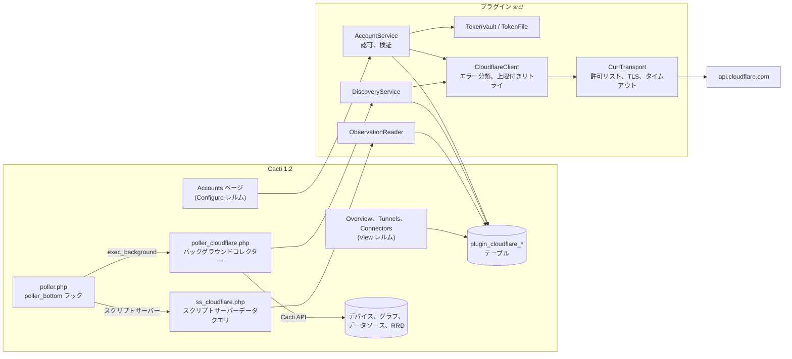
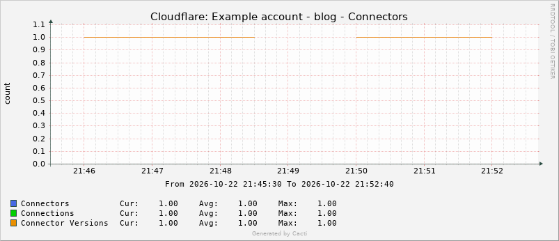

<!-- Source: README.md; SHA256: f8de0e02c5904e15bfa4c71edcaab219e5e5d4f6d9dbe589f4ed16351df6bf4d -->

<!-- translations:start -->
[English](../../../README.md) | [简体中文](../zh-CN/README.md) | [हिन्दी](../hi-IN/README.md) | [Español (España)](../es-ES/README.md) | [Español (Latinoamérica)](../es-419/README.md) | [العربية (السعودية)](../ar-SA/README.md) | [Afrikaans](../af-ZA/README.md) | [አማርኛ](../am-ET/README.md) | [العربية (مصر)](../ar-EG/README.md) | [العربية (المغرب)](../ar-MA/README.md) | [বাংলা](../bn-BD/README.md) | [Bosanski](../bs-BA/README.md) | [Deutsch](../de-DE/README.md) | [فارسی](../fa-IR/README.md) | [Filipino](../fil-PH/README.md) | [Français](../fr-FR/README.md) | [Français (Maroc)](../fr-MA/README.md) | [Français (Sénégal)](../fr-SN/README.md) | [Hausa](../ha-NG/README.md) | [עברית](../he-IL/README.md) | [Hrvatski](../hr-HR/README.md) | [Bahasa Indonesia](../id-ID/README.md) | [Igbo](../ig-NG/README.md) | [Italiano](../it-IT/README.md) | [日本語](README.md) | [한국어](../ko-KR/README.md) | [Malagasy](../mg-MG/README.md) | [मराठी](../mr-IN/README.md) | [Bahasa Melayu](../ms-MY/README.md) | [Nederlands](../nl-NL/README.md) | [Polski](../pl-PL/README.md) | [Português (Brasil)](../pt-BR/README.md) | [Русский](../ru-RU/README.md) | [Kinyarwanda](../rw-RW/README.md) | [Soomaali](../so-SO/README.md) | [Српски](../sr-RS/README.md) | [Svenska](../sv-SE/README.md) | [Kiswahili](../sw-KE/README.md) | [தமிழ்](../ta-IN/README.md) | [తెలుగు](../te-IN/README.md) | [ไทย](../th-TH/README.md) | [Türkçe](../tr-TR/README.md) | [Українська](../uk-UA/README.md) | [اردو](../ur-PK/README.md) | [Tiếng Việt](../vi-VN/README.md) | [isiXhosa](../xh-ZA/README.md) | [Yorùbá](../yo-NG/README.md) | [繁體中文](../zh-TW/README.md) | [isiZulu](../zu-ZA/README.md)
<!-- translations:end -->

<p align="center">
  
</p>

# Cacti 用 Cloudflare プラグイン

[](https://github.com/somethingwithproof/plugin_cloudflare/actions/workflows/ci.yml)
[](https://sonarcloud.io/summary/new_code?id=somethingwithproof_plugin_cloudflare)
[](../../../LICENSE)


[](https://sonarcloud.io/summary/new_code?id=somethingwithproof_plugin_cloudflare)
[](https://sonarcloud.io/summary/new_code?id=somethingwithproof_plugin_cloudflare)
[](https://sonarcloud.io/summary/new_code?id=somethingwithproof_plugin_cloudflare)


Cloudflare Tunnel とゾーン分析を監視するために構築中の Cacti 1.2 プラグインです。スコープを限定した API トークンを使用して Cloudflare API から読み取りを行い、Cloudflare 側の設定を変更することは一切なく、データはプラグイン独自のテーブルに保持します。Cacti 側ではデータクエリ XML ファイルを `resource/script_server/` にコピーし、Cacti 自身の API を通じてデバイス、グラフ、テンプレートを作成するため、コアファイルを変更する必要はありません。

**ステータス: 0.4.0-dev（未リリース）。** 最新のリリース済みバージョンは 0.3.0 です。開発版では、CSV インベントリ出力、削除されたトンネルの明示的な廃止処理（retirement）、キャッシュされたゾーン分析、およびオプションの Thold テンプレートが追加されています。実プロバイダー環境およびデプロイ検証は未完了です。

以下の表は 0.3.0 安定版リリースの内容を示しています。開発版の追加機能については、後述の「運用ワークフローとゾーン分析」で説明しています。

| 現在利用可能な機能 | 計画中の機能 |
|---|---|
| Cacti のプラグインマネージャーを通じたインストール、アップグレード、無効化、アンインストール | GraphQL 分析および Thold アラート（マイルストーン 4） |
| Cloudflare: View、Operator、および Configure 権限 | フォールトインジェクション、TLA+ モデル、および完全なドキュメント（マイルストーン 5） |
| Cloudflare アカウントの追加、編集、削除、有効化、無効化 | |
| ファイルまたは暗号化した状態で Cacti データベースにトークンを保存 | |
| トークンの検証およびトンネルとゾーンの読み取り権限の確認 | |
| メインポーラーから起動されるバックグラウンドコレクターでのトンネルおよびコネクターの検出 | |
| Management > Cloudflare Tunnels 配下の Overview、Tunnels、Connectors ページ | |
| ライフサイクル追跡: `active`、`unavailable`、`deleted` | |
| 管理者によって作成されるアカウントごとに 1 つの Cacti デバイス（トンネルをデータクエリのインデックスとして使用） | |
| トンネルごとに 1 つの RRD ファイルから描画される、トンネル単位の Connectors、Health、Collection グラフ | |
| プラグインが保証できない値は、0 ではなく未知値（`U`）として保存 | |

## アクセスロール

| レルム | アクセス権限 |
| --- | --- |
| Cloudflare: View | 既存の監視ページ。 |
| Cloudflare: Operator | 監視ページに加え、Operations ページおよび個人用のトリアージ確認（acknowledgment）。 |
| Cloudflare: Configure | Operator のアクセス権限に加え、既存の設定および管理操作。 |

アップグレード用ファイルをコピーした後、管理者として Plugins ページを開き、新しいレルムを登録してください。Operator レルムは **Configuration > Users** またはユーザーグループ配下で明示的に割り当ててください。アップグレードでは既存の View および Admin のレルム ID と付与権限が保持されます。Admin アクセス権限は Operator アクセス権限を継承し、Operator アクセス権限はリクエストごとに View アクセス権限を継承します。これによってユーザーやグループに保存済みの付与権限が追加されることはありません。プラグイン設定には、Cacti の Settings 権限に加えて Cloudflare: Configure アクセス権限も必要です。

Cloudflare アカウントの可視性は既存の View レルムに一致し、アカウント全体を対象とします。認証情報、設定、マッピング、削除などの管理変更は、引き続き管理ページ内にとどまります。確認状態（acknowledgment）は現在のユーザーのセッション内でのみ、最長 1 時間、かつ同じ観測結果が最新（fresh）である間だけ有効です。新しい観測結果や変更された観測結果があると無効化されます。確認状態によって失敗した測定が正常とみなされたり、アラートが抑制されたりすることはありません。

## このプラグインが必要な理由

Cloudflare Tunnel 経由でサービスを公開している Cacti 運用者は、Cacti 内部からトンネルの状態を把握する手段がありません。オリジンホストがまだ SNMP に応答している間にトンネルがすべてのコネクターを失うことがあり、その場合、ユーザーにはエラーが発生しているにもかかわらず既存のグラフは緑色のままになります。このプラグインの目的は、Cacti に Cloudflare を変更する権限を一切与えることなく、運用者がすでに監視しているデバイスグラフの隣にトンネルの健全性とゾーントラフィックを並べて表示することです。

設計は以下の 3 つの制約に基づいています。

- **読み取り専用（Read-only）:** プラグインは `GET` エンドポイントと GraphQL Analytics API のみを呼び出します。どの Cloudflare リソースに対しても編集権限を必要としません。
- **オプショナル（Optional）:** Cloudflare の障害、期限切れのトークン、レート制限によって Cacti UI が遅延したり、他のデバイスのポーリングが停止したりしてはなりません。すべての API 呼び出しには厳格なタイムアウトが設定されており、収集処理はポーラーによって起動されるバックグラウンドプロセスで実行されます。
- **コア変更なし（No core changes）:** プラグインは Cacti 1.2 のプラグインフックと独自のテーブルを使用します。データクエリ XML ファイルを 1 つ `resource/script_server/` にコピーし、Cacti 自身の API を通じてデバイス、グラフ、テンプレートを作成します。コアファイルは一切変更しないため、Cacti のアップグレードや他のプラグインに影響を与えません。

## 仕組み



- **Cacti 連携層（Cacti glue）**（`setup.php`、`includes/`、および各ページスクリプト）はフックとレルムを登録し、Cacti 自身のヘルパーを使用してページを描画し、すべてのアクションを `src/` 内のライブラリに委譲します。
- **ライブラリ**（`src/`、名前空間 `Somethingwithproof\Cloudflare\`）は Cacti のグローバル変数に依存しないため、Cacti を稼働させなくても実データベースとフェイク HTTP トランスポートに対してテストできます。
- **単一の送信経路:** ネットワーク通信を行うコードは `CurlTransport` のみであり、`https://api.cloudflare.com` のみを許可します。各失敗は 1 つのエラークラス（`auth`、`permission`、`rate_limited`、`transient` など）にマッピングされ、これが UI に表示されるステータスを決定します。
- **ストレージ**はプリペアドステートメントを使用して Cacti 自身の PDO 接続経由で行われます。スキーマ変更は番号付きの冪等なマイグレーションとして管理されています。

設計上の決定とその理由については、[docs/design.md](../../design.md) をご覧ください。

## スクリーンショット

スクリーンショットは実際の Cloudflare アカウントではなく、テスト用スタックから取得したものです。このスタックはフィクスチャデータを返すフェイク Cloudflare API に対して Cacti 1.2.31 を実行しているため、アカウント名、ID、および 3 つのトンネルはプレースホルダーです。


*Cloudflare Accounts 一覧。フェイク API がトークンを受け入れるため、Verify の結果は `ok` と報告されます。*


*アカウントの編集画面。トークン欄は常に空になっており、保存されたトークンがブラウザに返されることはありません。Collect Tunnels と Create Graphs が有効で、Collect Analytics は無効です。Connection Status には前回の Verify の結果（`ok`、トンネル読み取り権限あり、ゾーン読み取り権限なし）が表示されています。*


*Settings > Cloudflare。*


*Management > Cloudflare Tunnels > Overview。ステータスはアカウントのアクティブなトンネルの中で最悪の Cloudflare ステータスになり、ここではフィクスチャのトンネルの 1 つがダウンしているため `down` となっています。`Disabled`、`Not collected`、`Collection failing`、`Not yet collected` はこの順序でトンネルの健全性よりも優先されるため、前回の実行が失敗したアカウントはトンネルの報告内容にかかわらず `Collection failing` と表示されます。*


*Tunnels タブ。フェイク API が old-office の接続リクエストに対して未知のトンネルとして応答し何も保存されなかったため、old-office の Connectors と Connections は `-` と表示されています。稼働中のコネクターがない staging では 0 と表示されています。*



*blog トンネルの Connectors グラフ。3 本の線はすべて中央の空白期間の前と後で 1 になっています。この空白期間ではフェイク API がエラーを返し、プラグインが未知値を保存したため、線が 0 に落ちることはありません。このグラフも同じフィクスチャスタック（`make screenshots`）から生成されており、7 分間のポーリングでグラフが埋まるように、このデータソースのみステップ間隔を 30 秒に設定しています。*

## 要件

- Cacti 1.2.25 ～ 1.2.31。Cacti 1.2.31 自体は PHP 8.0 以降が必要です。
  CI では 1.2.31 のみをテストしています。1.2.25 は 2026-10-22 に手動で最終テストが行われました。
- `curl`、`openssl`、および `pdo_mysql` 拡張モジュールを含む PHP 7.4 ～ 8.4。
  これらがない場合、プラグインは有効化を拒否します。
- MariaDB 10.6 以降、または MySQL 8.0 以降。
- Cacti サーバーから `api.cloudflare.com` への HTTPS アクセス。プロキシはサポートされていません。

テスト対象の詳細については、[docs/compatibility.md](../../compatibility.md) を参照してください。

## インストール

1. [GitHub Releases](https://github.com/somethingwithproof/plugin_cloudflare/releases) からアーカイブを展開するか（リリースタグのチェックアウトで `make package` を実行すると同じアーカイブがビルドされます）、git clone によって、Cacti の `plugins/cloudflare` ディレクトリにプラグインを配置します。ディレクトリ名は `cloudflare` にする必要があります。
2. Console > Configuration > Plugins から、または Web サーバーユーザーとして CLI を使用してインストールおよび有効化します。

   ```sh
   php cli/plugin_manage.php --plugin=cloudflare --install --enable
   ```

3. インストール時に、admin ユーザーには Cloudflare: Configure 権限が付与されます。Console > Configuration > Users で、他のユーザーやグループにもこの権限を付与してください。
4. [docs/token-permissions.md](../../token-permissions.md) に記載されている権限を持つトークンを作成します。概要としては、Account > Cloudflare Tunnel > Read、およびオプションで Zone > Zone > Read です。
5. 以下の 2 通りの方法のいずれかでトークンを保存し、Console > Configuration > Cloudflare Accounts でアカウントを追加して、アクションメニューから Verify を実行します。

### オプション A: データベースに暗号化して保存

プラグインは、ユーザーが作成した 32 バイトの鍵を使用してトークンを暗号化します。プラグイン自身が鍵を作成したり書き込んだりすることはありません。鍵ファイルは Web サーバーユーザーおよびポーラーユーザーが読み取り可能で、他のユーザーからは読み取り不可である必要があり、そのディレクトリもそれらのユーザーがアクセスできる必要があります。Web サーバーが `www-data` として実行されている場合の例は次のとおりです。

```sh
sudo mkdir -p /etc/cacti
sudo sh -c 'umask 077 && openssl rand -hex 32 > /etc/cacti/cloudflare.key'
sudo chgrp www-data /etc/cacti/cloudflare.key
sudo chmod 0440 /etc/cacti/cloudflare.key
```

デフォルトのパスは `/etc/cacti/cloudflare.key` です。変更する場合は Settings > Cloudflare > Token Vault Key File で設定します。鍵が存在しないか拒否された場合、編集フォームにはトークンファイルのオプションのみが表示されます。鍵のバックアップを保管してください。鍵がない場合、保存されたトークンを復号できなくなり、再入力が必要になります。

#### 鍵のローテーション

鍵を再暗号化（rekey）するコマンドはありません。新しい鍵では古い鍵で保存されたトークンを復号できないため、ローテーションでは保存済みの各トークンを再入力する必要があります。

1. 各アカウントのトークン値を用意します。Cloudflare はトークンの作成時またはロール（再発行）時にのみトークン値を表示するため、手元にない場合は Cloudflare ダッシュボードでトークンをロールしてください。
2. 上記のコマンドを使用して、同じ所有者およびパーミッションで新しいパス（たとえば `/etc/cacti/cloudflare.key.new`）に新しい鍵を作成します。
3. Settings > Cloudflare > Token Vault Key File に新しいパスを設定して保存します。
   これ以降、古い鍵で暗号化されたままのアカウントで Verify を実行すると "Stored token cannot be decrypted" と報告され、コレクターの実行ごとにそのアカウントに対して `reason=decrypt_failed` とともに `discovery token unavailable` がログに記録されます。
4. トークンをデータベースに保存している各アカウントについて、Console > Configuration > Cloudflare Accounts で該当アカウントを開き、両方のトークンフィールドにトークンを貼り付けて保存し、Verify を実行します。`ok` と報告されるはずです。
5. 該当するすべてのアカウントで検証が成功したら、古い鍵ファイルとそのバックアップを削除します。

手順 3 と 4 の間は、アカウントのトンネルは更新されず、そのヘルス、コネクタ、および接続グラフには U が記録されます。トークンファイルを使用するアカウントは影響を受けません。

### オプション B: トークンファイル

Web サーバーユーザーとポーラーユーザーのみが読み取れ、他のユーザーは読み取れないファイルにトークンのみ（余計な文字を含めず）を書き込み、編集フォームにその絶対パスを入力します。

```sh
sudo sh -c 'umask 077 && cat > /etc/cacti/cloudflare-account.token'   # paste the token, then Ctrl-D
sudo chgrp www-data /etc/cacti/cloudflare-account.token
sudo chmod 0440 /etc/cacti/cloudflare-account.token
```

ファイルは保存時ではなく、Verify 実行時の読み取り時にチェックされます。シンボリックリンク、4 KiB を超えるファイル、および他のユーザーが読み取りまたは書き込み可能なファイルは拒否されます。

Cloudflare: Configure 権限を持つユーザーは任意のパスを入力でき、ポーラーユーザーがそのパスを読み取ります。トークンファイルを 1 か所にまとめるには、Settings > Cloudflare > Token File Directory をたとえば `/etc/cacti` に設定します。設定すると、そのディレクトリ外のパスは拒否されます。[docs/security.md](../../security.md#token-file) を参照してください。

## アップグレード

1. ディレクトリ名を維持したまま、`plugins/cloudflare` 内のファイルを新しいリリースに置き換えます。
2. 管理者として Console > Configuration > Plugins または Console > Configuration > Cloudflare Accounts を 1 回開きます。これによりプラグインのマイグレーションが実行され、Cloudflare テンプレートがインポートされ、データクエリファイルがコピーされます（[トンネルのメトリクスとグラフ](#tunnel-metrics-and-graphs)を参照）。また、0.1.0 からのアップグレード時には `poller_bottom` フックが登録されます。

`poller.php` はプラグインのアップグレードを実行しないため、手順 2 を行うまで新しいスキーマが存在しない状態になります。その間、コレクターの各実行では何も処理が行われず、`CLOUDFLARE: collector skipped; plugin upgrade pending, open Console > Plugins` がログに記録されます。Cloudflare Tunnels ページには Cloudflare: View 権限のみが必要であるためアップグレードは実行されず、手順 2 を完了するまでは "The Cloudflare tunnels could not be read" と表示される場合があります。

## アカウントステータス

Verify によりアカウントのステータスが設定されます。

| ステータス | 意味 |
|---|---|
| `unknown` | アカウントの追加後、または認証情報の変更後に未検証の状態です |
| `ok` | トークンは有効であり、トンネルを読み取ることができます |
| `token_inactive` | Cloudflare からトークンが無効化または期限切れとして報告されました |
| `auth_failed` | Cloudflare がトークンを無効または期限切れとして拒否しました（HTTP 401） |
| `permission_denied` | トークンは有効ですがトンネルを読み取れないか、トークン検証エンドポイントを呼び出す権限がありません（HTTP 403） |
| `unreachable` | API に到達できないか、タイムアウトまたはサーバーエラーが返されました |
| `rate_limited` | Cloudflare から HTTP 429 が返されました |
| `error` | トークンファイルが存在しない・安全でない、トークンボルト鍵ファイルが存在しない・使用できない、保存されたトークンを復号できないなどのその他のエラーです |

編集ページでは、トンネルの読み取り権限とゾーンの読み取り権限が付与されているかどうかも表示されます。

## トンネル検出

メインポーラーでの各ポーリングサイクル終了後、Collect Tunnels がオンになっている有効なアカウントが少なくとも 1 つ存在する場合、`poller_bottom` フックが `exec_background` を使用してバックグラウンドコレクターを起動します。コレクターがポーラーのプロセス内で実行されることはないため、Cloudflare API の応答が遅くても `poller.php` が遅延することはありません。リモートポーラーがコレクターを起動することはありません。

実行時期に達した各アカウントについて、コレクターはアカウントのトンネル一覧を取得し、次にアクティブなトンネルの接続情報を読み取ります。これにより、各トンネルのコネクタ、そのバージョン、データセンター、およびオリジンアドレスが取得されます。アカウントは Discovery Interval（デフォルト 300 秒）ごとに実行対象になります。1 回の実行では 50 秒経過後は新しいアカウントを開始せず、最大 200 回の接続リクエストを行います。接続情報の読み取り途中でいずれかの制限に達してアカウントの処理が中断されることもあり、その場合はアカウントが `partial` として記録され、次回の実行では最も長い間試行されていないトンネルから処理が再開されます。開始されなかったアカウントは次回の実行でも実行対象のままとなります。

トンネルには、Cloudflare が報告するステータス（`healthy`、`degraded`、`down`、または `inactive`）とは別にライフサイクルがあります。

| ライフサイクル | 意味 |
|---|---|
| `active` | 直近の完全な一覧取得にそのトンネルが含まれていました |
| `deleted` | 完全な一覧取得にそのトンネルが含まれませんでした（空の一覧取得を含みます）。行とその履歴は保持され、再び一覧に現れるとトンネルは再び `active` になります |
| `unavailable` | 間に完全な一覧取得を挟まずに、カウント対象の障害が 3 回発生したため、トンネルの状態が不明になっています |

完全かつ成功した一覧取得のみがトンネルの追加、更新、または削除を行い、失敗した一覧取得によってトンネルが削除されることはありません。Cloudflare からの読み取り自体が失敗した場合（`transient`、`rate_limited`、`auth`、または `permission`）は障害としてカウントされます。間に完全な一覧取得を挟まずにカウント対象の障害が 3 回発生すると、そのアカウントのアクティブなトンネルは `unavailable` になります。次の完全な一覧取得が成功すると、それらは復元され、カウントがリセットされます。接続情報の読み取り時に Cloudflare 側で既に存在しなくなっていたトンネルは、アカウント全体の失敗にはせずスキップされます。その他の失敗では、障害カウンターは増加もリセットもされません。

`cacti.log` では、検出に関する行は `CLOUDFLARE: discovery` で始まり、実行サマリーは `CLOUDFLARE: collector` で始まります。一覧取得の失敗やトンネルが `unavailable` になるなどの失敗とライフサイクルの変更は Cacti のデフォルトの `LOW` レベルでログに記録され、各アカウントの結果と実行サマリーは `MEDIUM` で記録されます。接続情報の読み取りはすべてのトンネルで失敗する可能性があるため、各アカウントにつき各エラークラスの最初の失敗のみが `LOW` で記録され、残りは `MEDIUM` で記録された後、エラークラスごとに失敗したトンネル数を示す 1 行の `LOW` ログが続きます。

Management > Cloudflare Tunnels には Cloudflare: View 権限が必要であり、読み取り専用です。

- **Overview** では、各アカウントのステータス、ライフサイクル別のトンネル数、直近の成功した検出日時、および連続失敗回数が一覧表示されます。
- **Tunnels** では、複数アカウントまたは特定の 1 アカウントのトンネルが一覧表示され、アカウント、ライフサイクル、ステータス、名前によるフィルターと、ソート可能な列を利用できます。
- **Connectors** では、Tunnels タブで選択したトンネルのコネクタが表示されます。

## トンネルのメトリクスとグラフ

Cacti はスクリプトサーバーデータクエリ `ss_cloudflare.php` を通じてトンネルの状態を読み取ります。このスクリプトはプラグインのテーブルのみから応答を返し、Cloudflare を呼び出すことはないため、Cloudflare の障害によってポーラーが遅くなることはありません。各トンネルからは、ヘルス（healthy: 3、degraded: 2、down: 1、inactive: 0）、コネクタ数、接続数、コネクタバージョン数、直近の接続情報読み取りからの経過秒数、および検出ジョブの連続失敗回数の 6 つの値が返されます。ヘルス、コネクタ数、接続数、およびバージョン数は、プラグインが値を保証できる場合（直近の検出が成功しており、トンネルが `active` であり、かつ読み取りが最新である場合）にのみ出力されます。それ以外の場合は `U` が出力され、障害のように見えるゼロ値ではなくギャップ（欠損）としてグラフに表示されます。2 つの収集値（経過秒数と連続失敗回数）は障害中も出力され続けるため、Collection グラフに障害の状況が表示されます。これらが `U` になるのは、削除されたトンネルまたは接続情報が一度も更新されていないトンネルの場合のみです。詳細なルールは [docs/metrics.md](../../metrics.md) に記載されています。

### デバイスの作成

1 つのアカウントは最大 1 つの Cacti デバイスにマッピングされます。デバイスは、Cloudflare Tunnels データクエリのインデックスとしてアカウントのトンネルを保持します。デバイスが自動的に作成されることはありません。

1. Console > Configuration > Cloudflare Accounts を開きます。
2. アカウントを選択し、アクションメニューから Create Cacti Device を選んで確定します。

この操作には、Cloudflare: Configure レルムと Cacti の Sites/Devices/Data レルム（`host.php` 用のレルム）の両方が必要です。このメニュー項目は両方の権限を持つユーザーにのみ表示され、それ以外のユーザーからのリクエストはサーバー側で拒否されます。作成されるデバイスには `Cloudflare: <account name>` という名前が付けられ、Cloudflare Account ホストテンプレートとメインポーラーを使用し、SNMP バージョン 0・死活監視なしに設定され、ホスト名には `<account ID>.cloudflare.invalid` が割り当てられます。このホスト名は予約済みであり名前解決されることはないため、Cacti が実際に接続を試みることはありません。アカウントに既にデバイスが存在する場合、この操作はその旨を通知して何も変更しません。管理者が Cacti 上でデバイスを削除した場合、Create Cacti Device を再度実行するまでプラグインが別のデバイスを作成することはありません。

### グラフの作成

アカウントフォームの Create Graphs はデフォルトでオフになっています。オンにすると、アカウントの検出が `ok` または `partial` で終了するたびに、コレクターがデバイスのインデックスを再作成し、アカウントの `active` なトンネルに対して不足しているグラフ（Connectors、Health、Collection のトンネルごとに 3 種類）を作成します。1 つのトンネルの 3 つのグラフは 1 つの RRD ファイルを共有します。1 回の実行で作成されるグラフは最大 50 個までで、20 秒経過すると停止し、次回の実行で続きが処理されます。プラグインが Cacti オブジェクトを削除することはありません。管理者が削除したグラフは再作成されず、Cloudflare の一覧から消えたトンネルもグラフと RRD ファイルを保持し、`U` を表示します。

Create Graphs をオンにするには両方のレルムが必要です。オフにするには Configure レルムのみが必要です。Sites/Devices/Data レルムを持たないユーザーがフォームを保存すると、警告が表示され、設定は変更前の状態のまま維持されます。Create Graphs がオフの場合でも、検出のたびにデバイスのインデックスは再作成されるため、新しいトンネルはデータクエリのインデックスとして表示されます。

### データクエリファイル

Cacti 1.2.31 は、`resource` ディレクトリ内にあるデータクエリ XML のみを読み込みます。そのため、インストールおよびアップグレード時に、プラグインは 1 つのファイル `templates/resource/cloudflare_tunnels.xml` を `<Cacti>/resource/script_server/cloudflare_tunnels.xml` にコピーします。これはプラグインが自身のディレクトリ外に書き込む唯一のファイルであるため、プラグインをインストールまたはアップグレードするユーザーはそのディレクトリへの書き込み権限を持っている必要があります。
アンインストール時も、デバイス、グラフ、RRD ファイル、およびテンプレートとともにこのファイルは保持されます。コピーまたはテンプレートのインポートに失敗した場合、プラグインはログに記録し、Create Cacti Device 実行時に再試行します。

## 設定

Settings > Cloudflare には以下の項目があります：

- **Token Vault Key File**: ボールトキーへのパスです。
- **Token File Directory**: 設定されている場合、そのディレクトリ外のトークンファイルは拒否されます。デフォルトは空であり、任意のパスが許可されます。[docs/security.md](../../security.md#token-file) を参照してください。
- **Interactive Request Timeout**: Verify など、Web インターフェースから行われるリクエストの合計タイムアウト秒数です。デフォルトは 10 で、5 ～ 60 の範囲外の値は 10 にフォールバックします。
- **Collector Request Timeout**: バックグラウンドコレクターによって行われるリクエストの合計タイムアウト秒数です。デフォルトは 20 で、5 ～ 60 の範囲外の値は 20 にフォールバックします。
- **Log Level**: 保存されますが、現時点ではどこからも参照されません。

アカウントフォームでは、Collect Tunnels と Discovery Interval がディスカバリを制御し、Create Graphs がグラフの作成を制御します。Collect Analytics は保存されますが、このリリースでは機能しません。

## 言語

このプラグインには、スペイン語（スペイン、`es-ES`）、フランス語（`fr-FR`）、ドイツ語（`de-DE`）、簡体字中国語（`zh-CN`）、ヒンディー語（`hi-IN`）、アラビア語（`ar-SA`）、および日本語（`ja-JP`）の翻訳が同梱されています。言語サポートを有効にし（Configuration > Settings > General > Language Support）、ユーザーが言語を選択すると Cacti に表示されます。ラテンアメリカスペイン語のカタログ（`es-419`）も同梱されていますが、Cacti 1.2 には選択可能なラテンアメリカスペイン語のロケールがないため、Cacti 側で追加された場合にのみ有効になります。それまではスペイン語（`es-ES`）を選択してください。

一部のテキストは英語のまま表示されます。プラグインが保存してそのまま表示するステータス値（`ok`、`active`、`unavailable`、`deleted`、および Cloudflare が報告するトンネルステータス）と、プラグインが Cacti ログに書き込むすべての内容が該当します。

## アンインストールとデータ保持

アンインストールを実行すると、アカウント、暗号化されたトークン、検出されたトンネル、ジョブの状態、および作成された Cacti オブジェクトの記録を保持するプラグイン独自のテーブルが削除され、`cloudflare_` で始まる設定も削除されます。キーファイル、トークンファイル、コピーされた `resource/script_server/cloudflare_tunnels.xml`、および Cacti のデバイス、グラフ、データソース、RRD ファイル、テンプレートは削除されません。これらには過去の監視データが保持されているため、削除は Cacti 上で管理者が明示的に行う必要があります。

保持されたデバイスはデータの受信を停止します。アンインストール後、またはアカウントの削除後は、そのホストを所有するアカウントが存在しなくなるため、グラフには過去の履歴が残りますが、それ以降は `U` が出力されます。再インストールまたは再追加したアカウントで Create Cacti Device を実行すると、古いデバイスは再利用されず新しいデバイスが作成されるため、履歴が不要になった時点で古いデバイスを Cacti から削除してください。

## 既知の制限事項

- 1 回の実行で行われる接続リクエストは最大 200 件です。この上限を超えるトンネルは観測ウィンドウよりも低い頻度で更新されるため、接続グラフに欠損が生じます。
- アップグレードによって同梱のテンプレート XML が変更された場合、インポート済みテンプレートに対する管理者の編集内容はプラグインによって上書きされます。
- アカウントのデバイスはメインポーラー上に配置しておく必要があります。プラグインのテーブルはメインデータベースにあり、スクリプトはそこからデータを読み取ります。
- 削除されたトンネルは、管理者が明示的に廃止（retire）するまでデータクエリインデックスに残り、`U` を出力し続けます。廃止処理では、Cacti を通じてプラグインが記録したグラフと非共有のデータソースのみが削除され、インベントリ行は表示されたままになります。RRD のクリーンアップは Cacti によって制御されます。
- メモリ不足などの真の致命的エラー（fatal error）でコードが終了した場合、Cacti はプラグインを無効化します。[docs/security.md](../../security.md) を参照してください。

## セキュリティ

- Global API Key は拒否され、スコープ付き API トークンのみが受け付けられます。
- トークンはユーザーが用意したファイルに保存されるか、データベースには決して格納されないキーファイルを用いて AES-256-GCM で暗号化されます。トークンがページに表示されたり、ログに書き込まれたり、エラーメッセージに含まれたりすることはありません。
- データベースエラーには SQLSTATE とドライバーのエラーコードのみが含まれ、ステートメントの値は一切含まれません。
- すべての変更操作は、Cacti の CSRF トークンで保護された POST リクエストです。管理用アカウントおよび設定の変更には Cloudflare: Configure 権限が必要であり、個人的なトリアージの確認応答（acknowledgment）には Cloudflare: Operator 権限が必要です。Cacti デバイスの作成や Create Graphs の有効化には、Cacti の Sites/Devices/Data 権限も必要です。無効化されたプラグインはページへのアクセスを拒否します。

詳細および既知の制限事項については [docs/security.md](../../security.md) を参照してください。脆弱性の報告は [SECURITY.md](../../../SECURITY.md) に記載されている非公開の方法で行ってください。

## オペレーターワークフローとゾーンアナリティクス

開発中の追加機能には、削除されたトンネルの明示的な廃止処理、プランや機能に応じた（capability-aware）ゾーンアナリティクス、およびインポート可能な Thold テンプレートが含まれます。これらの追加機能には、まだリリースタグや実アカウントでの検証実績がありません。セットアップ、メトリクスの意味、および検証の制限事項については [docs/analytics-and-alerting.md](../../analytics-and-alerting.md) を参照してください。

### インベントリのエクスポート

Tunnels ページおよび Connectors ページでは、Cloudflare: View 領域向けに Export 機能が提供されています。トンネルの CSV ファイルには、すべてのページにわたって現在のアカウント、ライフサイクル、ステータス、検索、および並び替え設定に一致するすべての行が含まれます。コネクターの CSV ファイルには、選択したトンネルのバージョン、アーキテクチャ、データセンター、およびオリジンアドレスが含まれます。ダウンロードではキャッシュされたレコードのみが読み取られます。不明なカウント値は空欄となり、数式のように見えるセルには表計算ソフトへ安全にインポートできるよう先頭にアポストロフィが付与されます。

## ロードマップ

各マイルストーンは、その番号に対応した 0.x リリースとして出荷されます（マイルストーン 3 は 0.3.0、マイルストーン 4 は 0.4.0 となります）。マイルストーン 1 および 2 は単独ではリリースされず、0.3.0 の一部として含まれています。バージョン 1.0.0 は、以下のすべてのマイルストーンを完了したリリース向けに予約されています。

| マイルストーン | 範囲 | 状態 |
|---|---|---|
| 1. Foundation | プラグインのライフサイクル、権限、アカウント設定、接続テスト | 0.3.0 でリリース済み（[#2](https://github.com/somethingwithproof/plugin_cloudflare/pull/2) ～ [#5](https://github.com/somethingwithproof/plugin_cloudflare/pull/5)） |
| 2. Discovery | バックグラウンドコレクターでのトンネルおよびコネクターの検出、Overview、Tunnels、Connectors ページ | 0.3.0 でリリース済み（[#6](https://github.com/somethingwithproof/plugin_cloudflare/pull/6)） |
| 3. Metrics | トンネルヘルスのデータソース、グラフテンプレート、捏造されたゼロを記録しない障害処理 | 0.3.0 でリリース済み（[#7](https://github.com/somethingwithproof/plugin_cloudflare/pull/7)） |
| 4. Analytics and alerting | ゾーンごとのプラン対応 GraphQL アナリティクス、障害抑制付き Thold しきい値 | 予定 |
| 5. Hardening | フォールトインジェクション、ディスカバリと収集の TLA+ モデル、完全なドキュメント | 予定 |

## 開発

開発ツールには PHP 8.x と Composer が必要ですが、プラグインコード自体は PHP 7.4 との互換性を維持しています。結合テストおよび BDD テストにはデータベースが必要であり、`make db-up` を実行すると Docker 上のポート 33061 で起動します。

```sh
composer install
make db-up
make ci            # unit, integration, BDD, PHPStan, php-cs-fixer, php -l on PHP 7.4
make smoke         # installs the plugin into Cacti 1.2.31 in Docker and walks its lifecycle
make package       # builds build/cloudflare-<version>.tar.gz and checks its contents
make db-down
```

`make smoke` および `make screenshots` には Cacti のチェックアウトが必要です。`CACTI_REPO` にそのパスを設定してください。結合テストは `CF_TEST_DSN`、`CF_TEST_DB_USER`、および `CF_TEST_DB_PASS` を読み込み、`CI` が設定されていない限りデータベースに接続できない場合はスキップされます。

## コントリビューション

プルリクエストを歓迎します。各コミットには DCO サインオフ（`git commit -s`）が必要です。テストを先に記述し、`make ci` がパスすることを確認してください。また、Cacti 連携部分の変更では `make smoke` もパスする必要があります。プラグインコードは PHP 7.4 互換を維持し、Cacti のコードスタイル（タブ、シングルクォート、同一行の波括弧）に従う必要があります。

### 翻訳

メッセージは `__('...', 'cloudflare')` でマークされています。`locales/build_gettext.sh`（GNU gettext を必要とする `make i18n`）を実行すると、テンプレート `locales/po/cacti.pot` が再生成され、各カタログ `locales/po/<locale>.po` にマージされて `locales/LC_MESSAGES/<locale>.mo` がコンパイルされます。これら 3 種類すべてをコミットしてください。CI は `make i18n-check` を実行し、カタログの欠落や fuzzy エントリがある場合、フォーマット文字列が異なる場合、またはコンパイル済みファイルが古い場合に失敗します。さらにユニットテストスイートでも、すべてのエントリのプレースホルダー、HTML タグ、前後の空白がチェックされます。したがって、メッセージを変更した場合は同じプルリクエスト内で翻訳も更新する必要があります。新しい言語を追加する場合は、Cacti のロケール命名規則に従った `<locale>.po`（例: `pt-BR`）を新規作成し、`CatalogTest::LOCALES` および `tests/build/package.sh` 内のアーカイブチェックに追加してください。Cloudflare、Cacti、Thold の製品名、API、GraphQL、および `Account Cloudflare Tunnel Read` などの権限名はそのまま変更しないでください。

## ドキュメント

- [docs/security.md](../../security.md): セキュリティ制御と既知の制限事項
- [docs/token-permissions.md](../../token-permissions.md): トークン権限
- [docs/compatibility.md](../../compatibility.md): サポート対象バージョンと使用されるインターフェース
- [docs/metrics.md](../../metrics.md): メトリクスカタログおよび値が不明になる条件
- [docs/collector-protocol.md](../../collector-protocol.md): `ss_cloudflare.php` が読み取り、出力する内容
- [docs/schema.md](../../schema.md): データベーステーブル
- [docs/design.md](../../design.md): 設計上の決定事項
- [CHANGELOG.md](../../../CHANGELOG.md)

## ライセンス

GPL-2.0-or-later です。[LICENSE](../../../LICENSE) を参照してください。

## 商標

Cloudflare は Cloudflare, Inc. の登録商標です。本プロジェクトは独立したオープンソースツールであり、Cloudflare, Inc. と提携、支援、または推奨されたものではありません。

また、本プロジェクトは Cacti プロジェクトとも提携していません。ロゴについては [docs/images/README-logo.md](../../images/README-logo.md) を参照してください。
