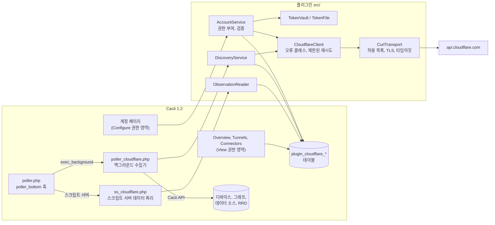

<!-- Source: README.md; SHA256: 813d1c85c236b426b83e42e63c69496f33f8909b5e435d0d45efa6a4ba2f17ca -->

<!-- translations:start -->
[English](../../../README.md) | [简体中文](../zh-CN/README.md) | [हिन्दी](../hi-IN/README.md) | [Español (España)](../es-ES/README.md) | [Español (Latinoamérica)](../es-419/README.md) | [العربية (السعودية)](../ar-SA/README.md) | [Afrikaans](../af-ZA/README.md) | [አማርኛ](../am-ET/README.md) | [العربية (مصر)](../ar-EG/README.md) | [العربية (المغرب)](../ar-MA/README.md) | [বাংলা](../bn-BD/README.md) | [Bosanski](../bs-BA/README.md) | [Deutsch](../de-DE/README.md) | [فارسی](../fa-IR/README.md) | [Filipino](../fil-PH/README.md) | [Français](../fr-FR/README.md) | [Français (Maroc)](../fr-MA/README.md) | [Français (Sénégal)](../fr-SN/README.md) | [Hausa](../ha-NG/README.md) | [עברית](../he-IL/README.md) | [Hrvatski](../hr-HR/README.md) | [Bahasa Indonesia](../id-ID/README.md) | [Igbo](../ig-NG/README.md) | [Italiano](../it-IT/README.md) | [日本語](../ja-JP/README.md) | [한국어](README.md) | [Malagasy](../mg-MG/README.md) | [मराठी](../mr-IN/README.md) | [Bahasa Melayu](../ms-MY/README.md) | [Nederlands](../nl-NL/README.md) | [Polski](../pl-PL/README.md) | [Português (Brasil)](../pt-BR/README.md) | [Русский](../ru-RU/README.md) | [Kinyarwanda](../rw-RW/README.md) | [Soomaali](../so-SO/README.md) | [Српски](../sr-RS/README.md) | [Svenska](../sv-SE/README.md) | [Kiswahili](../sw-KE/README.md) | [தமிழ்](../ta-IN/README.md) | [తెలుగు](../te-IN/README.md) | [ไทย](../th-TH/README.md) | [Türkçe](../tr-TR/README.md) | [Українська](../uk-UA/README.md) | [اردو](../ur-PK/README.md) | [Tiếng Việt](../vi-VN/README.md) | [isiXhosa](../xh-ZA/README.md) | [Yorùbá](../yo-NG/README.md) | [繁體中文](../zh-TW/README.md) | [isiZulu](../zu-ZA/README.md)
<!-- translations:end -->

<p align="center">
  
</p>

# Cacti용 Cloudflare 플러그인

[](https://github.com/somethingwithproof/plugin_cloudflare/actions/workflows/ci.yml)
[](https://sonarcloud.io/summary/new_code?id=somethingwithproof_plugin_cloudflare)
[](../../../LICENSE)


[](https://sonarcloud.io/summary/new_code?id=somethingwithproof_plugin_cloudflare)
[](https://sonarcloud.io/summary/new_code?id=somethingwithproof_plugin_cloudflare)
[](https://sonarcloud.io/summary/new_code?id=somethingwithproof_plugin_cloudflare)


Cloudflare Tunnel과 영역(zone) 분석을 모니터링하기 위해 개발 중인 Cacti 1.2 플러그인입니다. 범위가 지정된 API 토큰으로 Cloudflare API를 읽기 전용으로 조회하며, Cloudflare의 설정은 절대 변경하지 않고 데이터는 자체 테이블에 저장합니다. Cacti에서는 데이터 쿼리 XML 파일을 `resource/script_server/`에 복사하고 Cacti 자체 API를 통해 디바이스, 그래프 및 템플릿을 생성하므로 코어 파일을 수정하지 않습니다.

**상태: 0.4.0-dev, 미출시.** 마지막으로 릴리스된 버전은 0.3.0입니다. 개발 버전에는 CSV 인벤토리 내보내기, 삭제된 터널의 명시적 만료(retirement) 처리, 캐시된 영역 분석, 허용 목록 기반의 읽기 전용 GraphQL Analytics 클라이언트(`GraphqlAnalyticsClient`) 및 Thold용 요약 도우미(`AnalyticsSummary`), Configuration-as-Code CLI(`cli/cloudflare.php`), 에코시스템 훅(`abilities_register`, `doctor_register_checks`, `casc_register_providers`), 그리고 폴러 범위 원격 수집기 지원(`replicate_out`)이 추가되었습니다. 실제 공급자 연동 및 배포 검증은 아직 진행 중입니다.

아래 표는 0.3.0 안정 버전을 기준으로 설명합니다. 0.4.0-dev의 개발 중인 추가 기능은 아래의 운영자 워크플로 및 영역 분석 섹션에 설명되어 있습니다.

| 현재 사용 가능 | 예정 |
|---|---|
| Cacti 플러그인 관리자를 통한 설치, 업그레이드, 비활성화 및 제거 | 실제 계정 GraphQL 및 배포 검증(마일스톤 4 종료) |
| Cloudflare: View, Operator 및 Configure 권한 | 장애 주입(Fault injection), TLA+ 모델 및 전체 문서화(마일스톤 5) |
| Cloudflare 계정 추가, 편집, 삭제, 활성화 및 비활성화 | |
| 파일 또는 Cacti 데이터베이스에 암호화하여 토큰 저장 | |
| 토큰 검증 및 터널·영역 읽기 권한 확인 | |
| 메인 폴러가 시작하는 백그라운드 수집기(`poller_cloudflare.php`)에서의 터널 및 커넥터 검색 | |
| Management > Cloudflare Tunnels 아래의 Overview, Tunnels 및 Connectors 페이지 | |
| 수명 주기 추적: `active`, `unavailable` 및 `deleted` | |
| 관리자가 계정당 하나의 Cacti 디바이스를 생성하며, 터널을 데이터 쿼리의 인덱스로 사용 | |
| 터널당 하나의 RRD 파일에서 그려지는 터널별 Connectors, Health 및 Collection 그래프 | |
| 플러그인이 보증할 수 없는 값은 0이 아닌 알 수 없음(`U`)으로 저장 | |

## 접근 역할

| 권한 영역(Realm) | 접근 범위 |
| --- | --- |
| Cloudflare: View | 기존 모니터링 페이지. |
| Cloudflare: Operator | 모니터링 페이지 및 Operations 페이지, 개인 트리아지(triage) 확인(acknowledgment) 기능. |
| Cloudflare: Configure | Operator 접근 권한 및 기존 구성과 관리 작업. |

업그레이드 파일을 복사한 후 관리자로 Plugins 페이지를 열어 새 권한 영역을 등록하세요. **Configuration > Users** 또는 사용자 그룹에서 Operator 권한 영역을 명시적으로 할당하세요. 업그레이드 시 기존의 View 및 Admin 권한 영역 ID와 부여된 권한은 유지됩니다. 요청이 처리될 때마다 Admin 권한은 Operator 권한을 상속하고, Operator 권한은 View 권한을 상속합니다. 이는 사용자나 그룹에 저장된 권한 부여 항목을 추가로 생성하지 않습니다. 또한 플러그인 설정에는 Cacti의 Settings 권한 외에 Cloudflare: Configure 권한이 필요합니다.

Cloudflare 계정의 표시 범위는 기존 View 권한 영역과 동일하게 계정 전체 단위입니다. 자격 증명, 구성, 매핑, 삭제 및 기타 관리 변경 작업은 관리 페이지에서만 수행할 수 있습니다. 확인(acknowledgment) 상태는 현재 사용자 세션 내에서만 최대 1시간 동안 유지되며, 동일한 관측 결과가 최신 상태인 동안에만 유효합니다. 새 관측 결과가 들어오거나 관측 값이 변경되면 확인 상태는 무효화됩니다. 확인 처리는 실패한 측정을 정상으로 표시하거나 알림을 억제하지 않습니다.

## 이 플러그인이 필요한 이유

Cloudflare Tunnel을 통해 서비스를 게시하는 Cacti 운영자는 Cacti 내부에서 터널 상태를 확인할 수 없습니다. 원본 호스트가 여전히 SNMP에 응답하는 상태에서도 터널의 모든 커넥터가 끊어질 수 있으므로, 사용자는 오류를 겪는 동안 기존 그래프는 계속 정상으로 표시됩니다. 이 플러그인의 목표는 Cacti에 Cloudflare를 변경할 수 있는 권한을 전혀 부여하지 않으면서도 운영자가 이미 모니터링하고 있는 디바이스 그래프 옆에 터널 상태와 영역 트래픽을 함께 표시하는 것입니다.

설계는 다음 세 가지 제약 조건을 바탕으로 합니다:

- **읽기 전용.** 플러그인은 `GET` 엔드포인트와 GraphQL Analytics API만 호출합니다. 어떤 Cloudflare 리소스에 대해서도 편집 권한이 필요하지 않습니다.
- **선택적 동작(비차단).** Cloudflare 장애, 만료된 토큰, 속도 제한이 Cacti UI를 느리게 하거나 다른 디바이스의 폴링을 지연시켜서는 안 됩니다. 모든 API 호출에는 엄격한 타임아웃이 적용되며, 수집은 폴러가 실행하는 백그라운드 프로세스에서 수행됩니다.
- **코어 변경 없음.** 플러그인은 Cacti 1.2 플러그인 훅과 자체 테이블을 사용합니다. 하나의 데이터 쿼리 XML을 `resource/script_server/`에 복사하고 Cacti 자체 API를 통해 디바이스, 그래프 및 템플릿을 생성합니다. 코어 파일을 수정하지 않으므로 Cacti 업그레이드나 다른 플러그인에 영향을 주지 않습니다.

## 작동 방식



- **Cacti 연동 코드** (`setup.php`, `includes/`, 페이지 스크립트)는 훅과 권한 영역을 등록하고, Cacti 자체 헬퍼로 페이지를 렌더링하며, 모든 작업을 `src/`의 라이브러리에 위임합니다.
- **라이브러리** (`src/`, 네임스페이스 `Somethingwithproof\Cloudflare\`)는 Cacti 전역 변수에 의존하지 않으므로 실행 중인 Cacti 없이도 실제 데이터베이스와 모의(fake) HTTP 트랜스포트를 대상으로 테스트할 수 있습니다.
- **단일 아웃바운드 경로.** 네트워크에 접근하는 코드는 `CurlTransport`뿐이며, `https://api.cloudflare.com`만 허용합니다. 각 실패는 하나의 오류 클래스(`auth`, `permission`, `rate_limited`, `transient`, ...)에 매핑되며, 이를 바탕으로 UI에 상태가 표시됩니다.
- **저장소**는 준비된 문(prepared statement)을 사용하는 Cacti 자체 PDO 연결을 통해 처리됩니다. 스키마 변경은 번호가 매겨진 멱등적(idempotent) 마이그레이션으로 관리됩니다.

설계 결정과 그 이유는 [docs/design.md](../../design.md)에 정리되어 있습니다.

## 스크린샷

이 스크린샷들은 실제 Cloudflare 계정이 아니라 테스트 스택에서 촬영한 것입니다. 해당 스택은 픽스처 데이터를 반환하는 모의 Cloudflare API를 대상으로 Cacti 1.2.31을 실행하므로, 계정과 계정 ID 및 세 개의 터널은 모두 자리표시자(placeholder) 데이터입니다.


*Cloudflare Accounts 목록. 모의 API가 토큰을 수락하므로 Verify 결과가 `ok`로 표시됩니다.*


*계정 편집 화면. 토큰 필드는 항상 비어 있으며, 저장된 토큰은 브라우저로 다시 전송되지 않습니다. Collect Tunnels와 Create Graphs는 켜져 있고 Collect Analytics는 꺼져 있습니다. Connection Status는 마지막 Verify 결과인 `ok`, 터널 읽기 권한 부여됨, 영역 읽기 권한 누락을 보여줍니다.*


*Settings > Cloudflare.*


*Management > Cloudflare Tunnels > Overview. 표시되는 상태는 계정의 활성 터널 중 가장 나쁜 Cloudflare 상태이며, 여기서는 픽스처 터널 하나가 중단되었기 때문에 `down`으로 표시됩니다. `Disabled`, `Not collected`, `Collection failing`, `Not yet collected`는 이 순서대로 터널 상태보다 우선하므로, 마지막 실행이 실패한 계정은 터널이 어떤 상태를 보고하든 `Collection failing`으로 표시됩니다.*


*Tunnels 탭. old-office의 경우 모의 API가 연결 요청에 대해 알 수 없는 터널로 응답하여 아무 값도 저장되지 않았기 때문에 Connectors와 Connections가 `-`로 표시되며, 실행 중인 커넥터가 없는 staging은 0으로 표시됩니다.*


*blog 터널의 Connectors 그래프. 모의 API가 오류를 반환하여 플러그인이 알 수 없음(unknown) 값을 저장한 중간 공백 구간 전후로 세 선 모두 1을 유지합니다. 선이 0으로 떨어지지 않습니다. 이 그래프는 동일한 픽스처 스택(`make screenshots`)에서 생성되었으며, 7분간의 폴링으로 그래프가 채워지도록 이 단일 데이터 소스에 30초 간격(step)을 설정한 것입니다.*

## 요구 사항

- Cacti 1.2.25 ~ 1.2.31. Cacti 1.2.31 자체는 PHP 8.0 이상이 필요합니다.
  CI는 1.2.31만 테스트하며, 1.2.25는 2026-10-22에 마지막으로 수동 테스트되었습니다.
- `curl`, `openssl` 및 `pdo_mysql` 확장이 포함된 PHP 7.4 ~ 8.4.
  해당 확장이 없으면 플러그인이 활성화되지 않습니다.
- MariaDB 10.6 이상 또는 MySQL 8.0 이상.
- Cacti 서버에서 `api.cloudflare.com`으로의 HTTPS 접근. 프록시는
  지원되지 않습니다.

테스트 대상에 대한 자세한 내용은 [docs/compatibility.md](../../compatibility.md)를 참조하세요.

## 설치

1. [GitHub Releases](https://github.com/somethingwithproof/plugin_cloudflare/releases)에서
   아카이브를 추출하거나(릴리스 태그의 체크아웃에서 `make package`를 실행하면
   동일한 아카이브가 빌드됩니다) git clone을 사용하여 Cacti의 `plugins/cloudflare`
   디렉터리에 플러그인을 배치하세요. 디렉터리 이름은 반드시 `cloudflare`여야 합니다.
2. Console > Configuration > Plugins에서 설치 및 활성화하거나, 웹 서버 사용자로
   CLI를 통해 실행하세요:

   ```sh
   php cli/plugin_manage.php --plugin=cloudflare --install --enable
   ```

3. admin 사용자는 설치 시 Cloudflare: Configure 권한을 얻습니다. Console >
   Configuration > Users에서 다른 사용자나 그룹에 이 권한을 부여하세요.
4. [docs/token-permissions.md](../../token-permissions.md)에 나와 있는 권한으로
   토큰을 생성하세요. 간단히 말해 Account > Cloudflare Tunnel > Read 권한과
   선택적으로 Zone > Zone > Read 권한이 필요합니다.
5. 아래 두 가지 방법 중 하나로 토큰을 저장한 다음, Console > Configuration >
   Cloudflare Accounts에서 계정을 추가하고 작업 메뉴에서 Verify를 실행하세요.

### 옵션 A: 데이터베이스에 암호화하여 저장

플러그인은 사용자가 생성한 32바이트 키로 토큰을 암호화합니다. 플러그인 자체가
키를 생성하거나 쓰지는 않습니다. 키 파일은 웹 서버 및 poller 사용자가 읽을 수 있어야
하고 다른 사용자는 읽을 수 없어야 하며, 해당 디렉터리도 이들 사용자가 접근할 수
있어야 합니다. 웹 서버가 `www-data`로 실행되는 경우:

```sh
sudo mkdir -p /etc/cacti
sudo sh -c 'umask 077 && openssl rand -hex 32 > /etc/cacti/cloudflare.key'
sudo chgrp www-data /etc/cacti/cloudflare.key
sudo chmod 0440 /etc/cacti/cloudflare.key
```

기본 경로는 `/etc/cacti/cloudflare.key`이며, Settings > Cloudflare >
Token Vault Key File에서 변경할 수 있습니다. 키가 없거나 거부되면 편집 양식에
토큰 파일 옵션만 표시됩니다. 키 백업을 보관하세요. 키가 없으면 저장된 토큰을
복호화할 수 없으므로 다시 입력해야 합니다.

#### 키 교체

재암호화(rekey) 명령은 없습니다. 새 키로는 이전 키로 저장된 토큰을 복호화할 수
없으므로 키를 교체하려면 저장된 각 토큰을 다시 입력해야 합니다:

1. 각 계정의 토큰 값을 미리 준비하세요. Cloudflare는 토큰을 생성하거나 롤링할 때만
   토큰 값을 표시하므로, 값을 더 이상 가지고 있지 않다면 Cloudflare 대시보드에서
   토큰을 롤링하세요.
2. 위 명령을 사용하여 새 경로(예: `/etc/cacti/cloudflare.key.new`)에 동일한
   소유자와 권한으로 새 키를 생성하세요.
3. Settings > Cloudflare > Token Vault Key File을 새 경로로 설정하고 저장하세요.
   이제부터 이전 키로 암호화된 상태로 남아 있는 계정에 대해 Verify를 실행하면
   "Stored token cannot be decrypted"가 보고되고, 각 수집기 실행마다 해당 계정에
   대해 `reason=decrypt_failed`와 함께 `discovery token unavailable`이 기록됩니다.
4. 데이터베이스에 토큰을 저장하는 각 계정에 대해 Console > Configuration >
   Cloudflare Accounts에서 해당 계정을 열고, 두 토큰 필드에 모두 토큰을 붙여넣은
   뒤 저장하고 Verify를 실행하세요. `ok`가 보고되어야 합니다.
5. 해당되는 모든 계정의 검증이 완료되면 이전 키 파일과 그 백업을 제거하세요.

3단계와 4단계 사이에는 계정의 터널이 새로 고쳐지지 않으며, 해당 터널의
상태(health), 커넥터(connector) 및 연결(connection) 그래프에는 U가 기록됩니다.
토큰 파일 방식 계정은 영향을 받지 않습니다.

### 옵션 B: 토큰 파일

웹 서버 및 poller 사용자는 읽을 수 있고 다른 사용자는 읽을 수 없는 파일에 다른
내용 없이 토큰만 작성한 다음, 편집 양식에 해당 파일의 절대 경로를 입력하세요:

```sh
sudo sh -c 'umask 077 && cat > /etc/cacti/cloudflare-account.token'   # paste the token, then Ctrl-D
sudo chgrp www-data /etc/cacti/cloudflare-account.token
sudo chmod 0440 /etc/cacti/cloudflare-account.token
```

파일은 저장 시점이 아니라 Verify에서 읽을 때 확인됩니다. 심볼릭 링크, 4 KiB를
초과하는 파일 및 다른 사용자가 읽거나 쓸 수 있는 파일은 거부됩니다.

Cloudflare: Configure 권한이 있는 사용자는 누구나 어떤 경로든 입력할 수 있으며,
poller 사용자가 이를 읽습니다. 토큰 파일을 한 곳에 보관하려면 Settings > Cloudflare >
Token File Directory를 예를 들어 `/etc/cacti`로 설정하세요. 그러면 해당 디렉터리
외부의 경로는 거부됩니다. [docs/security.md](../../security.md#token-file)를 참조하세요.

## 업그레이드

1. 디렉터리 이름은 유지한 채 `plugins/cloudflare`의 파일을 새 릴리스로 교체하세요.
2. 관리자로 Console > Configuration > Plugins 또는 Console > Configuration >
   Cloudflare Accounts를 한 번 여세요. 그러면 플러그인 마이그레이션이 실행되고,
   Cloudflare 템플릿을 가져오며, 데이터 쿼리 파일을 복사하고([터널 메트릭 및 그래프](#tunnel-metrics-and-graphs) 참조),
   `abilities_register`, `doctor_register_checks`, `casc_register_providers` 및 `replicate_out` 에코시스템 훅(`includes/ecosystem.php`)을 등록하며,
   0.1.0에서 업그레이드하는 경우 `poller_bottom` 훅을 등록합니다.

`poller.php`는 플러그인 업그레이드를 실행하지 않으므로 2단계 전까지는 새 스키마가
누락된 상태가 됩니다. 그 동안 각 수집기 실행은 아무 작업도 수행하지 않고
`CLOUDFLARE: collector skipped; plugin upgrade pending, open Console > Plugins`를
로그에 기록합니다. Cloudflare Tunnels 페이지는 Cloudflare: View 권한만 필요하므로
업그레이드를 실행하지 않으며, 2단계 전까지는 "The Cloudflare tunnels could not
be read"가 표시될 수 있습니다.

## 계정 상태

Verify는 계정의 상태를 설정합니다:

| 상태 | 의미 |
|---|---|
| `unknown` | 계정을 추가하거나 자격 증명을 변경한 이후 아직 검증되지 않았습니다 |
| `ok` | 토큰이 활성 상태이며 터널을 읽을 수 있습니다 |
| `token_inactive` | Cloudflare에서 토큰이 비활성화되었거나 만료된 것으로 보고했습니다 |
| `auth_failed` | Cloudflare에서 토큰이 유효하지 않거나 만료된 것으로 거부했습니다 (HTTP 401) |
| `permission_denied` | 토큰은 활성 상태이지만 터널을 읽을 수 없거나, 토큰 검증 엔드포인트를 호출할 권한이 없습니다 (HTTP 403) |
| `unreachable` | API에 연결할 수 없거나, 시간 초과되었거나, 서버 오류를 반환했습니다 |
| `rate_limited` | Cloudflare가 HTTP 429를 반환했습니다 |
| `error` | 토큰 파일이 없거나 안전하지 않은 경우, 토큰 볼트 키 파일이 없거나 사용할 수 없는 경우, 저장된 토큰을 복호화할 수 없는 경우를 포함한 기타 모든 실패 |

편집 페이지에는 터널 읽기 및 영역 읽기 권한이 부여되었는지도 표시됩니다.

## 터널 검색

구성된 수집기 폴러(`cloudflare_poller_id`, 기본값 `1`)에서 각 폴링 주기가 끝난 후, Collect Tunnels가 켜진 활성화된 계정이
하나 이상 있으면 `poller_bottom` 훅이 `exec_background`로 백그라운드 수집기를
시작합니다. 수집기는 poller 프로세스 내에서 실행되지 않으므로 Cloudflare API가
느리더라도 `poller.php`를 지연시키지 않습니다. `INFO`는 `remote_collect:1`을 선언하며,
`replicate_out` 훅(`RemoteReplication`)은 볼트 키 자료를 제외한 채 비밀이 아닌 메타데이터 테이블(`token_ciphertext`가 `NULL`로 제거된 `plugin_cloudflare_accounts`, `plugin_cloudflare_tunnels`, `plugin_cloudflare_connectors`, `plugin_cloudflare_zones`, `plugin_cloudflare_metric_mappings` 및 `plugin_cloudflare_resources`)을 원격 폴러(`poller_id > 1`)로 푸시합니다.

실행 주기가 도래한 각 계정에 대해 수집기는 계정의 터널 목록을 조회한 다음, 활성
터널의 연결 정보를 읽어 각 터널의 커넥터, 버전, 데이터 센터 및 오리진 주소를
가져옵니다. 계정의 실행 주기는 Discovery Interval(기본값 300초)마다 도래합니다.
한 번의 실행에서는 50초 이후 새 계정을 시작하지 않으며 최대 200회의 연결 요청을
수행합니다. 두 제한 중 하나에 걸리면 연결을 읽는 도중에 계정이 중단될 수도 있으며,
이 경우 해당 계정은 `partial`로 기록되고 다음 실행에서 가장 오래전에 시도된
터널부터 이어서 진행합니다. 시작되지 않은 계정은 다음 실행의 대상 상태로 유지됩니다.

터널에는 Cloudflare가 보고하는 상태(`healthy`, `degraded`, `down` 또는 `inactive`)와는
별도로 관리되는 수명 주기(lifecycle)가 있습니다:

| 수명 주기 | 의미 |
|---|---|
| `active` | 마지막 전체 목록 조회에 해당 터널이 포함되었습니다 |
| `deleted` | 전체 목록 조회(빈 목록 포함)에 포함되지 않았습니다. 행과 기록은 유지되며, 터널이 다시 나타나면 다시 `active`가 됩니다 |
| `unavailable` | 그사이에 전체 목록 조회 성공 없이 장애 횟수가 3회 누적되어 터널 상태를 알 수 없는 상태입니다 |

완전하게 성공한 목록 조회만 터널을 추가, 업데이트 또는 삭제하며, 실패한 목록 조회는
터널을 절대 삭제하지 않습니다. Cloudflare를 전혀 읽지 못한 실패(`transient`,
`rate_limited`, `auth` 또는 `permission`)는 장애 횟수에 산입됩니다. 그사이에
전체 목록 조회 성공 없이 장애 횟수가 3회에 도달하면 해당 계정의 활성 터널은
`unavailable` 상태가 됩니다. 다음 전체 목록 조회가 성공하면 터널이 복원되고
카운트가 재설정됩니다. 연결을 읽을 때 Cloudflare가 더 이상 알지 못하는 터널은
계정을 실패 처리하지 않고 건너뜁니다. 그 외의 실패는 장애 카운터를 증가시키지도
초기화하지도 않습니다.

`cacti.log`에서 검색(discovery) 로그는 `CLOUDFLARE: discovery`로, 실행 요약은
`CLOUDFLARE: collector`로 시작합니다. 목록 조회 실패나 터널의 `unavailable` 전환과
같은 실패 및 수명 주기 변경은 Cacti의 기본 `LOW` 수준으로 기록되며, 각 계정의
결과와 실행 요약은 `MEDIUM`으로 기록됩니다. 연결 읽기는 모든 터널에서 실패할 수
있으므로 각 계정에 대해 오류 클래스당 첫 번째 실패만 `LOW`로 기록하고 나머지는
`MEDIUM`으로 기록한 뒤, 클래스별로 실패한 터널 수를 나타내는 `LOW` 줄 하나를
남깁니다.

Management > Cloudflare Tunnels는 Cloudflare: View 권한이 필요하며 읽기 전용입니다:

- **Overview**는 각 계정의 상태, 수명 주기별 터널 수, 마지막 성공적인 검색 시간 및
  연속 실패 횟수를 나열합니다.
- **Tunnels**는 전체 계정 또는 단일 계정의 터널을 나열하며, 계정, 수명 주기, 상태 및
  이름 필터와 정렬 가능한 열을 제공합니다.
- **Connectors**는 Tunnels 탭에서 선택한 터널의 커넥터를 표시합니다.

<a name="tunnel-metrics-and-graphs"></a>

## 터널 메트릭 및 그래프

Cacti는 스크립트 서버 데이터 쿼리인 `ss_cloudflare.php`를 통해 터널 상태를
읽습니다. 이 쿼리는 플러그인 테이블에서만 응답하며 Cloudflare를 절대 호출하지
않으므로 Cloudflare 장애가 발생해도 poller가 느려지지 않습니다. 각 터널은
여섯 가지 값을 제공합니다: 상태(health: healthy 3, degraded 2, down 1, inactive 0),
커넥터 수, 연결 수, 커넥터 버전 수, 마지막으로 연결을 읽은 후 경과한 초, 그리고
검색 작업의 연속 실패 횟수입니다. 상태, 커넥터, 연결 및 버전 값은 플러그인이
이를 보증할 수 있을 때만, 즉 마지막 검색이 성공하고 터널이 `active`이며 측정값이
최신인 경우에만 출력됩니다. 그렇지 않으면 `U`가 되며, 장애처럼 보이는 0 대신
그래프에 빈 구간으로 표시됩니다. 두 수집(collection) 값은 장애 중에도 계속
출력되므로 Collection 그래프에 장애 상태가 표시되며, 삭제된 터널이나 연결이 한
번도 새로 고쳐지지 않은 터널에 대해서만 `U`가 됩니다. 자세한 규칙은
[docs/metrics.md](../../metrics.md)에 있습니다.

### 디바이스 생성

하나의 계정은 최대 하나의 Cacti 디바이스에 매핑됩니다. 이 디바이스는 계정의
터널을 Cloudflare Tunnels 데이터 쿼리의 인덱스로 보관합니다. 어떤 작업도 이를
자동으로 생성하지는 않습니다:

1. Console > Configuration > Cloudflare Accounts를 엽니다.
2. 계정을 선택하고 작업 메뉴에서 Create Cacti Device를 선택한 뒤 확인합니다.

이 작업을 수행하려면 Cloudflare: Configure 영역(realm)과 Cacti의
Sites/Devices/Data 영역(`host.php`용 영역)이 모두 필요합니다. 이 메뉴 항목은
두 권한을 모두 가진 사용자에게만 표시되며, 다른 사용자의 요청은 서버가 거부합니다.
디바이스 이름은 `Cloudflare: <account name>`으로 지정되고 Cloudflare Account
호스트 템플릿과 메인 poller를 사용하며, SNMP 버전 0과 가용성 검사 없음으로
설정되고 호스트명은 `<account ID>.cloudflare.invalid`가 됩니다. 이 이름은
예약된 도메인으로 절대 확인(resolve)되지 않으며, Cacti는 여기에 연결하지
않습니다. 계정에 이미 디바이스가 있으면 해당 작업은 이를 알리고 아무것도
변경하지 않습니다. 관리자가 Cacti에서 디바이스를 삭제하더라도 Create Cacti Device를
다시 실행하기 전까지는 플러그인이 새 디바이스를 만들지 않습니다.

### 그래프 생성

계정 양식의 Create Graphs는 기본적으로 꺼져 있습니다. 이 옵션이 켜져 있으면
계정 검색이 `ok` 또는 `partial`로 끝날 때마다 수집기가 디바이스의 인덱스를 다시
생성(reindex)하고 계정의 `active` 터널에 누락된 그래프(Connectors, Health,
Collection — 터널당 3개)를 생성합니다. 하나의 터널에 속한 세 그래프는 하나의 RRD
파일을 공유합니다. 한 번의 실행에서 최대 50개의 그래프를 생성하고 20초 후에
중지하며, 다음 실행에서 이어서 진행합니다. 플러그인은 Cacti 개체를 절대 제거하지
않습니다. 관리자가 삭제한 그래프는 다시 생성되지 않으며, Cloudflare가 더 이상
나열하지 않는 터널도 그래프와 RRD 파일은 그대로 유지되어 `U`를 표시합니다.

Create Graphs를 켜려면 두 영역(realm)이 모두 필요합니다. 끄는 데는 Configure
권한만 있으면 됩니다. Sites/Devices/Data 영역이 없는 사용자가 양식을 저장하면
해당 설정은 기존 상태 그대로 유지되고 경고가 표시됩니다. Create Graphs가 꺼져
있더라도 각 검색 후 디바이스 인덱스는 계속 갱신되므로 새 터널은 데이터 쿼리의
인덱스로 나타납니다.

### 데이터 쿼리 파일

Cacti 1.2.31은 `resource` 디렉터리 내부에 있는 데이터 쿼리 XML만 읽습니다.
따라서 플러그인은 설치 및 업그레이드 시 단일 파일인
`templates/resource/cloudflare_tunnels.xml`을
`<Cacti>/resource/script_server/cloudflare_tunnels.xml`로 복사합니다. 이는
플러그인이 자체 디렉터리 외부에 쓰는 유일한 파일이므로, 플러그인을 설치하거나
업그레이드하는 사용자는 해당 디렉터리에 쓸 수 있어야 합니다.
제거(uninstall) 시에도 이 파일은 디바이스, 그래프, RRD 파일 및 템플릿과 함께
유지됩니다. 복사나 템플릿 가져오기에 실패하면 플러그인이 이를 로그에 기록하고
Create Cacti Device에서 다시 시도합니다.

## 설정

Settings > Cloudflare에는 다음 항목이 있습니다:

- **Token Vault Key File**: 볼트 키의 경로입니다.
- **Token File Directory**: 설정된 경우 이 디렉터리 외부의 토큰 파일은 거부됩니다. 기본값은 비어 있으며, 이 경우 모든 경로가 허용됩니다. [docs/security.md](../../security.md#token-file)를 참고하세요.
- **Interactive Request Timeout**: Verify 등 웹 인터페이스에서 보낸 요청의 총 제한 시간(초)입니다. 기본값은 10이며, 5에서 60 범위를 벗어나는 값은 10으로 대체됩니다.
- **Collector Request Timeout**: 백그라운드 수집기에서 보낸 요청의 총 제한 시간(초)입니다. 기본값은 20이며, 5에서 60 범위를 벗어나는 값은 20으로 대체됩니다.
- **Log Level**: 저장만 되며, 아직 이를 읽는 기능은 없습니다.

계정 양식에서는 Collect Tunnels와 Discovery Interval이 검색을 제어하고, Create Graphs가 그래프 생성을 제어합니다. Collect Analytics는 저장만 되며 이 릴리스에서는 동작하지 않습니다.

## 언어

이 플러그인에는 스페인어(스페인, `es-ES`), 프랑스어(`fr-FR`), 독일어(`de-DE`), 중국어 간체(`zh-CN`), 힌디어(`hi-IN`), 아랍어(`ar-SA`) 및 일본어(`ja-JP`) 번역이 포함되어 있습니다. 언어 지원을 활성화하고(Configuration > Settings > General > Language Support) 사용자가 언어를 선택하면 Cacti에 해당 언어가 표시됩니다. 라틴 아메리카 스페인어 카탈로그(`es-419`)도 함께 제공되지만, Cacti 1.2에는 선택할 수 있는 라틴 아메리카 스페인어 로캘이 없으므로 Cacti가 해당 로캘을 추가한 경우에만 적용됩니다. 그전까지는 스페인어(`es-ES`)를 선택하세요.

플러그인이 저장하고 그대로 표시하는 상태 값(`ok`, `active`, `unavailable`, `deleted` 및 Cloudflare가 보고하는 터널 상태)과 플러그인이 Cacti 로그에 기록하는 모든 내용은 영어로 유지됩니다.

## 제거 및 데이터 보존

제거(Uninstall)를 실행하면 계정, 암호화된 토큰, 검색된 터널, 작업 상태 및 플러그인이 생성한 Cacti 객체 기록을 보관하는 플러그인 자체 테이블이 삭제되고, `cloudflare_` 설정이 삭제됩니다. 키 파일, 토큰 파일, 복사된 `resource/script_server/cloudflare_tunnels.xml` 파일이나 Cacti 장치, 그래프, 데이터 소스, RRD 파일 또는 템플릿은 제거되지 않습니다. 이러한 항목에는 과거 모니터링 데이터가 보관되어 있으며, 이를 삭제하려면 Cacti에서 관리자가 직접 제거 작업을 수행해야 합니다.

유지된 장치는 더 이상 데이터를 수신하지 않습니다. 제거 후 또는 해당 계정이 삭제된 후에는 호스트를 소유하는 계정이 없으므로, 그래프의 기존 기록은 유지되지만 그 이후부터는 `U`가 출력됩니다. 플러그인을 다시 설치하거나 계정을 다시 추가한 뒤 Create Cacti Device를 실행하면 기존 장치를 재사용하지 않고 새 장치를 만드므로, 기존 기록이 더 이상 필요하지 않다면 Cacti에서 이전 장치를 삭제하세요.

## 알려진 제한 사항

- 한 번의 실행에서 최대 200개의 연결 요청을 수행합니다. 이 한도를 초과하는 터널은 관찰 창보다 덜 자주 갱신되므로 연결 그래프에 공백이 표시될 수 있습니다.
- 업그레이드 시 포함된 템플릿 XML이 변경되면, 플러그인이 가져온 템플릿에 대해 관리자가 수정한 내용을 덮어씁니다.
- 원격 폴러는 자격 증명 없이 복제된 메타데이터를 수신합니다(`token_ciphertext`는 `NULL`로 제거되며 볼트 키는 절대 복제되지 않습니다). 지정된 원격 폴러(`cloudflare_poller_id`)에서 수집기를 실행할 때는 해당 수집기 호스트에 직접 토큰 파일이나 볼트 키를 프로비저닝하세요.
- 삭제된 터널은 관리자가 명시적으로 사용 중지(retire) 처리할 때까지 데이터 쿼리 인덱스에 남아 `U`를 출력합니다. 사용 중지 처리는 Cacti를 통해 플러그인에 기록된 그래프와 공유되지 않은 데이터 소스만 제거하며, 인벤토리 행은 계속 표시됩니다. RRD 정리는 Cacti가 제어합니다.
- 메모리 부족과 같은 치명적 오류로 코드가 종료되면 Cacti가 해당 플러그인을 비활성화합니다. [docs/security.md](../../security.md)를 참고하세요.

## 보안

- Global API Key는 거부되며, 범위가 지정된 API 토큰만 허용됩니다.
- 토큰은 직접 프로비저닝한 파일에 저장되거나, 데이터베이스에 절대 저장되지 않는 키 파일을 사용해 AES-256-GCM으로 암호화됩니다. 토큰은 페이지에 표시되거나 로그에 기록되거나 오류 메시지에 포함되지 않습니다.
- 데이터베이스 오류에는 SQLSTATE와 드라이버 오류 코드만 포함되며, 구문의 값은 절대 포함되지 않습니다.
- 모든 변경 작업은 Cacti의 CSRF 토큰으로 보호되는 POST 요청입니다. 관리 계정 및 구성 변경에는 Cloudflare: Configure 권한이 필요하며, 개인 분류 확인에는 Cloudflare: Operator 권한이 필요합니다. Cacti 장치를 생성하거나 Create Graphs를 켜려면 Cacti의 Sites/Devices/Data 권한도 필요합니다. 비활성화된 플러그인은 해당 페이지 접근을 거부합니다.
- Configuration-as-Code(`cli/cloudflare.php` 및 `casc_register_providers`)는 `vault:<account_id>` 또는 `file:<absolute_path>` 비밀 참조만 허용하고, 원시 토큰, 볼트 암호문 및 XML `DOCTYPE` 선언을 거부하며, 쓰기 전에 정확한 `--confirm=<PLAN_HASH>`를 요구합니다.
- 등록된 기능(`cloudflare-list-tunnels`, `cloudflare-get-health`)은 엄격하게 읽기 전용이며, 호출자의 사용자 ID에 대해 Cacti 인증 테이블에서 직접 Cloudflare: View 영역을 평가하고(세션 상태를 사용하지 않음), 토큰이나 키 자료를 반환하지 않습니다.

자세한 내용과 알려진 제한 사항은 [docs/security.md](../../security.md)에 있습니다.
취약점은 [SECURITY.md](../../../SECURITY.md)에 안내된 대로 비공개로 제보해 주세요.

## 운영자 워크플로 및 영역 분석

`0.4.0-dev`의 개발 추가 기능에는 삭제된 터널의 명시적 사용 중지 처리, 기능 인식 GraphQL 영역 및 터널 분석, Thold용 요약 도우미 및 가져올 수 있는 템플릿, CasC 및 상태(health) CLI, 에코시스템 훅, 원격 수집기 복제가 포함됩니다. 이러한 추가 기능은 아직 릴리스 태그나 실제 계정 검증이 완료되지 않았습니다. 설정, 메트릭 의미 및 검증 제한 사항은 [docs/analytics-and-alerting.md](../../analytics-and-alerting.md)를 참고하세요.

- **GraphQL Analytics 클라이언트 및 Thold 요약 (`src/Api/GraphqlAnalyticsClient.php`, `src/Metrics/AnalyticsSummary.php`)**: `GraphqlAnalyticsClient`는 `CloudflareClient`(TLS 검증, `api.cloudflare.com` 고정, 응답 크기 제한 및 `RetryPolicy` 속도 제한 백오프)를 통해 컴파일 타임에 허용 목록에 등록된 읽기 전용 쿼리(`zone_settings`, `zone_http_metrics`, `zone_edge_latency`, `tunnel_analytics`)만 실행하여 영역 및 터널 요청 볼륨, HTTP 5xx 오류율, 응답 바이트 및 엣지 지연 시간(평균 및 p95)을 수집합니다. `AnalyticsSummary`는 플러그인의 RRD DS 이름(`health`, `collect_age`, `error_pct`, `age`)에 맞춘 `recommendedThresholds()`, `summarizeZones()` 및 `evaluateSample()`을 제공합니다.
- **운영자 및 CasC CLI (`cli/cloudflare.php`)**: `ConfigCodec`(`src/Config/ConfigCodec.php`) 및 `ConfigService`(`src/Config/ConfigService.php`)를 기반으로 하며, `cli/cloudflare.php export [--format=yaml|xml] [--file=PATH]`(`vault:` / `file:` 비밀 참조만 출력), `cli/cloudflare.php validate --file=PATH [--format=yaml|xml]`, `cli/cloudflare.php plan --file=PATH [--format=yaml|xml]`, `cli/cloudflare.php apply --file=PATH --confirm=<PLAN_HASH> [--format=yaml|xml]` 및 `cli/cloudflare.php health [--format=text|json]`를 지원합니다.
- **에코시스템 통합 훅 (`includes/ecosystem.php`, `setup.php`)**:
  - `abilities_register` (`AbilitiesProvider`): 출력에 토큰이나 비밀 없이 Cloudflare: View 영역(직접 및 그룹 부여)으로 제한되는 읽기 전용 `cloudflare-list-tunnels` 및 `cloudflare-get-health`를 등록합니다.
  - `doctor_register_checks` (`DoctorChecks`): `cloudflare_vault_key`(모드, 심볼릭 링크 및 길이 검증), `cloudflare_token_dir`(절대 경로, 심볼릭 링크 및 전체 쓰기 가능 여부 검사), `cloudflare_tunnel_freshness` 및 `cloudflare_api_failure_rate`를 제공합니다.
  - `casc_register_providers` (`CascProvider`): 계정(비밀 참조만), 영역, 터널 및 메트릭 매핑을 위한 `cloudflare` CasC 공급자(`export`, `validate`, `plan`, `apply`)를 제공합니다.
  - `replicate_out` (`RemoteReplication`): `token_ciphertext`를 `NULL`로 제거하고 볼트 키 자료를 제외한 채 비밀이 아닌 메타데이터 테이블을 원격 폴러(`poller_id > 1`)에 복제합니다.

### 인벤토리 내보내기

Tunnels 및 Connectors 페이지에서는 Cloudflare: View 영역에 대해 내보내기(Export) 기능을 제공합니다. 터널 CSV 파일에는 모든 페이지에 걸쳐 활성 계정, 수명 주기, 상태, 검색 및 정렬 설정이 적용된 일치하는 모든 행이 포함됩니다. 커넥터 CSV 파일에는 선택한 터널의 버전, 아키텍처, 데이터 센터 및 원본 주소가 포함됩니다. 다운로드 시 캐시된 레코드만 읽습니다. 알 수 없는 개수는 비워 두며, 스프레드시트에서 안전하게 가져올 수 있도록 수식 형태의 셀 앞에는 아포스트로피를 붙입니다.

## 로드맵

각 마일스톤은 번호에 맞춰 0.x 릴리스로 배포됩니다. 마일스톤 3은 0.3.0이며, 마일스톤 4는 0.4.0이 될 예정입니다. 마일스톤 1과 2는 별도로 릴리스되지 않았으며 0.3.0에 포함됩니다. 버전 1.0.0은 아래의 모든 마일스톤을 완료하는 릴리스를 위해 예약되어 있습니다.

| 마일스톤 | 범위 | 상태 |
|---|---|---|
| 1. 기반 구축 | 플러그인 수명 주기, 권한, 계정 구성, 연결 테스트 | 0.3.0에서 릴리스됨 ([#2](https://github.com/somethingwithproof/plugin_cloudflare/pull/2) ~ [#5](https://github.com/somethingwithproof/plugin_cloudflare/pull/5)) |
| 2. 검색 | 백그라운드 수집기의 터널 및 커넥터 검색, Overview, Tunnels 및 Connectors 페이지 | 0.3.0에서 릴리스됨 ([#6](https://github.com/somethingwithproof/plugin_cloudflare/pull/6)) |
| 3. 메트릭 | 터널 상태 데이터 소스, 그래프 템플릿, 인위적인 0을 기록하지 않는 장애 처리 | 0.3.0에서 릴리스됨 ([#7](https://github.com/somethingwithproof/plugin_cloudflare/pull/7)) |
| 4. 분석 및 알림 | 요금제 인식 GraphQL 분석(`GraphqlAnalyticsClient`), Thold 요약 및 템플릿(`AnalyticsSummary`), CasC CLI(`cli/cloudflare.php`), 에코시스템 훅 및 원격 복제 | 0.4.0-dev에 구현됨; 실제 계정 검증 대기 중 |
| 5. 강화 | 결함 주입, 검색 및 수집에 대한 TLA+ 모델, 전체 문서화 | 계획됨 |

## 개발

도구 실행에는 PHP 8.x와 Composer가 필요하지만, 플러그인 코드 자체는 PHP 7.4 호환성을 유지합니다. 통합 테스트와 BDD 테스트에는 데이터베이스가 필요하며, `make db-up`으로 Docker의 33061 포트에서 시작할 수 있습니다.

```sh
composer install
make db-up
make ci            # unit, integration, BDD, PHPStan, php-cs-fixer, php -l on PHP 7.4
make smoke         # installs the plugin into Cacti 1.2.31 in Docker and walks its lifecycle
make package       # builds build/cloudflare-<version>.tar.gz and checks its contents
make db-down
```

`make smoke` 및 `make screenshots`에는 Cacti 체크아웃이 필요합니다. 해당 경로를 `CACTI_REPO`로 설정하세요. 통합 테스트는 `CF_TEST_DSN`, `CF_TEST_DB_USER`, `CF_TEST_DB_PASS`를 읽으며, `CI`가 설정되지 않은 한 데이터베이스에 연결할 수 없으면 테스트를 건너뜁니다.

## 기여

Pull Request를 환영합니다. 각 커밋에는 DCO 서명(`git commit -s`)이 필요합니다. 테스트를 먼저 작성하세요. `make ci`를 통과해야 하며, Cacti 연동 코드의 변경 사항은 `make smoke`도 통과해야 합니다. 플러그인 코드는 PHP 7.4 호환성을 유지하고 Cacti의 코드 스타일(탭, 작은따옴표, 같은 줄에 중괄호 배치)을 따라야 합니다.

### 번역

메시지는 `__('...', 'cloudflare')`로 표시됩니다. `locales/build_gettext.sh`(GNU gettext가 필요한 `make i18n`)는 템플릿 `locales/po/cacti.pot`을 재생성하고, 이를 각 카탈로그 `locales/po/<locale>.po`에 병합한 뒤 `locales/LC_MESSAGES/<locale>.mo`로 컴파일합니다. 이 세 종류의 파일을 모두 커밋하세요. CI는 `make i18n-check`를 실행하며, 카탈로그에 누락되거나 모호한(fuzzy) 항목이 있거나, 형식 문자열이 다르거나, 컴파일된 파일이 최신 상태가 아니면 실패합니다. 또한 단위 테스트 스위트는 모든 항목의 플레이스홀더, HTML 태그 및 양 끝 공백도 검사합니다. 따라서 메시지를 변경하면 동일한 Pull Request에서 해당 번역도 함께 업데이트해야 합니다. 새 언어를 추가하려면 Cacti 로캘 명명 규칙에 따라 새 `<locale>.po` 파일(예: `pt-BR`)을 만들고, `CatalogTest::LOCALES` 및 `tests/build/package.sh`의 아카이브 검사에 추가하세요. Cloudflare, Cacti, Thold 제품명, API, GraphQL 및 `Account Cloudflare Tunnel Read`와 같은 권한 이름은 그대로 유지하세요.

## 문서

- [docs/security.md](../../security.md): 보안 제어 및 알려진 제한 사항
- [docs/token-permissions.md](../../token-permissions.md): 토큰 권한
- [docs/compatibility.md](../../compatibility.md): 지원되는 버전 및 사용되는 인터페이스
- [docs/metrics.md](../../metrics.md): 메트릭 카탈로그 및 값이 알 수 없음으로 표시되는 경우
- [docs/collector-protocol.md](../../collector-protocol.md): `ss_cloudflare.php`가 읽고 출력하는 내용
- [docs/schema.md](../../schema.md): 데이터베이스 테이블
- [docs/design.md](../../design.md): 설계 결정
- [CHANGELOG.md](../../../CHANGELOG.md)

## 라이선스

GPL-2.0-or-later. [LICENSE](../../../LICENSE)를 참고하세요.

## 상표

Cloudflare는 Cloudflare, Inc.의 등록 상표입니다. 이 프로젝트는 독립적인 오픈 소스 도구이며 Cloudflare, Inc.와 제휴, 후원 또는 보증 관계가 없습니다.

또한 이 프로젝트는 Cacti 프로젝트와도 제휴 관계가 없습니다. 로고에 대한 자세한 내용은 [docs/images/README-logo.md](../../images/README-logo.md)를 참고하세요.
