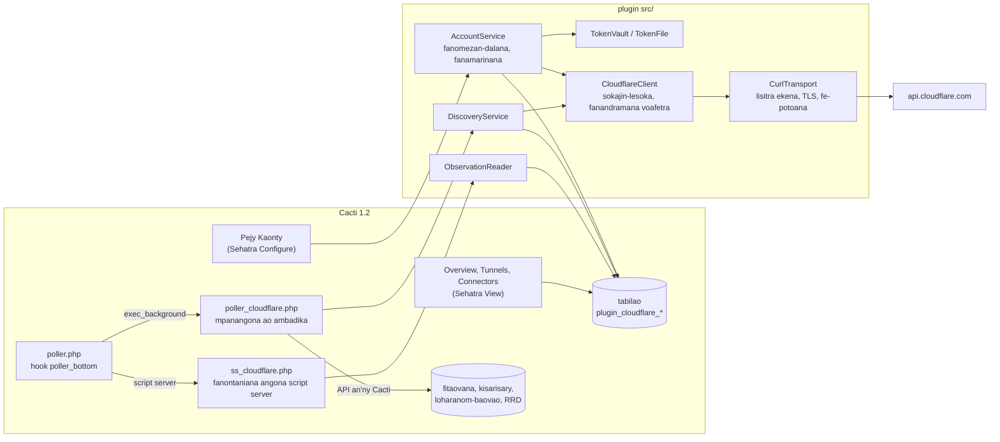

<!-- Source: README.md; SHA256: f8de0e02c5904e15bfa4c71edcaab219e5e5d4f6d9dbe589f4ed16351df6bf4d -->

<!-- translations:start -->
[English](../../../README.md) | [简体中文](../zh-CN/README.md) | [हिन्दी](../hi-IN/README.md) | [Español (España)](../es-ES/README.md) | [Español (Latinoamérica)](../es-419/README.md) | [العربية (السعودية)](../ar-SA/README.md) | [Afrikaans](../af-ZA/README.md) | [አማርኛ](../am-ET/README.md) | [العربية (مصر)](../ar-EG/README.md) | [العربية (المغرب)](../ar-MA/README.md) | [বাংলা](../bn-BD/README.md) | [Bosanski](../bs-BA/README.md) | [Deutsch](../de-DE/README.md) | [فارسی](../fa-IR/README.md) | [Filipino](../fil-PH/README.md) | [Français](../fr-FR/README.md) | [Français (Maroc)](../fr-MA/README.md) | [Français (Sénégal)](../fr-SN/README.md) | [Hausa](../ha-NG/README.md) | [עברית](../he-IL/README.md) | [Hrvatski](../hr-HR/README.md) | [Bahasa Indonesia](../id-ID/README.md) | [Igbo](../ig-NG/README.md) | [Italiano](../it-IT/README.md) | [日本語](../ja-JP/README.md) | [한국어](../ko-KR/README.md) | [Malagasy](README.md) | [मराठी](../mr-IN/README.md) | [Bahasa Melayu](../ms-MY/README.md) | [Nederlands](../nl-NL/README.md) | [Polski](../pl-PL/README.md) | [Português (Brasil)](../pt-BR/README.md) | [Русский](../ru-RU/README.md) | [Kinyarwanda](../rw-RW/README.md) | [Soomaali](../so-SO/README.md) | [Српски](../sr-RS/README.md) | [Svenska](../sv-SE/README.md) | [Kiswahili](../sw-KE/README.md) | [தமிழ்](../ta-IN/README.md) | [తెలుగు](../te-IN/README.md) | [ไทย](../th-TH/README.md) | [Türkçe](../tr-TR/README.md) | [Українська](../uk-UA/README.md) | [اردو](../ur-PK/README.md) | [Tiếng Việt](../vi-VN/README.md) | [isiXhosa](../xh-ZA/README.md) | [Yorùbá](../yo-NG/README.md) | [繁體中文](../zh-TW/README.md) | [isiZulu](../zu-ZA/README.md)
<!-- translations:end -->

<p align="center">
  
</p>

# Plugin Cloudflare ho an'ny Cacti

[](https://github.com/somethingwithproof/plugin_cloudflare/actions/workflows/ci.yml)
[](https://sonarcloud.io/summary/new_code?id=somethingwithproof_plugin_cloudflare)
[](../../../LICENSE)


[](https://sonarcloud.io/summary/new_code?id=somethingwithproof_plugin_cloudflare)
[](https://sonarcloud.io/summary/new_code?id=somethingwithproof_plugin_cloudflare)
[](https://sonarcloud.io/summary/new_code?id=somethingwithproof_plugin_cloudflare)


Plugin ho an'ny Cacti 1.2 izay amboarina hanaraha-maso ny Cloudflare Tunnels sy ny fanadihadiana ny faritra (zone analytics). Mamaky avy amin'ny API Cloudflare izy amin'ny alalan'ny mari-pamantarana API voafetra fahefana (scoped API tokens), tsy manova na inona na inona ao amin'ny Cloudflare mihitsy, ary mitahiry ny angon-drakitra ao amin'ny tabilao azy manokana. Ao amin'ny Cacti dia mandika rakitra XML fanontaniana angona (data query) ho ao amin'ny `resource/script_server/` izy ary mamorona fitaovana, kisarisary ary môdely amin'ny alalan'ny API an'ny Cacti ihany, tsy misy fanovana rakitra fototra.

**Sata: 0.4.0-dev, mbola tsy navoaka.** Ny dikan-teny farany navoaka dia 0.3.0. Ny dikan-teny eo am-panamboarana dia manampy fanondranana lisitry ny fitaovana amin'ny endrika CSV, fanesorana mazava ireo tonelina voafafa, fanadihadiana faritra voatahiry an-tsidina (cached zone analytics), ary môdely Thold azo isafidianana. Mbola miandry ny fanamarinana amin'ny mpamatsy tena izy sy ny fametrahana amin'ny tontolo tena izy.

Ity tabilao manaraka ity dia mamaritra ny dikan-teny marin-toerana 0.3.0. Ny fanampiny eo am-panamboarana dia voafaritra ao amin'ny fizarana momba ny fizotry ny asan'ny mpandraharaha sy ny fanadihadiana ny faritra etsy ambany.

| Azo ampiasaina ankehitriny | Vinavinaina |
|---|---|
| Fametrahana, fanavaozana, fanafoanana vonjimaika ary fanesorana amin'ny alalan'ny mpitantana plugin an'ny Cacti | Fanadihadiana GraphQL sy fampandrenesana Thold (Milestone 4) |
| Alàlana Cloudflare: View, Operator ary Configure | Fampidirana hadisoana niniana natao (fault injection), môdely TLA+ ary antontan-taratasy feno (Milestone 5) |
| Manampy, manova, mamafa, mampandeha ary manafoana vonjimaika ny kaonty Cloudflare | |
| Mitahiry mari-pamantarana ao anaty rakitra na voasoritra miafina (encrypted) ao amin'ny tahiry angon'ny Cacti | |
| Manamarina ny mari-pamantarana ary mijery ny alàlana famakiana tonelina sy faritra ananany | |
| Fikarohana tonelina sy mpampitohy ao amin'ny mpanangona ao ambadika izay atomboky ny poller fototra | |
| Pejy Overview, Tunnels ary Connectors eo ambanin'ny Management > Cloudflare Tunnels | |
| Fanaraha-maso ny tsingerin'aina: `active`, `unavailable` ary `deleted` | |
| Fitaovana Cacti iray isaky ny kaonty, noforonin'ny mpitantana, miaraka amin'ny tonelina ho fanondroana (indexes) amin'ny fanontaniana angona | |
| Kisarisary Connectors, Health ary Collection isaky ny tonelina, sintonina avy amin'ny rakitra RRD iray isaky ny tonelina | |
| Ny sanda tsy azon'ny plugin antoka dia tahirizina ho tsy fantatra (`U`), fa tsy ho 0 mihitsy | |

## Andraikitra sy alàlana

| Sehatra (Realm) | Alàlana |
| --- | --- |
| Cloudflare: View | Ireo pejy fanaraha-maso efa misy. |
| Cloudflare: Operator | Fanaraha-maso miampy ny pejy Operations sy ny fankatoavana fanasokajiana manokana. |
| Cloudflare: Configure | Alàlan'ny Operator miampy ny fikirakirana efa misy sy ny hetsika fitantanana. |

Rehefa avy mandika ireo rakitra fanavaozana dia sokafy amin'ny maha-mpitantana ny pejy Plugins mba hisoratra anarana ny sehatra (realm) vaovao. Omeo mazava ny sehatra Operator ao amin'ny **Configuration > Users** na ny vondrona mpampiasa. Ny fanavaozana dia mitazona ny ID sy ny alàlana View sy Admin efa misy. Ny alàlana Admin dia mandova ny alàlana Operator, ary ny alàlana Operator dia mandova ny alàlana View isaky ny fangatahana; tsy manampy alàlana voatahiry ho an'ny mpampiasa na vondrona izany. Ny fikirakirana ny plugin koa dia mitaky ny alàlana Cloudflare: Configure ho fanampin'ny alàlana Settings an'ny Cacti.

Ny fahitana ny kaonty Cloudflare dia mifanaraka amin'ny sehatra View efa misy; mahafaoka ny kaonty iray manontolo izany. Ny mombamomba ny fidirana, ny fikirakirana, ny fampifandraisana, ny famafana ary ny fanovana fitantanana hafa dia mijanona ao amin'ny pejy fitantanana. Ny fankatoavana (acknowledgments) dia tsy maharitra afa-tsy mandritra ny fotoam-pivoriana (session) an'ny mpampiasa ankehitriny, adiny iray raha be indrindra ary raha mbola vaovao ilay fandinihana mitovy ihany. Ny fandinihana vaovao na niova dia manafoana azy ireo. Tsy manamarika ny fandrefesana tsy nahomby ho salama na manafoana fampandrenesana mihitsy izy ireo.

## Antony nanaovana ity plugin ity

Ireo mpandraharaha Cacti izay mamoaka sampan-draharaha amin'ny alalan'ny Cloudflare Tunnel dia tsy mahita ny momba ilay tonelina ao anatin'ny Cacti. Mety ho very daholo ny mpampitohy ao amin'ny tonelina iray kanefa mbola mamaly SNMP ireo mpampiantrano fototra (origin hosts), ka mijanona ho maitso ireo kisarisary efa misy nefa mahita hadisoana ny mpampiasa. Ny tanjon'ity plugin ity dia ny hametraka ny fahasalaman'ny tonelina sy ny fifamoivoizana ao amin'ny faritra eo akaikin'ireo kisarisary fitaovana efa arahan'ny mpandraharaha maso, nefa tsy manome fahefana ny Cacti hanova na inona na inona ao amin'ny Cloudflare.

Fepetra telo no mamolavola ny rafitra:

- **Famakianteny fotsiny.** Ny plugin dia tsy miantso afa-tsy teboka fidirana `GET` sy ny GraphQL Analytics API. Tsy mila alàlana hanova amin'izay mety ho loharanon'ny Cloudflare izy.
- **Azo atao tsy miankina.** Ny fahatapahan'ny Cloudflare, ny mari-pamantarana lany daty ary ny fetran'ny tahan'ny fangatahana dia tsy tokony hampihena ny hafainganan'ny rindranasan'ny Cacti na hampijanona ny fanangonam-baovaon'ny fitaovana hafa. Ny antso API rehetra dia samy manana fe-potoana hentitra, ary mandeha ao amin'ny dingana ao ambadika izay atomboky ny poller ny fanangonana.
- **Tsy misy fanovana rakitra fototra.** Mampiasa ny hooks plugin an'ny Cacti 1.2 sy ny tabilao azy manokana ny plugin. Mandika XML fanontaniana angona iray ho ao amin'ny `resource/script_server/` izy ary mamorona fitaovana, kisarisary ary môdely amin'ny alalan'ny API an'ny Cacti ihany. Tsy misy fanovana rakitra fototra, ka tsy voakasika ny fanavaozana ny Cacti sy ny plugin hafa.

## Fomba fiasany



- **Fampifandraisana amin'ny Cacti** (`setup.php`, `includes/`, ireo script pejy) dia misoratra hooks sy sehatra, mamoaka pejy amin'ny alalan'ny mpanampy an'ny Cacti ihany, ary manankina ny hetsika rehetra amin'ny tranomboky ao amin'ny `src/`.
- **Ny tranomboky** (`src/`, namespace `Somethingwithproof\Cloudflare\`) dia tsy miankina amin'ny globals an'ny Cacti, ka azo tsapaina miaraka amin'ny tahiry angona tena izy sy fitaterana HTTP sandoka nefa tsy mila Cacti mandeha.
- **Lalana mivoaka tokana.** `CurlTransport` ihany no kaody mikasika ny tambajotra, ary tsy manaiky afa-tsy `https://api.cloudflare.com`. Ny tsy fahombiazana tsirairay dia ampifandraisina amin'ny sokajin-lesoka iray (`auth`, `permission`, `rate_limited`, `transient`, ...), izay mamaritra ny sata aseho ao amin'ny rindranasa.
- **Ny fitahirizana** dia mandalo amin'ny fifandraisana PDO an'ny Cacti ihany miaraka amin'ny fanambarana voaomana (prepared statements). Ny fanovana rafitra (schema) dia fifindra-monina misy laharan-javatra sy idempotent.

Ny fanapahan-kevitra momba ny famolavolana sy ny antony nanosika azy ireo dia ao amin'ny [docs/design.md](../../design.md).

## Sary fampisehoana

Avy amin'ny tontolo fitsapana ireo sary fampisehoana, fa tsy avy amin'ny kaonty Cloudflare tena izy. Io tontolo io dia mampiasa Cacti 1.2.31 miaraka amin'ny API Cloudflare sandoka izay mamerina angona fitsapana, ka solon-toerana fotsiny ny kaonty, ny ID-ny ary ireo tonelina telo.


*Ny lisitry ny kaonty Cloudflare. Manaiky ny mari-pamantarana ny API sandoka, ka mitatitra `ok` ny Verify.*


*Fanovana kaonty. Foana mandrakariva ny sahan'ny mari-pamantarana; tsy alefa miverina any amin'ny mpitety tranonkala mihitsy ny mari-pamantarana voatahiry. Mandeha ny Collect Tunnels sy ny Create Graphs ary maty ny Collect Analytics. Ny Connection Status dia mampiseho ny vokatry ny Verify farany: `ok`, voaome ny famakiana tonelina ary tsy ampy ny famakiana faritra.*


*Settings > Cloudflare.*


*Management > Cloudflare Tunnels > Overview. Ny sata dia ny sata Cloudflare ratsy indrindra amin'ireo tonelina mavitrika an'ny kaonty, eto dia `down` satria misy tonelina fitsapana iray tapaka. Ny `Disabled`, `Not collected`, `Collection failing` ary `Not yet collected` dia mitana ny laharam-pahamehana alohan'ny fahasalaman'ny tonelina, araka izany filaharana izany, ka ny kaonty izay tsy nahomby tamin'ny fampandehanana farany dia mampiseho `Collection failing` na inona na inona tatitra avy amin'ny toneliny.*


*Ny takelaka Tunnels. Mampiseho `-` ho an'ny old-office ny Connectors sy Connections, satria mamaly ny fangatahana fifandraisany ho tonelina tsy fantatra ny API sandoka ary tsy nisy na inona na inona voatahiry, ary mampiseho 0 ho an'ny staging, izay tsy manana mpampitohy mandeha.*


*Ny kisarisary Connectors an'ny tonelina blog. Ny tsipika telo dia 1 avokoa mialoha sy aorian'ny elanelana eo afovoany, izay namerenan'ny API sandoka hadisoana ary nitahirizan'ny plugin sanda tsy fantatra. Tsy midina ho 0 ireo tsipika. Avy amin'ny tontolo fitsapana mitovy (`make screenshots`) ny kisarisary, izay mametraka dingana 30 segondra amin'ity loharanom-baovao tokana ity mba hamenoan'ny fanangonana mandritra ny fito minitra ny kisarisary.*

## Fepetra takina

- Cacti 1.2.25 hatramin'ny 1.2.31. Ny Cacti 1.2.31 dia mitaky PHP 8.0 na ambony kokoa.
  Ny CI dia mitsapa ny 1.2.31 ihany; ny 1.2.25 dia notsapaina tanana farany tamin'ny 2026-10-22.
- PHP 7.4 hatramin'ny 8.4 miaraka amin'ny fanitarana `curl`, `openssl` ary `pdo_mysql`.
  Tsy manaiky halefa ny plugin raha tsy misy ireo.
- MariaDB 10.6 na ambony kokoa, na MySQL 8.0 na ambony kokoa.
- Fahafahana miditra amin'ny alalan'ny HTTPS avy amin'ny mpizara Cacti mankany amin'ny `api.cloudflare.com`. Tsy tohanana ny proxy.

Jereo ny [docs/compatibility.md](../../compatibility.md) raha hijery izay voatsapa.

## Fametrahana

1. Apetraho ao amin'ny lahatahiry `plugins/cloudflare` an'ny Cacti ny plugin, na amin'ny
   fanesorana ny arsiva avy ao amin'ny
   [GitHub Releases](https://github.com/somethingwithproof/plugin_cloudflare/releases)
   (ny fampandehanana ny `make package` ao amin'ny kopian'ny mariky ny famoahana dia manamboatra io arsiva io ihany) na amin'ny alalan'ny git
   clone. Ny anaran'ny lahatahiry dia tsy maintsy atao hoe `cloudflare`.
2. Apetraho sy alefaso izany avy ao amin'ny Console > Configuration > Plugins, na amin'ny alalan'ny
   CLI amin'ny maha-mpampiasa ny mpizara tranonkala anao:

   ```sh
   php cli/plugin_manage.php --plugin=cloudflare --install --enable
   ```

3. Mahazo ny alalana Cloudflare: Configure ny mpampiasa mpitantana mandritra ny fametrahana. Omeo
   izany alalana izany ny mpampiasa na vondrona hafa ao amin'ny Console > Configuration > Users.
4. Mamorona token miaraka amin'ny alalana voalaza ao amin'ny
   [docs/token-permissions.md](../../token-permissions.md). Raha fintinina:
   Account > Cloudflare Tunnel > Read, ary raha tiana dia Zone > Zone > Read.
5. Tehirizo amin'ny iray amin'ireto fomba roa eto ambany ireto ny token, avy eo ampio ny kaonty ao amin'ny
   Console > Configuration > Cloudflare Accounts ary alefaso ny Verify avy ao amin'ny
   safidin'asa.

### Safidy A: voafina ao amin'ny angon-drakitra

Ny plugin dia manafina ny token amin'ny alalan'ny fanalahidy 32-byte izay noforoninao. Tsy mamorona
na manoratra ilay fanalahidy mihitsy izy. Ny rakitra dia tsy maintsy azon'ny mpampiasa ny mpizara
tranonkala sy ny mpampiasa ny poller vakiana, tsy tokony ho azon'ny hafa vakiana, ary ny lahatahiry
misy azy dia tsy maintsy mamela ireo mpampiasa ireo ho tonga any aminy. Ho an'ny mpizara tranonkala mandeha amin'ny maha `www-data`:

```sh
sudo mkdir -p /etc/cacti
sudo sh -c 'umask 077 && openssl rand -hex 32 > /etc/cacti/cloudflare.key'
sudo chgrp www-data /etc/cacti/cloudflare.key
sudo chmod 0440 /etc/cacti/cloudflare.key
```

Ny lalana mahazatra dia `/etc/cacti/cloudflare.key`; ovao izany ao amin'ny Settings >
Cloudflare > Token Vault Key File. Rehefa tsy hita na tsy azo ekena ny fanalahidy, ny
takelaka fanovana dia manolotra ny safidin'ny rakitra token ihany. Mitahiry kopia fiarovana an'ilay fanalahidy:
raha tsy misy izany dia tsy azo sokafana ny token voatahiry ary tsy maintsy ampidirina indray.

#### Fanoloana ny fanalahidy

Tsy misy baiko fanoloana fanalahidy mivantana. Ny fanalahidy vaovao dia tsy afaka mamoha ny token voatahiry tamin'ny
fanalahidy taloha, koa ny fanoloana dia midika hoe fampidirana indray ny token voatahiry tsirairay:

1. Ataovy eo am-pelatanana ny sandan'ny token an'ny kaonty tsirairay. Asehon'ny Cloudflare ny sandan'ny token
   rehefa noforonina na naverina nohavaozina ihany, koa havaozy ao amin'ny takelaka fitantanana
   Cloudflare ny token raha tsy anananao intsony izany.
2. Mamorona ny fanalahidy vaovao amin'ny lalana vaovao amin'ny alalan'ireo baiko etsy ambony, ohatra
   `/etc/cacti/cloudflare.key.new`, miaraka amin'ny tompony sy ny alalana mitovy.
3. Apetraho amin'ilay lalana vaovao ny Settings > Cloudflare > Token Vault Key File ary tehirizo.
   Manomboka izao, ny Verify amin'ny kaonty mbola voafina amin'ny fanalahidy taloha
   dia mitatitra hoe "Stored token cannot be decrypted", ary isaky ny mandeha ny mpanangona dia mirakitra hoe
   `discovery token unavailable` miaraka amin'ny `reason=decrypt_failed` ho an'izany kaonty izany.
4. Ho an'ny kaonty tsirairay izay mitahiry ny token ao amin'ny angon-drakitra, sokafy izany ao amin'ny
   Console > Configuration > Cloudflare Accounts, apetaho ao amin'ireo saha token roa
   ny token, tehirizo, ary alefaso ny Verify. Tokony hitatitra hoe `ok` izany.
5. Rehefa voamarina daholo ny kaonty rehetra toy izany, esory ny rakitra fanalahidy taloha sy ireo
   kopia fiarovana azy.

Eo anelanelan'ny dingana 3 sy 4 dia tsy havaozina ny tonelina an'ny kaonty iray ary ny
tabilao momba ny fahasalamana, ny mpampifandray ary ny fifandraisana dia mirakitra U. Tsy voakasika ny kaonty
mampiasa rakitra token.

### Safidy B: rakitra token

Soraty ao anaty rakitra izay azon'ny mpampiasa ny mpizara tranonkala sy ny mpampiasa ny poller
vakiana fa tsy azon'ny hafa ny token, ary izay ihany, avy eo ampidiro ny lalana feno mankany aminy ao amin'ny takelaka fanovana:

```sh
sudo sh -c 'umask 077 && cat > /etc/cacti/cloudflare-account.token'   # paste the token, then Ctrl-D
sudo chgrp www-data /etc/cacti/cloudflare-account.token
sudo chmod 0440 /etc/cacti/cloudflare-account.token
```

Ny rakitra dia voamarina rehefa vakiana, amin'ny fotoana anaovana Verify, fa tsy rehefa mitahiry ianao. Lavina ny rohy
an'ohatra, ny rakitra mihoatra ny 4 KiB ary ny rakitra azon'ny hafa vakiana na soratana.

Na iza na iza manana ny alalana Cloudflare: Configure dia afaka mampiditra lalana na inona na inona, ary ny mpampiasa ny poller
no mamaky izany. Mba hitazonana ny rakitra token amin'ny toerana iray, apetraho ny Settings > Cloudflare >
Token File Directory, ohatra hoe `/etc/cacti`; izay lalana ivelan'izany dia
lavina avy eo. Jereo ny [docs/security.md](../../security.md#token-file).

## Fanavaozana

1. Soloy amin'ny famoahana vaovao ireo rakitra ao amin'ny `plugins/cloudflare`, ka tazony
   ny anaran'ny lahatahiry.
2. Sokafy indray mandeha amin'ny maha-mpitantana ny Console > Configuration > Plugins, na Console > Configuration >
   Cloudflare Accounts. Izany dia mampandeha ny fifindran'ny angon-drakitra an'ny plugin,
   manafatra ireo môdely Cloudflare ary mandika ny rakitra fangatahana angon-drakitra (jereo ny
   [Metrika sy tabilaon'ny tonelina](#tunnel-metrics-and-graphs)), ary, amin'ny
   fanavaozana avy amin'ny 0.1.0, dia misoratra ny hook `poller_bottom`.

Tsy mampandeha ny fanavaozana ny plugin ny `poller.php`, ka mandra-pahatongan'ny dingana 2 dia
tsy eo ny rafitra vaovao. Ny fampandehanana ny mpanangona tsirairay avy eo dia tsy manao na inona na inona ary mirakitra hoe
`CLOUDFLARE: collector skipped; plugin upgrade pending, open Console > Plugins`.
Ny pejy Cloudflare Tunnels dia mila ny Cloudflare: View ihany, koa tsy mampandeha
ny fanavaozana mihitsy izy ireo, ary mandra-pahatongan'ny dingana 2 dia mety hampiseho hoe "The Cloudflare tunnels could not
be read".

## Toetry ny kaonty

Ny Verify no mametraka ny toetry ny kaonty:

| Toetra | Dikany |
|---|---|
| `unknown` | Tsy mbola voamarina hatramin'ny nanampiana ny kaonty na nanovana ny mombamomba ny fidirana |
| `ok` | Mavitrika ny token ary afaka mamaky tonelina |
| `token_inactive` | Mitatitra ny Cloudflare fa tsy mandeha na lany daty ny token |
| `auth_failed` | Nolavin'ny Cloudflare ny token satria tsy manan-kery na lany daty (HTTP 401) |
| `permission_denied` | Mavitrika ny token saingy tsy afaka mamaky tonelina, na tsy ampy alalana hiantso ny teboka fanamarinana token (HTTP 403) |
| `unreachable` | Tsy tratra ny API, tapaka ny fe-potoana na namerina hadisoan'ny mpizara |
| `rate_limited` | Namerina HTTP 429 ny Cloudflare |
| `error` | Izay tsy fahombiazana hafa rehetra, ao anatin'izany ny rakitra token tsy hita na tsy azo antoka, ny rakitra fanalahidy fitehirizana token tsy hita na tsy azo ampiasaina, na ny token voatahiry tsy azo sokafana |

Ny pejy fanovana koa dia mampiseho raha nomena ny fahazoan-dalana mamaky tonelina sy mamaky faritra.

## Fikarohana tonelina

Aorian'ny tsingerin'ny fanadihadiana tsirairay ao amin'ny poller fototra, ny hook `poller_bottom` dia manomboka
mpanangona ao ambadika amin'ny alalan'ny `exec_background` rehefa misy kaonty iray farafahakeliny mandeha
izay manana Collect Tunnels mihodina. Tsy mandeha ao anatin'ny dingan'ny poller mihitsy ny mpanangona,
koa ny API Cloudflare miadana dia tsy mampitarazoka ny `poller.php`. Ny poller lavitra
dia tsy manomboka azy mihitsy.

Ho an'ny kaonty tsirairay tonga fotoana, ny mpanangona dia mitanisa ny tonelina an'ny kaonty, avy eo
mamaky ny fifandraisan'ireo tonelina mavitrika ao aminy, izay manome ny mpampifandray an'ny
tonelina tsirairay, ny dikan-teniny, ny foibe angon-drakitra ary ny adiresy niaviany. Tonga fotoana
isaky ny Discovery Interval (300 segondra amin'ny mahazatra) ny kaonty. Tsy manomboka kaonty vaovao intsony
ny fampandehanana iray aorian'ny 50 segondra ary manao fangatahana fifandraisana 200 raha be indrindra. Ireo fetra roa ireo
koa dia afaka mampiato kaonty iray eo am-pamakiana ny fifandraisany; voarakitra ho `partial` izany
kaonty izany, ary ny fampandehanana manaraka dia manohy amin'ireo tonelina
nanaovana andrana ela indrindra. Ny kaonty tsy natomboka dia mijanona ho miandry ny fampandehanana manaraka.

Manana tsingerim-piainana ny tonelina iray, izay avahana amin'ny toetra tatitry ny Cloudflare
(`healthy`, `degraded`, `down` na `inactive`):

| Tsingerim-piainana | Dikany |
|---|---|
| `active` | Tao amin'ny lisitra feno farany ilay tonelina |
| `deleted` | Tsy nisy azy ny lisitra feno iray, izay ahitana ny lisitra poakaty. Mijanona ny andalana sy ny tantarany, ary lasa `active` indray ilay tonelina raha miseho indray |
| `unavailable` | Ny fahatapahana telo voaisa tsy nisy lisitra feno teo anelanelany dia mahatonga ny toetry ny tonelina tsy ho fantatra |

Ny lisitra feno sy nahomby ihany no manampy, manavao na mamafa tonelina, ary ny
lisitra tsy nahomby dia tsy mamafa mihitsy. Ny tsy fahombiazana mamaky ny Cloudflare mihitsy
(`transient`, `rate_limited`, `auth` na `permission`) dia isaina ho fahatapahana;
aorian'ny fahatapahana telo voaisa tsy nisy lisitra feno teo anelanelany, dia lasa `unavailable`
ireo tonelina mavitrika an'ny kaonty. Ny lisitra feno manaraka dia mamerina azy ireo ary mamerina
ny fanisana ho aotra. Ny tonelina tsy fantatry ny Cloudflare intsony rehefa vakiana ny fifandraisany dia
dinganina nefa tsy mahatonga ny kaonty ho tsy nahomby. Ny tsy fahombiazana hafa dia sady tsy mampitombo no tsy
mamerina ny kaontera fahatapahana ho aotra.

Ao amin'ny `cacti.log`, ny andalana fikarohana dia manomboka amin'ny `CLOUDFLARE: discovery` ary ny
famintinana ny fampandehanana amin'ny `CLOUDFLARE: collector`. Ny tsy fahombiazana sy ny fiovan'ny tsingerim-piainana, toy ny
lisitra tsy nahomby na tonelina voamarika ho `unavailable`, dia voarakitra amin'ny
ambaratonga mahazatra `LOW` an'ny Cacti; ny valin'ny kaonty tsirairay sy ny famintinana ny fampandehanana dia voarakitra amin'ny
`MEDIUM`. Ny famakiana fifandraisana dia mety tsy hahomby amin'ny tonelina rehetra, koa ho an'ny kaonty tsirairay dia ny
tsy fahombiazana voalohany amin'ny sokajin-diso tsirairay ihany no voarakitra amin'ny `LOW`, ny ambiny amin'ny
`MEDIUM`, arahin'ny andalana `LOW` iray isaky ny sokajy misy ny isan'ny tonelina tsy
nahomby.

Ny Management > Cloudflare Tunnels dia mila ny alalana Cloudflare: View ary
natao hovakiana ihany:

- **Overview** dia mitanisa ny kaonty tsirairay miaraka amin'ny toetrany, ny isan'ny tonelina araka ny tsingerim-piainana,
  ny fikarohana nahomby farany ary ny isan'ny tsy fahombiazana nisesy.
- **Tunnels** dia mitanisa ny tonelina manerana ny kaonty na ho an'ny kaonty iray, miaraka amin'ny sivana
  ho an'ny kaonty, tsingerim-piainana, toetra ary anarana, ary tsanganana azo alamina.
- **Connectors** dia mampiseho ny mpampifandray an'ilay tonelina voafidy tao amin'ny tabilao Tunnels.

<a name="tunnel-metrics-and-graphs"></a>

## Metrika sy tabilaon'ny tonelina

Mamaky ny toetry ny tonelina amin'ny alalan'ny fangatahana angon-drakitra script server ny Cacti,
dia ny `ss_cloudflare.php`. Mamaly avy amin'ny tabilao an'ny plugin ihany izy ary tsy miantso ny
Cloudflare mihitsy, koa ny fahatapahan'ny Cloudflare dia tsy afaka mampiadana ny poller. Ny tonelina tsirairay dia manome
sanda enina: fahasalamana (healthy 3, degraded 2, down 1, inactive 0), mpampifandray,
fifandraisana, dikan-tenin'ny mpampifandray, ny segondra hatramin'ny namakiana farany ny fifandraisany,
ary ny tsy fahombiazana nisesy tamin'ny asan'ny fikarohana. Ny fahasalamana, ny mpampifandray,
ny fifandraisana ary ny dikan-teny dia avoaka ihany rehefa afaka miantoka azy ireo ny plugin,
izay midika fa nahomby ny fikarohana farany, `active` ny tonelina ary vao haingana ny famakiana.
Raha tsy izany dia `U` izy ireo, ary mampiseho banga ny tabilao fa tsy aotra izay toa
fahatapahana. Ny sanda roa momba ny fanangonana dia mijanona avoaka mandritra ny fahatapahana,
mba hampisehoan'ny tabilao Collection izany; `U` ihany izy ireo ho an'ny tonelina voafafa
na izay tsy mbola nahavaozana ny fifandraisany mihitsy. Ao amin'ny [docs/metrics.md](../../metrics.md) ny fitsipika.

### Famoronana ny fitaovana

Ny kaonty iray dia mifanitsy amin'ny fitaovana Cacti iray raha be indrindra. Mitazona ireo tonelina an'ny kaonty
ho toy ny fanondroana ao amin'ny fangatahana angon-drakitra Cloudflare Tunnels ilay fitaovana. Tsy misy zavatra mamorona
azy ho azy:

1. Sokafy ny Console > Configuration > Cloudflare Accounts.
2. Fidio ny kaonty, fidio ny Create Cacti Device avy ao amin'ny safidin'asa, ary
   hamarino.

Mila sady manana ny sehatra Cloudflare: Configure no manana ny sehatra
Sites/Devices/Data an'ny Cacti (ilay ho an'ny `host.php`) io asa io. Ny mpampiasa manana azy roa ihany no mahita ilay safidy ao amin'ny menu,
ary mandà ny fangatahana avy amin'ny olon-kafa ny mpizara.
Nomena anarana hoe `Cloudflare: <account name>` ilay fitaovana, mampiasa ny môdely mpampiantrano Cloudflare Account
sy ny poller fototra, manana dikan-teny SNMP 0 ary tsy misy fanamarinana fahafahana mifandray,
ary mahazo ny anaran'ny mpampiantrano `<account ID>.cloudflare.invalid`. Natokana io anarana io
ary tsy misy famahana adiresy mihitsy; tsy mifandray aminy ny Cacti. Raha efa manana fitaovana
ilay kaonty dia milaza izany ilay asa ary tsy manova na inona na inona. Raha mamafa ny fitaovana ao amin'ny Cacti
ny mpitantana iray, dia tsy manamboatra iray hafa ny plugin raha tsy alefa indray ny Create Cacti Device.

### Famoronana tabilao

Maty amin'ny mahazatra ny Create Graphs ao amin'ny takelaky ny kaonty. Rehefa mandeha izy, isaky ny
mifarana amin'ny `ok` na `partial` ny fikarohana iray ho an'ny kaonty, dia mamerina manondro ilay
fitaovana ny mpanangona ary mamorona izay tabilao tsy ampy ho an'ireo tonelina `active` an'ny kaonty:
Connectors, Health ary Collection, telo isaky ny tonelina. Miara-mampiasa rakitra RRD iray ireo tabilao telo an'ny tonelina iray.
Ny fampandehanana iray dia mamorona tabilao 50 raha be indrindra ary mijanona aorian'ny 20
segondra, ary ny fampandehanana manaraka no manohy. Tsy mamafa zavatra Cacti mihitsy ny plugin.
Ny tabilao iray voafafan'ny mpitantana dia tsy amboarina intsony, ary ny tonelina iray izay
tsy tanisan'ny Cloudflare intsony dia mitazona ny tabilaony sy ny rakitra RRD-ny, izay mampiseho `U`.

Mila ireo sehatra roa ireo ny fandefasana ny Create Graphs. Ny fanapahana azy dia mila ny
Configure ihany. Ny mpampiasa tsy manana ny sehatra Sites/Devices/Data izay mitahiry ny takelaka dia
mamela ilay toe-javatra tahaka ny teo ihany, miaraka amin'ny fampitandremana. Rehefa maty ny Create Graphs, dia
mbola haverina tondroina ihany ny fitaovana aorian'ny fikarohana tsirairay, mba hisehoan'ireo tonelina vaovao ho
fanondroana ao amin'ny fangatahana angon-drakitra.

### Ny rakitra fangatahana angon-drakitra

Ny Cacti 1.2.31 dia mamaky rakitra XML fangatahana angon-drakitra avy ao anatin'ny lahatahiry `resource`
ihany. Mandritra ny fametrahana sy ny fanavaozana araka izany dia mandika rakitra iray ny plugin,
dia ny `templates/resource/cloudflare_tunnels.xml`, mankany amin'ny
`<Cacti>/resource/script_server/cloudflare_tunnels.xml`. Io ihany no rakitra
soratan'ny plugin ivelan'ny lahatahiriny manokana, koa ny mpampiasa izay mametraka na
manavao ny plugin dia tsy maintsy mahazo manoratra ao amin'io lahatahiry io.
Mitazona ilay rakitra ny fanesorana ny plugin, miaraka amin'ireo fitaovana, tabilao, rakitra RRD ary
môdely. Raha tsy mahomby ny fandikana na ny fanafarana môdely, dia mirakitra izany ny plugin ary
manandrana indray ny Create Cacti Device.

## Fikirana

Ny Settings > Cloudflare dia ahitana ireto:

- **Token Vault Key File**: lalana mankany amin'ny fanalahidin'ny fitehirizana (vault key).
- **Token File Directory**: rehefa voafaritra, dia lavina izay rakitra famantarana (token file) ivelan'izany. Foana amin'ny toerana mahazatra izany, izay mamela ny lalana rehetra. Jereo ny [docs/security.md](../../security.md#token-file).
- **Interactive Request Timeout**: fitambaran'ny segondra ho an'ny fangatahana atao avy amin'ny sehatra web, toy ny Verify. Ny sanda mahazatra dia 10; ny sanda ivelan'ny 5 ka hatramin'ny 60 dia miverina ho 10.
- **Collector Request Timeout**: fitambaran'ny segondra ho an'ny fangatahana atao amin'ny alalan'ny mpanangona ao ambadika (background collector). Ny sanda mahazatra dia 20; ny sanda ivelan'ny 5 ka hatramin'ny 60 dia miverina ho 20.
- **Log Level**: voatahiry. Mbola tsy misy mamaky azy aloha.

Ao amin'ny taratasy fanoratana kaonty, ny Collect Tunnels sy ny Discovery Interval no mifehy ny fitadiavana, ary ny Create Graphs no mifehy ny famoronana kisary. Ny Collect Analytics dia voatahiry saingy tsy misy fiantraikany amin'ity dikan-teny ity.

## Fiteny

Ny plugin dia miaraka amin'ny fandikan-teny amin'ny teny Espaniola (Espaina, `es-ES`), Frantsay (`fr-FR`), Alemana (`de-DE`), Sinoa tsotsotra (`zh-CN`), Hindi (`hi-IN`), Arabo (`ar-SA`) ary Japoney (`ja-JP`). Asehon'ny Cacti izy ireo raha vantany vao mandeha ny fanohanana fiteny (Configuration > Settings > General > Language Support) ary misafidy ny fiteny ny mpampiasa. Miaraka ao koa ny katalaogy Espaniola Amerika Latina (`es-419`), saingy ny Cacti 1.2 dia tsy manana toerana (locale) Espaniola Amerika Latina azo safidina, koa tsy manan-kery izany raha tsy manampy iray ny Cacti; mandra-pahatongan'izany, dia fidio ny Espaniola (`es-ES`).

Ny lahatsoratra sasany dia mijanona amin'ny teny Anglisy: ny sandan'ny sata izay tahirizin'ny plugin sy asehony araka ny endriny (`ok`, `active`, `unavailable`, `deleted`, ary ny satan'ny tonelina taterin'ny Cloudflare), ary ny zavatra rehetra soratan'ny plugin ao amin'ny tatitra (log) Cacti.

## Fanesorana sy fitahirizana angona

Ny fanesorana (uninstall) dia mamafa ny tabilao manokan'ny plugin, izay mitahiry ny kaonty, ny famantarana voasoritra miafina, ny tonelina hita, ny satan'ny asa ary ny firaketana ny zavatra Cacti noforoniny, ary mamafa ny fikirana `cloudflare_`. Tsy manala ny rakitra fanalahidy, ny rakitra famantarana, ny `resource/script_server/cloudflare_tunnels.xml` nadika, na ny fitaovana Cacti, kisary, loharanon-drakitra, rakitra RRD na modely (templates) izy. Mitahiry angona fanaraha-maso ara-tantara ireo, ary hetsika manokana ataon'ny mpitantana ao amin'ny Cacti ny famafana azy ireo.

Ny fitaovana voatahiry dia mitsahatra tsy mahazo angona intsony. Aorian'ny fanesorana, na aorian'ny famafana ny kaontiny, dia tsy misy kaonty tompon'ny mpampiantrano, ka mitazona ny tantarany ny kisariny saingy manoratra `U` hatreto. Ny Create Cacti Device eo amin'ny kaonty naverina napetraka na naverina nampiana dia mamorona fitaovana vaovao; tsy mampiasa indray ilay taloha izy, koa fafao ao amin'ny Cacti ilay fitaovana taloha raha vantany vao tsy ilaina intsony ny tantarany.

## Fetrany fantatra

- Ny fampandehanana iray dia manao fangatahana fifandraisana 200 farafahabetsany. Ny tonelina mihoatra izany fetra izany dia havaozina mahalana kokoa noho ny fe-potoana fijerena, ka mampiseho banga ny kisarin'ny fifandraisany.
- Manolo ny fanovana nataon'ny mpitantana tamin'ireo modely nafarana ny plugin rehefa manova ny XML modely nampiarahina ny fanavaozana.
- Ny fitaovan'ny kaonty dia tsy maintsy mijanona ao amin'ny poller fototra. Ao amin'ny angon-drakitra fototra ny tabilaon'ny plugin ary mamaky azy ireo ao ny script.
- Ny tonelina voafafa dia mijanona ao amin'ny tondron'ny fangatahana angona ary manoratra `U` mandra-panajanona azy ireo manokana ataon'ny mpitantana. Ny fanajanona dia tsy manala afa-tsy ny kisary noraketin'ny plugin sy ny loharanon-drakitra tsy iombonana amin'ny alalan'ny Cacti; mijanona ho hita ny andalana ao amin'ny lisitra. Ny Cacti no mifehy ny fanadiovana RRD.
- Ny Cacti dia manafoana ny plugin iray izay miafara amin'ny hadisoana mahafaty ny kaodiny, toy ny fahataperan'ny fitadidiana. Jereo ny [docs/security.md](../../security.md).

## Fiarovana

- Lavina ny Global API Keys; ny API tokens voafetra sehatra ihany no ekena.
- Tehirizina ao anaty rakitra omaninao ny famantarana na soritana miafina amin'ny AES-256-GCM ambanin'ny rakitra fanalahidy izay tsy miditra ao amin'ny angon-drakitra mihitsy. Tsy aseho amin'ny pejy mihitsy izy ireo, tsy soratana ao amin'ny tatitra, ary tsy ampidirina amin'ny hafatra hadisoana.
- Ny hadisoan'ny angon-drakitra dia tsy mitondra afa-tsy ny SQLSTATE sy ny kaody hadisoan'ny driver, fa tsy ny sandan'ny fanambarana mihitsy.
- Ny fanovana rehetra dia POST voaaron'ny famantarana CSRF an'ny Cacti. Ny fanovana kaonty sy fikirana fitantanana dia mitaky ny Cloudflare: Configure; ny fanekena fanasokajiana manokana dia mitaky ny Cloudflare: Operator. Ny famoronana fitaovana Cacti na ny fampandehanana ny Create Graphs dia mila ihany koa ny alalana Sites/Devices/Data an'ny Cacti. Ny plugin voafoana dia mandà ny pejiny.

Ny antsipiriany sy ny fetrany fantatra dia ao amin'ny [docs/security.md](../../security.md).
Ampitao manokana ny lesoka ara-piarovana araka ny voalaza ao amin'ny [SECURITY.md](../../../SECURITY.md).

## Fomba fiasan'ny mpandraharaha sy fanadihadiana faritra

Ny fanampiana eo amin'ny fampandrosoana dia ahitana ny fanajanona manokana ny tonelina voafafa, ny fanadihadiana faritra mahatsapa ny fahafahana (capability-aware zone analytics) ary ny modely Thold azo afarana. Mbola tsy manana marika famoahana na fanamarinana amin'ny kaonty mivantana ireo fanampiana ireo. Jereo ny [docs/analytics-and-alerting.md](../../analytics-and-alerting.md) ho an'ny fametrahana, ny dikan'ny fandrefesana ary ny fetran'ny fanamarinana.

### Fanondranana ny lisitra

Ny pejy Tunnels sy Connectors dia manolotra Export ho an'ny sehatra Cloudflare: View. Ny rakitra CSV an'ny tonelina dia ahitana ny andalana mifanaraka rehetra, mampiasa ny kaonty mavitrika, ny tsingerim-piainana, ny sata, ny fikarohana ary ny fikirana fandaharana amin'ny pejy rehetra. Ny rakitra CSV an'ny mpampifandray (Connector) dia ahitana ny dikan-teny, ny rafitra, ny foiben'angona ary ny adiresy fiaviana ho an'ny tonelina voafantina. Ny fampidinana dia mamaky ny firaketana voatahiry ao anaty cache ihany. Foana ny isa tsy fantatra; ny sela mitovy amin'ny raikipohy dia asiana apostrophe eo alohany mba ho azo antoka ny fanafarana amin'ny takelaka fikajiana.

## Tondrozotra

Ny dingana tsirairay dia avoaka ho dikan-teny 0.x nomena laharana manaraka azy: ny Dingana 3 dia 0.3.0, ny Dingana 4 dia ho 0.4.0. Ny Dingana 1 sy 2 dia tsy navoaka mitokana fa tafiditra ao amin'ny 0.3.0. Ny dikan-teny 1.0.0 dia natokana ho an'ny famoahana izay mahavita ny dingana rehetra eto ambany.

| Dingana | Sahan'asa | Sata |
|---|---|---|
| 1. Fototra | Tsingerim-piainan'ny plugin, alalana, fikirana kaonty, fitsapana fifandraisana | Navoaka tao amin'ny 0.3.0 ([#2](https://github.com/somethingwithproof/plugin_cloudflare/pull/2) hatramin'ny [#5](https://github.com/somethingwithproof/plugin_cloudflare/pull/5)) |
| 2. Fitadiavana | Fitadiavana tonelina sy mpampifandray amin'ny mpanangona ao ambadika, pejy Overview, Tunnels ary Connectors | Navoaka tao amin'ny 0.3.0 ([#6](https://github.com/somethingwithproof/plugin_cloudflare/pull/6)) |
| 3. Fandrefesana | Loharanon-drakitra momba ny fahasalaman'ny tonelina, modely kisary, fitantanana fahatapahana tsy mirakitra aotra noforonina mihitsy | Navoaka tao amin'ny 0.3.0 ([#7](https://github.com/somethingwithproof/plugin_cloudflare/pull/7)) |
| 4. Fanadihadiana sy fampitandremana | Fanadihadiana GraphQL araka ny drafitra isaky ny faritra, fetra Thold miaraka amin'ny fanafoanana mandritra ny fahatapahana | Voalahatra |
| 5. Fanamafisana | Fampidirana lesoka, modely TLA+ ho an'ny fitadiavana sy ny fanangonana, antontan-taratasy feno | Voalahatra |

## Fampandrosoana

Ny fitaovana dia mila PHP 8.x sy Composer; ny kaodin'ny plugin mihitsy dia mijanona ho mifanaraka amin'ny PHP 7.4. Ny fitsapana fampidirana sy BDD dia mila angon-drakitra, izay alefan'ny `make db-up` ao amin'ny Docker amin'ny seranan-tsambo 33061.

```sh
composer install
make db-up
make ci            # unit, integration, BDD, PHPStan, php-cs-fixer, php -l on PHP 7.4
make smoke         # installs the plugin into Cacti 1.2.31 in Docker and walks its lifecycle
make package       # builds build/cloudflare-<version>.tar.gz and checks its contents
make db-down
```

Ny `make smoke` sy ny `make screenshots` dia mila kopia Cacti; amboary ho amin'ny lalany ny `CACTI_REPO`. Ny fitsapana fampidirana dia mamaky ny `CF_TEST_DSN`, `CF_TEST_DB_USER` ary `CF_TEST_DB_PASS`, ary mandingana rehefa tsy azo idirana ny angon-drakitra raha tsy hoe voafaritra ny `CI`.

## Fandraisana anjara

Tongasoa ny pull requests. Ny commit tsirairay dia mila sonia DCO (`git commit -s`). Soraty aloha ny fitsapana; tsy maintsy mandalo ny `make ci`, ary ny fanovana amin'ny fifandraisana amin'ny Cacti dia tokony handalo ny `make smoke` ihany koa. Ny kaodin'ny plugin dia tsy maintsy mijanona ho mifanaraka amin'ny PHP 7.4 ary manaraka ny fomba fanoratra kaody an'ny Cacti (tabs, single quotes, braces amin'ny andalana iray ihany).

### Fandikan-teny

Ny hafatra dia asiana marika `__('...', 'cloudflare')`. Ny `locales/build_gettext.sh` (`make i18n`, izay mila GNU gettext) dia mamorona indray ny modely `locales/po/cacti.pot`, mampitambatra azy ao amin'ny katalaogy tsirairay `locales/po/<locale>.po` ary manangona ny `locales/LC_MESSAGES/<locale>.mo`; ataovy commit izy telo. Ny CI dia mandefa ny `make i18n-check`, izay tsy mahomby rehefa misy katalaogy tsy ampy na manana fampidirana tsy azo antoka (fuzzy), samy hafa ny tady fandrafetana, na lany andro ny rakitra voangona, ary ny fitsapana unit dia manamarina ihany koa ny placeholders, ny marika HTML ary ny elanelana fotsy eo amin'ny sisin'ny fampidirana tsirairay. Noho izany, ny hafatra novaina dia mila fanavaozana ny fandikan-teniny ao amin'io pull request io ihany. Ny fiteny vaovao dia `<locale>.po` vaovao nomena anarana araka ny fanomezan'ny Cacti anarana ny locales (ohatra `pt-BR`), ampiana ao amin'ny `CatalogTest::LOCALES` sy ao amin'ny fanamarinana tahiry ao amin'ny `tests/build/package.sh`. Tazony araka ny endriny ny anaran'ny vokatra Cloudflare, Cacti sy Thold, API sy GraphQL, ary ny anaran'ny alalana toy ny `Account Cloudflare Tunnel Read`.

## Antontan-taratasy

- [docs/security.md](../../security.md): fifehezana ara-piarovana sy fetrany fantatra
- [docs/token-permissions.md](../../token-permissions.md): alalan'ny famantarana
- [docs/compatibility.md](../../compatibility.md): dikan-teny tohanana sy ny interface ampiasaina
- [docs/metrics.md](../../metrics.md): katalaogin'ny fandrefesana sy ny fotoana tsy ahafantarana ny sanda
- [docs/collector-protocol.md](../../collector-protocol.md): izay vakin'ny `ss_cloudflare.php` sy avoakany
- [docs/schema.md](../../schema.md): tabilaon'ny angon-drakitra
- [docs/design.md](../../design.md): fanapahan-kevitra ara-drafitra
- [CHANGELOG.md](../../../CHANGELOG.md)

## Lisansa

GPL-2.0-or-later. Jereo ny [LICENSE](../../../LICENSE).

## Marika ara-barotra

Ny Cloudflare dia marika ara-barotra voasoratra anaran'ny Cloudflare, Inc. Ity tetikasa ity dia fitaovana open-source mahaleo tena ary tsy mifandray, tsy tohanan'ny vola, ary tsy ankatoavin'ny Cloudflare, Inc.

Ity tetikasa ity koa dia tsy mifandray amin'ny tetikasa Cacti. Jereo ny [docs/images/README-logo.md](../../images/README-logo.md) ho an'ny sary famantarana.
