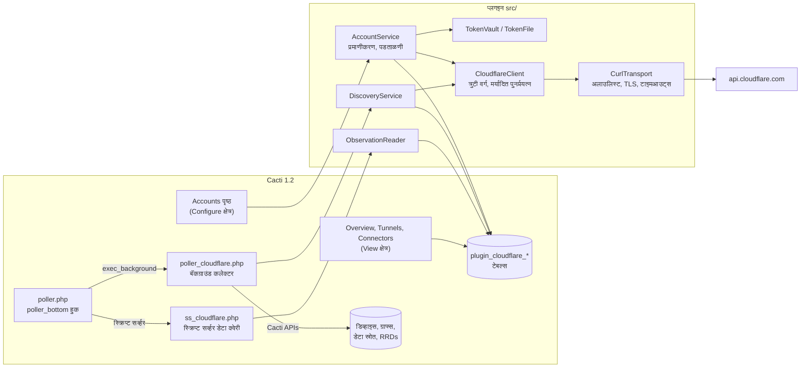

<!-- Source: README.md; SHA256: 813d1c85c236b426b83e42e63c69496f33f8909b5e435d0d45efa6a4ba2f17ca -->

<!-- translations:start -->
[English](../../../README.md) | [简体中文](../zh-CN/README.md) | [हिन्दी](../hi-IN/README.md) | [Español (España)](../es-ES/README.md) | [Español (Latinoamérica)](../es-419/README.md) | [العربية (السعودية)](../ar-SA/README.md) | [Afrikaans](../af-ZA/README.md) | [አማርኛ](../am-ET/README.md) | [العربية (مصر)](../ar-EG/README.md) | [العربية (المغرب)](../ar-MA/README.md) | [বাংলা](../bn-BD/README.md) | [Bosanski](../bs-BA/README.md) | [Deutsch](../de-DE/README.md) | [فارسی](../fa-IR/README.md) | [Filipino](../fil-PH/README.md) | [Français](../fr-FR/README.md) | [Français (Maroc)](../fr-MA/README.md) | [Français (Sénégal)](../fr-SN/README.md) | [Hausa](../ha-NG/README.md) | [עברית](../he-IL/README.md) | [Hrvatski](../hr-HR/README.md) | [Bahasa Indonesia](../id-ID/README.md) | [Igbo](../ig-NG/README.md) | [Italiano](../it-IT/README.md) | [日本語](../ja-JP/README.md) | [한국어](../ko-KR/README.md) | [Malagasy](../mg-MG/README.md) | [मराठी](README.md) | [Bahasa Melayu](../ms-MY/README.md) | [Nederlands](../nl-NL/README.md) | [Polski](../pl-PL/README.md) | [Português (Brasil)](../pt-BR/README.md) | [Русский](../ru-RU/README.md) | [Kinyarwanda](../rw-RW/README.md) | [Soomaali](../so-SO/README.md) | [Српски](../sr-RS/README.md) | [Svenska](../sv-SE/README.md) | [Kiswahili](../sw-KE/README.md) | [தமிழ்](../ta-IN/README.md) | [తెలుగు](../te-IN/README.md) | [ไทย](../th-TH/README.md) | [Türkçe](../tr-TR/README.md) | [Українська](../uk-UA/README.md) | [اردو](../ur-PK/README.md) | [Tiếng Việt](../vi-VN/README.md) | [isiXhosa](../xh-ZA/README.md) | [Yorùbá](../yo-NG/README.md) | [繁體中文](../zh-TW/README.md) | [isiZulu](../zu-ZA/README.md)
<!-- translations:end -->

<p align="center">
  
</p>

# Cacti साठी Cloudflare प्लगइन

[](https://github.com/somethingwithproof/plugin_cloudflare/actions/workflows/ci.yml)
[](https://sonarcloud.io/summary/new_code?id=somethingwithproof_plugin_cloudflare)
[](../../../LICENSE)


[](https://sonarcloud.io/summary/new_code?id=somethingwithproof_plugin_cloudflare)
[](https://sonarcloud.io/summary/new_code?id=somethingwithproof_plugin_cloudflare)
[](https://sonarcloud.io/summary/new_code?id=somethingwithproof_plugin_cloudflare)


Cloudflare Tunnels आणि झोन अ‍ॅनालिटिक्सचे निरीक्षण करण्यासाठी तयार केले जात असलेले एक Cacti 1.2 प्लगइन. हे मर्यादित API टोकन्स वापरून Cloudflare API मधून डेटा वाचते, Cloudflare मध्ये कधीही कोणताही बदल करत नाही आणि त्याचा डेटा स्वतःच्या स्वतंत्र टेबल्समध्ये ठेवते. Cacti मध्ये हे डेटा क्वेरी XML फाइल्स `resource/script_server/` मध्ये कॉपी करते आणि कोणत्याही कोअर फाइलमध्ये बदल न करता, Cacti च्या स्वतःच्या API द्वारे डिव्हाइसेस, ग्राफ्स आणि टेम्पलेट्स तयार करते.

**स्थिती: 0.4.0-dev, अप्रकाशित.** शेवटची प्रकाशित आवृत्ती 0.3.0 आहे. डेव्हलपमेंट आवृत्तीमध्ये CSV इन्व्हेंटरी एक्सपोर्ट, हटवलेल्या टनेल्सचे स्पष्ट निवृत्तीकरण, कॅश केलेले झोन अ‍ॅनालिटिक्स आणि वैकल्पिक Thold टेम्पलेट्स जोडले आहेत. थेट-प्रदाता आणि डिप्लॉयमेंट प्रमाणीकरण अद्याप प्रलंबित आहे.

खालील तक्त्यामध्ये 0.3.0 स्थिर आवृत्तीचे वर्णन केले आहे. डेव्हलपमेंटमधील नवीन भर खाली ऑपरेटर कार्यप्रवाह आणि झोन अ‍ॅनालिटिक्स अंतर्गत वर्णन केल्या आहेत.

| आता उपलब्ध | नियोजित |
|---|---|
| Cacti च्या प्लगइन व्यवस्थापकाद्वारे इन्स्टॉल, अपग्रेड, अक्षम आणि अनइन्स्टॉल करणे | GraphQL अ‍ॅनालिटिक्स आणि Thold अलर्ट्स (टप्पा 4) |
| Cloudflare: View, Operator आणि Configure परवानग्या | फॉल्ट इंजेक्शन, TLA+ मॉडेल्स आणि संपूर्ण दस्तऐवजीकरण (टप्पा 5) |
| Cloudflare खाती जोडणे, संपादित करणे, हटवणे, सक्षम आणि अक्षम करणे | |
| टोकन फाइलमध्ये किंवा Cacti डेटाबेसमध्ये एन्क्रिप्टेड स्वरूपात साठवणे | |
| टोकनची पडताळणी करणे आणि त्याच्या टनेल व झोन वाचन परवानग्या तपासणे | |
| मुख्य पोलरद्वारे सुरू केलेल्या बॅकग्राउंड कलेक्टरमध्ये टनेल आणि कनेक्टर शोध | |
| Management > Cloudflare Tunnels अंतर्गत Overview, Tunnels आणि Connectors पृष्ठे | |
| जीवनचक्र मागोवा: `active`, `unavailable` आणि `deleted` | |
| प्रशासकाने तयार केलेले प्रति खाते एक Cacti डिव्हाइस, ज्यामध्ये डेटा क्वेरीचे इंडेक्स म्हणून टनेल्स असतात | |
| प्रति टनेल एका RRD फाइलमधून काढलेले प्रति टनेल Connectors, Health आणि Collection ग्राफ्स | |
| प्लगइन ज्या मूल्यांची खात्री देऊ शकत नाही ती अज्ञात (`U`) म्हणून साठवली जातात, कधीही 0 म्हणून नाही | |

## प्रवेश भूमिका

| क्षेत्र | प्रवेश |
| --- | --- |
| Cloudflare: View | विद्यमान देखरेख पृष्ठे. |
| Cloudflare: Operator | देखरेख तसेच Operations पृष्ठ आणि वैयक्तिक ट्रायज पोचपावत्या. |
| Cloudflare: Configure | Operator प्रवेश तसेच विद्यमान कॉन्फिगरेशन आणि प्रशासकीय कृती. |

अपग्रेड फाइल्स कॉपी केल्यानंतर, नवीन क्षेत्र नोंदणीकृत करण्यासाठी प्रशासक म्हणून Plugins पृष्ठ उघडा. **Configuration > Users** किंवा वापरकर्ता गटांअंतर्गत Operator क्षेत्र स्पष्टपणे नेमून द्या. अपग्रेडमध्ये विद्यमान View आणि Admin क्षेत्र आयडी आणि अनुदाने कायम राहतात. Admin प्रवेशास Operator प्रवेश वारशाने मिळतो आणि प्रत्येक विनंतीवर Operator प्रवेशास View प्रवेश वारशाने मिळतो; यामुळे वापरकर्ते किंवा गटांना साठवलेले अनुदान जोडले जात नाही. प्लगइन सेटिंग्जसाठी Cacti च्या Settings परवानगीव्यतिरिक्त Cloudflare: Configure प्रवेश देखील आवश्यक आहे.

Cloudflare खाते दृश्यमानता विद्यमान View क्षेत्राशी जुळते; ती खाते-व्यापी आहे. ओळखपत्रे, कॉन्फिगरेशन, मॅपिंग, हटवणे आणि इतर प्रशासकीय बदल प्रशासकीय पृष्ठांवरच राहतात. पोचपावत्या फक्त वर्तमान वापरकर्त्याच्या सत्रात, जास्तीत जास्त एका तासासाठी आणि फक्त तेच निरीक्षण ताजे असेपर्यंतच टिकतात. नवीन किंवा बदललेली निरीक्षणे त्यांना अवैध ठरवतात. त्या कधीही अयशस्वी मोजमापाला निरोगी म्हणून चिन्हांकित करत नाहीत किंवा अलर्ट्स दडपत नाहीत.

## हे प्लगइन का

Cloudflare Tunnel द्वारे सेवा प्रकाशित करणाऱ्या Cacti ऑपरेटर्सना Cacti मध्ये टनेलची कोणतीही माहिती दिसत नाही. मूळ होस्ट्स अद्याप SNMP ला प्रतिसाद देत असतानाही एखादा टनेल त्याचे सर्व कनेक्टर्स गमावू शकतो, त्यामुळे वापरकर्त्यांना त्रुटी दिसत असतानाही विद्यमान ग्राफ्स हिरवेच राहतात. Cacti ला Cloudflare मध्ये कोणताही बदल करण्याची क्षमता न देता, ऑपरेटर्स आधीच पाहत असलेल्या डिव्हाइस ग्राफ्सच्या शेजारी टनेल आरोग्य आणि झोन ट्रॅफिक दर्शवणे हे या प्लगइनचे उद्दिष्ट आहे.

तीन मर्यादा या रचनेला आकार देतात:

- **केवळ-वाचन.** प्लगइन केवळ `GET` एंडपॉइंट्स आणि GraphQL Analytics API ला कॉल करते. याला कोणत्याही Cloudflare संसाधनावर संपादनाच्या परवानगीची आवश्यकता नाही.
- **पर्यायी.** Cloudflare आउटेज, कालबाह्य झालेले टोकन्स आणि दर मर्यादांमुळे Cacti UI संथ होऊ नये किंवा इतर डिव्हाइसेसचे पोलिंग थांबू नये. सर्व API कॉल्सना कठोर कालमर्यादा आहेत आणि संकलन पोलरद्वारे सुरू केलेल्या बॅकग्राउंड प्रक्रियेत चालते.
- **कोणतेही कोअर बदल नाहीत.** प्लगइन Cacti 1.2 प्लगइन हुक्स आणि स्वतःचे टेबल्स वापरते. हे एक डेटा क्वेरी XML `resource/script_server/` मध्ये कॉपी करते आणि Cacti च्या स्वतःच्या API द्वारे डिव्हाइसेस, ग्राफ्स आणि टेम्पलेट्स तयार करते. कोणतेही कोअर फाइल बदल नाहीत, त्यामुळे Cacti अपग्रेड्स आणि इतर प्लगिन्सवर कोणताही परिणाम होत नाही.

## हे कसे कार्य करते



- **Cacti ग्लू** (`setup.php`, `includes/`, पृष्ठ स्क्रिप्ट्स) हुक्स आणि क्षेत्रे नोंदणीकृत करते, Cacti च्या स्वतःच्या हेल्पर्ससह पृष्ठे रेंडर करते आणि प्रत्येक कृती `src/` मधील लायब्ररीकडे सोपवते.
- **लायब्ररी** (`src/`, नेमस्पेस `Somethingwithproof\Cloudflare\`) हिचे Cacti ग्लोबल्सवर कोणतेही अवलंबित्व नाही, त्यामुळे तिची चाचणी चालू Cacti शिवाय वास्तविक डेटाबेस आणि बनावट HTTP ट्रान्सपोर्टवर केली जाते.
- **एक आउटबाउंड मार्ग.** `CurlTransport` हा नेटवर्कला स्पर्श करणारा एकमेव कोड आहे आणि तो फक्त `https://api.cloudflare.com` स्वीकारतो. प्रत्येक अपयश एका त्रुटी वर्गाशी (`auth`, `permission`, `rate_limited`, `transient`, ...) जोडलेला असतो, जो UI मध्ये दर्शवलेली स्थिती नियंत्रित करतो.
- **साठवणूक** तयार केलेल्या विधानांसह Cacti च्या स्वतःच्या PDO कनेक्शनद्वारे होते. स्कीमा बदल क्रमांकित, आयडेंपोटंट मायग्रेशन्स आहेत.

रचनेचे निर्णय आणि त्यांची कारणे
[docs/design.md](../../design.md) मध्ये आहेत.

## स्क्रीनशॉट्स

स्क्रीनशॉट्स थेट Cloudflare खात्यातून नसून चाचणी स्टॅकमधून घेतलेले आहेत. हा स्टॅक बनावट Cloudflare API विरुद्ध Cacti 1.2.31 चालवतो जो फिक्स्चर डेटा परत करतो, त्यामुळे खाते, त्याचा आयडी आणि तीन टनेल्स हे नमुना आहेत.


*Cloudflare Accounts सूची. बनावट API टोकन स्वीकारतो, त्यामुळे Verify `ok` नोंदवतो.*


*खाते संपादित करणे. टोकन फील्ड्स नेहमी रिकामी असतात; साठवलेले टोकन कधीही ब्राउझरकडे परत पाठवले जात नाही. Collect Tunnels आणि Create Graphs चालू आहेत आणि Collect Analytics बंद आहे. Connection Status शेवटच्या Verify चा निकाल दर्शवतो: `ok`, टनेल वाचन मंजूर आणि झोन वाचन गहाळ.*


*Settings > Cloudflare.*


*Management > Cloudflare Tunnels > Overview. ही स्थिती खात्याच्या सक्रिय टनेल्समधील सर्वात वाईट Cloudflare स्थिती आहे, येथे `down` कारण एक फिक्स्चर टनेल बंद आहे. `Disabled`, `Not collected`, `Collection failing` आणि `Not yet collected` यांना अनुक्रमे या क्रमाने टनेल आरोग्यापेक्षा प्राधान्य दिले जाते, त्यामुळे ज्या खात्याची शेवटची रन अयशस्वी झाली आहे ते टनेल्स काहीही नोंदवत असले तरी `Collection failing` दर्शवते.*


*Tunnels टॅब. old-office साठी Connectors आणि Connections `-` दर्शवतात, कारण बनावट API त्याच्या कनेक्शन विनंतीला अज्ञात टनेल म्हणून उत्तर देतो आणि काहीही साठवले गेले नाही, आणि staging साठी 0 दर्शवतात, ज्याचा कोणताही चालू कनेक्टर नाही.*


*blog टनेलचा Connectors ग्राफ. मध्यभागी एका अंतराच्या आधी आणि नंतर तिन्ही रेषा 1 वर आहेत, जिथे बनावट API ने त्रुटी परत केल्या आणि प्लगइनने अज्ञात मूल्ये साठवली. रेषा 0 वर घसरत नाहीत. हा ग्राफ त्याच फिक्स्चर स्टॅकमधून (`make screenshots`) येतो, जो या एका डेटा स्रोतावर 30 सेकंदांचा टप्पा सेट करतो जेणेकरून सात मिनिटांचे पोलिंग ग्राफ भरेल.*

## आवश्यकता

- Cacti 1.2.25 ते 1.2.31. Cacti 1.2.31 साठी PHP 8.0 किंवा त्यापुढील आवृत्ती आवश्यक आहे.
  CI केवळ 1.2.31 ची चाचणी घेते; 1.2.25 ची शेवटची हस्तचलित चाचणी 2026-10-22 रोजी केली गेली होती.
- `curl`, `openssl` आणि `pdo_mysql` एक्स्टेंशन्ससह PHP 7.4 ते 8.4.
  त्यांशिवाय प्लगइन सक्षम होण्यास नकार देते.
- MariaDB 10.6 किंवा त्यापुढील आवृत्ती, किंवा MySQL 8.0 किंवा त्यापुढील आवृत्ती.
- Cacti सर्व्हरवरून `api.cloudflare.com` वर HTTPS प्रवेश. प्रॉक्सी समर्थित नाहीत.

काय तपासले गेले आहे ते पाहण्यासाठी [docs/compatibility.md](../../compatibility.md) पहा.

## इन्स्टॉलेशन

1. प्लगइन Cacti च्या `plugins/cloudflare` डिरेक्टरीमध्ये ठेवा; यासाठी
   [GitHub Releases](https://github.com/somethingwithproof/plugin_cloudflare/releases)
   मधील अर्काइव्ह एक्सट्रॅक्ट करा
   (रिलीज टॅगच्या चेकआउटमध्ये `make package` चालवल्यास तोच अर्काइव्ह तयार होतो)
   किंवा git clone वापरा. डिरेक्टरीचे नाव `cloudflare` असणे आवश्यक आहे.
2. Console > Configuration > Plugins मधून किंवा वेब सर्व्हर वापरकर्ता म्हणून
   CLI वापरून ते इन्स्टॉल आणि सक्षम करा:

   ```sh
   php cli/plugin_manage.php --plugin=cloudflare --install --enable
   ```

3. इन्स्टॉलेशनच्या वेळी अ‍ॅडमिन वापरकर्त्याला Cloudflare: Configure परवानगी मिळते.
   Console > Configuration > Users अंतर्गत इतर वापरकर्त्यांना किंवा गटांना ती द्या.
4. [docs/token-permissions.md](../../token-permissions.md) मधील परवानग्यांसह
   एक टोकन तयार करा. थोडक्यात:
   Account > Cloudflare Tunnel > Read, आणि पर्यायाने Zone > Zone > Read.
5. खालील दोनपैकी एका मार्गाने टोकन संग्रहित करा, नंतर Console > Configuration >
   Cloudflare Accounts अंतर्गत खाते जोडा आणि कृती मेनूमधून Verify चालवा.

### पर्याय A: डेटाबेसमध्ये एन्क्रिप्ट केलेले

तुम्ही तयार केलेल्या 32-बाइट कीने प्लगइन टोकन्स एन्क्रिप्ट करते. ते स्वतः
कधीही की तयार करत नाही किंवा लिहीत नाही. फाइल वेब सर्व्हर आणि पोलर
वापरकर्त्यांना वाचता येण्याजोगी असावी, इतरांना वाचता येऊ नये आणि तिच्या
डिरेक्टरीने त्या वापरकर्त्यांना तिच्यापर्यंत पोहोचू द्यावे. `www-data` म्हणून
चालणाऱ्या वेब सर्व्हरसाठी:

```sh
sudo mkdir -p /etc/cacti
sudo sh -c 'umask 077 && openssl rand -hex 32 > /etc/cacti/cloudflare.key'
sudo chgrp www-data /etc/cacti/cloudflare.key
sudo chmod 0440 /etc/cacti/cloudflare.key
```

डीफॉल्ट पाथ `/etc/cacti/cloudflare.key` आहे; Settings > Cloudflare >
Token Vault Key File अंतर्गत तो बदला. जेव्हा की गहाळ असते किंवा नाकारली
जाते, तेव्हा संपादन फॉर्म केवळ टोकन फाइल पर्याय देतो. कीचा बॅकअप ठेवा:
त्याशिवाय, संग्रहित केलेले टोकन्स डिक्रिप्ट केले जाऊ शकत नाहीत आणि ते पुन्हा
प्रविष्ट करावे लागतील.

#### की बदलणे (रोटेशन)

यासाठी कोणतीही rekey कमांड नाही. जुन्या कीखाली संग्रहित केलेले टोकन्स नवीन
कीने डिक्रिप्ट करता येत नाहीत, त्यामुळे की बदलण्यासाठी प्रत्येक संग्रहित
टोकन पुन्हा प्रविष्ट करावे लागते:

1. प्रत्येक खात्याचे टोकन मूल्य जवळ ठेवा. Cloudflare टोकनचे मूल्य केवळ ते
   तयार करताना किंवा रोल करतानाच दाखवते, त्यामुळे तुमच्याकडे ते नसल्यास
   Cloudflare डॅशबोर्डमध्ये टोकन रोल करा.
2. वरील कमांड्स वापरून नवीन पाथवर, उदाहरणार्थ `/etc/cacti/cloudflare.key.new`,
   समान मालक आणि मोडसह नवीन की तयार करा.
3. Settings > Cloudflare > Token Vault Key File नवीन पाथवर सेट करा आणि
   जतन करा. यापुढे, अजूनही जुन्या कीने एन्क्रिप्ट केलेल्या खात्यावर Verify
   केल्यास "Stored token cannot be decrypted" असे कळवले जाते आणि प्रत्येक
   कलेक्टर रन त्यासाठी `reason=decrypt_failed` सह `discovery token unavailable`
   लॉग करते.
4. डेटाबेसमध्ये टोकन संग्रहित करणाऱ्या प्रत्येक खात्यासाठी, Console >
   Configuration > Cloudflare Accounts अंतर्गत ते उघडा, दोन्ही टोकन
   फील्डमध्ये टोकन पेस्ट करा, जतन करा आणि Verify चालवा. त्याचे उत्तर `ok`
   यायला हवे.
5. अशा प्रत्येक खात्याची पडताळणी झाल्यावर, जुनी की फाइल आणि तिचे बॅकअप्स
   काढून टाका.

पायरी 3 आणि 4 दरम्यान खात्याचे टनेल्स रिफ्रेश केले जात नाहीत आणि त्यांचे
health, connector आणि connection आलेख U नोंदवतात. टोकन फाइल खात्यांवर
याचा परिणाम होत नाही.

### पर्याय B: टोकन फाइल

वेब सर्व्हर आणि पोलर वापरकर्ते वाचू शकतील आणि इतर कोणीही वाचू शकणार नाही
अशा फाइलमध्ये केवळ टोकन (आणि इतर काहीही नाही) लिहा, नंतर संपादन फॉर्मवर
तिचा संपूर्ण (absolute) पाथ प्रविष्ट करा:

```sh
sudo sh -c 'umask 077 && cat > /etc/cacti/cloudflare-account.token'   # paste the token, then Ctrl-D
sudo chgrp www-data /etc/cacti/cloudflare-account.token
sudo chmod 0440 /etc/cacti/cloudflare-account.token
```

तुम्ही जतन करता तेव्हा नव्हे, तर ती वाचली जाते तेव्हा म्हणजे Verify वेळी
फाइल तपासली जाते. सिम्बॉलिक लिंक्स, 4 KiB पेक्षा मोठ्या फाइल्स आणि इतरांना
वाचता किंवा लिहिता येण्याजोग्या फाइल्स नाकारल्या जातात.

Cloudflare: Configure परवानगी असलेली कोणतीही व्यक्ती कोणताही पाथ प्रविष्ट
करू शकते आणि पोलर वापरकर्ता तो वाचतो. टोकन फाइल्स एकाच ठिकाणी ठेवण्यासाठी,
Settings > Cloudflare > Token File Directory सेट करा, उदाहरणार्थ
`/etc/cacti`; त्यानंतर त्याबाहेरील पाथ नाकारला जातो.
[docs/security.md](../../security.md#token-file) पहा.

## अपग्रेड

1. डिरेक्टरीचे नाव तसेच ठेवून `plugins/cloudflare` मधील फाइल्स नवीन रिलीझने
   बदला.
2. अ‍ॅडमिन म्हणून एकदा Console > Configuration > Plugins किंवा Console >
   Configuration > Cloudflare Accounts उघडा. यामुळे प्लगइनचे मायग्रेशन्स
   चालतात, Cloudflare टेम्पलेट्स इम्पोर्ट होतात आणि डेटा क्वेरी फाइल कॉपी
   केली जाते ([टनेल मेट्रिक्स आणि आलेख](#tunnel-metrics-and-graphs) पहा),
   तसेच 0.1.0 वरून अपग्रेड करताना `poller_bottom` हुक नोंदणीकृत होतो.

`poller.php` प्लगइनचे अपग्रेड चालवत नाही, त्यामुळे पायरी 2 पर्यंत नवीन
स्कीमा गहाळ असतो. त्यानंतर प्रत्येक कलेक्टर रन काहीही करत नाही आणि
`CLOUDFLARE: collector skipped; plugin upgrade pending, open Console > Plugins`
लॉग करतो. Cloudflare Tunnels पृष्ठांना केवळ Cloudflare: View आवश्यक असते,
त्यामुळे ती कधीही अपग्रेड चालवत नाहीत आणि पायरी 2 पर्यंत ती "The Cloudflare
tunnels could not be read" दाखवू शकतात.

## खात्याची स्थिती

Verify खात्याची स्थिती सेट करते:

| स्थिती | अर्थ |
|---|---|
| `unknown` | खाते जोडल्यापासून किंवा त्याची क्रेडेंशियल्स बदलल्यापासून पडताळणी झालेली नाही |
| `ok` | टोकन सक्रिय आहे आणि टनेल्स वाचू शकते |
| `token_inactive` | Cloudflare ने टोकन अक्षम किंवा कालबाह्य झाल्याचे कळवले आहे |
| `auth_failed` | Cloudflare ने टोकन अवैध किंवा कालबाह्य म्हणून नाकारले (HTTP 401) |
| `permission_denied` | टोकन सक्रिय आहे परंतु टनेल्स वाचू शकत नाही, किंवा त्याच्याकडे टोकन पडताळणी एंडपॉइंट्स कॉल करण्याच्या परवानग्या नाहीत (HTTP 403) |
| `unreachable` | API पर्यंत पोहोचता आले नाही, टाइमआउट झाला किंवा सर्व्हर त्रुटी आली |
| `rate_limited` | Cloudflare ने HTTP 429 परत केले |
| `error` | इतर कोणतीही त्रुटी, ज्यामध्ये गहाळ किंवा असुरक्षित टोकन फाइल, गहाळ किंवा वापरता न येण्याजोगी टोकन व्हॉल्ट की फाइल, किंवा डिक्रिप्ट करता न येणारे संग्रहित टोकन यांचा समावेश आहे |

संपादन पृष्ठ हे देखील दर्शवते की tunnel read आणि zone read परवानग्या दिल्या गेल्या आहेत का.

## टनेल शोध (डिस्कव्हरी)

मुख्य पोलरवरील प्रत्येक पोलिंग चक्रानंतर, किमान एका सक्षम खात्यावर Collect
Tunnels चालू असल्यास `poller_bottom` हुक `exec_background` सह बॅकग्राउंड
कलेक्टर सुरू करतो. कलेक्टर कधीही पोलरच्या प्रक्रियेमध्ये चालत नाही,
त्यामुळे संथ Cloudflare API मुळे `poller.php` ला विलंब होत नाही. रिमोट
पोलर्स ते कधीही सुरू करत नाहीत.

नियत वेळ झालेल्या प्रत्येक खात्यासाठी, कलेक्टर खात्याच्या टनेल्सची यादी
करतो, नंतर त्याच्या सक्रिय टनेल्सची कनेक्शन्स वाचतो, ज्यातून प्रत्येक
टनेलचे कनेक्टर्स, त्यांच्या आवृत्त्या, डेटा सेंटर्स आणि ओरिजिन पत्ते
मिळतात. खाती प्रत्येक Discovery Interval (डीफॉल्ट 300 सेकंद) नुसार नियत
असतात. एक रन 50 सेकंदांनंतर कोणतेही नवीन खाते सुरू करत नाही आणि जास्तीत
जास्त 200 कनेक्शन विनंत्या करतो. दोन्हीपैकी कोणतीही मर्यादा कनेक्शन्स
वाचताना खात्याला अर्ध्यावर थांबवू शकते; ते खाते `partial` म्हणून नोंदवले
जाते आणि पुढील रन अलीकडे सर्वात कमी वेळा प्रयत्न केलेल्या टनेल्सपासून पुढे
सुरू राहतो. सुरू न झालेली खाती पुढील रनसाठी नियत राहतात.

टनेलचे एक जीवनचक्र (lifecycle) असते, जे Cloudflare कळवत असलेल्या स्थितीपेक्षा
(`healthy`, `degraded`, `down` किंवा `inactive`) वेगळे ठेवले जाते:

| जीवनचक्र | अर्थ |
|---|---|
| `active` | टनेल शेवटच्या पूर्ण यादीत होते |
| `deleted` | पूर्ण यादीत त्याचा समावेश नव्हता, ज्यामध्ये रिकाम्या यादीचाही समावेश होतो. ओळ आणि तिचा इतिहास राहतो आणि टनेल पुन्हा दिसल्यास ते पुन्हा `active` होते |
| `unavailable` | दरम्यान पूर्ण यादी न येता सलग तीन मोजलेल्या आउटेजेसमुळे टनेलची स्थिती अज्ञात राहते |

केवळ पूर्ण, यशस्वी यादीच टनेल्स जोडते, अद्यतनित करते किंवा हटवते आणि
अयशस्वी यादी कधीही टनेल हटवत नाही. Cloudflare अजिबात वाचता न येण्याची
त्रुटी (`transient`, `rate_limited`, `auth` किंवा `permission`) आउटेज म्हणून
मोजली जाते; दरम्यान पूर्ण यादी न येता तीन मोजलेल्या आउटेजेसनंतर, खात्याची
सक्रिय टनेल्स `unavailable` होतात. पुढील पूर्ण यादी त्यांना पुनर्संचयित
करते आणि गणना रीसेट करते. कनेक्शन्स वाचताना ज्या टनेलबद्दल Cloudflare ला
माहिती राहिलेली नसते, ते टनेल खात्याला अयशस्वी न करता वगळले जाते. इतर
त्रुट्यांमुळे आउटेज काउंटर वाढत नाही किंवा रीसेटही होत नाही.

`cacti.log` मध्ये, डिस्कव्हरी ओळी `CLOUDFLARE: discovery` ने आणि रनचा
सारांश `CLOUDFLARE: collector` ने सुरू होतो. अयशस्वी यादी किंवा `unavailable`
म्हणून चिन्हांकित केलेली टनेल्स यांसारख्या त्रुटी आणि जीवनचक्र बदल Cacti च्या
डीफॉल्ट `LOW` स्तरावर लॉग केले जातात; प्रत्येक खात्याचा निकाल आणि रनचा
सारांश `MEDIUM` वर लॉग केला जातो. कनेक्शन वाचन प्रत्येक टनेलवर अयशस्वी होऊ
शकते, त्यामुळे प्रत्येक खात्यासाठी प्रत्येक त्रुटी वर्गाची केवळ पहिली त्रुटी
`LOW` वर, उर्वरित `MEDIUM` वर लॉग केल्या जातात आणि त्यानंतर अयशस्वी झालेल्या
टनेल्सच्या संख्येसह प्रति वर्ग एक `LOW` ओळ लॉग केली जाते.

Management > Cloudflare Tunnels साठी Cloudflare: View परवानगी आवश्यक आहे
आणि ते केवळ वाचनीय (read-only) आहे:

- **Overview** प्रत्येक खात्याची स्थिती, जीवनचक्रानुसार टनेल संख्या, शेवटचा
  यशस्वी शोध आणि सलग अपयशांची संख्या सूचीबद्ध करते.
- **Tunnels** खाते, जीवनचक्र, स्थिती आणि नावासाठी फिल्टरसह आणि क्रमवारी
  लावता येण्याजोग्या स्तंभांसह सर्व खात्यांमधील किंवा एका खात्यातील टनेल्स
  सूचीबद्ध करते.
- **Connectors** Tunnels टॅबवर निवडलेल्या टनेलचे कनेक्टर्स दाखवते.

<a name="tunnel-metrics-and-graphs"></a>

## टनेल मेट्रिक्स आणि आलेख

Cacti स्क्रिप्ट सर्व्हर डेटा क्वेरी `ss_cloudflare.php` द्वारे टनेल स्थिती
वाचते. ते केवळ प्लगइनच्या टेबल्समधूनच उत्तर देते आणि कधीही Cloudflare ला
कॉल करत नाही, त्यामुळे Cloudflare आउटेजमुळे पोलर संथ होऊ शकत नाही. प्रत्येक
टनेल सहा मूल्ये देते: health (healthy 3, degraded 2, down 1, inactive 0),
connectors, connections, connector versions, त्याची कनेक्शन्स शेवटची वाचली
गेल्यापासूनचे सेकंद आणि डिस्कव्हरी जॉबची सलग अपयशे. Health, connectors,
connections आणि versions केवळ तेव्हाच प्रिंट केले जातात जेव्हा प्लगइन
त्यांची खात्री देऊ शकते, याचा अर्थ शेवटचा शोध यशस्वी झाला होता, टनेल
`active` आहे आणि वाचन अलीकडील आहे. अन्यथा ती `U` असतात आणि आउटेजसारख्या
दिसणाऱ्या शून्याऐवजी आलेखामध्ये अंतर (gap) दिसते. आउटेज दरम्यान दोन्ही
कलेक्शन मूल्ये प्रिंट केलेली राहतात, जेणेकरून Collection आलेख ते दाखवतो; ती
केवळ हटवलेल्या टनेलसाठी किंवा ज्याची कनेक्शन्स कधीही रिफ्रेश केली गेली
नाहीत अशा टनेलसाठी `U` असतात. नियम [docs/metrics.md](../../metrics.md)
मध्ये आहेत.

### डिव्हाइस तयार करा

एक खाते जास्तीत जास्त एका Cacti डिव्हाइसशी मॅप होते. डिव्हाइस खात्याचे
टनेल्स Cloudflare Tunnels डेटा क्वेरीचे इंडेक्स म्हणून ठेवते. ते काहीही
स्वयंचलितपणे तयार करत नाही:

1. Console > Configuration > Cloudflare Accounts उघडा.
2. खाते निवडा, कृती मेनूमधून Create Cacti Device निवडा आणि पुष्टी करा.

या कृतीसाठी Cloudflare: Configure क्षेत्र (realm) आणि Cacti चे
Sites/Devices/Data क्षेत्र (`host.php` साठी असलेले) दोन्ही आवश्यक आहेत.
मेनू प्रविष्टी केवळ दोन्ही क्षेत्रे असलेल्या वापरकर्त्यांनाच दिसते आणि
सर्व्हर इतर कोणाकडूनही आलेली विनंती नाकारतो. डिव्हाइसला `Cloudflare: <account name>`
असे नाव दिले जाते, ते Cloudflare Account होस्ट टेम्पलेट आणि मुख्य पोलर
वापरते, त्यात SNMP आवृत्ती 0 असते आणि कोणतीही उपलब्धता तपासणी नसते,
तसेच त्याला `<account ID>.cloudflare.invalid` हे होस्टनेम मिळते. ते नाव
राखीव आहे आणि कधीही रिझॉल्व्ह होत नाही; Cacti त्याच्याशी कनेक्ट होत नाही.
खात्याकडे आधीपासून डिव्हाइस असल्यास, ही कृती तसे सांगते आणि काहीही बदलत
नाही. जर अ‍ॅडमिनिस्ट्रेटरने Cacti मधील डिव्हाइस हटवले, तर पुन्हा Create
Cacti Device चालवेपर्यंत प्लगइन दुसरे डिव्हाइस तयार करत नाही.

### आलेख तयार करा (Create Graphs)

खाते फॉर्मवरील Create Graphs डीफॉल्टनुसार बंद असते. जेव्हा ते चालू असते,
तेव्हा प्रत्येक वेळी खात्याचा शोध `ok` किंवा `partial` वर समाप्त झाल्यावर,
कलेक्टर डिव्हाइस पुन्हा इंडेक्स करतो आणि खात्याच्या `active` टनेल्ससाठी
कोणतेही गहाळ आलेख तयार करतो: Connectors, Health आणि Collection, प्रति
टनेल तीन. टनेलचे तीन आलेख एकच RRD फाइल सामायिक करतात. एका रनमध्ये
जास्तीत जास्त 50 आलेख तयार केले जातात आणि 20 सेकंदांनंतर ते थांबते, आणि
पुढील रन पुढे सुरू राहतो. प्लगइन कधीही Cacti ऑब्जेक्ट काढून टाकत नाही.
अ‍ॅडमिनिस्ट्रेटरने हटवलेला आलेख पुन्हा तयार केला जात नाही आणि Cloudflare
ज्या टनेलची यादी देत नाही त्याचा आलेख आणि RRD फाइल कायम राहते, ज्यामध्ये
`U` दिसते.

Create Graphs चालू करण्यासाठी दोन्ही क्षेत्रे आवश्यक आहेत. ते बंद
करण्यासाठी केवळ Configure आवश्यक आहे. Sites/Devices/Data क्षेत्र नसलेल्या
वापरकर्त्याने फॉर्म जतन केल्यास सेटिंग जसे होते तसेच राहते आणि एक चेतावणी
दिली जाते. Create Graphs बंद असतानाही, प्रत्येक शोधानंतर डिव्हाइस पुन्हा
इंडेक्स केले जाते, त्यामुळे नवीन टनेल्स डेटा क्वेरीचे इंडेक्स म्हणून दिसतात.

### डेटा क्वेरी फाइल

Cacti 1.2.31 डेटा क्वेरी XML केवळ त्याच्या `resource` डिरेक्टरीमधूनच वाचते.
म्हणूनच इन्स्टॉलेशन आणि अपग्रेडच्या वेळी प्लगइन `templates/resource/cloudflare_tunnels.xml`
ही एक फाइल `<Cacti>/resource/script_server/cloudflare_tunnels.xml` येथे
कॉपी करते. प्लगइन स्वतःच्या डिरेक्टरीबाहेर लिहीत असलेली ही एकमेव फाइल आहे,
त्यामुळे प्लगइन इन्स्टॉल किंवा अपग्रेड करणाऱ्या वापरकर्त्याला त्या डिरेक्टरीमध्ये
लिहिता येणे आवश्यक आहे.
अनइन्स्टॉल केल्यास डिव्हाइसेस, आलेख, RRD फाइल्स आणि टेम्पलेट्ससह ही फाइल
कायम राहते. कॉपी किंवा टेम्पलेट इम्पोर्ट अयशस्वी झाल्यास, प्लगइन ते लॉग
करते आणि Create Cacti Device पुन्हा प्रयत्न करते.

## सेटिंग्ज

Settings > Cloudflare मध्ये खालील सेटिंग्ज असतात:

- **Token Vault Key File**: व्हॉल्ट कीचा मार्ग.
- **Token File Directory**: हे सेट केल्यास, याच्या बाहेरील टोकन फाइल नाकारली जाते. डीफॉल्टनुसार रिकामे असते, ज्यामुळे कोणताही मार्ग वापरता येतो. [docs/security.md](../../security.md#token-file) पहा.
- **Interactive Request Timeout**: वेब इंटरफेसमधून केलेल्या विनंतीसाठी (उदाहरणार्थ Verify) एकूण सेकंद. डीफॉल्ट 10; 5 ते 60 च्या बाहेरील मूल्ये पुन्हा 10 वर सेट होतात.
- **Collector Request Timeout**: पार्श्वभूमी कलेक्टरद्वारे केलेल्या विनंतीसाठी एकूण सेकंद. डीफॉल्ट 20; 5 ते 60 च्या बाहेरील मूल्ये पुन्हा 20 वर सेट होतात.
- **Log Level**: साठवले जाते. अद्याप काहीही हे वाचत नाही.

खाते फॉर्मवर, Collect Tunnels आणि Discovery Interval शोध प्रक्रिया नियंत्रित करतात, आणि Create Graphs आलेख निर्मिती नियंत्रित करते. Collect Analytics साठवले जाते आणि या रिलीझमध्ये त्याचा कोणताही प्रभाव नाही.

## भाषा

हा प्लगइन स्पॅनिश (स्पेन, `es-ES`), फ्रेंच (`fr-FR`), जर्मन (`de-DE`), सरलीकृत चीनी (`zh-CN`), हिंदी (`hi-IN`), अरबी (`ar-SA`) आणि जपानी (`ja-JP`) भाषांमध्ये भाषांतरे पुरवतो. भाषा समर्थन सुरू केल्यावर (Configuration > Settings > General > Language Support) आणि वापरकर्त्याने भाषा निवडल्यावर Cacti ती दाखवतो. लॅटिन अमेरिकन स्पॅनिश कॅटलॉग (`es-419`) देखील समाविष्ट आहे, परंतु Cacti 1.2 मध्ये निवडण्यासाठी लॅटिन अमेरिकन स्पॅनिश लोकेल नाही, त्यामुळे Cacti ते जोडेल तेव्हाच ते लागू होईल; तोपर्यंत स्पॅनिश (`es-ES`) निवडा.

काही मजकूर इंग्रजीमध्येच राहतो: प्लगइन जशीच्या तशी साठवतो आणि दाखवतो ती स्थिती मूल्ये (`ok`, `active`, `unavailable`, `deleted`, आणि Cloudflare ने कळवलेली टनल स्थिती), तसेच प्लगइन Cacti लॉगमध्ये लिहितो तो सर्व मजकूर.

## अनइन्स्टॉल आणि डेटा धारणा

अनइन्स्टॉल केल्याने प्लगइनचे स्वतःचे टेबल्स काढून टाकले जातात, ज्यामध्ये खाती, एन्क्रिप्ट केलेले टोकन, शोधलेले टनल, जॉब स्थिती आणि त्याने तयार केलेल्या Cacti ऑब्जेक्ट्सची नोंद असते, आणि त्याच्या `cloudflare_` सेटिंग्ज हटवल्या जातात. हे की फाइल, टोकन फाइल्स, कॉपी केलेली `resource/script_server/cloudflare_tunnels.xml` फाइल, किंवा कोणतेही Cacti डिव्हाइस, आलेख, डेटा स्रोत, RRD फाइल्स किंवा टेम्प्लेट्स काढून टाकत नाही. त्यांमध्ये ऐतिहासिक देखरेख डेटा असतो, आणि त्यांना काढून टाकणे ही Cacti मधील प्रशासकाची स्पष्ट कृती असते.

ठेवलेले डिव्हाइस डेटा मिळवणे थांबवते. अनइन्स्टॉल केल्यानंतर, किंवा त्याचे खाते हटवल्यानंतर, कोणत्याही खात्याकडे होस्टची मालकी राहत नाही, त्यामुळे त्याचे आलेख त्यांचा इतिहास जपून ठेवतात परंतु त्यानंतर `U` प्रिंट करतात. पुन्हा इन्स्टॉल केलेल्या किंवा पुन्हा जोडलेल्या खात्यावर Create Cacti Device नवीन डिव्हाइस तयार करते; ते जुने डिव्हाइस पुन्हा वापरत नाही, त्यामुळे त्याचा इतिहास आवश्यक नसल्यास Cacti मधून जुने डिव्हाइस हटवा.

## ज्ञात मर्यादा

- एका रनमध्ये जास्तीत जास्त 200 कनेक्शन विनंत्या केल्या जातात. त्या मर्यादेपलीकडील टनल निरीक्षण कालावधीपेक्षा कमी वेळा रिफ्रेश केले जातात, त्यामुळे त्यांच्या कनेक्शन आलेखांमध्ये अंतर दिसते.
- अपग्रेडमुळे सोबत येणाऱ्या टेम्प्लेट XML मध्ये बदल झाल्यास, प्लगइन आयात केलेल्या टेम्प्लेट्समधील प्रशासकाचे बदल अधिलिखित करतो.
- खात्याचे डिव्हाइस मुख्य पोलरवरच राहिले पाहिजे. प्लगइनचे टेबल्स मुख्य डेटाबेसमध्ये असतात आणि स्क्रिप्ट तेथूनच ते वाचते.
- हटवलेले टनल डेटा क्वेरी इंडेक्समध्ये राहतात आणि प्रशासक त्यांना स्पष्टपणे निवृत्त करेपर्यंत `U` प्रिंट करतात. निवृत्तीमुळे Cacti द्वारे फक्त प्लगइन-नोंदवलेले आलेख आणि शेअर न केलेले डेटा स्रोत काढून टाकले जातात; यादीतील ओळ दृश्यमान राहते. RRD साफसफाई Cacti नियंत्रित करते.
- मेमरी संपण्यासारख्या खऱ्या गंभीर त्रुटीमुळे ज्या प्लगइनचा कोड थांबतो, तो प्लगइन Cacti अक्षम करते. [docs/security.md](../../security.md) पहा.

## सुरक्षा

- Global API Keys नाकारल्या जातात; फक्त मर्यादित व्याप्तीचे API टोकन स्वीकारले जातात.
- टोकन तुम्ही पुरवलेल्या फाइलमध्ये साठवले जातात किंवा डेटाबेसमध्ये कधीही न जाणाऱ्या की फाइलच्या अंतर्गत AES-256-GCM ने एन्क्रिप्ट केले जातात. ते कधीही पृष्ठावर दाखवले जात नाहीत, लॉगमध्ये लिहिले जात नाहीत, किंवा त्रुटी संदेशात समाविष्ट केले जात नाहीत.
- डेटाबेस त्रुटींमध्ये फक्त SQLSTATE आणि ड्रायव्हर त्रुटी कोड असतो, स्टेटमेंटची मूल्ये कधीही नसतात.
- प्रत्येक बदल ही Cacti च्या CSRF टोकनद्वारे संरक्षित POST विनंती असते. प्रशासकीय खाते आणि कॉन्फिगरेशन बदलांसाठी Cloudflare: Configure आवश्यक असते; वैयक्तिक ट्रायएज पोचपावत्यांसाठी Cloudflare: Operator आवश्यक असते. Cacti डिव्हाइस तयार करण्यासाठी किंवा Create Graphs सुरू करण्यासाठी Cacti ची Sites/Devices/Data परवानगी देखील आवश्यक असते. अक्षम केलेला प्लगइन त्याची पृष्ठे नाकारतो.

तपशील आणि ज्ञात मर्यादा [docs/security.md](../../security.md) मध्ये आहेत.
[SECURITY.md](../../../SECURITY.md) मध्ये वर्णन केल्याप्रमाणे असुरक्षितता खाजगीरित्या कळवा.

## ऑपरेटर कार्यप्रवाह आणि झोन विश्लेषण

विकासकालीन जोडणीमध्ये हटवलेल्या टनलची स्पष्ट निवृत्ती, क्षमता-जागरूक झोन विश्लेषण आणि आयात करता येणारे Thold टेम्प्लेट्स यांचा समावेश आहे. या जोडण्यांना अद्याप रिलीझ टॅग किंवा लाइव्ह-खाते पात्रता मिळालेली नाही. सेटअप, मेट्रिक अर्थ आणि पडताळणी मर्यादांसाठी [docs/analytics-and-alerting.md](../../analytics-and-alerting.md) पहा.

### यादी निर्यात

Tunnels आणि Connectors पृष्ठे Cloudflare: View क्षेत्रासाठी Export सुविधा देतात. टनल CSV फाइल्समध्ये सर्व पृष्ठांवरील सक्रिय खाते, जीवनचक्र, स्थिती, शोध आणि क्रमवारी सेटिंग्ज वापरून प्रत्येक जुळणारी ओळ समाविष्ट असते. कनेक्टर CSV फाइल्समध्ये निवडलेल्या टनलसाठी आवृत्त्या, आर्किटेक्चर, डेटा सेंटर्स आणि मूळ पत्ते समाविष्ट असतात. डाउनलोड फक्त कॅश केलेल्या नोंदी वाचतात. अज्ञात संख्या रिकाम्या असतात; सुरक्षित स्प्रेडशीट आयातीसाठी सूत्रासारख्या सेल्सच्या पुढे अपॉस्ट्रॉफी जोडली जाते.

## रोडमॅप

प्रत्येक टप्पा त्याच्या क्रमांकानुसार 0.x रिलीझ म्हणून प्रकाशित केला जातो: टप्पा 3 हा 0.3.0 आहे, टप्पा 4 हा 0.4.0 असेल. टप्पे 1 आणि 2 स्वतंत्रपणे प्रकाशित केले गेले नव्हते आणि ते 0.3.0 चा भाग आहेत. आवृत्ती 1.0.0 खालील प्रत्येक टप्पा पूर्ण करणाऱ्या रिलीझसाठी राखीव आहे.

| टप्पा | व्याप्ती | स्थिती |
|---|---|---|
| 1. पायाभरणी | प्लगइन जीवनचक्र, परवानग्या, खाते कॉन्फिगरेशन, कनेक्शन चाचणी | 0.3.0 मध्ये प्रकाशित ([#2](https://github.com/somethingwithproof/plugin_cloudflare/pull/2) ते [#5](https://github.com/somethingwithproof/plugin_cloudflare/pull/5)) |
| 2. शोध | पार्श्वभूमी कलेक्टरमध्ये टनल आणि कनेक्टर शोध, Overview, Tunnels आणि Connectors पृष्ठे | 0.3.0 मध्ये प्रकाशित ([#6](https://github.com/somethingwithproof/plugin_cloudflare/pull/6)) |
| 3. मेट्रिक्स | टनल आरोग्य डेटा स्रोत, आलेख टेम्प्लेट्स, कधीही बनावट शून्य नोंद न करणारी आउटेज हाताळणी | 0.3.0 मध्ये प्रकाशित ([#7](https://github.com/somethingwithproof/plugin_cloudflare/pull/7)) |
| 4. विश्लेषण आणि सूचना | प्रति झोन योजना-जागरूक GraphQL विश्लेषण, आउटेज सप्रेशनसह Thold मर्यादा | नियोजित |
| 5. मजबुतीकरण | फॉल्ट इंजेक्शन, शोध आणि संकलनाचे TLA+ मॉडेल्स, संपूर्ण दस्तऐवजीकरण | नियोजित |

## विकास

साधनांसाठी PHP 8.x आणि Composer आवश्यक आहे; प्लगइन कोड स्वतः PHP 7.4 सुसंगत राहतो. एकत्रीकरण आणि BDD चाचण्यांसाठी डेटाबेस आवश्यक असतो, जो `make db-up` Docker मध्ये पोर्ट 33061 वर सुरू करतो.

```sh
composer install
make db-up
make ci            # unit, integration, BDD, PHPStan, php-cs-fixer, php -l on PHP 7.4
make smoke         # installs the plugin into Cacti 1.2.31 in Docker and walks its lifecycle
make package       # builds build/cloudflare-<version>.tar.gz and checks its contents
make db-down
```

`make smoke` आणि `make screenshots` साठी Cacti चेकआउट आवश्यक आहे; `CACTI_REPO` ला त्याचा मार्ग सेट करा. एकत्रीकरण चाचण्या `CF_TEST_DSN`, `CF_TEST_DB_USER` आणि `CF_TEST_DB_PASS` वाचतात, आणि `CI` सेट नसल्यास डेटाबेसपर्यंत पोहोचता न आल्यास चाचण्या वगळतात.

## योगदान

पुल विनंत्यांचे स्वागत आहे. प्रत्येक कमिटसाठी DCO साइन-ऑफ (`git commit -s`) आवश्यक आहे. प्रथम चाचणी लिहा; `make ci` उत्तीर्ण होणे आवश्यक आहे, आणि Cacti ग्लू मधील बदलांनी `make smoke` देखील उत्तीर्ण केले पाहिजे. प्लगइन कोड PHP 7.4 सुसंगत राहिला पाहिजे आणि त्याने Cacti च्या कोड शैलीचे (टॅब, सिंगल कोट्स, त्याच ओळीवर कंस) पालन केले पाहिजे.

### भाषांतरे

संदेश `__('...', 'cloudflare')` ने चिन्हांकित केले जातात. `locales/build_gettext.sh` (`make i18n`, ज्यासाठी GNU gettext आवश्यक आहे) `locales/po/cacti.pot` टेम्प्लेट पुन्हा तयार करते, ते प्रत्येक `locales/po/<locale>.po` कॅटलॉगमध्ये विलीन करते आणि `locales/LC_MESSAGES/<locale>.mo` संकलित करते; हे तिन्ही कमिट करा. CI `make i18n-check` चालवते, जे एखाद्या कॅटलॉगमध्ये नोंद गहाळ असल्यास किंवा अस्पष्ट (fuzzy) नोंद असल्यास, फॉरमॅट स्ट्रिंग वेगळी असल्यास, किंवा संकलित फाइल कालबाह्य असल्यास अयशस्वी होते, आणि युनिट सूट प्रत्येक नोंदीचे प्लेसहोल्डर, HTML टॅग आणि कडेची मोकळी जागा देखील तपासतो. त्यामुळे बदललेल्या संदेशाची भाषांतरे त्याच पुल विनंतीमध्ये अद्यतनित करणे आवश्यक असते. नवीन भाषा म्हणजे Cacti ज्याप्रमाणे आपल्या लोकेल्सना नाव देते (उदाहरणार्थ `pt-BR`) त्याप्रमाणे नाव दिलेली नवीन `<locale>.po` फाइल, जी `CatalogTest::LOCALES` मध्ये आणि `tests/build/package.sh` मधील संग्रह तपासणीमध्ये जोडली जाते. Cloudflare, Cacti आणि Thold उत्पादनांची नावे, API आणि GraphQL, तसेच `Account Cloudflare Tunnel Read` सारखी परवानगीची नावे जशी आहेत तशीच ठेवा.

## दस्तऐवजीकरण

- [docs/security.md](../../security.md): सुरक्षा नियंत्रणे आणि ज्ञात मर्यादा
- [docs/token-permissions.md](../../token-permissions.md): टोकन परवानग्या
- [docs/compatibility.md](../../compatibility.md): समर्थित आवृत्त्या आणि वापरलेले इंटरफेस
- [docs/metrics.md](../../metrics.md): मेट्रिक कॅटलॉग आणि मूल्य कधी अज्ञात असते
- [docs/collector-protocol.md](../../collector-protocol.md): `ss_cloudflare.php` काय वाचते आणि प्रिंट करते
- [docs/schema.md](../../schema.md): डेटाबेस टेबल्स
- [docs/design.md](../../design.md): डिझाइन निर्णय
- [CHANGELOG.md](../../../CHANGELOG.md)

## परवाना

GPL-2.0-or-later. [LICENSE](../../../LICENSE) पहा.

## ट्रेडमार्क

Cloudflare हा Cloudflare, Inc. चा नोंदणीकृत ट्रेडमार्क आहे. हा प्रकल्प एक स्वतंत्र मुक्त-स्रोत साधन आहे आणि तो Cloudflare, Inc. शी संलग्न, प्रायोजित किंवा समर्थित नाही.

हा प्रकल्प Cacti प्रकल्पाशी देखील संलग्न नाही. लोगोसाठी [docs/images/README-logo.md](../../images/README-logo.md) पहा.
