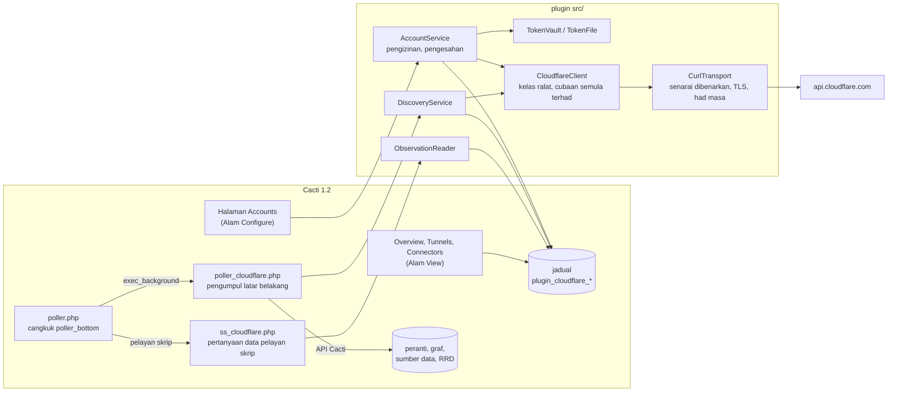

<!-- Source: README.md; SHA256: f8de0e02c5904e15bfa4c71edcaab219e5e5d4f6d9dbe589f4ed16351df6bf4d -->

<!-- translations:start -->
[English](../../../README.md) | [简体中文](../zh-CN/README.md) | [हिन्दी](../hi-IN/README.md) | [Español (España)](../es-ES/README.md) | [Español (Latinoamérica)](../es-419/README.md) | [العربية (السعودية)](../ar-SA/README.md) | [Afrikaans](../af-ZA/README.md) | [አማርኛ](../am-ET/README.md) | [العربية (مصر)](../ar-EG/README.md) | [العربية (المغرب)](../ar-MA/README.md) | [বাংলা](../bn-BD/README.md) | [Deutsch](../de-DE/README.md) | [فارسی](../fa-IR/README.md) | [Filipino](../fil-PH/README.md) | [Français](../fr-FR/README.md) | [Français (Maroc)](../fr-MA/README.md) | [Français (Sénégal)](../fr-SN/README.md) | [Hausa](../ha-NG/README.md) | [עברית](../he-IL/README.md) | [Bahasa Indonesia](../id-ID/README.md) | [Igbo](../ig-NG/README.md) | [Italiano](../it-IT/README.md) | [日本語](../ja-JP/README.md) | [한국어](../ko-KR/README.md) | [Malagasy](../mg-MG/README.md) | [मराठी](../mr-IN/README.md) | [Bahasa Melayu](README.md) | [Nederlands](../nl-NL/README.md) | [Polski](../pl-PL/README.md) | [Português (Brasil)](../pt-BR/README.md) | [Русский](../ru-RU/README.md) | [Kinyarwanda](../rw-RW/README.md) | [Soomaali](../so-SO/README.md) | [Svenska](../sv-SE/README.md) | [Kiswahili](../sw-KE/README.md) | [தமிழ்](../ta-IN/README.md) | [తెలుగు](../te-IN/README.md) | [ไทย](../th-TH/README.md) | [Türkçe](../tr-TR/README.md) | [Українська](../uk-UA/README.md) | [اردو](../ur-PK/README.md) | [Tiếng Việt](../vi-VN/README.md) | [isiXhosa](../xh-ZA/README.md) | [Yorùbá](../yo-NG/README.md) | [繁體中文](../zh-TW/README.md) | [isiZulu](../zu-ZA/README.md)
<!-- translations:end -->

<p align="center">
  
</p>

# Pemalam Cloudflare untuk Cacti

[](https://github.com/somethingwithproof/plugin_cloudflare/actions/workflows/ci.yml)
[](https://sonarcloud.io/summary/new_code?id=somethingwithproof_plugin_cloudflare)
[](../../../LICENSE)


[](https://sonarcloud.io/summary/new_code?id=somethingwithproof_plugin_cloudflare)
[](https://sonarcloud.io/summary/new_code?id=somethingwithproof_plugin_cloudflare)
[](https://sonarcloud.io/summary/new_code?id=somethingwithproof_plugin_cloudflare)


Pemalam Cacti 1.2 yang sedang dibangunkan untuk memantau Cloudflare Tunnels dan
analitik zon. Pemalam ini membaca daripada API Cloudflare menggunakan token API
berskop, tidak pernah mengubah apa-apa dalam Cloudflare, dan menyimpan datanya
dalam jadualnya sendiri. Dalam Cacti, ia menyalin fail XML pertanyaan data ke
dalam `resource/script_server/` serta mencipta peranti, graf dan templat melalui
API Cacti sendiri, tanpa sebarang perubahan pada fail teras.

**Status: 0.4.0-dev, belum dikeluarkan.** Versi terakhir yang dikeluarkan ialah 0.3.0. Versi pembangunan menambah eksport inventori CSV, penamatan eksplisit bagi terowong yang dipadamkan, analitik zon tercache dan templat Thold pilihan. Pengesahan penyedia langsung dan penggunaan masih belum selesai.

Jadual di bawah menerangkan keluaran stabil 0.3.0. Penambahan pembangunan diterangkan di bawah aliran kerja Pengendali dan analitik zon di bawah.

| Tersedia sekarang | Dirancang |
|---|---|
| Pasang, naik taraf, nyahdayakan dan nyahpasang melalui pengurus pemalam Cacti | Analitik GraphQL dan amaran Thold (Pencapaian 4) |
| Kebenaran Cloudflare: View, Operator dan Configure | Suntikan kerosakan, model TLA+ dan dokumentasi penuh (Pencapaian 5) |
| Tambah, sunting, padam, dayakan dan nyahdayakan akaun Cloudflare | |
| Simpan token dalam fail atau disulitkan dalam pangkalan data Cacti | |
| Sahkan token dan semak kebenaran bacaan terowong dan zonnya | |
| Penemuan terowong dan penyambung dalam pengumpul latar belakang yang dimulakan oleh peninjau utama | |
| Halaman Overview, Tunnels dan Connectors di bawah Management > Cloudflare Tunnels | |
| Penjejakan kitaran hayat: `active`, `unavailable` dan `deleted` | |
| Satu peranti Cacti bagi setiap akaun, dicipta oleh pentadbir, dengan terowong sebagai indeks bagi pertanyaan data | |
| Graf Connectors, Health dan Collection bagi setiap terowong, dilukis daripada satu fail RRD bagi setiap terowong | |
| Nilai yang tidak dapat disahkan oleh pemalam disimpan sebagai tidak diketahui (`U`), tidak sesekali sebagai 0 | |

## Peranan akses

| Alam | Akses |
| --- | --- |
| Cloudflare: View | Halaman pemantauan sedia ada. |
| Cloudflare: Operator | Pemantauan berserta halaman Operations dan pengakuan triaj peribadi. |
| Cloudflare: Configure | Akses Operator berserta konfigurasi dan tindakan pentadbiran sedia ada. |

Selepas menyalin fail naik taraf, buka halaman Plugins sebagai pentadbir untuk
mendaftarkan alam baharu. Tugaskan alam Operator secara eksplisit di bawah **Configuration > Users** atau kumpulan pengguna.
Naik taraf mengekalkan ID alam View dan Admin sedia ada serta pemberian aksesnya. Akses Admin
mewarisi akses Operator, dan akses Operator mewarisi akses View pada setiap permintaan;
ini tidak menambah pemberian akses yang disimpan kepada pengguna atau kumpulan. Tetapan pemalam juga memerlukan
akses Cloudflare: Configure selain kebenaran Settings Cacti.

Keterlihatan akaun Cloudflare sepadan dengan alam View sedia ada; ia merangkumi seluruh akaun.
Bukti kelayakan, konfigurasi, pemetaan, pemadaman dan perubahan pentadbiran lain
kekal dalam halaman pentadbiran. Pengakuan hanya bertahan dalam sesi pengguna
semasa, paling lama satu jam dan hanya selagi pemerhatian yang sama kekal
terkini. Pemerhatian baharu atau yang berubah akan membatalkannya. Pengakuan tidak sesekali menandakan pengukuran yang gagal sebagai sihat atau menyekat amaran.

## Mengapa pemalam ini

Pengendali Cacti yang menerbitkan perkhidmatan melalui Cloudflare Tunnel tidak mempunyai paparan
terowong di dalam Cacti. Sesebuah terowong boleh kehilangan kesemua penyambungnya sementara
hos asal masih membalas SNMP, jadi graf sedia ada kekal hijau sedangkan
pengguna melihat ralat. Matlamat pemalam ini adalah untuk meletakkan kesihatan terowong dan trafik
zon bersebelahan graf peranti yang sudah dipantau oleh pengendali, tanpa memberikan
Cacti sebarang keupayaan untuk mengubah Cloudflare.

Tiga kekangan membentuk reka bentuknya:

- **Baca sahaja.** Pemalam ini hanya memanggil titik akhir `GET` dan API Analitik
  GraphQL. Ia tidak memerlukan sebarang kebenaran suntingan pada mana-mana sumber Cloudflare.
- **Pilihan.** Gangguan Cloudflare, token tamat tempoh dan had kadar tidak boleh
  memperlahankan UI Cacti atau menghentikan peninjauan peranti lain. Semua panggilan API mempunyai
  had masa tetap, dan pengumpulan berjalan dalam proses latar belakang yang dilancarkan oleh
  peninjau.
- **Tiada perubahan teras.** Pemalam ini menggunakan cangkuk pemalam Cacti 1.2 dan
  jadualnya sendiri. Ia menyalin satu XML pertanyaan data ke dalam `resource/script_server/` serta
  mencipta peranti, graf dan templat melalui API Cacti sendiri. Tiada perubahan pada fail
  teras, jadi naik taraf Cacti dan pemalam lain tidak terjejas.

## Cara ia berfungsi



- **Pengikat Cacti** (`setup.php`, `includes/`, skrip halaman) mendaftarkan
  cangkuk dan alam, memaparkan halaman menggunakan pembantu Cacti sendiri, dan mewakilkan
  setiap tindakan kepada pustaka dalam `src/`.
- **Pustaka** (`src/`, ruang nama `Somethingwithproof\Cloudflare\`) tidak mempunyai
  kebergantungan pada pemboleh ubah global Cacti, jadi ia diuji terhadap pangkalan data sebenar dan
  pengangkutan HTTP palsu tanpa Cacti yang sedang berjalan.
- **Satu laluan keluar.** `CurlTransport` ialah satu-satunya kod yang menyentuh
  rangkaian, dan ia hanya menerima `https://api.cloudflare.com`. Setiap kegagalan
  dipetakan kepada satu kelas ralat (`auth`, `permission`, `rate_limited`,
  `transient`, ...), yang menentukan status yang dipaparkan dalam UI.
- **Storan** melalui sambungan PDO Cacti sendiri dengan pernyataan
  tersedia. Perubahan skema ialah migrasi bernombor yang idempoten.

Keputusan reka bentuk dan sebabnya terdapat dalam
[docs/design.md](../../design.md).

## Tangkapan skrin

Tangkapan skrin ini diambil daripada tindanan ujian, bukan akaun Cloudflare langsung. Tindanan
tersebut menjalankan Cacti 1.2.31 terhadap API Cloudflare palsu yang mengembalikan data
lekapan, jadi akaun, ID akaun dan ketiga-tiga terowong itu hanyalah pemegang tempat.


*Senarai Akaun Cloudflare. API palsu menerima token, jadi Verify
melaporkan `ok`.*


*Menyunting akaun. Medan token sentiasa kosong; token yang disimpan
tidak pernah dihantar kembali ke pelayar. Collect Tunnels dan Create Graphs dihidupkan manakala
Collect Analytics dimatikan. Connection Status menunjukkan hasil Verify
terakhir: `ok`, kebenaran bacaan terowong diberikan dan kebenaran bacaan zon tiada.*


*Settings > Cloudflare.*


*Management > Cloudflare Tunnels > Overview. Status tersebut ialah status Cloudflare
paling teruk antara terowong aktif akaun, di sini `down` kerana satu terowong
lekapan sedang tergendala. `Disabled`, `Not collected`, `Collection failing` dan `Not yet
collected` mengatasi kesihatan terowong, mengikut urutan tersebut, supaya akaun
yang larian terakhirnya gagal menunjukkan `Collection failing` walau apa pun yang dilaporkan oleh terowongnya.*


*Tab Tunnels. Connectors dan Connections menunjukkan `-` untuk old-office, kerana
API palsu menjawab permintaan sambungannya sebagai terowong tidak diketahui dan tiada apa-apa
yang disimpan, serta 0 untuk staging, yang tidak mempunyai penyambung yang sedang berjalan.*


*Graf Connectors bagi terowong blog. Ketiga-tiga garis bernilai 1 sebelum dan
selepas jurang di tengah, apabila API palsu mengembalikan ralat dan pemalam
menyimpan nilai tidak diketahui. Garis tersebut tidak jatuh ke 0. Graf ini datang daripada
tindanan lekapan yang sama (`make screenshots`), yang menetapkan langkah 30 saat pada satu
sumber data ini supaya tujuh minit peninjauan memenuhi graf.*

## Keperluan

- Cacti 1.2.25 hingga 1.2.31. Cacti 1.2.31 sendiri memerlukan PHP 8.0 atau yang lebih baharu.
  CI hanya menguji 1.2.31; 1.2.25 terakhir kali diuji secara manual pada 2026-10-22.
- PHP 7.4 hingga 8.4 dengan sambungan `curl`, `openssl` dan `pdo_mysql`.
  Pemalam ini enggan diaktifkan tanpa sambungan tersebut.
- MariaDB 10.6 atau yang lebih baharu, atau MySQL 8.0 atau yang lebih baharu.
- Akses HTTPS daripada pelayan Cacti ke `api.cloudflare.com`. Proksi tidak
  disokong.

Lihat [docs/compatibility.md](../../compatibility.md) untuk perkara yang diuji.

## Pemasangan

1. Letakkan pemalam dalam direktori `plugins/cloudflare` Cacti, sama ada dengan
   mengekstrak arkib daripada
   [GitHub Releases](https://github.com/somethingwithproof/plugin_cloudflare/releases)
   (`make package` yang dijalankan dalam salinan tag keluaran membina arkib yang
   sama) atau dengan klon
   git. Direktori tersebut mestilah dinamakan `cloudflare`.
2. Pasang dan aktifkannya melalui Console > Configuration > Plugins, atau melalui
   CLI sebagai pengguna pelayan web:

   ```sh
   php cli/plugin_manage.php --plugin=cloudflare --install --enable
   ```

3. Pengguna pentadbir menerima kebenaran Cloudflare: Configure semasa pemasangan. Berikan
   kebenaran ini kepada pengguna atau kumpulan lain di bawah Console > Configuration > Users.
4. Cipta token dengan kebenaran dalam
   [docs/token-permissions.md](../../token-permissions.md). Secara ringkasnya:
   Account > Cloudflare Tunnel > Read, dan secara pilihan Zone > Zone > Read.
5. Simpan token melalui salah satu daripada dua cara di bawah, kemudian tambahkan akaun di bawah
   Console > Configuration > Cloudflare Accounts dan jalankan Verify daripada
   menu tindakan.

### Pilihan A: disulitkan dalam pangkalan data

Pemalam ini menyulitkan token menggunakan kunci 32-bait yang anda cipta. Ia tidak pernah
mencipta atau menulis kunci itu sendiri. Fail tersebut mestilah boleh dibaca oleh pengguna pelayan
web dan pengguna pengumpul, tidak boleh dibaca oleh pihak lain, dan direktorinya
mestilah membenarkan pengguna tersebut mencapainya. Bagi pelayan web yang dijalankan sebagai `www-data`:

```sh
sudo mkdir -p /etc/cacti
sudo sh -c 'umask 077 && openssl rand -hex 32 > /etc/cacti/cloudflare.key'
sudo chgrp www-data /etc/cacti/cloudflare.key
sudo chmod 0440 /etc/cacti/cloudflare.key
```

Laluan lalai ialah `/etc/cacti/cloudflare.key`; ubahnya di bawah Settings >
Cloudflare > Token Vault Key File. Apabila kunci tiada atau ditolak, borang
suntingan hanya menawarkan pilihan fail token. Simpan sandaran kunci tersebut:
tanpanya, token yang disimpan tidak dapat dinyahsulit dan mesti dimasukkan semula.

#### Memutar kunci

Tiada arahan penukaran kunci semula. Kunci baharu tidak dapat menyahsulit token yang disimpan di bawah
kunci lama, jadi putaran kunci bermakna memasukkan semula setiap token yang disimpan:

1. Sediakan nilai token bagi setiap akaun. Cloudflare hanya memaparkan nilai token
   apabila ia dicipta atau diputarkan, jadi putar token dalam papan pemuka Cloudflare
   jika anda tidak lagi menyimpannya.
2. Cipta kunci baharu pada laluan baharu menggunakan arahan di atas, contohnya
   `/etc/cacti/cloudflare.key.new`, dengan pemilik dan mod yang sama.
3. Tetapkan Settings > Cloudflare > Token Vault Key File kepada laluan baharu dan simpan.
   Mulai saat ini, Verify pada akaun yang masih disulitkan dengan kunci lama
   akan melaporkan "Stored token cannot be decrypted", dan setiap larian pengumpul akan merekodkan
   `discovery token unavailable` dengan `reason=decrypt_failed` baginya.
4. Bagi setiap akaun yang menyimpan tokennya dalam pangkalan data, bukanya di bawah
   Console > Configuration > Cloudflare Accounts, tampalkan token ke dalam kedua-dua
   medan token, simpan, dan jalankan Verify. Ia sepatutnya melaporkan `ok`.
5. Apabila setiap akaun sedemikian berjaya disahkan, buang fail kunci lama dan
   fail sandarannya.

Antara langkah 3 dan 4, terowong bagi sesuatu akaun tidak disegarkan semula dan graf
kesihatan, penyambung serta sambungannya merekodkan U. Akaun fail token tidak
terjejas.

### Pilihan B: fail token

Tulis token tersebut, dan tiada yang lain, ke dalam fail yang boleh dibaca oleh pengguna pelayan web dan pengumpul
dan tidak boleh dibaca oleh pihak lain, kemudian masukkan laluan mutlaknya pada borang suntingan:

```sh
sudo sh -c 'umask 077 && cat > /etc/cacti/cloudflare-account.token'   # paste the token, then Ctrl-D
sudo chgrp www-data /etc/cacti/cloudflare-account.token
sudo chmod 0440 /etc/cacti/cloudflare-account.token
```

Fail tersebut diperiksa semasa ia dibaca, iaitu ketika Verify, bukan semasa anda menyimpan. Pautan
simbolik, fail melebihi 4 KiB dan fail yang boleh dibaca atau ditulis oleh pihak lain akan
ditolak.

Sesiapa yang mempunyai kebenaran Cloudflare: Configure boleh memasukkan sebarang laluan, dan pengguna pengumpul
akan membacanya. Untuk menyimpan fail token di satu tempat, tetapkan Settings > Cloudflare >
Token File Directory, contohnya kepada `/etc/cacti`; laluan di luar direktori tersebut akan
ditolak. Lihat [docs/security.md](../../security.md#token-file).

## Naik taraf

1. Gantikan fail dalam `plugins/cloudflare` dengan keluaran baharu, sambil mengekalkan
   nama direktori tersebut.
2. Buka Console > Configuration > Plugins, atau Console > Configuration >
   Cloudflare Accounts, sekali sebagai pentadbir. Tindakan itu menjalankan migrasi pemalam,
   mengimport templat Cloudflare dan menyalin fail pertanyaan data (lihat
   [Metrik dan graf terowong](#tunnel-metrics-and-graphs)), serta, apabila menaiknya taraf
   daripada versi 0.1.0, mendaftarkan cangkuk `poller_bottom`.

`poller.php` tidak menjalankan naik taraf pemalam, jadi sehingga langkah 2 dilakukan, skema baharu
masih tiada. Setiap larian pengumpul kemudian tidak melakukan apa-apa dan merekodkan
`CLOUDFLARE: collector skipped; plugin upgrade pending, open Console > Plugins`.
Halaman Cloudflare Tunnels hanya memerlukan kebenaran Cloudflare: View, jadi halaman tersebut tidak pernah menjalankan
naik taraf, dan sehingga langkah 2 dilakukan, ia mungkin memaparkan "The Cloudflare tunnels could not
be read".

## Status akaun

Verify menetapkan status akaun tersebut:

| Status | Maksud |
|---|---|
| `unknown` | Belum disahkan sejak akaun ditambahkan atau kelayakannya diubah |
| `ok` | Token aktif dan boleh membaca terowong |
| `token_inactive` | Cloudflare melaporkan token sebagai dilumpuhkan atau tamat tempoh |
| `auth_failed` | Cloudflare menolak token sebagai tidak sah atau tamat tempoh (HTTP 401) |
| `permission_denied` | Token aktif tetapi tidak boleh membaca terowong, atau ia kekurangan kebenaran untuk memanggil titik akhir pengesahan token (HTTP 403) |
| `unreachable` | API tidak dapat dicapai, tamat masa atau memulangkan ralat pelayan |
| `rate_limited` | Cloudflare memulangkan HTTP 429 |
| `error` | Sebarang kegagalan lain, termasuk fail token yang tiada atau tidak selamat, fail kunci peti token yang tiada atau tidak boleh digunakan, atau token tersimpan yang tidak dapat dinyahsulit |

Halaman suntingan turut memaparkan sama ada kebenaran membaca terowong dan membaca zon telah diberikan.

## Penemuan terowong

Selepas setiap kitaran pengumpulan pada pengumpul utama, cangkuk `poller_bottom` memulakan
pengumpul latar belakang dengan `exec_background` apabila sekurang-kurangnya satu akaun yang diaktifkan
menghidupkan Collect Tunnels. Pengumpul tersebut tidak pernah berjalan dalam proses
pengumpul utama, jadi API Cloudflare yang perlahan tidak melambatkan `poller.php`. Pengumpul jauh
tidak pernah memulakannya.

Bagi setiap akaun yang tiba masanya, pengumpul akan menyenaraikan terowong akaun tersebut, kemudian
membaca sambungan bagi terowong aktifnya, yang memberikan maklumat penyambung setiap terowong,
versinya, pusat data dan alamat asalan. Akaun tiba masanya pada setiap
Discovery Interval (lalai 300 saat). Satu larian tidak akan memulakan akaun baharu
selepas 50 saat dan membuat selebih-lebihnya 200 permintaan sambungan. Mana-mana satu
had juga boleh menghentikan sesuatu akaun di pertengahan pembacaan sambungannya; akaun
tersebut direkodkan sebagai `partial`, dan larian seterusnya akan menyambung dengan terowong
yang paling lama tidak dicuba. Akaun yang tidak dimulakan kekal menunggu untuk larian seterusnya.

Setiap terowong mempunyai kitaran hayat, yang diasingkan daripada status yang dilaporkan oleh Cloudflare
(`healthy`, `degraded`, `down` atau `inactive`):

| Kitaran hayat | Maksud |
|---|---|
| `active` | Terowong berada dalam penyenaraian lengkap yang terakhir |
| `deleted` | Penyenaraian lengkap tidak menyertakannya, termasuk penyenaraian kosong. Baris dan sejarahnya kekal, dan terowong menjadi `active` semula jika ia muncul kembali |
| `unavailable` | Tiga gangguan yang dikira tanpa penyenaraian lengkap di antaranya menjadikan keadaan terowong tidak diketahui |

Hanya penyenaraian yang lengkap dan berjaya dapat menambah, mengemas kini atau memadamkan terowong, dan
penyenaraian yang gagal tidak pernah memadamkan mana-mana terowong. Kegagalan untuk membaca Cloudflare sama sekali
(`transient`, `rate_limited`, `auth` atau `permission`) dikira sebagai gangguan;
selepas tiga gangguan yang dikira tanpa penyenaraian lengkap di antaranya, terowong
aktif akaun tersebut menjadi `unavailable`. Penyenaraian lengkap yang seterusnya
memulihkannya dan menetapkan semula kiraan tersebut. Terowong yang tidak lagi dikenali oleh Cloudflare
semasa sambungannya dibaca akan dilangkau tanpa menggagalkan akaun. Kegagalan lain
tidak menambah mahupun menetapkan semula pembilang gangguan.

Dalam `cacti.log`, baris penemuan bermula dengan `CLOUDFLARE: discovery` dan ringkasan
larian bermula dengan `CLOUDFLARE: collector`. Kegagalan dan perubahan kitaran hayat, seperti
penyenaraian yang gagal atau terowong yang ditandakan `unavailable`, direkodkan pada tahap
lalai Cacti `LOW`; keputusan setiap akaun dan ringkasan larian direkodkan pada tahap
`MEDIUM`. Pembacaan sambungan boleh gagal pada setiap terowong, jadi bagi setiap akaun hanya
kegagalan pertama bagi setiap kelas ralat direkodkan pada tahap `LOW`, selebihnya pada `MEDIUM`,
diikuti oleh satu baris `LOW` bagi setiap kelas dengan bilangan terowong yang gagal.

Management > Cloudflare Tunnels memerlukan kebenaran Cloudflare: View dan bersifat
baca sahaja:

- **Overview** menyenaraikan setiap akaun berserta statusnya, bilangan terowong mengikut kitaran hayat,
  penemuan terakhir yang berjaya dan bilangan kegagalan berturut-turut.
- **Tunnels** menyenaraikan terowong merentas semua akaun atau untuk satu akaun, dengan penapis
  untuk akaun, kitaran hayat, status dan nama, serta lajur yang boleh diisih.
- **Connectors** memaparkan penyambung bagi terowong yang dipilih pada tab Tunnels.

## Metrik dan graf terowong

Cacti membaca keadaan terowong melalui pertanyaan data pelayan skrip,
`ss_cloudflare.php`. Ia hanya menjawab daripada jadual pemalam dan tidak pernah memanggil
Cloudflare, jadi gangguan Cloudflare tidak dapat melambatkan pengumpul. Setiap terowong memberikan
enam nilai: kesihatan (healthy 3, degraded 2, down 1, inactive 0), penyambung,
sambungan, versi penyambung, saat sejak sambungannya terakhir kali
dibaca, dan kegagalan berturut-turut tugas penemuan. Kesihatan, penyambung,
sambungan dan versi hanya dicetak apabila pemalam dapat mengesahkannya,
yang bermaksud penemuan terakhir berjaya, terowong berada dalam keadaan `active` dan
bacaan tersebut adalah terkini. Jika tidak, nilainya ialah `U`, dan graf menunjukkan jurang dan bukannya
sifar yang akan kelihatan seperti gangguan. Dua nilai pengumpulan kekal
dicetak semasa gangguan, supaya graf Collection memaparkannya; nilainya menjadi `U` hanya
bagi terowong yang dipadamkan atau yang sambungannya tidak pernah disegarkan semula. Peraturan ini
terdapat dalam [docs/metrics.md](../../metrics.md).

### Cipta peranti

Satu akaun dipetakan kepada selebih-lebihnya satu peranti Cacti. Peranti ini memegang terowong
akaun tersebut sebagai indeks bagi pertanyaan data Cloudflare Tunnels. Tiada apa yang menciptanya
secara automatik:

1. Buka Console > Configuration > Cloudflare Accounts.
2. Pilih akaun tersebut, pilih Create Cacti Device daripada menu tindakan, dan
   sahkan.

Tindakan ini memerlukan kedua-dua realm Cloudflare: Configure dan realm
Sites/Devices/Data Cacti (realm untuk `host.php`). Entri menu hanya muncul
kepada pengguna yang memiliki kedua-duanya, dan pelayan menolak permintaan daripada sesiapa sahaja yang lain.
Peranti ini dinamakan `Cloudflare: <account name>`, menggunakan templat hos Cloudflare Account
dan pengumpul utama, mempunyai versi SNMP 0 serta tiada semakan
ketersediaan, dan mendapat nama hos `<account ID>.cloudflare.invalid`. Nama itu
dikhaskan dan tidak pernah diselesaikan; Cacti tidak bersambung dengannya. Jika akaun
tersebut sudah mempunyai peranti, tindakan ini memaklumkannya dan tidak mengubah apa-apa. Jika seorang
pentadbir memadamkan peranti tersebut dalam Cacti, pemalam tidak akan membuat peranti lain
sehingga Create Cacti Device dijalankan semula.

### Cipta Graf

Create Graphs pada borang akaun dimatikan secara lalai. Apabila ia dihidupkan, setiap kali
penemuan akaun berakhir dengan `ok` atau `partial`, pengumpul mengindeks semula
peranti dan mencipta sebarang graf yang tiada bagi terowong `active` akaun tersebut:
Connectors, Health dan Collection, tiga graf bagi setiap terowong. Tiga graf bagi satu terowong
berkongsi satu fail RRD. Satu larian mencipta selebih-lebihnya 50 graf dan berhenti selepas 20
saat, dan larian seterusnya menyambung kerja tersebut. Pemalam tidak pernah membuang objek Cacti.
Graf yang dipadamkan oleh pentadbir tidak akan dibuat semula, dan terowong yang
tidak lagi disenaraikan oleh Cloudflare mengekalkan graf serta fail RRD miliknya, yang memaparkan `U`.

Menghidupkan Create Graphs memerlukan kedua-dua realm tersebut. Mematikannya hanya memerlukan
Configure. Pengguna tanpa realm Sites/Devices/Data yang menyimpan borang tersebut
mengekalkan tetapan sedia ada, berserta amaran. Apabila Create Graphs dimatikan,
peranti masih diindeks semula selepas setiap penemuan, supaya terowong baharu muncul sebagai
indeks pertanyaan data tersebut.

### Fail pertanyaan data

Cacti 1.2.31 hanya membaca XML pertanyaan data dari dalam direktori `resource`
miliknya. Oleh itu, semasa pemasangan dan naik taraf, pemalam menyalin satu fail,
`templates/resource/cloudflare_tunnels.xml`, ke
`<Cacti>/resource/script_server/cloudflare_tunnels.xml`. Ia satu-satunya fail
yang ditulis oleh pemalam di luar direktorinya sendiri, jadi pengguna yang memasang atau
menaik taraf pemalam mestilah dapat menulis ke direktori tersebut.
Nyahpasang mengekalkan fail ini, bersama peranti, graf, fail RRD dan
templat. Jika penyalinan atau pengimportan templat gagal, pemalam merekodkannya dan
Create Cacti Device akan mencuba lagi.

## Tetapan

Settings > Cloudflare mengandungi:

- **Token Vault Key File**: laluan ke kunci vault.
- **Token File Directory**: apabila ditetapkan, fail token di luar direktori ini akan ditolak. Kosong secara
  lalai, yang membenarkan sebarang laluan. Lihat [docs/security.md](../../security.md#token-file).
- **Interactive Request Timeout**: jumlah saat bagi permintaan yang dibuat daripada
  antara muka web, seperti Verify. Lalai ialah 10; nilai di luar julat 5 hingga 60 akan
  kembali kepada 10.
- **Collector Request Timeout**: jumlah saat bagi permintaan yang dibuat oleh
  pengumpul latar belakang. Lalai ialah 20; nilai di luar julat 5 hingga 60 akan kembali kepada 20.
- **Log Level**: disimpan. Tiada komponen yang membacanya buat masa ini.

Pada borang akaun, Collect Tunnels dan Discovery Interval mengawal penemuan,
dan Create Graphs mengawal penciptaan graf. Collect Analytics disimpan dan tidak mempunyai
kesan dalam keluaran ini.

## Bahasa

Pemalam ini menyertakan terjemahan ke dalam bahasa Sepanyol (Sepanyol, `es-ES`), Perancis
(`fr-FR`), Jerman (`de-DE`), Cina Ringkas (`zh-CN`), Hindi (`hi-IN`),
Arab (`ar-SA`) dan Jepun (`ja-JP`). Cacti memaparkannya setelah sokongan bahasa diaktifkan (Configuration >
Settings > General > Language Support) dan pengguna memilih bahasa tersebut. Katalog bahasa
Sepanyol Amerika Latin (`es-419`) turut disertakan, tetapi Cacti 1.2 tidak mempunyai lokal
Sepanyol Amerika Latin untuk dipilih, maka ia hanya berkuat kuasa apabila Cacti menambahkannya;
sehingga itu, pilih bahasa Sepanyol (`es-ES`).

Sesetengah teks kekal dalam bahasa Inggeris: nilai status yang disimpan dan dipaparkan
oleh pemalam seadanya (`ok`, `active`, `unavailable`, `deleted`, serta status terowong
yang dilaporkan oleh Cloudflare), dan semua yang ditulis oleh pemalam ke log Cacti.

## Nyahpasang dan pengekalan data

Penyahpasangan menggugurkan jadual pemalam itu sendiri, yang menyimpan akaun, token
tersulit, terowong yang ditemui, keadaan tugas dan rekod objek Cacti yang
diciptanya, serta memadamkan tetapan `cloudflare_` miliknya. Ia tidak mengalih keluar fail kunci,
fail token, fail `resource/script_server/cloudflare_tunnels.xml` yang disalin, atau mana-mana
peranti, graf, sumber data, fail RRD atau templat Cacti. Semua itu menyimpan
data pemantauan sejarah, dan pengalihkeluarannya ialah tindakan pentadbir secara eksplisit
dalam Cacti.

Peranti yang dikekalkan berhenti menerima data. Selepas nyahpasang, atau selepas
akaunnya dipadamkan, tiada akaun memiliki hos tersebut, jadi grafnya mengekalkan
sejarahnya tetapi mencetak `U` mulai saat itu. Create Cacti Device pada akaun yang dipasang semula atau
ditambah semula mencipta peranti baharu; ia tidak menggunakan semula peranti lama, jadi padamkan
peranti lama dalam Cacti apabila sejarahnya tidak lagi diperlukan.

## Had yang diketahui

- Satu larian membuat paling banyak 200 permintaan sambungan. Terowong yang melebihi had tersebut
  disegarkan semula kurang kerap berbanding tetingkap pemerhatian, jadi graf sambungannya
  menunjukkan jurang.
- Pemalam menulis ganti suntingan pentadbir pada templat yang diimport apabila
  naik taraf mengubah XML templat yang disertakan.
- Peranti akaun mesti kekal pada poller utama. Jadual pemalam berada
  dalam pangkalan data utama dan skrip membacanya di sana.
- Terowong yang dipadamkan kekal dalam indeks pertanyaan data dan mencetak `U` sehingga pentadbir menamatkannya secara eksplisit. Penamatan hanya mengalih keluar graf yang direkodkan oleh pemalam dan sumber data yang tidak dikongsi melalui Cacti; baris inventori kekal kelihatan. Cacti mengawal pembersihan RRD.
- Cacti melumpuhkan pemalam yang kodnya berakhir dengan ralat maut sebenar, seperti
  kehabisan memori. Lihat [docs/security.md](../../security.md).

## Keselamatan

- Kunci API Global ditolak; hanya token API berskop diterima.
- Token disimpan dalam fail yang anda sediakan atau disulitkan dengan AES-256-GCM
  menggunakan fail kunci yang tidak pernah memasuki pangkalan data. Ia tidak pernah dipaparkan
  pada halaman, ditulis ke log, atau disertakan dalam mesej ralat.
- Ralat pangkalan data hanya membawa SQLSTATE dan kod ralat pemacu, tidak pernah
  nilai penyataan tersebut.
- Setiap perubahan ialah permintaan POST yang dilindungi oleh token CSRF Cacti. Perubahan akaun
  pentadbiran dan konfigurasi memerlukan kebenaran Cloudflare: Configure; pengakuan
  triaj peribadi memerlukan Cloudflare: Operator. Mencipta peranti Cacti
  atau mengaktifkan Create Graphs juga memerlukan kebenaran Sites/Devices/Data
  Cacti. Pemalam yang dilumpuhkan menolak halamannya.

Butiran dan had yang diketahui terdapat dalam [docs/security.md](../../security.md).
Laporkan kerentanan secara peribadi seperti yang diterangkan dalam [SECURITY.md](../../../SECURITY.md).

## Aliran kerja pengendali dan analitik zon

Penambahan pembangunan merangkumi penamatan eksplisit bagi terowong yang dipadamkan, analitik zon sedar keupayaan dan templat Thold yang boleh diimport. Penambahan ini belum mempunyai tag keluaran atau kelayakan akaun langsung. Lihat [docs/analytics-and-alerting.md](../../analytics-and-alerting.md) untuk persediaan, semantik metrik dan had pengesahan.

### Eksport inventori

Halaman Tunnels dan Connectors menawarkan Export untuk alam Cloudflare: View. Fail CSV terowong merangkumi setiap baris yang sepadan, menggunakan tetapan akaun aktif, kitaran hayat, status, carian dan isihan merentas semua halaman. Fail CSV penyambung merangkumi versi, seni bina, pusat data dan alamat asal bagi terowong yang dipilih. Muat turun hanya membaca rekod yang dicache. Kiraan yang tidak diketahui dibiarkan kosong; sel yang menyerupai formula diawali dengan tanda koma atas untuk import hamparan yang selamat.

## Hala tuju

Setiap pencapaian dikeluarkan sebagai keluaran 0.x yang dinomborkan mengikutnya: Pencapaian 3 ialah
0.3.0, Pencapaian 4 akan menjadi 0.4.0. Pencapaian 1 dan 2 tidak dikeluarkan secara
berasingan dan merupakan sebahagian daripada 0.3.0. Versi 1.0.0 dikhaskan untuk keluaran yang melengkapkan
setiap pencapaian di bawah.

| Pencapaian | Skop | Keadaan |
|---|---|---|
| 1. Asas | Kitaran hayat pemalam, kebenaran, konfigurasi akaun, ujian sambungan | Dikeluarkan dalam 0.3.0 ([#2](https://github.com/somethingwithproof/plugin_cloudflare/pull/2) hingga [#5](https://github.com/somethingwithproof/plugin_cloudflare/pull/5)) |
| 2. Penemuan | Penemuan terowong dan penyambung dalam pengumpul latar belakang, halaman Overview, Tunnels dan Connectors | Dikeluarkan dalam 0.3.0 ([#6](https://github.com/somethingwithproof/plugin_cloudflare/pull/6)) |
| 3. Metrik | Sumber data kesihatan terowong, templat graf, pengendalian gangguan yang tidak pernah merekodkan sifar rekaan | Dikeluarkan dalam 0.3.0 ([#7](https://github.com/somethingwithproof/plugin_cloudflare/pull/7)) |
| 4. Analitik dan pemakluman | Analitik GraphQL sedar pelan bagi setiap zon, ambang Thold dengan penyekatan gangguan | Dirancang |
| 5. Pengukuhan | Suntikan kerosakan, model TLA+ bagi penemuan dan pengumpulan, dokumentasi penuh | Dirancang |

## Pembangunan

Alatan tersebut memerlukan PHP 8.x dan Composer; kod pemalam itu sendiri kekal serasi dengan PHP 7.4.
Ujian integrasi dan BDD memerlukan pangkalan data, yang
dimulakan oleh `make db-up` dalam Docker pada port 33061.

```sh
composer install
make db-up
make ci            # unit, integration, BDD, PHPStan, php-cs-fixer, php -l on PHP 7.4
make smoke         # installs the plugin into Cacti 1.2.31 in Docker and walks its lifecycle
make package       # builds build/cloudflare-<version>.tar.gz and checks its contents
make db-down
```

`make smoke` dan `make screenshots` memerlukan salinan repositori Cacti; tetapkan `CACTI_REPO`
kepada laluannya. Ujian integrasi membaca `CF_TEST_DSN`, `CF_TEST_DB_USER`
dan `CF_TEST_DB_PASS`, dan melangkau apabila pangkalan data tidak dapat dicapai melainkan `CI`
ditetapkan.

## Sumbangan

Permintaan tarik amat dialu-alukan. Setiap komit memerlukan pengesahan DCO
(`git commit -s`). Tulis ujian terlebih dahulu; `make ci` mesti lulus, dan perubahan
kepada kod penyambung Cacti juga mesti lulus `make smoke`. Kod pemalam mesti kekal serasi dengan PHP
7.4 dan mematuhi gaya kod Cacti (tab, petikan tunggal, pendakap dakap
pada baris yang sama).

### Terjemahan

Mesej ditandakan dengan `__('...', 'cloudflare')`. `locales/build_gettext.sh`
(`make i18n`, yang memerlukan GNU gettext) menjana semula templat
`locales/po/cacti.pot`, menggabungkannya ke dalam setiap katalog `locales/po/<locale>.po`
dan mengkompil `locales/LC_MESSAGES/<locale>.mo`; komit ketiga-tiganya. CI menjalankan
`make i18n-check`, yang gagal apabila katalog terlepas atau mempunyai entri kabur,
rentetan format berbeza, atau fail yang dikompil sudah lapuk, dan suit unit
juga menyemak pemegang tempat, tag HTML dan ruang putih pinggir bagi setiap entri. Oleh itu,
mesej yang diubah memerlukan terjemahannya dikemas kini dalam permintaan tarik yang sama.
Bahasa baharu ialah `<locale>.po` baharu yang dinamakan mengikut cara Cacti menamakan
lokalnya (contohnya `pt-BR`), ditambahkan ke `CatalogTest::LOCALES` dan ke
semakan arkib dalam `tests/build/package.sh`. Kekalkan nama produk Cloudflare, Cacti dan Thold,
API dan GraphQL, serta nama kebenaran seperti
`Account Cloudflare Tunnel Read`, seadanya.

## Dokumentasi

- [docs/security.md](../../security.md): kawalan keselamatan dan had yang diketahui
- [docs/token-permissions.md](../../token-permissions.md): kebenaran token
- [docs/compatibility.md](../../compatibility.md): versi yang disokong dan antara muka yang digunakan
- [docs/metrics.md](../../metrics.md): katalog metrik dan bila sesuatu nilai tidak diketahui
- [docs/collector-protocol.md](../../collector-protocol.md): apa yang dibaca dan dicetak oleh `ss_cloudflare.php`
- [docs/schema.md](../../schema.md): jadual pangkalan data
- [docs/design.md](../../design.md): keputusan reka bentuk
- [CHANGELOG.md](../../../CHANGELOG.md)

## Lesen

GPL-2.0-or-later. Lihat [LICENSE](../../../LICENSE).

## Cap dagangan

Cloudflare ialah cap dagangan berdaftar Cloudflare, Inc. Projek ini ialah alat sumber terbuka bebas dan tidak bersekutu dengan, ditaja oleh, atau disokong oleh Cloudflare, Inc.

Projek ini juga tidak bersekutu dengan projek Cacti. Lihat
[docs/images/README-logo.md](../../images/README-logo.md) untuk logo.
