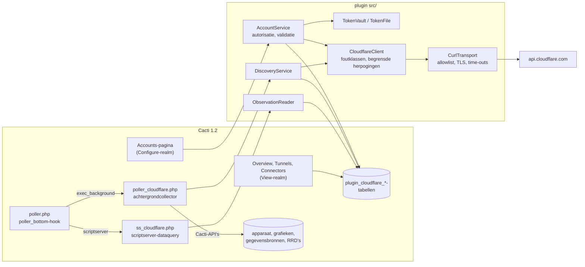

<!-- Source: README.md; SHA256: 813d1c85c236b426b83e42e63c69496f33f8909b5e435d0d45efa6a4ba2f17ca -->

<!-- translations:start -->
[English](../../../README.md) | [简体中文](../zh-CN/README.md) | [हिन्दी](../hi-IN/README.md) | [Español (España)](../es-ES/README.md) | [Español (Latinoamérica)](../es-419/README.md) | [العربية (السعودية)](../ar-SA/README.md) | [Afrikaans](../af-ZA/README.md) | [አማርኛ](../am-ET/README.md) | [العربية (مصر)](../ar-EG/README.md) | [العربية (المغرب)](../ar-MA/README.md) | [বাংলা](../bn-BD/README.md) | [Bosanski](../bs-BA/README.md) | [Deutsch](../de-DE/README.md) | [فارسی](../fa-IR/README.md) | [Filipino](../fil-PH/README.md) | [Français](../fr-FR/README.md) | [Français (Maroc)](../fr-MA/README.md) | [Français (Sénégal)](../fr-SN/README.md) | [Hausa](../ha-NG/README.md) | [עברית](../he-IL/README.md) | [Hrvatski](../hr-HR/README.md) | [Bahasa Indonesia](../id-ID/README.md) | [Igbo](../ig-NG/README.md) | [Italiano](../it-IT/README.md) | [日本語](../ja-JP/README.md) | [한국어](../ko-KR/README.md) | [Malagasy](../mg-MG/README.md) | [मराठी](../mr-IN/README.md) | [Bahasa Melayu](../ms-MY/README.md) | [Nederlands](README.md) | [Polski](../pl-PL/README.md) | [Português (Brasil)](../pt-BR/README.md) | [Русский](../ru-RU/README.md) | [Kinyarwanda](../rw-RW/README.md) | [Soomaali](../so-SO/README.md) | [Српски](../sr-RS/README.md) | [Svenska](../sv-SE/README.md) | [Kiswahili](../sw-KE/README.md) | [தமிழ்](../ta-IN/README.md) | [తెలుగు](../te-IN/README.md) | [ไทย](../th-TH/README.md) | [Türkçe](../tr-TR/README.md) | [Українська](../uk-UA/README.md) | [اردو](../ur-PK/README.md) | [Tiếng Việt](../vi-VN/README.md) | [isiXhosa](../xh-ZA/README.md) | [Yorùbá](../yo-NG/README.md) | [繁體中文](../zh-TW/README.md) | [isiZulu](../zu-ZA/README.md)
<!-- translations:end -->

<p align="center">
  
</p>

# Cloudflare-plugin voor Cacti

[](https://github.com/somethingwithproof/plugin_cloudflare/actions/workflows/ci.yml)
[](https://sonarcloud.io/summary/new_code?id=somethingwithproof_plugin_cloudflare)
[](../../../LICENSE)


[](https://sonarcloud.io/summary/new_code?id=somethingwithproof_plugin_cloudflare)
[](https://sonarcloud.io/summary/new_code?id=somethingwithproof_plugin_cloudflare)
[](https://sonarcloud.io/summary/new_code?id=somethingwithproof_plugin_cloudflare)


Een Cacti 1.2-plugin die wordt ontwikkeld om Cloudflare Tunnels en
zone-analyses te monitoren. De plugin leest gegevens uit de Cloudflare-API met
scoped API-tokens, wijzigt nooit iets in Cloudflare en bewaart zijn gegevens in
eigen tabellen. In Cacti kopieert de plugin XML-bestanden voor dataquery's naar
`resource/script_server/` en maakt apparaten, grafieken en sjablonen aan via
de eigen API's van Cacti, zonder wijzigingen aan kernbestanden.

**Status: 0.4.0-dev, niet uitgebracht.** De laatst uitgebrachte versie is 0.3.0. De ontwikkelversie voegt CSV-inventarisexports, expliciete buitengebruikstelling van verwijderde tunnels, gecachte zone-analyses en optionele Thold-sjablonen toe. Kwalificatie met een live-provider en in een implementatieomgeving is nog in behandeling.

De onderstaande tabel beschrijft de stabiele release 0.3.0. Toevoegingen in de ontwikkelversie worden hieronder beschreven onder Operatorworkflows en zone-analyses.

| Nu beschikbaar | Gepland |
|---|---|
| Installeren, upgraden, uitschakelen en verwijderen via het pluginbeheer van Cacti | GraphQL-analyses en Thold-meldingen (Mijlpaal 4) |
| Machtigingen Cloudflare: View, Operator en Configure | Fault injection, TLA+-modellen en volledige documentatie (Mijlpaal 5) |
| Cloudflare-accounts toevoegen, bewerken, verwijderen, inschakelen en uitschakelen | |
| Een token opslaan in een bestand of versleuteld in de Cacti-database | |
| Een token verifiëren en de leesrechten voor tunnels en zones controleren | |
| Tunnel- en connectordetectie in een achtergrondcollector die door de hoofdpoller wordt gestart | |
| Pagina's Overview, Tunnels en Connectors onder Management > Cloudflare Tunnels | |
| Levenscyclustracking: `active`, `unavailable` en `deleted` | |
| Eén Cacti-apparaat per account, aangemaakt door een beheerder, met de tunnels als de indexen van een dataquery | |
| Grafieken voor Connectors, Health en Collection per tunnel, getekend vanuit één RRD-bestand per tunnel | |
| Waarden waarvoor de plugin niet kan instaan worden opgeslagen als onbekend (`U`), nooit als 0 | |

## Toegangsrollen

| Realm | Toegang |
| --- | --- |
| Cloudflare: View | Bestaande monitoringpagina's. |
| Cloudflare: Operator | Monitoring plus de pagina Operations en persoonlijke triagebevestigingen. |
| Cloudflare: Configure | Operator-toegang plus de bestaande configuratie- en beheeracties. |

Open na het kopiëren van de upgradebestanden de pagina Plugins als beheerder om de
nieuwe realm te registreren. Wijs de realm Operator expliciet toe onder **Configuration > Users** of gebruikersgroepen.
Upgrades behouden de bestaande ID's en toekenningen van de realms View en Admin. Admin-toegang
erft Operator-toegang, en Operator-toegang erft View-toegang bij elke aanvraag;
hierdoor worden geen opgeslagen toekenningen aan gebruikers of groepen toegevoegd. Voor plugininstellingen is naast
de Cacti-machtiging Settings ook toegang via Cloudflare: Configure vereist.

De zichtbaarheid van Cloudflare-accounts komt overeen met de bestaande realm View; deze geldt voor het hele account.
Inloggegevens, configuratie, koppelingen, verwijdering en andere beheerwijzigingen
blijven op de beheerpagina's. Bevestigingen blijven alleen geldig in de huidige
gebruikerssessie, voor maximaal één uur en alleen zolang dezelfde waarneming actueel
blijft. Nieuwe of gewijzigde waarnemingen maken ze ongeldig. Ze markeren een mislukte
meting nooit als gezond en onderdrukken geen meldingen.

## Waarom deze plugin

Cacti-beheerders die services publiceren via Cloudflare Tunnel hebben binnen Cacti
geen zicht op de tunnel. Een tunnel kan al zijn connectors verliezen terwijl
de oorspronkelijke hosts nog steeds op SNMP antwoorden, waardoor de bestaande grafieken groen blijven terwijl
gebruikers fouten zien. Het doel van deze plugin is om tunnelstatus en zoneverkeer
naast de apparaatgrafieken te plaatsen die beheerders al in de gaten houden, zonder
Cacti enige mogelijkheid te geven om Cloudflare te wijzigen.

Drie randvoorwaarden bepalen het ontwerp:

- **Alleen-lezen.** De plugin roept alleen `GET`-eindpunten en de GraphQL
  Analytics API aan. Hij heeft geen bewerkingsrechten nodig op enige Cloudflare-resource.
- **Optioneel.** Storingen bij Cloudflare, verlopen tokens en snelheidslimieten mogen
  de Cacti-UI niet vertragen of het pollen van andere apparaten blokkeren. Alle API-aanroepen hebben
  harde time-outs en de verzameling draait in een achtergrondproces dat door
  de poller wordt gestart.
- **Geen wijzigingen aan de kern.** De plugin gebruikt de Cacti 1.2-pluginhooks en zijn
  eigen tabellen. Hij kopieert één XML-bestand voor dataquery's naar `resource/script_server/` en
  maakt apparaten, grafieken en sjablonen aan via de eigen API's van Cacti. Geen wijzigingen aan
  kernbestanden, zodat Cacti-upgrades en andere plugins onaangetast blijven.

## Hoe het werkt



- **Cacti-koppeling** (`setup.php`, `includes/`, de paginascripts) registreert
  hooks en realms, rendert pagina's met de eigen helpers van Cacti en delegeert
  elke actie aan de bibliotheek in `src/`.
- **De bibliotheek** (`src/`, namespace `Somethingwithproof\Cloudflare\`) is niet
  afhankelijk van Cacti-globals en wordt daarom getest tegen een echte database en
  een nep-HTTP-transport zonder een draaiende Cacti-instantie.
- **Eén uitgaand pad.** `CurlTransport` is de enige code die het netwerk
  aanspreekt, en accepteert alleen `https://api.cloudflare.com`. Elke fout
  wordt toegewezen aan één foutklasse (`auth`, `permission`, `rate_limited`,
  `transient`, ...), wat de in de UI getoonde status aanstuurt.
- **Opslag** verloopt via de eigen PDO-verbinding van Cacti met prepared
  statements. Schemawijzigingen zijn genummerde, idempotente migraties.

De ontwerpbeslissingen en de redenen daarvoor staan in
[docs/design.md](../../design.md).

## Schermafbeeldingen

De schermafbeeldingen zijn afkomstig van een teststack, niet van een live Cloudflare-account. De
stack draait Cacti 1.2.31 tegen een nep-Cloudflare-API die fixturegegevens retourneert,
dus het account, de ID en de drie tunnels zijn tijdelijke aanduidingen.


*De lijst met Cloudflare-accounts. De nep-API accepteert het token, dus Verify
meldt `ok`.*


*Een account bewerken. De tokenvelden zijn altijd leeg; het opgeslagen token wordt
nooit teruggestuurd naar de browser. Collect Tunnels en Create Graphs staan aan en
Collect Analytics staat uit. Connection Status toont het resultaat van de laatste
Verify: `ok`, tunnel-leestoegang verleend en zone-leestoegang ontbreekt.*


*Settings > Cloudflare.*


*Management > Cloudflare Tunnels > Overview. De status is de slechtste Cloudflare-status
onder de actieve tunnels van het account, hier `down` omdat één fixture-tunnel
offline is. `Disabled`, `Not collected`, `Collection failing` en `Not yet
collected` hebben in die volgorde voorrang boven de tunnelstatus, zodat een account
waarvan de laatste uitvoering is mislukt `Collection failing` toont, ongeacht wat zijn tunnels melden.*


*Het tabblad Tunnels. Connectors en Connections tonen `-` voor old-office, omdat
de nep-API het verbindingsverzoek beantwoordt als een onbekende tunnel en er niets
is opgeslagen, en 0 voor staging, dat geen actieve connector heeft.*


*De Connectors-grafiek van de blog-tunnel. Alle drie de lijnen staan op 1 voor en
na een onderbreking in het midden, waar de nep-API fouten retourneerde en de plugin
onbekende waarden opsloeg. De lijnen dalen niet naar 0. De grafiek komt uit
dezelfde fixture-stack (`make screenshots`), die een stap van 30 seconden instelt op deze
ene gegevensbron zodat zeven minuten pollen de grafiek vult.*

## Vereisten

- Cacti 1.2.25 tot en met 1.2.31. Cacti 1.2.31 vereist zelf PHP 8.0 of hoger.
  CI test alleen 1.2.31; 1.2.25 is voor het laatst handmatig getest op 2026-10-22.
- PHP 7.4 tot en met 8.4 met de extensies `curl`, `openssl` en `pdo_mysql`.
  Zonder deze extensies weigert de plug-in om ingeschakeld te worden.
- MariaDB 10.6 of hoger, of MySQL 8.0 of hoger.
- HTTPS-toegang vanaf de Cacti-server naar `api.cloudflare.com`. Proxy's worden
  niet ondersteund.

Zie [docs/compatibility.md](../../compatibility.md) voor een overzicht van wat er wordt getest.

## Installatie

1. Plaats de plug-in in de map `plugins/cloudflare` van Cacti, door het archief uit
   [GitHub Releases](https://github.com/somethingwithproof/plugin_cloudflare/releases)
   uit te pakken (`make package` uitvoeren in een checkout van de release-tag
   bouwt hetzelfde archief) of met een git-kloon. De map moet `cloudflare` heten.
2. Installeer en schakel de plug-in in via Console > Configuration > Plugins, of via de
   CLI als de gebruiker van de webserver:

   ```sh
   php cli/plugin_manage.php --plugin=cloudflare --install --enable
   ```

3. De admin-gebruiker krijgt bij de installatie de machtiging Cloudflare: Configure.
   Ken deze toe aan andere gebruikers of groepen onder Console > Configuration > Users.
4. Maak een token aan met de machtigingen in
   [docs/token-permissions.md](../../token-permissions.md). Kort samengevat:
   Account > Cloudflare Tunnel > Read, en optioneel Zone > Zone > Read.
5. Sla het token op een van de twee onderstaande manieren op, voeg het account toe onder
   Console > Configuration > Cloudflare Accounts en voer Verify uit via het
   actiemenu.

### Optie A: versleuteld in de database

De plug-in versleutelt tokens met een 32-bytes sleutel die u zelf aanmaakt. De plug-in
maakt of schrijft deze sleutel nooit zelf. Het bestand moet leesbaar zijn voor de
webserver- en poller-gebruikers, mag niet leesbaar zijn voor anderen, en de bovenliggende
map moet voor die gebruikers toegankelijk zijn. Voor een webserver die draait als `www-data`:

```sh
sudo mkdir -p /etc/cacti
sudo sh -c 'umask 077 && openssl rand -hex 32 > /etc/cacti/cloudflare.key'
sudo chgrp www-data /etc/cacti/cloudflare.key
sudo chmod 0440 /etc/cacti/cloudflare.key
```

Het standaardpad is `/etc/cacti/cloudflare.key`; wijzig dit onder Settings >
Cloudflare > Token Vault Key File. Wanneer de sleutel ontbreekt of wordt geweigerd,
biedt het bewerkingsformulier alleen de optie voor een tokenbestand. Maak een back-up
van de sleutel: zonder de sleutel kunnen opgeslagen tokens niet worden ontsleuteld en
moeten ze opnieuw worden ingevoerd.

#### De sleutel roteren

Er is geen opdracht voor het opnieuw versleutelen. Een nieuwe sleutel kan tokens die
met de oude sleutel zijn opgeslagen niet ontsleutelen, dus roteren betekent dat elk
opgeslagen token opnieuw moet worden ingevoerd:

1. Houd de tokenwaarde van elk account bij de hand. Cloudflare toont de waarde van een token
   alleen bij het aanmaken of roteren, dus roteer het token in het Cloudflare-dashboard
   als u de waarde niet meer hebt.
2. Maak de nieuwe sleutel aan op een nieuw pad met de bovenstaande opdrachten, bijvoorbeeld
   `/etc/cacti/cloudflare.key.new`, met dezelfde eigenaar en bestandsrechten.
3. Stel Settings > Cloudflare > Token Vault Key File in op het nieuwe pad en sla op.
   Vanaf dat moment meldt Verify bij een account dat nog met de oude sleutel is versleuteld
   "Stored token cannot be decrypted", en logt elke collector-run
   `discovery token unavailable` met `reason=decrypt_failed` voor dat account.
4. Open voor elk account waarvan het token in de database is opgeslagen het account onder
   Console > Configuration > Cloudflare Accounts, plak het token in beide
   tokenvelden, sla op en voer Verify uit. Dit zou `ok` moeten melden.
5. Zodra elk dergelijk account is geverifieerd, verwijdert u het oude sleutelbestand en de
   back-ups daarvan.

Tussen stap 3 en 4 worden de tunnels van een account niet vernieuwd en registreren de
grafieken voor status, connectors en verbindingen de waarde U. Accounts die een
tokenbestand gebruiken worden hierdoor niet beïnvloed.

### Optie B: tokenbestand

Schrijf het token, en niets anders, naar een bestand dat de webserver- en poller-gebruikers
kunnen lezen en anderen niet, en vul vervolgens het absolute pad in op het bewerkingsformulier:

```sh
sudo sh -c 'umask 077 && cat > /etc/cacti/cloudflare-account.token'   # paste the token, then Ctrl-D
sudo chgrp www-data /etc/cacti/cloudflare-account.token
sudo chmod 0440 /etc/cacti/cloudflare-account.token
```

Het bestand wordt gecontroleerd wanneer het wordt gelezen, tijdens Verify, en niet bij het
opslaan. Symbolische links, bestanden groter dan 4 KiB en bestanden die leesbaar of
schrijfbaar zijn voor anderen worden geweigerd.

Iedereen met Cloudflare: Configure kan een willekeurig pad opgeven, en de poller-gebruiker
leest het uit. Om tokenbestanden op één plek te bewaren, stelt u Settings > Cloudflare >
Token File Directory in, bijvoorbeeld op `/etc/cacti`; een pad daarbuiten wordt dan
geweigerd. Zie [docs/security.md](../../security.md#token-file).

## Upgraden

1. Vervang de bestanden in `plugins/cloudflare` door de nieuwe release, met behoud
   van de mapnaam.
2. Open eenmalig als admin Console > Configuration > Plugins of Console > Configuration >
   Cloudflare Accounts. Daarmee worden de migraties van de plug-in uitgevoerd, de
   Cloudflare-sjablonen geïmporteerd, het gegevensquerybestand gekopieerd (zie
   [Tunnelstatistieken en -grafieken](#tunnel-metrics-and-graphs)) en, bij een
   upgrade vanaf 0.1.0, de hook `poller_bottom` geregistreerd.

`poller.php` voert de upgrade van de plug-in niet uit, dus tot stap 2 ontbreekt het
nieuwe schema. Elke collector-run doet dan niets en logt
`CLOUDFLARE: collector skipped; plugin upgrade pending, open Console > Plugins`.
De pagina's voor Cloudflare Tunnels vereisen alleen Cloudflare: View, waardoor ze de
upgrade nooit uitvoeren en tot stap 2 mogelijk "The Cloudflare tunnels could not
be read" tonen.

## Accountstatus

Verify stelt de status van het account in:

| Status | Betekenis |
|---|---|
| `unknown` | Niet geverifieerd sinds het account is toegevoegd of de inloggegevens zijn gewijzigd |
| `ok` | Het token is actief en kan tunnels lezen |
| `token_inactive` | Cloudflare meldt dat het token is uitgeschakeld of verlopen |
| `auth_failed` | Cloudflare heeft het token geweigerd als ongeldig of verlopen (HTTP 401) |
| `permission_denied` | Het token is actief maar kan geen tunnels lezen, of het mist de machtigingen om de token-verificatie-endpoints aan te roepen (HTTP 403) |
| `unreachable` | De API kon niet worden bereikt, kreeg een time-out of gaf een serverfout terug |
| `rate_limited` | Cloudflare gaf HTTP 429 terug |
| `error` | Elke andere fout, waaronder een ontbrekend of onveilig tokenbestand, een ontbrekend of onbruikbaar sleutelbestand van de tokenkluis, of een opgeslagen token dat niet kan worden ontsleuteld |

De bewerkingspagina toont ook of leestoegang voor tunnels en leestoegang voor zones zijn toegekend.

## Tunneldetectie

Na elke polling-cyclus op de hoofdpoller start de hook `poller_bottom`
een achtergrondcollector met `exec_background` wanneer voor ten minste één ingeschakeld
account Collect Tunnels aan staat. De collector draait nooit in het proces van de
poller, zodat een trage Cloudflare API `poller.php` niet vertraagt. Externe pollers
starten deze nooit.

Voor elk account dat aan de beurt is, haalt de collector de lijst met tunnels van het
account op en leest vervolgens de verbindingen van de actieve tunnels, wat de connectors,
versies, datacenters en origin-adressen van elke tunnel oplevert. Accounts zijn elk
Discovery Interval (standaard 300 seconden) aan de beurt. Een run start na 50 seconden
geen nieuw account meer en doet maximaal 200 verbindingsverzoeken. Beide limieten kunnen
een account ook halverwege het uitlezen van zijn verbindingen stoppen; dat account wordt
dan vastgelegd als `partial`, en de volgende run gaat verder met de tunnels die het
langst geleden zijn geprobeerd. Niet-gestarte accounts blijven aan de beurt voor de volgende run.

Een tunnel heeft een levenscyclus, die losstaat van de status die Cloudflare rapporteert
(`healthy`, `degraded`, `down` of `inactive`):

| Levenscyclus | Betekenis |
|---|---|
| `active` | De tunnel stond in de laatste volledige lijst |
| `deleted` | De tunnel ontbrak in een volledige lijst, inclusief een lege lijst. De rij en de bijbehorende geschiedenis blijven behouden, en de tunnel wordt weer `active` als deze opnieuw verschijnt |
| `unavailable` | Drie getelde storingen zonder een volledige lijst ertussen laten de toestand van de tunnel onbekend |

Alleen een volledige, geslaagde lijst voegt tunnels toe, werkt ze bij of verwijdert ze;
een mislukte lijst verwijdert nooit een tunnel. Een fout waarbij Cloudflare helemaal niet
kan worden gelezen (`transient`, `rate_limited`, `auth` of `permission`) telt mee als
storing; na drie getelde storingen zonder een volledige lijst ertussen worden de actieve
tunnels van het account `unavailable`. De eerstvolgende volledige lijst herstelt ze en zet
de teller terug op nul. Een tunnel die Cloudflare niet meer kent op het moment dat de
verbindingen worden uitgelezen, wordt overgeslagen zonder dat het account faalt. Andere
fouten verhogen de storingsteller niet en zetten deze ook niet terug op nul.

In `cacti.log` beginnen detectieregels met `CLOUDFLARE: discovery` en de samenvatting
van de run met `CLOUDFLARE: collector`. Fouten en wijzigingen in de levenscyclus, zoals
een mislukte lijst of tunnels die als `unavailable` zijn gemarkeerd, worden gelogd op het
standaardniveau `LOW` van Cacti; het resultaat per account en de samenvatting van de run
worden gelogd op `MEDIUM`. Het uitlezen van verbindingen kan bij elke tunnel mislukken,
dus per account wordt alleen de eerste fout van elke foutklasse gelogd op `LOW` en de
rest op `MEDIUM`, gevolgd door één `LOW`-regel per klasse met het aantal mislukte tunnels.

Management > Cloudflare Tunnels vereist de machtiging Cloudflare: View en is
alleen-lezen:

- **Overview** toont elk account met de status, aantallen tunnels per levenscyclus,
  de laatste geslaagde detectie en het aantal opeenvolgende fouten.
- **Tunnels** toont tunnels over alle accounts heen of voor één account, met filters
  voor account, levenscyclus, status en naam, en sorteerbare kolommen.
- **Connectors** toont de connectors van de tunnel die op het tabblad Tunnels is gekozen.

<a name="tunnel-metrics-and-graphs"></a>

## Tunnelstatistieken en -grafieken

Cacti leest de tunnelstatus uit via een scriptserver-gegevensquery,
`ss_cloudflare.php`. Deze geeft alleen antwoord vanuit de tabellen van de plug-in en
roept nooit Cloudflare aan, zodat een storing bij Cloudflare de poller niet kan vertragen.
Elke tunnel levert zes waarden op: status/health (healthy 3, degraded 2, down 1,
inactive 0), connectors, verbindingen, connectorversies, het aantal seconden sinds de
verbindingen voor het laatst zijn uitgelezen, en de opeenvolgende fouten van de
detectietaak. Status, connectors, verbindingen en versies worden alleen uitgevoerd wanneer
de plug-in ervoor kan instaan, wat betekent dat de laatste detectie is geslaagd, de tunnel
`active` is en de meting recent is. Anders zijn ze `U`, en toont de grafiek een
onderbreking in plaats van een nul die op een storing zou lijken. De twee verzamelwaarden
blijven tijdens een storing wel uitgevoerd worden, zodat de grafiek Collection dit
weergeeft; deze zijn alleen `U` voor een verwijderde tunnel of een tunnel waarvan de
verbindingen nooit zijn vernieuwd. De regels staan in [docs/metrics.md](../../metrics.md).

### Het apparaat aanmaken

Een account komt overeen met hoogstens één Cacti-apparaat. Het apparaat bevat de tunnels
van het account als de indexen van de gegevensquery Cloudflare Tunnels. Er wordt niets
automatisch aangemaakt:

1. Open Console > Configuration > Cloudflare Accounts.
2. Selecteer het account, kies Create Cacti Device in het actiemenu en bevestig.

De actie vereist zowel de realm Cloudflare: Configure als de realm
Sites/Devices/Data van Cacti (die voor `host.php`). Het menu-item verschijnt alleen
voor gebruikers die beide bezitten, en de server weigert het verzoek van ieder ander.
Het apparaat krijgt de naam `Cloudflare: <account name>`, gebruikt het host-sjabloon
Cloudflare Account en de hoofdpoller, heeft SNMP-versie 0 en geen beschikbaarheidscontrole,
en krijgt de hostnaam `<account ID>.cloudflare.invalid`. Die naam is gereserveerd en wordt
nooit omgezet; Cacti maakt er geen verbinding mee. Als het account al een apparaat heeft,
meldt de actie dat en wijzigt niets. Als een beheerder het apparaat in Cacti verwijdert,
maakt de plug-in geen nieuw apparaat aan totdat Create Cacti Device opnieuw wordt uitgevoerd.

### Grafieken aanmaken

Create Graphs op het accountformulier staat standaard uit. Wanneer deze optie aan staat,
herindexeert de collector het apparaat telkens wanneer een detectie voor het account
eindigt met `ok` of `partial`, en maakt eventuele ontbrekende grafieken aan voor de
`active` tunnels van het account: Connectors, Health en Collection, drie per tunnel. De
drie grafieken van een tunnel delen één RRD-bestand. Eén run maakt maximaal 50 grafieken
aan en stopt na 20 seconden, waarna de volgende run verdergaat. De plug-in verwijdert nooit
een Cacti-object. Een grafiek die een beheerder verwijdert wordt niet opnieuw aangemaakt, en
een tunnel die Cloudflare niet langer vermeldt behoudt zijn grafiek en RRD-bestand, die `U`
weergeven.

Voor het inschakelen van Create Graphs zijn beide realms nodig. Voor het uitschakelen is
alleen Configure nodig. Als een gebruiker zonder de realm Sites/Devices/Data het
formulier opslaat, blijft de instelling zoals deze was, met een waarschuwing. Wanneer Create
Graphs uit staat, wordt het apparaat nog steeds na elke detectie geherindexeerd, zodat
nieuwe tunnels als indexen van de gegevensquery verschijnen.

### Het gegevensquerybestand

Cacti 1.2.31 leest een gegevensquery-XML alleen vanuit zijn `resource`-map.
Bij installatie en upgrade kopieert de plug-in daarom één bestand,
`templates/resource/cloudflare_tunnels.xml`, naar
`<Cacti>/resource/script_server/cloudflare_tunnels.xml`. Dit is het enige bestand dat de
plug-in buiten zijn eigen map schrijft, dus de gebruiker die de plug-in installeert of
upgradet moet schrijfrechten hebben op die map. Bij de-installatie blijft het bestand
behouden, samen met de apparaten, grafieken, RRD-bestanden en sjablonen. Als het kopiëren
of het importeren van de sjablonen mislukt, logt de plug-in dit en probeert Create Cacti
Device het opnieuw.

## Instellingen

Settings > Cloudflare bevat:

- **Token Vault Key File**: pad naar de kluissleutel.
- **Token File Directory**: indien ingesteld, wordt een tokenbestand buiten deze map geweigerd. Standaard leeg, waardoor elk pad is toegestaan. Zie [docs/security.md](../../security.md#token-file).
- **Interactive Request Timeout**: totaal aantal seconden voor een verzoek vanuit de webinterface, zoals Verify. Standaard 10; waarden buiten 5 tot en met 60 vallen terug op 10.
- **Collector Request Timeout**: totaal aantal seconden voor een verzoek door de achtergrondcollector. Standaard 20; waarden buiten 5 tot en met 60 vallen terug op 20.
- **Log Level**: wordt opgeslagen. Niets leest deze waarde nog uit.

Op het accountformulier bepalen Collect Tunnels en Discovery Interval de detectie, en Create Graphs bepaalt het aanmaken van grafieken. Collect Analytics wordt opgeslagen en heeft in deze release geen effect.

## Talen

De plug-in levert vertalingen in het Spaans (Spanje, `es-ES`), Frans (`fr-FR`), Duits (`de-DE`), Vereenvoudigd Chinees (`zh-CN`), Hindi (`hi-IN`), Arabisch (`ar-SA`) en Japans (`ja-JP`). Cacti toont deze zodra taalondersteuning is ingeschakeld (Configuration > Settings > General > Language Support) en een gebruiker de taal kiest. Er wordt ook een Latijns-Amerikaans Spaanse catalogus (`es-419`) meegeleverd, maar Cacti 1.2 heeft geen Latijns-Amerikaans Spaanse landinstelling om te selecteren, dus deze wordt pas actief wanneer Cacti er een toevoegt; kies tot die tijd Spaans (`es-ES`).

Sommige tekst blijft in het Engels: de statuswaarden die de plug-in opslaat en ongewijzigd toont (`ok`, `active`, `unavailable`, `deleted`, en de tunnelstatus die Cloudflare rapporteert), en alles wat de plug-in naar het Cacti-logboek schrijft.

## Verwijderen en gegevensbehoud

Bij het verwijderen worden de eigen tabellen van de plug-in verwijderd, die accounts, versleutelde tokens, gedetecteerde tunnels, taakstatus en het overzicht van aangemaakte Cacti-objecten bevatten, en worden de `cloudflare_`-instellingen gewist. Het sleutelbestand, de tokenbestanden, het gekopieerde `resource/script_server/cloudflare_tunnels.xml` en eventuele Cacti-apparaten, grafieken, gegevensbronnen, RRD-bestanden of sjablonen worden niet verwijderd. Deze bevatten historische monitoringgegevens en het verwijderen ervan is een expliciete beheerdersactie in Cacti.

Het behouden apparaat ontvangt geen gegevens meer. Na verwijdering, of nadat het account is verwijderd, is geen enkel account meer eigenaar van de host, waardoor de grafieken hun geschiedenis behouden maar vanaf dat moment `U` weergeven. Create Cacti Device op het opnieuw geïnstalleerde of opnieuw toegevoegde account maakt een nieuw apparaat aan; het oude apparaat wordt niet hergebruikt, dus verwijder het oude apparaat in Cacti zodra de geschiedenis ervan niet langer nodig is.

## Bekende beperkingen

- Eén uitvoering doet maximaal 200 verbindingsverzoeken. Tunnels boven die limiet worden minder vaak vernieuwd dan het observatievenster, waardoor hun verbindingsgrafieken hiaten vertonen.
- De plug-in overschrijft beheerderswijzigingen aan de geïmporteerde sjablonen wanneer een upgrade de meegeleverde sjabloon-XML wijzigt.
- Het apparaat van het account moet op de hoofdpoller blijven. De tabellen van de plug-in staan in de hoofddatabase en het script leest ze daaruit.
- Verwijderde tunnels blijven in de gegevensquery-index staan en geven `U` weer totdat een beheerder ze expliciet buiten gebruik stelt. Buitengebruikstelling verwijdert alleen de door de plug-in geregistreerde grafieken en niet-gedeelde gegevensbronnen via Cacti; de inventarisrij blijft zichtbaar. Cacti beheert het opschonen van RRD-bestanden.
- Cacti schakelt een plug-in uit waarvan de code eindigt in een echte fatale fout, zoals een tekort aan geheugen. Zie [docs/security.md](../../security.md).

## Beveiliging

- Global API Keys worden geweigerd; alleen API-tokens met beperkt bereik worden geaccepteerd.
- Tokens worden opgeslagen in een door u aangeleverd bestand of versleuteld met AES-256-GCM onder een sleutelbestand dat nooit in de database terechtkomt. Ze worden nooit op een pagina getoond, naar een logboek geschreven of in een foutmelding opgenomen.
- Databasefouten bevatten alleen de SQLSTATE en de foutcode van het stuurprogramma, nooit de waarden van de instructie.
- Elke wijziging is een POST die wordt beschermd door het CSRF-token van Cacti. Administratieve account- en configuratiewijzigingen vereisen Cloudflare: Configure; persoonlijke bevestigingen bij triage vereisen Cloudflare: Operator. Het aanmaken van een Cacti-apparaat of het inschakelen van Create Graphs vereist ook de machtiging Sites/Devices/Data van Cacti. Een uitgeschakelde plug-in weigert zijn pagina's.

Details en bekende beperkingen staan in [docs/security.md](../../security.md).
Meld kwetsbaarheden vertrouwelijk zoals beschreven in [SECURITY.md](../../../SECURITY.md).

## Operatorworkflows en zone-analyses

Toevoegingen in ontwikkeling omvatten expliciete buitengebruikstelling van verwijderde tunnels, capaciteitsbewuste zone-analyses en importeerbare Thold-sjablonen. Deze toevoegingen hebben nog geen releasetag of kwalificatie op een live account. Zie [docs/analytics-and-alerting.md](../../analytics-and-alerting.md) voor configuratie, metrieksemantiek en verificatielimieten.

### Inventarisexports

De pagina's Tunnels en Connectors bieden Export voor de machtiging Cloudflare: View. CSV-bestanden voor tunnels bevatten elke overeenkomende rij, met gebruik van de instellingen voor actief account, levenscyclus, status, zoekopdracht en sortering over alle pagina's. CSV-bestanden voor connectors bevatten versies, architectuur, datacenters en origin-adressen voor de geselecteerde tunnel. Downloads lezen alleen opgeslagen records uit de cache. Onbekende aantallen zijn leeg; cellen die op een formule lijken worden voorafgegaan door een apostrof voor een veilige import in spreadsheets.

## Roadmap

Elke mijlpaal wordt uitgebracht als een 0.x-release die ernaar is genummerd: Mijlpaal 3 is 0.3.0, Mijlpaal 4 wordt 0.4.0. Mijlpalen 1 en 2 zijn niet afzonderlijk uitgebracht en maken deel uit van 0.3.0. Versie 1.0.0 is gereserveerd voor de release die alle onderstaande mijlpalen voltooit.

| Mijlpaal | Bereik | Status |
|---|---|---|
| 1. Basis | Plug-inlevenscyclus, machtigingen, accountconfiguratie, verbindingstest | Uitgebracht in 0.3.0 ([#2](https://github.com/somethingwithproof/plugin_cloudflare/pull/2) t/m [#5](https://github.com/somethingwithproof/plugin_cloudflare/pull/5)) |
| 2. Detectie | Tunnel- en connectordetectie in een achtergrondcollector, pagina's Overview, Tunnels en Connectors | Uitgebracht in 0.3.0 ([#6](https://github.com/somethingwithproof/plugin_cloudflare/pull/6)) |
| 3. Metrieken | Gegevensbronnen voor tunnelstatus, grafieksjablonen, uitvalafhandeling die nooit een verzonnen nulwaarde vastlegt | Uitgebracht in 0.3.0 ([#7](https://github.com/somethingwithproof/plugin_cloudflare/pull/7)) |
| 4. Analyses en alarmering | Abonnementsbewuste GraphQL-analyses per zone, Thold-drempelwaarden met uitvalonderdrukking | Gepland |
| 5. Verharding | Foutinjectie, TLA+-modellen van detectie en verzameling, volledige documentatie | Gepland |

## Ontwikkeling

De hulpmiddelen vereisen PHP 8.x en Composer; de plug-incode zelf blijft compatibel met PHP 7.4. Integratie- en BDD-tests vereisen een database, die `make db-up` start in Docker op poort 33061.

```sh
composer install
make db-up
make ci            # unit, integration, BDD, PHPStan, php-cs-fixer, php -l on PHP 7.4
make smoke         # installs the plugin into Cacti 1.2.31 in Docker and walks its lifecycle
make package       # builds build/cloudflare-<version>.tar.gz and checks its contents
make db-down
```

`make smoke` en `make screenshots` vereisen een Cacti-checkout; stel `CACTI_REPO` in op het pad ernaar. De integratietests lezen `CF_TEST_DSN`, `CF_TEST_DB_USER` en `CF_TEST_DB_PASS`, en worden overgeslagen wanneer de database onbereikbaar is, tenzij `CI` is ingesteld.

## Bijdragen

Pull requests zijn welkom. Elke commit heeft een DCO sign-off (`git commit -s`) nodig. Schrijf eerst de test; `make ci` moet slagen, en wijzigingen aan de Cacti-koppeling moeten ook slagen voor `make smoke`. Plug-incode moet compatibel blijven met PHP 7.4 en de codestijl van Cacti volgen (tabs, enkele aanhalingstekens, accolades op dezelfde regel).

### Vertalingen

Berichten worden gemarkeerd met `__('...', 'cloudflare')`. `locales/build_gettext.sh` (`make i18n`, waarvoor GNU gettext vereist is) genereert de sjabloon `locales/po/cacti.pot` opnieuw, voegt deze samen in elke catalogus `locales/po/<locale>.po` en compileert `locales/LC_MESSAGES/<locale>.mo`; commit alle drie. CI voert `make i18n-check` uit, die faalt wanneer een catalogus een item mist of een fuzzy item bevat, een opmaakstring verschilt, of een gecompileerd bestand verouderd is, en de testsuite met unit-tests controleert ook plaatshouders, HTML-tags en witruimte aan de randen van elk item. Een gewijzigd bericht vereist daarom dat de vertalingen ervan in dezelfde pull request worden bijgewerkt. Een nieuwe taal is een nieuw bestand `<locale>.po` met de naamgeving zoals Cacti zijn locales benoemt (bijvoorbeeld `pt-BR`), toegevoegd aan `CatalogTest::LOCALES` en aan de archiefcontrole in `tests/build/package.sh`. Houd de productnamen Cloudflare, Cacti en Thold, API en GraphQL, en machtigingsnamen zoals `Account Cloudflare Tunnel Read` ongewijzigd.

## Documentatie

- [docs/security.md](../../security.md): beveiligingsmaatregelen en bekende beperkingen
- [docs/token-permissions.md](../../token-permissions.md): tokenmachtigingen
- [docs/compatibility.md](../../compatibility.md): ondersteunde versies en de gebruikte interfaces
- [docs/metrics.md](../../metrics.md): metriekencatalogus en wanneer een waarde onbekend is
- [docs/collector-protocol.md](../../collector-protocol.md): wat `ss_cloudflare.php` leest en uitvoert
- [docs/schema.md](../../schema.md): databasetabellen
- [docs/design.md](../../design.md): ontwerpbeslissingen
- [CHANGELOG.md](../../../CHANGELOG.md)

## Licentie

GPL-2.0-or-later. Zie [LICENSE](../../../LICENSE).

## Handelsmerken

Cloudflare is een geregistreerd handelsmerk van Cloudflare, Inc. Dit project is een onafhankelijk open-sourcehulpmiddel en is niet gelieerd aan, gesponsord door of onderschreven door Cloudflare, Inc.

Het project is ook niet gelieerd aan het Cacti-project. Zie [docs/images/README-logo.md](../../images/README-logo.md) voor het logo.
