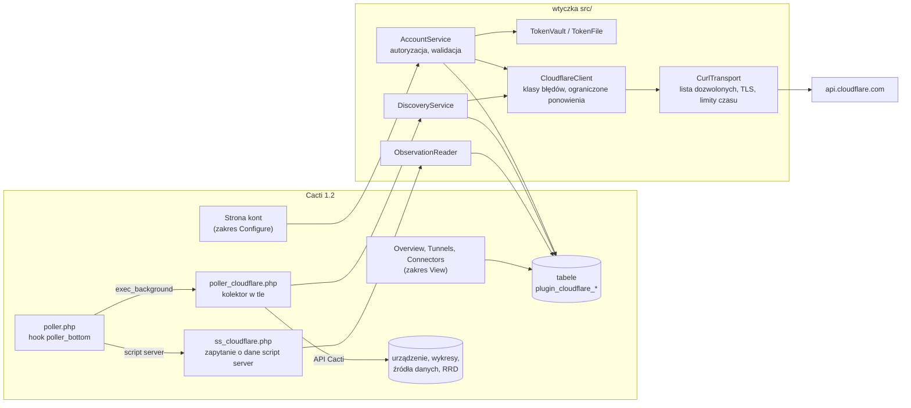

<!-- Source: README.md; SHA256: f8de0e02c5904e15bfa4c71edcaab219e5e5d4f6d9dbe589f4ed16351df6bf4d -->

<!-- translations:start -->
[English](../../../README.md) | [简体中文](../zh-CN/README.md) | [हिन्दी](../hi-IN/README.md) | [Español (España)](../es-ES/README.md) | [Español (Latinoamérica)](../es-419/README.md) | [العربية (السعودية)](../ar-SA/README.md) | [Afrikaans](../af-ZA/README.md) | [አማርኛ](../am-ET/README.md) | [العربية (مصر)](../ar-EG/README.md) | [العربية (المغرب)](../ar-MA/README.md) | [বাংলা](../bn-BD/README.md) | [Deutsch](../de-DE/README.md) | [فارسی](../fa-IR/README.md) | [Filipino](../fil-PH/README.md) | [Français](../fr-FR/README.md) | [Français (Maroc)](../fr-MA/README.md) | [Français (Sénégal)](../fr-SN/README.md) | [Hausa](../ha-NG/README.md) | [עברית](../he-IL/README.md) | [Bahasa Indonesia](../id-ID/README.md) | [Igbo](../ig-NG/README.md) | [Italiano](../it-IT/README.md) | [日本語](../ja-JP/README.md) | [한국어](../ko-KR/README.md) | [Malagasy](../mg-MG/README.md) | [मराठी](../mr-IN/README.md) | [Bahasa Melayu](../ms-MY/README.md) | [Nederlands](../nl-NL/README.md) | [Polski](README.md) | [Português (Brasil)](../pt-BR/README.md) | [Русский](../ru-RU/README.md) | [Kinyarwanda](../rw-RW/README.md) | [Soomaali](../so-SO/README.md) | [Svenska](../sv-SE/README.md) | [Kiswahili](../sw-KE/README.md) | [தமிழ்](../ta-IN/README.md) | [తెలుగు](../te-IN/README.md) | [ไทย](../th-TH/README.md) | [Türkçe](../tr-TR/README.md) | [Українська](../uk-UA/README.md) | [اردو](../ur-PK/README.md) | [Tiếng Việt](../vi-VN/README.md) | [isiXhosa](../xh-ZA/README.md) | [Yorùbá](../yo-NG/README.md) | [繁體中文](../zh-TW/README.md) | [isiZulu](../zu-ZA/README.md)
<!-- translations:end -->

<p align="center">
  
</p>

# Wtyczka Cloudflare dla Cacti

[](https://github.com/somethingwithproof/plugin_cloudflare/actions/workflows/ci.yml)
[](https://sonarcloud.io/summary/new_code?id=somethingwithproof_plugin_cloudflare)
[](../../../LICENSE)


[](https://sonarcloud.io/summary/new_code?id=somethingwithproof_plugin_cloudflare)
[](https://sonarcloud.io/summary/new_code?id=somethingwithproof_plugin_cloudflare)
[](https://sonarcloud.io/summary/new_code?id=somethingwithproof_plugin_cloudflare)


Wtyczka dla Cacti 1.2 tworzona w celu monitorowania tuneli Cloudflare (Cloudflare Tunnels) oraz
statystyk stref. Odczytuje dane z API Cloudflare przy użyciu tokenów API o ograniczonym zakresie uprawnień,
nigdy nie wprowadza żadnych zmian w Cloudflare i przechowuje dane we własnych tabelach.
W Cacti kopiuje pliki XML zapytań o dane do katalogu `resource/script_server/` oraz
tworzy urządzenia, wykresy i szablony za pomocą własnych interfejsów API Cacti, bez modyfikacji
plików bazowych.

**Status: 0.4.0-dev, wersja niewydana.** Ostatnią wydaną wersją jest 0.3.0. Wersja rozwojowa dodaje eksport inwentarza do CSV, jawne wycofywanie usuniętych tuneli, buforowane statystyki stref oraz opcjonalne szablony Thold. Kwalifikacja z rzeczywistym dostawcą oraz wdrożeniowa pozostaje w toku.

Poniższa tabela opisuje wydanie stabilne 0.3.0. Nowości z wersji rozwojowej opisano poniżej w sekcjach poświęconych przepływom pracy operatora i statystykom stref.

| Dostępne obecnie | Planowane |
|---|---|
| Instalacja, aktualizacja, wyłączanie i odinstalowywanie za pomocą menedżera wtyczek Cacti | Statystyki GraphQL i alerty Thold (Kamień milowy 4) |
| Uprawnienia Cloudflare: View, Operator oraz Configure | Wstrzykiwanie błędów, modele TLA+ i pełna dokumentacja (Kamień milowy 5) |
| Dodawanie, edycja, usuwanie, włączanie i wyłączanie kont Cloudflare | |
| Przechowywanie tokenu w pliku lub w postaci zaszyfrowanej w bazie danych Cacti | |
| Weryfikacja tokenu oraz sprawdzanie uprawnień odczytu tuneli i stref | |
| Wykrywanie tuneli i konektorów w kolektorze działającym w tle, uruchamianym przez główny poller | |
| Strony Overview, Tunnels i Connectors w sekcji Management > Cloudflare Tunnels | |
| Śledzenie cyklu życia: `active`, `unavailable` oraz `deleted` | |
| Jedno urządzenie Cacti na konto, tworzone przez administratora, z tunelami jako indeksami zapytania o dane | |
| Wykresy Connectors, Health i Collection dla każdego tunelu, generowane z jednego pliku RRD na tunel | |
| Wartości, których wtyczka nie może potwierdzić, są zapisywane jako nieznane (`U`), nigdy jako 0 | |

## Role dostępu

| Zakres (Realm) | Dostęp |
| --- | --- |
| Cloudflare: View | Istniejące strony monitorowania. |
| Cloudflare: Operator | Monitorowanie oraz strona Operations i osobiste potwierdzenia w ramach triażu. |
| Cloudflare: Configure | Dostęp Operator oraz istniejąca konfiguracja i działania administracyjne. |

Po skopiowaniu plików aktualizacji otwórz stronę Plugins jako administrator, aby zarejestrować
nowy zakres uprawnień. Przypisz zakres Operator jawnie w sekcji **Configuration > Users** lub w grupach użytkowników.
Aktualizacje zachowują istniejące identyfikatory i nadania zakresów View oraz Admin. Dostęp Admin
dziedziczy dostęp Operator, a dostęp Operator dziedziczy dostęp View przy każdym żądaniu;
nie dodaje to trwałych nadań do użytkowników ani grup. Ustawienia wtyczki wymagają również
uprawnienia Cloudflare: Configure oprócz uprawnienia Settings w Cacti.

Widoczność kont Cloudflare odpowiada istniejącemu zakresowi View; obejmuje całe konto.
Poświadczenia, konfiguracja, mapowanie, usuwanie i inne zmiany administracyjne
pozostają na stronach administracyjnych. Potwierdzenia obowiązują wyłącznie w bieżącej
sesji użytkownika, maksymalnie przez jedną godzinę i tylko dopóki ta sama obserwacja pozostaje
aktualna. Nowe lub zmienione obserwacje je unieważniają. Nigdy nie oznaczają one nieudanego
pomiaru jako prawidłowego ani nie tłumią alertów.

## Dlaczego ta wtyczka

Administratorzy Cacti publikujący usługi przez Cloudflare Tunnel nie mają wglądu
w stan tunelu bezpośrednio w Cacti. Tunel może utracić wszystkie konektory, podczas gdy
hosty źródłowe nadal odpowiadają na SNMP, przez co istniejące wykresy pozostają zielone, a
użytkownicy widzą błędy. Celem tej wtyczki jest umieszczenie informacji o stanie tuneli i ruchu
stref obok wykresów urządzeń już obserwowanych przez operatorów, bez dawania
Cacti jakichkolwiek możliwości modyfikacji konfiguracji w Cloudflare.

Projekt kształtują trzy założenia:

- **Tylko do odczytu.** Wtyczka wywołuje wyłącznie punkty końcowe `GET` oraz interfejs GraphQL
  Analytics API. Nie wymaga żadnych uprawnień do edycji zasobów Cloudflare.
- **Opcjonalność.** Awarie Cloudflare, wygasłe tokeny i limity zapytań nie mogą
  spowalniać interfejsu Cacti ani blokować odpytywania innych urządzeń. Wszystkie wywołania API mają
  sztywne limity czasu, a zbieranie danych odbywa się w procesie w tle uruchamianym przez
  poller.
- **Brak zmian w kodzie bazowym.** Wtyczka korzysta z punktów zaczepienia wtyczek Cacti 1.2 oraz
  własnych tabel. Kopiuje jeden plik XML zapytania o dane do katalogu `resource/script_server/` oraz
  tworzy urządzenia, wykresy i szablony poprzez własne API Cacti. Brak modyfikacji
  plików bazowych sprawia, że aktualizacje Cacti i inne wtyczki pozostają nienaruszone.

## Jak to działa



- **Warstwa integracji z Cacti** (`setup.php`, `includes/`, skrypty stron) rejestruje
  punkty zaczepienia i zakresy uprawnień, renderuje strony przy użyciu własnych funkcji pomocniczych Cacti i deleguje
  każdą akcję do biblioteki w katalogu `src/`.
- **Biblioteka** (`src/`, przestrzeń nazw `Somethingwithproof\Cloudflare\`) nie ma
  zależności od zmiennych globalnych Cacti, dzięki czemu jest testowana z rzeczywistą bazą danych i
  symulowanym transportem HTTP bez uruchomionej instancji Cacti.
- **Jedna ścieżka wychodząca.** `CurlTransport` to jedyny kod komunikujący się z
  siecią, akceptujący wyłącznie `https://api.cloudflare.com`. Każde niepowodzenie
  jest mapowane na jedną klasę błędu (`auth`, `permission`, `rate_limited`,
  `transient`, ...), co determinuje status wyświetlany w interfejsie.
- **Przechowywanie danych** odbywa się poprzez własne połączenie PDO w Cacti z wykorzystaniem
  zapytań parametryzowanych. Zmiany schematu bazy to numerowane, idempotentne migracje.

Decyzje projektowe i ich uzasadnienie znajdują się w pliku
[docs/design.md](../../design.md).

## Zrzuty ekranu

Zrzuty ekranu pochodzą ze środowiska testowego, a nie z produkcyjnego konta Cloudflare. Środowisko
uruchamia Cacti 1.2.31 z symulowanym API Cloudflare zwracającym dane
testowe, więc konto, jego identyfikator oraz trzy tunele są wartościami przykładowymi.


*Lista kont Cloudflare. Symulowane API akceptuje token, więc weryfikacja (Verify)
zwraca status `ok`.*


*Edycja konta. Pola tokenu są zawsze puste; zapisany token nigdy
nie jest odsyłany do przeglądarki. Opcje Collect Tunnels i Create Graphs są włączone, a
Collect Analytics jest wyłączona. Sekcja Connection Status pokazuje wynik ostatniej
weryfikacji (Verify): `ok`, przyznany odczyt tuneli i brak odczytu stref.*


*Settings > Cloudflare.*


*Management > Cloudflare Tunnels > Overview. Status odpowiada najgorszemu stanowi Cloudflare
wśród aktywnych tuneli konta — tutaj jest to `down`, ponieważ jeden z testowych
tuneli nie działa. Statusy `Disabled`, `Not collected`, `Collection failing` oraz `Not yet
collected` mają pierwszeństwo przed stanem tuneli w tej właśnie kolejności, więc konto,
którego ostatni przebieg zakończył się niepowodzeniem, wyświetla `Collection failing` niezależnie od tego, co zgłaszają jego tunele.*


*Karta Tunnels. Kolumny Connectors i Connections wyświetlają `-` dla tunelu old-office, ponieważ
symulowane API odpowiada na jego żądanie połączeń jako nieznany tunel i nic
nie zostało zapisane, oraz 0 dla tunelu staging, który nie ma działającego konektora.*


*Wykres Connectors dla tunelu blog. Wszystkie trzy linie mają wartość 1 przed przerwą i
po przerwie pośrodku, gdzie symulowane API zwracało błędy i wtyczka
zapisała wartości nieznane. Linie nie spadają do 0. Wykres pochodzi z tego
samego środowiska testowego (`make screenshots`), które ustawia 30-sekundowy krok dla tego
jednego źródła danych, dzięki czemu siedem minut odpytywania wypełnia wykres.*

## Wymagania

- Cacti od wersji 1.2.25 do 1.2.31. Sama wersja Cacti 1.2.31 wymaga PHP 8.0 lub
  nowszego. CI testuje wyłącznie wersję 1.2.31; wersja 1.2.25 była ostatnio
  testowana ręcznie 2026-10-22.
- PHP od wersji 7.4 do 8.4 z rozszerzeniami `curl`, `openssl` oraz `pdo_mysql`.
  Wtyczka odmawia włączenia bez tych rozszerzeń.
- MariaDB 10.6 lub nowsza, bądź MySQL 8.0 lub nowszy.
- Dostęp HTTPS z serwera Cacti do `api.cloudflare.com`. Serwery proxy nie są
  obsługiwane.

Zakres testowanych konfiguracji opisano w pliku [docs/compatibility.md](../../compatibility.md).

## Instalacja

1. Umieść wtyczkę w katalogu `plugins/cloudflare` instalacji Cacti,
   rozpakowując archiwum z
   [GitHub Releases](https://github.com/somethingwithproof/plugin_cloudflare/releases)
   (uruchomienie `make package` w kopii roboczej tagu wydania buduje to samo
   archiwum) albo klonując repozytorium za pomocą git. Katalog musi nazywać
   się `cloudflare`.
2. Zainstaluj i włącz wtyczkę w menu Console > Configuration > Plugins lub za
   pomocą interfejsu CLI jako użytkownik serwera WWW:

   ```sh
   php cli/plugin_manage.php --plugin=cloudflare --install --enable
   ```

3. Użytkownik administratora otrzymuje uprawnienie Cloudflare: Configure podczas
   instalacji. Nadaj je innym użytkownikom lub grupom w menu Console >
   Configuration > Users.
4. Utwórz token z uprawnieniami opisanymi w
   [docs/token-permissions.md](../../token-permissions.md). W skrócie:
   Account > Cloudflare Tunnel > Read oraz opcjonalnie Zone > Zone > Read.
5. Zapisz token na jeden z dwóch poniższych sposobów, następnie dodaj konto w
   menu Console > Configuration > Cloudflare Accounts i uruchom akcję Verify z
   menu akcji.

### Opcja A: szyfrowanie w bazie danych

Wtyczka szyfruje tokeny za pomocą utworzonego przez Ciebie 32-bajtowego klucza.
Sama nigdy nie tworzy ani nie zapisuje tego klucza. Plik musi być możliwy do
odczytu przez użytkowników serwera WWW oraz pollera, nie może być możliwy do
odczytu przez innych użytkowników, a jego katalog musi pozwalać tym
użytkownikom na dostęp do niego. Dla serwera WWW działającego jako `www-data`:

```sh
sudo mkdir -p /etc/cacti
sudo sh -c 'umask 077 && openssl rand -hex 32 > /etc/cacti/cloudflare.key'
sudo chgrp www-data /etc/cacti/cloudflare.key
sudo chmod 0440 /etc/cacti/cloudflare.key
```

Domyślna ścieżka to `/etc/cacti/cloudflare.key`; możesz ją zmienić w Settings >
Cloudflare > Token Vault Key File. Gdy klucz jest nieobecny lub odrzucony,
formularz edycji oferuje wyłącznie opcję pliku z tokenem. Zachowaj kopię
zapasową klucza: bez niego zapisanych tokenów nie da się odszyfrować i trzeba je
wprowadzić ponownie.

#### Rotacja klucza

Nie ma polecenia do ponownego zaszyfrowania klucza. Nowy klucz nie może
odszyfrować tokenów zapisanych przy użyciu starego, więc rotacja oznacza
ponowne wprowadzenie każdego zapisanego tokenu:

1. Miej pod ręką wartość tokenu każdego konta. Cloudflare wyświetla wartość
   tokenu wyłącznie podczas jego tworzenia lub odnawiania, więc odnów token w
   panelu Cloudflare, jeśli już go nie posiadasz.
2. Utwórz nowy klucz pod nową ścieżką za pomocą powyższych poleceń, na
   przykład `/etc/cacti/cloudflare.key.new`, z tym samym właścicielem i
   uprawnieniami.
3. Ustaw Settings > Cloudflare > Token Vault Key File na nową ścieżkę i zapisz.
   Od tego momentu Verify dla konta nadal zaszyfrowanego starym kluczem zgłasza
   komunikat „Stored token cannot be decrypted”, a każde uruchomienie kolektora
   rejestruje dla niego w dzienniku wpis `discovery token unavailable` z
   `reason=decrypt_failed`.
4. Dla każdego konta przechowującego token w bazie danych otwórz je w Console >
   Configuration > Cloudflare Accounts, wklej token w oba pola tokenu, zapisz
   i uruchom Verify. Powinno zgłosić `ok`.
5. Gdy wszystkie takie konta przejdą weryfikację, usuń stary plik klucza oraz
   jego kopie zapasowe.

Pomiędzy krokami 3 i 4 tunele konta nie są odświeżane, a ich wykresy kondycji,
konektorów i połączeń rejestrują wartość U. Konta korzystające z pliku z tokenem
nie są tym objęte.

### Opcja B: plik z tokenem

Zapisz sam token, i nic poza nim, do pliku, który mogą odczytać użytkownicy
serwera WWW oraz pollera, a inni nie mogą, po czym wprowadź jego ścieżkę
bezwzględną w formularzu edycji:

```sh
sudo sh -c 'umask 077 && cat > /etc/cacti/cloudflare-account.token'   # paste the token, then Ctrl-D
sudo chgrp www-data /etc/cacti/cloudflare-account.token
sudo chmod 0440 /etc/cacti/cloudflare-account.token
```

Plik jest sprawdzany podczas odczytu w trakcie Verify, a nie przy zapisie.
Dowiązania symboliczne, pliki większe niż 4 KiB oraz pliki możliwe do odczytu
lub zapisu przez innych użytkowników są odrzucane.

Każdy użytkownik z uprawnieniem Cloudflare: Configure może podać dowolną ścieżkę,
a użytkownik pollera ją odczytuje. Aby przechowywać pliki z tokenami w jednym
miejscu, ustaw Settings > Cloudflare > Token File Directory, na przykład na
`/etc/cacti`; ścieżki spoza tego katalogu będą wówczas odrzucane. Zobacz
[docs/security.md](../../security.md#token-file).

## Aktualizacja

1. Zastąp pliki w `plugins/cloudflare` plikami z nowego wydania, zachowując
   nazwę katalogu.
2. Otwórz jednokrotnie jako administrator Console > Configuration > Plugins lub
   Console > Configuration > Cloudflare Accounts. Spowoduje to uruchomienie
   migracji wtyczki, zaimportowanie szablonów Cloudflare i skopiowanie pliku
   zapytania danych (zobacz
   [Metryki i wykresy tuneli](#tunnel-metrics-and-graphs)), a przy aktualizacji z
   wersji 0.1.0 — zarejestrowanie hooka `poller_bottom`.

`poller.php` nie uruchamia aktualizacji wtyczki, więc do czasu wykonania kroku 2
brakuje nowego schematu. Każde uruchomienie kolektora nic wtedy nie robi i
zapisuje w dzienniku
`CLOUDFLARE: collector skipped; plugin upgrade pending, open Console > Plugins`.
Strony Cloudflare Tunnels wymagają jedynie uprawnienia Cloudflare: View, więc
nigdy nie uruchamiają aktualizacji i do czasu wykonania kroku 2 mogą wyświetlać
komunikat „The Cloudflare tunnels could not be read”.

## Stan konta

Akcja Verify ustawia stan konta:

| Stan | Znaczenie |
|---|---|
| `unknown` | Nie zweryfikowano od czasu dodania konta lub zmiany jego danych uwierzytelniających |
| `ok` | Token jest aktywny i może odczytywać tunele |
| `token_inactive` | Cloudflare zgłasza token jako wyłączony lub wygasły |
| `auth_failed` | Cloudflare odrzucił token jako nieprawidłowy lub wygasły (HTTP 401) |
| `permission_denied` | Token jest aktywny, ale nie może odczytywać tuneli, albo nie ma uprawnień do wywołania punktów końcowych weryfikacji tokenu (HTTP 403) |
| `unreachable` | Nie udało się połączyć z API, upłynął limit czasu lub zwrócono błąd serwera |
| `rate_limited` | Cloudflare zwrócił kod HTTP 429 |
| `error` | Każdy inny błąd, w tym brakujący lub niebezpieczny plik z tokenem, brakujący lub bezużyteczny plik klucza skarbca tokenów albo zapisany token, którego nie można odszyfrować |

Strona edycji pokazuje również, czy przyznano uprawnienia odczytu tuneli oraz
odczytu stref.

## Wykrywanie tuneli

Po każdym cyklu odpytywania na głównym pollerze hook `poller_bottom` uruchamia
kolektor w tle za pomocą `exec_background`, gdy co najmniej jedno włączone konto
ma aktywną opcję Collect Tunnels. Kolektor nigdy nie działa w procesie pollera,
dzięki czemu wolne API Cloudflare nie opóźnia `poller.php`. Zdalne pollery
nigdy go nie uruchamiają.

Dla każdego konta, dla którego nadszedł czas odświeżenia, kolektor pobiera listę
tuneli konta, a następnie odczytuje połączenia jego aktywnych tuneli, co
dostarcza informacji o konektorach każdego tunelu, ich wersjach, centrach
danych i adresach źródłowych. Konta są odświeżane co Discovery Interval
(domyślnie 300 sekund). Pojedyncze uruchomienie nie rozpoczyna obsługi nowego
konta po upływie 50 sekund i wykonuje maksymalnie 200 żądań połączeń. Każdy z
tych limitów może również zatrzymać obsługę konta w trakcie odczytywania jego
połączeń; takie konto jest zapisywane jako `partial`, a kolejne uruchomienie
kontynuuje od tuneli obsługiwanych najdawniej. Konta, których nie rozpoczęto,
pozostają gotowe do uruchomienia w kolejnym cyklu.

Tunel ma swój cykl życia, utrzymywany oddzielnie od stanu zgłaszanego przez
Cloudflare (`healthy`, `degraded`, `down` lub `inactive`):

| Cykl życia | Znaczenie |
|---|---|
| `active` | Tunel znajdował się na ostatniej kompletnej liście |
| `deleted` | Kompletna lista go nie zawierała, co obejmuje również pustą listę. Wiersz i jego historia pozostają zachowane, a tunel staje się ponownie `active`, jeśli pojawi się z powrotem |
| `unavailable` | Trzy zliczone awarie bez kompletnej listy pomiędzy nimi pozostawiają stan tunelu nieznany |

Wyłącznie kompletna, pomyślnie pobrana lista dodaje, aktualizuje lub usuwa
tunele, a nieudane pobranie listy nigdy żadnego nie usuwa. Błąd samego odczytu z
Cloudflare (`transient`, `rate_limited`, `auth` lub `permission`) wlicza się do
awarii; po trzech zliczonych awariach bez kompletnej listy pomiędzy nimi
aktywne tunele konta stają się `unavailable`. Kolejna kompletna lista przywraca
je i zeruje licznik. Tunel, którego Cloudflare już nie rozpoznaje podczas
odczytu jego połączeń, jest pomijany bez oznaczania całego konta jako błędnego.
Pozostałe błędy ani nie zwiększają, ani nie zerują licznika awarii.

W pliku `cacti.log` wiersze dotyczące wykrywania zaczynają się od
`CLOUDFLARE: discovery`, a podsumowanie uruchomienia od `CLOUDFLARE: collector`.
Błędy i zmiany cyklu życia, takie jak nieudane pobranie listy lub oznaczenie
tuneli jako `unavailable`, są rejestrowane na domyślnym poziomie Cacti `LOW`;
wynik każdego konta oraz podsumowanie uruchomienia są rejestrowane na poziomie
`MEDIUM`. Odczyty połączeń mogą zawieść na każdym tunelu, więc dla każdego konta
na poziomie `LOW` rejestrowany jest tylko pierwszy błąd danej klasy błędów,
kolejne na poziomie `MEDIUM`, a na końcu jeden wiersz `LOW` na klasę z liczbą
tuneli, które zawiodły.

Menu Management > Cloudflare Tunnels wymaga uprawnienia Cloudflare: View i
działa w trybie tylko do odczytu:

- **Overview** wyświetla listę kont wraz z ich stanem, liczbą tuneli według
  cyklu życia, czasem ostatniego udanego wykrywania oraz liczbą kolejnych
  błędów.
- **Tunnels** wyświetla tunele ze wszystkich kont lub jednego konta, z filtrami
  dla konta, cyklu życia, stanu i nazwy oraz sortowalnymi kolumnami.
- **Connectors** pokazuje konektory tunelu wybranego na karcie Tunnels.

## Metryki i wykresy tuneli

Cacti odczytuje stan tuneli za pomocą zapytania danych serwera skryptów
`ss_cloudflare.php`. Odpowiada ono wyłącznie na podstawie tabel wtyczki i nigdy
nie łączy się z Cloudflare, więc awaria Cloudflare nie spowalnia pollera. Każdy
tunel dostarcza sześć wartości: kondycję (healthy 3, degraded 2, down 1,
inactive 0), liczbę konektorów, liczbę połączeń, wersje konektorów, liczbę
sekund od ostatniego odczytu jego połączeń oraz liczbę kolejnych błędów zadania
wykrywania. Kondycja, konektory, połączenia i wersje są wypisywane tylko wtedy,
gdy wtyczka może za nie ręczyć — co oznacza, że ostatnie wykrywanie powiodło się,
tunel jest `active`, a odczyt jest aktualny. W przeciwnym razie przyjmują
wartość `U`, a wykres wyświetla przerwę zamiast zera, które wyglądałoby jak
awaria. Dwie wartości dotyczące zbierania danych pozostają wypisywane podczas
awarii, dzięki czemu wykres Collection ją uwidacznia; przyjmują wartość `U`
jedynie dla usuniętego tunelu lub takiego, którego połączenia nigdy nie zostały
odświeżone. Zasady opisano w pliku [docs/metrics.md](../../metrics.md).

### Tworzenie urządzenia

Jedno konto odpowiada maksymalnie jednemu urządzeniu Cacti. Urządzenie
przechowuje tunele konta jako indeksy zapytania danych Cloudflare Tunnels. Nic
nie tworzy go automatycznie:

1. Otwórz Console > Configuration > Cloudflare Accounts.
2. Zaznacz konto, wybierz Create Cacti Device z menu akcji i potwierdź.

Akcja wymaga zarówno uprawnienia Cloudflare: Configure, jak i uprawnienia Cacti
Sites/Devices/Data (tego samego, które dotyczy `host.php`). Pozycja w menu jest
widoczna tylko dla użytkowników posiadających oba uprawnienia, a serwer odrzuca
żądanie od każdego innego użytkownika. Urządzenie otrzymuje nazwę
`Cloudflare: <account name>`, używa szablonu hosta Cloudflare Account i głównego
pollera, ma wersję SNMP 0 bez sprawdzania dostępności oraz otrzymuje nazwę hosta
`<account ID>.cloudflare.invalid`. Ta nazwa jest zarezerwowana i nigdy nie jest
rozwiązywana w DNS; Cacti się z nią nie łączy. Jeśli konto ma już przypisane
urządzenie, akcja informuje o tym i niczego nie zmienia. Jeśli administrator
usunie urządzenie w Cacti, wtyczka nie utworzy kolejnego, dopóki akcja Create
Cacti Device nie zostanie uruchomiona ponownie.

### Tworzenie wykresów

Opcja Create Graphs w formularzu konta jest domyślnie wyłączona. Gdy jest
włączona, po każdym zakończeniu wykrywania dla konta ze statusem `ok` lub
`partial` kolektor ponownie indeksuje urządzenie i tworzy brakujące wykresy dla
tuneli konta w stanie `active`: Connectors, Health oraz Collection — trzy na
każdy tunel. Trzy wykresy jednego tunelu współdzielą jeden plik RRD. Pojedyncze
uruchomienie tworzy maksymalnie 50 wykresów i zatrzymuje się po 20 sekundach, a
kolejne uruchomienie kontynuuje pracę. Wtyczka nigdy nie usuwa obiektów Cacti.
Wykres usunięty przez administratora nie jest tworzony ponownie, a tunel,
którego Cloudflare już nie wymienia na liście, zachowuje swoje wykresy i plik
RRD, które wyświetlają wartość `U`.

Włączenie Create Graphs wymaga obu uprawnień. Wyłączenie wymaga jedynie
uprawnienia Configure. Zapisanie formularza przez użytkownika bez uprawnienia
Sites/Devices/Data pozostawia to ustawienie bez zmian i wyświetla ostrzeżenie.
Przy wyłączonym Create Graphs urządzenie jest nadal ponownie indeksowane po
każdym wykrywaniu, dzięki czemu nowe tunele pojawiają się jako indeksy
zapytania danych.

### Plik zapytania danych

Cacti 1.2.31 odczytuje plik XML zapytania danych wyłącznie ze swojego katalogu
`resource`. Dlatego podczas instalacji i aktualizacji wtyczka kopiuje jeden
plik, `templates/resource/cloudflare_tunnels.xml`, do
`<Cacti>/resource/script_server/cloudflare_tunnels.xml`. Jest to jedyny plik
zapisywany przez wtyczkę poza jej własnym katalogiem, więc użytkownik
instalujący lub aktualizujący wtyczkę musi mieć prawo zapisu do tego katalogu.
Odinstalowanie zachowuje ten plik, podobnie jak urządzenia, wykresy, pliki RRD i
szablony. Jeśli kopiowanie lub import szablonu nie powiedzie się, wtyczka
zapisuje to w dzienniku, a akcja Create Cacti Device ponawia próbę.

## Ustawienia

Sekcja Settings > Cloudflare zawiera następujące opcje:

- **Token Vault Key File**: ścieżka do klucza sejfu tokenów.
- **Token File Directory**: po ustawieniu odrzuca pliki tokenów znajdujące się poza tym katalogiem. Domyślnie puste, co zezwala na dowolną ścieżkę. Zob. [docs/security.md](../../security.md#token-file).
- **Interactive Request Timeout**: łączny czas w sekundach dla żądania wykonywanego z poziomu interfejsu WWW, takiego jak Verify. Wartość domyślna to 10; wartości spoza zakresu od 5 do 60 są zastępowane domyślną wartością 10.
- **Collector Request Timeout**: łączny czas w sekundach dla żądania wykonywanego przez kolektor działający w tle. Wartość domyślna to 20; wartości spoza zakresu od 5 do 60 są zastępowane domyślną wartością 20.
- **Log Level**: wartość jest zapisywana. Żaden mechanizm jeszcze jej nie odczytuje.

W formularzu konta opcje Collect Tunnels oraz Discovery Interval sterują wykrywaniem, a Create Graphs steruje tworzeniem wykresów. Opcja Collect Analytics jest zapisywana, lecz w tym wydaniu nie wywołuje żadnego efektu.

## Języki

Wtyczka zawiera tłumaczenia na język hiszpański (Hiszpania, `es-ES`), francuski (`fr-FR`), niemiecki (`de-DE`), chiński uproszczony (`zh-CN`), hindi (`hi-IN`), arabski (`ar-SA`) oraz japoński (`ja-JP`). Cacti wyświetla je po włączeniu obsługi języków (Configuration > Settings > General > Language Support) i wybraniu języka przez użytkownika. Dostarczany jest również katalog dla języka hiszpańskiego w wersji latynoamerykańskiej (`es-419`), jednak Cacti 1.2 nie posiada odpowiedniego ustawienia regionalnego do wyboru, więc zacznie on działać dopiero po dodaniu takiego ustawienia w Cacti; do tego czasu należy wybrać język hiszpański (`es-ES`).

Część tekstów pozostaje w języku angielskim: wartości statusów zapisywane i wyświetlane przez wtyczkę w niezmienionej formie (`ok`, `active`, `unavailable`, `deleted` oraz status tunelu zwracany przez Cloudflare), a także wszystkie wpisy zapisywane przez wtyczkę w dzienniku Cacti.

## Odinstalowanie i przechowywanie danych

Odinstalowanie usuwa własne tabele wtyczki, które przechowują konta, zaszyfrowane tokeny, wykryte tunele, stan zadań oraz rejestr utworzonych przez wtyczkę obiektów Cacti, a także usuwa jej ustawienia `cloudflare_`. Nie usuwa ono pliku klucza, plików tokenów, skopiowanego pliku `resource/script_server/cloudflare_tunnels.xml` ani żadnych urządzeń, wykresów, źródeł danych, plików RRD czy szablonów Cacti. Zawierają one historyczne dane monitorowania, a ich usunięcie wymaga wyraźnego działania administratora w Cacti.

Zachowane urządzenie przestaje otrzymywać dane. Po odinstalowaniu lub usunięciu powiązanego konta żadne konto nie jest właścicielem hosta, więc jego wykresy zachowują historię, lecz od tego momentu rejestrują wartość `U`. Użycie opcji Create Cacti Device dla ponownie zainstalowanego lub dodanego konta tworzy nowe urządzenie; nie wykorzystuje ponownie starego, dlatego stare urządzenie należy usunąć w Cacti, gdy jego historia nie jest już potrzebna.

## Znane ograniczenia

- Pojedyncze uruchomienie wykonuje maksymalnie 200 żądań dotyczących połączeń. Tunele wykraczające poza ten limit są odświeżane rzadziej niż okno obserwacji, przez co na ich wykresach połączeń pojawiają się luki.
- Wtyczka nadpisuje modyfikacje wprowadzone przez administratora w zaimportowanych szablonach, gdy aktualizacja zmienia dostarczony plik XML szablonu.
- Urządzenie konta musi pozostać przypisane do głównego pollera. Tabele wtyczki znajdują się w głównej bazie danych i stamtąd odczytuje je skrypt.
- Usunięte tunele pozostają w indeksie zapytań danych i zwracają `U`, dopóki administrator jawnie ich nie wycofa. Wycofanie usuwa za pośrednictwem Cacti wyłącznie wykresy zarejestrowane przez wtyczkę oraz niewspółdzielone źródła danych; wiersz inwentarza pozostaje widoczny. Oczyszczaniem plików RRD zarządza Cacti.
- Cacti wyłącza wtyczkę, której kod zakończy się prawdziwym błędem krytycznym, takim jak wyczerpanie pamięci. Zob. [docs/security.md](../../security.md).

## Bezpieczeństwo

- Klucze Global API Keys są odrzucane; akceptowane są wyłącznie tokeny API o ograniczonym zakresie uprawnień.
- Tokeny są przechowywane w pliku dostarczonym przez administratora lub szyfrowane algorytmem AES-256-GCM przy użyciu pliku klucza, który nigdy nie trafia do bazy danych. Nigdy nie są wyświetlane na stronie, zapisywane w dzienniku ani dołączane do komunikatów o błędach.
- Błędy bazy danych zawierają wyłącznie kod SQLSTATE oraz kod błędu sterownika, nigdy zaś wartości z zapytania.
- Każda zmiana jest żądaniem POST chronionym tokenem CSRF systemu Cacti. Zmiany administracyjne dotyczące kont i konfiguracji wymagają uprawnienia Cloudflare: Configure; osobiste potwierdzenia wstępnej selekcji zdarzeń wymagają uprawnienia Cloudflare: Operator. Utworzenie urządzenia Cacti lub włączenie opcji Create Graphs wymaga ponadto uprawnienia Sites/Devices/Data w Cacti. Wyłączona wtyczka odrzuca dostęp do swoich stron.

Szczegóły oraz znane ograniczenia opisano w pliku [docs/security.md](../../security.md).
Podatności należy zgłaszać prywatnie zgodnie z opisem w pliku [SECURITY.md](../../../SECURITY.md).

## Przepływy pracy operatora i analityka stref

Rozszerzenia deweloperskie obejmują jawne wycofywanie usuniętych tuneli, analitykę stref uwzględniającą możliwości planu oraz importowalne szablony Thold. Rozszerzenia te nie mają jeszcze tagu wydania ani kwalifikacji na koncie produkcyjnym. Zob. [docs/analytics-and-alerting.md](../../analytics-and-alerting.md), aby zapoznać się z konfiguracją, semantyką metryk oraz ograniczeniami weryfikacji.

### Eksporty inwentarza

Strony Tunnels oraz Connectors udostępniają opcję Export dla zakresu uprawnień Cloudflare: View. Pliki CSV dla tuneli zawierają każdy pasujący wiersz zgodnie z aktywnymi ustawieniami konta, cyklu życia, statusu, wyszukiwania i sortowania na wszystkich stronach. Pliki CSV dla konektorów zawierają wersje, architekturę, centra danych oraz adresy źródłowe dla wybranego tunelu. Pobieranie odczytuje wyłącznie rekordy z pamięci podręcznej. Nieznane wartości liczbowe są puste; komórki przypominające formuły są poprzedzane apostrofem w celu bezpiecznego importu do arkusza kalkulacyjnego.

## Plan rozwoju

Każdy kamień milowy jest publikowany jako wydanie 0.x o odpowiadającym mu numerze: Kamień milowy 3 to wersja 0.3.0, a Kamień milowy 4 będzie wersją 0.4.0. Kamienie milowe 1 i 2 nie zostały wydane osobno i stanowią część wersji 0.3.0. Wersja 1.0.0 jest zarezerwowana dla wydania realizującego wszystkie poniższe kamienie milowe.

| Kamień milowy | Zakres | Stan |
|---|---|---|
| 1. Podstawy | Cykl życia wtyczki, uprawnienia, konfiguracja konta, test połączenia | Wydano w 0.3.0 (od [#2](https://github.com/somethingwithproof/plugin_cloudflare/pull/2) do [#5](https://github.com/somethingwithproof/plugin_cloudflare/pull/5)) |
| 2. Wykrywanie | Wykrywanie tuneli i konektorów w kolektorze działającym w tle, strony Overview, Tunnels i Connectors | Wydano w 0.3.0 ([#6](https://github.com/somethingwithproof/plugin_cloudflare/pull/6)) |
| 3. Metryki | Źródła danych kondycji tuneli, szablony wykresów, obsługa awarii bez rejestrowania sztucznych zer | Wydano w 0.3.0 ([#7](https://github.com/somethingwithproof/plugin_cloudflare/pull/7)) |
| 4. Analityka i alertowanie | Analityka GraphQL dla poszczególnych stref uwzględniająca plan, progi Thold z tłumieniem podczas awarii | Planowano |
| 5. Wzmocnienie niezawodności | Wstrzykiwanie błędów, modele TLA+ wykrywania i zbierania danych, pełna dokumentacja | Planowano |

## Rozwój oprogramowania

Narzędzia wymagają PHP 8.x i Composera; sam kod wtyczki zachowuje zgodność z PHP 7.4. Testy integracyjne i BDD wymagają bazy danych, którą polecenie `make db-up` uruchamia w Dockerze na porcie 33061.

```sh
composer install
make db-up
make ci            # unit, integration, BDD, PHPStan, php-cs-fixer, php -l on PHP 7.4
make smoke         # installs the plugin into Cacti 1.2.31 in Docker and walks its lifecycle
make package       # builds build/cloudflare-<version>.tar.gz and checks its contents
make db-down
```

Polecenia `make smoke` i `make screenshots` wymagają kopii repozytorium Cacti; należy ustawić zmienną `CACTI_REPO` na jej ścieżkę. Testy integracyjne odczytują zmienne `CF_TEST_DSN`, `CF_TEST_DB_USER` oraz `CF_TEST_DB_PASS` i są pomijane, gdy baza danych jest nieosiągalna, chyba że ustawiono zmienną `CI`.

## Współpraca

Pull requesty są mile widziane. Każdy commit wymaga podpisu DCO (`git commit -s`). Najpierw napisz test; polecenie `make ci` musi zakończyć się powodzeniem, a zmiany w warstwie integracji z Cacti powinny także przejść `make smoke`. Kod wtyczki musi zachować zgodność z PHP 7.4 i być zgodny ze stylem kodu Cacti (tabulatory, pojedyncze cudzysłowy, klamry otwierające w tej samej linii).

### Tłumaczenia

Komunikaty są oznaczane za pomocą `__('...', 'cloudflare')`. Skrypt `locales/build_gettext.sh` (`make i18n`, wymagający narzędzia GNU gettext) generuje ponownie szablon `locales/po/cacti.pot`, scala go z każdym katalogiem `locales/po/<locale>.po` oraz kompiluje `locales/LC_MESSAGES/<locale>.mo`; należy zatwierdzić wszystkie trzy pliki. System CI uruchamia `make i18n-check`, który kończy się błędem, gdy w katalogu brakuje wpisu lub ma on status fuzzy, różni się ciąg formatujący albo skompilowany plik jest nieaktualny; zestaw testów jednostkowych sprawdza ponadto symbole zastępcze, znaczniki HTML i białe znaki na krańcach każdego wpisu. Zmieniony komunikat wymaga zatem aktualizacji jego tłumaczeń w tym samym pull requeście. Nowy język to nowy plik `<locale>.po` nazwany zgodnie z konwencją nazw ustawień regionalnych Cacti (na przykład `pt-BR`), dodany do `CatalogTest::LOCALES` oraz do sprawdzania archiwum w pliku `tests/build/package.sh`. Nazwy produktów Cloudflare, Cacti i Thold, nazwy API i GraphQL oraz nazwy uprawnień, takie jak `Account Cloudflare Tunnel Read`, należy pozostawić bez zmian.

## Dokumentacja

- [docs/security.md](../../security.md): mechanizmy bezpieczeństwa i znane ograniczenia
- [docs/token-permissions.md](../../token-permissions.md): uprawnienia tokenów
- [docs/compatibility.md](../../compatibility.md): obsługiwane wersje i używane interfejsy
- [docs/metrics.md](../../metrics.md): katalog metryk oraz przypadki nieznanych wartości
- [docs/collector-protocol.md](../../collector-protocol.md): co odczytuje i wypisuje `ss_cloudflare.php`
- [docs/schema.md](../../schema.md): tabele bazy danych
- [docs/design.md](../../design.md): decyzje projektowe
- [CHANGELOG.md](../../../CHANGELOG.md)

## Licencja

GPL-2.0-or-later. Zob. [LICENSE](../../../LICENSE).

## Znaki towarowe

Cloudflare jest zastrzeżonym znakiem towarowym firmy Cloudflare, Inc. Ten projekt jest niezależnym narzędziem open-source i nie jest powiązany z firmą Cloudflare, Inc., przez nią sponsorowany ani wspierany.

Projekt nie jest również powiązany z projektem Cacti. Informacje o logo znajdują się w pliku [docs/images/README-logo.md](../../images/README-logo.md).
