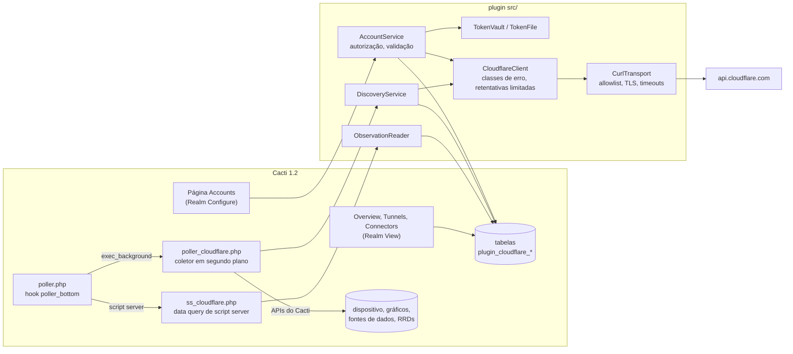

<!-- Source: README.md; SHA256: f8de0e02c5904e15bfa4c71edcaab219e5e5d4f6d9dbe589f4ed16351df6bf4d -->

<!-- translations:start -->
[English](../../../README.md) | [简体中文](../zh-CN/README.md) | [हिन्दी](../hi-IN/README.md) | [Español (España)](../es-ES/README.md) | [Español (Latinoamérica)](../es-419/README.md) | [العربية (السعودية)](../ar-SA/README.md) | [Afrikaans](../af-ZA/README.md) | [አማርኛ](../am-ET/README.md) | [العربية (مصر)](../ar-EG/README.md) | [العربية (المغرب)](../ar-MA/README.md) | [বাংলা](../bn-BD/README.md) | [Deutsch](../de-DE/README.md) | [فارسی](../fa-IR/README.md) | [Filipino](../fil-PH/README.md) | [Français](../fr-FR/README.md) | [Français (Maroc)](../fr-MA/README.md) | [Français (Sénégal)](../fr-SN/README.md) | [Hausa](../ha-NG/README.md) | [עברית](../he-IL/README.md) | [Bahasa Indonesia](../id-ID/README.md) | [Igbo](../ig-NG/README.md) | [Italiano](../it-IT/README.md) | [日本語](../ja-JP/README.md) | [한국어](../ko-KR/README.md) | [Malagasy](../mg-MG/README.md) | [मराठी](../mr-IN/README.md) | [Bahasa Melayu](../ms-MY/README.md) | [Nederlands](../nl-NL/README.md) | [Polski](../pl-PL/README.md) | [Português (Brasil)](README.md) | [Русский](../ru-RU/README.md) | [Kinyarwanda](../rw-RW/README.md) | [Soomaali](../so-SO/README.md) | [Svenska](../sv-SE/README.md) | [Kiswahili](../sw-KE/README.md) | [தமிழ்](../ta-IN/README.md) | [తెలుగు](../te-IN/README.md) | [ไทย](../th-TH/README.md) | [Türkçe](../tr-TR/README.md) | [Українська](../uk-UA/README.md) | [اردو](../ur-PK/README.md) | [Tiếng Việt](../vi-VN/README.md) | [isiXhosa](../xh-ZA/README.md) | [Yorùbá](../yo-NG/README.md) | [繁體中文](../zh-TW/README.md) | [isiZulu](../zu-ZA/README.md)
<!-- translations:end -->

<p align="center">
  
</p>

# Plugin Cloudflare para Cacti

[](https://github.com/somethingwithproof/plugin_cloudflare/actions/workflows/ci.yml)
[](https://sonarcloud.io/summary/new_code?id=somethingwithproof_plugin_cloudflare)
[](../../../LICENSE)


[](https://sonarcloud.io/summary/new_code?id=somethingwithproof_plugin_cloudflare)
[](https://sonarcloud.io/summary/new_code?id=somethingwithproof_plugin_cloudflare)
[](https://sonarcloud.io/summary/new_code?id=somethingwithproof_plugin_cloudflare)


Um plugin para Cacti 1.2 em desenvolvimento para monitorar túneis da Cloudflare
(Cloudflare Tunnels) e análises de zonas. Ele lê dados da API da Cloudflare
usando tokens de API com escopo restrito, nunca altera nada na Cloudflare e
mantém seus dados em tabelas próprias. No Cacti, ele copia arquivos XML de
consulta de dados (data query) para `resource/script_server/` e cria
dispositivos, gráficos e modelos por meio das próprias APIs do Cacti, sem
alterações nos arquivos principais (core).

**Status: 0.4.0-dev, não lançada.** A última versão lançada é a 0.3.0. A versão em desenvolvimento adiciona exportação de inventário em CSV, desativação explícita de túneis excluídos, análises de zonas em cache e modelos opcionais do Thold. A qualificação com provedor ativo e implantação ainda está pendente.

A tabela abaixo descreve a versão estável 0.3.0. As adições em desenvolvimento estão descritas abaixo em fluxos de trabalho de operador e análise de zonas.

| Disponível agora | Planejado |
|---|---|
| Instalar, atualizar, desativar e desinstalar pelo gerenciador de plugins do Cacti | Análises GraphQL e alertas Thold (Marco 4) |
| Permissões Cloudflare: View, Operator e Configure | Injeção de falhas, modelos TLA+ e documentação completa (Marco 5) |
| Adicionar, editar, excluir, ativar e desativar contas da Cloudflare | |
| Armazenar um token em um arquivo ou criptografado no banco de dados do Cacti | |
| Verificar um token e checar suas permissões de leitura de túneis e zonas | |
| Descoberta de túneis e conectores em um coletor em segundo plano iniciado pelo poller principal | |
| Páginas Overview, Tunnels e Connectors em Management > Cloudflare Tunnels | |
| Rastreamento de ciclo de vida: `active`, `unavailable` e `deleted` | |
| Um dispositivo Cacti por conta, criado por um administrador, com os túneis como índices de uma data query | |
| Gráficos de Connectors, Health e Collection por túnel, gerados a partir de um arquivo RRD por túnel | |
| Valores que o plugin não consegue validar são armazenados como desconhecidos (`U`), nunca como 0 | |

## Perfis de acesso

| Realm | Acesso |
| --- | --- |
| Cloudflare: View | Páginas de monitoramento existentes. |
| Cloudflare: Operator | Monitoramento mais a página Operations e confirmações pessoais de triagem. |
| Cloudflare: Configure | Acesso Operator mais as ações administrativas e de configuração existentes. |

Após copiar os arquivos de atualização, abra a página Plugins como administrador para registrar
o novo realm. Atribua o realm Operator explicitamente em **Configuration > Users** ou em grupos de usuários.
As atualizações mantêm os IDs e concessões existentes dos realms View e Admin. O acesso Admin
herda o acesso Operator, e o acesso Operator herda o acesso View em cada requisição;
isso não adiciona concessões armazenadas a usuários ou grupos. As configurações do plugin também exigem
acesso Cloudflare: Configure além da permissão Settings do Cacti.

A visibilidade das contas da Cloudflare corresponde ao realm View existente; ela abrange toda a conta.
Credenciais, configuração, mapeamento, exclusão e outras alterações administrativas
permanecem nas páginas administrativas. As confirmações duram apenas na sessão atual
do usuário, por no máximo uma hora e somente enquanto a mesma observação permanecer
recente. Observações novas ou alteradas as invalidam. Elas nunca marcam uma medição
com falha como íntegra nem suprimem alertas.

## Por que usar este plugin

Operadores do Cacti que publicam serviços por meio do Cloudflare Tunnel não têm visibilidade
do túnel dentro do Cacti. Um túnel pode perder todos os seus conectores enquanto
os hosts de origem continuam respondendo ao SNMP, de modo que os gráficos existentes permanecem verdes enquanto
os usuários veem erros. O objetivo deste plugin é colocar a integridade dos túneis e o tráfego
de zonas ao lado dos gráficos de dispositivos que os operadores já acompanham, sem dar
ao Cacti qualquer capacidade de alterar a Cloudflare.

Três restrições orientam o design:

- **Somente leitura.** O plugin chama apenas endpoints `GET` e a API GraphQL
  Analytics. Ele não precisa de nenhuma permissão de edição em nenhum recurso da Cloudflare.
- **Opcional.** Indisponibilidades da Cloudflare, tokens expirados e limites de taxa (rate limits) não devem
  deixar a interface do Cacti lenta nem travar o polling de outros dispositivos. Todas as chamadas de API têm
  timeouts rígidos, e a coleta é executada em um processo em segundo plano iniciado pelo
  poller.
- **Sem alterações no core.** O plugin usa os hooks de plugin do Cacti 1.2 e suas
  próprias tabelas. Ele copia um XML de data query para `resource/script_server/` e
  cria dispositivos, gráficos e modelos por meio das próprias APIs do Cacti. Sem alterações
  nos arquivos principais, atualizações do Cacti e outros plugins não são afetados.

## Como funciona



- **Integração com o Cacti** (`setup.php`, `includes/`, os scripts de página) registra
  hooks e realms, renderiza páginas com os próprios helpers do Cacti e delega
  cada ação para a biblioteca em `src/`.
- **A biblioteca** (`src/`, namespace `Somethingwithproof\Cloudflare\`) não tem
  dependência das variáveis globais do Cacti, por isso é testada contra um banco de dados real e
  um transporte HTTP simulado sem um Cacti em execução.
- **Um único caminho de saída.** `CurlTransport` é o único código que acessa a
  rede e aceita apenas `https://api.cloudflare.com`. Cada falha
  é mapeada para uma classe de erro (`auth`, `permission`, `rate_limited`,
  `transient`, ...), que orienta o status exibido na interface.
- **O armazenamento** passa pela própria conexão PDO do Cacti com prepared
  statements. Alterações de esquema são migrações numeradas e idempotentes.

As decisões de design e seus motivos estão em
[docs/design.md](../../design.md).

## Capturas de tela

As capturas de tela vêm de uma pilha de testes, não de uma conta ativa da Cloudflare. A
pilha executa o Cacti 1.2.31 contra uma API falsa da Cloudflare que retorna dados
de fixture, portanto a conta, seu ID e os três túneis são valores fictícios.


*A lista de Contas da Cloudflare. A API falsa aceita o token, portanto Verify
reporta `ok`.*


*Edição de uma conta. Os campos de token ficam sempre vazios; o token armazenado
nunca é enviado de volta ao navegador. Collect Tunnels e Create Graphs estão ativados e
Collect Analytics está desativado. Connection Status mostra o resultado da última
verificação (Verify): `ok`, leitura de túnel concedida e leitura de zona ausente.*


*Settings > Cloudflare.*


*Management > Cloudflare Tunnels > Overview. O status é o pior status da Cloudflare
entre os túneis ativos da conta — aqui `down` porque um túnel de fixture
está inativo. `Disabled`, `Not collected`, `Collection failing` e `Not yet
collected` têm precedência sobre a integridade do túnel, nessa ordem, portanto uma conta
cuja última execução falhou exibe `Collection failing` independentemente do que seus túneis reportarem.*


*A aba Tunnels. Connectors e Connections mostram `-` para old-office, porque
a API falsa responde à requisição de conexões como um túnel desconhecido e nada
foi armazenado, e 0 para staging, que não tem nenhum conector em execução.*


*O gráfico Connectors do túnel blog. Todas as três linhas estão em 1 antes e
depois de uma lacuna no meio, onde a API falsa retornou erros e o plugin
armazenou valores desconhecidos. As linhas não caem para 0. O gráfico vem da
mesma pilha de fixture (`make screenshots`), que define um passo de 30 segundos nessa
fonte de dados específica para que sete minutos de polling preencham o gráfico.*

## Requisitos

- Cacti 1.2.25 até 1.2.31. O próprio Cacti 1.2.31 exige PHP 8.0 ou posterior.
  A CI testa apenas a 1.2.31; a 1.2.25 foi testada manualmente pela última vez em 2026-10-22.
- PHP 7.4 até 8.4 com as extensões `curl`, `openssl` e `pdo_mysql`.
  O plugin se recusa a ser habilitado sem elas.
- MariaDB 10.6 ou posterior, ou MySQL 8.0 ou posterior.
- Acesso HTTPS do servidor Cacti para `api.cloudflare.com`. Proxies não são
  suportados.

Consulte [docs/compatibility.md](../../compatibility.md) para ver o que é testado.

## Instalação

1. Coloque o plugin no diretório `plugins/cloudflare` do Cacti, seja
   extraindo o arquivo do
   [GitHub Releases](https://github.com/somethingwithproof/plugin_cloudflare/releases)
   (`make package` executado em um checkout da tag de lançamento gera o mesmo
   arquivo) ou com um git
   clone. O diretório deve se chamar `cloudflare`.
2. Instale e habilite-o em Console > Configuration > Plugins, ou pela
   CLI como o usuário do servidor web:

   ```sh
   php cli/plugin_manage.php --plugin=cloudflare --install --enable
   ```

3. O usuário admin recebe a permissão Cloudflare: Configure na instalação. Conceda-a
   a outros usuários ou grupos em Console > Configuration > Users.
4. Crie um token com as permissões indicadas em
   [docs/token-permissions.md](../../token-permissions.md). Em resumo:
   Account > Cloudflare Tunnel > Read e, opcionalmente, Zone > Zone > Read.
5. Armazene o token de uma das duas formas abaixo, depois adicione a conta em
   Console > Configuration > Cloudflare Accounts e execute Verify no
   menu de ações.

### Opção A: criptografado no banco de dados

O plugin criptografa os tokens com uma chave de 32 bytes que você cria. Ele nunca
cria nem grava a chave por conta própria. O arquivo deve ser legível pelos usuários
do servidor web e do poller, não deve ser legível por outros, e seu diretório
deve permitir que esses usuários o alcancem. Para um servidor web executando como `www-data`:

```sh
sudo mkdir -p /etc/cacti
sudo sh -c 'umask 077 && openssl rand -hex 32 > /etc/cacti/cloudflare.key'
sudo chgrp www-data /etc/cacti/cloudflare.key
sudo chmod 0440 /etc/cacti/cloudflare.key
```

O caminho padrão é `/etc/cacti/cloudflare.key`; altere-o em Settings >
Cloudflare > Token Vault Key File. Quando a chave está ausente ou é recusada, o
formulário de edição oferece apenas a opção de arquivo de token. Guarde uma cópia de segurança da chave:
sem ela, os tokens armazenados não podem ser descriptografados e devem ser inseridos novamente.

#### Rotação da chave

Não há comando de rechaveamento. Uma nova chave não consegue descriptografar tokens armazenados sob a
chave antiga, portanto a rotação significa inserir cada token armazenado novamente:

1. Tenha o valor do token de cada conta em mãos. A Cloudflare exibe o valor de um token
   apenas quando ele é criado ou rotacionado, portanto rotacione o token no painel da Cloudflare
   caso não o tenha mais.
2. Crie a nova chave em um novo caminho com os comandos acima, por exemplo
   `/etc/cacti/cloudflare.key.new`, com o mesmo proprietário e modo.
3. Defina Settings > Cloudflare > Token Vault Key File para o novo caminho e salve.
   A partir desse momento, Verify em uma conta ainda criptografada com a chave antiga
   relata "Stored token cannot be decrypted", e cada execução do coletor registra
   `discovery token unavailable` com `reason=decrypt_failed` para ela.
4. Para cada conta que armazena seu token no banco de dados, abra-a em
   Console > Configuration > Cloudflare Accounts, cole o token em ambos os
   campos de token, salve e execute Verify. Ele deve relatar `ok`.
5. Quando todas essas contas forem verificadas, remova o arquivo da chave antiga e suas
   cópias de segurança.

Entre as etapas 3 e 4, os túneis de uma conta não são atualizados e seus
gráficos de integridade, conectores e conexões registram U. Contas com arquivo de token não
são afetadas.

### Opção B: arquivo de token

Grave o token, e nada mais, em um arquivo que os usuários do servidor web e do poller
possam ler e outros não, e então insira seu caminho absoluto no formulário de edição:

```sh
sudo sh -c 'umask 077 && cat > /etc/cacti/cloudflare-account.token'   # paste the token, then Ctrl-D
sudo chgrp www-data /etc/cacti/cloudflare-account.token
sudo chmod 0440 /etc/cacti/cloudflare-account.token
```

O arquivo é verificado quando é lido, no Verify, e não ao salvar. Links simbólicos,
arquivos com mais de 4 KiB e arquivos legíveis ou graváveis por outros são
recusados.

Qualquer pessoa com Cloudflare: Configure pode inserir qualquer caminho, e o usuário do poller
o lê. Para manter os arquivos de token em um só lugar, defina Settings > Cloudflare >
Token File Directory, por exemplo para `/etc/cacti`; qualquer caminho fora dele passa a ser
recusado. Consulte [docs/security.md](../../security.md#token-file).

## Atualização

1. Substitua os arquivos em `plugins/cloudflare` pela nova versão, mantendo
   o nome do diretório.
2. Abra Console > Configuration > Plugins, ou Console > Configuration >
   Cloudflare Accounts, uma vez como administrador. Isso executa as migrações do plugin,
   importa os templates da Cloudflare e copia o arquivo de consulta de dados (consulte
   [Métricas e gráficos de túnel](#tunnel-metrics-and-graphs)) e, em uma
   atualização a partir da 0.1.0, registra o hook `poller_bottom`.

O `poller.php` não executa a atualização do plugin, então até a etapa 2 o novo
esquema está ausente. Cada execução do coletor então não faz nada e registra
`CLOUDFLARE: collector skipped; plugin upgrade pending, open Console > Plugins`.
As páginas Cloudflare Tunnels exigem apenas Cloudflare: View, portanto nunca executam
a atualização e, até a etapa 2, podem exibir "The Cloudflare tunnels could not
be read".

## Status da conta

Verify define o status da conta:

| Status | Significado |
|---|---|
| `unknown` | Não verificado desde que a conta foi adicionada ou suas credenciais foram alteradas |
| `ok` | O token está ativo e pode ler túneis |
| `token_inactive` | A Cloudflare informa o token como desabilitado ou expirado |
| `auth_failed` | A Cloudflare rejeitou o token como inválido ou expirado (HTTP 401) |
| `permission_denied` | O token está ativo, mas não pode ler túneis, ou não possui as permissões para chamar os endpoints de verificação de token (HTTP 403) |
| `unreachable` | Não foi possível alcançar a API, houve tempo limite esgotado ou ela retornou um erro de servidor |
| `rate_limited` | A Cloudflare retornou HTTP 429 |
| `error` | Qualquer outra falha, incluindo um arquivo de token ausente ou inseguro, um arquivo de chave do cofre de tokens ausente ou inutilizável, ou um token armazenado que não pode ser descriptografado |

A página de edição também mostra se a leitura de túneis e a leitura de zonas foram concedidas.

## Descoberta de túneis

Após cada ciclo de coleta no poller principal, o hook `poller_bottom` inicia
um coletor em segundo plano com `exec_background` quando pelo menos uma conta habilitada
está com Collect Tunnels ativado. O coletor nunca é executado no processo do poller,
portanto uma API da Cloudflare lenta não atrasa o `poller.php`. Pollers remotos
nunca o iniciam.

Para cada conta que está na vez, o coletor lista os túneis da conta e, em seguida,
lê as conexões de seus túneis ativos, o que fornece os conectores de cada túnel,
suas versões, data centers e endereços de origem. As contas vencem a cada
Discovery Interval (padrão de 300 segundos). Uma execução não inicia nenhuma nova
conta após 50 segundos e faz no máximo 200 requisições de conexão. Qualquer um dos
limites também pode interromper uma conta no meio da leitura de suas conexões; essa
conta é registrada como `partial`, e a próxima execução continua pelos túneis
tentados há mais tempo. Contas não iniciadas permanecem pendentes para a próxima execução.

Um túnel tem um ciclo de vida, mantido separado do status que a Cloudflare relata
(`healthy`, `degraded`, `down` ou `inactive`):

| Ciclo de vida | Significado |
|---|---|
| `active` | O túnel estava na última listagem completa |
| `deleted` | Uma listagem completa não o incluiu, o que inclui uma listagem vazia. A linha e seu histórico permanecem, e o túnel volta a ser `active` se reaparecer |
| `unavailable` | Três indisponibilidades contabilizadas sem uma listagem completa entre elas deixam o estado do túnel desconhecido |

Somente uma listagem completa e bem-sucedida adiciona, atualiza ou exclui túneis, e uma
listagem com falha nunca exclui um túnel. Uma falha ao ler a Cloudflare por completo
(`transient`, `rate_limited`, `auth` ou `permission`) conta como uma indisponibilidade;
após três indisponibilidades contabilizadas sem uma listagem completa entre elas, os
túneis ativos da conta tornam-se `unavailable`. A próxima listagem completa
os restaura e zera a contagem. Um túnel que a Cloudflare não conhece mais
quando suas conexões são lidas é ignorado sem falhar a conta. Outras
falhas não incrementam nem zeram o contador de indisponibilidades.

Em `cacti.log`, as linhas de descoberta começam com `CLOUDFLARE: discovery` e o resumo
da execução com `CLOUDFLARE: collector`. Falhas e mudanças de ciclo de vida, como
uma listagem com falha ou túneis marcados como `unavailable`, são registradas no nível padrão
`LOW` do Cacti; o resultado de cada conta e o resumo da execução são registrados em
`MEDIUM`. Leituras de conexão podem falhar em todos os túneis, então para cada conta apenas
a primeira falha de cada classe de erro é registrada em `LOW` e o restante em
`MEDIUM`, seguido por uma linha `LOW` por classe com o número de túneis que
falharam.

Management > Cloudflare Tunnels exige a permissão Cloudflare: View e é
somente leitura:

- **Overview** lista cada conta com seu status, contagens de túneis por ciclo de vida,
  a última descoberta bem-sucedida e o número de falhas consecutivas.
- **Tunnels** lista túneis entre todas as contas ou de uma conta, com filtros
  por conta, ciclo de vida, status e nome, e colunas ordenáveis.
- **Connectors** mostra os conectores do túnel escolhido na aba Tunnels.

<a name="tunnel-metrics-and-graphs"></a>

## Métricas e gráficos de túnel

O Cacti lê o estado do túnel por meio de uma consulta de dados do servidor de scripts,
`ss_cloudflare.php`. Ela responde apenas a partir das tabelas do plugin e nunca chama
a Cloudflare, portanto uma queda da Cloudflare não pode deixar o poller lento. Cada túnel fornece
seis valores: integridade (healthy 3, degraded 2, down 1, inactive 0), conectores,
conexões, versões de conectores, os segundos desde a última leitura de suas conexões
e as falhas consecutivas da tarefa de descoberta. Integridade, conectores,
conexões e versões só são exibidos quando o plugin pode atestá-los,
o que significa que a última descoberta foi bem-sucedida, o túnel está `active` e a
leitura é recente. Caso contrário, são `U`, e o gráfico mostra uma lacuna em vez
de um zero que pareceria uma queda. Os dois valores de coleta continuam sendo
exibidos durante uma queda, para que o gráfico Collection a mostre; eles são `U` apenas
para um túnel excluído ou um cujas conexões nunca foram atualizadas. As regras
estão em [docs/metrics.md](../../metrics.md).

### Criar o dispositivo

Uma conta corresponde a no máximo um dispositivo Cacti. O dispositivo mantém os
túneis da conta como os índices da consulta de dados Cloudflare Tunnels. Nada o cria
automaticamente:

1. Abra Console > Configuration > Cloudflare Accounts.
2. Selecione a conta, escolha Create Cacti Device no menu de ações e
   confirme.

A ação precisa tanto do realm Cloudflare: Configure quanto do realm
Sites/Devices/Data do Cacti (aquele para `host.php`). A entrada de menu aparece apenas
para usuários que possuem ambos, e o servidor recusa a requisição de qualquer outra pessoa.
O dispositivo recebe o nome `Cloudflare: <account name>`, usa o template de host Cloudflare Account
e o poller principal, tem versão SNMP 0 e nenhuma verificação de
disponibilidade, e recebe o nome de host `<account ID>.cloudflare.invalid`. Esse nome é
reservado e nunca resolve; o Cacti não se conecta a ele. Se a conta
já possui um dispositivo, a ação informa isso e não altera nada. Se um
administrador excluir o dispositivo no Cacti, o plugin não cria outro
até que Create Cacti Device seja executado novamente.

### Create Graphs

Create Graphs no formulário da conta vem desativado por padrão. Quando está ativado, toda vez
que uma descoberta da conta termina como `ok` ou `partial`, o coletor reindexa o
dispositivo e cria quaisquer gráficos ausentes para os túneis `active` da conta:
Connectors, Health e Collection, três por túnel. Os três gráficos de um túnel
compartilham um arquivo RRD. Uma execução cria no máximo 50 gráficos e para após 20
segundos, e a próxima execução continua. O plugin nunca remove um objeto do Cacti.
Um gráfico que um administrador exclui não é criado novamente, e um túnel que a
Cloudflare não lista mais mantém seu gráfico e arquivo RRD, que mostram `U`.

Ativar Create Graphs exige ambos os realms. Desativá-lo exige apenas
Configure. Um usuário sem o realm Sites/Devices/Data que salva o formulário
mantém a configuração como estava, com um aviso. Com Create Graphs desativado, o
dispositivo ainda é reindexado após cada descoberta, de modo que novos túneis aparecem como
índices da consulta de dados.

### O arquivo de consulta de dados

O Cacti 1.2.31 lê um XML de consulta de dados apenas de dentro do seu diretório
`resource`. Na instalação e atualização, o plugin portanto copia um arquivo,
`templates/resource/cloudflare_tunnels.xml`, para
`<Cacti>/resource/script_server/cloudflare_tunnels.xml`. É o único arquivo que
o plugin grava fora de seu próprio diretório, portanto o usuário que instala ou
atualiza o plugin deve poder gravar nesse diretório.
A desinstalação mantém o arquivo, junto com os dispositivos, gráficos, arquivos RRD e
templates. Se a cópia ou a importação do template falhar, o plugin registra isso e
Create Cacti Device tenta novamente.

## Configurações

Configurações > Cloudflare contém:

- **Arquivo de chave do cofre de tokens**: caminho para a chave do cofre.
- **Diretório de arquivos de token**: quando definido, um arquivo de token fora dele é
  recusado. Vazio por padrão, o que permite qualquer caminho. Consulte [docs/security.md](../../security.md#token-file).
- **Tempo limite de requisição interativa**: total de segundos para uma requisição feita
  pela interface web, como Verificar. Padrão 10; valores fora da faixa de 5 a 60
  retornam para 10.
- **Tempo limite de requisição do coletor**: total de segundos para uma requisição feita
  pelo coletor em segundo plano. Padrão 20; valores fora da faixa de 5 a 60 retornam para 20.
- **Nível de log**: armazenado. Nada o lê ainda.

No formulário da conta, Coletar túneis e Intervalo de descoberta controlam a descoberta,
e Criar gráficos controla a criação de gráficos. Coletar análises é armazenado e não
tem efeito nesta versão.

## Idiomas

O plugin inclui traduções para espanhol (Espanha, `es-ES`), francês
(`fr-FR`), alemão (`de-DE`), chinês simplificado (`zh-CN`), hindi (`hi-IN`),
árabe (`ar-SA`) e japonês (`ja-JP`). O Cacti os exibe quando o suporte a idiomas está ativado (Configuration >
Settings > General > Language Support) e um usuário seleciona o idioma. Um catálogo de
espanhol latino-americano (`es-419`) também é incluído, mas o Cacti 1.2 não tem um local
de espanhol latino-americano para selecionar, portanto ele só entra em vigor quando o Cacti
adicionar um; até lá, escolha espanhol (`es-ES`).

Alguns textos permanecem em inglês: os valores de status que o plugin armazena e exibe
como estão (`ok`, `active`, `unavailable`, `deleted` e o status do túnel relatado pela
Cloudflare), e tudo o que o plugin grava no log do Cacti.

## Desinstalação e retenção de dados

A desinstalação descarta as tabelas próprias do plugin, que armazenam contas, tokens
criptografados, túneis descobertos, estado de tarefas e o registro de quais objetos do Cacti
ele criou, e exclui suas configurações `cloudflare_`. Ela não remove o arquivo de chave,
os arquivos de token, o arquivo copiado `resource/script_server/cloudflare_tunnels.xml`, nem
quaisquer dispositivos, gráficos, fontes de dados, arquivos RRD ou modelos do Cacti. Eles
contêm dados históricos de monitoramento, e removê-los é uma ação explícita do administrador no Cacti.

O dispositivo mantido para de receber dados. Após uma desinstalação, ou após a exclusão de
sua conta, nenhuma conta é proprietária do host, portanto seus gráficos mantêm o histórico,
mas exibem `U` a partir desse momento. Criar dispositivo Cacti na conta reinstalada ou
readicionada cria um novo dispositivo; ele não reutiliza o antigo, portanto exclua o
dispositivo antigo no Cacti quando seu histórico não for mais necessário.

## Limitações conhecidas

- Uma execução faz no máximo 200 requisições de conexão. Túneis além desse limite são
  atualizados com menos frequência do que a janela de observação, portanto seus gráficos de
  conexão exibem lacunas.
- O plugin sobrescreve edições do administrador nos modelos importados quando uma
  atualização altera o XML de modelo incluído.
- O dispositivo da conta deve permanecer no poller principal. As tabelas do plugin ficam
  no banco de dados principal e o script as lê lá.
- Túneis excluídos permanecem no índice da consulta de dados e exibem `U` até que um administrador os desative explicitamente. A desativação remove apenas os gráficos registrados pelo plugin e as fontes de dados não compartilhadas por meio do Cacti; a linha do inventário permanece visível. O Cacti controla a limpeza de RRD.
- O Cacti desativa um plugin cujo código termina em um erro fatal verdadeiro, como
  falta de memória. Consulte [docs/security.md](../../security.md).

## Segurança

- Global API Keys são recusadas; apenas tokens de API com escopo são aceitos.
- Os tokens são armazenados em um arquivo provisionado por você ou criptografados com AES-256-GCM
  usando um arquivo de chave que nunca entra no banco de dados. Eles nunca são exibidos
  em uma página, gravados em um log nem incluídos em uma mensagem de erro.
- Erros de banco de dados carregam apenas o SQLSTATE e o código de erro do driver, nunca
  os valores da instrução.
- Cada alteração é um POST protegido pelo token CSRF do Cacti. Alterações administrativas
  de conta e configuração exigem Cloudflare: Configure; confirmações pessoais de triagem
  exigem Cloudflare: Operator. Criar um dispositivo Cacti ou ativar Criar gráficos também
  requer a permissão Sites/Devices/Data do Cacti. Um plugin desativado recusa suas páginas.

Detalhes e limitações conhecidas estão em [docs/security.md](../../security.md).
Relate vulnerabilidades de forma privada conforme descrito em [SECURITY.md](../../../SECURITY.md).

## Fluxos de trabalho do operador e análises de zona

Adições de desenvolvimento incluem a desativação explícita de túneis excluídos, análises de zona cientes de capacidades e modelos Thold importáveis. Essas adições ainda não possuem tag de lançamento nem qualificação em conta ativa. Consulte [docs/analytics-and-alerting.md](../../analytics-and-alerting.md) para configuração, semântica de métricas e limites de verificação.

### Exportações de inventário

As páginas Túneis e Conectores oferecem Exportar para o domínio Cloudflare: View. Arquivos CSV de túneis incluem todas as linhas correspondentes, usando a conta ativa e as configurações de ciclo de vida, status, pesquisa e ordenação em todas as páginas. Arquivos CSV de conectores incluem versões, arquitetura, data centers e endereços de origem para o túnel selecionado. Os downloads leem apenas registros em cache. Contagens desconhecidas ficam em branco; células semelhantes a fórmulas recebem um apóstrofo como prefixo para importação segura em planilhas.

## Roteiro

Cada marco é lançado como uma versão 0.x numerada de acordo: o Marco 3 é
0.3.0, o Marco 4 será 0.4.0. Os Marcos 1 e 2 não foram lançados
separadamente e fazem parte da 0.3.0. A versão 1.0.0 é reservada para o lançamento que conclui
todos os marcos abaixo.

| Marco | Escopo | Estado |
|---|---|---|
| 1. Fundação | Ciclo de vida do plugin, permissões, configuração de conta, teste de conexão | Lançado na 0.3.0 ([#2](https://github.com/somethingwithproof/plugin_cloudflare/pull/2) a [#5](https://github.com/somethingwithproof/plugin_cloudflare/pull/5)) |
| 2. Descoberta | Descoberta de túneis e conectores em um coletor em segundo plano, páginas Visão geral, Túneis e Conectores | Lançado na 0.3.0 ([#6](https://github.com/somethingwithproof/plugin_cloudflare/pull/6)) |
| 3. Métricas | Fontes de dados de integridade de túneis, modelos de gráficos, tratamento de indisponibilidade que nunca registra um zero fabricado | Lançado na 0.3.0 ([#7](https://github.com/somethingwithproof/plugin_cloudflare/pull/7)) |
| 4. Análises e alertas | Análises GraphQL por zona cientes do plano, limites Thold com supressão de indisponibilidade | Planejado |
| 5. Endurecimento | Injeção de falhas, modelos TLA+ de descoberta e coleta, documentação completa | Planejado |

## Desenvolvimento

As ferramentas exigem PHP 8.x e Composer; o código do plugin em si permanece compatível
com PHP 7.4. Os testes de integração e BDD precisam de um banco de dados, que
`make db-up` inicia no Docker na porta 33061.

```sh
composer install
make db-up
make ci            # unit, integration, BDD, PHPStan, php-cs-fixer, php -l on PHP 7.4
make smoke         # installs the plugin into Cacti 1.2.31 in Docker and walks its lifecycle
make package       # builds build/cloudflare-<version>.tar.gz and checks its contents
make db-down
```

`make smoke` e `make screenshots` precisam de um checkout do Cacti; defina `CACTI_REPO`
com o caminho dele. Os testes de integração leem `CF_TEST_DSN`, `CF_TEST_DB_USER`
e `CF_TEST_DB_PASS` e são ignorados quando o banco de dados está inacessível, a menos que `CI`
esteja definido.

## Contribuição

Pull requests são bem-vindos. Cada commit precisa de uma assinatura DCO
(`git commit -s`). Escreva o teste primeiro; `make ci` deve passar, e alterações
na camada de integração com o Cacti também devem passar em `make smoke`. O código do plugin deve permanecer compatível
com PHP 7.4 e seguir o estilo de código do Cacti (tabulações, aspas simples, chaves
na mesma linha).

### Traduções

As mensagens são marcadas com `__('...', 'cloudflare')`. `locales/build_gettext.sh`
(`make i18n`, que exige GNU gettext) gera novamente o modelo
`locales/po/cacti.pot`, mescla-o em cada catálogo `locales/po/<locale>.po`
e compila `locales/LC_MESSAGES/<locale>.mo`; faça o commit de todos os três. O CI executa
`make i18n-check`, que falha quando um catálogo está ausente ou possui uma entrada fuzzy, uma
string de formatação difere ou um arquivo compilado está desatualizado, e a suíte de testes unitários
também verifica marcadores de posição, tags HTML e espaços em branco nas extremidades de cada entrada. Portanto, uma
mensagem alterada precisa ter suas traduções atualizadas no mesmo pull
request. Um novo idioma é um novo `<locale>.po` nomeado conforme o Cacti nomeia seus
locais (por exemplo `pt-BR`), adicionado a `CatalogTest::LOCALES` e à
verificação de arquivo em `tests/build/package.sh`. Mantenha os nomes de produtos Cloudflare, Cacti e Thold,
API e GraphQL, e nomes de permissões como
`Account Cloudflare Tunnel Read`, como estão.

## Documentação

- [docs/security.md](../../security.md): controles de segurança e limitações conhecidas
- [docs/token-permissions.md](../../token-permissions.md): permissões de token
- [docs/compatibility.md](../../compatibility.md): versões suportadas e interfaces utilizadas
- [docs/metrics.md](../../metrics.md): catálogo de métricas e quando um valor é desconhecido
- [docs/collector-protocol.md](../../collector-protocol.md): o que `ss_cloudflare.php` lê e imprime
- [docs/schema.md](../../schema.md): tabelas do banco de dados
- [docs/design.md](../../design.md): decisões de design
- [CHANGELOG.md](../../../CHANGELOG.md)

## Licença

GPL-2.0-or-later. Consulte [LICENSE](../../../LICENSE).

## Marcas registradas

Cloudflare é uma marca registrada da Cloudflare, Inc. Este projeto é uma ferramenta independente de código aberto e não é afiliado, patrocinado ou endossado pela Cloudflare, Inc.

O projeto também não é afiliado ao projeto Cacti. Consulte
[docs/images/README-logo.md](../../images/README-logo.md) para ver o logotipo.
