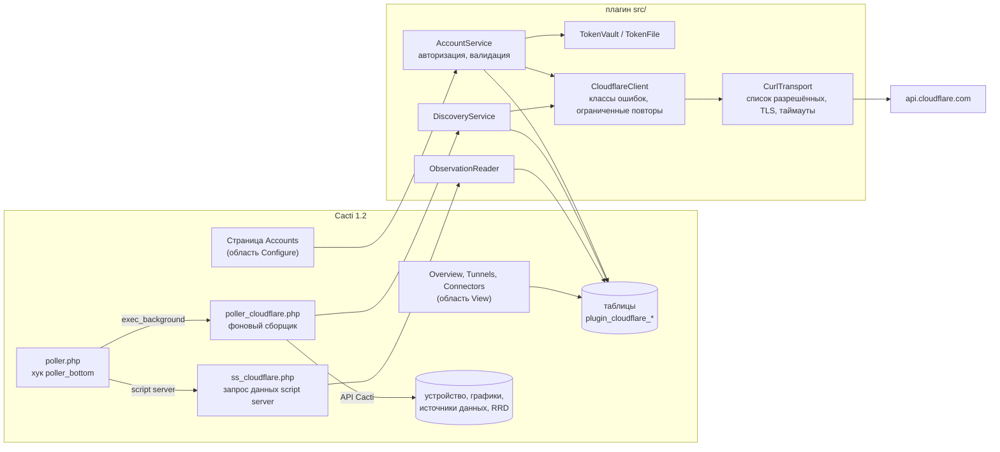

<!-- Source: README.md; SHA256: 813d1c85c236b426b83e42e63c69496f33f8909b5e435d0d45efa6a4ba2f17ca -->

<!-- translations:start -->
[English](../../../README.md) | [简体中文](../zh-CN/README.md) | [हिन्दी](../hi-IN/README.md) | [Español (España)](../es-ES/README.md) | [Español (Latinoamérica)](../es-419/README.md) | [العربية (السعودية)](../ar-SA/README.md) | [Afrikaans](../af-ZA/README.md) | [አማርኛ](../am-ET/README.md) | [العربية (مصر)](../ar-EG/README.md) | [العربية (المغرب)](../ar-MA/README.md) | [বাংলা](../bn-BD/README.md) | [Bosanski](../bs-BA/README.md) | [Deutsch](../de-DE/README.md) | [فارسی](../fa-IR/README.md) | [Filipino](../fil-PH/README.md) | [Français](../fr-FR/README.md) | [Français (Maroc)](../fr-MA/README.md) | [Français (Sénégal)](../fr-SN/README.md) | [Hausa](../ha-NG/README.md) | [עברית](../he-IL/README.md) | [Hrvatski](../hr-HR/README.md) | [Bahasa Indonesia](../id-ID/README.md) | [Igbo](../ig-NG/README.md) | [Italiano](../it-IT/README.md) | [日本語](../ja-JP/README.md) | [한국어](../ko-KR/README.md) | [Malagasy](../mg-MG/README.md) | [मराठी](../mr-IN/README.md) | [Bahasa Melayu](../ms-MY/README.md) | [Nederlands](../nl-NL/README.md) | [Polski](../pl-PL/README.md) | [Português (Brasil)](../pt-BR/README.md) | [Русский](README.md) | [Kinyarwanda](../rw-RW/README.md) | [Soomaali](../so-SO/README.md) | [Српски](../sr-RS/README.md) | [Svenska](../sv-SE/README.md) | [Kiswahili](../sw-KE/README.md) | [தமிழ்](../ta-IN/README.md) | [తెలుగు](../te-IN/README.md) | [ไทย](../th-TH/README.md) | [Türkçe](../tr-TR/README.md) | [Українська](../uk-UA/README.md) | [اردو](../ur-PK/README.md) | [Tiếng Việt](../vi-VN/README.md) | [isiXhosa](../xh-ZA/README.md) | [Yorùbá](../yo-NG/README.md) | [繁體中文](../zh-TW/README.md) | [isiZulu](../zu-ZA/README.md)
<!-- translations:end -->

<p align="center">
  
</p>

# Плагин Cloudflare для Cacti

[](https://github.com/somethingwithproof/plugin_cloudflare/actions/workflows/ci.yml)
[](https://sonarcloud.io/summary/new_code?id=somethingwithproof_plugin_cloudflare)
[](../../../LICENSE)


[](https://sonarcloud.io/summary/new_code?id=somethingwithproof_plugin_cloudflare)
[](https://sonarcloud.io/summary/new_code?id=somethingwithproof_plugin_cloudflare)
[](https://sonarcloud.io/summary/new_code?id=somethingwithproof_plugin_cloudflare)


Плагин для Cacti 1.2, разрабатываемый для мониторинга Cloudflare Tunnels и
аналитики зон. Он читает данные из Cloudflare API с помощью API-токенов с
ограниченной областью действия, никогда ничего не изменяет в Cloudflare и
хранит данные в собственных таблицах. В Cacti плагин копирует XML-файлы
запросов данных в `resource/script_server/` и создаёт устройства, графики и
шаблоны через собственные API Cacti без изменения файлов ядра.

**Статус: 0.4.0-dev, не выпущена.** Последняя выпущенная версия: 0.3.0. Версия в разработке добавляет экспорт инвентаризации в CSV, явный вывод из эксплуатации удалённых туннелей, кэшированную аналитику зон, клиент GraphQL Analytics только для чтения с разрешённым списком запросов (`GraphqlAnalyticsClient`) и вспомогательными сводками для Thold (`AnalyticsSummary`), CLI Configuration-as-Code (`cli/cloudflare.php`), хуки экосистемы (`abilities_register`, `doctor_register_checks`, `casc_register_providers`) и поддержку удалённых коллекторов в области видимости поллера (`replicate_out`). Проверка на реальном провайдере и квалификация развёртывания ещё не завершены.

В таблице ниже описан стабильный выпуск 0.3.0. Дополнения в версии 0.4.0-dev описаны ниже в разделе рабочих процессов оператора и аналитики зон.

| Доступно сейчас | Запланировано |
|---|---|
| Установка, обновление, отключение и удаление через менеджер плагинов Cacti | Квалификация GraphQL на реальной учётной записи и квалификация развёртывания (завершение этапа 4) |
| Права доступа Cloudflare: View, Operator и Configure | Внедрение сбоев, модели TLA+ и полная документация (этап 5) |
| Добавление, редактирование, удаление, включение и отключение учётных записей Cloudflare | |
| Хранение токена в файле или в зашифрованном виде в базе данных Cacti | |
| Проверка токена и его прав на чтение туннелей и зон | |
| Обнаружение туннелей и коннекторов в фоновом сборщике (`poller_cloudflare.php`) | |
| Страницы Overview, Tunnels и Connectors в разделе Management > Cloudflare Tunnels | |
| Отслеживание жизненного цикла: `active`, `unavailable` и `deleted` | |
| Одно устройство Cacti на учётную запись, создаваемое администратором, с туннелями в качестве индексов запроса данных | |
| Графики Connectors, Health и Collection для каждого туннеля, строящиеся из одного RRD-файла на туннель | |
| Значения, достоверность которых плагин не может гарантировать, сохраняются как неизвестные (`U`), а не как 0 | |

## Роли доступа

| Область (Realm) | Доступ |
| --- | --- |
| Cloudflare: View | Существующие страницы мониторинга. |
| Cloudflare: Operator | Мониторинг, а также страница Operations и личные подтверждения при сортировке инцидентов. |
| Cloudflare: Configure | Доступ уровня Operator, а также существующая конфигурация и административные действия. |

После копирования файлов обновления откройте страницу Plugins от имени администратора,
чтобы зарегистрировать новую область прав. Назначьте область Operator явно в разделе
**Configuration > Users** или для групп пользователей. При обновлении сохраняются
существующие идентификаторы и выданные права областей View и Admin. Доступ Admin
наследует доступ Operator, а доступ Operator наследует доступ View при каждом запросе;
это не добавляет сохранённых разрешений пользователям или группам. Для доступа к настройкам
плагина также требуются права Cloudflare: Configure в дополнение к праву Settings в Cacti.

Видимость учётных записей Cloudflare соответствует существующей области View и
распространяется на всю учётную запись. Учётные данные, конфигурация, сопоставление,
удаление и другие административные изменения остаются на административных страницах.
Подтверждения действуют только в текущей сессии пользователя, не более одного часа и
только пока то же наблюдение остаётся актуальным. Новые или изменившиеся наблюдения
делают их недействительными. Они никогда не помечают неудачное измерение как исправное
и не подавляют оповещения.

## Зачем нужен этот плагин

Операторы Cacti, публикующие сервисы через Cloudflare Tunnel, не видят
состояние туннеля внутри Cacti. Туннель может потерять все свои коннекторы,
в то время как исходные хосты продолжают отвечать по SNMP, поэтому существующие
графики остаются зелёными, а пользователи видят ошибки. Цель этого плагина —
разместить показатели работоспособности туннелей и трафика зон рядом с графиками
устройств, за которыми операторы уже наблюдают, не давая Cacti никакой
возможности изменять настройки в Cloudflare.

Архитектуру определяют три ограничения:

- **Только чтение.** Плагин вызывает только `GET`-эндпоинты и GraphQL
  Analytics API. Ему не требуются права на редактирование каких-либо ресурсов Cloudflare.
- **Опциональность.** Сбои Cloudflare, истекшие токены и ограничения скорости не
  должны замедлять веб-интерфейс Cacti или останавливать опрос других устройств.
  Все вызовы API имеют жёсткие таймауты, а сбор данных выполняется в фоновом
  процессе, запускаемом поллером.
- **Без изменений ядра.** Плагин использует хуки плагинов Cacti 1.2 и
  собственные таблицы. Он копирует один XML-файл запроса данных в `resource/script_server/`
  и создаёт устройства, графики и шаблоны через собственные API Cacti. Файлы ядра
  не изменяются, поэтому обновления Cacti и другие плагины не затрагиваются.

## Принцип работы



- **Интеграция с Cacti** (`setup.php`, `includes/`, скрипты страниц) регистрирует
  хуки и области прав, отрисовывает страницы с помощью собственных вспомогательных
  функций Cacti и делегирует каждое действие библиотеке в `src/`.
- **Библиотека** (`src/`, пространство имён `Somethingwithproof\Cloudflare\`) не
  зависит от глобальных переменных Cacti, поэтому она тестируется с реальной базой
  данных и фиктивным HTTP-транспортом без запущенного экземпляра Cacti.
- **Единый исходящий путь.** `CurlTransport` — это единственный код, обращающийся
  к сети, и он принимает только `https://api.cloudflare.com`. Каждый сбой
  сопоставляется с одним классом ошибок (`auth`, `permission`, `rate_limited`,
  `transient`, ...), который определяет статус, отображаемый в интерфейсе.
- **Хранение данных** осуществляется через собственное PDO-подключение Cacti с
  подготовленными выражениями. Изменения схемы представляют собой нумерованные,
  идемпотентные миграции.

Архитектурные решения и их обоснование приведены в
[docs/design.md](../../design.md).

## Снимки экрана

Снимки экрана сделаны в тестовом стеке, а не в реальной учётной записи Cloudflare.
В стеке запущен Cacti 1.2.31, работающий с фиктивным Cloudflare API, который
возвращает тестовые данные, поэтому учётная запись, её идентификатор и три
туннеля являются заглушками.


*Список учётных записей Cloudflare. Фиктивный API принимает токен, поэтому Verify
возвращает `ok`.*


*Редактирование учётной записи. Поля токена всегда пусты; сохранённый токен
никогда не отправляется обратно в браузер. Параметры Collect Tunnels и Create
Graphs включены, а Collect Analytics отключён. В разделе Connection Status показан
результат последней проверки Verify: `ok`, право на чтение туннелей предоставлено,
а право на чтение зон отсутствует.*


*Settings > Cloudflare.*


*Management > Cloudflare Tunnels > Overview. Статус соответствует наихудшему
статусу Cloudflare среди активных туннелей учётной записи — здесь это `down`, так
как один тестовый туннель не работает. Статусы `Disabled`, `Not collected`,
`Collection failing` и `Not yet collected` имеют приоритет над состоянием туннелей
именно в этом порядке, поэтому учётная запись, последний запуск которой завершился
сбоем, показывает `Collection failing` независимо от отчётов её туннелей.*


*Вкладка Tunnels. Для old-office в столбцах Connectors и Connections отображается `-`,
так как фиктивный API отвечает на запрос подключений как для неизвестного туннеля и
ничего не было сохранено, а для staging — 0, поскольку у него нет запущенного коннектора.*


*График Connectors туннеля blog. Все три линии равны 1 до и после разрыва
посередине, где фиктивный API возвращал ошибки, а плагин сохранял неизвестные
значения. Линии не падают до 0. График получен из того же тестового стека
(`make screenshots`), который задаёт шаг 30 секунд для этого единственного
источника данных, чтобы семь минут опроса заполнили график.*

## Требования

- Cacti от 1.2.25 до 1.2.31. Для самой Cacti 1.2.31 требуется PHP 8.0 или новее.
  В CI тестируется только 1.2.31; версия 1.2.25 последний раз проверялась вручную 2026-10-22.
- PHP от 7.4 до 8.4 с расширениями `curl`, `openssl` и `pdo_mysql`.
  Без них плагин не включится.
- MariaDB 10.6 или новее, либо MySQL 8.0 или новее.
- Доступ по HTTPS с сервера Cacti к `api.cloudflare.com`. Прокси-серверы не поддерживаются.

Перечень протестированных конфигураций см. в [docs/compatibility.md](../../compatibility.md).

## Установка

1. Поместите плагин в каталог `plugins/cloudflare` в Cacti — либо распаковав
   архив из [GitHub Releases](https://github.com/somethingwithproof/plugin_cloudflare/releases)
   (команда `make package`, запущенная в рабочей копии тега релиза, собирает
   такой же архив), либо с помощью git clone. Каталог должен называться
   `cloudflare`.
2. Установите и включите плагин в разделе Console > Configuration > Plugins или
   через CLI от имени пользователя веб-сервера:

   ```sh
   php cli/plugin_manage.php --plugin=cloudflare --install --enable
   ```

3. При установке пользователь admin получает разрешение Cloudflare: Configure.
   Назначьте его другим пользователям или группам в разделе Console > Configuration > Users.
4. Создайте токен с разрешениями, указанными в
   [docs/token-permissions.md](../../token-permissions.md). Вкратце:
   Account > Cloudflare Tunnel > Read и, при необходимости, Zone > Zone > Read.
5. Сохраните токен одним из двух способов ниже, затем добавьте учётную запись в
   разделе Console > Configuration > Cloudflare Accounts и запустите Verify в
   меню действий.

### Вариант A: шифрование в базе данных

Плагин шифрует токены 32-байтным ключом, который вы создаёте самостоятельно.
Он никогда не создаёт и не записывает ключ сам. Файл должен быть доступен для
чтения пользователям веб-сервера и поллера, недоступен для чтения остальным, а
его каталог должен позволять этим пользователям обращаться к нему. Для
веб-сервера, работающего от имени `www-data`:

```sh
sudo mkdir -p /etc/cacti
sudo sh -c 'umask 077 && openssl rand -hex 32 > /etc/cacti/cloudflare.key'
sudo chgrp www-data /etc/cacti/cloudflare.key
sudo chmod 0440 /etc/cacti/cloudflare.key
```

Путь по умолчанию — `/etc/cacti/cloudflare.key`; его можно изменить в
разделе Settings > Cloudflare > Token Vault Key File. Если ключ отсутствует или
отклонён, форма редактирования предлагает только вариант с файлом токена.
Сохраните резервную копию ключа: без него сохранённые токены невозможно
расшифровать, и их придётся ввести заново.

#### Ротация ключа

Команды перешифрования не существует. Новый ключ не может расшифровать токены,
сохранённые под старым ключом, поэтому ротация означает повторный ввод каждого
сохранённого токена:

1. Подготовьте значение токена для каждой учётной записи. Cloudflare показывает
   значение токена только при его создании или перевыпуске (roll), поэтому при
   утере перевыпустите токен в панели управления Cloudflare.
2. Создайте новый ключ по новому пути с помощью приведённых выше команд,
   например `/etc/cacti/cloudflare.key.new`, с тем же владельцем и правами
   доступа.
3. Укажите новый путь в разделе Settings > Cloudflare > Token Vault Key File и
   сохраните изменения. С этого момента выполнение Verify для учётной записи,
   всё ещё зашифрованной старым ключом, вернёт ошибку
   "Stored token cannot be decrypted", а каждый запуск сборщика будет записывать
   в журнал `discovery token unavailable` с `reason=decrypt_failed`.
4. Для каждой учётной записи, хранящей токен в базе данных, откройте её в
   разделе Console > Configuration > Cloudflare Accounts, вставьте токен в оба
   поля токена, сохраните и запустите Verify. Статус должен быть `ok`.
5. Когда все такие учётные записи пройдут проверку, удалите старый файл ключа
   и его резервные копии.

Между шагами 3 и 4 туннели учётной записи не обновляются, а в их графики
состояния (health), коннекторов и подключений записывается значение U. Учётные
записи с файлом токена не затрагиваются.

### Вариант B: файл токена

Запишите токен — и ничего больше — в файл, доступный для чтения пользователям
веб-сервера и поллера и недоступный остальным, затем укажите его абсолютный
путь в форме редактирования:

```sh
sudo sh -c 'umask 077 && cat > /etc/cacti/cloudflare-account.token'   # paste the token, then Ctrl-D
sudo chgrp www-data /etc/cacti/cloudflare-account.token
sudo chmod 0440 /etc/cacti/cloudflare-account.token
```

Файл проверяется при чтении — во время Verify, а не при сохранении.
Символические ссылки, файлы размером более 4 КиБ, а также файлы, доступные для
чтения или записи другим пользователям, отклоняются.

Любой пользователь с правом Cloudflare: Configure может указать любой путь, и
пользователь поллера прочитает его. Чтобы хранить файлы токенов в одном месте,
задайте параметр Settings > Cloudflare > Token File Directory, например
`/etc/cacti`; пути за пределами этого каталога будут отклоняться. См.
[docs/security.md](../../security.md#token-file).

## Обновление

1. Замените файлы в `plugins/cloudflare` файлами нового релиза, сохранив имя
   каталога.
2. Откройте один раз Console > Configuration > Plugins или Console >
   Configuration > Cloudflare Accounts от имени администратора. При этом
   выполнятся миграции плагина, импортируются шаблоны Cloudflare, скопируется
   файл запроса данных (см. [Метрики и графики туннелей](#tunnel-metrics-and-graphs)),
   зарегистрируются хуки экосистемы `abilities_register`, `doctor_register_checks`,
   `casc_register_providers` и `replicate_out` (`includes/ecosystem.php`),
   а при обновлении с версии 0.1.0 будет зарегистрирован хук `poller_bottom`.

`poller.php` не выполняет обновление плагина, поэтому до выполнения шага 2
новая схема базы данных отсутствует. В этом случае каждый запуск сборщика
ничего не делает и записывает в журнал
`CLOUDFLARE: collector skipped; plugin upgrade pending, open Console > Plugins`.
Для страниц Cloudflare Tunnels требуется только право Cloudflare: View, поэтому
они никогда не запускают обновление, и до выполнения шага 2 на них может
отображаться сообщение "The Cloudflare tunnels could not be read".

## Состояние учётной записи

Действие Verify устанавливает статус учётной записи:

| Статус | Значение |
|---|---|
| `unknown` | Проверка не выполнялась с момента добавления учётной записи или изменения её учётных данных |
| `ok` | Токен активен и может читать список туннелей |
| `token_inactive` | Cloudflare сообщает, что токен отключён или истёк срок его действия |
| `auth_failed` | Cloudflare отклонил токен как недействительный или просроченный (HTTP 401) |
| `permission_denied` | Токен активен, но не может читать туннели либо не имеет разрешений для вызова конечных точек проверки токена (HTTP 403) |
| `unreachable` | Не удалось связаться с API, истекло время ожидания или получена ошибка сервера |
| `rate_limited` | Cloudflare вернул HTTP 429 |
| `error` | Любая другая ошибка, включая отсутствующий или небезопасный файл токена, отсутствующий или непригодный файл ключа хранилища токенов, либо невозможность расшифровать сохранённый токен |

На странице редактирования также отображается, предоставлены ли права чтения
туннелей (tunnel read) и зон (zone read).

## Обнаружение туннелей

После каждого цикла опроса на настроенном поллере-сборщике (`cloudflare_poller_id`, по умолчанию `1`) хук `poller_bottom` запускает
фоновый сборщик с помощью `exec_background`, если хотя бы у одной включённой
учётной записи активирован параметр Collect Tunnels. Сборщик никогда не
выполняется в процессе самого поллера, поэтому медленный API Cloudflare не
задерживает `poller.php`. `INFO` объявляет `remote_collect:1`, а хук
`replicate_out` (`RemoteReplication`) передаёт несекретные таблицы метаданных
(`plugin_cloudflare_accounts` с очищенным до `NULL` полем `token_ciphertext`,
`plugin_cloudflare_tunnels`, `plugin_cloudflare_connectors`,
`plugin_cloudflare_zones`, `plugin_cloudflare_metric_mappings` и
`plugin_cloudflare_resources`) на удалённые поллеры (`poller_id > 1`),
исключая ключевой материал хранилища.

Для каждой учётной записи, время опроса которой наступило, сборщик запрашивает
список её туннелей, а затем читает подключения активных туннелей, что позволяет
получить коннекторы каждого туннеля, их версии, дата-центры и адреса источников
(origin). Очередь опроса учётной записи наступает с интервалом Discovery
Interval (по умолчанию 300 секунд). Один запуск не начинает обработку новой
учётной записи по истечении 50 секунд и выполняет не более 200 запросов
подключений. Любое из этих ограничений может также прервать учётную запись в
процессе чтения её подключений; такая учётная запись получает статус `partial`,
а следующий запуск продолжает с туннелей, к которым дольше всего не
выполнялись обращения. Не начатые учётные записи остаются в очереди на следующий
запуск.

У туннеля есть жизненный цикл, который хранится отдельно от статуса,
сообщаемого Cloudflare (`healthy`, `degraded`, `down` или `inactive`):

| Жизненный цикл | Значение |
|---|---|
| `active` | Туннель присутствовал в последнем полном списке |
| `deleted` | Туннель отсутствовал в полном списке (включая пустой список). Запись и её история сохраняются, и при повторном появлении туннель снова становится `active` |
| `unavailable` | Три учтённых сбоя подряд без полного списка между ними оставляют состояние туннеля неизвестным |

Только полный успешный список добавляет, обновляет или удаляет туннели, а
неудачное получение списка никогда не помечает туннель как удалённый. Сбой, при
котором вообще не удаётся прочитать данные из Cloudflare (`transient`,
`rate_limited`, `auth` или `permission`), засчитывается как отказ; после трёх
учтённых отказов подряд без полного списка между ними активные туннели
учётной записи переходят в состояние `unavailable`. Следующий полный список
восстанавливает их и сбрасывает счётчик. Туннель, о котором Cloudflare больше
не знает при чтении его подключений, пропускается без ошибки для всей учётной
записи. Прочие ошибки не увеличивают и не сбрасывают счётчик отказов.

В `cacti.log` строки обнаружения начинаются с `CLOUDFLARE: discovery`, а итог
запуска — с `CLOUDFLARE: collector`. Ошибки и изменения жизненного цикла,
такие как неудачное получение списка или перевод туннелей в `unavailable`,
записываются на уровне Cacti по умолчанию `LOW`; результат по каждой учётной
записи и итог запуска записываются на уровне `MEDIUM`. Ошибки чтения
подключений могут возникать на каждом туннеле, поэтому для каждой учётной
записи на уровне `LOW` записывается только первая ошибка каждого класса ошибок,
а остальные — на уровне `MEDIUM`, после чего для каждого класса выводится одна
строка `LOW` с количеством туннелей, завершившихся ошибкой.

Раздел Management > Cloudflare Tunnels требует права Cloudflare: View и
доступен только для чтения:

- **Overview** выводит каждую учётную запись с её статусом, количеством
  туннелей по жизненным циклам, временем последнего успешного обнаружения и
  числом последовательных сбоев.
- **Tunnels** выводит список туннелей по всем учётным записям или по одной из
  них с фильтрами по учётной записи, жизненному циклу, статусу и имени, а также
  с сортируемыми столбцами.
- **Connectors** отображает коннекторы туннеля, выбранного на вкладке Tunnels.

<a name="tunnel-metrics-and-graphs"></a>

## Метрики и графики туннелей

Cacti считывает состояние туннелей через запрос данных сервера скриптов
(script server data query) `ss_cloudflare.php`. Он отвечает только из таблиц
плагина и никогда не обращается к Cloudflare, поэтому сбой Cloudflare не может
замедлить поллер. Каждый туннель предоставляет шесть значений: состояние
(healthy — 3, degraded — 2, down — 1, inactive — 0), количество коннекторов,
количество подключений, версии коннекторов, число секунд с момента последнего
чтения подключений и число последовательных сбоев задания обнаружения.
Значения состояния, коннекторов, подключений и версий выводятся только тогда,
когда плагин может за них поручиться — то есть последнее обнаружение прошло
успешно, туннель находится в состоянии `active`, а данные актуальны. В
противном случае выводится `U`, и на графике отображается разрыв вместо нуля,
который выглядел бы как простой. Два показателя сбора данных продолжают
выводиться во время сбоя, чтобы график Collection отражал его; они принимают
значение `U` только для удалённого туннеля или туннеля, подключения которого
никогда не обновлялись. Правила описаны в [docs/metrics.md](../../metrics.md).

### Создание устройства

Учётной записи соответствует не более одного устройства Cacti. Устройство хранит
туннели учётной записи в виде индексов запроса данных Cloudflare Tunnels.
Автоматически оно не создаётся:

1. Откройте Console > Configuration > Cloudflare Accounts.
2. Выберите учётную запись, выберите Create Cacti Device в меню действий и
   подтвердите.

Для этого действия требуются оба права: Cloudflare: Configure и область
Sites/Devices/Data в Cacti (та же, что для `host.php`). Пункт меню виден только
пользователям с обоими правами, а сервер отклоняет запросы от всех остальных.
Устройство создаётся с именем `Cloudflare: <account name>`, использует шаблон
хоста Cloudflare Account и основной поллер, имеет версию SNMP 0 без проверки
доступности и получает имя хоста `<account ID>.cloudflare.invalid`. Это имя
зарезервировано и никогда не разрешается в IP-адрес; Cacti не подключается к
нему. Если у учётной записи уже есть устройство, действие сообщает об этом и
ничего не меняет. Если администратор удаляет устройство в Cacti, плагин не
создаёт новое до повторного запуска Create Cacti Device.

### Создание графиков

Параметр Create Graphs в форме учётной записи по умолчанию выключен. Когда он
включён, каждый раз, когда обнаружение для учётной записи завершается со
статусом `ok` или `partial`, сборщик переиндексирует устройство и создаёт
недостающие графики для её туннелей в состоянии `active`: Connectors, Health и
Collection — по три на туннель. Три графика одного туннеля используют общий
файл RRD. За один запуск создаётся не более 50 графиков, и работа
останавливается через 20 секунд, а следующий запуск продолжает процесс. Плагин
никогда не удаляет объекты Cacti. График, удалённый администратором, не
создаётся заново, а туннель, который Cloudflare больше не возвращает в списке,
сохраняет свой график и файл RRD, на которых отображается `U`.

Для включения Create Graphs требуются обе области прав. Для выключения
достаточно только Configure. Если пользователь без области Sites/Devices/Data
сохраняет форму, значение параметра остаётся прежним с выводом предупреждения.
При выключенном Create Graphs устройство всё равно переиндексируется после
каждого обнаружения, поэтому новые туннели появляются как индексы запроса
данных.

### Файл запроса данных

Cacti 1.2.31 считывает XML-файл запроса данных только из своего каталога
`resource`. Поэтому при установке и обновлении плагин копирует один файл —
`templates/resource/cloudflare_tunnels.xml` — в
`<Cacti>/resource/script_server/cloudflare_tunnels.xml`. Это единственный файл,
который плагин записывает за пределами собственного каталога, поэтому
пользователь, выполняющий установку или обновление плагина, должен иметь право
записи в этот каталог.
При удалении плагина этот файл сохраняется вместе с устройствами, графиками,
файлами RRD и шаблонами. Если копирование или импорт шаблонов завершается
ошибкой, плагин записывает это в журнал, а действие Create Cacti Device
повторяет попытку.

## Настройки

Раздел Settings > Cloudflare содержит следующие параметры:

- **Token Vault Key File**: путь к ключу хранилища.
- **Token File Directory**: если задан, файл токена за пределами этого каталога отклоняется. По умолчанию пуст, что разрешает любой путь. См. [docs/security.md](../../security.md#token-file).
- **Interactive Request Timeout**: общее время ожидания (в секундах) для запроса из веб-интерфейса, например Verify. По умолчанию 10; значения вне диапазона от 5 до 60 сбрасываются на 10.
- **Collector Request Timeout**: общее время ожидания (в секундах) для запроса фонового сборщика. По умолчанию 20; значения вне диапазона от 5 до 60 сбрасываются на 20.
- **Log Level**: сохраняется, но пока нигде не используется.

В форме учётной записи параметры Collect Tunnels и Discovery Interval управляют обнаружением, а Create Graphs — созданием графиков. Параметр Collect Analytics сохраняется, но в данном выпуске не оказывает никакого влияния.

## Языки

Плагин поставляется с переводами на испанский (Испания, `es-ES`), французский (`fr-FR`), немецкий (`de-DE`), упрощённый китайский (`zh-CN`), хинди (`hi-IN`), арабский (`ar-SA`) и японский (`ja-JP`) языки. Cacti отображает их, если включена поддержка языков (Configuration > Settings > General > Language Support) и пользователь выбрал язык. Также поставляется каталог для латиноамериканского испанского (`es-419`), но в Cacti 1.2 нет такой локали для выбора, поэтому он заработает только после её добавления в Cacti; до тех пор выбирайте испанский (`es-ES`).

Часть текста остаётся на английском языке: значения статусов, которые плагин сохраняет и отображает без изменений (`ok`, `active`, `unavailable`, `deleted`, а также статус туннеля, возвращаемый Cloudflare), и все записи плагина в журнале Cacti.

## Удаление и хранение данных

При удалении плагина удаляются его собственные таблицы (содержащие учётные записи, зашифрованные токены, обнаруженные туннели, состояние заданий и записи о созданных объектах Cacti) и параметры с префиксом `cloudflare_`. При этом не удаляются файл ключа, файлы токенов, скопированный файл `resource/script_server/cloudflare_tunnels.xml`, а также устройства, графики, источники данных, файлы RRD и шаблоны Cacti. В них хранятся исторические данные мониторинга, поэтому их удаление выполняется администратором в Cacti вручную.

Сохранённое устройство перестаёт получать данные. После удаления плагина или учётной записи у хоста больше нет связанной учётной записи, поэтому на его графиках сохраняется история, но далее записывается `U`. Действие Create Cacti Device для повторно установленного плагина или заново добавленной учётной записи создаёт новое устройство и не переиспользует старое, поэтому удалите старое устройство в Cacti, когда его история больше не потребуется.

## Известные ограничения

- За один запуск выполняется не более 200 запросов о подключениях. Туннели сверх этого лимита обновляются реже окна наблюдения, из-за чего на графиках их подключений появляются пробелы.
- Плагин перезаписывает изменения, внесённые администратором в импортированные шаблоны, если при обновлении изменяется поставляемый XML-файл шаблона.
- Удалённые поллеры получают реплицированные метаданные без учётных данных (`token_ciphertext` сбрасывается в `NULL`, а ключи хранилища никогда не реплицируются). При запуске сборщика на назначенном удалённом поллере (`cloudflare_poller_id`) разместите файлы токенов или ключ хранилища непосредственно на этом узле сборщика.
- Удалённые туннели остаются в индексе запроса данных и возвращают `U`, пока администратор явно не выведет их из эксплуатации. Вывод из эксплуатации удаляет через Cacti только зарегистрированные плагином графики и неразделяемые источники данных; строка в списке инвентаризации остаётся видимой. Очисткой RRD управляет Cacti.
- Cacti отключает плагин, выполнение кода которого завершилось фатальной ошибкой, например из-за нехватки памяти. См. [docs/security.md](../../security.md).

## Безопасность

- Глобальные ключи API (Global API Keys) отклоняются; принимаются только ограниченные по области действия токены API (scoped API tokens).
- Токены хранятся в предоставленном вами файле либо шифруются с помощью AES-256-GCM с использованием файла ключа, который никогда не попадает в базу данных. Они никогда не отображаются на страницах, не записываются в журналы и не включаются в сообщения об ошибках.
- Ошибки базы данных содержат только код SQLSTATE и код ошибки драйвера, но никогда не включают значения параметров запроса.
- Каждое изменение выполняется методом POST и защищено CSRF-токеном Cacti. Административные изменения учётных записей и конфигурации требуют права Cloudflare: Configure; персональные подтверждения при разборе инцидентов требуют права Cloudflare: Operator. Для создания устройства Cacti или включения Create Graphs также требуется право Cacti Sites/Devices/Data. Отключённый плагин отклоняет доступ к своим страницам.
- Configuration-as-Code (`cli/cloudflare.php` и `casc_register_providers`) принимает только ссылки на секреты `vault:<account_id>` или `file:<absolute_path>`, отклоняет сырые токены, шифротексты хранилища и объявления XML `DOCTYPE`, а также требует точный `--confirm=<PLAN_HASH>` перед записью.
- Зарегистрированные возможности (`cloudflare-list-tunnels`, `cloudflare-get-health`) работают строго только на чтение, проверяют область Cloudflare: View непосредственно по таблицам аутентификации Cacti для идентификатора вызывающего пользователя (никогда не по состоянию сессии) и не возвращают токены или ключевой материал.

Подробности и известные ограничения приведены в [docs/security.md](../../security.md). Сообщайте об уязвимостях конфиденциально в соответствии с [SECURITY.md](../../../SECURITY.md).

## Рабочие процессы оператора и аналитика зон

Дополнения в версии `0.4.0-dev` включают явный вывод удалённых туннелей из эксплуатации, аналитику GraphQL по зонам и туннелям с учётом возможностей тарифа, вспомогательные сводки для Thold и импортируемые шаблоны, CLI для CasC и проверки состояния, хуки экосистемы и репликацию для удалённых коллекторов. Эти дополнения пока не имеют тега выпуска и не прошли квалификацию на реальной учётной записи. Подробнее о настройке, семантике метрик и ограничениях проверки см. [docs/analytics-and-alerting.md](../../analytics-and-alerting.md).

- **Клиент GraphQL Analytics и сводка для Thold (`src/Api/GraphqlAnalyticsClient.php`, `src/Metrics/AnalyticsSummary.php`)**: `GraphqlAnalyticsClient` выполняет только разрешённые на этапе компиляции запросы только для чтения (`zone_settings`, `zone_http_metrics`, `zone_edge_latency`, `tunnel_analytics`) через `CloudflareClient` (с проверкой TLS, привязкой к `api.cloudflare.com`, ограничением размера ответов и задержками при ограничении частоты запросов `RetryPolicy`) для сбора объёма запросов зон и туннелей, доли ошибок HTTP 5xx, байтов ответа и пограничной задержки (средней и p95). `AnalyticsSummary` предоставляет `recommendedThresholds()`, согласованный с именами DS в RRD плагина (`health`, `collect_age`, `error_pct`, `age`), `summarizeZones()` и `evaluateSample()`.
- **CLI оператора и CasC (`cli/cloudflare.php`)**: основан на `ConfigCodec` (`src/Config/ConfigCodec.php`) и `ConfigService` (`src/Config/ConfigService.php`), поддерживает `cli/cloudflare.php export [--format=yaml|xml] [--file=PATH]` (выводит только ссылки на секреты `vault:` / `file:`), `cli/cloudflare.php validate --file=PATH [--format=yaml|xml]`, `cli/cloudflare.php plan --file=PATH [--format=yaml|xml]`, `cli/cloudflare.php apply --file=PATH --confirm=<PLAN_HASH> [--format=yaml|xml]` и `cli/cloudflare.php health [--format=text|json]`.
- **Хуки интеграции с экосистемой (`includes/ecosystem.php`, `setup.php`)**:
  - `abilities_register` (`AbilitiesProvider`): регистрирует доступные только для чтения `cloudflare-list-tunnels` и `cloudflare-get-health`, ограниченные областью Cloudflare: View (прямые и групповые права), с нулевым выводом токенов или секретов.
  - `doctor_register_checks` (`DoctorChecks`): предоставляет проверки `cloudflare_vault_key` (режим доступа, символические ссылки и длина), `cloudflare_token_dir` (абсолютный путь, символические ссылки и права записи для всех), `cloudflare_tunnel_freshness` и `cloudflare_api_failure_rate`.
  - `casc_register_providers` (`CascProvider`): предоставляет провайдер CasC `cloudflare` (`export`, `validate`, `plan`, `apply`) для учётных записей (только ссылки на секреты), зон, туннелей и сопоставлений метрик.
  - `replicate_out` (`RemoteReplication`): реплицирует несекретные таблицы метаданных на удалённые поллеры (`poller_id > 1`) с очисткой `token_ciphertext` до `NULL` и исключением ключевого материала хранилища.

### Экспорт инвентаризации

На страницах Tunnels и Connectors для области прав Cloudflare: View доступна кнопка Export. CSV-файлы туннелей включают все подходящие строки с учётом текущей учётной записи, жизненного цикла, статуса, поиска и сортировки по всем страницам. CSV-файлы коннекторов содержат версии, архитектуру, дата-центры и адреса origin для выбранного туннеля. Выгрузки считывают только кэшированные записи. Неизвестные значения количества оставляются пустыми; ячейки, похожие на формулы, предваряются апострофом для безопасного импорта в электронные таблицы.

## Дорожная карта

Каждая веха выпускается как версия 0.x с соответствующим номером: веха 3 — это 0.3.0, веха 4 будет 0.4.0. Вехи 1 и 2 не выходили отдельными выпусками и вошли в состав 0.3.0. Версия 1.0.0 зарезервирована для выпуска, завершающего все указанные ниже вехи.

| Веха | Содержание | Статус |
|---|---|---|
| 1. Основа | Жизненный цикл плагина, права доступа, настройка учётных записей, проверка подключения | Выпущено в 0.3.0 ([#2](https://github.com/somethingwithproof/plugin_cloudflare/pull/2) – [#5](https://github.com/somethingwithproof/plugin_cloudflare/pull/5)) |
| 2. Обнаружение | Обнаружение туннелей и коннекторов в фоновом сборщике, страницы Overview, Tunnels и Connectors | Выпущено в 0.3.0 ([#6](https://github.com/somethingwithproof/plugin_cloudflare/pull/6)) |
| 3. Метрики | Источники данных о состоянии туннелей, шаблоны графиков, обработка сбоев без записи фиктивных нулей | Выпущено в 0.3.0 ([#7](https://github.com/somethingwithproof/plugin_cloudflare/pull/7)) |
| 4. Аналитика и оповещения | GraphQL-аналитика с учётом тарифного плана (`GraphqlAnalyticsClient`), сводка и шаблоны Thold (`AnalyticsSummary`), CLI CasC (`cli/cloudflare.php`), хуки экосистемы и удалённая репликация | Реализовано в 0.4.0-dev; ожидается квалификация на реальной учётной записи |
| 5. Повышение надёжности | Внедрение отказов, TLA+-модели обнаружения и сбора, полная документация | Запланировано |

## Разработка

Инструментам разработки требуются PHP 8.x и Composer; сам код плагина сохраняет совместимость с PHP 7.4. Для интеграционных и BDD-тестов необходима база данных, которую `make db-up` запускает в Docker на порту 33061.

```sh
composer install
make db-up
make ci            # unit, integration, BDD, PHPStan, php-cs-fixer, php -l on PHP 7.4
make smoke         # installs the plugin into Cacti 1.2.31 in Docker and walks its lifecycle
make package       # builds build/cloudflare-<version>.tar.gz and checks its contents
make db-down
```

Для `make smoke` и `make screenshots` требуется локальная копия репозитория Cacti; укажите путь к ней в переменной `CACTI_REPO`. Интеграционные тесты считывают `CF_TEST_DSN`, `CF_TEST_DB_USER` и `CF_TEST_DB_PASS` и пропускаются, если база данных недоступна (если только не установлена переменная `CI`).

## Участие в разработке

Пул-реквесты приветствуются. Каждый коммит должен содержать подпись DCO (`git commit -s`). Сначала пишите тест; `make ci` должен завершаться успешно, а изменения в связующем коде с Cacti также должны проходить `make smoke`. Код плагина должен оставаться совместимым с PHP 7.4 и следовать стилю кода Cacti (табуляция, одинарные кавычки, открывающие фигурные скобки на той же строке).

### Переводы

Сообщения размечаются с помощью `__('...', 'cloudflare')`. Скрипт `locales/build_gettext.sh` (`make i18n`, требующий GNU gettext) пересоздаёт шаблон `locales/po/cacti.pot`, объединяет его с каждым каталогом `locales/po/<locale>.po` и компилирует `locales/LC_MESSAGES/<locale>.mo`; необходимо закоммитить все три файла. CI запускает `make i18n-check`, который завершается ошибкой, если в каталоге отсутствует запись или есть неточная (fuzzy) запись, отличается строка формата или устарел скомпилированный файл; модульные тесты также проверяют заполнители, HTML-теги и крайние пробелы в каждой записи. Поэтому при изменении сообщения переводы должны обновляться в том же пул-реквесте. Новый язык добавляется в виде нового файла `<locale>.po` с именем в формате локалей Cacti (например, `pt-BR`), добавленного в `CatalogTest::LOCALES` и в проверку архива в `tests/build/package.sh`. Оставляйте без изменений названия продуктов Cloudflare, Cacti и Thold, термины API и GraphQL, а также названия прав доступа, например `Account Cloudflare Tunnel Read`.

## Документация

- [docs/security.md](../../security.md): меры безопасности и известные ограничения
- [docs/token-permissions.md](../../token-permissions.md): права доступа токенов
- [docs/compatibility.md](../../compatibility.md): поддерживаемые версии и используемые интерфейсы
- [docs/metrics.md](../../metrics.md): каталог метрик и условия неизвестных значений
- [docs/collector-protocol.md](../../collector-protocol.md): что считывает и выводит `ss_cloudflare.php`
- [docs/schema.md](../../schema.md): таблицы базы данных
- [docs/design.md](../../design.md): архитектурные решения
- [CHANGELOG.md](../../../CHANGELOG.md)

## Лицензия

GPL-2.0-or-later. См. [LICENSE](../../../LICENSE).

## Товарные знаки

Cloudflare является зарегистрированным товарным знаком компании Cloudflare, Inc. Этот проект представляет собой независимый инструмент с открытым исходным кодом и не связан с Cloudflare, Inc., не спонсируется и не поддерживается ею.

Проект также не аффилирован с проектом Cacti. Информация о логотипе приведена в [docs/images/README-logo.md](../../images/README-logo.md).
