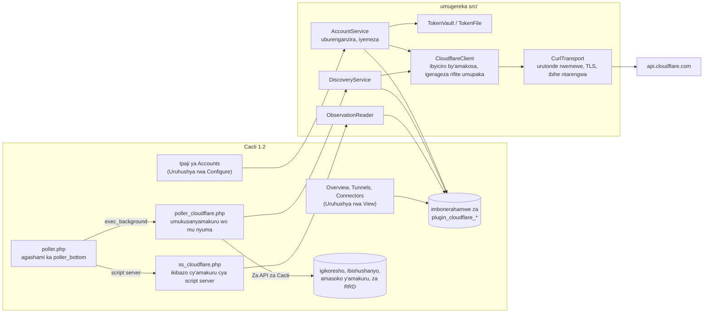

<!-- Source: README.md; SHA256: f8de0e02c5904e15bfa4c71edcaab219e5e5d4f6d9dbe589f4ed16351df6bf4d -->

<!-- translations:start -->
[English](../../../README.md) | [简体中文](../zh-CN/README.md) | [हिन्दी](../hi-IN/README.md) | [Español (España)](../es-ES/README.md) | [Español (Latinoamérica)](../es-419/README.md) | [العربية (السعودية)](../ar-SA/README.md) | [Afrikaans](../af-ZA/README.md) | [አማርኛ](../am-ET/README.md) | [العربية (مصر)](../ar-EG/README.md) | [العربية (المغرب)](../ar-MA/README.md) | [বাংলা](../bn-BD/README.md) | [Bosanski](../bs-BA/README.md) | [Deutsch](../de-DE/README.md) | [فارسی](../fa-IR/README.md) | [Filipino](../fil-PH/README.md) | [Français](../fr-FR/README.md) | [Français (Maroc)](../fr-MA/README.md) | [Français (Sénégal)](../fr-SN/README.md) | [Hausa](../ha-NG/README.md) | [עברית](../he-IL/README.md) | [Hrvatski](../hr-HR/README.md) | [Bahasa Indonesia](../id-ID/README.md) | [Igbo](../ig-NG/README.md) | [Italiano](../it-IT/README.md) | [日本語](../ja-JP/README.md) | [한국어](../ko-KR/README.md) | [Malagasy](../mg-MG/README.md) | [मराठी](../mr-IN/README.md) | [Bahasa Melayu](../ms-MY/README.md) | [Nederlands](../nl-NL/README.md) | [Polski](../pl-PL/README.md) | [Português (Brasil)](../pt-BR/README.md) | [Русский](../ru-RU/README.md) | [Kinyarwanda](README.md) | [Soomaali](../so-SO/README.md) | [Српски](../sr-RS/README.md) | [Svenska](../sv-SE/README.md) | [Kiswahili](../sw-KE/README.md) | [தமிழ்](../ta-IN/README.md) | [తెలుగు](../te-IN/README.md) | [ไทย](../th-TH/README.md) | [Türkçe](../tr-TR/README.md) | [Українська](../uk-UA/README.md) | [اردو](../ur-PK/README.md) | [Tiếng Việt](../vi-VN/README.md) | [isiXhosa](../xh-ZA/README.md) | [Yorùbá](../yo-NG/README.md) | [繁體中文](../zh-TW/README.md) | [isiZulu](../zu-ZA/README.md)
<!-- translations:end -->

<p align="center">
  
</p>

# Umugereka wa Cloudflare wa Cacti

[](https://github.com/somethingwithproof/plugin_cloudflare/actions/workflows/ci.yml)
[](https://sonarcloud.io/summary/new_code?id=somethingwithproof_plugin_cloudflare)
[](../../../LICENSE)


[](https://sonarcloud.io/summary/new_code?id=somethingwithproof_plugin_cloudflare)
[](https://sonarcloud.io/summary/new_code?id=somethingwithproof_plugin_cloudflare)
[](https://sonarcloud.io/summary/new_code?id=somethingwithproof_plugin_cloudflare)


Umugereka wa Cacti 1.2 urimo kubakwa kugira ngo ugenzure Cloudflare Tunnels
n'isesengura ry'imbuga (zone analytics). Usoma amakuru kuri API ya Cloudflare
ukoresheje uturango twa API dufite uburenganzira bugenzuwe, ntuhindura na rimwe
ikintu muri Cloudflare, kandi ubika amakuru yawo mu mbonerahamwe zawo bwite.
Muri Cacti ukoporora amadosiye ya XML y'ibibazo by'amakuru muri `resource/script_server/`
kandi ugakora ibikoresho, ibishushanyo n'inyandikorugero binyuze muri za API za
Cacti ubwayo, nta guhindura amadosiye y'ibanze.

**Imiterere: 0.4.0-dev, ntabwo irasohoka.** Verisiyo iheruka gusohoka ni 0.3.0. Verisiyo irimo gukorwa yongeraho uburyo bwo gusohora urutonde rw'ibikoresho muri CSV, guhagarika ku mugaragaro za tunnel zasibwe, isesengura ry'imbuga ribitswe by'agateganyo (cached zone analytics) n'inyandikorugero za Thold zitari itegeko. Isuzuma ku mutangaserivisi w'ukuri no ku ishyirwa mu bikorwa riracyategerejwe.

Imbonerahamwe ikurikira isobanura verisiyo ihamye ya 0.3.0. Ibyongewe mu iterambere bisobanurwa munsi y'ibikorwa by'abakoresha n'isesengura ry'imbuga hasi aha.

| Biboneka ubu | Biteganyijwe |
|---|---|
| Kwinjiza, kuvugurura, guhagarika no gukuramo binyuze mu mucungamigereka wa Cacti | Isesengura rya GraphQL n'intabaza za Thold (Icyiciro cya 4) |
| Uburenganzira bwa Cloudflare: View, Operator na Configure | Igerageza ry'amakosa, imiterere ya TLA+ n'inyandiko zuzuye (Icyiciro cya 5) |
| Kongeramo, guhindura, gusiba, kwemerera no guhagarika konti za Cloudflare | |
| Kubika akarangamubare mu dosiye cyangwa mu bubiko bwa Cacti mu buryo bushifitse | |
| Kugenzura akarangamubare no gusuzuma uburenganzira bwo gusoma tunnel na zone | |
| Kuvumbura za tunnel na connector mu mukusanyamakuru wo mu nyuma utangizwa na poller nkuru | |
| Amapaji ya Overview, Tunnels na Connectors munsi ya Management > Cloudflare Tunnels | |
| Gukurikirana ibyiciro by'ubuzima: `active`, `unavailable` na `deleted` | |
| Igikoresho kimwe cya Cacti kuri buri konti, gikorwa n'umuyobozi, gifite za tunnel nk'urutonde rw'ikibazo cy'amakuru | |
| Ibishushanyo bya Connectors, Health na Collection kuri buri tunnel, bishushanyijwe bivuye kuri dosiye imwe ya RRD kuri buri tunnel | |
| Uduciro umugereka udashobora kwemeza tubikwa nka utazwi (`U`), ntabwo tubikwa nka 0 | |

## Uburenganzira bwo kwinjira

| Uruhushya (Realm) | Uburenganzira |
| --- | --- |
| Cloudflare: View | Amapaji yo kugenzura asanzweho. |
| Cloudflare: Operator | Kugenzura hiyongereyeho ipaji ya Operations n'ibyemezo bwite byo gusesengura ibibazo. |
| Cloudflare: Configure | Uburenganzira bwa Operator hiyongereyeho ibikorwa bisanzwe byo gutunganya n'iby'ubuyobozi. |

Nyuma yo gukoporora amadosiye y'ivugurura, fungura ipaji ya Plugins nk'umuyobozi
kugira ngo wandikishe uruhushya rushya. Tanga uruhushya rwa Operator ku buryo
bweruye munsi ya **Configuration > Users** cyangwa mu matsinda y'abakoresha.
Amavugurura agumana nimero za ID n'uburenganzira bisanzweho bya View na Admin.
Uburenganzira bwa Admin bukomora ubwa Operator, naho uburenganzira bwa Operator
bukomora ubwa View kuri buri busabe; ibi ntibyongera uburenganzira bubitswe ku
bakoresha cyangwa ku matsinda. Igenamiterere ry'umugereka na ryo risaba
uburenganzira bwa Cloudflare: Configure hiyongereyeho uruhushya rwa Settings rwa Cacti.

Uburyo konti za Cloudflare zigaragara buhuye n'uruhushya rusanzwe rwa View; bukora
ku rwego rwa konti yose. Amakuru y'ibanga yo kwinjira, igenamiterere, guhuza,
gusiba n'izindi mpinduka z'ubuyobozi biguma mu mapaji y'ubuyobozi. Ibyemezo byo
kwakira ibibazo bimara gusa mu gihe cy'ikiganiro cy'ukoresha uriho, mu gihe
kitarenze isaha imwe kandi gusa mu gihe igenzura rimwe rikiri rishya. Amagenzura
mashya cyangwa yahindutse ahita abitesha agaciro. Ntibishobora na rimwe kwerekana
igipimo cyatsinzwe nk'aho ari kizima cyangwa ngo bihagarike intabaza.

## Impamvu y'uyu mugereka

Abakoresha ba Cacti bashyira serivisi ahagaragara binyuze muri Cloudflare Tunnel
ntibashobora kubona uko tunnel ihagaze imbere muri Cacti. Tunnel ishobora gutakaza
za connector zayo zose mu gihe seriveri z'inkomoko zigisubiza SNMP, bityo ibishushanyo
bisanzwe bikaguma mu ibara ry'icyatsi mu gihe abakoresha babona amakosa. Intego
y'uyu mugereka ni ugushyira ubuzima bwa tunnel n'urujya n'uruza rwa zone iruhande
rw'ibishushanyo by'ibikoresho abakoresha basanzwe bareba, nta guha Cacti ububasha
na bumwe bwo guhindura Cloudflare.

Imipaka itatu ni yo igena imiterere yawo:

- **Gusoma gusa.** Umugereka uhamagara gusa imiyoboro ya `GET` hamwe na GraphQL
  Analytics API. Nta burenganzira bwo guhindura ukeneye ku mutungo uwo ari wo
  wose wa Cloudflare.
- **Utari itegeko.** Ihagarara rya Cloudflare, uturango twarangije igihe n'imipaka
  y'ubusabe ntibigomba gutinza imigaragarire ya Cacti cyangwa ngo bihagarike
  ikusanyamakuru ry'ibindi bikoresho. Ibyoherezwa kuri API byose bifite igihe
  ntarengwa kidakuka, kandi ikusanyamakuru rikorwa n'igikorwa cyo mu nyuma
  gitangizwa na poller.
- **Nta mpinduka ku madosiye y'ibanze.** Umugereka ukoresha udushami twa Cacti 1.2
  n'imbonerahamwe zawo bwite. Ukoporora dosiye imwe ya XML y'ikibazo cy'amakuru
  muri `resource/script_server/` kandi ugakora ibikoresho, ibishushanyo n'inyandikorugero
  binyuze muri za API za Cacti ubwayo. Nta madosiye y'ibanze ahindurwa, bityo
  amavugurura ya Cacti n'indi migereka ntibihungabanywa.

## Uko ukora



- **Ihuza rya Cacti** (`setup.php`, `includes/`, inyandiko z'amapaji) ryandikisha
  udushami n'impusha, ryerekana amapaji rikoresheje ubufasha bwa Cacti ubwayo,
  kandi rigashyikiriza buri gikorwa isomero riri muri `src/`.
- **Isomero** (`src/`, namespace `Somethingwithproof\Cloudflare\`) nta ho
  rihurira n'ibigize rusange bya Cacti, bityo rigeragezwa ku bubiko bw'amakuru
  nyabwo n'uburyo bwa HTTP bw'icyitegererezo hatariho Cacti ikora.
- **Inzira imwe isohoka hanze.** `CurlTransport` ni yo nyandiko yonyine igera ku
  murandamo, kandi yemera gusa `https://api.cloudflare.com`. Buri kunanirwa
  gushyirwa mu cyiciro kimwe cy'amakosa (`auth`, `permission`, `rate_limited`,
  `transient`, ...), ari na cyo kigena imiterere yerekanywa mu igaragarire ry'ukoresha.
- **Ububiko** bunyura ku murongo wa PDO wa Cacti ubwayo ukoresheje amabwiriza
  yateguwe. Impinduka ku miterere y'ububiko ni imigereko y'imibare ishobora
  gusubirwamo nta kibazo.

Ibyemezo by'imikorere n'impamvu zabyo biri muri
[docs/design.md](../../design.md).

## Amafoto y'imigaragarire

Amafoto y'imigaragarire aturuka mu buryo bw'igerageza, ntabwo ari kuri konti ya
Cloudflare ikora mu buryo nyabwo. Ubwo buryo bukoresha Cacti 1.2.31 ikorana na
API ya Cloudflare y'icyitegererezo itanga amakuru y'igerageza, bityo konti,
nimero yayo ya ID na za tunnel eshatu ni ibyitegererezo gusa.


*Urutonde rwa Cloudflare Accounts. API y'icyitegererezo yemera akarangamubare,
bityo Verify itanga `ok`.*


*Guhindura konti. Imyanya y'akarangamubare ihora irimo ubusa; akarangamubare
kabitswe ntigashobora na rimwe koherezwa muri mushakisha. Collect Tunnels na
Create Graphs birafunguye naho Collect Analytics irafunze. Connection Status
yerekana ibyavuye muri Verify iheruka: `ok`, uburenganzira bwo gusoma tunnel
bwaremejwe naho ubwo gusoma zone burabura.*


*Settings > Cloudflare.*


*Management > Cloudflare Tunnels > Overview. Imiterere ni imiterere mibi kurusha
iyindi ya Cloudflare mu ma tunnel akora ya konti, hano ni `down` kuko tunnel
imwe y'igerageza ihagaze. `Disabled`, `Not collected`, `Collection failing` na
`Not yet collected` birusha agaciro ubuzima bwa tunnel, muri ubwo buryo bukurikiranye,
bityo konti ifite ikusanyamakuru riheruka ryatsinzwe yerekana `Collection failing`
uko za tunnel zayo zaba zimeze kose.*


*Agashami ka Tunnels. Connectors na Connections byerekana `-` kuri old-office,
kuko API y'icyitegererezo isubiza ubusabe bwayo bwa connections nka tunnel
itazwi kandi nta cyabitswe, naho kuri staging bikerekana 0 kuko nta connector
ikora ifite.*


*Igishushanyo cya Connectors cya tunnel ya blog. Imirongo yose uko ari itatu
iri kuri 1 mbere na nyuma y'icyuho kiri hagati, aho API y'icyitegererezo
yasubije amakosa n'umugereka ukabika uduciro tutazwi. Imirongo ntimanuka ngo
igere kuri 0. Igishushanyo kiva mu buryo bumwe bw'igerageza (`make screenshots`),
bushyira intambwe y'amasegonda 30 kuri iyi soko imwe y'amakuru kugira ngo
iminota irindwi y'ikusanyamakuru yuzuze igishushanyo.*

## Ibisabwa

- Cacti 1.2.25 kugeza kuri 1.2.31. Cacti 1.2.31 ubwayo isaba PHP 8.0 cyangwa irenga.
  CI ipima 1.2.31 gusa; 1.2.25 yaherukaga gupimwa n'intoki ku ya 2026-10-22.
- PHP 7.4 kugeza kuri 8.4 ifite imigereka ya `curl`, `openssl` na `pdo_mysql`.
  Umugereka wanga gukora igihe idahari.
- MariaDB 10.6 cyangwa irenga, cyangwa MySQL 8.0 cyangwa irenga.
- Ubushobozi bwa HTTPS kuva kuri seriveri ya Cacti kugera kuri `api.cloudflare.com`. Ama-proxy
  ntiyemewe.

Reba [docs/compatibility.md](../../compatibility.md) kugira ngo umenye ibyapimwe.

## Kwinjiza

1. Shyira umugereka mu bubiko bwa `plugins/cloudflare` bwa Cacti, haba ukoresheje
   gukura ibikubiye mu bubiko bwa
   [Ibisohorwa bya GitHub](https://github.com/somethingwithproof/plugin_cloudflare/releases)
   (`make package` ikoreshejwe muri checkout y'ikimenyetso cy'isohorwa ikora ubwo
   bubiko bumwe) cyangwa ukoresheje git
   clone. Ubwo bubiko bugomba kwitwa `cloudflare`.
2. Wushyiremo kandi uwukoreshe unyuze muri Console > Configuration > Plugins, cyangwa ukoresheje
   CLI nk'ukoresha seriveri y'urubuga:

   ```sh
   php cli/plugin_manage.php --plugin=cloudflare --install --enable
   ```

3. Ukoresha w'umuyobozi (admin) ahabwa uruhushya rwa Cloudflare: Configure mu gihe cyo kwinjiza. Ruhe
   abandi bakoresha cyangwa amatsinda munsi ya Console > Configuration > Users.
4. Kora token ifite impushya ziri muri
   [docs/token-permissions.md](../../token-permissions.md). Mu magambo make:
   Account > Cloudflare Tunnel > Read, ndetse ku buryo butari itegeko Zone > Zone > Read.
5. Bika token mu buryo bumwe muri ubu bubiri bukurikira, hanyuma wongereho konti munsi ya
   Console > Configuration > Cloudflare Accounts kandi ukoreshe Verify kuva ku rutonde
   rw'ibikorwa.

### Uburyo A: ishyizwe mu ibanga mu bubiko bw'amakuru

Umugereka ushyira ama-token mu ibanga ukoresheje urufunguzo rwa byte 32 wikorera. Ntabwo na rimwe
ukora cyangwa wandika urufunguzo ubwarwo. Dosiye igomba kuba ishobora gusomwa n'abakoresha ba seriveri
y'urubuga na poller, ntigomba gusomwa n'abandi, kandi ububiko irimo bugomba kwemerera abo bakoresha
kuyigeraho. Kuri seriveri y'urubuga ikoresha `www-data`:

```sh
sudo mkdir -p /etc/cacti
sudo sh -c 'umask 077 && openssl rand -hex 32 > /etc/cacti/cloudflare.key'
sudo chgrp www-data /etc/cacti/cloudflare.key
sudo chmod 0440 /etc/cacti/cloudflare.key
```

Inzira mburabuzi ni `/etc/cacti/cloudflare.key`; yihindure munsi ya Settings >
Cloudflare > Token Vault Key File. Iyo urufunguzo rubuze cyangwa rwanzwe, ifishi
yo guhindura itanga uburyo bwa dosiye ya token gusa. Bika kopi y'urufunguzo:
iyo rudahari, ama-token abitswe ntashobora gukurwa mu ibanga kandi agomba kongera kwinjizwa.

#### Guhindura urufunguzo

Nta tegeko ryo guhindura urufunguzo (rekey) rihari. Urufunguzo rushya ntirushobora gukura mu ibanga ama-token yabitswe hakoreshejwe urushaje, bityo guhindura urufunguzo bisobanura kongera kwinjiza buri token yabitswe:

1. Ba ufite agaciro ka token ya buri konti hafi. Cloudflare yerekana agaciro ka token
   gusa iyo ikozwe cyangwa ihinduwe, bityo hindura token mu kibaho cya Cloudflare
   niba utagifite.
2. Kora urufunguzo rushya ku nzira nshya ukoresheje amategeko ari haruguru, urugero
   `/etc/cacti/cloudflare.key.new`, ufite nyirayo umwe n'uburyo bw'impushya bumwe.
3. Shyira Settings > Cloudflare > Token Vault Key File ku nzira nshya maze ubike.
   Guhera ubwo, Verify kuri konti igishyizwe mu ibanga n'urufunguzo rushaje
   igaragaza "Stored token cannot be decrypted", kandi buri gikorwa cy'ikusanyamakuru cyandika mu nyandiko-kugenzura
   `discovery token unavailable` hamwe na `reason=decrypt_failed` kuri yo.
4. Kuri buri konti ibika token yayo mu bubiko bw'amakuru, yifungure munsi ya
   Console > Configuration > Cloudflare Accounts, womeke token mu myanya yombi ya
   token, ubike, maze ukoreshe Verify. Igomba kugaragaza `ok`.
5. Iyo buri konti nk'iyo igenzuwe neza, siba dosiye y'urufunguzo rushaje na kopi
   zayo zose.

Hagati y'intambwe ya 3 n'iya 4, ama-tunnel ya konti ntabwo avugururwa kandi ibishushanyo
byayo by'ubuzima, ibihuza n'imiyoboro byandika U. Konti zikoresha dosiye ya token
ntizigerwaho n'iki kibazo.

### Uburyo B: dosiye ya token

Andika token, kandi nta kindi kintu, muri dosiye abakoresha ba seriveri y'urubuga na poller
bashobora gusoma kandi abandi badashobora gusoma, hanyuma winjize inzira yayo yuzuye ku ifishi yo guhindura:

```sh
sudo sh -c 'umask 077 && cat > /etc/cacti/cloudflare-account.token'   # paste the token, then Ctrl-D
sudo chgrp www-data /etc/cacti/cloudflare-account.token
sudo chmod 0440 /etc/cacti/cloudflare-account.token
```

Dosiye igenzurwa iyo isomwe, mu gihe cya Verify, atari igihe ubika. Ihuza ry'ikigereranyo (symbolic
links), dosiye zirengeje 4 KiB na dosiye zishobora gusomwa cyangwa kwandikwaho n'abandi
birangwa.

Umuntu wese ufite Cloudflare: Configure ashobora kwinjiza inzira iyo ari yo yose, kandi ukoresha wa poller
arayisoma. Kugira ngo ubeho amadosiye ya token ahantu hamwe, shyiraho Settings > Cloudflare >
Token File Directory, urugero kuri `/etc/cacti`; inzira iri hanze yaho ihita
yangwa. Reba [docs/security.md](../../security.md#token-file).

## Kuvugurura

1. Simbuza amadosiye ari muri `plugins/cloudflare` ay'isohorwa rishya, ugumishaho
   izina ry'ububiko.
2. Fungura Console > Configuration > Plugins, cyangwa Console > Configuration >
   Cloudflare Accounts, rimwe nk'umuyobozi (admin). Ibyo bitangiza impinduka z'imiterere y'ububiko bw'umugereka,
   bikinjiza inyandiko-ndangamiterere za Cloudflare kandi bigakoporora dosiye y'isabamakuru (reba
   [Ibipimo n'ibishushanyo bya Tunnel](#tunnel-metrics-and-graphs)), ndetse, mu gihe cyo
   kuvugurura uvuye kuri 0.1.0, byandikisha ingobyi ya `poller_bottom`.

`poller.php` ntabwo ikora ivugurura ry'umugereka, bityo kugeza ku ntambwe ya 2 imiterere mishya
y'ububiko iba ibura. Buri gikorwa cy'ikusanyamakuru ntacyo gikora kandi cyandika mu nyandiko-kugenzura
`CLOUDFLARE: collector skipped; plugin upgrade pending, open Console > Plugins`.
Impapuro za Cloudflare Tunnels zisaba Cloudflare: View gusa, bityo ntizikora
ivugurura na rimwe, kandi kugeza ku ntambwe ya 2 zishobora kwerekana "The Cloudflare tunnels could not
be read".

## Imiterere ya konti

Verify ishyiraho imiterere ya konti:

| Imiterere | Ibisobanuro |
|---|---|
| `unknown` | Ntiyagenzuwe kuva konti yongerwaho cyangwa kuva amakuru yayo yo kwinjira yahinduka |
| `ok` | Token irakora kandi ishobora gusoma ama-tunnel |
| `token_inactive` | Cloudflare igaragaza ko token yahagaritswe cyangwa yarangiye |
| `auth_failed` | Cloudflare yanze token nk'itemewe cyangwa yarangiye (HTTP 401) |
| `permission_denied` | Token irakora ariko ntishobora gusoma ama-tunnel, cyangwa ibura impushya zo guhamagara imipaka yo kugenzura token (HTTP 403) |
| `unreachable` | API ntiyashoboye kugerwaho, igihe cyararangiye cyangwa yatanze ikosa rya seriveri |
| `rate_limited` | Cloudflare yagaruye HTTP 429 |
| `error` | Ikindi kibazo icyo ari cyo cyose, harimo dosiye ya token ibuze cyangwa itarinzwe, dosiye y'urufunguzo rw'ububiko bwa token ibuze cyangwa idakoreshwa, cyangwa token ibitswe idashobora gukurwa mu ibanga |

Urupapuro rwo guhindura rwerekaniraho niba gusoma tunnel no gusoma zone byemewe.

## Itahura rya Tunnel

Nyuma ya buri rugendo rwo gukusanya amakuru kuri poller nkuru, ingobyi ya `poller_bottom` itangiza
ikusanyamakuru ryo mu nyuma hakoreshejwe `exec_background` igihe byibura konti imwe ikora
ifite Collect Tunnels ifunguye. Ikusanyamakuru ntirikorera mu gikorwa cya poller na rimwe,
bityo API ya Cloudflare igenda gahoro ntikerereza `poller.php`. Za poller za kure
ntiziritangiza na rimwe.

Kuri buri konti igihe cyayo cyageze, ikusanyamakuru rishyira ku rutonde ama-tunnel ya konti, hanyuma
rikasoma imiyoboro y'ama-tunnel yayo akora, ibyo bigatanga ibihuza bya buri tunnel,
verisiyo zabyo, ibigo by'amakuru n'amaderesi y'inkomoko. Igihe cya konti kigera
buri Discovery Interval (mburabuzi ni amasegonda 300). Igikorwa kimwe ntitangira konti
nshya nyuma y'amasegonda 50 kandi gikora ibisabwa by'imiyoboro bitarenze 200. Rimwe muri ayo
maherezo rishobora kandi guhagarika konti hagati mu gusoma imiyoboro yayo; iyo
konti yandikwa nka `partial`, kandi igikorwa gikurikira gikomereza ku ma-tunnel
yageragejwe kera cyane. Konti zitatangiwe ziguma zitegereje igikorwa gikurikira.

Tunnel igira ubuzima bwayo bwite, butandukanyijwe n'imiterere Cloudflare itangaza
(`healthy`, `degraded`, `down` cyangwa `inactive`):

| Ubuzima | Ibisobanuro |
|---|---|
| `active` | Tunnel yari mu rutonde ruzuye ruheruka |
| `deleted` | Urutonde ruzuye ntirwayishyizemo, ibyo bikaba binakubiyemo urutonde rurimo ubusa. Umurongo n'amateka yayo biraguma, kandi tunnel yongera kuba `active` niyongera kugaragara |
| `unavailable` | Ihagarara ryabazwe inshuro eshatu nta rutonde ruzuye ruri hagati yazo rituma imiterere ya tunnel itamenyekana |

Urutonde ruzuye kandi rwagenze neza rwonyine ni rwo rwongera, ruvugurura cyangwa rusiba ama-tunnel, kandi
urutonde rwananiranye ntirusiba tunnel na rimwe. Kunanirwa gusoma Cloudflare na gato
(`transient`, `rate_limited`, `auth` cyangwa `permission`) bibarirwa mu ihagarara;
nyuma y'ihagarara ryabazwe inshuro eshatu nta rutonde ruzuye ruri hagati yazo,
ama-tunnel akora ya konti ahinduka `unavailable`. Urutonde ruzuye rukurikira
rurayasubiza kandi rugatangira kubara bundi bushya. Tunnel Cloudflare itakizi
igihe imiyoboro yayo isomwa irasimbutswa bidateje konti kunanirwa. Ibindi
bibazo ntibyongera kandi ntibisubiza inyuma umubare w'ihagarara.

Muri `cacti.log`, imirongo y'itahura itangirana na `CLOUDFLARE: discovery` naho incamake y'igikorwa
igatangirana na `CLOUDFLARE: collector`. Kunanirwa n'impinduka z'ubuzima, nk'urutonde
rwananiranye cyangwa ama-tunnel yashyizweho `unavailable`, byandikwa ku rwego
mburabuzi rwa `LOW` rwa Cacti; igisubizo cya buri konti n'incamake y'igikorwa byandikwa kuri
`MEDIUM`. Gusoma imiyoboro bishobora kunanirwa kuri buri tunnel, bityo kuri buri konti
ikosa rya mbere rya buri cyiciro cy'ikosa ryandikwa kuri `LOW`, ibisigaye kuri
`MEDIUM`, bigakurikirwa n'umurongo umwe wa `LOW` kuri buri cyiciro ufite umubare w'ama-tunnel
yananiranye.

Management > Cloudflare Tunnels isaba uruhushya rwa Cloudflare: View kandi ni
iyo gusomwa gusa:

- **Overview** ishyira ku rutonde buri konti n'imiterere yayo, umubare w'ama-tunnel hakurikijwe ubuzima bwayo,
  itahura riheruka ryagenze neza n'umubare w'ibibazo bikurikiranye.
- **Tunnels** ishyira ku rutonde ama-tunnel mu makonti yose cyangwa kuri konti imwe, ifite muyunguruzi
  ya konti, ubuzima, imiterere n'izina, hamwe n'inkingi zishobora gutondekwa.
- **Connectors** yerekana ibihuza bya tunnel yatoranyijwe ku gice cya Tunnels.

<a name="tunnel-metrics-and-graphs"></a>

## Ibipimo n'ibishushanyo bya Tunnel

Cacti isoma imiterere ya tunnel inyuze mu isabamakuru rya script server,
`ss_cloudflare.php`. Risubiza riva mu mbonerahamwe z'umugereka gusa kandi ntirihamagara
Cloudflare na rimwe, bityo ihagarara rya Cloudflare ntirishobora gutinza poller. Buri tunnel itanga
indangagaciro esheshatu: ubuzima (healthy 3, degraded 2, down 1, inactive 0), ibihuza,
imiyoboro, verisiyo z'ibihuza, amasegonda ashize kuva imiyoboro yayo iheruka
gusomwa, n'inshuro zikurikiranye igikorwa cy'itahura cyananiranye. Ubuzima, ibihuza,
imiyoboro na verisiyo byandikwa gusa iyo umugereka ushobora kubyemeza,
bisobanura ko itahura riheruka ryagenze neza, tunnel ari `active` kandi
isoma riherutse. Bitari ibyo biba `U`, maze igishushanyo kikerekana umwanya urimo ubusa aho kwerekana
zeru yagaragara nk'ihagarara. Indangagaciro ebyiri z'ikusanyamakuru ziguma
zandikwa mu gihe cy'ihagarara, kugira ngo igishushanyo cya Collection kibyerekane; ziba `U` gusa
kuri tunnel yasibwe cyangwa iyo imiyoboro yayo itigeze ivugururwa. Amategeko
ari muri [docs/metrics.md](../../metrics.md).

### Kurema igikoresho

Konti imwe ihuzwa n'igikoresho cya Cacti kitarenze kimwe. Igikoresho kibika ama-tunnel
ya konti nk'indangamwirondoro z'isabamakuru rya Cloudflare Tunnels. Nta kintu
kigikora mu buryo bwikora:

1. Fungura Console > Configuration > Cloudflare Accounts.
2. Hitamo konti, uhitemo Create Cacti Device ku rutonde rw'ibikorwa, maze
   wemeze.

Iki gikorwa gisaba impushya zombi za Cloudflare: Configure na
Sites/Devices/Data ya Cacti (iyo kuri `host.php`). Icyo gikorwa ku rutonde kigaragarira gusa
abakoresha bafite zombi, kandi seriveri yanga ubusabe bw'undi wese.
Igikoresho cyitwa `Cloudflare: <account name>`, gikoresha inyandiko-ndangamiterere ya host ya Cloudflare Account
na poller nkuru, gifite verisiyo ya SNMP 0 kandi nta genzura ryo kuboneka,
ndetse gihabwa izina rya host rya `<account ID>.cloudflare.invalid`. Iryo zina
ryaragenewe kandi ntirihindurwa muri aderesi na rimwe; Cacti ntiyihuza na ryo. Niba konti
isanzwe ifite igikoresho, igikorwa kirabivuga kandi ntacyo gihindura. Niba
umuyobozi asibye igikoresho muri Cacti, umugereka ntukora ikindi
kugeza igihe Create Cacti Device yongeye gukoreshwa.

### Gukora ibishushanyo

Create Graphs ku ifishi ya konti iba ifunze mu buryo mburabuzi. Iyo ifunguye, buri gihe
itahura rya konti rirangiye ari `ok` cyangwa `partial`, ikusanyamakuru risubiramo indangamwirondoro
z'igikoresho kandi rigakora ibishushanyo byose bibura ku ma-tunnel `active` ya konti:
Connectors, Health na Collection, bitatu kuri buri tunnel. Ibishushanyo bitatu bya tunnel
bisangira dosiye imwe ya RRD. Igikorwa kimwe gikora ibishushanyo bitarenze 50 kandi kigahagarara nyuma
y'amasegonda 20, maze igikorwa gikurikira kigakomeza. Umugereka ntukura ikintu cya Cacti na rimwe.
Igishushanyo umuyobozi yasibye nticyongera gukorwa, kandi tunnel
Cloudflare itagishyira ku rutonde igumana igishushanyo cyayo na dosiye ya RRD, byerekana `U`.

Gufungura Create Graphs bisaba impushya zombi. Kuyifunga bisaba Configure
gusa. Ukoresha udafite uruhushya rwa Sites/Devices/Data ubika ifishi
asiga igenamiterere uko ryari, hamwe n'iburira. Iyo Create Graphs ifunze,
igikoresho gikomeza gusubirwamo indangamwirondoro nyuma ya buri tahura, bityo ama-tunnel mashya agaragara nk'indangamwirondoro
z'isabamakuru.

### Dosiye y'isabamakuru

Cacti 1.2.31 isoma XML y'isabamakuru ivuye gusa imbere mu bubiko bwayo bwa `resource`.
Mu gihe cyo kwinjiza no kuvugurura, umugereka rero ukoporora dosiye imwe,
`templates/resource/cloudflare_tunnels.xml`, uyishyira kuri
`<Cacti>/resource/script_server/cloudflare_tunnels.xml`. Ni yo dosiye yonyine
umugereka wandika hanze y'ububiko bwawo bwite, bityo ukoresha winjiza cyangwa
uvugurura umugereka agomba kuba ashobora kwandika muri ubwo bubiko.
Gukuramo umugereka bigumishaho iyo dosiye, hamwe n'ibikoresho, ibishushanyo, amadosiye ya RRD
n'inyandiko-ndangamiterere. Iyo gukoporora cyangwa kwinjiza inyandiko-ndangamiterere binaniranye, umugereka urabyandika mu nyandiko-kugenzura kandi
Create Cacti Device yongera kubigerageza.

## Igenamiterere

Ahanditse Settings > Cloudflare harimo:

- **Token Vault Key File**: inzira igana ku rufunguzo rwa vault.
- **Token File Directory**: iyo hashyizwemo agaciro, dosiye ya token iri hanze yaho irangwa. Ubusanzwe haba harimo ubusa, ibyo bikemerera inzira iyo ari yo yose. Reba [docs/security.md](../../security.md#token-file).
- **Interactive Request Timeout**: umubare w'amasegonda yose hamwe y'icyifuzo gikorwa kivuye ku rubuga rw'imikorere, nka Verify. Agaciro fatizo ni 10; uduciro turi hanze ya 5 kugeza kuri 60 dusubira kuri 10.
- **Collector Request Timeout**: umubare w'amasegonda yose hamwe y'icyifuzo gikorwa n'ikusanya ryo mu nyuma. Agaciro fatizo ni 20; uduciro turi hanze ya 5 kugeza kuri 60 dusubira kuri 20.
- **Log Level**: birabitswe. Nta na kimwe kirabisoma kugeza ubu.

Kuri fomu ya konti, Collect Tunnels na Discovery Interval bigenga iboneka rya za tunnel, naho Create Graphs ikagenga ikorwa ry'ibishushanyo. Collect Analytics irabikwa kandi nta gikorwa igira muri iyi verisiyo.

## Indimi

Uyu mugereka uzana ubusemuzi mu Cyispanyoli (Esipanye, `es-ES`), Igifaransa (`fr-FR`), Ikidage (`de-DE`), Igishinwa cyorohejwe (`zh-CN`), Igihindi (`hi-IN`), Icyarabu (`ar-SA`) n'Ikiyapani (`ja-JP`). Cacti irabyerekana igihe ubufasha bw'indimi bwakijwe (Configuration > Settings > General > Language Support) kandi umukoresha agahitamo ururimi. Igitabo cy'ubusemuzi bw'Icyispanyoli cyo muri Amerika y'Epfo (`es-419`) na cyo kirazana na wo, ariko Cacti 1.2 nta rurimi rw'Icyispanyoli cyo muri Amerika y'Epfo igira rwo guhitamo, bityo rugira agaciro gusa igihe Cacti izashyiramo rumwe; kugeza icyo gihe, hitamo Icyispanyoli (`es-ES`).

Amwe mu magambo aguma mu Cyongereza: uduciro tw'imimerere umugereka ubika kandi ukerekana uko turi (`ok`, `active`, `unavailable`, `deleted`, hamwe n'imimerere ya tunnel itangazwa na Cloudflare), ndetse n'ibintu byose umugereka wandika mu nyandiko y'ibikorwa ya Cacti.

## Gukuramo no kubika amakuru

Gukuramo bisiba imbonerahamwe z'umugereka ubwayo, zibitse konti, ama-token yashyizwe mu ibanga, za tunnel zabonetse, imimerere y'imirimo n'inyandiko y'ibikoresho bya Cacti wakoze, kandi bigasiba igenamiterere rya `cloudflare_`. Ntikuraho dosiye y'urufunguzo, dosiye za token, `resource/script_server/cloudflare_tunnels.xml` yakoporowe, cyangwa ibikoresho bya Cacti, ibishushanyo, amasoko y'amakuru, dosiye za RRD cyangwa inyandikorugero. Ibyo bibitse amakuru y'amateka yo kugenzura, kandi kubikuraho ni igikorwa umuyobozi akora ku buryo bwihariye muri Cacti.

Igikoresho gisigaye gihagarika kwakira amakuru. Nyuma yo gukuramo, cyangwa nyuma y'uko konti yacyo isibwe, nta konti iba igifite uwo mudasobwa, bityo ibishushanyo byacyo bigumana amateka yabyo ariko bigatangira kwerekana `U` guhera ubwo. Igikorwa cya Create Cacti Device kuri konti yongeye gushyirwamo cyangwa yongeye kongerwamo gikora igikoresho gishya; ntikongera gukoresha igishaje, bityo siba igikoresho gishaje muri Cacti igihe amateka yacyo atagikenewe.

## Imbogamizi zizwi

- Icyiciro kimwe gikora ibyifuzo byo guhuza bitarenze 200. Za tunnel zirenze uwo mupaka zivugururwa gake ugereranyije n'igihe cyo kwitegereza, bityo ibishushanyo byazo by'imikoranire bigaragaza ibyuho.
- Umugereka usimbura impinduka z'umuyobozi ku nyandikorugero zinjijwe igihe ivugurura rihinduye XML y'inyandikorugero yazanywe.
- Igikoresho cya konti kigomba kuguma kuri poller nyamukuru. Imbonerahamwe z'umugereka ziri muri database nyamukuru kandi porogaramu nto izisomera aho.
- Za tunnel zasibwe ziguma mu rutonde rw'ibibazo by'amakuru kandi zikerekana `U` kugeza igihe umuyobozi azikuriye ku buryo bweruye. Kuzikura mu mikoreshereze bikuraho gusa ibishushanyo byanditswe n'umugereka n'amasoko y'amakuru adasangirwa binyuze muri Cacti; umurongo wo mu rutonde rw'ibikoresho uguma ugaragara. Cacti ni yo igenga isukurwa rya RRD.
- Cacti ihagarika umugereka iyo kode yawo irangiriye mu ikosa rikomeye ry'ukuri, nk'igihe ububiko bushize. Reba [docs/security.md](../../security.md).

## Umutekano

- Global API Keys zirangwa; ama-API token afite uburenganzira bugenewe ni yo yonyine yemerwa.
- Ama-token abikwa muri dosiye utanga cyangwa agashyirwa mu ibanga hakoreshejwe AES-256-GCM mu rufunguzo rwa dosiye rutinjira na rimwe muri database. Ntiyigera yerekanwa ku rupapuro, yandikwa mu nyandiko y'ibikorwa, cyangwa ngo ashyirwe mu butumwa bw'ikosa.
- Amakosa ya database atwara gusa SQLSTATE na kode y'ikosa rya driver, ntiyigera atwara uduciro tw'inyandiko y'ikibazo.
- Buri mpinduka ni POST irinzwe na token ya CSRF ya Cacti. Impinduka z'ubuyobozi za konti n'igenamiterere bisaba Cloudflare: Configure; kwemeza isesengura ku giti cy'umuntu bisaba Cloudflare: Operator. Gukora igikoresho cya Cacti cyangwa gufungura Create Graphs na byo bisaba uburenganzira bwa Sites/Devices/Data bwa Cacti. Umugereka uhagaritswe wanga ko impapuro zawo zifungurwa.

Ibisobanuro birambuye n'imbogamizi zizwi biri muri [docs/security.md](../../security.md). Tangaza ibibazo by'umutekano mu ibanga nk'uko bisobanurwa muri [SECURITY.md](../../../SECURITY.md).

## Imikorere y'abashinzwe gukurikirana n'isesengura ry'uturere

Ibikorwa byongereweho mu iterambere birimo gukura mu mikoreshereze ku buryo bweruye za tunnel zasibwe, isesengura ry'uturere rishingiye ku bushobozi n'inyandikorugero za Thold zishobora kwinjizwa. Ibi byongereweho ntibirabona nimero ya verisiyo cyangwa igenzura kuri konti ikora koko. Reba [docs/analytics-and-alerting.md](../../analytics-and-alerting.md) kugira ngo umenye ishyirwaho, ibisobanuro by'ibipimo n'imipaka y'igenzura.

### Gusohora urutonde rw'ibikoresho

Impapuro za Tunnels na Connectors zitanga Export ku rubuga rw'uburenganzira rwa Cloudflare: View. Dosiye za CSV za Tunnel zirimo buri murongo uhura, hakoreshejwe konti ikora, icyiciro cy'ubuzima, imimerere, ishakisha n'igenamiterere ryo gutondeka ku mpapuro zose. Dosiye za CSV za Connector zirimo verisiyo, imiterere ya sisitemu, ibigo by'amakuru na aderesi z'inkomoko za tunnel yahiswemo. Ibikururwa bisoma inyandiko zibitswe mu bubiko bw'agateganyo gusa. Imibare itazwi iba irimo ubusa; utwumba tumeze nk'amafomire twongerwaho akamenyetso ka apostrophe imbere kugira ngo twinjizwe mu mbonerahamwe ku buryo bufite umutekano.

## Icyerekezo cy'iterambere

Buri cyiciro gikuru gisohoka nka verisiyo ya 0.x ifite nomero ikurikira: Icyiciro cya 3 ni 0.3.0, Icyiciro cya 4 kizaba 0.4.0. Ibyiciro bya 1 n'iya 2 ntibyasohotse ukwabyo ahubwo ni igice cya 0.3.0. Verisiyo 1.0.0 igenewe isohoka rirangiza buri cyiciro kiri hasi aha.

| Icyiciro | Ibikubiyemo | Imimerere |
|---|---|---|
| 1. Urufatiro | Imibereho y'umugereka, uburenganzira, igenamiterere rya konti, isuzuma ryo guhuza | Yasohotse muri 0.3.0 ([#2](https://github.com/somethingwithproof/plugin_cloudflare/pull/2) kugeza kuri [#5](https://github.com/somethingwithproof/plugin_cloudflare/pull/5)) |
| 2. Iboneka | Iboneka rya tunnel na connector mu ikusanya ryo mu nyuma, impapuro za Overview, Tunnels na Connectors | Yasohotse muri 0.3.0 ([#6](https://github.com/somethingwithproof/plugin_cloudflare/pull/6)) |
| 3. Ibipimo | Amasoko y'amakuru y'ubuzima bwa tunnel, inyandikorugero z'ibishushanyo, imicungire y'ihagarara itigera yandika zeru yahimbwe | Yasohotse muri 0.3.0 ([#7](https://github.com/somethingwithproof/plugin_cloudflare/pull/7)) |
| 4. Isesengura n'impuruza | Isesengura rya GraphQL rishingiye kuri gahunda kuri buri karere, imipaka ya Thold hamwe no guhagarika impuruza mu gihe cy'ihagarara | Birateganyijwe |
| 5. Gushimangira ubudahangarwa | Kwinjiza amakosa mu isuzuma, imiterere ya TLA+ y'iboneka n'ikusanya, inyandiko zisobanura zuzuye | Birateganyijwe |

## Iterambere

Ibikoresho bisaba PHP 8.x na Composer; kode y'umugereka ubwayo ikomeza guhuza na PHP 7.4. Isuzuma ryo guhuza n'irya BDD bisaba database, iyo `make db-up` itangiza muri Docker ku cyambu 33061.

```sh
composer install
make db-up
make ci            # unit, integration, BDD, PHPStan, php-cs-fixer, php -l on PHP 7.4
make smoke         # installs the plugin into Cacti 1.2.31 in Docker and walks its lifecycle
make package       # builds build/cloudflare-<version>.tar.gz and checks its contents
make db-down
```

`make smoke` na `make screenshots` bisaba kopi ya Cacti yakuweho; shiraho `CACTI_REPO` ku nzira yayo. Isuzuma ryo guhuza risoma `CF_TEST_DSN`, `CF_TEST_DB_USER` na `CF_TEST_DB_PASS`, kandi rirasimbuka igihe database itagerwaho keretse `CI` yashyizweho.

## Gutanga umusanzu

Ibyifuzo byo kwinjiza impinduka birakiriwe. Buri cyemezo cya commit gikeneye umukono wa DCO (`git commit -s`). Banza wandike isuzuma; `make ci` igomba gutsinda, kandi impinduka mu gice gihuza na Cacti na zo zigomba gutsinda `make smoke`. Kode y'umugereka igomba gukomeza guhuza na PHP 7.4 kandi igakurikiza imyandikire ya kode ya Cacti (tabs, utwuguruzo n'utwugarizo tumwe, n'udufunga ku murongo umwe).

### Ubusemuzi

Ubutumwa bugaragazwa na `__('...', 'cloudflare')`. `locales/build_gettext.sh` (`make i18n`, isaba GNU gettext) yongera gukora inyandikorugero `locales/po/cacti.pot`, ikayihuza muri buri gitabo `locales/po/<locale>.po` kandi ikabikusanya muri `locales/LC_MESSAGES/<locale>.mo`; kora commit kuri byose uko ari bitatu. CI ikoresha `make i18n-check`, itsindwa igihe igitabo kibura cyangwa gifite inyandiko itanoze, inyandiko y'imiterere itandukanye, cyangwa dosiye yakusanyijwe ishaje, kandi itsinda ry'isuzuma rito rinagenzura ibimenyetso bisimbura, utumenyetso twa HTML n'umwanya wo ku mpera za buri nyandiko. Ubutumwa bwahindutse rero bukeneye ko ubusemuzi bwabwo buvugururwa muri icyo cyifuzo cyo kwinjiza impinduka kimwe. Ururimi rushya ni `<locale>.po` nshya yitwa nk'uko Cacti yita indimi zayo (urugero `pt-BR`), yongerwa kuri `CatalogTest::LOCALES` no ku igenzura ry'ishyinguro muri `tests/build/package.sh`. Gumisha amazina y'ibicuruzwa bya Cloudflare, Cacti na Thold, API na GraphQL, n'amazina y'uburenganzira nka `Account Cloudflare Tunnel Read`, uko ari.

## Inyandiko zisobanura

- [docs/security.md](../../security.md): ingamba z'umutekano n'imbogamizi zizwi
- [docs/token-permissions.md](../../token-permissions.md): uburenganzira bwa token
- [docs/compatibility.md](../../compatibility.md): verisiyo zishyigikiwe n'imbuga zikoreshwa
- [docs/metrics.md](../../metrics.md): urutonde rw'ibipimo n'igihe agaciro katazwi
- [docs/collector-protocol.md](../../collector-protocol.md): ibyo `ss_cloudflare.php` isoma kandi igasohora
- [docs/schema.md](../../schema.md): imbonerahamwe za database
- [docs/design.md](../../design.md): ibyemezo by'imiyoborere y'imiterere
- [CHANGELOG.md](../../../CHANGELOG.md)

## Uruhushya

GPL-2.0-or-later. Reba [LICENSE](../../../LICENSE).

## Ibirango by'ubucuruzi

Cloudflare ni ikirango cy'ubucuruzi cyanditswe cya Cloudflare, Inc. Uyu mushinga ni igikoresho cyigenga cy'isoko ifunguye kandi ntaho uhuriye, ntuterwa inkunga, cyangwa ngo wemezwe na Cloudflare, Inc.

Uyu mushinga kandi ntaho uhuriye n'umushinga wa Cacti. Reba
[docs/images/README-logo.md](../../images/README-logo.md) ku bijyanye n'ikirango.
