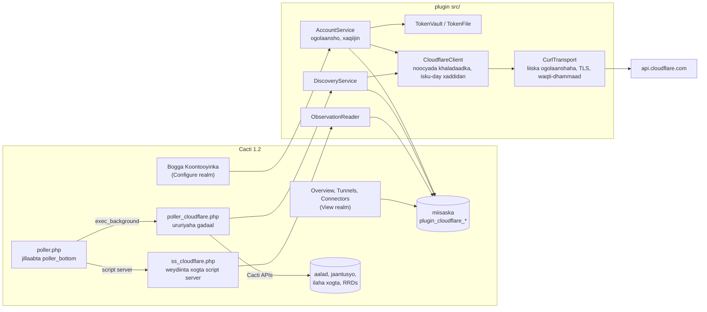

<!-- Source: README.md; SHA256: f8de0e02c5904e15bfa4c71edcaab219e5e5d4f6d9dbe589f4ed16351df6bf4d -->

<!-- translations:start -->
[English](../../../README.md) | [简体中文](../zh-CN/README.md) | [हिन्दी](../hi-IN/README.md) | [Español (España)](../es-ES/README.md) | [Español (Latinoamérica)](../es-419/README.md) | [العربية (السعودية)](../ar-SA/README.md) | [Afrikaans](../af-ZA/README.md) | [አማርኛ](../am-ET/README.md) | [العربية (مصر)](../ar-EG/README.md) | [العربية (المغرب)](../ar-MA/README.md) | [বাংলা](../bn-BD/README.md) | [Deutsch](../de-DE/README.md) | [فارسی](../fa-IR/README.md) | [Filipino](../fil-PH/README.md) | [Français](../fr-FR/README.md) | [Français (Maroc)](../fr-MA/README.md) | [Français (Sénégal)](../fr-SN/README.md) | [Hausa](../ha-NG/README.md) | [עברית](../he-IL/README.md) | [Bahasa Indonesia](../id-ID/README.md) | [Igbo](../ig-NG/README.md) | [Italiano](../it-IT/README.md) | [日本語](../ja-JP/README.md) | [한국어](../ko-KR/README.md) | [Malagasy](../mg-MG/README.md) | [मराठी](../mr-IN/README.md) | [Bahasa Melayu](../ms-MY/README.md) | [Nederlands](../nl-NL/README.md) | [Polski](../pl-PL/README.md) | [Português (Brasil)](../pt-BR/README.md) | [Русский](../ru-RU/README.md) | [Kinyarwanda](../rw-RW/README.md) | [Soomaali](README.md) | [Svenska](../sv-SE/README.md) | [Kiswahili](../sw-KE/README.md) | [தமிழ்](../ta-IN/README.md) | [తెలుగు](../te-IN/README.md) | [ไทย](../th-TH/README.md) | [Türkçe](../tr-TR/README.md) | [Українська](../uk-UA/README.md) | [اردو](../ur-PK/README.md) | [Tiếng Việt](../vi-VN/README.md) | [isiXhosa](../xh-ZA/README.md) | [Yorùbá](../yo-NG/README.md) | [繁體中文](../zh-TW/README.md) | [isiZulu](../zu-ZA/README.md)
<!-- translations:end -->

<p align="center">
  
</p>

# Plugin-ka Cloudflare ee Cacti

[](https://github.com/somethingwithproof/plugin_cloudflare/actions/workflows/ci.yml)
[](https://sonarcloud.io/summary/new_code?id=somethingwithproof_plugin_cloudflare)
[](../../../LICENSE)


[](https://sonarcloud.io/summary/new_code?id=somethingwithproof_plugin_cloudflare)
[](https://sonarcloud.io/summary/new_code?id=somethingwithproof_plugin_cloudflare)
[](https://sonarcloud.io/summary/new_code?id=somethingwithproof_plugin_cloudflare)


Waa plugin loogu talagalay Cacti 1.2 oo la dhisayo si uu ula socdo Cloudflare Tunnels iyo
falanqaynta aagga (zone analytics). Waxa uu ka akhriyaa Cloudflare API isaga oo adeegsanaya calaamado API oo xaddidan (scoped API tokens),
marnaba waxba kama beddelo Cloudflare, xogtiisana waxa uu ku hayaa miisas u gaar ah.
Gudaha Cacti waxa uu nuqul ka sameeyaa faylasha XML ee weydiinta xogta isaga oo geliya `resource/script_server/` waxa uuna
ku abuuraa aaladaha, jaantusyada iyo qaab-dhismeedyada (templates) isaga oo adeegsanaya API-yada Cacti lafteeda, iyada oo aan wax isbeddel ah lagu samayn faylasha udub-dhexaadka ah.

**Xaaladda: 0.4.0-dev, aan weli la sii dayn.** Noocii ugu dambeeyay ee la sii daayay waa 0.3.0. Nooca horumarinta waxa uu ku darayaa dhoofinta liiska alaabta ee CSV, ka-fariisinta cad ee godadka la tirtiray, falanqaynta aagga ee kaydsan (cached) iyo qaab-dhismeedyada Thold ee ikhtiyaariga ah. Xaqiijinta bixiyaha tooska ah iyo hawlgelinta weli way dhiman tahay.

Shaxda hoose waxay sharxaysaa sii-daynta deggan ee 0.3.0. Ku-daridda horumarinta waxaa lagu sharxay qaybaha socodka shaqada ee hawlwadeenka iyo falanqaynta aagga ee hoose.

| Waxa hadda diyaar ah | Waxa la qorsheeyay |
|---|---|
| Ku rakibidda, cusboonaysiinta, joojinta iyo ka-saaridda iyada oo loo marayo maamulaha plugin-ka ee Cacti | Falanqaynta GraphQL iyo digniinaha Thold (Marxaladda 4) |
| Ogolaanshaha Cloudflare: View, Operator iyo Configure | Gelinta cilladaha (Fault injection), moodooyinka TLA+ iyo dukumeenti dhammaystiran (Marxaladda 5) |
| Ku darista, wax ka beddelidda, tirtiridda, hawl-gelinta iyo joojinta koontooyinka Cloudflare | |
| Ku kaydinta calaamadda (token) fayl ama iyada oo la siriyay gudaha kaydka xogta ee Cacti | |
| Xaqiijinta calaamadda iyo hubinta ogolaansheheeda akhrinta tunnel-ka iyo aagga | |
| Helitaanka tunnel-ka iyo xiriiriyaha ee ururiyaha gadaal ka shaqeeya (background collector) ee uu bilaabo poller-ka weyn | |
| Bogagga Overview, Tunnels iyo Connectors ee hoos yimaada Management > Cloudflare Tunnels | |
| La-socoshada meertada nolosha: `active`, `unavailable` iyo `deleted` | |
| Hal aalad Cacti ah koonto kasta, oo uu abuuro maamule, iyada oo godadka (tunnels) ay yihiin tusmooyinka weydiinta xogta | |
| Jaantusyada Connectors, Health iyo Collection ee tunnel kasta, oo laga soo sawiray hal fayl RRD ah tunnel kasta | |
| Qiimayaasha uusan plugin-ku dammaanad qaadi karin waxaa loo kaydiyaa sidii aan la aqoon (`U`), marnaba sidii 0 | |

## Doorarka gelitaanka

| Qaybta (Realm) | Gelitaanka |
| --- | --- |
| Cloudflare: View | Bogagga la-socoshada ee jira. |
| Cloudflare: Operator | La-socoshada oo lagu daray bogga Operations iyo qirashada kala-soocidda shakhsi ahaaneed. |
| Cloudflare: Configure | Gelitaanka Operator oo lagu daray habaynta jirta iyo hawlaha maamulka. |

Ka dib markaad nuqul ka samayso faylasha cusboonaysiinta, u fur bogga Plugins maamule ahaan si aad u diiwaangeliso
qaybta cusub. U qoondee qaybta Operator si cad hoosta **Configuration > Users** ama kooxaha isticmaalayaasha.
Cusboonaysiintu waxay xafidaan aqoonsiyada iyo deeqaha qaybaha View iyo Admin ee jira. Gelitaanka Admin
waxa uu dhaxlaa gelitaanka Operator, gelitaanka Operator-na waxa uu dhaxlaa gelitaanka View codsi kasta;
tani kuma darto deeqo kaydsan isticmaalayaasha ama kooxaha. Dejinta plugin-ka waxay sidoo kale u baahan tahay
gelitaanka Cloudflare: Configure marka lagu daro ogolaanshaha Settings ee Cacti.

Muuqaalka koontada Cloudflare waxa uu la mid yahay qaybta View ee jirta; waa mid ku baahsan koontada oo dhan.
Aqoonsiyada, habaynta, khariidaynta, tirtiridda iyo isbeddellada kale ee maamulka
waxay ku sii jiraan bogagga maamulka. Qirashooyinku (Acknowledgments) waxay jiraan oo keliya fadhiga
isticmaalaha hadda jira, ugu badnaan hal saac iyo oo keliya inta isla indho-indhayntu ay sii ahaato mid
cusub. Indho-indhaynaha cusub ama isbeddelay waxay buriyaan iyaga. Marnaba cabbir fashilmay
uma calaamadiyaan mid caafimaad qaba mana cabudhiyaan digniinaha.

## Sababta plugin-kan

Hawlwadeenada Cacti ee ku daabaca adeegyada iyaga oo adeegsanaya Cloudflare Tunnel ma laha aragti
ku saabsan tunnel-ka gudaha Cacti. Tunnel wuxuu lumin karaa dhammaan xiriiriyeyaashiisa iyada oo
martigeliyeyaasha asalka ahi ay weli ka jawaabayaan SNMP, sidaas darteed jaantusyada jira waxay sii ahaanayaan cagaar iyada oo
isticmaalayaashu ay arkayaan khaladaad. Hadafka plugin-kan waa in caafimaadka tunnel-ka iyo taraafikada aagga
la dhigo agagaarka jaantusyada aaladaha ee hawlwadeenadu horay u daawadaan, iyada oo aan
Cacti la siin wax awood ah oo uu ku beddelo Cloudflare.

Saddex xaddidaadood ayaa qaabeeya naqshadda:

- **Akhri-keliya (Read-only).** Plugin-ku waxa uu wacaa oo keliya meelaha dhammaadka ee `GET` iyo GraphQL
  Analytics API. Uma baahna wax ogolaansho wax-ka-beddel ah kheyraad kasta oo Cloudflare ah.
- **Ikhtiyaari (Optional).** Ciladaha Cloudflare, calaamadaha dhacay iyo xaddidaadaha heerka (rate limits) waa inaysan
  gaabin UI-ga Cacti ama aysan joojin codaynta (polling) aaladaha kale. Dhammaan wicitaannada API waxay leeyihiin
  waqti-dhammaad adag, ururintuna waxay ku socotaa hab gadaal ka shaqeeya oo uu bilaabo
  poller-ka.
- **Ma jiraan isbeddello udub-dhexaad ah.** Plugin-ku waxa uu adeegsadaa jillaabyada plugin-ka ee Cacti 1.2 iyo
  miisaskiisa u gaarka ah. Waxa uu hal XML oo weydiin xog ah ku nuqul yeelaa `resource/script_server/` waxa uuna
  ku abuuraa aaladaha, jaantusyada iyo qaab-dhismeedyada isaga oo adeegsanaya API-yada Cacti lafteeda. Ma jiraan
  isbeddello fayl udub-dhexaad ah, sidaas darteed cusboonaysiinta Cacti iyo plugins-ka kale ma saameeyaan.

## Sida uu u shaqeeyo



- **Xabagta Cacti** (`setup.php`, `includes/`, qoraallada bogga) waxay diiwaangelisaa
  jillaabyada iyo qaybaha, waxay ku soo bandhigtaa bogagga caawiyeyaasha Cacti lafteeda, waxayna u wakiishaa
  ficil kasta maktabadda ku jirta `src/`.
- **Maktabadda** (`src/`, namespace `Somethingwithproof\Cloudflare\`) ma laha wax
  ku tiirsanaan ah oo ku xiran doorsoomayaasha caalamiga ah ee Cacti, sidaas darteed waxaa lagu tijaabiyaa kayd xog ah oo dhab ah iyo
  gaadiid HTTP oo been abuur ah iyada oo aan Cacti shaqaynayn.
- **Hal dariiq oo baxaya.** `CurlTransport` waa koodhka keliya ee taabta
  shabakadda, waxa uuna aqbalaa oo keliya `https://api.cloudflare.com`. Fashil kasta
  waxaa loo khariidadeeyaa hal fasal oo khalad ah (`auth`, `permission`, `rate_limited`,
  `transient`, ...), kaas oo wada xaaladda ka muuqata UI-ga.
- **Kaydinta** waxay martaa isku xirka PDO ee Cacti lafteeda iyada oo la adeegsanayo bayaannada
  diyaarsan. Isbeddellada qaab-dhismeedka (Schema) waa kuwo tiro leh, guuritaan isku-mid ah (idempotent migrations).

Go'aannada naqshadaynta iyo sababahooda waxay ku jiraan
[docs/design.md](../../design.md).

## Sawirrada shaashadda

Sawirrada shaashaddu waxay ka yimaadeen tijaabo isku-dhafan (test stack), ee ma aha koonto Cloudflare oo toos ah. Isku-dhafku
waxa uu ku shaqeeyaa Cacti 1.2.31 iyada oo lala kaashanayo API Cloudflare oo been abuur ah kaas oo soo celiya xog
la diyaariyay (fixture data), sidaas darteed koontada, aqoonsigeeda iyo saddexda godadba waa kuwo tusaale ah.


*Liiska Koontooyinka Cloudflare. API-ga been abuurka ah wuxuu aqbalaa calaamadda, sidaas darteed Verify waxay soo warisaa `ok`.*


*Wax ka beddelidda koonto. Goobaha calaamaddu mar walba way madhan yihiin; calaamadda kaydsan dib looguma soo celiyo biraawsarka. Collect Tunnels iyo Create Graphs way daaran yihiin halka Collect Analytics ay dansan tahay. Connection Status waxa uu muujinayaa natiijadii Verify ee u dambaysay: `ok`, akhrinta tunnel waa la ogolaaday halka akhrinta aagga ay maqan tahay.*


*Settings > Cloudflare.*


*Management > Cloudflare Tunnels > Overview. Xaaladdu waa xaaladda Cloudflare ee ugu xun ee ka mid ah godadka firfircoon ee koontada, halkan waa `down` sababtoo ah hal god oo tusaale ah ayaa hoos u dhacay. `Disabled`, `Not collected`, `Collection failing` iyo `Not yet collected` waxay ka mudnaan badan yihiin caafimaadka tunnel-ka, siday u kala horreeyaan, sidaas darteed koontada orodkeedii u dambeeyay uu fashilmay waxay muujinaysaa `Collection failing` wax kasta oo ay godadkeedu soo wariyaan.*


*Tab-ka Tunnels. Connectors iyo Connections waxay muujinayaan `-` qaybta old-office, sababtoo ah API-ga been abuurka ah wuxuu uga jawaabaa codsigeeda xiriirinta sidii god aan la aqoon waxbana lama kaydin, iyo 0 qaybta staging, oo aan lahayn xiriiriye shaqaynaya.*


*Jaantuska Connectors ee godka blog. Dhammaan saddexda xariiqba waa 1 ka hor iyo ka dib farqiga dhexda ku jira, halkaas oo API-ga been abuurka ah uu soo celiyay khaladaad plugin-kuna uu kaydiyay qiimayaal aan la aqoon. Xariiquhu kuma dhacaan 0. Jaantusku wuxuu ka yimid isla isku-dhafka tijaabada (`make screenshots`), kaas oo dejiya tallaabo 30 ilbiriqsi ah hal il xog ah si toddoba daqiiqo oo codayn ah ay u buuxiso jaantuska.*

## Shuruudaha

- Cacti 1.2.25 ilaa 1.2.31. Cacti 1.2.31 lafteedu waxay u baahan tahay PHP 8.0 ama ka dambeeya.
  CI waxay tijaabisaa 1.2.31 oo keliya; 1.2.25 waxaa gacanta lagu tijaabiyay markii ugu dambaysay 2026-10-22.
- PHP 7.4 ilaa 8.4 oo leh kordhinnada `curl`, `openssl` iyo `pdo_mysql`.
  Plugin-ku wuu diidaa inuu shaqeeyo haddii la waayo.
- MariaDB 10.6 ama ka dambeeya, ama MySQL 8.0 ama ka dambeeya.
- Helitaanka HTTPS ee ka yimaada server-ka Cacti una socda `api.cloudflare.com`. Proxy-yada lama
  taageero.

Eeg [docs/compatibility.md](../../compatibility.md) wixii la tijaabiyay.

## Ku-rakibidda

1. Geli plugin-ka galka `plugins/cloudflare` ee Cacti, adigoo soo saaraya
   kaydka laga helo
   [GitHub Releases](https://github.com/somethingwithproof/plugin_cloudflare/releases)
   (`make package` oo lagu socodsiiyo nuqulka sumadda sii-deynta waxay dhisaysaa isla
   kaydka) ama adigoo adeegsanaya git
   clone. Galku waa inuu yeeshaa magaca `cloudflare`.
2. Ka rakib oo ka hawlgeli Console > Configuration > Plugins, ama iyadoo la adeegsanayo
   CLI adigoo ah isticmaalaha web server-ka:

   ```sh
   php cli/plugin_manage.php --plugin=cloudflare --install --enable
   ```

3. Isticmaalaha maamulka (admin) wuxuu helaa ogolaanshaha Cloudflare: Configure marka la rakibo. U ogolow
   isticmaalayaasha kale ama kooxaha hoosta Console > Configuration > Users.
4. Abuur token leh ogolaanshaha ku jira
   [docs/token-permissions.md](../../token-permissions.md). Marka la soo koobo:
   Account > Cloudflare Tunnel > Read, iyo ikhtiyaari ahaan Zone > Zone > Read.
5. Ku kaydi token-ka mid ka mid ah labada hab ee hoose, ka dibna ku dar akoonka hoosta
   Console > Configuration > Cloudflare Accounts oo ka socodsii Verify
   liiska ficillada.

### Ikhtiyaarka A: lagu sir-qariyay kaydka xogta

Plugin-ku wuxuu ku sir-qariyaa token-nada fure 32-byte ah oo aad abuurto. Weligiis
isagu ma abuuro mana qoro furaha. Faylku waa inuu u furnaadaa akhriska isticmaalayaasha web
server-ka iyo poller-ka, waa inaanay dadka kale akhrin karin, galkiisuna
waa inuu u oggolaadaa isticmaalayaashaas inay gaaraan. Web server ku shaqeeya sida `www-data`:

```sh
sudo mkdir -p /etc/cacti
sudo sh -c 'umask 077 && openssl rand -hex 32 > /etc/cacti/cloudflare.key'
sudo chgrp www-data /etc/cacti/cloudflare.key
sudo chmod 0440 /etc/cacti/cloudflare.key
```

Dariiqa caadiga ahi waa `/etc/cacti/cloudflare.key`; ka beddel hoosta Settings >
Cloudflare > Token Vault Key File. Marka furuhu maqan yahay ama la diido, foomka
wax-ka-beddelku wuxuu bixiyaa ikhtiyaarka faylka token-ka oo keliya. Hayso nuqul kayd ah oo furaha ah:
la'aantiis, token-nada kaydsan lama furi karo waana in mar kale la geliyo.

#### Beddelidda furaha

Ma jiro amar dib-u-furid ah. Fure cusub ma furi karo token-nada ku kaydsan
furuhii hore, sidaa darteed wareejintu waxay ka dhigan tahay in token kasta oo kaydsan mar kale la geliyo:

1. Gacanta ku hay qiimaha token-ka akoon kasta. Cloudflare waxay muujisaa qiimaha token-ka
   marka la abuuro ama la beddelo oo keliya, markaa ka beddel token-ka dashboard-ka Cloudflare
   haddii aadan haysan.
2. Ku abuur furaha cusub dariiq cusub adigoo adeegsanaya amarrada sare, tusaale ahaan
   `/etc/cacti/cloudflare.key.new`, adigoo siinaya isla lahaanshaha iyo habka (mode).
3. U deji Settings > Cloudflare > Token Vault Key File dariiqa cusub oo kaydi.
   Hadda wixii ka dambeeya, Verify ee akoon weli ku sir-qaraysan furaha hore
   wuxuu soo sheegayaa "Stored token cannot be decrypted", socodsiin kasta oo ururiyaha ahna wuxuu diiwaangeliyaa
   `discovery token unavailable` oo leh `reason=decrypt_failed` isaga dartii.
4. Akoon kasta oo ku kaydiya token-kiisa kaydka xogta, ka fur hoosta
   Console > Configuration > Cloudflare Accounts, ku dheji token-ka labada
   goobood ee token-ka, kaydi, oo socodsii Verify. Waa inuu soo sheegaa `ok`.
5. Marka akoon kasta oo noocaas ah la xaqiijiyo, tirtir faylka furaha hore iyo
   nuqulladiisa kaydka.

Inta u dhaxaysa tallaabooyinka 3 iyo 4, tunnel-lada akoonka lama cusboonaysiiyo,
jaantusyadooda caafimaadka, xiriiriyaha iyo xiriirraduna waxay diiwaangeliyaan U. Akoonnada faylka token-ka
ma saamaynayaan.

### Ikhtiyaarka B: faylka token-ka

Ku qor token-ka, oo aan wax kale la socon, fayl ay isticmaalayaasha web server-ka iyo poller-ku
akhrin karaan kuwa kalena aanay akhrin karin, ka dibna geli dariiqiisa buuxa foomka wax-ka-beddelka:

```sh
sudo sh -c 'umask 077 && cat > /etc/cacti/cloudflare-account.token'   # paste the token, then Ctrl-D
sudo chgrp www-data /etc/cacti/cloudflare-account.token
sudo chmod 0440 /etc/cacti/cloudflare-account.token
```

Faylka waxaa la hubiyaa marka la akhriyo, xilliga Verify, ma aha marka aad kaydiso. Xiriiriyayaasha calaamadaha (symbolic links),
faylasha ka weyn 4 KiB iyo faylasha ay dadka kale akhrin karaan ama qori karaan waa la
diidaa.

Qof kasta oo leh Cloudflare: Configure wuxuu gelin karaa dariiq kasta, isticmaalaha poller-kuna
wuu akhriyaa. Si faylasha token-ka loogu hayo hal meel, deji Settings > Cloudflare >
Token File Directory, tusaale ahaan `/etc/cacti`; dariiq ka baxsan kaas markaa waa la
diidaa. Eeg [docs/security.md](../../security.md#token-file).

## Kor-u-qaadidda

1. Ku beddel faylasha ku jira `plugins/cloudflare` sii-deynta cusub, adigoo ilaalinaya
   magaca galka.
2. Fur Console > Configuration > Plugins, ama Console > Configuration >
   Cloudflare Accounts, hal mar adigoo ah maamule. Taasi waxay socodsiisaa hijrada (migrations) plugin-ka,
   waxay soo dejisaa qaababka Cloudflare waxayna koobiyeysaa faylka waydiinta xogta (eeg
   [Qiyaasaha iyo jaantusyada tunnel-ka](#tunnel-metrics-and-graphs)), iyo, marka laga kor-u-qaadayo
   0.1.0, waxay diiwaangelisaa hook-ga `poller_bottom`.

`poller.php` ma socodsiiso kor-u-qaadidda plugin-ka, markaa ilaa tallaabo 2 qaab-dhismeedka cusub
waa maqan yahay. Socodsiin kasta oo ururiyaha ah markaas waxba ma sameyso waxayna diiwaangelisaa
`CLOUDFLARE: collector skipped; plugin upgrade pending, open Console > Plugins`.
Bogagga Cloudflare Tunnels waxay u baahan yihiin Cloudflare: View oo keliya, markaa weligood ma socodsiiyaan
kor-u-qaadidda, ilaa tallaabo 2 waxay muujin karaan "The Cloudflare tunnels could not
be read".

## Xaaladda akoonka

Verify wuxuu dejiyaa xaaladda akoonka:

| Xaaladda | Macnaha |
|---|---|
| `unknown` | Lama xaqiijin tan iyo markii akoonka lagu daray ama aqoonsigiisa la beddelay |
| `ok` | Token-ku waa firfircoon yahay wuuna akhrin karaa tunnel-lada |
| `token_inactive` | Cloudflare waxay soo sheegtay in token-ku naafo yahay ama dhacay |
| `auth_failed` | Cloudflare way diidday token-ka maadaama uu yahay mid aan sax ahayn ama dhacay (HTTP 401) |
| `permission_denied` | Token-ku waa firfircoon yahay laakiin ma akhrin karo tunnel-lada, ama wuxuu la'yahay ogolaanshaha uu ugu yeero meelaha dhammaadka xaqiijinta token-ka (HTTP 403) |
| `unreachable` | API-ga lama gaari karin, waqtigu wuu ka dhacay ama wuxuu soo celiyay qalad server |
| `rate_limited` | Cloudflare waxay soo celisay HTTP 429 |
| `error` | Fashil kasta oo kale, oo ay ku jiraan fayl token oo maqan ama aan ammaan ahayn, fayl furaha kaydka token-ka oo maqan ama aan la isticmaali karin, ama token kaydsan oo aan la furi karin |

Bogga wax-ka-beddelku wuxuu sidoo kale muujiyaa haddii akhrinta tunnel-ka iyo akhrinta zone-ka la bixiyay.

## Helitaanka tunnel-ka

Ka dib wareeg kasta oo cod-qaadis ah oo ku yaal poller-ka weyn, hook-ga `poller_bottom` wuxuu bilaabaa
ururiye gadaal ka shaqeeya oo leh `exec_background` marka ugu yaraan hal akoon oo shaqaynaya
uu leeyahay Collect Tunnels oo shidan. Ururiyuhu weligiis kuma dhex shaqeeyo habka poller-ka,
markaa Cloudflare API oo gaabis ah ma daahiyo `poller.php`. Poller-rada fog
weligood ma bilaabaan.

Akoon kasta oo waqtigiisu joogo, ururiyuhu wuxuu taxaa tunnel-lada akoonka, ka dibna
wuxuu akhriyaa xiriirrada tunnel-ladiisa firfircoon, taasoo bixisa xiriiriyayaasha tunnel kasta,
noocyadooda, xarumaha xogta iyo cinwaannada asalka. Akoonnadu waxay
waqtigoodu gaaraa Discovery Interval kasta (caadi ahaan 300 ilbiriqsi). Hal socodsiin ma bilowdo akoon cusub
ka dib 50 ilbiriqsi waxayna samaysaa ugu badnaan 200 codsi xiriir. Midkoodna
xaddiga wuxuu kaloo joojin karaa akoon inta uu ku jiro akhrinta xiriirradiisa; akoonkaas
waxaa loo diiwaangeliyaa sidii `partial`, socodsiinta xigtana waxay ka sii waddaa tunnel-ladii
la isku dayay waqtigii ugu dambeeyay ee fogaa. Akoonnada aan la bilaabin waxay u sugnaadaan socodsiinta xigta.

Tunnel-ku wuxuu leeyahay wareeg nololeed, oo laga soocay xaaladda ay Cloudflare soo sheegto
(`healthy`, `degraded`, `down` ama `inactive`):

| Wareegga nololeed | Macnaha |
|---|---|
| `active` | Tunnel-ku wuxuu ku jiray liiskii ugu dambeeyay ee dhammaystiran |
| `deleted` | Liis dhammaystiran kuma darin, taasoo ay ku jirto liis madhan. Safka iyo taariikhdiisu way joogaan, tunnel-kuna wuxuu noqdaa `active` mar kale haddii uu dib u soo muuqdo |
| `unavailable` | Saddex maqnaansho oo la tiriyay oo aanu u dhaxayn liis dhammaystiran ayaa xaaladda tunnel-ka ka dhiga mid aan la garanayn |

Kaliya liis dhammaystiran oo guulaystay ayaa ku dara, cusboonaysiiya ama tirtira tunnel-lada, liis
fashilmayna weligiis ma tirtiro mid. Fashil ku yimaada akhrinta Cloudflare gebi ahaanba
(`transient`, `rate_limited`, `auth` ama `permission`) waxaa loo tiriyaa maqnaansho;
ka dib saddex maqnaansho oo la tiriyay oo aanu u dhaxayn liis dhammaystiran,
tunnel-lada firfircoon ee akoonku waxay noqdaan `unavailable`. Liiska dhammaystiran ee xiga
wuu soo celiyaa wuuna dib u dejiyaa tirada. Tunnel aanay Cloudflare mar dambe aqoon
marka xiriirradiisa la akhriyo waa laga boodaa iyadoo aan akoonku fashilmin. Fashillada kale
ma kordhiyaan mana dib u dejiyaan tiriyaha maqnaanshaha.

Gudaha `cacti.log`, xariiqyada helitaanku waxay ku bilaabmaan `CLOUDFLARE: discovery`, soo koobidda socodsiintuna
waxay ku bilaabataa `CLOUDFLARE: collector`. Fashillada iyo isbeddellada wareegga nololeed, sida
liis fashilmay ama tunnel-lo lagu calaamadeeyay `unavailable`, waxaa lagu diiwaangeliyaa heerka caadiga ah ee Cacti
ee `LOW`; natiijada akoon kasta iyo soo koobidda socodsiinta waxaa lagu diiwaangeliyaa
`MEDIUM`. Akhrinta xiriirrada way ku fashilmi kartaa tunnel kasta, markaa akoon kasta kaliya
fashilka ugu horreeya ee nooc kasta oo qalad ah waxaa lagu diiwaangeliyaa `LOW`, inta kalena `MEDIUM`,
oo ay ku xigto hal xariiq oo `LOW` ah nooc kasta oo leh tirada tunnel-lada
fashilmay.

Management > Cloudflare Tunnels wuxuu u baahan yahay ogolaanshaha Cloudflare: View waana mid
akhris keliya ah:

- **Overview** wuxuu taxaa akoon kasta iyo xaaladdiisa, tirada tunnel-lada ee wareegga nololeed,
  helitaankii ugu dambeeyay ee guulaystay iyo tirada fashillada isxiga.
- **Tunnels** wuxuu taxaa tunnel-lada akoonnada oo dhan ama hal akoon, oo leh shaandhooyin
  loogu talagalay akoonka, wareegga nololeed, xaaladda iyo magaca, iyo tiirar la kala sooci karo.
- **Connectors** wuxuu muujiyaa xiriiriyayaasha tunnel-ka laga doortay tab-ka Tunnels.

<a name="tunnel-metrics-and-graphs"></a>

## Qiyaasaha iyo jaantusyada tunnel-ka

Cacti wuxuu ka akhriyaa xaaladda tunnel-ka iyadoo loo marayo waydiin xogta server-ka qoraalka,
`ss_cloudflare.php`. Waxay ka jawaabtaa miisaska plugin-ka oo keliya weligeedna ma wacdo
Cloudflare, markaa maqnaanshaha Cloudflare ma gaabin karo poller-ka. Tunnel kasta wuxuu bixiyaa
lix qiime: caafimaadka (healthy 3, degraded 2, down 1, inactive 0), xiriiriyayaasha,
xiriirrada, noocyada xiriiriyaha, ilbiriqsiyada tan iyo markii xiriirradiisa ugu dambaysay
la akhriyay, iyo fashillada isxiga ee shaqada helitaanka. Caafimaadka, xiriiriyayaasha,
xiriirrada iyo noocyada waxaa la daabacaa oo keliya marka plugin-ku dammaanad qaadi karo,
taasoo macnaheedu yahay in helitaankii ugu dambeeyay uu guulaystay, tunnel-ku yahay `active` iyo
akhrintu tahay mid dhow. Haddii kale waa `U`, jaantuskuna wuxuu muujiyaa meel bannaan halkii
uu ka muujin lahaa eber u ekaan lahaa maqnaansho. Labada qiime ee ururintu way sii
daabacmaan inta lagu jiro maqnaansho, si jaantuska Collection uu u muujiyo; waxay noqdaan `U` oo keliya
tunnel la tirtiray ama mid aan xiriirradiisa weligood la cusboonaysiin. Xeerarku
waxay ku jiraan [docs/metrics.md](../../metrics.md).

### Abuuridda aaladda

Akoon wuxuu ku beegmaa ugu badnaan hal aalad Cacti ah. Aaladdu waxay haysaa tunnel-lada
akoonka iyagoo ah tusmooyinka waydiinta xogta ee Cloudflare Tunnels. Waxba kama abuuraan
si toos ah:

1. Fur Console > Configuration > Cloudflare Accounts.
2. Dooro akoonka, ka dooro Create Cacti Device liiska ficillada, oo
   xaqiiji.

Ficilku wuxuu u baahan yahay labada qaybood ee Cloudflare: Configure iyo qaybta Cacti ee
Sites/Devices/Data (tan loogu talagalay `host.php`). Gelitaanka liisku wuxuu u muuqdaa oo keliya
isticmaalayaasha haysta labadaba, server-kuna wuu diidaa codsiga ka yimaada qof kale.
Aaladda waxaa loo bixiyaa `Cloudflare: <account name>`, waxay isticmaashaa qaabka martigeliyaha ee Cloudflare Account
iyo poller-ka weyn, waxay leedahay nooca SNMP 0 mana laha hubin
helitaan, waxayna heshaa magaca martigeliyaha `<account ID>.cloudflare.invalid`. Magacaas waa mid
xafidan weligiisna ma xalliyo; Cacti kuma xirmo. Haddii akoonku
horay u lahaa aalad, ficilku wuxuu sheegayaa sidaas waxbana ma beddelo. Haddii
maamule ka tirtiro aaladda gudaha Cacti, plugin-ku ma sameeyo mid kale
ilaa Create Cacti Device mar kale la socodsiiyo.

### Abuuridda Jaantusyada

Create Graphs ee foomka akoonka waa dansan yahay si caadi ah. Marka uu shidan yahay, mar kasta oo
helitaanka akoonku ku dhammaado `ok` ama `partial`, ururiyuhu wuxuu dib u tusmeeyaa
aaladda wuxuuna abuuraa jaantus kasta oo maqan oo loogu talagalay tunnel-lada `active` ee akoonka:
Connectors, Health iyo Collection, saddex tunnelkiiba. Saddexda jaantus ee tunnel-ku
waxay wadaagaan hal fayl RRD ah. Hal socodsiin waxay abuurtaa ugu badnaan 50 jaantus waxayna joogsataa 20
ilbiriqsi ka dib, socodsiinta xigtana way sii waddaa. Plugin-ku weligiis ma saaro shay Cacti ah.
Jaantus uu maamule tirtiro mar dambe lama sameeyo, tunnel aanay
Cloudflare mar dambe taxinna wuxuu haystaa jaantuskiisa iyo faylka RRD, kuwaasoo muujiya `U`.

Shididda Create Graphs waxay u baahan tahay labada qayboodba. Damintiisu waxay u baahan tahay oo keliya
Configure. Isticmaale aan lahayn qaybta Sites/Devices/Data oo kaydiya foomka
wuxuu u daayaa dejinta sidii ay ahayd, iyadoo digniin la socoto. Iyadoo Create Graphs dansan yahay,
aaladda weli dib ayaa loo tusmeeyaa helitaan kasta ka dib, si tunnel-lada cusub ay ugu muuqdaan
tusmooyin ahaan waydiinta xogta.

### Faylka waydiinta xogta

Cacti 1.2.31 wuxuu ka akhriyaa XML-ka waydiinta xogta kaliya gudaha galkiisa `resource`.
Marka la rakibo iyo marka la kor-u-qaado, plugin-ku wuxuu sidaa darteed koobiyeeyaa hal fayl,
`templates/resource/cloudflare_tunnels.xml`, una geeyaa
`<Cacti>/resource/script_server/cloudflare_tunnels.xml`. Waa faylka keliya
ee plugin-ku ku qoro meel ka baxsan galkiisa, markaa isticmaalaha rakiba ama
kor-u-qaada plugin-ka waa inuu awoodaa inuu wax ku qoro galkaas.
Ka-saariddu way haysaa faylka, iyadoo ay weheliyaan aaladaha, jaantusyada, faylasha RRD iyo
qaababka. Haddii koobiyaynta ama soo-dejinta qaabku fashilmato, plugin-ku wuu diiwaangeliyaa,
Create Cacti Device ayaana mar kale isku daya.

## Dejinta

Settings > Cloudflare waxay ka kooban tahay:

- **Token Vault Key File**: jidka furaha kaydka (vault key).
- **Token File Directory**: marka la dejiyo, faylka token-ka ee ka baxsan galkan waa la diidaa. Sida caadiga ah waa madhan yahay, taas oo oggolaanaysa jid kasta. Eeg [docs/security.md](../../security.md#token-file).
- **Interactive Request Timeout**: wadarta ilbiriqsiyada codsi laga sameeyay is-dhexgalka shabakadda, sida Verify. Qiimaha caadiga ah waa 10; qiimayaasha ka baxsan 5 ilaa 60 waxay ku noqdaan 10.
- **Collector Request Timeout**: wadarta ilbiriqsiyada codsi uu sameeyay ururiyaha gadaal ka shaqeeya (background collector). Qiimaha caadiga ah waa 20; qiimayaasha ka baxsan 5 ilaa 60 waxay ku noqdaan 20.
- **Log Level**: waa la kaydiyaa. Weli waxba ma akhriyaan.

Foomka akoonka dhexdiisa, Collect Tunnels iyo Discovery Interval waxay xakameeyaan baaritaanka (discovery), Create Graphs na waxay xakamaysaa samaynta garaafyada. Collect Analytics waa la kaydiyaa mana laha wax saamayn ah sii-dayntan.

## Luuqadaha

Kordhintani waxay la timaaddaa tarjumaado afka Isbaanishka (Isbaanishka Spain, `es-ES`), Faransiiska (`fr-FR`), Jarmalka (`de-DE`), Shiinaha La Fududeeyay (`zh-CN`), Hindiga (`hi-IN`), Carabiga (`ar-SA`) iyo Jabbaaniska (`ja-JP`). Cacti waxay soo bandhigtaa marka taageerada luuqaddu shidan tahay (Configuration > Settings > General > Language Support) oo isticmaaluhu doorto luuqadda. Buug-yaraha Isbaanishka Laatiin Ameerika (`es-419`) isna wuu la socdaa, laakiin Cacti 1.2 ma laha goob luuqadeed (locale) oo Isbaanishka Laatiin Ameerika ah oo la dooran karo, sidaas darteed wuxuu shaqeeyaa oo keliya marka Cacti ku darto mid; ilaa markaas, dooro Isbaanishka (`es-ES`).

Qoraalka qaarkood wuxuu ku sii jiraa Ingiriis: qiimayaasha xaaladda ee kordhintu kaydiso oo u muujiso sidooda (`ok`, `active`, `unavailable`, `deleted`, iyo xaaladda tunnel-ka ee Cloudflare soo sheegto), iyo wax kasta oo kordhintu ku qorto diiwaanka (log) Cacti.

## Ka-saarista iyo haynta xogta

Ka-saaristu waxay tirtirtaa miisaska u gaarka ah kordhinta, kuwaas oo haya akoonnada, token-nada sirta ah, tunnel-lada la helay, xaaladda shaqada iyo diiwaanka walxaha Cacti ee ay samaysay, waxayna tirtirtaa dejinteeda `cloudflare_`. Ma saarayso faylka furaha, faylasha token-ka, faylka la koobiyay ee `resource/script_server/cloudflare_tunnels.xml`, ama wax qalab Cacti ah, garaafyo, ilaha xogta, faylasha RRD ama qaababka (templates). Kuwaasi waxay hayaan xogta la socodka taariikhiga ah, ka-saaristooduna waa tallaabo cad oo maamuluhu ka qaado Cacti dhexdiisa.

Qalabka la hayay wuxuu joojiyaa helitaanka xogta. Ka-saaris ka dib, ama marka akoonkiisa la tirtiro ka dib, ma jiro akoon leh martigeliyaha (host), sidaas darteed garaafyadiisu waxay hayaan taariikhdooda laakiin waxay daabacaan `U` wixii markaas ka dambeeya. Create Cacti Device oo ku yaal akoonka dib loo rakibay ama dib loogu daray wuxuu sameeyaa qalab cusub; dib uma isticmaalo kii hore, sidaas darteed ka tirtir qalabkii hore Cacti dhexdiisa marka taariikhdiisa aan loo baahnayn.

## Xaddidaadaha la yaqaan

- Hal orod wuxuu sameeyaa ugu badnaan 200 oo codsi oo xiriir ah. Tunnel-lada ka badan xadkaas waxaa dib loo cusboonaysiiyaa si ka yar daaqadda kormeerka, sidaas darteed garaafyada xiriirkoodu waxay muujiyaan daldaloolo.
- Kordhintu waxay dib u qortaa wax-ka-beddelka maamulaha ee qaababka (templates) la soo dejiyay marka cusboonaysiin ay beddesho XML-ka qaabka la soo diray.
- Qalabka akoonku waa inuu ku sii jiraa poller-ka weyn. Miisaska kordhintu waxay ku jiraan kaydka xogta weyn, qoraalkuna (script) halkaas ayuu ka akhriyaa.
- Tunnel-lada la tirtiray waxay ku sii jiraan tusmada weydiinta xogta (data query index) waxayna daabacaan `U` ilaa maamuluhu si cad u hawlgabiyo. Hawlgabintu waxay Cacti dhexdiisa ka saartaa oo keliya garaafyada kordhintu diiwaangelisay iyo ilaha xogta aan la wadaagin; safka liiska alaabtu wuxuu sii ahaadaa mid muuqda. Cacti ayaa xakamaysa nadiifinta RRD.
- Cacti waxay damisaa kordhin kasta oo koodkeedu ku dhammaado khalad halis ah oo dhab ah, sida dhammaadka xusuusta. Eeg [docs/security.md](../../security.md).

## Amniga

- Furayaasha Global API Keys waa la diidaa; waxaa la aqbalaa oo keliya token-nada API ee leh baaxad cayiman (scoped API tokens).
- Token-nada waxaa lagu kaydiyaa fayl aad adigu diyaarisay ama waxaa lagu xiraa sirta AES-256-GCM iyadoo la adeegsanayo fayl fure ah oo aan waligiis gelin kaydka xogta. Waligood laguma soo bandhigo bog, laguma qoro diiwaan (log), lagumana daro farriin khalad ah.
- Khaladaadka kaydka xogtu waxay xambaaraan oo keliya SQLSTATE iyo lambarka khaladka darawalka, waligoodna ma xambaaraan qiimayaasha bayaanka.
- Isbeddel kasta waa POST lagu ilaaliyay token-ka CSRF ee Cacti. Isbeddellada maamulka akoonka iyo qaabayntu waxay u baahan yihiin ogolaanshaha Cloudflare: Configure; aqoonsiga kala-soocidda shakhsi ahaaneed (triage acknowledgments) wuxuu u baahan yahay Cloudflare: Operator. Samaynta qalab Cacti ah ama shidista Create Graphs waxay sidoo kale u baahan tahay ogolaanshaha Sites/Devices/Data ee Cacti. Kordhin damisan waxay diidaa boggageeda.

Faahfaahinta iyo xaddidaadaha la yaqaan waxay ku jiraan [docs/security.md](../../security.md). Ku soo sheeg nuglaanshaha si qarsoodi ah sida lagu sharraxay [SECURITY.md](../../../SECURITY.md).

## Socodka shaqada hawlwadeenka iyo falanqaynta aagga (zone analytics)

Waxyaabaha lagu daray horumarinta waxaa ka mid ah hawlgabinta cad ee tunnel-lada la tirtiray, falanqaynta aagga ee ogaata awoodaha (capability-aware zone analytics) iyo qaababka Thold ee la soo dejin karo. Waxyaabahan lagu daray weli ma laha sumadda sii-daynta ama xaqiijinta akoon nool. Eeg [docs/analytics-and-alerting.md](../../analytics-and-alerting.md) si aad u hesho habaynta, macnaha cabbirrada iyo xaddidaadaha xaqiijinta.

### Dhoofinta liiska agabka

Boggaga Tunnels iyo Connectors waxay bixiyaan Export oo loogu talagalay goobta Cloudflare: View. Faylasha CSV ee Tunnel waxay ku jiraan saf kasta oo u dhigma, iyadoo la adeegsanayo akoonka firfircoon, meertada nolosha, xaaladda, raadinta iyo dejinta kala-soocidda dhammaan boggaga. Faylasha CSV ee Connector waxay ku jiraan noocyada, qaab-dhismeedka (architecture), xarumaha xogta iyo cinwaannada asalka ah ee tunnel-ka la doortay. Soo-dejinadu waxay akhriyaan diiwaannada kaydsan (cached) oo keliya. Tirooyinka aan la aqoon waa kuwo bannaan; unugyada u eg qaaciddooyinka waxaa hortooda la geliyaa hakad sare (apostrophe) si loogu soo dejiyo xaashida xisaabta si badbaado leh.

## Khariidadda horumarinta

Marxalad kasta waxay u soo baxdaa sidii sii-dayn 0.x ah oo loogu magac daray: Marxaladda 3 waa 0.3.0, Marxaladda 4 waxay noqon doontaa 0.4.0. Marxaladaha 1 iyo 2 kaligood lama sii dayn waxayna qayb ka yihiin 0.3.0. Nooca 1.0.0 waxaa loo keydiyay sii-daynta dhammaystiraysa marxalad kasta oo hoos ku qoran.

| Marxaladda | Baaxadda | Xaaladda |
|---|---|---|
| 1. Aasaaska | Meertada nolosha kordhinta, ogolaanshaha, qaabaynta akoonka, tijaabada xiriirka | Waxaa lagu sii daayay 0.3.0 ([#2](https://github.com/somethingwithproof/plugin_cloudflare/pull/2) ilaa [#5](https://github.com/somethingwithproof/plugin_cloudflare/pull/5)) |
| 2. Baaritaanka | Baaritaanka tunnel-ka iyo connector-ka ee ururiye gadaal ka shaqeeya, boggaga Overview, Tunnels iyo Connectors | Waxaa lagu sii daayay 0.3.0 ([#6](https://github.com/somethingwithproof/plugin_cloudflare/pull/6)) |
| 3. Cabbirrada | Ilaha xogta caafimaadka tunnel-ka, qaababka garaafyada, maaraynta ciladda koronto/xiriir go'a oo aan waligeed diiwaangelin eber been abuur ah | Waxaa lagu sii daayay 0.3.0 ([#7](https://github.com/somethingwithproof/plugin_cloudflare/pull/7)) |
| 4. Falanqaynta iyo digniinta | Falanqaynta GraphQL ee ku salaysan qorshaha aag kasta, xadadka Thold oo leh xakamaynta xilli-go'a | Qorshaysan |
| 5. Adkaynta | Duritaanka ciladaha (fault injection), moodooyinka TLA+ ee baaritaanka iyo ururinta, dukumentiyo dhammaystiran | Qorshaysan |

## Horumarinta

Qalabku wuxuu u baahan yahay PHP 8.x iyo Composer; koodka kordhinta laftiisu wuxuu la jaanqaadayaa PHP 7.4. Tijaabooyinka isdhexgalka (integration) iyo BDD waxay u baahan yihiin kayd xog, kaas oo `make db-up` uu ku bilaabo Docker dhexdiisa dekadda (port) 33061.

```sh
composer install
make db-up
make ci            # unit, integration, BDD, PHPStan, php-cs-fixer, php -l on PHP 7.4
make smoke         # installs the plugin into Cacti 1.2.31 in Docker and walks its lifecycle
make package       # builds build/cloudflare-<version>.tar.gz and checks its contents
make db-down
```

`make smoke` iyo `make screenshots` waxay u baahan yihiin nuqul Cacti ah; ku deji `CACTI_REPO` jidkiisa. Tijaabooyinka isdhexgalku waxay akhriyaan `CF_TEST_DSN`, `CF_TEST_DB_USER` iyo `CF_TEST_DB_PASS`, wayna ka boodaan marka kaydka xogtu aanu gaari karin ilaa `CI` la dejiyo mooyee.

## Wax ku darsiga

Codsiyada isbeddelka (pull requests) waa la soo dhaweynayaa. Commit kasta wuxuu u baahan yahay saxiixa DCO (`git commit -s`). Marka hore qor tijaabada; `make ci` waa inuu gudbaa, isbeddellada lagu sameeyo xiriiriyaha Cacti na waa inay sidoo kale gudbaan `make smoke`. Koodka kordhintu waa inuu la jaanqaadaa PHP 7.4 uuna raacaa qaabka koodka ee Cacti (tabs, calaamado keli ah, braces-kuna ku jiraan isla sadar).

### Tarjumaadaha

Farriimaha waxaa lagu calaamadeeyaa `__('...', 'cloudflare')`. `locales/build_gettext.sh` (`make i18n`, oo u baahan GNU gettext) wuxuu dib u abuuraa qaabka `locales/po/cacti.pot`, wuxuu ku daraa buug-yare kasta `locales/po/<locale>.po` wuxuuna isku duwaa `locales/LC_MESSAGES/<locale>.mo`; commit garee dhammaan saddexda. CI waxay waddaa `make i18n-check`, taas oo fashilanta marka buug-yare uu maqan yahay ama leeyahay gelitaan aan hubanti lahayn (fuzzy), xaraf qaabaysan (format string) uu kala duwan yahay, ama fayl la isku duway uu duugoobay, kooxda tijaabada cutubka (unit suite) waxay sidoo kale hubisaa meelaha wax lagu beddelo (placeholders), sumadaha HTML iyo booska cad ee geesaha gelitaan kasta. Sidaas darteed farriin la beddelay waxay u baahan tahay in tarjumaaddeeda lagu cusboonaysiiyo isla pull request-ka. Luuqad cusub waa `<locale>.po` cusub oo loo magac daray sida Cacti u magacawdo goobaha luuqaddeeda (tusaale ahaan `pt-BR`), lagu daray `CatalogTest::LOCALES` iyo hubinta kaydka ee `tests/build/package.sh`. U daa magacyada alaabooyinka Cloudflare, Cacti iyo Thold, API iyo GraphQL, iyo magacyada ogolaanshaha sida `Account Cloudflare Tunnel Read`, sidooda.

## Dukumentiyada

- [docs/security.md](../../security.md): koontaroolada amniga iyo xaddidaadaha la yaqaan
- [docs/token-permissions.md](../../token-permissions.md): ogolaanshaha token-ka
- [docs/compatibility.md](../../compatibility.md): noocyada la taageero iyo is-dhexgalyada la isticmaalo
- [docs/metrics.md](../../metrics.md): buug-yaraha cabbirrada iyo marka qiimuhu yahay mid aan la aqoon
- [docs/collector-protocol.md](../../collector-protocol.md): waxa `ss_cloudflare.php` akhriyo oo daabaco
- [docs/schema.md](../../schema.md): miisaska kaydka xogta
- [docs/design.md](../../design.md): go'aannada naqshadaynta
- [CHANGELOG.md](../../../CHANGELOG.md)

## Shatiga

GPL-2.0-or-later. Eeg [LICENSE](../../../LICENSE).

## Calaamadaha ganacsiga

Cloudflare waa calaamad ganacsi oo diiwaangashan oo ay leedahay Cloudflare, Inc. Mashruucani waa qalab madax-bannaan oo il-furan ah (open-source) mana la xiriiro, ma maalgeliso, mana taageerto Cloudflare, Inc.

Mashruucan sidoo kale lama xiriiro mashruuca Cacti. Eeg
[docs/images/README-logo.md](../../images/README-logo.md) wixii ku saabsan astaanta (logo).
