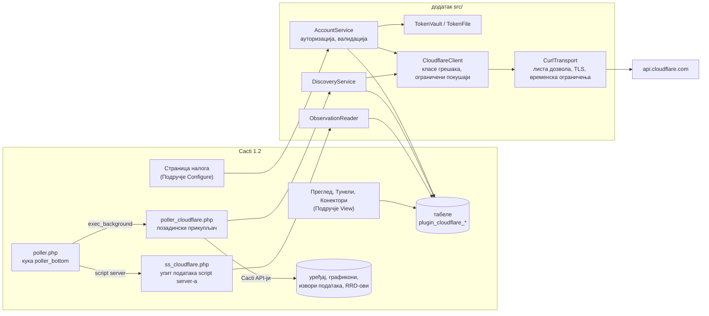

<!-- Source: README.md; SHA256: 813d1c85c236b426b83e42e63c69496f33f8909b5e435d0d45efa6a4ba2f17ca -->

<!-- translations:start -->
[English](../../../README.md) | [简体中文](../zh-CN/README.md) | [हिन्दी](../hi-IN/README.md) | [Español (España)](../es-ES/README.md) | [Español (Latinoamérica)](../es-419/README.md) | [العربية (السعودية)](../ar-SA/README.md) | [Afrikaans](../af-ZA/README.md) | [አማርኛ](../am-ET/README.md) | [العربية (مصر)](../ar-EG/README.md) | [العربية (المغرب)](../ar-MA/README.md) | [বাংলা](../bn-BD/README.md) | [Bosanski](../bs-BA/README.md) | [Deutsch](../de-DE/README.md) | [فارسی](../fa-IR/README.md) | [Filipino](../fil-PH/README.md) | [Français](../fr-FR/README.md) | [Français (Maroc)](../fr-MA/README.md) | [Français (Sénégal)](../fr-SN/README.md) | [Hausa](../ha-NG/README.md) | [עברית](../he-IL/README.md) | [Hrvatski](../hr-HR/README.md) | [Bahasa Indonesia](../id-ID/README.md) | [Igbo](../ig-NG/README.md) | [Italiano](../it-IT/README.md) | [日本語](../ja-JP/README.md) | [한국어](../ko-KR/README.md) | [Malagasy](../mg-MG/README.md) | [मराठी](../mr-IN/README.md) | [Bahasa Melayu](../ms-MY/README.md) | [Nederlands](../nl-NL/README.md) | [Polski](../pl-PL/README.md) | [Português (Brasil)](../pt-BR/README.md) | [Русский](../ru-RU/README.md) | [Kinyarwanda](../rw-RW/README.md) | [Soomaali](../so-SO/README.md) | [Српски](README.md) | [Svenska](../sv-SE/README.md) | [Kiswahili](../sw-KE/README.md) | [தமிழ்](../ta-IN/README.md) | [తెలుగు](../te-IN/README.md) | [ไทย](../th-TH/README.md) | [Türkçe](../tr-TR/README.md) | [Українська](../uk-UA/README.md) | [اردو](../ur-PK/README.md) | [Tiếng Việt](../vi-VN/README.md) | [isiXhosa](../xh-ZA/README.md) | [Yorùbá](../yo-NG/README.md) | [繁體中文](../zh-TW/README.md) | [isiZulu](../zu-ZA/README.md)
<!-- translations:end -->

<p align="center">
  
</p>

# Cloudflare додатак за Cacti

[](https://github.com/somethingwithproof/plugin_cloudflare/actions/workflows/ci.yml)
[](https://sonarcloud.io/summary/new_code?id=somethingwithproof_plugin_cloudflare)
[](../../../LICENSE)


[](https://sonarcloud.io/summary/new_code?id=somethingwithproof_plugin_cloudflare)
[](https://sonarcloud.io/summary/new_code?id=somethingwithproof_plugin_cloudflare)
[](https://sonarcloud.io/summary/new_code?id=somethingwithproof_plugin_cloudflare)


Додатак за Cacti 1.2 који се развија за надзор Cloudflare тунела и аналитике
зона. Чита податке из Cloudflare API-ја помоћу ограничених API токена, никада
ништа не мења у систему Cloudflare и чува своје податке у сопственим табелама.
У систему Cacti копира XML датотеке упита података у `resource/script_server/`
и креира уређаје, графиконе и шаблоне преко сопствених API-ја система Cacti,
без икаквих измена у основним датотекама.

**Статус: 0.4.0-dev, необјављена верзија.** Последња објављена верзија је 0.3.0. Развојна верзија додаје CSV извоз инвентара, изричито повлачење обрисаних тунела, кеширану аналитику зона и опционе Thold шаблоне. Квалификација са стварним провајдером и за продукционо постављање још је на чекању.

Табела у наставку описује стабилно издање 0.3.0. Развојни додаци описани су ниже у одељку о токовима рада оператера и аналитици зона.

| Доступно сада | Планирано |
|---|---|
| Инсталација, надоградња, онемогућавање и деинсталација кроз менаџер додатака система Cacti | GraphQL аналитика и Thold упозорења (Прекретница 4) |
| Дозволе Cloudflare: View, Operator и Configure | Убризгавање грешака, TLA+ модели и потпуна документација (Прекретница 5) |
| Додавање, уређивање, брисање, омогућавање и онемогућавање Cloudflare налога | |
| Чување токена у датотеци или шифровано у Cacti бази података | |
| Провера токена и његових дозвола за читање тунела и зона | |
| Откривање тунела и конектора у позадинском прикупљачу који покреће главни poller | |
| Странице Преглед, Тунели и Конектори под Управљање > Cloudflare тунели | |
| Праћење животног циклуса: `active`, `unavailable` и `deleted` | |
| Један Cacti уређај по налогу, који креира администратор, са тунелима као индексима упита података | |
| Графикони Конектори, Исправност и Прикупљање по тунелу, нацртани из једне RRD датотеке по тунелу | |
| Вредности за које додатак не може да гарантује чувају се као непознате (`U`), никада као 0 | |

## Улоге приступа

| Подручје (Realm) | Приступ |
| --- | --- |
| Cloudflare: View | Постојеће странице за надзор. |
| Cloudflare: Operator | Надзор плус страница Операције и личне потврде тријаже. |
| Cloudflare: Configure | Приступ оператера плус постојеће конфигурационе и административне радње. |

Након копирања датотека за надоградњу, отворите страницу Plugins као администратор
да бисте регистровали ново подручје. Изричито доделите подручје Operator под
**Configuration > Users** или корисничким групама. Надоградње задржавају постојеће
ID-ове и доделе подручја View и Admin. Приступ Admin наслеђује приступ Operator,
а приступ Operator наслеђује приступ View при сваком захтеву; ово не додаје
сачуване доделе корисницима ни групама. Подешавања додатка захтевају и приступ
Cloudflare: Configure поред дозволе Settings система Cacti.

Видљивост Cloudflare налога одговара постојећем подручју View и важи на нивоу
целог налога. Акредитиви, конфигурација, мапирање, брисање и остале административне
измене остају на административним страницама. Потврде трају само током тренутне
корисничке сесије, најдуже један сат и само док исто запажање остаје свеже. Нова
или измењена запажања их поништавају. Она никада не означавају неуспело мерење
као исправно нити потискују упозорења.

## Зашто овај додатак

Оператери система Cacti који објављују сервисе преко Cloudflare тунела немају
увид у тунел унутар система Cacti. Тунел може изгубити све своје конекторе док
изворни рачунари и даље одговарају на SNMP, па постојећи графикони остају зелени
док корисници виде грешке. Циљ овог додатка је да постави исправност тунела и
саобраћај зона одмах уз графиконе уређаја које оператери већ прате, без давања
систему Cacti икакве могућности да мења било шта у систему Cloudflare.

Три услова обликују дизајн:

- **Само за читање.** Додатак позива искључиво `GET` крајње тачке и GraphQL
  Analytics API. Не захтева никакву дозволу за измену било ког Cloudflare ресурса.
- **Опциони рад.** Испади сервиса Cloudflare, истекли токени и ограничења учесталости
  захтева не смеју успорити веб интерфејс система Cacti нити зауставити испитивање
  других уређаја. Сви API позиви имају строга временска ограничења, а прикупљање
  се извршава у позадинском процесу који покреће poller.
- **Без измена језгра.** Додатак користи куке (hooks) за додатке система Cacti 1.2
  и сопствене табеле. Копира једну XML датотеку упита података у
  `resource/script_server/` и креира уређаје, графиконе и шаблоне преко сопствених
  API-ја система Cacti. Нема измена основних датотека, па надоградње система Cacti
  и други додаци остају нетакнути.

## Како функционише



- **Интеграциони слој за Cacti** (`setup.php`, `includes/`, скрипте страница)
  региструје куке и подручја, исцртава странице помоћу сопствених помоћних функција
  система Cacti и прослеђује сваку радњу библиотеци у `src/`.
- **Библиотека** (`src/`, именски простор `Somethingwithproof\Cloudflare\`) не
  зависи од глобалних променљивих система Cacti, па се тестира над стварном базом
  података и лажним HTTP транспортом без покренуте Cacti инстанце.
- **Једна излазна путања.** `CurlTransport` је једини код који приступа мрежи и
  прихвата искључиво `https://api.cloudflare.com`. Сваки неуспех се мапира на
  једну класу грешке (`auth`, `permission`, `rate_limited`, `transient`, ...), што
  одређује статус приказан у корисничком интерфејсу.
- **Складиштење** иде преко сопствене PDO везе система Cacti са припремљеним
  изразима. Измене шеме су нумерисане, идемпотентне миграције.

Одлуке о дизајну и њихови разлози описани су у
[docs/design.md](../../design.md).

## Снимци екрана

Снимци екрана потичу из тестног окружења, а не из продукционог Cloudflare налога.
Окружење покреће Cacti 1.2.31 према лажном Cloudflare API-ју који враћа тестне
податке, па су налог, његов ID и три тунела само заменски примери.


*Списак Cloudflare налога. Лажни API прихвата токен, па Провери пријављује `ok`.*


*Уређивање налога. Поља за токен су увек празна; сачувани токен се никада не
шаље назад у прегледач. Прикупљај тунеле и Креирај графиконе су укључени, док је
Прикупљај аналитику искључен. Статус везе приказује резултат последње провере:
`ok`, додељена дозвола за читање тунела и недостајућа дозвола за читање зона.*


*Подешавања > Cloudflare.*


*Управљање > Cloudflare тунели > Преглед. Статус је најгори Cloudflare статус
међу активним тунелима налога, овде `down` јер је један тестни тунел у прекиду.
`Disabled`, `Not collected`, `Collection failing` и `Not yet collected` имају
предност над исправношћу тунела, тим редоследом, па налог чије је последње
извршавање пропало приказује `Collection failing` без обзира на то шта његови
тунели пријављују.*


*Картица Тунели. Конектори и Везе приказују `-` за old-office јер лажни API на
његов захтев за везе одговара као за непознат тунел па ништа није сачувано, док
за staging приказују 0 јер нема покренутог конектора.*


*Графикон Конектори тунела blog. Све три линије имају вредност 1 пре и после
прекида у средини, где је лажни API вратио грешке а додатак сачувао непознате
вредности. Линије не падају на 0. Графикон потиче из истог тестног окружења
(`make screenshots`), које поставља корак од 30 секунди на овај један извор
података како би седам минута испитивања попунило графикон.*

## Захтеви

- Cacti од 1.2.25 до 1.2.31. Сам Cacti 1.2.31 захтева PHP 8.0 или новији.
  CI тестира само 1.2.31; верзија 1.2.25 последњи пут је ручно тестирана 2026-10-22.
- PHP од 7.4 до 8.4 са екстензијама `curl`, `openssl` и `pdo_mysql`.
  Додатак одбија да се омогући без њих.
- MariaDB 10.6 или новији, или MySQL 8.0 или новији.
- HTTPS приступ са Cacti сервера на `api.cloudflare.com`. Прокси сервери нису подржани.

Погледајте [docs/compatibility.md](../../compatibility.md) за преглед тестираних верзија.

## Инсталација

1. Поставите додатак у Cacti директоријум `plugins/cloudflare`, било распакивањем
   архиве са странице
   [GitHub Releases](https://github.com/somethingwithproof/plugin_cloudflare/releases)
   (`make package` покренут у копији ознаке издања прави исту архиву) или путем
   git клонирања. Директоријум мора имати назив `cloudflare`.
2. Инсталирајте и омогућите додатак из Console > Configuration > Plugins или
   преко командне линије као корисник веб сервера:

   ```sh
   php cli/plugin_manage.php --plugin=cloudflare --install --enable
   ```

3. Администраторски корисник при инсталацији добија дозволу Cloudflare: Configure.
   Доделите је другим корисницима или групама под Console > Configuration > Users.
4. Креирајте токен са дозволама наведеним у
   [docs/token-permissions.md](../../token-permissions.md). Укратко:
   Account > Cloudflare Tunnel > Read, и опционо Zone > Zone > Read.
5. Сачувајте токен на један од два начина у наставку, затим додајте налог под
   Console > Configuration > Cloudflare Accounts и покрените Провери из менија радњи.

### Опција A: шифровано у бази података

Додатак шифрује токене помоћу кључа од 32 бајта који сами креирате. Никада сам
не креира нити уписује тај кључ. Датотека мора бити читљива за кориснике веб
сервера и poller-а, не сме бити читљива за остале, а њен директоријум мора
дозвољавати тим корисницима приступ. За веб сервер који ради као `www-data`:

```sh
sudo mkdir -p /etc/cacti
sudo sh -c 'umask 077 && openssl rand -hex 32 > /etc/cacti/cloudflare.key'
sudo chgrp www-data /etc/cacti/cloudflare.key
sudo chmod 0440 /etc/cacti/cloudflare.key
```

Подразумевана путања је `/etc/cacti/cloudflare.key`; можете је променити под
Settings > Cloudflare > Token Vault Key File. Када кључ недостаје или је одбијен,
образац за уређивање нуди само опцију датотеке токена. Чувајте резервну копију
кључа: без њега сачувани токени не могу да се дешифрују и морају се поново унети.

#### Ротација кључа

Не постоји команда за поновно шифровање. Нови кључ не може да дешифрује токене
сачуване под старим кључем, па ротација подразумева поновни унос сваког
сачуваног токена:

1. Припремите вредност токена за сваки налог. Cloudflare приказује вредност
   токена само приликом креирања или обнављања, па обновите токен на Cloudflare
   контролној табли ако га више немате.
2. Креирајте нови кључ на новој путањи помоћу горњих команди, на пример
   `/etc/cacti/cloudflare.key.new`, са истим власником и дозволама.
3. Поставите Settings > Cloudflare > Token Vault Key File на нову путању и
   сачувајте. Од тог тренутка Провери на налогу који је још шифрован старим
   кључем пријављује "Stored token cannot be decrypted", а свако покретање
   прикупљача бележи `discovery token unavailable` са `reason=decrypt_failed`.
4. За сваки налог који чува токен у бази података отворите га под
   Console > Configuration > Cloudflare Accounts, налепите токен у оба поља за
   токен, сачувајте и покрените Провери. Требало би да пријави `ok`.
5. Када сваки такав налог прође проверу, уклоните стару датотеку кључа и њене
   резервне копије.

Између корака 3 и 4 тунели налога се не освежавају, а њихови графикони исправности,
конектора и веза бележе U. Налози који користе датотеку токена нису погођени.

### Опција B: датотека токена

Упишите токен, и ништа друго, у датотеку коју могу читати корисници веб сервера
и poller-а, а остали не могу, затим унесите њену апсолутну путању у образац за
уређивање:

```sh
sudo sh -c 'umask 077 && cat > /etc/cacti/cloudflare-account.token'   # paste the token, then Ctrl-D
sudo chgrp www-data /etc/cacti/cloudflare-account.token
sudo chmod 0440 /etc/cacti/cloudflare-account.token
```

Датотека се проверава када се чита, приликом провере (Verify), а не при чувању.
Симболичке везе, датотеке веће од 4 KiB и датотеке које могу читати или мењати
остали корисници се одбијају.

Свако са дозволом Cloudflare: Configure може унети било коју путању, а корисник
poller-а је чита. Да бисте све датотеке токена држали на једном месту, поставите
Settings > Cloudflare > Token File Directory, на пример на `/etc/cacti`; путања
ван тог директоријума тада бива одбијена. Погледајте
[docs/security.md](../../security.md#token-file).

## Надоградња

1. Замените датотеке у `plugins/cloudflare` новим издањем, задржавајући назив
   директоријума.
2. Отворите Console > Configuration > Plugins или Console > Configuration >
   Cloudflare Accounts једном као администратор. Тиме се покрећу миграције додатка,
   увозе Cloudflare шаблони и копира датотека упита података (погледајте
   [Метрике и графикони тунела](#tunnel-metrics-and-graphs)), а при надоградњи са
   верзије 0.1.0 региструје се кука `poller_bottom`.

`poller.php` не извршава надоградњу додатка, па до корака 2 нова шема недостаје.
Свако покретање прикупљача тада не ради ништа и бележи
`CLOUDFLARE: collector skipped; plugin upgrade pending, open Console > Plugins`.
Страницама Cloudflare Tunnels потребна је само дозвола Cloudflare: View, па оне
никада не покрећу надоградњу и до корака 2 могу приказивати "The Cloudflare
tunnels could not be read".

## Статус налога

Провери поставља статус налога:

| Статус | Значење |
|---|---|
| `unknown` | Није проверено откако је налог додат или су му промењени акредитиви |
| `ok` | Токен је активан и може да чита тунеле |
| `token_inactive` | Cloudflare пријављује да је токен онемогућен или истекао |
| `auth_failed` | Cloudflare је одбио токен као неважећи или истекао (HTTP 401) |
| `permission_denied` | Токен је активан али не може да чита тунеле, или му недостају дозволе за позивање крајњих тачака за проверу токена (HTTP 403) |
| `unreachable` | API није могао да се досегне, истекло је време или је враћена серверска грешка |
| `rate_limited` | Cloudflare је вратио HTTP 429 |
| `error` | Било који други неуспех, укључујући датотеку токена која недостаје или није безбедна, датотеку кључа трезора токена која недостаје или је неупотребљива, или сачувани токен који не може да се дешифрује |

Страница за уређивање такође приказује да ли су додељене дозволе за читање тунела
и читање зона.

## Откривање тунела

Након сваког циклуса испитивања на главном poller-у, кука `poller_bottom` покреће
позадински прикупљач помоћу `exec_background` када је барем за један омогућени
налог укључена опција Прикупљај тунеле. Прикупљач се никада не извршава у процесу
poller-а, па спор Cloudflare API не успорава `poller.php`. Удаљени poller-и га
никада не покрећу.

За сваки налог који је на реду прикупљач преузима списак тунела налога, а затим
чита везе његових активних тунела, чиме добија конекторе сваког тунела, њихове
верзије, центре података и изворне адресе. Налози долазе на ред сваког Интервала
откривања (подразумевано 300 секунди). Једно покретање не започиње нови налог
након 50 секунди и шаље највише 200 захтева за везе. Било које од ова два
ограничења може зауставити налог на пола читања његових веза; тај налог се бележи
као `partial`, а следеће покретање наставља са тунелима који су најдавније
покушани. Налози који нису започети остају на чекању за следеће покретање.

Тунел има животни циклус који се води одвојено од статуса који пријављује
Cloudflare (`healthy`, `degraded`, `down` или `inactive`):

| Животни циклус | Значење |
|---|---|
| `active` | Тунел је био присутан на последњем потпуном списку |
| `deleted` | Потпуни списак га није садржао, што укључује и празан списак. Ред и његова историја остају, а тунел поново постаје `active` ако се опет појави |
| `unavailable` | Три урачуната испада без потпуног списка између њих остављају стање тунела непознатим |

Само потпун и успешан списак додаје, ажурира или брише тунеле, а неуспело
преузимање списка никада не брише тунел. Неуспех у читању сервиса Cloudflare уопште
(`transient`, `rate_limited`, `auth` или `permission`) рачуна се као испад; након
три урачуната испада без потпуног списка између њих активни тунели налога постају
`unavailable`. Следећи потпуни списак их враћа у активно стање и ресетује бројач.
Тунел за који Cloudflare више не зна приликом читања његових веза прескаче се без
грешке на нивоу налога. Остали неуспеси нити повећавају нити ресетују бројач испада.

У датотеци `cacti.log` редови откривања почињу са `CLOUDFLARE: discovery`, а
извештај покретања са `CLOUDFLARE: collector`. Неуспеси и промене животног циклуса,
попут неуспелог списка или тунела означених као `unavailable`, бележе се на
подразумеваном нивоу система Cacti `LOW`; резултат сваког налога и извештај
покретања бележе се на нивоу `MEDIUM`. Читање веза може заказати на сваком тунелу,
па се за сваки налог само први неуспех сваке класе грешке бележи на нивоу `LOW`,
остали на нивоу `MEDIUM`, након чега следи један `LOW` ред по класи са бројем
тунела који нису успели.

Управљање > Cloudflare тунели захтева дозволу Cloudflare: View и служи само за читање:

- **Преглед** приказује списак свих налога са њиховим статусом, бројем тунела по
  животном циклусу, временом последњег успешног откривања и бројем узастопних
  неуспеха.
- **Тунели** приказује списак тунела кроз све налоге или за један налог, са
  филтерима за налог, животни циклус, статус и назив и колонама које се могу
  сортирати.
- **Конектори** приказује конекторе тунела изабраног на картици Тунели.

<a id="tunnel-metrics-and-graphs"></a>
## Метрике и графикони тунела

Cacti чита стање тунела кроз упит података script server-а `ss_cloudflare.php`.
Он одговара искључиво из табела додатка и никада не позива Cloudflare, па испад
сервиса Cloudflare не може успорити poller. Сваки тунел даје шест вредности:
исправност (healthy 3, degraded 2, down 1, inactive 0), конекторе, везе, верзије
конектора, секунде од последњег читања веза и узастопне неуспехе задатка
откривања. Исправност, конектори, везе и верзије исписују се само када додатак
може да гарантује за њих, што значи да је последње откривање успело, тунел је
`active` и очитавање је свеже. У супротном су `U`, а графикон приказује прекид
уместо нуле која би изгледала као испад. Две вредности прикупљања остају исписане
током испада како би га графикон Прикупљање приказао; оне су `U` само за обрисани
тунел или тунел чије везе никада нису освежене. Правила су дефинисана у
[docs/metrics.md](../../metrics.md).

### Креирање уређаја

Један налог одговара највише једном Cacti уређају. Уређај држи тунеле налога као
индексе упита података Cloudflare Tunnels. Ништа га не креира аутоматски:

1. Отворите Console > Configuration > Cloudflare Accounts.
2. Изаберите налог, изаберите Create Cacti Device из менија радњи и потврдите.

Ова радња захтева и подручје Cloudflare: Configure и подручје Sites/Devices/Data
система Cacti (оно за `host.php`). Ставка менија приказује се само корисницима
који имају оба подручја, а сервер одбија захтев свих осталих. Уређај добија назив
`Cloudflare: <назив налога>`, користи шаблон домаћина Cloudflare Account и главни
poller, има SNMP верзију 0 без провере доступности и добија име домаћина
`<ID налога>.cloudflare.invalid`. Тај назив је резервисан и никада се не разрешава;
Cacti се на њега не повезује. Ако налог већ има уређај, радња то пријављује и не
мења ништа. Ако администратор обрише уређај у систему Cacti, додатак неће
креирати нови док се поново не покрене Create Cacti Device.

### Креирање графикона

Опција Креирај графиконе на обрасцу налога подразумевано је искључена. Када је
укључена, сваки пут када се откривање налога заврши са `ok` или `partial`,
прикупљач поново индексира уређај и креира све недостајуће графиконе за активне
(`active`) тунеле налога: Connectors, Health и Collection, по три за сваки тунел.
Три графикона једног тунела деле једну RRD датотеку. Једно покретање креира
највише 50 графикона и стаје након 20 секунди, а следеће покретање наставља.
Додатак никада не уклања Cacti објекат. Графикон који администратор обрише не
креира се поново, а тунел који Cloudflare више не наводи задржава свој графикон и
RRD датотеку, који приказују `U`.

Укључивање опције Креирај графиконе захтева оба подручја. Искључивање захтева само
Configure. Корисник без подручја Sites/Devices/Data који сачува образац оставља
подешавање непромењеним, уз упозорење. Када је Креирај графиконе искључено,
уређај се и даље поново индексира након сваког откривања, тако да се нови тунели
појављују као индекси упита података.

### Датотека упита података

Cacti 1.2.31 чита XML датотеку упита података само из свог директоријума `resource`.
При инсталацији и надоградњи додатак зато копира једну датотеку,
`templates/resource/cloudflare_tunnels.xml`, у
`<Cacti>/resource/script_server/cloudflare_tunnels.xml`. То је једина датотека коју
додатак уписује ван сопственог директоријума, па корисник који инсталира или
надограђује додатак мора имати право уписа у тај директоријум. Деинсталација
задржава ову датотеку, заједно са уређајима, графиконима, RRD датотекама и
шаблонима. Ако копирање или увоз шаблона не успе, додатак то бележи у дневник, а
Create Cacti Device покушава поново.

## Подешавања

Settings > Cloudflare садржи:

- **Token Vault Key File**: путања до кључа трезора.
- **Token File Directory**: када је подешено, датотека токена ван овог директоријума
  се одбија. Подразумевано је празно, што дозвољава било коју путању. Погледајте
  [docs/security.md](../../security.md#token-file).
- **Interactive Request Timeout**: укупно секунди за захтев упућен из веб
  интерфејса, као што је Провери. Подразумевано 10; вредности ван опсега од 5 до 60
  враћају се на 10.
- **Collector Request Timeout**: укупно секунди за захтев који шаље позадински
  прикупљач. Подразумевано 20; вредности ван опсега од 5 до 60 враћају се на 20.
- **Log Level**: сачувано, али га још ништа не очитава.

На обрасцу налога опције Прикупљај тунеле и Интервал откривања управљају
откривањем, а Креирај графиконе управља креирањем графикона. Опција Прикупљај
аналитику се чува и нема ефекта у овом издању.

## Језици

Додатак испоручује преводе на шпански (Шпанија, `es-ES`), француски (`fr-FR`),
немачки (`de-DE`), поједностављени кинески (`zh-CN`), хинди (`hi-IN`), арапски
(`ar-SA`) и јапански (`ja-JP`). Cacti их приказује када је језичка подршка
укључена (Configuration > Settings > General > Language Support) и када корисник
изабере језик. Испоручује се и каталог за латиноамерички шпански (`es-419`), али
Cacti 1.2 нема изабрану локализацију за латиноамерички шпански, па ће ступити на
снагу тек када је Cacti дода; до тада изаберите шпански (`es-ES`).

Део текста остаје на енглеском: вредности статуса које додатак чува и приказује
какве јесу (`ok`, `active`, `unavailable`, `deleted` и статус тунела који пријављује
Cloudflare), као и све што додатак уписује у Cacti дневник.

## Деинсталација и задржавање података

Деинсталација брише сопствене табеле додатка које чувају налоге, шифроване токене,
откривене тунеле, стање задатака и евиденцију које је Cacti објекте додатак
креирао, те брише његова `cloudflare_` подешавања. Не уклања датотеку кључа,
датотеке токена, копирану датотеку `resource/script_server/cloudflare_tunnels.xml`
нити било које Cacti уређаје, графиконе, изворе података, RRD датотеке или шаблоне.
Они чувају историјске податке надзора и њихово уклањање представља изричиту
административну радњу у систему Cacti.

Задржани уређај престаје да прима податке. Након деинсталације или након брисања
његовог налога ниједан налог више не поседује тај уређај, па његови графикони
задржавају своју историју али од тада надаље исписују `U`. Create Cacti Device на
поново инсталираном или поново додатом налогу креира нови уређај; не користи стари
поново, па обришите стари уређај у систему Cacti када његова историја више није
потребна.

## Позната ограничења

- Једно покретање шаље највише 200 захтева за везе. Тунели ван тог ограничења
  освежавају се ређе од прозора посматрања, па њихови графикони веза приказују
  прекиде.
- Додатак преписује администраторске измене на увезеним шаблонима када надоградња
  промени испоручени XML шаблона.
- Уређај налога мора остати на главном poller-у. Табеле додатка налазе се у
  главној бази података и скрипта их чита одатле.
- Обрисани тунели остају у индексу упита података и исписују `U` све док их
  администратор изричито не повуче из употребе. Повлачење преко система Cacti
  уклања само графиконе које је забележио додатак и недељене изворе података; ред
  у инвентару остаје видљив. Cacti управља чишћењем RRD датотека.
- Cacti онемогућава додатак чији код заврши правом фаталном грешком, као што је
  нестанак меморије. Погледајте [docs/security.md](../../security.md).

## Безбедност

- Global API Keys се одбијају; прихватају се само ограничени API токени.
- Токени се чувају у датотеци коју сами обезбедите или шифровани алгоритмом
  AES-256-GCM помоћу датотеке кључа која никада не улази у базу података. Никада
  се не приказују на страници, не уписују у дневник нити укључују у поруку о грешци.
- Грешке базе података садрже искључиво SQLSTATE и код грешке драјвера, никада
  вредности самог исказа.
- Свака измена је POST захтев заштићен CSRF токеном система Cacti. Административне
  измене налога и конфигурације захтевају Cloudflare: Configure; личне потврде
  тријаже захтевају Cloudflare: Operator. Креирање Cacti уређаја или укључивање
  опције Креирај графиконе додатно захтева Cacti дозволу Sites/Devices/Data.
  Онемогућен додатак одбија приступ својим страницама.

Детаљи и позната ограничења налазе се у [docs/security.md](../../security.md).
Безбедносне рањивости пријавите приватно како је описано у
[SECURITY.md](../../../SECURITY.md).

## Токови рада оператера и аналитика зона

Развојни додаци обухватају изричито повлачење обрисаних тунела, аналитику зона
свесну могућности плана и Thold шаблоне спремне за увоз. Ови додаци још немају
ознаку издања нити квалификацију на продукционом налогу. Погледајте
[docs/analytics-and-alerting.md](../../analytics-and-alerting.md) за подешавање,
семантику метрика и ограничења провере.

### Извоз инвентара

Странице Тунели и Конектори нуде Извоз за подручје Cloudflare: View. CSV датотеке
тунела обухватају сваки одговарајући ред према активним подешавањима налога,
животног циклуса, статуса, претраге и сортирања на свим страницама. CSV датотеке
конектора садрже верзије, архитектуру, центре података и изворне адресе за
изабрани тунел. Преузимања читају искључиво кеширане записе. Непознати бројеви
остају празни; ћелије налик формулама добијају почетни апостроф ради безбедног
увоза у табеларне програме.

## План развоја

Свака прекретница излази као 0.x издање нумерисано према њој: Прекретница 3 је
0.3.0, Прекретница 4 биће 0.4.0. Прекретнице 1 и 2 нису објављене засебно и део
су издања 0.3.0. Верзија 1.0.0 резервисана је за издање које довршава сваку
прекретницу наведену у наставку.

| Прекретница | Опсег | Стање |
|---|---|---|
| 1. Основа | Животни циклус додатка, дозволе, конфигурација налога, тест везе | Објављено у 0.3.0 ([#2](https://github.com/somethingwithproof/plugin_cloudflare/pull/2) до [#5](https://github.com/somethingwithproof/plugin_cloudflare/pull/5)) |
| 2. Откривање | Откривање тунела и конектора у позадинском прикупљачу, странице Преглед, Тунели и Конектори | Објављено у 0.3.0 ([#6](https://github.com/somethingwithproof/plugin_cloudflare/pull/6)) |
| 3. Метрике | Извори података о исправности тунела, шаблони графикона, обрада испада која никада не бележи измишљену нулу | Објављено у 0.3.0 ([#7](https://github.com/somethingwithproof/plugin_cloudflare/pull/7)) |
| 4. Аналитика и упозоравање | GraphQL аналитика по зони прилагођена плану, Thold прагови са потискивањем испада | Планирано |
| 5. Учвршћивање | Убризгавање грешака, TLA+ модели откривања и прикупљања, потпуна документација | Планирано |

## Развој

Алати захтевају PHP 8.x и Composer; сам код додатка остаје компатибилан са
PHP 7.4. Интеграциони и BDD тестови захтевају базу података коју `make db-up`
покреће у Docker-у на порту 33061.

```sh
composer install
make db-up
make ci            # unit, integration, BDD, PHPStan, php-cs-fixer, php -l on PHP 7.4
make smoke         # installs the plugin into Cacti 1.2.31 in Docker and walks its lifecycle
make package       # builds build/cloudflare-<version>.tar.gz and checks its contents
make db-down
```

Команде `make smoke` и `make screenshots` захтевају локалну копију Cacti
репозиторијума; поставите `CACTI_REPO` на њену путању. Интеграциони тестови читају
`CF_TEST_DSN`, `CF_TEST_DB_USER` и `CF_TEST_DB_PASS`, те се прескачу када је база
података недоступна осим ако је постављена променљива `CI`.

## Допринос пројекту

Pull захтеви су добродошли. Сваки commit захтева DCO потпис (`git commit -s`).
Прво напишите тест; `make ci` мора да прође, а измене у интеграционом слоју за
Cacti треба да прођу и `make smoke`. Код додатка мора остати компатибилан са
PHP 7.4 и пратити стил кода система Cacti (табови, једноструки наводници,
витичасте заграде у истом реду).

### Преводи

Поруке су означене са `__('...', 'cloudflare')`. Скрипта `locales/build_gettext.sh`
(`make i18n`, за коју је потребан GNU gettext) поново генерише шаблон
`locales/po/cacti.pot`, спаја га у сваки каталог `locales/po/<locale>.po` и
компајлира `locales/LC_MESSAGES/<locale>.mo`; додајте у commit све три датотеке.
CI покреће `make i18n-check`, који пада ако каталогу недостаје унос или има fuzzy
унос, ако се форматни стринг разликује или је компајлирана датотека застарела, а
јединични тестови додатно проверавају заменске ознаке, HTML ознаке и рубне
размаке сваког уноса. Измењена порука стога захтева ажурирање превода у истом
pull захтеву. Нови језик представља нову датотеку `<locale>.po` названу онако
како Cacti именује своје локализације (на пример `pt-BR`), додату у
`CatalogTest::LOCALES` и у проверу архиве у `tests/build/package.sh`. Задржите
називе производа Cloudflare, Cacti и Thold, појмове API и GraphQL те називе
дозвола као што је `Account Cloudflare Tunnel Read` у изворном облику.

## Документација

- [docs/security.md](../../security.md): безбедносне контроле и позната ограничења
- [docs/token-permissions.md](../../token-permissions.md): дозволе токена
- [docs/compatibility.md](../../compatibility.md): подржане верзије и коришћени интерфејси
- [docs/metrics.md](../../metrics.md): каталог метрика и када је вредност непозната
- [docs/collector-protocol.md](../../collector-protocol.md): шта `ss_cloudflare.php` чита и исписује
- [docs/schema.md](../../schema.md): табеле базе података
- [docs/design.md](../../design.md): одлуке о дизајну
- [CHANGELOG.md](../../../CHANGELOG.md)

## Лиценца

GPL-2.0-or-later. Погледајте [LICENSE](../../../LICENSE).

## Заштитни знакови

Cloudflare је регистровани заштитни знак компаније Cloudflare, Inc. Овај пројекат
је независан алат отвореног кода и није повезан са компанијом Cloudflare, Inc.,
нити га она спонзорише или подржава.

Пројекат такође није повезан са пројектом Cacti. Погледајте
[docs/images/README-logo.md](../../images/README-logo.md) за информације о логотипу.
