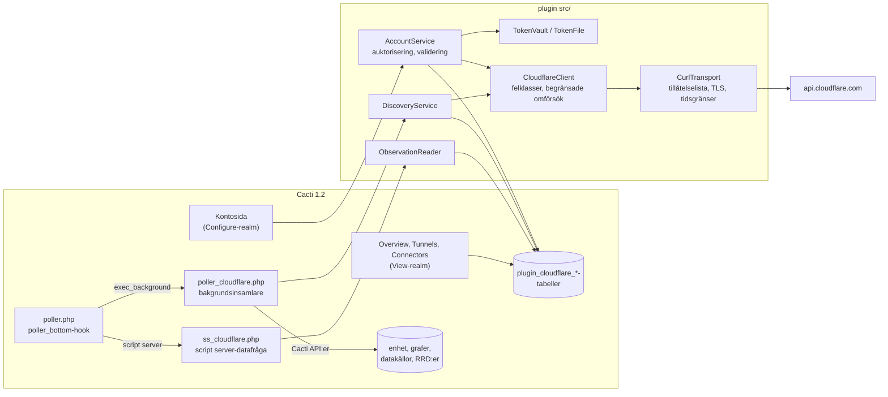

<!-- Source: README.md; SHA256: f8de0e02c5904e15bfa4c71edcaab219e5e5d4f6d9dbe589f4ed16351df6bf4d -->

<!-- translations:start -->
[English](../../../README.md) | [简体中文](../zh-CN/README.md) | [हिन्दी](../hi-IN/README.md) | [Español (España)](../es-ES/README.md) | [Español (Latinoamérica)](../es-419/README.md) | [العربية (السعودية)](../ar-SA/README.md) | [Afrikaans](../af-ZA/README.md) | [አማርኛ](../am-ET/README.md) | [العربية (مصر)](../ar-EG/README.md) | [العربية (المغرب)](../ar-MA/README.md) | [বাংলা](../bn-BD/README.md) | [Deutsch](../de-DE/README.md) | [فارسی](../fa-IR/README.md) | [Filipino](../fil-PH/README.md) | [Français](../fr-FR/README.md) | [Français (Maroc)](../fr-MA/README.md) | [Français (Sénégal)](../fr-SN/README.md) | [Hausa](../ha-NG/README.md) | [עברית](../he-IL/README.md) | [Bahasa Indonesia](../id-ID/README.md) | [Igbo](../ig-NG/README.md) | [Italiano](../it-IT/README.md) | [日本語](../ja-JP/README.md) | [한국어](../ko-KR/README.md) | [Malagasy](../mg-MG/README.md) | [मराठी](../mr-IN/README.md) | [Bahasa Melayu](../ms-MY/README.md) | [Nederlands](../nl-NL/README.md) | [Polski](../pl-PL/README.md) | [Português (Brasil)](../pt-BR/README.md) | [Русский](../ru-RU/README.md) | [Kinyarwanda](../rw-RW/README.md) | [Soomaali](../so-SO/README.md) | [Svenska](README.md) | [Kiswahili](../sw-KE/README.md) | [தமிழ்](../ta-IN/README.md) | [తెలుగు](../te-IN/README.md) | [ไทย](../th-TH/README.md) | [Türkçe](../tr-TR/README.md) | [Українська](../uk-UA/README.md) | [اردو](../ur-PK/README.md) | [Tiếng Việt](../vi-VN/README.md) | [isiXhosa](../xh-ZA/README.md) | [Yorùbá](../yo-NG/README.md) | [繁體中文](../zh-TW/README.md) | [isiZulu](../zu-ZA/README.md)
<!-- translations:end -->

<p align="center">
  
</p>

# Cloudflare-insticksprogram för Cacti

[](https://github.com/somethingwithproof/plugin_cloudflare/actions/workflows/ci.yml)
[](https://sonarcloud.io/summary/new_code?id=somethingwithproof_plugin_cloudflare)
[](../../../LICENSE)


[](https://sonarcloud.io/summary/new_code?id=somethingwithproof_plugin_cloudflare)
[](https://sonarcloud.io/summary/new_code?id=somethingwithproof_plugin_cloudflare)
[](https://sonarcloud.io/summary/new_code?id=somethingwithproof_plugin_cloudflare)


Ett Cacti 1.2-insticksprogram som byggs för att övervaka Cloudflare Tunnels och
zonanalys. Det läser från Cloudflares API med begränsade API-token,
ändrar aldrig något i Cloudflare och sparar sin data i egna tabeller.
I Cacti kopierar det XML-filer för datafrågor till `resource/script_server/` och
skapar enheter, grafer och mallar via Cactis egna API:er, utan att ändra några
kärnfiler.

**Status: 0.4.0-dev, ej släppt.** Den senast släppta versionen är 0.3.0. Utvecklingsversionen lägger till CSV-inventeringsexporter, explicit avveckling av borttagna tunnlar, cachad zonanalys och valfria Thold-mallar. Kvalificering mot skarp leverantör och driftsättning återstår.

Tabellen nedan beskriver den stabila versionen 0.3.0. Tillägg i utvecklingsversionen beskrivs under Operatörsarbetsflöden och zonanalys nedan.

| Tillgängligt nu | Planerat |
|---|---|
| Installera, uppgradera, inaktivera och avinstallera via Cactis insticksprogramshanterare | GraphQL-analys och Thold-larm (Milstolpe 4) |
| Behörigheterna Cloudflare: View, Operator och Configure | Felinjektion, TLA+-modeller och fullständig dokumentation (Milstolpe 5) |
| Lägga till, redigera, ta bort, aktivera och inaktivera Cloudflare-konton | |
| Lagra en token i en fil eller krypterad i Cacti-databasen | |
| Verifiera en token och kontrollera dess läsbehörigheter för tunnlar och zoner | |
| Upptäckt av tunnlar och anslutare (connectors) i en bakgrundsinsamlare som startas av huvudpollern | |
| Sidorna Overview, Tunnels och Connectors under Management > Cloudflare Tunnels | |
| Livscykelspårning: `active`, `unavailable` och `deleted` | |
| En Cacti-enhet per konto, skapad av en administratör, med tunnlarna som index i en datafråga | |
| Graferna Connectors, Health och Collection per tunnel, ritade från en RRD-fil per tunnel | |
| Värden som insticksprogrammet inte kan gå i god för lagras som okända (`U`), aldrig som 0 | |

## Åtkomstroller

| Realm | Åtkomst |
| --- | --- |
| Cloudflare: View | Befintliga övervakningssidor. |
| Cloudflare: Operator | Övervakning samt sidan Operations och personliga bekräftelser vid felsökning. |
| Cloudflare: Configure | Operator-åtkomst samt befintliga konfigurations- och administrationsåtgärder. |

Efter att ha kopierat uppgraderingsfiler öppnar du sidan Plugins som administratör för att registrera
den nya behörighetsnivån. Tilldela Operator-nivån explicit under **Configuration > Users** eller användargrupper.
Uppgraderingar behåller befintliga ID:n och tilldelningar för View- och Admin-nivåerna. Admin-åtkomst
ärver Operator-åtkomst, och Operator-åtkomst ärver View-åtkomst vid varje begäran;
detta lägger inte till lagrade behörigheter på användare eller grupper. Inställningar för insticksprogrammet kräver också
åtkomst till Cloudflare: Configure utöver Cactis behörighet Settings.

Synligheten för Cloudflare-konton motsvarar den befintliga View-nivån; den gäller för hela kontot.
Inloggningsuppgifter, konfiguration, mappning, borttagning och andra administrativa ändringar
finns kvar på administrationssidorna. Bekräftelser gäller endast i den aktuella
användarens session, i högst en timme och bara så länge samma observation förblir
aktuell. Nya eller ändrade observationer gör dem ogiltiga. De markerar aldrig en misslyckad
mätning som felfri och undertrycker aldrig larm.

## Varför detta insticksprogram

Cacti-operatörer som publicerar tjänster via Cloudflare Tunnel har ingen insyn
i tunneln inuti Cacti. En tunnel kan förlora alla sina anslutare (connectors) medan
ursprungsvärdarna fortfarande svarar på SNMP, så befintliga grafer fortsätter att visa grönt medan
användare ser fel. Målet med detta insticksprogram är att placera tunnelhälsa och
zontrafik bredvid de enhetsgrafer som operatörer redan övervakar, utan att ge
Cacti någon möjlighet att ändra i Cloudflare.

Tre begränsningar formar designen:

- **Endast läsåtkomst.** Insticksprogrammet anropar endast `GET`-slutpunkter och GraphQL
  Analytics API. Det behöver ingen redigeringsbehörighet för någon Cloudflare-resurs.
- **Icke-blockerande.** Driftstörningar hos Cloudflare, utgångna token och hastighetsbegränsningar får inte
  göra Cacti-gränssnittet långsamt eller blockera polling av andra enheter. Alla API-anrop har
  hårda tidsgränser, och insamlingen körs i en bakgrundsprocess som startas av
  pollern.
- **Inga ändringar i kärnan.** Insticksprogrammet använder Cacti 1.2:s plugin-hooks och sina
  egna tabeller. Det kopierar en XML-fil för datafråga till `resource/script_server/` och
  skapar enheter, grafer och mallar via Cactis egna API:er. Inga kärnfiler
  ändras, så Cacti-uppgraderingar och andra insticksprogram påverkas inte.

## Så fungerar det



- **Cacti-limmet** (`setup.php`, `includes/`, sidskripten) registrerar
  hooks och behörighetsnivåer, renderar sidor med Cactis egna hjälpfunktioner och delegerar
  varje åtgärd till biblioteket i `src/`.
- **Biblioteket** (`src/`, namnrymd `Somethingwithproof\Cloudflare\`) har inget
  beroende av Cactis globala variabler, så det testas mot en riktig databas och
  en simulerad HTTP-transport utan en körande Cacti-instans.
- **En utgående väg.** `CurlTransport` är den enda kod som rör
  nätverket, och den accepterar endast `https://api.cloudflare.com`. Varje fel
  mappas till en felklass (`auth`, `permission`, `rate_limited`,
  `transient`, ...), vilket styr den status som visas i gränssnittet.
- **Lagring** går genom Cactis egen PDO-anslutning med preparerade
  satser. Schemaändringar är numrerade, idempotenta migreringar.

Designbesluten och motiveringarna bakom dem finns i
[docs/design.md](../../design.md).

## Skärmbilder

Skärmbilderna kommer från en testmiljö, inte ett skarpt Cloudflare-konto. Miljön
kör Cacti 1.2.31 mot ett simulerat Cloudflare-API som returnerar fixturdata,
så kontot, dess ID och de tre tunnlarna är platshållare.


*Listan Cloudflare Accounts. Det simulerade API:et accepterar tokenet, så Verify
rapporterar `ok`.*


*Redigering av ett konto. Tokenfälten är alltid tomma; det lagrade tokenet
skickas aldrig tillbaka till webbläsaren. Collect Tunnels och Create Graphs är aktiverade och
Collect Analytics är avaktiverat. Connection Status visar resultatet av den senaste
verifieringen (Verify): `ok`, läsbehörighet för tunnlar beviljad och läsbehörighet för zoner saknas.*


*Settings > Cloudflare.*


*Management > Cloudflare Tunnels > Overview. Statusen är den sämsta Cloudflare-statusen
bland kontots aktiva tunnlar, här `down` eftersom en fixturtunnel
är nere. `Disabled`, `Not collected`, `Collection failing` och `Not yet
collected` har företräde framför tunnelhälsa, i den ordningen, så ett konto
vars senaste körning misslyckades visar `Collection failing` oavsett vad dess tunnlar rapporterar.*


*Fliken Tunnels. Connectors och Connections visar `-` för old-office, eftersom
det simulerade API:et svarar på dess anslutningsbegäran som en okänd tunnel och inget
lagrades, och 0 för staging, som inte har någon körande anslutare.*


*Connectors-grafen för tunneln blog. Alla tre linjerna är 1 före och
efter en lucka i mitten, där det simulerade API:et returnerade fel och insticksprogrammet
lagrade okända värden. Linjerna faller inte till 0. Grafen kommer från
samma fixturmiljö (`make screenshots`), som sätter ett 30-sekunderssteg på just denna
datakälla så att sju minuters polling fyller grafen.*

## Krav

- Cacti 1.2.25 till och med 1.2.31. Cacti 1.2.31 kräver i sig PHP 8.0 eller senare.
  CI testar endast 1.2.31; 1.2.25 testades senast manuellt den 2026-10-22.
- PHP 7.4 till och med 8.4 med tilläggen `curl`, `openssl` och `pdo_mysql`.
  Pluginet vägrar att aktiveras utan dem.
- MariaDB 10.6 eller senare, eller MySQL 8.0 eller senare.
- HTTPS-åtkomst från Cacti-servern till `api.cloudflare.com`. Proxyservrar stöds inte.

Se [docs/compatibility.md](../../compatibility.md) för information om vad som testas.

## Installation

1. Placera pluginet i Cactis katalog `plugins/cloudflare`, antingen genom att
   packa upp arkivet från
   [GitHub Releases](https://github.com/somethingwithproof/plugin_cloudflare/releases)
   (`make package` som körs i en utcheckning av releasetaggen bygger samma
   arkiv) eller med en git-kloning. Katalogen måste heta `cloudflare`.
2. Installera och aktivera det från Console > Configuration > Plugins, eller med
   CLI som webbserveranvändaren:

   ```sh
   php cli/plugin_manage.php --plugin=cloudflare --install --enable
   ```

3. Admin-användaren får behörigheten Cloudflare: Configure vid installationen. Tilldela
   den till andra användare eller grupper under Console > Configuration > Users.
4. Skapa ett token med behörigheterna i
   [docs/token-permissions.md](../../token-permissions.md). Kortfattat:
   Account > Cloudflare Tunnel > Read, och valfritt Zone > Zone > Read.
5. Lagra tokenet på något av de två sätten nedan, lägg sedan till kontot under
   Console > Configuration > Cloudflare Accounts och kör Verify från
   åtgärdsmenyn.

### Alternativ A: krypterat i databasen

Pluginet krypterar token med en 32-bytesnyckel som du skapar. Det skapar eller
skriver aldrig nyckeln självt. Filen måste vara läsbar av webbserver- och
polleranvändarna, får inte vara läsbar av andra, och dess katalog
måste ge dessa användare åtkomst till den. För en webbserver som körs som `www-data`:

```sh
sudo mkdir -p /etc/cacti
sudo sh -c 'umask 077 && openssl rand -hex 32 > /etc/cacti/cloudflare.key'
sudo chgrp www-data /etc/cacti/cloudflare.key
sudo chmod 0440 /etc/cacti/cloudflare.key
```

Standardsökvägen är `/etc/cacti/cloudflare.key`; ändra den under Settings >
Cloudflare > Token Vault Key File. När nyckeln saknas eller nekas erbjuder
redigeringsformuläret endast alternativet med tokenfil. Spara en säkerhetskopia av nyckeln:
utan den kan lagrade token inte dekrypteras och måste anges på nytt.

#### Rotera nyckeln

Det finns inget kommando för att byta nyckel. En ny nyckel kan inte dekryptera token som lagrats under
den gamla, så rotation innebär att varje lagrat token måste anges på nytt:

1. Ha varje kontos tokenvärde till hands. Cloudflare visar ett tokens värde
   endast när det skapas eller förnyas, så förnya tokenet i Cloudflares
   kontrollpanel om du inte längre har kvar det.
2. Skapa den nya nyckeln på en ny sökväg med kommandona ovan, till exempel
   `/etc/cacti/cloudflare.key.new`, med samma ägare och rättigheter.
3. Ställ in Settings > Cloudflare > Token Vault Key File till den nya sökvägen och spara.
   Från och med nu rapporterar Verify på ett konto som fortfarande är krypterat med den gamla nyckeln
   "Stored token cannot be decrypted", och varje insamlarkörning loggar
   `discovery token unavailable` med `reason=decrypt_failed` för det.
4. För varje konto som lagrar sitt token i databasen, öppna det under
   Console > Configuration > Cloudflare Accounts, klistra in tokenet i båda
   tokenfälten, spara och kör Verify. Det bör rapportera `ok`.
5. När alla sådana konton verifieras, ta bort den gamla nyckelfilen och dess
   säkerhetskopior.

Mellan steg 3 och 4 uppdateras inte kontots tunnlar och deras
hälso-, connector- och anslutningsgrafer registrerar U. Konton med tokenfil
påverkas inte.

### Alternativ B: tokenfil

Skriv tokenet, och inget annat, till en fil som webbserver- och polleranvändarna
kan läsa och som andra inte kan läsa, och ange sedan dess absoluta sökväg i redigeringsformuläret:

```sh
sudo sh -c 'umask 077 && cat > /etc/cacti/cloudflare-account.token'   # paste the token, then Ctrl-D
sudo chgrp www-data /etc/cacti/cloudflare-account.token
sudo chmod 0440 /etc/cacti/cloudflare-account.token
```

Filen kontrolleras när den läses, vid Verify, inte när du sparar. Symboliska
länkar, filer över 4 KiB och filer som är läsbara eller skrivbara av andra
nekas.

Alla med Cloudflare: Configure kan ange vilken sökväg som helst, och polleranvändaren
läser den. För att hålla tokenfiler på ett ställe, ställ in Settings > Cloudflare >
Token File Directory, till exempel till `/etc/cacti`; en sökväg utanför den
nekas då. Se [docs/security.md](../../security.md#token-file).

## Uppgradering

1. Ersätt filerna i `plugins/cloudflare` med den nya releasen och behåll
   katalognamnet.
2. Öppna Console > Configuration > Plugins, eller Console > Configuration >
   Cloudflare Accounts, en gång som administratör. Det kör pluginets migreringar,
   importerar Cloudflare-mallarna och kopierar datafrågefilen (se
   [Tunnelmätvärden och grafer](#tunnel-metrics-and-graphs)), och registrerar, vid en
   uppgradering från 0.1.0, hooken `poller_bottom`.

`poller.php` kör inte pluginets uppgradering, så fram till steg 2 saknas det nya
schemat. Varje insamlarkörning gör då ingenting och loggar
`CLOUDFLARE: collector skipped; plugin upgrade pending, open Console > Plugins`.
Sidorna för Cloudflare Tunnels kräver endast Cloudflare: View, så de kör aldrig
uppgraderingen, och fram till steg 2 kan de visa "The Cloudflare tunnels could not
be read".

## Kontostatus

Verify anger kontots status:

| Status | Betydelse |
|---|---|
| `unknown` | Inte verifierat sedan kontot lades till eller dess autentiseringsuppgifter ändrades |
| `ok` | Tokenet är aktivt och kan läsa tunnlar |
| `token_inactive` | Cloudflare rapporterar att tokenet är inaktiverat eller har löpt ut |
| `auth_failed` | Cloudflare avvisade tokenet som ogiltigt eller utgånget (HTTP 401) |
| `permission_denied` | Tokenet är aktivt men kan inte läsa tunnlar, eller så saknar det behörighet att anropa slutpunkterna för tokenverifiering (HTTP 403) |
| `unreachable` | API:et kunde inte nås, överskred tidsgränsen eller returnerade ett serverfel |
| `rate_limited` | Cloudflare returnerade HTTP 429 |
| `error` | Alla andra fel, inklusive en tokenfil som saknas eller är osäker, en nyckelfil för tokenvalv som saknas eller är oanvändbar, eller ett lagrat token som inte kan dekrypteras |

Redigeringssidan visar också om läsbehörighet för tunnlar och zoner har beviljats.

## Tunnelidentifiering

Efter varje pollingcykel på huvudpollern startar hooken `poller_bottom`
en bakgrundsinsamlare med `exec_background` när minst ett aktiverat
konto har Collect Tunnels påslaget. Insamlaren körs aldrig i pollerns
process, så ett långsamt Cloudflare-API fördröjer inte `poller.php`. Fjärrpollers
startar den aldrig.

För varje konto som står på tur listar insamlaren kontots tunnlar och läser sedan
anslutningarna för dess aktiva tunnlar, vilket ger varje tunnels
connectors, deras versioner, datacenter och ursprungsadresser. Konton står på
tur enligt Discovery Interval (standard 300 sekunder). En körning påbörjar inget nytt
konto efter 50 sekunder och gör högst 200 anslutningsbegäranden. Båda
gränserna kan också stoppa ett konto mitt i läsningen av dess anslutningar; det
kontot registreras som `partial`, och nästa körning fortsätter med de tunnlar
som senast försöktes för längst tid sedan. Konton som inte påbörjats står kvar på tur till nästa körning.

En tunnel har en livscykel, skild från den status som Cloudflare rapporterar
(`healthy`, `degraded`, `down` eller `inactive`):

| Livscykel | Betydelse |
|---|---|
| `active` | Tunneln fanns med i den senaste fullständiga listningen |
| `deleted` | En fullständig listning inkluderade den inte, vilket även omfattar en tom listning. Raden och dess historik finns kvar, och tunneln blir `active` igen om den dyker upp på nytt |
| `unavailable` | Tre räknade driftavbrott utan en fullständig listning däremellan lämnar tunnelns tillstånd okänt |

Endast en fullständig, lyckad listning lägger till, uppdaterar eller tar bort tunnlar, och en
misslyckad listning tar aldrig bort någon. Ett fel vid läsning av Cloudflare över huvud taget
(`transient`, `rate_limited`, `auth` eller `permission`) räknas som ett driftavbrott;
efter tre räknade driftavbrott utan en fullständig listning däremellan blir
kontots aktiva tunnlar `unavailable`. Nästa fullständiga listning
återställer dem och nollställer räknaren. En tunnel som Cloudflare inte längre känner till
när dess anslutningar läses hoppas över utan att kontot markeras som misslyckat. Andra
fel varken ökar eller nollställer avbrottsräknaren.

I `cacti.log` börjar identifieringsrader med `CLOUDFLARE: discovery` och körningssammanfattningen
med `CLOUDFLARE: collector`. Fel och livscykelförändringar, såsom
en misslyckad listning eller tunnlar som markerats som `unavailable`, loggas på Cactis
standardnivå `LOW`; varje kontos resultat och körningssammanfattningen loggas på
`MEDIUM`. Anslutningsläsningar kan misslyckas på varje tunnel, så för varje konto loggas endast
det första felet i varje felklass på `LOW`, resten på
`MEDIUM`, följt av en `LOW`-rad per klass med antalet tunnlar som
misslyckades.

Management > Cloudflare Tunnels kräver behörigheten Cloudflare: View och är
skrivskyddad:

- **Overview** listar varje konto med dess status, tunnelantal per livscykel,
  den senaste lyckade identifieringen och antalet på varandra följande fel.
- **Tunnels** listar tunnlar över flera konton eller för ett konto, med filter
  för konto, livscykel, status och namn samt sorterbara kolumner.
- **Connectors** visar connectors för den tunnel som valts på fliken Tunnels.

<a name="tunnel-metrics-and-graphs"></a>

## Tunnelmätvärden och grafer

Cacti läser tunneltillstånd via en script server-datafråga,
`ss_cloudflare.php`. Den svarar endast från pluginets tabeller och anropar aldrig
Cloudflare, så ett driftavbrott hos Cloudflare kan inte sakta ner pollern. Varje tunnel ger
sex värden: hälsa (healthy 3, degraded 2, down 1, inactive 0), connectors,
anslutningar, connector-versioner, antal sekunder sedan dess anslutningar senast
lästes samt identifieringsjobbets på varandra följande fel. Hälsa, connectors,
anslutningar och versioner skrivs ut endast när pluginet kan gå i god för dem,
vilket innebär att den senaste identifieringen lyckades, tunneln är `active` och
avläsningen är färsk. Annars är de `U`, och grafen visar en lucka i stället
för en nolla som skulle se ut som ett driftavbrott. De två insamlingsvärdena fortsätter att
skrivas ut under ett driftavbrott, så Collection-grafen visar det; de är `U` endast
för en borttagen tunnel eller en vars anslutningar aldrig har uppdaterats. Reglerna
finns i [docs/metrics.md](../../metrics.md).

### Skapa enheten

Ett konto motsvarar högst en Cacti-enhet. Enheten innehåller kontots
tunnlar som index i datafrågan Cloudflare Tunnels. Ingenting skapar
den automatiskt:

1. Öppna Console > Configuration > Cloudflare Accounts.
2. Markera kontot, välj Create Cacti Device från åtgärdsmenyn och
   bekräfta.

Åtgärden kräver både behörighetsområdet Cloudflare: Configure och Cactis
behörighetsområde Sites/Devices/Data (det för `host.php`). Menyalternativet visas endast
för användare som har båda, och servern nekar begäran från alla andra.
Enheten namnges `Cloudflare: <account name>`, använder värdmallen Cloudflare Account
och huvudpollern, har SNMP-version 0 och ingen tillgänglighetskontroll,
och får värdnamnet `<account ID>.cloudflare.invalid`. Det namnet är
reserverat och löses aldrig upp; Cacti ansluter inte till det. Om kontot
redan har en enhet meddelar åtgärden det och ändrar ingenting. Om en
administratör tar bort enheten i Cacti skapar pluginet ingen ny
förrän Create Cacti Device körs igen.

### Skapa grafer

Create Graphs i kontoformuläret är avstängt som standard. När det är påslaget
omindexerar insamlaren enheten varje gång en identifiering av kontot avslutas med `ok`
eller `partial` och skapar eventuella saknade grafer för kontots `active`-tunnlar:
Connectors, Health och Collection, tre per tunnel. En tunnels tre grafer
delar en och samma RRD-fil. En körning skapar högst 50 grafer och stannar efter 20
sekunder, och nästa körning fortsätter. Pluginet tar aldrig bort något Cacti-objekt.
En graf som en administratör tar bort skapas inte på nytt, och en tunnel som
Cloudflare inte längre listar behåller sin graf och RRD-fil, vilka visar `U`.

Att aktivera Create Graphs kräver båda behörighetsområdena. Att stänga av det kräver endast
Configure. En användare utan behörighetsområdet Sites/Devices/Data som sparar formuläret
lämnar inställningen som den var, med en varning. Med Create Graphs avstängt
omindexeras enheten fortfarande efter varje identifiering, så nya tunnlar visas som
index i datafrågan.

### Datafrågefilen

Cacti 1.2.31 läser en XML-fil för datafrågor endast inifrån sin `resource`-katalog.
Vid installation och uppgradering kopierar pluginet därför en fil,
`templates/resource/cloudflare_tunnels.xml`, till
`<Cacti>/resource/script_server/cloudflare_tunnels.xml`. Det är den enda filen
pluginet skriver utanför sin egen katalog, så användaren som installerar eller
uppgraderar pluginet måste kunna skriva till den katalogen.
Avinstallation behåller filen, tillsammans med enheterna, graferna, RRD-filerna och
mallarna. Om kopieringen eller mallimporten misslyckas loggar pluginet det och
Create Cacti Device försöker igen.

## Inställningar

Inställningar > Cloudflare innehåller:

- **Nyckelfil för tokenvalv**: sökväg till valvnyckeln.
- **Katalog för tokenfiler**: när den är inställd nekas en tokenfil som ligger utanför den. Tom som standard, vilket tillåter valfri sökväg. Se [docs/security.md](../../security.md#token-file).
- **Tidsgräns för interaktiv begäran**: totalt antal sekunder för en begäran från webbgränssnittet, till exempel Verifiera. Standard är 10; värden utanför 5 till 60 faller tillbaka till 10.
- **Tidsgräns för insamlarbegäran**: totalt antal sekunder för en begäran från bakgrundsinsamlaren. Standard är 20; värden utanför 5 till 60 faller tillbaka till 20.
- **Loggnivå**: lagras. Inget läser den ännu.

I kontoformuläret styr Hämta tunnlar och Upptäcktsintervall upptäckten, och Skapa grafer styr skapandet av grafer. Hämta analysdata lagras och har ingen effekt i den här versionen.

## Språk

Insticksprogrammet levereras med översättningar till spanska (Spanien, `es-ES`), franska (`fr-FR`), tyska (`de-DE`), förenklad kinesiska (`zh-CN`), hindi (`hi-IN`), arabiska (`ar-SA`) och japanska (`ja-JP`). Cacti visar dem när språkstöd är aktiverat (Konfiguration > Inställningar > Allmänt > Språkstöd) och en användare väljer språket. En katalog för latinamerikansk spanska (`es-419`) följer också med, men Cacti 1.2 har ingen lokalinställning för latinamerikansk spanska att välja, så den börjar gälla först när Cacti lägger till en; fram till dess väljer du spanska (`es-ES`).

Viss text förblir på engelska: de statusvärden som insticksprogrammet lagrar och visar som de är (`ok`, `active`, `unavailable`, `deleted`, samt tunnelstatusen som Cloudflare rapporterar) och allt som insticksprogrammet skriver till Cacti-loggen.

## Avinstallation och datalagring

Avinstallation tar bort insticksprogrammets egna tabeller – som innehåller konton, krypterade token, upptäckta tunnlar, jobbstatus och registret över vilka Cacti-objekt det har skapat – samt raderar dess `cloudflare_`-inställningar. Den tar inte bort nyckelfilen, tokenfiler, den kopierade `resource/script_server/cloudflare_tunnels.xml`, eller några Cacti-enheter, grafer, datakällor, RRD-filer eller mallar. Dessa innehåller historiska övervakningsdata, och att ta bort dem är en uttrycklig administratörsåtgärd i Cacti.

Den sparade enheten slutar ta emot data. Efter en avinstallation, eller efter att dess konto har raderats, äger inget konto värden, så dess grafer behåller sin historik men skriver ut `U` från och med då. Skapa Cacti-enhet på det ominstallerade eller åter tillagda kontot skapar en ny enhet; den återanvänder inte den gamla, så ta bort den gamla enheten i Cacti när dess historik inte längre behövs.

## Kända begränsningar

- En körning gör högst 200 anslutningsbegäranden. Tunnlar utöver den gränsen uppdateras mer sällan än observationsfönstret, så deras anslutningsgrafer visar luckor.
- Insticksprogrammet skriver över administratörsändringar i de importerade mallarna när en uppgradering ändrar den medföljande mall-XML-filen.
- Kontots enhet måste ligga kvar på huvudpollern. Insticksprogrammets tabeller finns i huvuddatabasen och skriptet läser dem där.
- Raderade tunnlar ligger kvar i datafrågeindexet och skriver ut `U` tills en administratör uttryckligen avvecklar dem. Avveckling tar endast bort de grafer som registrerats av insticksprogrammet och odelade datakällor via Cacti; inventeringsraden förblir synlig. Cacti styr rensning av RRD-filer.
- Cacti inaktiverar ett insticksprogram vars kod avslutas med ett verkligt allvarligt fel, till exempel att minnet tar slut. Se [docs/security.md](../../security.md).

## Säkerhet

- Global API Keys nekas; endast begränsade API-token accepteras.
- Token lagras i en fil som du tillhandahåller eller krypteras med AES-256-GCM med en nyckelfil som aldrig hamnar i databasen. De visas aldrig på en sida, skrivs aldrig till en logg och ingår aldrig i ett felmeddelande.
- Databasfel innehåller endast SQLSTATE och drivrutinens felkod, aldrig satsens värden.
- Varje ändring är en POST som skyddas av Cactis CSRF-token. Administrativa konto- och konfigurationsändringar kräver behörigheten Cloudflare: Configure; personliga bekräftelser vid triagering kräver Cloudflare: Operator. Att skapa en Cacti-enhet eller aktivera Skapa grafer kräver också Cactis behörighet Sites/Devices/Data. Ett inaktiverat insticksprogram nekar åtkomst till sina sidor.

Detaljer och kända begränsningar finns i [docs/security.md](../../security.md).
Rapportera sårbarheter privat enligt beskrivningen i [SECURITY.md](../../../SECURITY.md).

## Operatörsarbetsflöden och zonanalys

Utvecklingstillägg inkluderar uttrycklig avveckling av raderade tunnlar, funktionsmedveten zonanalys och importerbara Thold-mallar. Dessa tillägg har ännu ingen versionsstämpel eller verifiering mot ett skarpt konto. Se [docs/analytics-and-alerting.md](../../analytics-and-alerting.md) för konfiguration, mätvärdessemantik och verifieringsgränser.

### Inventeringsexporter

Sidorna Tunnlar och Connectors erbjuder Export för behörighetsområdet Cloudflare: View. CSV-filer för tunnlar inkluderar varje matchande rad, med de aktiva inställningarna för konto, livscykel, status, sökning och sortering över alla sidor. CSV-filer för connectors inkluderar versioner, arkitektur, datacenter och ursprungsadresser för den valda tunneln. Nedladdningar läser endast cachelagrade poster. Okända antal lämnas tomma; formelliknande celler föregås av en apostrof för säker import till kalkylblad.

## Färdplan

Varje milstolpe släpps som en 0.x-version numrerad efter den: Milstolpe 3 är 0.3.0, Milstolpe 4 blir 0.4.0. Milstolpe 1 och 2 släpptes inte separat utan ingår i 0.3.0. Version 1.0.0 är reserverad för den version som slutför alla milstolpar nedan.

| Milstolpe | Omfattning | Status |
|---|---|---|
| 1. Grund | Insticksprogrammets livscykel, behörigheter, kontokonfiguration, anslutningstest | Släppt i 0.3.0 ([#2](https://github.com/somethingwithproof/plugin_cloudflare/pull/2) till [#5](https://github.com/somethingwithproof/plugin_cloudflare/pull/5)) |
| 2. Upptäckt | Upptäckt av tunnlar och connectors i en bakgrundsinsamlare, sidorna Översikt, Tunnlar och Connectors | Släppt i 0.3.0 ([#6](https://github.com/somethingwithproof/plugin_cloudflare/pull/6)) |
| 3. Mätvärden | Datakällor för tunnelhälsa, grafmallar, avbrottshantering som aldrig registrerar en påhittad nolla | Släppt i 0.3.0 ([#7](https://github.com/somethingwithproof/plugin_cloudflare/pull/7)) |
| 4. Analys och larm | Abonnemangsmedveten GraphQL-analys per zon, Thold-tröskelvärden med dämpning vid avbrott | Planerad |
| 5. Härdning | Felinjektering, TLA+-modeller för upptäckt och insamling, fullständig dokumentation | Planerad |

## Utveckling

Verktygen kräver PHP 8.x och Composer; själva koden i insticksprogrammet förblir kompatibel med PHP 7.4. Integrations- och BDD-tester kräver en databas, vilket `make db-up` startar i Docker på port 33061.

```sh
composer install
make db-up
make ci            # unit, integration, BDD, PHPStan, php-cs-fixer, php -l on PHP 7.4
make smoke         # installs the plugin into Cacti 1.2.31 in Docker and walks its lifecycle
make package       # builds build/cloudflare-<version>.tar.gz and checks its contents
make db-down
```

`make smoke` och `make screenshots` kräver en Cacti-utcheckning; ange `CACTI_REPO` till dess sökväg. Integrationstesterna läser `CF_TEST_DSN`, `CF_TEST_DB_USER` och `CF_TEST_DB_PASS`, och hoppas över när databasen inte kan nås om inte `CI` är satt.

## Bidra

Pull requests är välkomna. Varje commit behöver en DCO-signering (`git commit -s`). Skriv testet först; `make ci` måste passera, och ändringar i Cacti-kopplingen bör även passera `make smoke`. Koden i insticksprogrammet måste förbli kompatibel med PHP 7.4 och följa Cactis kodstil (tabbar, enkla citattecken, klammerparenteser på samma rad).

### Översättningar

Meddelanden markeras med `__('...', 'cloudflare')`. `locales/build_gettext.sh` (`make i18n`, som kräver GNU gettext) återskapar mallen `locales/po/cacti.pot`, sammanfogar den med varje katalog `locales/po/<locale>.po` och kompilerar `locales/LC_MESSAGES/<locale>.mo`; commita alla tre. CI kör `make i18n-check`, som misslyckas om en katalog saknar en post eller har en ungefärlig (fuzzy) post, om en formatsträng skiljer sig åt eller om en kompilerad fil är inaktuell, och enhetstestsviten kontrollerar även platshållare, HTML-taggar och inledande/avslutande blanksteg i varje post. Ett ändrat meddelande behöver därför få sina översättningar uppdaterade i samma pull request. Ett nytt språk är en ny `<locale>.po` namngiven på samma sätt som Cacti namnger sina lokalinställningar (till exempel `pt-BR`), tillagd i `CatalogTest::LOCALES` och i arkivkontrollen i `tests/build/package.sh`. Behåll produktnamnen Cloudflare, Cacti och Thold, API och GraphQL samt behörighetsnamn som `Account Cloudflare Tunnel Read` oförändrade.

## Dokumentation

- [docs/security.md](../../security.md): säkerhetskontroller och kända begränsningar
- [docs/token-permissions.md](../../token-permissions.md): tokenbehörigheter
- [docs/compatibility.md](../../compatibility.md): versioner som stöds och de gränssnitt som används
- [docs/metrics.md](../../metrics.md): mätvärdeskatalog och när ett värde är okänt
- [docs/collector-protocol.md](../../collector-protocol.md): vad `ss_cloudflare.php` läser och skriver ut
- [docs/schema.md](../../schema.md): databastabeller
- [docs/design.md](../../design.md): designbeslut
- [CHANGELOG.md](../../../CHANGELOG.md)

## Licens

GPL-2.0-or-later. Se [LICENSE](../../../LICENSE).

## Varumärken

Cloudflare är ett registrerat varumärke som tillhör Cloudflare, Inc. Det här projektet är ett oberoende verktyg med öppen källkod och är inte anslutet till, sponsrat av eller godkänt av Cloudflare, Inc.

Projektet är inte heller anslutet till Cacti-projektet. Se [docs/images/README-logo.md](../../images/README-logo.md) för logotypen.
