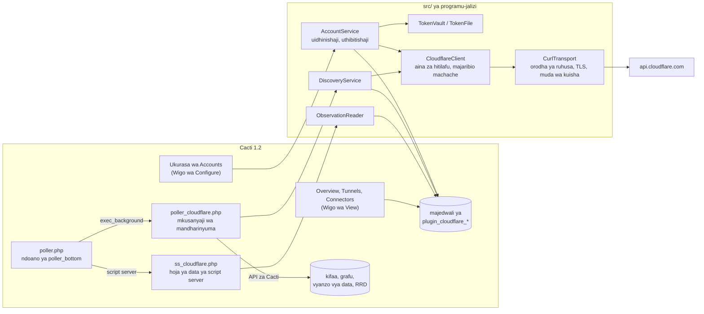

<!-- Source: README.md; SHA256: f8de0e02c5904e15bfa4c71edcaab219e5e5d4f6d9dbe589f4ed16351df6bf4d -->

<!-- translations:start -->
[English](../../../README.md) | [简体中文](../zh-CN/README.md) | [हिन्दी](../hi-IN/README.md) | [Español (España)](../es-ES/README.md) | [Español (Latinoamérica)](../es-419/README.md) | [العربية (السعودية)](../ar-SA/README.md) | [Afrikaans](../af-ZA/README.md) | [አማርኛ](../am-ET/README.md) | [العربية (مصر)](../ar-EG/README.md) | [العربية (المغرب)](../ar-MA/README.md) | [বাংলা](../bn-BD/README.md) | [Deutsch](../de-DE/README.md) | [فارسی](../fa-IR/README.md) | [Filipino](../fil-PH/README.md) | [Français](../fr-FR/README.md) | [Français (Maroc)](../fr-MA/README.md) | [Français (Sénégal)](../fr-SN/README.md) | [Hausa](../ha-NG/README.md) | [עברית](../he-IL/README.md) | [Bahasa Indonesia](../id-ID/README.md) | [Igbo](../ig-NG/README.md) | [Italiano](../it-IT/README.md) | [日本語](../ja-JP/README.md) | [한국어](../ko-KR/README.md) | [Malagasy](../mg-MG/README.md) | [मराठी](../mr-IN/README.md) | [Bahasa Melayu](../ms-MY/README.md) | [Nederlands](../nl-NL/README.md) | [Polski](../pl-PL/README.md) | [Português (Brasil)](../pt-BR/README.md) | [Русский](../ru-RU/README.md) | [Kinyarwanda](../rw-RW/README.md) | [Soomaali](../so-SO/README.md) | [Svenska](../sv-SE/README.md) | [Kiswahili](README.md) | [தமிழ்](../ta-IN/README.md) | [తెలుగు](../te-IN/README.md) | [ไทย](../th-TH/README.md) | [Türkçe](../tr-TR/README.md) | [Українська](../uk-UA/README.md) | [اردو](../ur-PK/README.md) | [Tiếng Việt](../vi-VN/README.md) | [isiXhosa](../xh-ZA/README.md) | [Yorùbá](../yo-NG/README.md) | [繁體中文](../zh-TW/README.md) | [isiZulu](../zu-ZA/README.md)
<!-- translations:end -->

<p align="center">
  
</p>

# Programu-jalizi ya Cloudflare kwa Cacti

[](https://github.com/somethingwithproof/plugin_cloudflare/actions/workflows/ci.yml)
[](https://sonarcloud.io/summary/new_code?id=somethingwithproof_plugin_cloudflare)
[](../../../LICENSE)


[](https://sonarcloud.io/summary/new_code?id=somethingwithproof_plugin_cloudflare)
[](https://sonarcloud.io/summary/new_code?id=somethingwithproof_plugin_cloudflare)
[](https://sonarcloud.io/summary/new_code?id=somethingwithproof_plugin_cloudflare)


Programu-jalizi ya Cacti 1.2 inayoundwa kufuatilia Cloudflare Tunnels na
uchanganuzi wa kanda. Inasoma kutoka kwa API ya Cloudflare kwa kutumia tokeni za API zenye wigo mahususi,
haibadilishi chochote kamwe katika Cloudflare, na huhifadhi data yake katika majedwali yake yenyewe.
Katika Cacti hunakili faili za XML za hoja ya data kwenda `resource/script_server/` na
kuunda vifaa, grafu na violezo kupitia API za Cacti yenyewe, bila mabadiliko yoyote ya
faili msingi.

**Hali: 0.4.0-dev, haijatolewa bado.** Toleo la mwisho lililotolewa ni 0.3.0. Toleo la usanidi linaongeza uhamishaji wa orodha ya CSV, uondoaji dhahiri wa mahandaki yaliyofutwa, uchanganuzi wa kanda uliowekwa kwenye kache na violezo vya hiari vya Thold. Uthibitishaji wa mtoa huduma wa moja kwa moja na uwekaji kazini bado unasubiri.

Jedwali lililo hapa chini linaelezea toleo thabiti la 0.3.0. Nyongeza za usanidi zinaelezewa chini ya mtiririko wa kazi wa Opereta na uchanganuzi wa kanda hapa chini.

| Inapatikana sasa | Inapangwa |
|---|---|
| Sakinisha, sasisha, zima na uondoe kupitia kidhibiti cha programu-jalizi cha Cacti | Uchanganuzi wa GraphQL na arifa za Thold (Hatua ya 4) |
| Ruhusa za Cloudflare: View, Operator na Configure | Uingizaji wa hitilafu, miundo ya TLA+ na nyaraka kamili (Hatua ya 5) |
| Ongeza, hariri, futa, wezesha na zima akaunti za Cloudflare | |
| Hifadhi tokeni kwenye faili au kwa njia iliyosimbwa katika hifadhidata ya Cacti | |
| Thibitisha tokeni na uangalie ruhusa zake za kusoma mahandaki na kanda | |
| Ugunduzi wa mahandaki na viunganishi katika mkusanyaji wa mandharinyuma ulioanzishwa na poller kuu | |
| Kurasa za Overview, Tunnels na Connectors chini ya Management > Cloudflare Tunnels | |
| Ufuatiliaji wa mzunguko wa maisha: `active`, `unavailable` na `deleted` | |
| Kifaa kimoja cha Cacti kwa kila akaunti, kilichoundwa na msimamizi, kikiwa na mahandaki kama faharasa za hoja ya data | |
| Grafu za Connectors, Health na Collection kwa kila handaki, zikichorwa kutoka kwa faili moja ya RRD kwa kila handaki | |
| Thamani ambazo programu-jalizi haiwezi kuzithibitisha huhifadhiwa kama zisizojulikana (`U`), kamwe si kama 0 | |

## Majukumu ya ufikiaji

| Wigo | Ufikiaji |
| --- | --- |
| Cloudflare: View | Kurasa zilizopo za ufuatiliaji. |
| Cloudflare: Operator | Ufuatiliaji pamoja na ukurasa wa Operations na uthibitisho wa kibinafsi wa uchunguzi wa awali. |
| Cloudflare: Configure | Ufikiaji wa Operator pamoja na usanidi uliopo na hatua za kiutawala. |

Baada ya kunakili faili za sasisho, fungua ukurasa wa Plugins kama msimamizi ili kusajili
wigo mpya. Weka wigo wa Operator kwa uwazi chini ya **Configuration > Users** au vikundi vya watumiaji.
Masasisho huhifadhi vitambulisho vya wigo wa View na Admin vilivyopo na ruhusa zake. Ufikiaji wa Admin
hurithi ufikiaji wa Operator, na ufikiaji wa Operator hurithi ufikiaji wa View kwa kila ombi;
hii haiongezi ruhusa zilizohifadhiwa kwa watumiaji au vikundi. Mipangilio ya programu-jalizi pia inahitaji
ufikiaji wa Cloudflare: Configure pamoja na ruhusa ya Settings ya Cacti.

Mwonekano wa akaunti ya Cloudflare unalingana na wigo uliopo wa View; unahusisha akaunti nzima.
Vitambulisho vya uthibitishaji, usanidi, uoanishaji, ufutaji na mabadiliko mengine ya kiutawala
hubaki katika kurasa za kiutawala. Uthibitisho wa kibinafsi hudumu tu katika kipindi cha sasa cha
mtumiaji, kwa muda usiozidi saa moja na tu mradi uchunguzi uleule unasalia kuwa
mpya. Uchunguzi mpya au uliobadilishwa huubatilisha. Kamwe haufanyi kipimo kilichoshindwa
kuonekana kuwa kiko sawa au kuzuia arifa.

## Kwa nini programu-jalizi hii

Waendeshaji wa Cacti wanaochapisha huduma kupitia Cloudflare Tunnel hawana mwonekano
wa handaki ndani ya Cacti. Handaki inaweza kupoteza viunganishi vyake vyote huku
seva za asili zikiwa bado zinajibu SNMP, hivyo grafu zilizopo hubaki za kijani wakati
watumiaji wanaona hitilafu. Lengo la programu-jalizi hii ni kuweka afya ya handaki na trafiki ya kanda
karibu na grafu za vifaa ambazo waendeshaji tayari wanazitazama, bila kuipa
Cacti uwezo wowote wa kubadilisha Cloudflare.

Vizuizi vitatu vinaongoza muundo huu:

- **Kusoma pekee.** Programu-jalizi huita tu miisho ya `GET` na API ya Uchanganuzi ya GraphQL.
  Haihitaji ruhusa ya kuhariri kwenye rasilimali yoyote ya Cloudflare.
- **Ya hiari.** Hitilafu za Cloudflare, tokeni zilizoisha muda wake na vikomo vya kiwango cha maombi havipaswi
  kupunguza kasi ya kiolesura cha Cacti au kusimamisha ukusanyaji wa data wa vifaa vingine. Miito yote ya API ina
  muda wa mwisho mgumu, na ukusanyaji huendeshwa katika mchakato wa mandharinyuma ulioanzishwa na
  poller.
- **Hakuna mabadiliko ya msingi.** Programu-jalizi hutumia ndoano za programu-jalizi za Cacti 1.2 na
  majedwali yake yenyewe. Hunakili faili moja ya XML ya hoja ya data kwenda `resource/script_server/` na
  huunda vifaa, grafu na violezo kupitia API za Cacti yenyewe. Hakuna mabadiliko ya faili
  msingi, hivyo masasisho ya Cacti na programu-jalizi nyingine haziathiriwi.

## Jinsi inavyofanya kazi



- **Kiunganishi cha Cacti** (`setup.php`, `includes/`, hati za kurasa) husajili
  ndoano na mawigo, huonyesha kurasa kwa kutumia visaidizi vya Cacti yenyewe, na hukabidhi
  kila hatua kwa maktaba iliyo katika `src/`.
- **Maktaba** (`src/`, nafasi ya majina `Somethingwithproof\Cloudflare\`) haina
  utegemezi kwa vigeu vya kimataifa vya Cacti, hivyo hujaribiwa dhidi ya hifadhidata halisi na
  usafirishaji bandia wa HTTP bila Cacti inayoendesha.
- **Njia moja ya kutoka nje.** `CurlTransport` ndiyo msimbo pekee unaogusa
  mtandao, na hukubali `https://api.cloudflare.com` pekee. Kila hitilafu
  huoanishwa na aina moja ya hitilafu (`auth`, `permission`, `rate_limited`,
  `transient`, ...), ambayo huendesha hali inayoonyeshwa kwenye kiolesura.
- **Uhifadhi** hupitia muunganisho wa PDO wa Cacti yenyewe ukiwa na taarifa
  zilizotayarishwa. Mabadiliko ya muundo ni uhamishaji wenye nambari na usiobadilika ukirudiwa.

Maamuzi ya muundo na sababu zake yako katika
[docs/design.md](../../design.md).

## Picha za skrini

Picha za skrini zinatoka kwenye mazingira ya majaribio, si akaunti halisi ya Cloudflare. Mazingira
hayo yanaendesha Cacti 1.2.31 dhidi ya API bandia ya Cloudflare inayorejesha data
ya mfano, hivyo akaunti, kitambulisho chake na mahandaki matatu ni vishikilia nafasi.


*Orodha ya Akaunti za Cloudflare. API bandia hukubali tokeni, hivyo Verify
huripoti `ok`.*


*Kuhariri akaunti. Sehemu za tokeni huwa tupu kila wakati; tokeni iliyohifadhiwa
hairejeshwi kamwe kwenye kivinjari. Collect Tunnels na Create Graphs zimewashwa na
Collect Analytics imezimwa. Connection Status huonyesha matokeo ya Verify ya mwisho:
`ok`, ruhusa ya kusoma handaki imetolewa na ruhusa ya kusoma kanda inakosekana.*


*Settings > Cloudflare.*


*Management > Cloudflare Tunnels > Overview. Hali ni hali mbaya zaidi ya Cloudflare
miongoni mwa mahandaki amilifu ya akaunti, hapa `down` kwa sababu handaki moja ya mfano
iko chini. `Disabled`, `Not collected`, `Collection failing` na `Not yet
collected` huchukua kipaumbele juu ya afya ya handaki, kwa mpangilio huo, hivyo akaunti
ambayo uendeshaji wake wa mwisho ulishindwa huonyesha `Collection failing` vyovyote mahandaki yake yanavyoripoti.*


*Kichupo cha Tunnels. Connectors na Connections huonyesha `-` kwa old-office, kwa sababu
API bandia hujibu ombi lake la miunganisho kama handaki isiyojulikana na hakuna chochote
kilichohifadhiwa, na 0 kwa staging, ambayo haina kiunganishi kinachoendesha.*


*Grafu ya Connectors ya handaki ya blog. Mistari yote mitatu iko kwenye 1 kabla na
baada ya pengo katikati, ambapo API bandia ilirejesha hitilafu na programu-jalizi
ilihifadhi thamani zisizojulikana. Mistari haishuki hadi 0. Grafu inatoka kwenye
mazingira yaleyale ya mfano (`make screenshots`), ambayo huweka hatua ya sekunde 30 kwenye chanzo hiki
kimoja cha data ili dakika saba za ukusanyaji zijaze grafu.*

## Mahitaji

- Cacti 1.2.25 hadi 1.2.31. Cacti 1.2.31 yenyewe inahitaji PHP 8.0 au toleo la baadaye.
  CI hujaribu 1.2.31 pekee; 1.2.25 ilijaribiwa kwa mkono mara ya mwisho mnamo 2026-10-22.
- PHP 7.4 hadi 8.4 ikiwa na viendelezi vya `curl`, `openssl` na `pdo_mysql`.
  Programu-jalizi hukataa kuwashwa bila viendelezi hivyo.
- MariaDB 10.6 au toleo la baadaye, au MySQL 8.0 au toleo la baadaye.
- Ufikiaji wa HTTPS kutoka kwa seva ya Cacti hadi `api.cloudflare.com`. Proksi hazitumiki.

Tazama [docs/compatibility.md](../../compatibility.md) ili kuona kinachojaribiwa.

## Usakinishaji

1. Weka programu-jalizi katika saraka ya `plugins/cloudflare` ya Cacti, ama kwa
   kuchambua kumbukumbu kutoka
   [Matoleo ya GitHub](https://github.com/somethingwithproof/plugin_cloudflare/releases)
   (`make package` inayoendeshwa katika nakala ya lebo ya toleo hujenga kumbukumbu
   hiyohiyo) au kwa kunakili kwa git. Saraka lazima ipewe jina `cloudflare`.
2. Isakinishe na kuiwasha kutoka Console > Configuration > Plugins, au kwa
   kutumia CLI kama mtumiaji wa seva ya wavuti:

   ```sh
   php cli/plugin_manage.php --plugin=cloudflare --install --enable
   ```

3. Mtumiaji msimamizi hupata ruhusa ya Cloudflare: Configure wakati wa usakinishaji. Wape
   watumiaji au vikundi vingine ruhusa hii chini ya Console > Configuration > Users.
4. Unda tokeni yenye ruhusa zilizo katika
   [docs/token-permissions.md](../../token-permissions.md). Kwa ufupi:
   Account > Cloudflare Tunnel > Read, na kwa hiari Zone > Zone > Read.
5. Hifadhi tokeni kwa mojawapo ya njia mbili zilizo hapa chini, kisha ongeza akaunti chini ya
   Console > Configuration > Cloudflare Accounts na uendeshe Verify kutoka kwenye
   menyu ya vitendo.

### Chaguo A: iliyosimbwa kwa njia fiche katika hifadhidata

Programu-jalizi husimba tokeni kwa njia fiche kwa kutumia ufunguo wa baiti 32 unaounda wewe mwenyewe. Haiundi
wala kuandika ufunguo huo yenyewe kamwe. Faili lazima iweze kusomwa na mtumiaji wa seva ya wavuti
na mtumiaji wa poller, isisomeke na wengine, na saraka yake lazima
iwaruhusu watumiaji hao kuifikia. Kwa seva ya wavuti inayoendeshwa kama `www-data`:

```sh
sudo mkdir -p /etc/cacti
sudo sh -c 'umask 077 && openssl rand -hex 32 > /etc/cacti/cloudflare.key'
sudo chgrp www-data /etc/cacti/cloudflare.key
sudo chmod 0440 /etc/cacti/cloudflare.key
```

Njia chaguo-msingi ni `/etc/cacti/cloudflare.key`; ibadilishe chini ya Settings >
Cloudflare > Token Vault Key File. Wakati ufunguo haupo au umekataliwa,
fomu ya kuhariri hutoa chaguo la faili ya tokeni pekee. Weka nakala rudufu ya ufunguo:
bila ufunguo huo, tokeni zilizohifadhiwa haziwezi kusimbuliwa na lazima ziingizwe tena.

#### Kubadilisha ufunguo

Hakuna amri ya kubadilisha ufunguo moja kwa moja. Ufunguo mpya hauwezi kusimbua tokeni zilizohifadhiwa chini ya
ufunguo wa zamani, kwa hivyo mabadiliko yanamaanisha kuingiza tena kila tokeni iliyohifadhiwa:

1. Kuwa na thamani ya tokeni ya kila akaunti karibu. Cloudflare huonyesha thamani ya tokeni
   wakati inapoundwa au kuzungushwa upya pekee, kwa hivyo zungusha upya tokeni katika dashibodi ya Cloudflare
   kama huna tena thamani hiyo.
2. Unda ufunguo mpya katika njia mpya kwa amri zilizo hapo juu, kwa mfano
   `/etc/cacti/cloudflare.key.new`, ukiwa na mmiliki na ruhusa zilezile.
3. Weka Settings > Cloudflare > Token Vault Key File kuwa njia mpya kisha uhifadhi.
   Kuanzia hapo, Verify kwenye akaunti ambayo bado imesimbwa kwa ufunguo wa zamani
   huripoti "Stored token cannot be decrypted", na kila uendeshaji wa mkusanyaji huweka kumbukumbu ya
   `discovery token unavailable` ikiwa na `reason=decrypt_failed` kwa akaunti hiyo.
4. Kwa kila akaunti inayohifadhi tokeni yake katika hifadhidata, ifungue chini ya
   Console > Configuration > Cloudflare Accounts, bandika tokeni katika sehemu zote mbili
   za tokeni, hifadhi, kisha uendeshe Verify. Inapaswa kuripoti `ok`.
5. Kila akaunti kama hiyo ikishathibitishwa, ondoa faili ya ufunguo wa zamani na nakala zake
   rudufu.

Kati ya hatua ya 3 na ya 4, mahandaki ya akaunti hayasasishwi na grafu zake za
afya, viunganishi na miunganisho hurekodi U. Akaunti za faili ya tokeni
haziathiriwi.

### Chaguo B: faili ya tokeni

Andika tokeni pekee, bila kitu kingine chochote, kwenye faili ambayo mtumiaji wa seva ya wavuti na wa poller
wanaweza kuisoma na wengine hawawezi, kisha ingiza njia yake kamili kwenye fomu ya kuhariri:

```sh
sudo sh -c 'umask 077 && cat > /etc/cacti/cloudflare-account.token'   # paste the token, then Ctrl-D
sudo chgrp www-data /etc/cacti/cloudflare-account.token
sudo chmod 0440 /etc/cacti/cloudflare-account.token
```

Faili hukaguliwa inaposomwa, wakati wa Verify, si unapohifadhi. Viungo vya kiishara,
faili zinazozidi 4 KiB na faili zinazoweza kusomwa au kuandikwa na wengine
hukataliwa.

Mtu yeyote aliye na ruhusa ya Cloudflare: Configure anaweza kuingiza njia yoyote, na mtumiaji wa poller
huisoma. Ili kuweka faili za tokeni mahali pamoja, weka Settings > Cloudflare >
Token File Directory, kwa mfano kuwa `/etc/cacti`; njia iliyo nje yake
hukataliwa. Tazama [docs/security.md](../../security.md#token-file).

## Uboreshaji

1. Badilisha faili katika `plugins/cloudflare` kwa toleo jipya, ukiweka
   jina la saraka kama lilivyo.
2. Fungua Console > Configuration > Plugins, au Console > Configuration >
   Cloudflare Accounts, mara moja kama msimamizi. Hatua hiyo huendesha uhamishaji wa hifadhidata wa programu-jalizi,
   huingiza violezo vya Cloudflare na kunakili faili ya hoja ya data (tazama
   [Vipimo na grafu za mahandaki](#tunnel-metrics-and-graphs)), na, katika uboreshaji
   kutoka 0.1.0, husajili ndoano ya `poller_bottom`.

`poller.php` haiendeshi uboreshaji wa programu-jalizi, kwa hivyo hadi hatua ya 2 muundo mpya
wa hifadhidata haupo. Kila uendeshaji wa mkusanyaji basi haufanyi chochote na huweka kumbukumbu ya
`CLOUDFLARE: collector skipped; plugin upgrade pending, open Console > Plugins`.
Kurasa za Cloudflare Tunnels zinahitaji Cloudflare: View pekee, kwa hivyo haziendeshi
uboreshaji kamwe, na hadi hatua ya 2 zinaweza kuonyesha "The Cloudflare tunnels could not
be read".

## Hali ya akaunti

Verify huweka hali ya akaunti:

| Hali | Maana |
|---|---|
| `unknown` | Haijathibitishwa tangu akaunti ilipoongezwa au vitambulisho vyake kubadilishwa |
| `ok` | Tokeni inafanya kazi na inaweza kusoma mahandaki |
| `token_inactive` | Cloudflare inaripoti kuwa tokeni imezimwa au muda wake umeisha |
| `auth_failed` | Cloudflare ilikataa tokeni kama batili au iliyokwisha muda wake (HTTP 401) |
| `permission_denied` | Tokeni inafanya kazi lakini haiwezi kusoma mahandaki, au haina ruhusa za kuita miisho ya uthibitishaji wa tokeni (HTTP 403) |
| `unreachable` | API haikuweza kufikiwa, muda wake uliisha au ilirudisha hitilafu ya seva |
| `rate_limited` | Cloudflare ilirudisha HTTP 429 |
| `error` | Hitilafu nyingine yoyote, ikiwa ni pamoja na faili ya tokeni iliyokosekana au isiyo salama, faili ya ufunguo wa hifadhi ya tokeni iliyokosekana au isiyoweza kutumika, au tokeni iliyohifadhiwa isiyoweza kusimbuliwa |

Ukurasa wa kuhariri pia huonyesha kama ruhusa za kusoma mahandaki na kusoma kanda zilitolewa.

## Ugunduzi wa mahandaki

Baada ya kila mzunguko wa ukaguzi kwenye poller kuu, ndoano ya `poller_bottom` huanzisha
mkusanyaji wa chinichini kwa `exec_background` wakati angalau akaunti moja iliyowashwa
imewezesha Collect Tunnels. Mkusanyaji haendeshwi kamwe ndani ya mchakato wa poller,
hivyo API ya Cloudflare iliyo polepole haicheleweshi `poller.php`. Poller za mbali
hazimwanzishi kamwe.

Kwa kila akaunti iliyofikia muda wake, mkusanyaji huorodhesha mahandaki ya akaunti, kisha
husoma miunganisho ya mahandaki yake yanayofanya kazi, jambo linalotoa viunganishi vya kila handaki,
matoleo yake, vituo vya data na anwani asili. Akaunti hufikia muda wake
kila Discovery Interval (chaguo-msingi sekunde 300). Uendeshaji mmoja hauanzishi akaunti mpya
baada ya sekunde 50 na hufanya maombi yasiyozidi 200 ya miunganisho. Kikomo chochote
kinaweza pia kusimamisha akaunti katikati mwa usomaji wa miunganisho yake; akaunti hiyo
hurekodiwa kama `partial`, na uendeshaji unaofuata huendelea na mahandaki
yaliyojaribiwa zamani zaidi. Akaunti ambazo hazijaanza hubaki zikisubiri uendeshaji unaofuata.

Handaki lina mzunguko wa maisha, unaotenganishwa na hali ambayo Cloudflare huripoti
(`healthy`, `degraded`, `down` au `inactive`):

| Mzunguko wa maisha | Maana |
|---|---|
| `active` | Handaki lilikuwa katika orodha kamili ya mwisho |
| `deleted` | Orodha kamili haikujumuisha handaki hilo, ikijumuisha orodha tupu. Mstari na historia yake hubaki, na handaki huwa `active` tena likionekana upya |
| `unavailable` | Kukosekana mara tatu kulikohesabiwa bila orodha kamili kati yake huacha hali ya handaki ikiwa haijulikani |

Ni orodha kamili na iliyofanikiwa pekee ndiyo huongeza, husasisha au kufuta mahandaki, na
orodha iliyoshindikana haifuti handaki lolote kamwe. Kushindwa kusoma Cloudflare kabisa
(`transient`, `rate_limited`, `auth` au `permission`) huhesabiwa kama kukosekana;
baada ya kukosekana mara tatu kulikohesabiwa bila orodha kamili kati yake,
mahandaki ya akaunti yanayofanya kazi huwa `unavailable`. Orodha kamili inayofuata
huyarejesha na kuweka upya hesabu. Handaki ambalo Cloudflare hailijui tena
wakati miunganisho yake inaposomwa hurukwa bila kusababisha akaunti kushindwa. Hitilafu
nyingine haziongezi wala kuweka upya kihesabu cha kukosekana.

Katika `cacti.log`, mistari ya ugunduzi huanza na `CLOUDFLARE: discovery` na muhtasari wa uendeshaji
na `CLOUDFLARE: collector`. Kushindwa na mabadiliko ya mzunguko wa maisha, kama vile
orodha iliyoshindikana au mahandaki yaliyowekwa alama `unavailable`, huandikwa katika kumbukumbu kwa kiwango chaguo-msingi cha Cacti
`LOW`; matokeo ya kila akaunti na muhtasari wa uendeshaji huandikwa kwa kiwango cha
`MEDIUM`. Usomaji wa miunganisho unaweza kushindwa kwenye kila handaki, kwa hivyo kwa kila akaunti ni
kushindwa kwa kwanza tu kwa kila aina ya hitilafu kunakoandikwa kwa `LOW`, mengine kwa
`MEDIUM`, ikifuatiwa na mstari mmoja wa `LOW` kwa kila aina ukiwa na idadi ya mahandaki
yaliyoshindwa.

Management > Cloudflare Tunnels inahitaji ruhusa ya Cloudflare: View na ni ya kusoma tu:

- **Overview** huorodhesha kila akaunti pamoja na hali yake, idadi ya mahandaki kwa mzunguko wa maisha,
  ugunduzi wa mwisho uliofanikiwa na idadi ya kushindwa mfululizo.
- **Tunnels** huorodhesha mahandaki katika akaunti zote au kwa akaunti moja, ikiwa na vichujio
  kwa akaunti, mzunguko wa maisha, hali na jina, pamoja na safuwima zinazoweza kupangwa.
- **Connectors** huonyesha viunganishi vya handaki lililochaguliwa kwenye kichupo cha Tunnels.

<a name="tunnel-metrics-and-graphs"></a>

## Vipimo na grafu za mahandaki

Cacti husoma hali ya handaki kupitia hoja ya data ya seva ya hati,
`ss_cloudflare.php`. Hujibu kutoka kwa majedwali ya programu-jalizi pekee na haiiti
Cloudflare kamwe, hivyo kukatika kwa Cloudflare hakuwezi kupunguza kasi ya poller. Kila handaki hutoa
thamani sita: afya (healthy 3, degraded 2, down 1, inactive 0), viunganishi,
miunganisho, matoleo ya viunganishi, sekunde zilizopita tangu miunganisho yake iliposomwa mara ya mwisho,
na kushindwa mfululizo kwa kazi ya ugunduzi. Afya, viunganishi,
miunganisho na matoleo huchapishwa tu wakati programu-jalizi inaweza kuyathibitisha,
jambo linalomaanisha ugunduzi wa mwisho ulifanikiwa, handaki ni `active` na
kipimo ni cha hivi karibuni. Vinginevyo huwa `U`, na grafu huonyesha pengo badala ya
sifuri ambayo ingeonekana kama kukatika. Thamani mbili za ukusanyaji huendelea kuchapishwa
wakati wa kukatika, ili grafu ya Collection ikuonyeshe; huwa `U` tu
kwa handaki lililofutwa au ambalo miunganisho yake haikuwahi kusasishwa. Kanuni
ziko katika [docs/metrics.md](../../metrics.md).

### Kuunda kifaa

Akaunti huunganishwa na kifaa kimoja cha Cacti kwa upeo. Kifaa hicho hushikilia mahandaki ya akaunti
kama faharasa za hoja ya data ya Cloudflare Tunnels. Hakuna kinachokiunda
kiotomatiki:

1. Fungua Console > Configuration > Cloudflare Accounts.
2. Chagua akaunti, chagua Create Cacti Device kutoka kwenye menyu ya vitendo, kisha
   uthibitishe.

Kitendo hiki kinahitaji ruhusa zote mbili: Cloudflare: Configure na
Sites/Devices/Data ya Cacti (ile ya `host.php`). Chaguo la menyu huonekana tu
kwa watumiaji walio na zote mbili, na seva hukataa ombi kutoka kwa mtu mwingine yeyote.
Kifaa hupewa jina `Cloudflare: <account name>`, hutumia kiolezo cha mwenyeji cha Cloudflare Account
na poller kuu, kina toleo la SNMP 0 na hakina ukaguzi wa upatikanaji,
na hupata jina la mwenyeji `<account ID>.cloudflare.invalid`. Jina hilo limehifadhiwa
na halitafsiriwi kamwe; Cacti haiunganishi nalo. Kama akaunti tayari
ina kifaa, kitendo hicho husema hivyo na hakibadilishi chochote. Kama msimamizi
atafuta kifaa katika Cacti, programu-jalizi haiundi kingine hadi Create Cacti Device
iendeshwe tena.

### Kuunda Grafu

Create Graphs kwenye fomu ya akaunti imezimwa kwa chaguo-msingi. Inapokuwa imewashwa, kila wakati
ugunduzi wa akaunti unapoisha kwa `ok` au `partial`, mkusanyaji hufaharisha upya
kifaa na kuunda grafu zozote zinazokosekana kwa mahandaki `active` ya akaunti:
Connectors, Health na Collection, tatu kwa kila handaki. Grafu tatu za handaki moja
hushiriki faili moja ya RRD. Uendeshaji mmoja huunda grafu zisizozidi 50 na kusimama baada ya sekunde 20,
na uendeshaji unaofuata huendelea. Programu-jalizi haiondoi kipengee chochote cha Cacti kamwe.
Grafu inayofutwa na msimamizi haiundwi tena, na handaki ambalo
Cloudflare haiorodheshi tena huhifadhi grafu yake na faili ya RRD, ambazo huonyesha `U`.

Kuwasha Create Graphs kunahitaji ruhusa zote mbili. Kuizima kunahitaji
Configure pekee. Mtumiaji asiye na ruhusa ya Sites/Devices/Data anayehifadhi fomu
huacha mpangilio kama ulivyokuwa, pamoja na onyo. Create Graphs ikiwa imezimwa,
kifaa bado hufaharishwa upya baada ya kila ugunduzi, hivyo mahandaki mapya huonekana kama
faharasa za hoja ya data.

### Faili ya hoja ya data

Cacti 1.2.31 husoma XML ya hoja ya data kutoka ndani ya saraka yake ya `resource` pekee.
Kwa hivyo wakati wa usakinishaji na uboreshaji, programu-jalizi hunakili faili moja,
`templates/resource/cloudflare_tunnels.xml`, hadi
`<Cacti>/resource/script_server/cloudflare_tunnels.xml`. Ndiyo faili pekee
ambayo programu-jalizi huandika nje ya saraka yake yenyewe, kwa hivyo mtumiaji anayesakinisha au
kuboresha programu-jalizi lazima aweze kuandika kwenye saraka hiyo.
Kuondoa usakinishaji huhifadhi faili hiyo, pamoja na vifaa, grafu, faili za RRD na
violezo. Kama kunakili au uingizaji wa kiolezo utashindwa, programu-jalizi huweka kumbukumbu yake na
Create Cacti Device hujaribu tena.

## Mipangilio

Mipangilio > Cloudflare ina:

- **Faili ya Ufunguo wa Hifadhi ya Tokeni (Token Vault Key File)**: njia ya kufikia ufunguo wa hifadhi.
- **Saraka ya Faili ya Tokeni (Token File Directory)**: inapowekwa, faili ya tokeni iliyo nje yake hukataliwa. Ni tupu kwa chaguomsingi, hali inayoruhusu njia yoyote. Tazama [docs/security.md](../../security.md#token-file).
- **Muda wa Kikomo wa Ombi la Kiolesura (Interactive Request Timeout)**: jumla ya sekunde za ombi linalotumwa kutoka kwa kiolesura cha wavuti, kama vile Verify. Chaguomsingi ni 10; thamani zilizo nje ya 5 hadi 60 hurejea kwenye 10.
- **Muda wa Kikomo wa Ombi la Mkusanyaji (Collector Request Timeout)**: jumla ya sekunde za ombi linalotumwa na mkusanyaji wa chinichini. Chaguomsingi ni 20; thamani zilizo nje ya 5 hadi 60 hurejea kwenye 20.
- **Kiwango cha Kumbukumbu (Log Level)**: huhifadhiwa. Hakuna kinachokisoma bado.

Kwenye fomu ya akaunti, Collect Tunnels na Discovery Interval hudhibiti ugunduzi,
nayo Create Graphs hudhibiti uundaji wa grafu. Collect Analytics huhifadhiwa na haina
athari yoyote katika toleo hili.

## Lugha

Programu-jalizi hii huja na tafsiri za Kihispania (Uhispania, `es-ES`), Kifaransa
(`fr-FR`), Kijerumani (`de-DE`), Kichina Rahisi (`zh-CN`), Kihindi (`hi-IN`),
Kiarabu (`ar-SA`) na Kijapani (`ja-JP`). Cacti huzionyesha pindi tu usaidizi wa lugha unapowashwa (Configuration >
Settings > General > Language Support) na mtumiaji anapochagua lugha. Katalogi ya Kihispania cha Amerika ya
Kusini (`es-419`) huja pamoja nayo pia, lakini Cacti 1.2 haina eneo la Kihispania cha Amerika ya
Kusini la kuchagua, kwa hivyo huanza kutumika tu Cacti itakapoongeza
moja; hadi wakati huo, chagua Kihispania (`es-ES`).

Baadhi ya maandishi hubaki kwa Kiingereza: thamani za hali ambazo programu-jalizi huhifadhi na kuonyesha
kama zilivyo (`ok`, `active`, `unavailable`, `deleted`, na hali ya handaki
inayoripotiwa na Cloudflare), na kila kitu ambacho programu-jalizi huandika kwenye kumbukumbu ya Cacti.

## Uondoaji wa programu-jalizi na uhifadhi wa data

Kuondoa programu-jalizi hufuta majedwali yake yenyewe, ambayo huhifadhi akaunti, tokeni
zilizosimbwa kwa njia fiche, mahandaki yaliyogunduliwa, hali ya kazi na rekodi ya vipengee vya Cacti ilivyounda,
na hufuta mipangilio yake ya `cloudflare_`. Hakuondoi faili ya ufunguo,
faili za tokeni, faili iliyonakiliwa ya `resource/script_server/cloudflare_tunnels.xml`, wala
vifaa, grafu, vyanzo vya data, faili za RRD au violezo vyovyote vya Cacti. Hivyo huhifadhi
data ya kihistoria ya ufuatiliaji, na kuviondoa ni hatua mahususi ya msimamizi
katika Cacti.

Kifaa kilichohifadhiwa huacha kupokea data. Baada ya kuondolewa, au baada ya
akaunti yake kufutwa, hakuna akaunti inayomiliki seva pangishi hiyo, kwa hivyo grafu zake huhifadhi
historia yake lakini huonyesha `U` kuanzia wakati huo. Create Cacti Device kwenye akaunti iliyosakinishwa upya au
iliyoongezwa upya huunda kifaa kipya; haitumii tena kile cha zamani, kwa hivyo futa
kifaa cha zamani katika Cacti pindi historia yake isipohitajika tena.

## Mapungufu yanayojulikana

- Mzunguko mmoja hufanya maombi yasiyozidi 200 ya muunganisho. Mahandaki yanayozidi kiwango hicho
  husasishwa mara chache kuliko kipindi cha uchunguzi, kwa hivyo grafu zake za
  muunganisho huonyesha mapengo.
- Programu-jalizi huandika juu ya mabadiliko ya msimamizi kwenye violezo vilivyoletwa wakati
  uboreshaji unapobadilisha XML ya kiolezo kinachotumwa nayo.
- Kifaa cha akaunti lazima kibaki kwenye mkusanyaji mkuu (main poller). Majedwali ya programu-jalizi
  yako kwenye hifadhidata kuu na hati huyasoma humo.
- Mahandaki yaliyofutwa hubaki katika faharasa ya hoja ya data na huonyesha `U` hadi msimamizi atakapoyastaafisha waziwazi. Ustaafishaji huondoa tu grafu zilizorekodiwa na programu-jalizi na vyanzo vya data visivyoshirikiwa kupitia Cacti; safu mlalo ya orodha hubaki ikionekana. Cacti hudhibiti usafishaji wa RRD.
- Cacti huzima programu-jalizi ambayo msimbo wake huishia kwenye hitilafu mbaya ya kweli, kama vile
  kuishiwa na kumbukumbu. Tazama [docs/security.md](../../security.md).

## Usalama

- Global API Keys hukataliwa; tokeni za API zenye wigo maalum pekee ndizo zinazokubaliwa.
- Tokeni huhifadhiwa katika faili unayotoa au husimbwa kwa njia fiche kwa AES-256-GCM
  chini ya faili ya ufunguo ambayo haiingii kamwe kwenye hifadhidata. Hazionyeshwi kamwe
  kwenye ukurasa, kuandikwa kwenye kumbukumbu, au kujumuishwa katika ujumbe wa hitilafu.
- Hitilafu za hifadhidata hubeba tu SQLSTATE na msimbo wa hitilafu wa kiendeshaji, na kamwe
  hazibebi thamani za kauli.
- Kila badiliko ni ombi la POST linalolindwa na tokeni ya CSRF ya Cacti. Mabadiliko ya kiutawala ya
  akaunti na usanidi huhitaji ruhusa ya Cloudflare: Configure; uthibitisho wa kibinafsi wa
  uchunguzi wa awali huhitaji Cloudflare: Operator. Kuunda kifaa cha Cacti
  au kuwasha Create Graphs pia kunahitaji ruhusa ya Sites/Devices/Data ya
  Cacti. Programu-jalizi iliyozimwa hukataa kufungua kurasa zake.

Maelezo zaidi na mapungufu yanayojulikana yako katika [docs/security.md](../../security.md).
Ripoti udhaifu wa kiusalama kwa faragha kama ilivyoelezwa katika [SECURITY.md](../../../SECURITY.md).

## Mitiririko ya kazi ya mwendeshaji na uchanganuzi wa kanda

Nyongeza za maendeleo zinajumuisha ustaafishaji wazi wa mahandaki yaliyofutwa, uchanganuzi wa kanda unaotambua uwezo na violezo vya Thold vinavyoweza kuletwa. Nyongeza hizi bado hazina lebo ya toleo au uthibitishaji kwenye akaunti halisi. Tazama [docs/analytics-and-alerting.md](../../analytics-and-alerting.md) kwa usanidi, maana ya vipimo na mipaka ya uthibitishaji.

### Uhamishaji wa orodha

Kurasa za Tunnels na Connectors hutoa Export kwa ajili ya eneo la Cloudflare: View. Faili za CSV za mahandaki zinajumuisha kila safu mlalo inayolingana, kwa kutumia akaunti inayotumika, mzunguko wa maisha, hali, mipangilio ya utafutaji na upangaji katika kurasa zote. Faili za CSV za viunganishi zinajumuisha matoleo, usanifu, vituo vya data na anwani za asili kwa handaki lililochaguliwa. Vipakuliwa husoma rekodi zilizohifadhiwa kwenye kache pekee. Hesabu zisizojulikana huachwa wazi; seli zinazofanana na fomula huwekewa alama ya apostrofi mwanzoni kwa uingizaji salama kwenye lahajedwali.

## Mpango wa maendeleo

Kila hatua muhimu hutolewa kama toleo la 0.x lililopewa nambari yake: Hatua Muhimu ya 3 ni
0.3.0, Hatua Muhimu ya 4 itakuwa 0.4.0. Hatua Muhimu ya 1 na ya 2 hazikutolewa
peke yake na ni sehemu ya 0.3.0. Toleo la 1.0.0 limetengwa kwa ajili ya toleo linalokamilisha
kila hatua muhimu hapa chini.

| Hatua Muhimu | Wigo | Hali |
|---|---|---|
| 1. Msingi | Mzunguko wa maisha wa programu-jalizi, ruhusa, usanidi wa akaunti, jaribio la muunganisho | Imetolewa katika 0.3.0 ([#2](https://github.com/somethingwithproof/plugin_cloudflare/pull/2) hadi [#5](https://github.com/somethingwithproof/plugin_cloudflare/pull/5)) |
| 2. Ugunduzi | Ugunduzi wa mahandaki na viunganishi katika mkusanyaji wa chinichini, kurasa za Overview, Tunnels na Connectors | Imetolewa katika 0.3.0 ([#6](https://github.com/somethingwithproof/plugin_cloudflare/pull/6)) |
| 3. Vipimo | Vyanzo vya data vya afya ya handaki, violezo vya grafu, ushughulikiaji wa kukatika kwa huduma ambao kamwe haurekodi sifuri ya kubuni | Imetolewa katika 0.3.0 ([#7](https://github.com/somethingwithproof/plugin_cloudflare/pull/7)) |
| 4. Uchanganuzi na arifa | Uchanganuzi wa GraphQL unaotambua mpango kwa kila kanda, viwango vya Thold vyenye uzuiaji wakati wa kukatika kwa huduma | Imepangwa |
| 5. Uimarishaji | Uingizaji wa hitilafu, miundo ya TLA+ ya ugunduzi na ukusanyaji, nyaraka kamili | Imepangwa |

## Uendelezaji

Zana zinahitaji PHP 8.x na Composer; msimbo wa programu-jalizi wenyewe hubaki ukioana na PHP 7.4.
Majaribio ya muunganisho na BDD yanahitaji hifadhidata, ambayo
`make db-up` huianzisha ndani ya Docker kwenye lango la 33061.

```sh
composer install
make db-up
make ci            # unit, integration, BDD, PHPStan, php-cs-fixer, php -l on PHP 7.4
make smoke         # installs the plugin into Cacti 1.2.31 in Docker and walks its lifecycle
make package       # builds build/cloudflare-<version>.tar.gz and checks its contents
make db-down
```

`make smoke` na `make screenshots` zinahitaji nakala ya Cacti; weka `CACTI_REPO`
kwenye njia yake. Majaribio ya muunganisho husoma `CF_TEST_DSN`, `CF_TEST_DB_USER`
na `CF_TEST_DB_PASS`, na huruka wakati hifadhidata haifikiki isipokuwa `CI`
iwe imewekwa.

## Kuchangia

Maombi ya kuvuta (pull requests) yanakaribishwa. Kila commit inahitaji sahihi ya DCO
(`git commit -s`). Andika jaribio kwanza; `make ci` lazima ifaulu, na mabadiliko
kwenye msimbo wa kuunganisha na Cacti yanapaswa pia kufaulu `make smoke`. Msimbo wa programu-jalizi lazima ubaki ukioana na PHP
7.4 na ufuate mtindo wa msimbo wa Cacti (vichupo, alama za nukuu moja, mabano ya kufungulia
kwenye mstari uleule).

### Tafsiri

Ujumbe huwekwa alama kwa `__('...', 'cloudflare')`. `locales/build_gettext.sh`
(`make i18n`, ambayo inahitaji GNU gettext) hutengeneza upya kiolezo cha
`locales/po/cacti.pot`, hukiunganisha kwenye kila katalogi `locales/po/<locale>.po`
na hukusanya `locales/LC_MESSAGES/<locale>.mo`; fanya commit kwa zote tatu. CI huendesha
`make i18n-check`, ambayo hushindwa wakati katalogi imekosa au ina ingizo lisilo la uhakika (fuzzy),
mchapuo wa umbizo unapotofautiana, au faili iliyokusanywa imepitwa na wakati, na kundi la majaribio ya sehemu
pia hukagua vishikilia nafasi, lebo za HTML na nafasi za pembeni za kila ingizo. Kwa hivyo,
ujumbe uliobadilishwa unahitaji tafsiri zake zisasishwe katika ombi lilelile la kuvuta. Lugha mpya ni faili mpya ya `<locale>.po` iliyopewa jina kama Cacti inavyoyapa majina
maeneo yake (kwa mfano `pt-BR`), ikiongezwa kwenye `CatalogTest::LOCALES` na kwenye
ukaguzi wa kumbukumbu katika `tests/build/package.sh`. Weka majina ya bidhaa za Cloudflare, Cacti na Thold,
API na GraphQL, na majina ya ruhusa kama vile
`Account Cloudflare Tunnel Read`, kama yalivyo.

## Nyaraka

- [docs/security.md](../../security.md): vidhibiti vya usalama na mapungufu yanayojulikana
- [docs/token-permissions.md](../../token-permissions.md): ruhusa za tokeni
- [docs/compatibility.md](../../compatibility.md): matoleo yanayotumika na violesura vinavyotumika
- [docs/metrics.md](../../metrics.md): katalogi ya vipimo na wakati thamani haijulikani
- [docs/collector-protocol.md](../../collector-protocol.md): kile ambacho `ss_cloudflare.php` husoma na kuchapisha
- [docs/schema.md](../../schema.md): majedwali ya hifadhidata
- [docs/design.md](../../design.md): maamuzi ya muundo
- [CHANGELOG.md](../../../CHANGELOG.md)

## Leseni

GPL-2.0-or-later. Tazama [LICENSE](../../../LICENSE).

## Alama za biashara

Cloudflare ni alama ya biashara iliyosajiliwa ya Cloudflare, Inc. Mradi huu ni zana huria inayojitegemea na hauna uhusiano na, haudhaminiwi na, wala hauidhinishwi na Cloudflare, Inc.

Mradi huu pia hauna uhusiano na mradi wa Cacti. Tazama
[docs/images/README-logo.md](../../images/README-logo.md) kwa ajili ya nembo.
