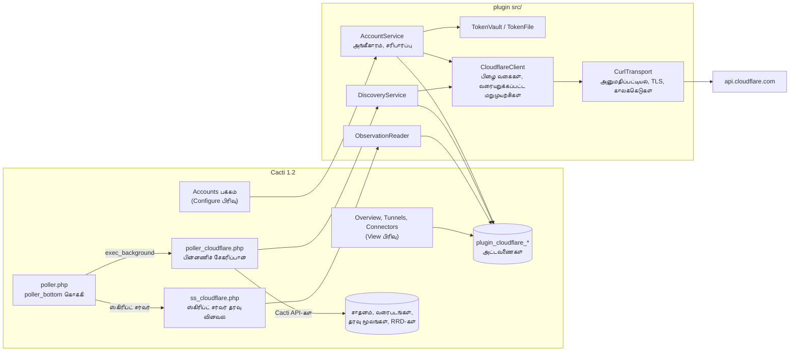

<!-- Source: README.md; SHA256: f8de0e02c5904e15bfa4c71edcaab219e5e5d4f6d9dbe589f4ed16351df6bf4d -->

<!-- translations:start -->
[English](../../../README.md) | [简体中文](../zh-CN/README.md) | [हिन्दी](../hi-IN/README.md) | [Español (España)](../es-ES/README.md) | [Español (Latinoamérica)](../es-419/README.md) | [العربية (السعودية)](../ar-SA/README.md) | [Afrikaans](../af-ZA/README.md) | [አማርኛ](../am-ET/README.md) | [العربية (مصر)](../ar-EG/README.md) | [العربية (المغرب)](../ar-MA/README.md) | [বাংলা](../bn-BD/README.md) | [Bosanski](../bs-BA/README.md) | [Deutsch](../de-DE/README.md) | [فارسی](../fa-IR/README.md) | [Filipino](../fil-PH/README.md) | [Français](../fr-FR/README.md) | [Français (Maroc)](../fr-MA/README.md) | [Français (Sénégal)](../fr-SN/README.md) | [Hausa](../ha-NG/README.md) | [עברית](../he-IL/README.md) | [Hrvatski](../hr-HR/README.md) | [Bahasa Indonesia](../id-ID/README.md) | [Igbo](../ig-NG/README.md) | [Italiano](../it-IT/README.md) | [日本語](../ja-JP/README.md) | [한국어](../ko-KR/README.md) | [Malagasy](../mg-MG/README.md) | [मराठी](../mr-IN/README.md) | [Bahasa Melayu](../ms-MY/README.md) | [Nederlands](../nl-NL/README.md) | [Polski](../pl-PL/README.md) | [Português (Brasil)](../pt-BR/README.md) | [Русский](../ru-RU/README.md) | [Kinyarwanda](../rw-RW/README.md) | [Soomaali](../so-SO/README.md) | [Српски](../sr-RS/README.md) | [Svenska](../sv-SE/README.md) | [Kiswahili](../sw-KE/README.md) | [தமிழ்](README.md) | [తెలుగు](../te-IN/README.md) | [ไทย](../th-TH/README.md) | [Türkçe](../tr-TR/README.md) | [Українська](../uk-UA/README.md) | [اردو](../ur-PK/README.md) | [Tiếng Việt](../vi-VN/README.md) | [isiXhosa](../xh-ZA/README.md) | [Yorùbá](../yo-NG/README.md) | [繁體中文](../zh-TW/README.md) | [isiZulu](../zu-ZA/README.md)
<!-- translations:end -->

<p align="center">
  
</p>

# Cacti-க்கான Cloudflare செருகி

[](https://github.com/somethingwithproof/plugin_cloudflare/actions/workflows/ci.yml)
[](https://sonarcloud.io/summary/new_code?id=somethingwithproof_plugin_cloudflare)
[](../../../LICENSE)


[](https://sonarcloud.io/summary/new_code?id=somethingwithproof_plugin_cloudflare)
[](https://sonarcloud.io/summary/new_code?id=somethingwithproof_plugin_cloudflare)
[](https://sonarcloud.io/summary/new_code?id=somethingwithproof_plugin_cloudflare)


Cloudflare Tunnel-களையும் zone பகுப்பாய்வுகளையும் கண்காணிக்க உருவாக்கப்பட்டு வரும் ஒரு Cacti 1.2 செருகி. இது வரையறுக்கப்பட்ட API டோக்கன்களுடன் Cloudflare API-இலிருந்து தகவல்களைப் படிக்கிறது, Cloudflare-இல் எதையும் மாற்றுவதில்லை, மேலும் தனது தரவைத் தனக்கென உள்ள அட்டவணைகளில் சேமிக்கிறது. Cacti-இல் இது தரவு வினவல் XML கோப்புகளை `resource/script_server/`-இல் நகலெடுத்து, எந்தக் கோர் கோப்பு மாற்றங்களும் இல்லாமல் Cacti-இன் சொந்த API-கள் வழியாகச் சாதனங்கள், வரைபடங்கள் மற்றும் வார்ப்புருக்களை உருவாக்குகிறது.

**நிலை: 0.4.0-dev, வெளியிடப்படாதது.** கடைசியாக வெளியிடப்பட்ட பதிப்பு 0.3.0 ஆகும். இந்த மேம்பாட்டுப் பதிப்பு CSV சரக்கு ஏற்றுமதிகள், நீக்கப்பட்ட டன்னல்களின் வெளிப்படையான ஓய்வு நிலை, தற்காலிகமாகச் சேமிக்கப்பட்ட zone பகுப்பாய்வுகள் மற்றும் விருப்பத்தேர்வு Thold வார்ப்புருக்களைச் சேர்க்கிறது. நேரடிச் சேவை வழங்குநர் மற்றும் பயன்பாட்டுத் தகுதிச் சரிபார்ப்பு நிலுவையில் உள்ளது.

கீழேயுள்ள அட்டவணை 0.3.0 நிலையான வெளியீட்டை விவரிக்கிறது. மேம்பாட்டுச் சேர்த்தல்கள் கீழே உள்ள ஆபரேட்டர் பணிப்பாய்வுகள் மற்றும் zone பகுப்பாய்வுகள் பிரிவின் கீழ் விவரிக்கப்பட்டுள்ளன.

| தற்போது கிடைப்பவை | திட்டமிடப்பட்டவை |
|---|---|
| Cacti-இன் செருகி மேலாளர் வழியாக நிறுவுதல், மேம்படுத்துதல், முடக்குதல் மற்றும் நீக்குதல் | GraphQL பகுப்பாய்வுகள் மற்றும் Thold எச்சரிக்கைகள் (மைல்கல் 4) |
| Cloudflare: View, Operator மற்றும் Configure அனுமதிகள் | பிழைப் புகுத்தல், TLA+ மாதிரிகள் மற்றும் முழு ஆவணப்படுத்தல் (மைல்கல் 5) |
| Cloudflare கணக்குகளைச் சேர்த்தல், திருத்துதல், நீக்குதல், இயக்குதல் மற்றும் முடக்குதல் | |
| ஒரு கோப்பில் அல்லது Cacti தரவுத்தளத்தில் குறியாக்கம் செய்து டோக்கனைச் சேமித்தல் | |
| டோக்கனைச் சரிபார்த்து அதன் டன்னல் மற்றும் zone படிக்கும் அனுமதிகளைச் சோதித்தல் | |
| முதன்மைப் போல்லரால் தொடங்கப்படும் பின்னணிச் சேகரிப்பானில் டன்னல் மற்றும் இணைப்பான் கண்டறிதல் | |
| Management > Cloudflare Tunnels என்பதன் கீழ் Overview, Tunnels மற்றும் Connectors பக்கங்கள் | |
| வாழ்க்கைச் சுழற்சி கண்காணிப்பு: `active`, `unavailable` மற்றும் `deleted` | |
| ஒரு கணக்கிற்கு ஒரு Cacti சாதனம், நிர்வாகியால் உருவாக்கப்பட்டு, டன்னல்கள் ஒரு தரவு வினவலின் குறியீடுகளாக இருக்கும் | |
| ஒரு டன்னலுக்கு ஒரு RRD கோப்பிலிருந்து வரையப்பட்ட, டன்னல் வாரியான Connectors, Health மற்றும் Collection வரைபடங்கள் | |
| செருகியால் உறுதிப்படுத்த முடியாத மதிப்புகள் எப்போதும் 0 ஆக இல்லாமல் தெரியாததாக (`U`) சேமிக்கப்படுகின்றன | |

## அணுகல் பாத்திரங்கள்

| பிரிவு | அணுகல் |
| --- | --- |
| Cloudflare: View | ஏற்கனவே உள்ள கண்காணிப்புப் பக்கங்கள். |
| Cloudflare: Operator | கண்காணிப்புடன் Operations பக்கம் மற்றும் தனிப்பட்ட முன்னுரிமை ஒப்புதல்கள். |
| Cloudflare: Configure | Operator அணுகலுடன் ஏற்கனவே உள்ள கட்டமைப்பு மற்றும் நிர்வாகச் செயல்கள். |

மேம்படுத்தல் கோப்புகளை நகலெடுத்த பிறகு, புதிய பிரிவைப் பதிவு செய்ய நிர்வாகியாக Plugins பக்கத்தைத் திறக்கவும். **Configuration > Users** அல்லது பயனர் குழுக்களின் கீழ் Operator பிரிவை வெளிப்படையாக ஒதுக்கவும். மேம்படுத்தல்கள் ஏற்கனவே உள்ள View மற்றும் Admin பிரிவு ஐடிகளையும் அனுமதிகளையும் தக்கவைத்துக்கொள்கின்றன. Admin அணுகல் Operator அணுகலையும், Operator அணுகல் View அணுகலையும் ஒவ்வொரு கோரிக்கையிலும் மரபுரிமையாகப் பெறுகின்றன; இது பயனர்களுக்கோ குழுக்களுக்கோ சேமிக்கப்பட்ட அனுமதிகளைச் சேர்ப்பதில்லை. செருகி அமைப்புகளுக்கு Cacti-இன் Settings அனுமதியுடன் கூடுதலாக Cloudflare: Configure அணுகலும் தேவைப்படுகிறது.

Cloudflare கணக்குத் தெரிவுநிலை ஏற்கனவே உள்ள View பிரிவுடன் பொருந்துகிறது; இது கணக்கு முழுவதற்குமானது. சான்றுகள், கட்டமைப்பு, இணைத்தல், நீக்குதல் மற்றும் பிற நிர்வாக மாற்றங்கள் நிர்வாகப் பக்கங்களிலேயே இருக்கும். ஒப்புதல்கள் தற்போதைய பயனரின் அமர்வில் மட்டுமே, அதிகபட்சம் ஒரு மணி நேரத்திற்கு மற்றும் அதே கவனிப்பு புதியதாக இருக்கும் வரை மட்டுமே நீடிக்கும். புதிய அல்லது மாற்றப்பட்ட கவனிப்புகள் அவற்றைச் செல்லாததாக்கும். அவை ஒருபோதும் தோல்வியுற்ற அளவீட்டை ஆரோக்கியமானதாகக் குறிக்காது அல்லது எச்சரிக்கைகளை அடக்காது.

## ஏன் இந்தச் செருகி

Cloudflare Tunnel வழியாகச் சேவைகளை வெளியிடும் Cacti ஆபரேட்டர்களுக்கு Cacti-க்குள் டன்னலின் நிலை குறித்த பார்வை இருப்பதில்லை. மூலப் புரவலர்கள் இன்னும் SNMP-க்குப் பதிலளிக்கும்போதே ஒரு டன்னல் தனது அனைத்து இணைப்பான்களையும் இழக்கக்கூடும்; இதனால் பயனர்கள் பிழைகளைப் பார்க்கும்போது ஏற்கனவே உள்ள வரைபடங்கள் பச்சையாகவே இருக்கும். Cacti-க்கு Cloudflare-ஐ மாற்றும் எந்தத் திறனையும் வழங்காமல், ஆபரேட்டர்கள் ஏற்கனவே பார்க்கும் சாதன வரைபடங்களுக்கு அருகிலேயே டன்னல் ஆரோக்கியத்தையும் zone போக்குவரத்தையும் கொண்டு வருவதே இந்தச் செருகியின் நோக்கமாகும்.

மூன்று கட்டுப்பாடுகள் இதன் வடிவமைப்பை வடிவமைக்கின்றன:

- **படிக்க மட்டும்.** இந்தச் செருகி `GET` இறுதிப்புள்ளிகள் மற்றும் GraphQL Analytics API-ஐ மட்டுமே அழைக்கிறது. எந்த Cloudflare வளத்திலும் இதற்குத் திருத்தும் அனுமதி தேவையில்லை.
- **விருப்பத்தேர்வுக்குரியது.** Cloudflare செயலிழப்புகள், காலாவதியான டோக்கன்கள் மற்றும் வீத வரம்புகள் ஆகியவை Cacti பயனர் இடைமுகத்தை மெதுவாக்கவோ அல்லது பிற சாதனங்களின் தரவு சேகரிப்பைத் தடுக்கவோ கூடாது. அனைத்து API அழைப்புகளுக்கும் கடுமையான காலக்கெடுகள் உள்ளன, மேலும் சேகரிப்பு போல்லரால் தொடங்கப்படும் பின்னணிச் செயலாக்கத்தில் இயங்குகிறது.
- **கோர் மாற்றங்கள் இல்லை.** இந்தச் செருகி Cacti 1.2 செருகி கொக்கிகள் மற்றும் தனது சொந்த அட்டவணைகளைப் பயன்படுத்துகிறது. இது ஒரு தரவு வினவல் XML கோப்பை `resource/script_server/`-இல் நகலெடுத்து, Cacti-இன் சொந்த API-கள் வழியாகச் சாதனங்கள், வரைபடங்கள் மற்றும் வார்ப்புருக்களை உருவாக்குகிறது. கோர் கோப்புகளில் எந்த மாற்றமும் இல்லாததால், Cacti மேம்படுத்தல்கள் மற்றும் பிற செருகிகள் பாதிக்கப்படுவதில்லை.

## இது எவ்வாறு செயல்படுகிறது



- **Cacti இணைப்புக் குறியீடு** (`setup.php`, `includes/`, பக்க ஸ்கிரிப்டுகள்) கொக்கிகள் மற்றும் பிரிவுகளைப் பதிவு செய்கிறது, Cacti-இன் சொந்த உதவிக் கருவிகளைக் கொண்டு பக்கங்களைக் காட்சிப்படுத்துகிறது, மேலும் ஒவ்வொரு செயலையும் `src/`-இல் உள்ள நூலகத்திற்கு அனுப்புகிறது.
- **நூலகம்** (`src/`, பெயர்வெளி `Somethingwithproof\Cloudflare\`) Cacti உலகளாவிய மாறிகளைச் சார்ந்து இல்லை, எனவே இயங்கும் Cacti இல்லாமலேயே உண்மையான தரவுத்தளம் மற்றும் போலி HTTP போக்குவரத்துக்கு எதிராகச் சோதிக்கப்படுகிறது.
- **ஒரே வெளிச்செல்லும் பாதை.** வலையமைப்பைத் தொடும் ஒரே குறியீடு `CurlTransport` ஆகும், மேலும் இது `https://api.cloudflare.com`-ஐ மட்டுமே ஏற்கிறது. ஒவ்வொரு தோல்வியும் ஒரு பிழை வகையுடன் (`auth`, `permission`, `rate_limited`, `transient`, ...) இணைக்கப்படுகிறது; இது பயனர் இடைமுகத்தில் காட்டப்படும் நிலையைத் தீர்மானிக்கிறது.
- **சேமிப்பகம்** தயாரிக்கப்பட்ட கூற்றுகளுடன் Cacti-இன் சொந்த PDO இணைப்பு வழியாகச் செல்கிறது. திட்ட மாற்றங்கள் எண்ணிடப்பட்ட, மீண்டும் இயக்கக்கூடிய இடம்பெயர்வுகள் ஆகும்.

வடிவமைப்பு முடிவுகளும் அவற்றிற்கான காரணங்களும்
[docs/design.md](../../design.md)-இல் உள்ளன.

## திரைப்பிடிப்புகள்

திரைப்பிடிப்புகள் ஒரு சோதனை அமைப்பிலிருந்து எடுக்கப்பட்டவை, நேரடி Cloudflare கணக்கிலிருந்து அல்ல. இந்த அமைப்பு நிலையான சோதனைத் தரவைத் திருப்பியனுப்பும் போலி Cloudflare API-க்கு எதிராக Cacti 1.2.31-ஐ இயக்குகிறது, எனவே கணக்கு, அதன் ஐடி மற்றும் மூன்று டன்னல்களும் மாதிரி இடநிரப்பிகளாகும்.


*Cloudflare Accounts பட்டியல். போலி API டோக்கனை ஏற்பதால், Verify `ok` என அறிக்கை செய்கிறது.*


*ஒரு கணக்கைத் திருத்துதல். டோக்கன் புலங்கள் எப்போதும் காலியாக இருக்கும்; சேமிக்கப்பட்ட டோக்கன் ஒருபோதும் உலாவிக்குத் திருப்பி அனுப்பப்படுவதில்லை. Collect Tunnels மற்றும் Create Graphs இயக்கத்தில் உள்ளன, மேலும் Collect Analytics அணைக்கப்பட்டுள்ளது. Connection Status கடைசி Verify-இன் முடிவைக் காட்டுகிறது: `ok`, டன்னல் படிக்கும் அனுமதி வழங்கப்பட்டுள்ளது மற்றும் zone படிக்கும் அனுமதி இல்லை.*


*Settings > Cloudflare.*


*Management > Cloudflare Tunnels > Overview. இந்த நிலை கணக்கின் செயலில் உள்ள டன்னல்களில் மிக மோசமான Cloudflare நிலையாகும்; இங்கே ஒரு மாதிரி டன்னல் செயலிழந்துள்ளதால் `down` என உள்ளது. `Disabled`, `Not collected`, `Collection failing` மற்றும் `Not yet collected` ஆகியவை அந்த வரிசையில் டன்னல் ஆரோக்கியத்தை விட முன்னுரிமை பெறுகின்றன; எனவே கடைசி இயக்கம் தோல்வியடைந்த ஒரு கணக்கு அதன் டன்னல்கள் எதைத் தெரிவித்தாலும் `Collection failing` என்பதைக் காட்டும்.*


*Tunnels தாவல். old-office-க்கு Connectors மற்றும் Connections `-` எனக் காட்டுகின்றன, ஏனெனில் போலி API அதன் இணைப்புகள் கோரிக்கைக்குத் தெரியாத டன்னலாகப் பதிலளிக்கிறது மற்றும் எதுவும் சேமிக்கப்படவில்லை; மேலும் இயங்கும் இணைப்பான் இல்லாத staging-க்கு 0 எனக் காட்டுகிறது.*


*blog டன்னலின் Connectors வரைபடம். நடுவில் போலி API பிழைகளைத் திருப்பியனுப்பி செருகி தெரியாத மதிப்புகளைச் சேமித்த இடைவெளிக்கு முன்னும் பின்னும் மூன்று கோடுகளும் 1 ஆக உள்ளன. கோடுகள் 0-க்கு விழவில்லை. இந்த வரைபடம் அதே சோதனை அமைப்பிலிருந்து (`make screenshots`) வருகிறது, இது ஏழு நிமிடத் தரவு சேகரிப்பு வரைபடத்தை நிரப்ப இந்த ஒரு தரவு மூலத்தில் 30 வினாடி இடைவெளியை அமைக்கிறது.*

## தேவைகள்

- Cacti 1.2.25 முதல் 1.2.31 வரை. Cacti 1.2.31-க்கு PHP 8.0 அல்லது அதற்குப் பிந்தைய பதிப்பு தேவைப்படுகிறது. CI ஆனது 1.2.31-ஐ மட்டுமே சோதிக்கிறது; 1.2.25 கடைசியாக 2026-10-22 அன்று நேரடியாகச் சோதிக்கப்பட்டது.
- `curl`, `openssl` மற்றும் `pdo_mysql` நீட்டிப்புகளுடன் கூடிய PHP 7.4 முதல் 8.4 வரை. இவை இல்லாமல் செருகுநிரல் இயக்கப்பட மறுக்கும்.
- MariaDB 10.6 அல்லது அதற்குப் பிந்தைய பதிப்பு, அல்லது MySQL 8.0 அல்லது அதற்குப் பிந்தைய பதிப்பு.
- Cacti சேவையகத்திலிருந்து `api.cloudflare.com`-க்கு HTTPS அணுகல். ப்ராக்ஸிகள் ஆதரிக்கப்படுவதில்லை.

என்னென்ன சோதிக்கப்பட்டுள்ளன என்பதை அறிய [docs/compatibility.md](../../compatibility.md) ஐப் பார்க்கவும்.

## நிறுவுதல்

1. [GitHub வெளியீடுகள்](https://github.com/somethingwithproof/plugin_cloudflare/releases) இலிருந்து காப்பகத்தைப் பிரித்தெடுப்பதன் மூலமோ (வெளியீட்டுக் குறிச்சொல்லின் சரிபார்ப்பில் `make package` இயக்குவது அதே காப்பகத்தை உருவாக்கும்) அல்லது git குளோன் மூலமோ Cacti-யின் `plugins/cloudflare` கோப்பகத்தில் செருகுநிரலை வைக்கவும். கோப்பகத்தின் பெயர் `cloudflare` என இருக்க வேண்டும்.
2. கன்சோல் > உள்ளமைவு > செருகுநிரல்கள் வழியாக அல்லது வலைச் சேவையகப் பயனராக CLI மூலம் இதை நிறுவி இயக்கவும்:

   ```sh
   php cli/plugin_manage.php --plugin=cloudflare --install --enable
   ```

3. நிறுவலின்போது நிர்வாகி பயனருக்கு Cloudflare: கட்டமைப்பு அனுமதி கிடைக்கும். கன்சோல் > உள்ளமைவு > பயனர்கள் கீழ் பிற பயனர்கள் அல்லது குழுக்களுக்கு இதை வழங்கவும்.
4. [docs/token-permissions.md](../../token-permissions.md)-இல் உள்ள அனுமதிகளுடன் ஒரு டோக்கனை உருவாக்கவும். சுருக்கமாக: கணக்கு > Cloudflare சுரங்கம் > படித்தல், மற்றும் விருப்பமாக மண்டலம் > மண்டலம் > படித்தல்.
5. கீழே உள்ள இரண்டு வழிகளில் ஒன்றில் டோக்கனைச் சேமித்து, பின்னர் கன்சோல் > உள்ளமைவு > Cloudflare கணக்குகள் கீழ் கணக்கைச் சேர்த்து, செயல்கள் பட்டியலில் இருந்து சரிபார் என்பதை இயக்கவும்.

### விருப்பம் A: தரவுத்தளத்தில் மறைகுறியாக்கப்பட்டது

நீங்கள் உருவாக்கும் 32-பைட் திறவுகோலைக் கொண்டு செருகுநிரல் டோக்கன்களை மறைகுறியாக்குகிறது. அது ஒருபோதும் திறவுகோலைத் தானாக உருவாக்கவோ எழுதவோ செய்யாது. அந்தக் கோப்பை வலைச் சேவையகம் மற்றும் போலர் பயனர்கள் படிக்கக் கூடியதாகவும், மற்றவர்கள் படிக்க முடியாததாகவும் இருக்க வேண்டும்; மேலும் அதன் கோப்பகம் அந்தப் பயனர்களை அதை அணுக அனுமதிக்க வேண்டும். `www-data` ஆக இயங்கும் வலைச் சேவையகத்திற்கு:

```sh
sudo mkdir -p /etc/cacti
sudo sh -c 'umask 077 && openssl rand -hex 32 > /etc/cacti/cloudflare.key'
sudo chgrp www-data /etc/cacti/cloudflare.key
sudo chmod 0440 /etc/cacti/cloudflare.key
```

இயல்புநிலை பாதை `/etc/cacti/cloudflare.key` ஆகும்; அமைப்புகள் > Cloudflare > டோக்கன் பெட்டகத் திறவுகோல் கோப்பு கீழ் அதை மாற்றவும். திறவுகோல் இல்லாதபோது அல்லது மறுக்கப்படும்போது, திருத்தும் படிவம் டோக்கன் கோப்பு விருப்பத்தை மட்டுமே வழங்கும். திறவுகோலின் காப்புப் பிரதியை வைத்திருக்கவும்: அது இல்லாமல், சேமிக்கப்பட்ட டோக்கன்களை மறைகுறியாக்க முடியாது, அவற்றை மீண்டும் உள்ளிட வேண்டியிருக்கும்.

#### திறவுகோலை மாற்றுதல்

மறு-திறவுகோலிடும் கட்டளை எதுவும் இல்லை. பழைய திறவுகோலின் கீழ் சேமிக்கப்பட்ட டோக்கன்களைப் புதிய திறவுகோலால் மறைகுறியாக்க முடியாது, எனவே மாற்றுதல் என்பது சேமிக்கப்பட்ட ஒவ்வொரு டோக்கனையும் மீண்டும் உள்ளிடுவதாகும்:

1. ஒவ்வொரு கணக்கின் டோக்கன் மதிப்பையும் கைவசம் வைத்திருக்கவும். டோக்கன் உருவாக்கப்படும்போது அல்லது புதுப்பிக்கப்படும்போது மட்டுமே Cloudflare அதன் மதிப்பைக் காட்டும்; எனவே உங்களிடம் அது இல்லையெனில் Cloudflare கட்டுப்பாட்டுப் பலகத்தில் டோக்கனைப் புதுப்பிக்கவும்.
2. மேலே உள்ள கட்டளைகளைக் கொண்டு, அதே உரிமையாளர் மற்றும் அனுமதி முறைமையுடன் ஒரு புதிய பாதையில், எடுத்துக்காட்டாக `/etc/cacti/cloudflare.key.new`-இல் புதிய திறவுகோலை உருவாக்கவும்.
3. அமைப்புகள் > Cloudflare > டோக்கன் பெட்டகத் திறவுகோல் கோப்பு என்பதைப் புதிய பாதைக்கு அமைத்துச் சேமிக்கவும். இனிமேல், பழைய திறவுகோலால் இன்னும் மறைகுறியாக்கப்பட்டுள்ள கணக்கில் சரிபார் என்பது "சேமிக்கப்பட்ட டோக்கனை மறைகுறியாக்க முடியவில்லை" எனப் புகாரளிக்கும், மேலும் ஒவ்வொரு சேகரிப்பான் இயக்கமும் அதற்காக `reason=decrypt_failed` உடன் `discovery token unavailable` எனப் பதிவு செய்யும்.
4. தரவுத்தளத்தில் தனது டோக்கனைச் சேமிக்கும் ஒவ்வொரு கணக்கிற்கும், கன்சோல் > உள்ளமைவு > Cloudflare கணக்குகள் கீழ் அதைத் திறந்து, இரண்டு டோக்கன் புலங்களிலும் டோக்கனை ஒட்டி, சேமித்து, சரிபார் என்பதை இயக்கவும். அது `ok` எனப் புகாரளிக்க வேண்டும்.
5. அத்தகைய ஒவ்வொரு கணக்கும் சரிபார்க்கப்பட்டதும், பழைய திறவுகோல் கோப்பையும் அதன் காப்புப் பிரதிகளையும் அகற்றவும்.

படி 3 மற்றும் 4-க்கு இடையில் ஒரு கணக்கின் சுரங்கங்கள் புதுப்பிக்கப்படாது, மேலும் அவற்றின் நலம், இணைப்பான் மற்றும் இணைப்பு வரைபடங்கள் U எனப் பதிவு செய்யும். டோக்கன் கோப்பு கணக்குகள் பாதிக்கப்படாது.

### விருப்பம் B: டோக்கன் கோப்பு

வலைச் சேவையகம் மற்றும் போலர் பயனர்கள் படிக்கக் கூடியதாகவும் மற்றவர்கள் படிக்க முடியாததாகவும் உள்ள ஒரு கோப்பில் டோக்கனை மட்டுமே (வேறு எதுவுமின்றி) எழுதி, பின்னர் திருத்தும் படிவத்தில் அதன் முழுமையான பாதையை உள்ளிடவும்:

```sh
sudo sh -c 'umask 077 && cat > /etc/cacti/cloudflare-account.token'   # paste the token, then Ctrl-D
sudo chgrp www-data /etc/cacti/cloudflare-account.token
sudo chmod 0440 /etc/cacti/cloudflare-account.token
```

நீங்கள் சேமிக்கும்போது அல்லாமல், சரிபார் நிலையில் கோப்பு படிக்கப்படும்போது அது சரிபார்க்கப்படுகிறது. குறியீட்டு இணைப்புகள், 4 KiB-க்கு அதிகமான கோப்புகள் மற்றும் மற்றவர்களால் படிக்கவோ எழுதவோ கூடிய கோப்புகள் மறுக்கப்படும்.

Cloudflare: கட்டமைப்பு அனுமதி கொண்ட எவரும் எந்தப் பாதையையும் உள்ளிடலாம், மேலும் போலர் பயனர் அதைப் படிப்பார். டோக்கன் கோப்புகளை ஒரே இடத்தில் வைத்திருக்க, அமைப்புகள் > Cloudflare > டோக்கன் கோப்பு கோப்பகம் என்பதை, எடுத்துக்காட்டாக `/etc/cacti` என அமைக்கவும்; அதற்கு வெளியேயுள்ள பாதை மறுக்கப்படும். [docs/security.md](../../security.md#token-file) ஐப் பார்க்கவும்.

## மேம்படுத்துதல்

1. கோப்பகப் பெயரை மாற்றாமல், `plugins/cloudflare`-இல் உள்ள கோப்புகளைப் புதிய வெளியீட்டுக் கோப்புகளால் மாற்றவும்.
2. நிர்வாகியாக கன்சோல் > உள்ளமைவு > செருகுநிரல்கள் அல்லது கன்சோல் > உள்ளமைவு > Cloudflare கணக்குகள் என்பதை ஒருமுறை திறக்கவும். அது செருகுநிரலின் தரவுத்தள மாற்றங்களை இயக்கி, Cloudflare வார்ப்புருக்களை இறக்குமதி செய்து, தரவு வினவல் கோப்பை நகலெடுக்கும் ([சுரங்க அளவீடுகள் மற்றும் வரைபடங்கள்](#tunnel-metrics-and-graphs) ஐப் பார்க்கவும்); மேலும் 0.1.0-இலிருந்து மேம்படுத்தும்போது `poller_bottom` இணைப்பியைப் பதிவு செய்யும்.

`poller.php` செருகுநிரலின் மேம்படுத்தலை இயக்காது, எனவே படி 2 வரை புதிய தரவுத்தள அமைப்பு இல்லாமல் இருக்கும். அப்போது ஒவ்வொரு சேகரிப்பான் இயக்கமும் எதுவும் செய்யாமல் `CLOUDFLARE: collector skipped; plugin upgrade pending, open Console > Plugins` எனப் பதிவு செய்யும். Cloudflare சுரங்கங்கள் பக்கங்களுக்கு Cloudflare: பார்வை அனுமதி மட்டுமே தேவைப்படுவதால் அவை மேம்படுத்தலை இயக்காது; படி 2 வரை அவை "Cloudflare சுரங்கங்களைப் படிக்க முடியவில்லை" எனக் காட்டக்கூடும்.

## கணக்கு நிலை

சரிபார் என்பது கணக்கின் நிலையை அமைக்கிறது:

| நிலை | பொருள் |
|---|---|
| `unknown` | கணக்கு சேர்க்கப்பட்டதிலிருந்தோ அல்லது அதன் சான்றுகள் மாற்றப்பட்டதிலிருந்தோ சரிபார்க்கப்படவில்லை |
| `ok` | டோக்கன் செயலில் உள்ளது மற்றும் சுரங்கங்களைப் படிக்க முடியும் |
| `token_inactive` | டோக்கன் முடக்கப்பட்டுள்ளது அல்லது காலாவதியாகிவிட்டது என Cloudflare தெரிவிக்கிறது |
| `auth_failed` | டோக்கன் செல்லுபடியாகாதது அல்லது காலாவதியானது என Cloudflare நிராகரித்தது (HTTP 401) |
| `permission_denied` | டோக்கன் செயலில் உள்ளது ஆனால் சுரங்கங்களைப் படிக்க முடியாது, அல்லது டோக்கன் சரிபார்ப்பு முனைப்புள்ளிகளை அழைக்கத் தேவையான அனுமதிகள் இல்லை (HTTP 403) |
| `unreachable` | API-ஐ அணுக முடியவில்லை, நேரம் முடிந்தது அல்லது சேவையகப் பிழை ஏற்பட்டது |
| `rate_limited` | Cloudflare HTTP 429 ஐத் திருப்பியனுப்பியது |
| `error` | காணாத அல்லது பாதுகாப்பற்ற டோக்கன் கோப்பு, காணாத அல்லது பயன்படுத்த முடியாத டோக்கன் பெட்டகத் திறவுகோல் கோப்பு, அல்லது மறைகுறியாக்க முடியாத சேமிக்கப்பட்ட டோக்கன் உட்பட வேறு ஏதேனும் தோல்வி |

சுரங்கப் படிப்பு மற்றும் மண்டலப் படிப்பு ஆகியவை வழங்கப்பட்டுள்ளனவா என்பதையும் திருத்தும் பக்கம் காட்டுகிறது.

## சுரங்கக் கண்டறிதல்

முதன்மை போலரில் ஒவ்வொரு வாக்கெடுப்புச் சுழற்சிக்கும் பிறகு, குறைந்தபட்சம் ஒரு இயக்கப்பட்ட கணக்கிலாவது சுரங்கங்களைச் சேகரி விருப்பம் இயக்கப்பட்டிருந்தால், `poller_bottom` இணைப்பி `exec_background` மூலம் ஒரு பின்னணி சேகரிப்பானைத் தொடங்குகிறது. சேகரிப்பான் ஒருபோதும் போலரின் செயல்முறையில் இயங்காது, எனவே மெதுவான Cloudflare API ஆனது `poller.php`-ஐத் தாமதப்படுத்தாது. தொலைநிலைப் போலர்கள் இதை ஒருபோதும் தொடங்காது.

காலக்கெடு வந்த ஒவ்வொரு கணக்கிற்கும், சேகரிப்பான் அக்கணக்கின் சுரங்கங்களைப் பட்டியலிட்டு, பின்னர் அதன் செயல்பாட்டில் உள்ள சுரங்கங்களின் இணைப்புகளைப் படிக்கிறது; இது ஒவ்வொரு சுரங்கத்தின் இணைப்பான்கள், அவற்றின் பதிப்புகள், தரவு மையங்கள் மற்றும் மூல முகவரிகளைத் தருகிறது. ஒவ்வொரு கண்டறிதல் இடைவெளிக்கும் (இயல்புநிலை 300 வினாடிகள்) கணக்குகளின் காலக்கெடு வரும். ஒரு இயக்கம் 50 வினாடிகளுக்குப் பிறகு எந்தப் புதிய கணக்கையும் தொடங்காது மற்றும் அதிகபட்சமாக 200 இணைப்புக் கோரிக்கைகளை மட்டுமே செய்யும். இந்த இரு வரம்புகளில் ஏதேனும் ஒன்று ஒரு கணக்கின் இணைப்புகளைப் படிக்கும்போது இடையிலேயே அதை நிறுத்தக்கூடும்; அந்தக் கணக்கு `partial` எனப் பதிவு செய்யப்படும், மேலும் அடுத்த இயக்கம் மிகக் குறைந்த சமீபத்தில் முயற்சித்த சுரங்கங்களிலிருந்து தொடரும். தொடங்கப்படாத கணக்குகள் அடுத்த இயக்கத்திற்காகக் காத்திருக்கும்.

Cloudflare அறிவிக்கும் நிலையிலிருந்து (`healthy`, `degraded`, `down` அல்லது `inactive`) தனித்து, ஒரு சுரங்கத்திற்கு ஒரு வாழ்க்கைச் சுழற்சி உள்ளது:

| வாழ்க்கைச் சுழற்சி | பொருள் |
|---|---|
| `active` | கடைசி முழுமையான பட்டியலிடலில் சுரங்கம் இருந்தது |
| `deleted` | முழுமையான பட்டியலிடலில் அது இல்லை, இதில் வெற்றுப் பட்டியலும் அடங்கும். வரிசையும் அதன் வரலாறும் அப்படியே இருக்கும், மேலும் அது மீண்டும் தோன்றினால் சுரங்கம் மீண்டும் `active` ஆகும் |
| `unavailable` | இடையில் ஒரு முழுமையான பட்டியலிடல் இல்லாமல் கணக்கிடப்பட்ட மூன்று செயலிழப்புகள் சுரங்கத்தின் நிலையை அறியாததாக விட்டுவிடுகின்றன |

முழுமையான, வெற்றிகரமான பட்டியலிடல் மட்டுமே சுரங்கங்களைச் சேர்க்கும், புதுப்பிக்கும் அல்லது நீக்கும்; தோல்வியடைந்த பட்டியலிடல் ஒருபோதும் எதையும் நீக்காது. Cloudflare-ஐப் படிக்கவே முடியாத தோல்வி (`transient`, `rate_limited`, `auth` அல்லது `permission`) ஒரு செயலிழப்பாகக் கணக்கிடப்படும்; இடையில் முழுமையான பட்டியலிடல் இல்லாமல் கணக்கிடப்பட்ட மூன்று செயலிழப்புகளுக்குப் பிறகு, கணக்கின் செயல்பாட்டில் உள்ள சுரங்கங்கள் `unavailable` ஆக மாறும். அடுத்த முழுமையான பட்டியலிடல் அவற்றை மீட்டெடுத்து எண்ணிக்கையை மீட்டமைக்கும். இணைப்புகள் படிக்கப்படும்போது Cloudflare-க்குத் தெரியாத ஒரு சுரங்கம் கணக்கைத் தோல்வியடையச் செய்யாமல் தவிர்க்கப்படும். பிற தோல்விகள் செயலிழப்பு எண்ணிக்கையை அதிகரிக்கவோ மீட்டமைக்கவோ செய்யாது.

`cacti.log`-இல், கண்டறிதல் வரிகள் `CLOUDFLARE: discovery` எனவும், இயக்கச் சுருக்கம் `CLOUDFLARE: collector` எனவும் தொடங்கும். தோல்வியடைந்த பட்டியலிடல் அல்லது `unavailable` எனக் குறிக்கப்பட்ட சுரங்கங்கள் போன்ற தோல்விகள் மற்றும் வாழ்க்கைச் சுழற்சி மாற்றங்கள் Cacti-யின் இயல்புநிலை `LOW` நிலையில் பதிவு செய்யப்படும்; ஒவ்வொரு கணக்கின் முடிவும் இயக்கச் சுருக்கமும் `MEDIUM` நிலையில் பதிவு செய்யப்படும். இணைப்புப் படிப்புகள் ஒவ்வொரு சுரங்கத்திலும் தோல்வியடையக்கூடும் என்பதால், ஒவ்வொரு கணக்கிற்கும் ஒவ்வொரு பிழை வகையின் முதல் தோல்வி மட்டுமே `LOW` நிலையிலும், மீதமுள்ளவை `MEDIUM` நிலையிலும் பதிவு செய்யப்பட்டு, தொடர்ந்து தோல்வியடைந்த சுரங்கங்களின் எண்ணிக்கையுடன் ஒரு வகைக்கு ஒரு `LOW` வரி பதிவு செய்யப்படும்.

மேலாண்மை > Cloudflare சுரங்கங்கள் என்பதற்கு Cloudflare: பார்வை அனுமதி தேவை மற்றும் இது படிக்க மட்டுமே ஆனது:

- **கண்ணோட்டம்** ஒவ்வொரு கணக்கையும் அதன் நிலை, வாழ்க்கைச் சுழற்சி வாரியான சுரங்க எண்ணிக்கை, கடைசி வெற்றிகரமான கண்டறிதல் மற்றும் தொடர்ச்சியான தோல்விகளின் எண்ணிக்கை ஆகியவற்றுடன் பட்டியலிடுகிறது.
- **சுரங்கங்கள்** அனைத்துக் கணக்குகளிலும் அல்லது ஒரு கணக்கிற்கான சுரங்கங்களையும், கணக்கு, வாழ்க்கைச் சுழற்சி, நிலை மற்றும் பெயர் ஆகியவற்றிற்கான வடிகட்டிகள் மற்றும் வரிசைப்படுத்தக்கூடிய நெடுவரிசைகளுடன் பட்டியலிடுகிறது.
- **இணைப்பான்கள்** சுரங்கங்கள் தாவலில் தேர்ந்தெடுக்கப்பட்ட சுரங்கத்தின் இணைப்பான்களைக் காட்டுகிறது.

<a name="tunnel-metrics-and-graphs"></a>

## சுரங்க அளவீடுகள் மற்றும் வரைபடங்கள்

Cacti ஆனது `ss_cloudflare.php` என்ற ஸ்கிரிப்ட் சேவையகத் தரவு வினவல் மூலம் சுரங்க நிலையைப் படிக்கிறது. இது செருகுநிரலின் அட்டவணைகளிலிருந்து மட்டுமே பதிலளிக்கும் மற்றும் ஒருபோதும் Cloudflare-ஐ அழைக்காது, எனவே Cloudflare செயலிழப்பு போலரை மெதுவாக்காது. ஒவ்வொரு சுரங்கமும் ஆறு மதிப்புகளைத் தருகிறது: நலம் (நலமானது 3, தரம் குறைந்தது 2, செயலிழந்தது 1, செயலற்றது 0), இணைப்பான்கள், இணைப்புகள், இணைப்பான் பதிப்புகள், அதன் இணைப்புகள் கடைசியாகப் படிக்கப்பட்டதிலிருந்து கடந்த வினாடிகள், மற்றும் கண்டறிதல் பணியின் தொடர்ச்சியான தோல்விகள். நலம், இணைப்பான்கள், இணைப்புகள் மற்றும் பதிப்புகள் ஆகியவை செருகுநிரலால் உறுதிப்படுத்தப்படும்போது மட்டுமே அச்சிடப்படும்; அதாவது கடைசி கண்டறிதல் வெற்றி பெற்றிருக்க வேண்டும், சுரங்கம் `active` ஆக இருக்க வேண்டும் மற்றும் வாசிப்பு சமீபத்தியதாக இருக்க வேண்டும். இல்லையெனில் அவை `U` ஆக இருக்கும், மேலும் செயலிழப்பைப் போலத் தோன்றும் பூச்சியத்திற்குப் பதிலாக வரைபடம் ஒரு இடைவெளியைக் காட்டும். செயலிழப்பின்போது இரண்டு சேகரிப்பு மதிப்புகளும் தொடர்ந்து அச்சிடப்படும், எனவே சேகரிப்பு வரைபடம் அதைக் காட்டும்; நீக்கப்பட்ட சுரங்கத்திற்கு அல்லது இணைப்புகள் ஒருபோதும் புதுப்பிக்கப்படாத சுரங்கத்திற்கு மட்டுமே அவை `U` ஆக இருக்கும். விதிகள் [docs/metrics.md](../../metrics.md)-இல் உள்ளன.

### சாதனத்தை உருவாக்குதல்

ஒரு கணக்கு அதிகபட்சமாக ஒரு Cacti சாதனத்துடன் மட்டுமே பொருந்தும். Cloudflare சுரங்கங்கள் தரவு வினவலின் சுட்டெண்களாகக் கணக்கின் சுரங்கங்களை இந்தச் சாதனம் வைத்திருக்கிறது. எதுவும் இதைத் தானாக உருவாக்காது:

1. கன்சோல் > உள்ளமைவு > Cloudflare கணக்குகள் என்பதைத் திறக்கவும்.
2. கணக்கைத் தேர்ந்தெடுத்து, செயல்கள் பட்டியலில் இருந்து Cacti சாதனத்தை உருவாக்கு என்பதைத் தேர்வு செய்து உறுதிப்படுத்தவும்.

இந்தச் செயலுக்கு Cloudflare: கட்டமைப்பு அதிகாரப் பகுதி மற்றும் Cacti-யின் தளங்கள்/சாதனங்கள்/தரவு அதிகாரப் பகுதி (`host.php`-க்கானது) ஆகிய இரண்டும் தேவை. இவை இரண்டையும் வைத்திருக்கும் பயனர்களுக்கு மட்டுமே பட்டியல் உள்ளீடு தோன்றும், மேலும் வேறு எவரிடமிருந்து வரும் கோரிக்கையையும் சேவையகம் மறுத்துவிடும். சாதனத்திற்கு `Cloudflare: <account name>` எனப் பெயரிடப்படும், அது Cloudflare கணக்கு புரவலன் வார்ப்புரு மற்றும் முதன்மை போலரைப் பயன்படுத்தும், SNMP பதிப்பு 0 மற்றும் கிடைக்கும் தன்மைச் சரிபார்ப்பு எதுவுமில்லாமல் இருக்கும், மேலும் `<account ID>.cloudflare.invalid` என்ற புரவலன் பெயரைப் பெறும். அந்தப் பெயர் ஒதுக்கப்பட்டது மற்றும் ஒருபோதும் தீர்க்கப்படாது; Cacti அதனுடன் இணைக்காது. கணக்கிற்கு ஏற்கனவே ஒரு சாதனம் இருந்தால், இச்செயல் அதைத் தெரிவித்து எதையும் மாற்றாது. Cacti-யில் நிர்வாகி சாதனத்தை நீக்கினால், Cacti சாதனத்தை உருவாக்கு என்பது மீண்டும் இயக்கப்படும் வரை செருகுநிரல் வேறொன்றை உருவாக்காது.

### வரைபடங்களை உருவாக்குதல்

கணக்குப் படிவத்தில் வரைபடங்களை உருவாக்கு என்பது இயல்புநிலையாக முடக்கப்பட்டிருக்கும். இது இயக்கப்பட்டிருக்கும்போது, கணக்கின் கண்டறிதல் `ok` அல்லது `partial` என முடியும் ஒவ்வொரு முறையும், சேகரிப்பான் சாதனத்தை மறுசுட்டெண் செய்து, கணக்கின் `active` சுரங்கங்களுக்கு விடுபட்ட வரைபடங்களை உருவாக்குகிறது: இணைப்பான்கள், நலம் மற்றும் சேகரிப்பு என ஒரு சுரங்கத்திற்கு மூன்று வரைபடங்கள். ஒரு சுரங்கத்தின் மூன்று வரைபடங்களும் ஒரு RRD கோப்பைப் பகிர்ந்து கொள்கின்றன. ஒரு இயக்கம் அதிகபட்சமாக 50 வரைபடங்களை உருவாக்கி 20 வினாடிகளுக்குப் பிறகு நிறுத்தும், மேலும் அடுத்த இயக்கம் தொடரும். செருகுநிரல் ஒருபோதும் ஒரு Cacti பொருளை அகற்றாது. நிர்வாகி நீக்கும் வரைபடம் மீண்டும் உருவாக்கப்படாது, மேலும் Cloudflare இனி பட்டியலிடாத ஒரு சுரங்கம் அதன் வரைபடம் மற்றும் `U` காட்டும் RRD கோப்பைத் தக்கவைத்துக்கொள்ளும்.

வரைபடங்களை உருவாக்கு என்பதை இயக்க இரண்டு அதிகாரப் பகுதிகளும் தேவை. அதை முடக்க கட்டமைப்பு மட்டுமே தேவை. தளங்கள்/சாதனங்கள்/தரவு அதிகாரப் பகுதி இல்லாத பயனர் படிவத்தைச் சேமித்தால், ஒரு எச்சரிக்கையுடன் அமைப்பு முன்பிருந்தபடியே இருக்கும். வரைபடங்களை உருவாக்கு முடக்கப்பட்டிருந்தாலும், ஒவ்வொரு கண்டறிதலுக்குப் பிறகும் சாதனம் மறுசுட்டெண் செய்யப்படும், எனவே புதிய சுரங்கங்கள் தரவு வினவலின் சுட்டெண்களாகத் தோன்றும்.

### தரவு வினவல் கோப்பு

Cacti 1.2.31 அதன் `resource` கோப்பகத்திற்கு உள்ளிருந்து மட்டுமே தரவு வினவல் XML-ஐப் படிக்கும். எனவே நிறுவும்போதும் மேம்படுத்தும்போதும் செருகுநிரல் `templates/resource/cloudflare_tunnels.xml` என்ற ஒரு கோப்பை `<Cacti>/resource/script_server/cloudflare_tunnels.xml`-க்கு நகலெடுக்கிறது. செருகுநிரல் தனது சொந்தக் கோப்பகத்திற்கு வெளியே எழுதும் ஒரே கோப்பு இதுதான், எனவே செருகுநிரலை நிறுவும் அல்லது மேம்படுத்தும் பயனர் அந்தக் கோப்பகத்தில் எழுதக்கூடியவராக இருக்க வேண்டும். நிறுவல் நீக்கம் சாதனங்கள், வரைபடங்கள், RRD கோப்புகள் மற்றும் வார்ப்புருக்களுடன் சேர்த்து இந்தக் கோப்பையும் வைத்திருக்கும். நகலெடுப்பு அல்லது வார்ப்புரு இறக்குமதி தோல்வியடைந்தால், செருகுநிரல் அதைப் பதிவு செய்து Cacti சாதனத்தை உருவாக்கு மீண்டும் முயற்சிக்கும்.

## அமைப்புகள்

அமைப்புகள் > Cloudflare பின்வருவனவற்றைக் கொண்டுள்ளது:

- **டோக்கன் பெட்டகத் திறவுகோல் கோப்பு**: பெட்டகத் திறவுகோலுக்கான பாதை.
- **டோக்கன் கோப்பு அடைவு**: அமைக்கப்படும்போது, இதற்கு வெளியே உள்ள டோக்கன் கோப்பு மறுக்கப்படும். இயல்பாகக் காலியாக இருக்கும், இது எந்தப் பாதையையும் அனுமதிக்கிறது. [docs/security.md](../../security.md#token-file) ஐப் பார்க்கவும்.
- **ஊடாடும் கோரிக்கை காலாவதி**: சரிபார்ப்பு போன்ற இணைய இடைமுகத்திலிருந்து செய்யப்படும் கோரிக்கைக்கான மொத்த வினாடிகள். இயல்புநிலை 10; 5 முதல் 60 வரையிலான வரம்பிற்கு வெளியே உள்ள மதிப்புகள் மீண்டும் 10 ஆகத் திரும்பும்.
- **சேகரிப்பான் கோரிக்கை காலாவதி**: பின்னணிச் சேகரிப்பாளரால் செய்யப்படும் கோரிக்கைக்கான மொத்த வினாடிகள். இயல்புநிலை 20; 5 முதல் 60 வரையிலான வரம்பிற்கு வெளியே உள்ள மதிப்புகள் மீண்டும் 20 ஆகத் திரும்பும்.
- **பதிவு நிலை**: சேமிக்கப்படுகிறது. இன்னும் எதுவும் இதைப் படிக்கவில்லை.

கணக்குப் படிவத்தில், டன்னல்களைச் சேகரி மற்றும் கண்டறிதல் இடைவெளி ஆகியவை கண்டறிதலைக் கட்டுப்படுத்துகின்றன, மேலும் வரைபடங்களை உருவாக்கு என்பது வரைபட உருவாக்கத்தைக் கட்டுப்படுத்துகிறது. பகுப்பாய்வுகளைச் சேகரி என்பது சேமிக்கப்படுகிறது, ஆனால் இந்த வெளியீட்டில் எந்தப் பயனும் இல்லை.

## மொழிகள்

இந்தச் செருகுநிரல் எசுப்பானியம் (எசுப்பானியா, `es-ES`), பிரெஞ்சு (`fr-FR`), செருமன் (`de-DE`), எளிய சீனம் (`zh-CN`), இந்தி (`hi-IN`), அரபு (`ar-SA`) மற்றும் ஜப்பானியம் (`ja-JP`) ஆகிய மொழிகளுக்கான மொழிபெயர்ப்புகளுடன் வருகிறது. மொழி ஆதரவு இயக்கப்பட்டு (கட்டமைப்பு > அமைப்புகள் > பொது > மொழி ஆதரவு) பயனர் ஒரு மொழியைத் தேர்ந்தெடுத்தவுடன் Cacti அவற்றைக் காண்பிக்கும். இலத்தீன் அமெரிக்க எசுப்பானியப் பட்டியல் (`es-419`) ஒன்றும் சேர்க்கப்பட்டுள்ளது, ஆனால் Cacti 1.2 இல் தேர்ந்தெடுக்க இலத்தீன் அமெரிக்க எசுப்பானிய மொழிப்பகுதி இல்லை, எனவே Cacti ஒன்றைச் சேர்க்கும்போது மட்டுமே அது நடைமுறைக்கு வரும்; அதுவரை எசுப்பானியத்தைத் (`es-ES`) தேர்ந்தெடுக்கவும்.

சில உரைகள் ஆங்கிலத்திலேயே இருக்கும்: செருகுநிரல் சேமித்து அப்படியே காண்பிக்கும் நிலை மதிப்புகள் (`ok`, `active`, `unavailable`, `deleted`, மற்றும் Cloudflare அறிவிக்கும் டன்னல் நிலை) மற்றும் செருகுநிரல் Cacti பதிவில் எழுதும் அனைத்தும் ஆங்கிலத்திலேயே இருக்கும்.

## நீக்கம் மற்றும் தரவுத் தக்கவைப்பு

நிறுவல் நீக்கம் கணக்குகள், மறைகுறியாக்கப்பட்ட டோக்கன்கள், கண்டறியப்பட்ட டன்னல்கள், பணி நிலை மற்றும் அது உருவாக்கிய Cacti பொருள்களின் பதிவு ஆகியவற்றைக் கொண்ட செருகுநிரலின் சொந்த அட்டவணைகளை நீக்குகிறது, மேலும் அதன் `cloudflare_` அமைப்புகளையும் நீக்குகிறது. இது திறவுகோல் கோப்பு, டோக்கன் கோப்புகள், நகலெடுக்கப்பட்ட `resource/script_server/cloudflare_tunnels.xml`, அல்லது எந்தவொரு Cacti சாதனங்கள், வரைபடங்கள், தரவு மூலங்கள், RRD கோப்புகள் அல்லது வார்ப்புருக்களையும் அகற்றுவதில்லை. அவை வரலாற்றுக் கண்காணிப்புத் தரவைக் கொண்டுள்ளன, மேலும் அவற்றை அகற்றுவது Cacti இல் நிர்வாகியின் வெளிப்படையான நடவடிக்கையாகும்.

தக்கவைக்கப்பட்ட சாதனம் தரவைப் பெறுவதை நிறுத்துகிறது. நிறுவல் நீக்கத்திற்குப் பிறகு, அல்லது அதன் கணக்கு நீக்கப்பட்ட பிறகு, எந்தக் கணக்கும் அந்தப் புரவலனுக்குச் சொந்தமில்லாததால், அதன் வரைபடங்கள் தங்கள் வரலாற்றைத் தக்கவைத்துக்கொண்டு அதன்பிறகு `U` என அச்சிடும். மீண்டும் நிறுவப்பட்ட அல்லது மீண்டும் சேர்க்கப்பட்ட கணக்கில் Cacti சாதனத்தை உருவாக்கு என்பது ஒரு புதிய சாதனத்தை உருவாக்கும்; அது பழையதை மீண்டும் பயன்படுத்தாது, எனவே பழைய சாதனத்தின் வரலாறு இனித் தேவையில்லாதபோது Cacti இல் அதை நீக்கிவிடவும்.

## அறியப்பட்ட வரம்புகள்

- ஒரு இயக்கத்தில் அதிகபட்சமாக 200 இணைப்புக் கோரிக்கைகள் மட்டுமே செய்யப்படுகின்றன. அந்த வரம்பிற்கு அப்பாற்பட்ட டன்னல்கள் கண்காணிப்புச் சாளரத்தை விடக் குறைவாகவே புதுப்பிக்கப்படுகின்றன, எனவே அவற்றின் இணைப்பு வரைபடங்களில் இடைவெளிகள் காணப்படும்.
- ஒரு மேம்படுத்தல் வழங்கப்பட்ட வார்ப்புரு XML ஐ மாற்றும்போது, இறக்குமதி செய்யப்பட்ட வார்ப்புருக்களில் நிர்வாகி செய்த திருத்தங்களைச் செருகுநிரல் மேலெழுதும்.
- கணக்கின் சாதனம் முதன்மைப் போலரிலேயே இருக்க வேண்டும். செருகுநிரலின் அட்டவணைகள் முதன்மைத் தரவுத்தளத்தில் உள்ளன, மேலும் நிரல் அவற்றை அங்கிருந்தே படிக்கிறது.
- நீக்கப்பட்ட டன்னல்கள் தரவு வினவல் அட்டவணையில் தங்கி, நிர்வாகி அவற்றை வெளிப்படையாக ஓய்வுபெறச் செய்யும் வரை `U` என அச்சிடும். ஓய்வுபெறச் செய்தல் Cacti வழியாகச் செருகுநிரல் பதிவுசெய்த வரைபடங்கள் மற்றும் பகிரப்படாத தரவு மூலங்களை மட்டுமே நீக்குகிறது; சரக்கு வரிசை தொடர்ந்து தெரியும். RRD சுத்திகரிப்பை Cacti கட்டுப்படுத்துகிறது.
- நினைவகம் தீர்ந்துபோவது போன்ற உண்மையான கடுமையான பிழையில் முடியும் குறியீட்டைக் கொண்ட செருகுநிரலை Cacti முடக்கிவிடும். [docs/security.md](../../security.md) ஐப் பார்க்கவும்.

## பாதுகாப்பு

- உலகளாவிய API திறவுகோல்கள் மறுக்கப்படுகின்றன; வரம்புக்குட்பட்ட API டோக்கன்கள் மட்டுமே ஏற்கப்படுகின்றன.
- டோக்கன்கள் நீங்கள் வழங்கும் கோப்பில் சேமிக்கப்படுகின்றன அல்லது தரவுத்தளத்திற்குள் ஒருபோதும் நுழையாத திறவுகோல் கோப்பின் கீழ் AES-256-GCM மூலம் மறைகுறியாக்கப்படுகின்றன. அவை ஒருபோதும் பக்கத்தில் காட்டப்படாது, பதிவில் எழுதப்படாது, அல்லது பிழைச் செய்தியில் சேர்க்கப்படாது.
- தரவுத்தளப் பிழைகள் SQLSTATE மற்றும் இயக்கிப் பிழைக் குறியீட்டை மட்டுமே கொண்டிருக்கும், ஒருபோதும் கூற்றின் மதிப்புகளைக் கொண்டிருக்காது.
- ஒவ்வொரு மாற்றமும் Cacti இன் CSRF டோக்கனால் பாதுகாக்கப்பட்ட POST ஆகும். நிர்வாகக் கணக்கு மற்றும் கட்டமைப்பு மாற்றங்களுக்கு Cloudflare: Configure அனுமதி தேவை; தனிப்பட்ட முன்னுரிமை ஒப்புதல்களுக்கு Cloudflare: Operator அனுமதி தேவை. Cacti சாதனத்தை உருவாக்குவதற்கோ அல்லது வரைபடங்களை உருவாக்கு என்பதை இயக்குவதற்கோ Cacti இன் Sites/Devices/Data அனுமதியும் தேவை. முடக்கப்பட்ட செருகுநிரல் அதன் பக்கங்களை மறுக்கும்.

விவரங்களும் அறியப்பட்ட வரம்புகளும் [docs/security.md](../../security.md) இல் உள்ளன.
[SECURITY.md](../../../SECURITY.md) இல் விவரிக்கப்பட்டுள்ளபடி பாதிப்புகளைத் தனிப்பட்ட முறையில் தெரிவிக்கவும்.

## இயக்குநர் பணிப்பாய்வுகள் மற்றும் மண்டலப் பகுப்பாய்வு

மேம்பாட்டுச் சேர்க்கைகளில் நீக்கப்பட்ட டன்னல்களை வெளிப்படையாக ஓய்வுபெறச் செய்தல், திறன்-அறிந்த மண்டலப் பகுப்பாய்வு மற்றும் இறக்குமதி செய்யக்கூடிய Thold வார்ப்புருக்கள் ஆகியவை அடங்கும். இந்தச் சேர்க்கைகளுக்கு இன்னும் வெளியீட்டுக் குறிச்சொல் அல்லது நேரடிக் கணக்குத் தகுதி இல்லை. அமைப்பு, அளவீட்டுப் பொருள் மற்றும் சரிபார்ப்பு வரம்புகளுக்கு [docs/analytics-and-alerting.md](../../analytics-and-alerting.md) ஐப் பார்க்கவும்.

### சரக்கு ஏற்றுமதிகள்

டன்னல்கள் மற்றும் இணைப்பிகள் பக்கங்கள் Cloudflare: View பகுதிக்கான ஏற்றுமதி வசதியை வழங்குகின்றன. டன்னல் CSV கோப்புகள் அனைத்துப் பக்கங்களிலும் உள்ள செயலில் உள்ள கணக்கு, வாழ்க்கைச் சுழற்சி, நிலை, தேடல் மற்றும் வரிசைப்படுத்தல் அமைப்புகளைப் பயன்படுத்திப் பொருந்தும் ஒவ்வொரு வரிசையையும் உள்ளடக்குகின்றன. இணைப்பி CSV கோப்புகள் தேர்ந்தெடுக்கப்பட்ட டன்னலுக்கான பதிப்புகள், கட்டமைப்பு, தரவு மையங்கள் மற்றும் மூல முகவரிகளை உள்ளடக்குகின்றன. பதிவிறக்கங்கள் தற்காலிகச் சேமிப்பில் உள்ள பதிவுகளை மட்டுமே படிக்கின்றன. தெரியாத எண்ணிக்கைகள் காலியாக இருக்கும்; பாதுகாப்பான விரிதாள் இறக்குமதிக்காகச் சூத்திரம் போன்ற கலங்களுக்கு முன்னால் ஒற்றை மேற்கோள் குறி சேர்க்கப்படும்.

## செயல்திட்டம்

ஒவ்வொரு மைல்கல்லும் அதன் பெயரிலான 0.x வெளியீடாக வெளியிடப்படுகிறது: மைல்கல் 3 என்பது 0.3.0 ஆகும், மைல்கல் 4 என்பது 0.4.0 ஆக இருக்கும். மைல்கல்கள் 1 மற்றும் 2 தனித்தனியாக வெளியிடப்படவில்லை, அவை 0.3.0 இன் பகுதியாகும். கீழே உள்ள ஒவ்வொரு மைல்கல்லையும் நிறைவு செய்யும் வெளியீட்டிற்காகப் பதிப்பு 1.0.0 ஒதுக்கப்பட்டுள்ளது.

| மைல்கல் | வரம்பு | நிலை |
|---|---|---|
| 1. அடித்தளம் | செருகுநிரல் வாழ்க்கைச் சுழற்சி, அனுமதிகள், கணக்கு கட்டமைப்பு, இணைப்புச் சோதனை | 0.3.0 இல் வெளியிடப்பட்டது ([#2](https://github.com/somethingwithproof/plugin_cloudflare/pull/2) முதல் [#5](https://github.com/somethingwithproof/plugin_cloudflare/pull/5) வரை) |
| 2. கண்டறிதல் | பின்னணிச் சேகரிப்பானில் டன்னல் மற்றும் இணைப்பியைக் கண்டறிதல், கண்ணோட்டம், டன்னல்கள் மற்றும் இணைப்பிகள் பக்கங்கள் | 0.3.0 இல் வெளியிடப்பட்டது ([#6](https://github.com/somethingwithproof/plugin_cloudflare/pull/6)) |
| 3. அளவீடுகள் | டன்னல் நலன் தரவு மூலங்கள், வரைபட வார்ப்புருக்கள், புனையப்பட்ட பூஜ்ஜியத்தை ஒருபோதும் பதிவு செய்யாத செயலிழப்புக் கையாளுதல் | 0.3.0 இல் வெளியிடப்பட்டது ([#7](https://github.com/somethingwithproof/plugin_cloudflare/pull/7)) |
| 4. பகுப்பாய்வு மற்றும் எச்சரிக்கை | மண்டல வாரியாகத் திட்டம்-அறிந்த GraphQL பகுப்பாய்வு, செயலிழப்புத் தடுப்புடன் கூடிய Thold வரம்புகள் | திட்டமிடப்பட்டது |
| 5. வலுப்படுத்தல் | பிழை உட்செலுத்தல், கண்டறிதல் மற்றும் சேகரிப்பின் TLA+ மாதிரிகள், முழு ஆவணப்படுத்தல் | திட்டமிடப்பட்டது |

## மேம்பாடு

கருவிகளுக்கு PHP 8.x மற்றும் Composer தேவை; செருகுநிரல் குறியீடு PHP 7.4 உடன் இணக்கமாகவே இருக்கும். ஒருங்கிணைப்பு மற்றும் BDD சோதனைகளுக்குத் தரவுத்தளம் தேவை, அதை `make db-up` Docker இல் 33061 போர்ட்டில் தொடங்கும்.

```sh
composer install
make db-up
make ci            # unit, integration, BDD, PHPStan, php-cs-fixer, php -l on PHP 7.4
make smoke         # installs the plugin into Cacti 1.2.31 in Docker and walks its lifecycle
make package       # builds build/cloudflare-<version>.tar.gz and checks its contents
make db-down
```

`make smoke` மற்றும் `make screenshots` ஆகியவற்றிற்கு Cacti களஞ்சிய நகல் தேவை; அதன் பாதைக்கு `CACTI_REPO` ஐ அமைக்கவும். ஒருங்கிணைப்புச் சோதனைகள் `CF_TEST_DSN`, `CF_TEST_DB_USER` மற்றும் `CF_TEST_DB_PASS` ஆகியவற்றைப் படிக்கின்றன, மேலும் `CI` அமைக்கப்படாவிட்டால் தரவுத்தளத்தை அணுக முடியாதபோது தவிர்த்துவிடும்.

## பங்களிப்பு

புல் கோரிக்கைகள் வரவேற்கப்படுகின்றன. ஒவ்வொரு பதிவிற்கும் DCO கையொப்பம் (`git commit -s`) தேவை. முதலில் சோதனையை எழுதுங்கள்; `make ci` தேர்ச்சி பெற வேண்டும், மேலும் Cacti இணைப்புக் குறியீட்டிற்கான மாற்றங்கள் `make smoke` ஐயும் கடக்க வேண்டும். செருகுநிரல் குறியீடு PHP 7.4 உடன் இணக்கமாக இருக்க வேண்டும் மற்றும் Cacti இன் குறியீட்டுப் பாணியைப் (தத்தல்கள், ஒற்றை மேற்கோள் குறிகள், ஒரே வரியில் அடைப்புக்குறிகள்) பின்பற்ற வேண்டும்.

### மொழிபெயர்ப்புகள்

செய்திகள் `__('...', 'cloudflare')` எனக் குறிக்கப்பட்டுள்ளன. `locales/build_gettext.sh` (GNU gettext தேவைப்படும் `make i18n`) `locales/po/cacti.pot` வார்ப்புருவை மீண்டும் உருவாக்கி, அதை ஒவ்வொரு `locales/po/<locale>.po` பட்டியலிலும் இணைத்து, `locales/LC_MESSAGES/<locale>.mo` ஐத் தொகுக்கிறது; மூன்றையும் பதிவு செய்யவும். CI `make i18n-check` ஐ இயக்குகிறது; ஒரு பட்டியலில் பதிவு விடுபட்டிருந்தால் அல்லது தெளிவற்ற பதிவு இருந்தால், வடிவமைப்புச் சரம் மாறுபட்டால், அல்லது தொகுக்கப்பட்ட கோப்பு காலாவதியானதாக இருந்தால் அது தோல்வியடையும், மேலும் அலகுச் சோதனைத் தொகுப்பு ஒவ்வொரு பதிவின் இடஒதுக்கிகள், HTML குறிச்சொற்கள் மற்றும் விளிம்பு இடைவெளியையும் சரிபார்க்கிறது. எனவே மாற்றப்பட்ட செய்திக்கு அதே புல் கோரிக்கையில் அதன் மொழிபெயர்ப்புகளையும் புதுப்பிக்க வேண்டும். ஒரு புதிய மொழி என்பது Cacti தனது மொழிப்பகுதிகளுக்குப் பெயரிடுவது போலப் பெயரிடப்பட்ட (எடுத்துக்காட்டாக `pt-BR`) ஒரு புதிய `<locale>.po` கோப்பாகும், இது `CatalogTest::LOCALES` இலும் `tests/build/package.sh` இல் உள்ள காப்பகச் சரிபார்ப்பிலும் சேர்க்கப்படும். Cloudflare, Cacti மற்றும் Thold தயாரிப்புப் பெயர்கள், API மற்றும் GraphQL, மற்றும் `Account Cloudflare Tunnel Read` போன்ற அனுமதிப் பெயர்களை அப்படியே வைத்திருங்கள்.

## ஆவணப்படுத்தல்

- [docs/security.md](../../security.md): பாதுகாப்புக் கட்டுப்பாடுகள் மற்றும் அறியப்பட்ட வரம்புகள்
- [docs/token-permissions.md](../../token-permissions.md): டோக்கன் அனுமதிகள்
- [docs/compatibility.md](../../compatibility.md): ஆதரிக்கப்படும் பதிப்புகள் மற்றும் பயன்படுத்தப்படும் இடைமுகங்கள்
- [docs/metrics.md](../../metrics.md): அளவீட்டுப் பட்டியல் மற்றும் ஒரு மதிப்பு எப்போது தெரியாது என்பது
- [docs/collector-protocol.md](../../collector-protocol.md): `ss_cloudflare.php` என்ன படிக்கிறது மற்றும் அச்சிடுகிறது
- [docs/schema.md](../../schema.md): தரவுத்தள அட்டவணைகள்
- [docs/design.md](../../design.md): வடிவமைப்பு முடிவுகள்
- [CHANGELOG.md](../../../CHANGELOG.md)

## உரிமம்

GPL-2.0-or-later. [LICENSE](../../../LICENSE) ஐப் பார்க்கவும்.

## வணிக முத்திரைகள்

Cloudflare என்பது Cloudflare, Inc. இன் பதிவுசெய்யப்பட்ட வணிக முத்திரையாகும். இந்தத் திட்டம் ஒரு சுயாதீனமான திறந்த மூலக் கருவியாகும், மேலும் இது Cloudflare, Inc. உடன் இணைக்கப்படவில்லை, நிதியுதவி செய்யப்படவில்லை அல்லது அங்கீகரிக்கப்படவில்லை.

இந்தத் திட்டம் Cacti திட்டத்துடனும் இணைக்கப்படவில்லை. இலச்சினைக்கு [docs/images/README-logo.md](../../images/README-logo.md) ஐப் பார்க்கவும்.
