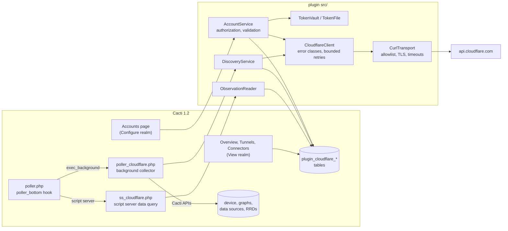

<!-- Source: README.md; SHA256: 813d1c85c236b426b83e42e63c69496f33f8909b5e435d0d45efa6a4ba2f17ca -->

<!-- translations:start -->
[English](../../../README.md) | [简体中文](../zh-CN/README.md) | [हिन्दी](../hi-IN/README.md) | [Español (España)](../es-ES/README.md) | [Español (Latinoamérica)](../es-419/README.md) | [العربية (السعودية)](../ar-SA/README.md) | [Afrikaans](../af-ZA/README.md) | [አማርኛ](../am-ET/README.md) | [العربية (مصر)](../ar-EG/README.md) | [العربية (المغرب)](../ar-MA/README.md) | [বাংলা](../bn-BD/README.md) | [Bosanski](../bs-BA/README.md) | [Deutsch](../de-DE/README.md) | [فارسی](../fa-IR/README.md) | [Filipino](../fil-PH/README.md) | [Français](../fr-FR/README.md) | [Français (Maroc)](../fr-MA/README.md) | [Français (Sénégal)](../fr-SN/README.md) | [Hausa](../ha-NG/README.md) | [עברית](../he-IL/README.md) | [Hrvatski](../hr-HR/README.md) | [Bahasa Indonesia](../id-ID/README.md) | [Igbo](../ig-NG/README.md) | [Italiano](../it-IT/README.md) | [日本語](../ja-JP/README.md) | [한국어](../ko-KR/README.md) | [Malagasy](../mg-MG/README.md) | [मराठी](../mr-IN/README.md) | [Bahasa Melayu](../ms-MY/README.md) | [Nederlands](../nl-NL/README.md) | [Polski](../pl-PL/README.md) | [Português (Brasil)](../pt-BR/README.md) | [Русский](../ru-RU/README.md) | [Kinyarwanda](../rw-RW/README.md) | [Soomaali](../so-SO/README.md) | [Српски](../sr-RS/README.md) | [Svenska](../sv-SE/README.md) | [Kiswahili](../sw-KE/README.md) | [தமிழ்](../ta-IN/README.md) | [తెలుగు](README.md) | [ไทย](../th-TH/README.md) | [Türkçe](../tr-TR/README.md) | [Українська](../uk-UA/README.md) | [اردو](../ur-PK/README.md) | [Tiếng Việt](../vi-VN/README.md) | [isiXhosa](../xh-ZA/README.md) | [Yorùbá](../yo-NG/README.md) | [繁體中文](../zh-TW/README.md) | [isiZulu](../zu-ZA/README.md)
<!-- translations:end -->

<p align="center">
  
</p>

# Cacti కోసం Cloudflare ప్లగ్‌ఇన్

[](https://github.com/somethingwithproof/plugin_cloudflare/actions/workflows/ci.yml)
[](https://sonarcloud.io/summary/new_code?id=somethingwithproof_plugin_cloudflare)
[](../../../LICENSE)


[](https://sonarcloud.io/summary/new_code?id=somethingwithproof_plugin_cloudflare)
[](https://sonarcloud.io/summary/new_code?id=somethingwithproof_plugin_cloudflare)
[](https://sonarcloud.io/summary/new_code?id=somethingwithproof_plugin_cloudflare)


Cloudflare Tunnels మరియు జోన్ విశ్లేషణలను పర్యవేక్షించడానికి రూపొందించబడుతున్న Cacti 1.2 ప్లగ్‌ఇన్. ఇది పరిమిత పరిధి గల API టోకెన్‌లతో Cloudflare API నుండి డేటాను చదువుతుంది, Cloudflare లో ఎటువంటి మార్పులు చేయదు మరియు తన డేటాను సొంత టేబుల్‌లలో నిల్వ చేస్తుంది. Cacti లో ఇది కోర్ ఫైల్‌లలో ఎటువంటి మార్పులు చేయకుండా, డేటా క్వెరీ XML ఫైల్‌లను `resource/script_server/` లోకి కాపీ చేస్తుంది మరియు Cacti సొంత API ల ద్వారా పరికరాలు, గ్రాఫ్‌లు మరియు టెంప్లేట్‌లను సృష్టిస్తుంది.

**స్థితి: 0.4.0-dev, ఇంకా విడుదల కాలేదు.** చివరిగా విడుదలైన వెర్షన్ 0.3.0. డెవలప్‌మెంట్ వెర్షన్‌లో CSV ఇన్వెంటరీ ఎగుమతులు, తొలగించబడిన టన్నెల్‌ల స్పష్టమైన విరమణ, క్యాష్ చేయబడిన జోన్ విశ్లేషణలు మరియు ఐచ్ఛిక Thold టెంప్లేట్‌లు జోడించబడ్డాయి. లైవ్-ప్రొవైడర్ మరియు డిప్లాయ్‌మెంట్ అర్హత పరిశీలన ఇంకా పెండింగ్‌లో ఉంది.

దిగువ పట్టిక 0.3.0 స్థిరమైన విడుదలను వివరిస్తుంది. డెవలప్‌మెంట్ అదనపు అంశాలు దిగువ Operator వర్క్‌ఫ్లోలు మరియు జోన్ విశ్లేషణల కింద వివరించబడ్డాయి.

| ఇప్పుడు అందుబాటులో ఉన్నవి | ప్రణాళిక చేయబడినవి |
|---|---|
| Cacti ప్లగ్‌ఇన్ మేనేజర్ ద్వారా ఇన్‌స్టాల్, అప్‌గ్రేడ్, డిజేబుల్ మరియు అన్‌ఇన్‌స్టాల్ చేయడం | GraphQL విశ్లేషణలు మరియు Thold అలర్ట్‌లు (మైల్‌స్టోన్ 4) |
| Cloudflare: View, Operator మరియు Configure అనుమతులు | ఫాల్ట్ ఇంజెక్షన్, TLA+ మోడల్‌లు మరియు పూర్తి డాక్యుమెంటేషన్ (మైల్‌స్టోన్ 5) |
| Cloudflare ఖాతాలను జోడించడం, సవరించడం, తొలగించడం, ఎనేబుల్ మరియు డిజేబుల్ చేయడం | |
| టోకెన్‌ను ఫైల్‌లో లేదా Cacti డేటాబేస్‌లో ఎన్‌క్రిప్ట్ చేసి నిల్వ చేయడం | |
| టోకెన్‌ను ధృవీకరించడం మరియు దాని టన్నెల్ మరియు జోన్ రీడ్ అనుమతులను తనిఖీ చేయడం | |
| ప్రధాన పోలర్ ప్రారంభించే బ్యాక్‌గ్రౌండ్ కలెక్టర్‌లో టన్నెల్ మరియు కనెక్టర్ డిస్కవరీ | |
| Management > Cloudflare Tunnels కింద Overview, Tunnels మరియు Connectors పేజీలు | |
| లైఫ్‌సైకిల్ ట్రాకింగ్: `active`, `unavailable` మరియు `deleted` | |
| ఒక ఖాతాకు ఒక Cacti పరికరం, అడ్మినిస్ట్రేటర్ ద్వారా సృష్టించబడుతుంది, డేటా క్వెరీ ఇండెక్స్‌లుగా టన్నెల్‌లు ఉంటాయి | |
| ప్రతి టన్నెల్‌కు ఒక RRD ఫైల్ నుండి గీయబడిన Connectors, Health మరియు Collection గ్రాఫ్‌లు | |
| ప్లగ్‌ఇన్ నిర్ధారించలేని విలువలు ఎప్పుడూ 0 గా కాకుండా తెలియనివిగా (`U`) నిల్వ చేయబడతాయి | |

## యాక్సెస్ పాత్రలు

| రెల్మ్ | యాక్సెస్ |
| --- | --- |
| Cloudflare: View | ఇప్పటికే ఉన్న పర్యవేక్షణ పేజీలు. |
| Cloudflare: Operator | పర్యవేక్షణతో పాటు Operations పేజీ మరియు వ్యక్తిగత ట్రయాజ్ అంగీకారాలు. |
| Cloudflare: Configure | Operator యాక్సెస్‌తో పాటు ఇప్పటికే ఉన్న కాన్ఫిగరేషన్ మరియు అడ్మినిస్ట్రేటివ్ చర్యలు. |

అప్‌గ్రేడ్ ఫైల్‌లను కాపీ చేసిన తర్వాత, కొత్త రెల్మ్‌ను నమోదు చేయడానికి అడ్మినిస్ట్రేటర్‌గా Plugins పేజీని తెరవండి. **Configuration > Users** లేదా వినియోగదారు సమూహాల కింద Operator రెల్మ్‌ను స్పష్టంగా కేటాయించండి. అప్‌గ్రేడ్‌లు ఇప్పటికే ఉన్న View మరియు Admin రెల్మ్ ID లు మరియు అనుమతులను అలాగే ఉంచుతాయి. ప్రతి అభ్యర్థనలో Admin యాక్సెస్ Operator యాక్సెస్‌ను వారసత్వంగా పొందుతుంది, మరియు Operator యాక్సెస్ View యాక్సెస్‌ను వారసత్వంగా పొందుతుంది; ఇది వినియోగదారులకు లేదా సమూహాలకు నిల్వ చేయబడిన అనుమతులను జోడించదు. ప్లగ్‌ఇన్ సెట్టింగ్‌లకు Cacti యొక్క Settings అనుమతితో పాటు Cloudflare: Configure యాక్సెస్ కూడా అవసరం.

Cloudflare ఖాతా దృశ్యమానత ఇప్పటికే ఉన్న View రెల్మ్‌కు సరిపోలుతుంది; ఇది ఖాతా-వ్యాప్తంగా ఉంటుంది. క్రెడెన్షియల్స్, కాన్ఫిగరేషన్, మ్యాపింగ్, తొలగింపు మరియు ఇతర అడ్మినిస్ట్రేటివ్ మార్పులు అడ్మినిస్ట్రేటివ్ పేజీలలోనే ఉంటాయి. అంగీకారాలు ప్రస్తుత వినియోగదారు సెషన్‌లో మాత్రమే, గరిష్టంగా ఒక గంట పాటు మరియు అదే పరిశీలన తాజాగా ఉన్నంత వరకు మాత్రమే ఉంటాయి. కొత్త లేదా మారిన పరిశీలనలు వాటిని చెల్లుబాటు కానివిగా చేస్తాయి. అవి విఫలమైన కొలతను ఎప్పుడూ ఆరోగ్యకరమైనదిగా గుర్తించవు లేదా అలర్ట్‌లను అణచివేయవు.

## ఈ ప్లగ్‌ఇన్ ఎందుకు

Cloudflare Tunnel ద్వారా సేవలను ప్రచురించే Cacti ఆపరేటర్లకు Cacti లోపల టన్నెల్ గురించి ఎటువంటి సమాచారం కనిపించదు. ఆరిజిన్ హోస్ట్‌లు ఇంకా SNMP కు ప్రతిస్పందిస్తున్నప్పటికీ ఒక టన్నెల్ తన అన్ని కనెక్టర్లను కోల్పోవచ్చు, కాబట్టి వినియోగదారులకు లోపాలు కనిపిస్తున్నప్పుడు కూడా ఇప్పటికే ఉన్న గ్రాఫ్‌లు ఆకుపచ్చగానే ఉంటాయి. Cloudflare ను మార్చే ఎటువంటి సామర్థ్యాన్ని Cacti కి ఇవ్వకుండానే, ఆపరేటర్లు ఇప్పటికే చూస్తున్న పరికర గ్రాఫ్‌ల పక్కన టన్నెల్ ఆరోగ్యం మరియు జోన్ ట్రాఫిక్‌ను ఉంచడమే ఈ ప్లగ్‌ఇన్ లక్ష్యం.

డిజైన్‌ను మూడు నియమాలు నిర్దేశిస్తాయి:

- **రీడ్-ఓన్లీ.** ఈ ప్లగ్‌ఇన్ కేవలం `GET` ఎండ్‌పాయింట్‌లు మరియు GraphQL Analytics API ని మాత్రమే కాల్ చేస్తుంది. దీనికి ఏ Cloudflare వనరుపైనా ఎడిట్ అనుమతి అవసరం లేదు.
- **ఐచ్ఛికం.** Cloudflare అంతరాయాలు, గడువు ముగిసిన టోకెన్‌లు మరియు రేట్ పరిమితులు Cacti UI ని నెమ్మదింపజేయకూడదు లేదా ఇతర పరికరాల పోలింగ్‌ను నిలిపివేయకూడదు. అన్ని API కాల్‌లకు కచ్చితమైన టైమ్‌అవుట్‌లు ఉంటాయి, మరియు డేటా సేకరణ పోలర్ ద్వారా ప్రారంభించబడిన బ్యాక్‌గ్రౌండ్ ప్రక్రియలో నడుస్తుంది.
- **కోర్ మార్పులు లేవు.** ఈ ప్లగ్‌ఇన్ Cacti 1.2 ప్లగ్‌ఇన్ హుక్స్ మరియు తన సొంత టేబుల్‌లను ఉపయోగిస్తుంది. ఇది ఒక డేటా క్వెరీ XML ను `resource/script_server/` లోకి కాపీ చేస్తుంది మరియు Cacti సొంత API ల ద్వారా పరికరాలు, గ్రాఫ్‌లు మరియు టెంప్లేట్‌లను సృష్టిస్తుంది. కోర్ ఫైల్‌లలో మార్పులు లేనందున, Cacti అప్‌గ్రేడ్‌లు మరియు ఇతర ప్లగ్‌ఇన్‌లపై ఎటువంటి ప్రభావం ఉండదు.

## ఇది ఎలా పనిచేస్తుంది



- **Cacti గ్లూ** (`setup.php`, `includes/`, పేజీ స్క్రిప్ట్‌లు) హుక్స్ మరియు రెల్మ్‌లను నమోదు చేస్తుంది, Cacti సొంత హెల్పర్‌లతో పేజీలను రెండర్ చేస్తుంది మరియు ప్రతి చర్యను `src/` లోని లైబ్రరీకి అప్పగిస్తుంది.
- **లైబ్రరీ** (`src/`, నేమ్‌స్పేస్ `Somethingwithproof\Cloudflare\`) కు Cacti గ్లోబల్స్‌పై ఎటువంటి ఆధారపడటం లేదు, కాబట్టి దీనిని నడుస్తున్న Cacti లేకుండానే నిజమైన డేటాబేస్ మరియు నకిలీ HTTP ట్రాన్స్‌పోర్ట్‌తో పరీక్షించవచ్చు.
- **ఒకే అవుట్‌బౌండ్ మార్గం.** నెట్‌వర్క్‌ను తాకే ఏకైక కోడ్ `CurlTransport`, మరియు ఇది కేవలం `https://api.cloudflare.com` ను మాత్రమే అంగీకరిస్తుంది. ప్రతి వైఫల్యం ఒక ఎర్రర్ క్లాస్‌కు (`auth`, `permission`, `rate_limited`, `transient`, ...) మ్యాప్ చేయబడుతుంది, ఇది UI లో చూపబడే స్థితిని నిర్దేశిస్తుంది.
- **నిల్వ** ప్రిపేర్డ్ స్టేట్‌మెంట్‌లతో Cacti సొంత PDO కనెక్షన్ ద్వారా జరుగుతుంది. స్కీమా మార్పులు సంఖ్యలతో కూడిన, ఐడెంపోటెంట్ మైగ్రేషన్‌లు.

డిజైన్ నిర్ణయాలు మరియు వాటి కారణాలు [docs/design.md](../../design.md) లో ఉన్నాయి.

## స్క్రీన్‌షాట్‌లు

ఈ స్క్రీన్‌షాట్‌లు లైవ్ Cloudflare ఖాతా నుండి కాకుండా టెస్ట్ స్టాక్ నుండి తీసుకోబడ్డాయి. ఈ స్టాక్ ఫిక్చర్ డేటాను అందించే నకిలీ Cloudflare API తో Cacti 1.2.31 ను నడుపుతుంది, కాబట్టి ఖాతా, దాని ID మరియు మూడు టన్నెల్‌లు నమూనా విలువలు.


*Cloudflare Accounts జాబితా. నకిలీ API టోకెన్‌ను ఆమోదిస్తుంది, కాబట్టి Verify `ok` అని నివేదిస్తుంది.*


*ఖాతాను సవరించడం. టోకెన్ ఫీల్డ్‌లు ఎల్లప్పుడూ ఖాళీగా ఉంటాయి; నిల్వ చేయబడిన టోకెన్ ఎప్పుడూ బ్రౌజర్‌కు తిరిగి పంపబడదు. Collect Tunnels మరియు Create Graphs ఆన్‌లో ఉన్నాయి మరియు Collect Analytics ఆఫ్‌లో ఉంది. Connection Status చివరి Verify ఫలితాన్ని చూపుతుంది: `ok`, టన్నెల్ రీడ్ మంజూరు చేయబడింది మరియు జోన్ రీడ్ లేదు.*


*Settings > Cloudflare.*


*Management > Cloudflare Tunnels > Overview. ఖాతా యొక్క సక్రియ టన్నెల్‌లలో అత్యంత అధ్వాన్నమైన Cloudflare స్థితి ఇక్కడ కనిపిస్తుంది, ఒక ఫిక్చర్ టన్నెల్ డౌన్ అయినందున ఇక్కడ `down` అని ఉంది. టన్నెల్ ఆరోగ్యం కంటే `Disabled`, `Not collected`, `Collection failing` మరియు `Not yet collected` అనేవి ఆ క్రమంలో ప్రాధాన్యత పొందుతాయి, కాబట్టి చివరి రన్ విఫలమైన ఖాతా దాని టన్నెల్‌లు ఏమి నివేదించినా `Collection failing` అని చూపుతుంది.*


*Tunnels ట్యాబ్. నకిలీ API దాని కనెక్షన్‌ల అభ్యర్థనకు తెలియని టన్నెల్‌గా సమాధానం ఇవ్వడం మరియు ఏమీ నిల్వ చేయకపోవడం వల్ల old-office కు Connectors మరియు Connections `-` అని చూపుతాయి, మరియు రన్నింగ్ కనెక్టర్ లేని staging కు 0 అని చూపుతాయి.*


*blog టన్నెల్ యొక్క Connectors గ్రాఫ్. మధ్యలో నకిలీ API లోపాలను అందించిన మరియు ప్లగ్‌ఇన్ తెలియని విలువలను నిల్వ చేసిన అంతరానికి ముందు మరియు తర్వాత మూడు రేఖలు 1 వద్ద ఉన్నాయి. రేఖలు 0 కు పడిపోవు. ఈ గ్రాఫ్ అదే ఫిక్చర్ స్టాక్ (`make screenshots`) నుండి వచ్చింది, ఇది ఏడు నిమిషాల పోలింగ్ గ్రాఫ్‌ను నింపడానికి ఈ ఒక్క డేటా సోర్స్‌పై 30 సెకన్ల స్టెప్‌ను సెట్ చేస్తుంది.*

## అవసరాలు

- Cacti 1.2.25 నుండి 1.2.31 వరకు. Cacti 1.2.31 కి PHP 8.0 లేదా ఆ తర్వాతి వెర్షన్ అవసరం.
  CI కేవలం 1.2.31 ని మాత్రమే పరీక్షిస్తుంది; 1.2.25 చివరిసారిగా 2026-10-22 న మాన్యువల్‌గా పరీక్షించబడింది.
- `curl`, `openssl` మరియు `pdo_mysql` ఎక్స్‌టెన్షన్‌లతో PHP 7.4 నుండి 8.4 వరకు.
  ఇవి లేకుండా ప్లగిన్ ఎనేబుల్ చేయడానికి నిరాకరిస్తుంది.
- MariaDB 10.6 లేదా ఆ తర్వాతి వెర్షన్, లేదా MySQL 8.0 లేదా ఆ తర్వాతి వెర్షన్.
- Cacti సర్వర్ నుండి `api.cloudflare.com` కి HTTPS యాక్సెస్. ప్రాక్సీలకు మద్దతు లేదు.

ఏమేమి పరీక్షించబడ్డాయో తెలుసుకోవడానికి [docs/compatibility.md](../../compatibility.md) చూడండి.

## ఇన్‌స్టాలేషన్

1. [GitHub విడుదలలు](https://github.com/somethingwithproof/plugin_cloudflare/releases)
   నుండి ఆర్కైవ్‌ను ఎక్స్‌ట్రాక్ట్ చేయడం ద్వారా (రిలీజ్ ట్యాగ్ యొక్క చెక్‌అవుట్‌లో
   `make package` రన్ చేయడం వల్ల అదే ఆర్కైవ్ బిల్డ్ అవుతుంది) లేదా git క్లోన్ ద్వారా
   ప్లగిన్‌ను Cacti యొక్క `plugins/cloudflare` డైరెక్టరీలో ఉంచండి. డైరెక్టరీ పేరు
   తప్పనిసరిగా `cloudflare` అని ఉండాలి.
2. కన్సోల్ > కాన్ఫిగరేషన్ > ప్లగిన్లు నుండి, లేదా వెబ్ సర్వర్ వినియోగదారుగా CLI తో
   దీన్ని ఇన్‌స్టాల్ చేసి ఎనేబుల్ చేయండి:

   ```sh
   php cli/plugin_manage.php --plugin=cloudflare --install --enable
   ```

3. ఇన్‌స్టాల్ చేసినప్పుడు అడ్మిన్ వినియోగదారుకు Cloudflare: కాన్ఫిగర్ అనుమతి లభిస్తుంది.
   కన్సోల్ > కాన్ఫిగరేషన్ > వినియోగదారులు కింద ఇతర వినియోగదారులకు లేదా సమూహాలకు దీన్ని మంజూరు చేయండి.
4. [docs/token-permissions.md](../../token-permissions.md) లోని అనుమతులతో
   ఒక టోకెన్‌ను సృష్టించండి. సంక్షిప్తంగా:
   ఖాతా > Cloudflare టన్నెల్ > రీడ్, మరియు ఐచ్ఛికంగా జోన్ > జోన్ > రీడ్.
5. దిగువ పేర్కొన్న రెండు మార్గాలలో ఒకదానిలో టోకెన్‌ను నిల్వ చేయండి, ఆపై
   కన్సోల్ > కాన్ఫిగరేషన్ > Cloudflare ఖాతాలు కింద ఖాతాను జోడించి,
   చర్యల మెనూ నుండి వెరిఫై ని రన్ చేయండి.

### ఎంపిక A: డేటాబేస్‌లో ఎన్‌క్రిప్ట్ చేయబడింది

మీరు సృష్టించిన 32-బైట్ కీతో ప్లగిన్ టోకెన్‌లను ఎన్‌క్రిప్ట్ చేస్తుంది. ఇది కీని
స్వయంగా ఎప్పుడూ సృష్టించదు లేదా వ్రాయదు. ఫైల్‌ను వెబ్ సర్వర్ మరియు పోలర్ వినియోగదారులు
చదవగలిగేలా ఉండాలి, ఇతరులు చదవకూడదు మరియు ఆ వినియోగదారులు దాన్ని చేరుకోవడానికి
దాని డైరెక్టరీ అనుమతించాలి. `www-data` గా రన్ అవుతున్న వెబ్ సర్వర్ కోసం:

```sh
sudo mkdir -p /etc/cacti
sudo sh -c 'umask 077 && openssl rand -hex 32 > /etc/cacti/cloudflare.key'
sudo chgrp www-data /etc/cacti/cloudflare.key
sudo chmod 0440 /etc/cacti/cloudflare.key
```

డిఫాల్ట్ పాత్ `/etc/cacti/cloudflare.key`; సెట్టింగ్‌లు > Cloudflare >
టోకెన్ వాల్ట్ కీ ఫైల్ కింద దీన్ని మార్చండి. కీ లేనప్పుడు లేదా తిరస్కరించబడినప్పుడు,
ఎడిట్ ఫారమ్ టోకెన్ ఫైల్ ఎంపికను మాత్రమే అందిస్తుంది. కీ యొక్క బ్యాకప్‌ను ఉంచుకోండి:
అది లేకుండా, నిల్వ చేయబడిన టోకెన్‌లను డిక్రిప్ట్ చేయడం సాధ్యం కాదు మరియు మళ్లీ నమోదు చేయాల్సి ఉంటుంది.

#### కీని రొటేట్ చేయడం

రీకీ కమాండ్ ఏదీ లేదు. కొత్త కీ పాత దాని కింద నిల్వ చేయబడిన టోకెన్‌లను
డిక్రిప్ట్ చేయలేదు, కాబట్టి రొటేషన్ అంటే నిల్వ చేయబడిన ప్రతి టోకెన్‌ను మళ్లీ నమోదు చేయడం:

1. ప్రతి ఖాతా యొక్క టోకెన్ విలువను సిద్ధంగా ఉంచుకోండి. టోకెన్ సృష్టించబడినప్పుడు లేదా
   రోల్ చేయబడినప్పుడు మాత్రమే Cloudflare దాని విలువను చూపుతుంది, కాబట్టి మీ వద్ద అది
   ఇకపై లేకపోతే Cloudflare డ్యాష్‌బోర్డ్‌లో టోకెన్‌ను రోల్ చేయండి.
2. పై కమాండ్‌లతో కొత్త పాత్‌లో, ఉదాహరణకు `/etc/cacti/cloudflare.key.new` వద్ద,
   అదే యజమాని మరియు మోడ్‌తో కొత్త కీని సృష్టించండి.
3. సెట్టింగ్‌లు > Cloudflare > టోకెన్ వాల్ట్ కీ ఫైల్ ని కొత్త పాత్‌కు సెట్ చేసి సేవ్ చేయండి.
   ఇప్పటి నుండి, పాత కీతో ఇప్పటికీ ఎన్‌క్రిప్ట్ చేయబడిన ఖాతాపై వెరిఫై ని రన్ చేస్తే
   "Stored token cannot be decrypted" అని నివేదిస్తుంది, మరియు ప్రతి కలెక్టర్ రన్ దాని కోసం
   `reason=decrypt_failed` తో `discovery token unavailable` అని లాగ్ చేస్తుంది.
4. డేటాబేస్‌లో తమ టోకెన్‌ను నిల్వ చేసే ప్రతి ఖాతా కోసం, కన్సోల్ > కాన్ఫిగరేషన్ >
   Cloudflare ఖాతాలు కింద దాన్ని తెరిచి, రెండు టోకెన్ ఫీల్డ్‌లలోనూ టోకెన్‌ను పేస్ట్ చేసి,
   సేవ్ చేసి, వెరిఫై ని రన్ చేయండి. అది `ok` అని నివేదించాలి.
5. అటువంటి ప్రతి ఖాతా ధృవీకరించబడిన తర్వాత, పాత కీ ఫైల్‌ను మరియు దాని
   బ్యాకప్‌లను తొలగించండి.

దశలు 3 మరియు 4 మధ్యలో ఖాతా యొక్క టన్నెల్స్ రిఫ్రెష్ చేయబడవు మరియు వాటి
హెల్త్, కనెక్టర్ మరియు కనెక్షన్ గ్రాఫ్‌లు `U` ని నమోదు చేస్తాయి. టోకెన్ ఫైల్ ఖాతాలపై
దీని ప్రభావం ఉండదు.

### ఎంపిక B: టోకెన్ ఫైల్

వెబ్ సర్వర్ మరియు పోలర్ వినియోగదారులు చదవగలిగే మరియు ఇతరులు చదవలేని ఫైల్‌కు
టోకెన్‌ను మాత్రమే (మరేదీ లేకుండా) వ్రాయండి, ఆపై ఎడిట్ ఫారమ్‌లో దాని సంపూర్ణ పాత్‌ను నమోదు చేయండి:

```sh
sudo sh -c 'umask 077 && cat > /etc/cacti/cloudflare-account.token'   # paste the token, then Ctrl-D
sudo chgrp www-data /etc/cacti/cloudflare-account.token
sudo chmod 0440 /etc/cacti/cloudflare-account.token
```

మీరు సేవ్ చేసినప్పుడు కాకుండా, వెరిఫై వద్ద ఫైల్ చదవబడినప్పుడు అది తనిఖీ చేయబడుతుంది.
సింబాలిక్ లింక్‌లు, 4 KiB కంటే ఎక్కువ పరిమాణం ఉన్న ఫైల్‌లు మరియు ఇతరులు
చదవగలిగే లేదా వ్రాయగలిగే ఫైల్‌లు తిరస్కరించబడతాయి.

Cloudflare: కాన్ఫిగర్ అనుమతి ఉన్న ఎవరైనా ఏ పాత్‌నైనా నమోదు చేయవచ్చు మరియు పోలర్ వినియోగదారు
దాన్ని చదువుతారు. టోకెన్ ఫైల్‌లను ఒకే చోట ఉంచడానికి, సెట్టింగ్‌లు > Cloudflare >
టోకెన్ ఫైల్ డైరెక్టరీ ని ఉదాహరణకు `/etc/cacti` కి సెట్ చేయండి; దానికి వెలుపల ఉన్న పాత్ అప్పుడు
తిరస్కరించబడుతుంది. [docs/security.md](../../security.md#token-file) చూడండి.

## అప్‌గ్రేడ్

1. డైరెక్టరీ పేరును అలాగే ఉంచి, `plugins/cloudflare` లోని ఫైల్‌లను కొత్త రిలీజ్‌తో భర్తీ చేయండి.
2. కన్సోల్ > కాన్ఫిగరేషన్ > ప్లగిన్లు లేదా కన్సోల్ > కాన్ఫిగరేషన్ >
   Cloudflare ఖాతాలు ని అడ్మిన్‌గా ఒకసారి తెరవండి. అది ప్లగిన్ మైగ్రేషన్‌లను రన్ చేస్తుంది,
   Cloudflare టెంప్లేట్‌లను దిగుమతి చేస్తుంది మరియు డేటా క్వెరీ ఫైల్‌ను కాపీ చేస్తుంది
   ([టన్నెల్ మెట్రిక్స్ మరియు గ్రాఫ్‌లు](#tunnel-metrics-and-graphs) చూడండి), అలాగే
   0.1.0 నుండి అప్‌గ్రేడ్ చేస్తున్నప్పుడు `poller_bottom` హుక్‌ను నమోదు చేస్తుంది.

`poller.php` ప్లగిన్ అప్‌గ్రేడ్‌ను రన్ చేయదు, కాబట్టి దశ 2 వరకు కొత్త
స్కీమా ఉండదు. అప్పుడు ప్రతి కలెక్టర్ రన్ ఏమీ చేయదు మరియు
`CLOUDFLARE: collector skipped; plugin upgrade pending, open Console > Plugins` అని లాగ్ చేస్తుంది.
Cloudflare టన్నెల్స్ పేజీలకు Cloudflare: వీక్షణ మాత్రమే అవసరం, కాబట్టి అవి ఎప్పుడూ
అప్‌గ్రేడ్‌ను రన్ చేయవు, మరియు దశ 2 వరకు అవి "The Cloudflare tunnels could not
be read" అని చూపవచ్చు.

## ఖాతా స్థితి

వెరిఫై ఖాతా స్థితిని సెట్ చేస్తుంది:

| స్థితి | అర్థం |
|---|---|
| `unknown` | ఖాతా జోడించబడినప్పటి నుండి లేదా దాని ఆధారాలు మార్చబడినప్పటి నుండి ధృవీకరించబడలేదు |
| `ok` | టోకెన్ సక్రియంగా ఉంది మరియు టన్నెల్స్‌ను చదవగలదు |
| `token_inactive` | టోకెన్ నిలిపివేయబడినట్లు లేదా గడువు ముగిసినట్లు Cloudflare నివేదిస్తోంది |
| `auth_failed` | టోకెన్ చెల్లనిదిగా లేదా గడువు ముగిసినదిగా Cloudflare తిరస్కరించింది (HTTP 401) |
| `permission_denied` | టోకెన్ సక్రియంగా ఉంది కానీ టన్నెల్స్‌ను చదవలేదు, లేదా టోకెన్ ధృవీకరణ ఎండ్‌పాయింట్‌లను కాల్ చేయడానికి దానికి అనుమతులు లేవు (HTTP 403) |
| `unreachable` | API ని చేరుకోవడం సాధ్యం కాలేదు, సమయం ముగిసింది లేదా సర్వర్ లోపాన్ని తిరిగి ఇచ్చింది |
| `rate_limited` | Cloudflare HTTP 429 ని తిరిగి ఇచ్చింది |
| `error` | టోకెన్ ఫైల్ లేకపోవడం లేదా అసురక్షితంగా ఉండటం, టోకెన్ వాల్ట్ కీ ఫైల్ లేకపోవడం లేదా ఉపయోగించలేకపోవడం, లేదా నిల్వ చేయబడిన టోకెన్‌ను డిక్రిప్ట్ చేయలేకపోవడం సహా ఏదైనా ఇతర వైఫల్యం |

టన్నెల్ రీడ్ మరియు జోన్ రీడ్ మంజూరు చేయబడ్డాయో లేదో కూడా ఎడిట్ పేజీ చూపుతుంది.

## టన్నెల్ డిస్కవరీ

ప్రధాన పోలర్‌పై ప్రతి పోలింగ్ సైకిల్ తర్వాత, కనీసం ఒక ఎనేబుల్ చేయబడిన ఖాతాకు
టన్నెల్స్‌ను సేకరించు ఆన్‌లో ఉన్నప్పుడు `poller_bottom` హుక్ `exec_background` తో
బ్యాక్‌గ్రౌండ్ కలెక్టర్‌ను ప్రారంభిస్తుంది. కలెక్టర్ పోలర్ ప్రక్రియలో ఎప్పుడూ రన్ అవ్వదు,
కాబట్టి నెమ్మదైన Cloudflare API `poller.php` ని ఆలస్యం చేయదు. రిమోట్ పోలర్లు
దీన్ని ఎప్పుడూ ప్రారంభించవు.

గడువు ముగిసిన ప్రతి ఖాతా కోసం, కలెక్టర్ ఖాతా యొక్క టన్నెల్స్‌ను జాబితా చేస్తుంది, ఆపై
దాని సక్రియ టన్నెల్స్ కనెక్షన్‌లను చదువుతుంది, ఇది ప్రతి టన్నెల్ యొక్క కనెక్టర్లు,
వాటి వెర్షన్‌లు, డేటా సెంటర్‌లు మరియు ఆరిజిన్ చిరునామాలను అందిస్తుంది. ప్రతి
డిస్కవరీ విరామం (డిఫాల్ట్ 300 సెకన్లు) వద్ద ఖాతాల గడువు వస్తుంది. ఒక రన్ 50 సెకన్ల తర్వాత
కొత్త ఖాతాను ప్రారంభించదు మరియు గరిష్టంగా 200 కనెక్షన్ అభ్యర్థనలను చేస్తుంది.
ఈ రెండు పరిమితులలో ఏదైనా ఒక ఖాతా యొక్క కనెక్షన్‌లను చదువుతున్నప్పుడు మధ్యలోనే ఆపివేయవచ్చు;
ఆ ఖాతా `partial` గా నమోదు చేయబడుతుంది మరియు తదుపరి రన్ ఇటీవల తక్కువగా ప్రయత్నించిన
టన్నెల్స్‌తో కొనసాగుతుంది. ప్రారంభించబడని ఖాతాలు తదుపరి రన్ కోసం గడువులో ఉంటాయి.

Cloudflare నివేదించే స్థితి (`healthy`, `degraded`, `down` లేదా `inactive`) నుండి వేరుగా
టన్నెల్‌కు ఒక జీవితచక్రం ఉంటుంది:

| జీవితచక్రం | అర్థం |
|---|---|
| `active` | చివరి పూర్తి జాబితాలో టన్నెల్ ఉంది |
| `deleted` | పూర్తి జాబితాలో అది లేదు, ఇందులో ఖాళీ జాబితా కూడా ఉంటుంది. అడ్డువరుస మరియు దాని చరిత్ర అలాగే ఉంటాయి, మరియు టన్నెల్ మళ్లీ కనిపిస్తే తిరిగి `active` అవుతుంది |
| `unavailable` | మధ్యలో పూర్తి జాబితా లేకుండా వరుసగా మూడు లెక్కించబడిన అంతరాయాలు ఏర్పడితే టన్నెల్ స్థితి తెలియనిదిగా మారుతుంది |

పూర్తి, విజయవంతమైన జాబితా మాత్రమే టన్నెల్స్‌ను జోడిస్తుంది, అప్‌డేట్ చేస్తుంది లేదా తొలగిస్తుంది,
మరియు విఫలమైన జాబితా ఎప్పుడూ ఒకదాన్ని తొలగించదు. Cloudflare ని అసలు చదవలేకపోవడం
(`transient`, `rate_limited`, `auth` లేదా `permission`) ఒక అంతరాయంగా లెక్కించబడుతుంది;
మధ్యలో పూర్తి జాబితా లేకుండా మూడు లెక్కించబడిన అంతరాయాల తర్వాత, ఖాతా యొక్క సక్రియ టన్నెల్స్
`unavailable` అవుతాయి. తదుపరి పూర్తి జాబితా వాటిని పునరుద్ధరిస్తుంది మరియు గణనను రీసెట్ చేస్తుంది.
కనెక్షన్‌లను చదువుతున్నప్పుడు Cloudflare కి ఇకపై తెలియని టన్నెల్ ఖాతాను విఫలం చేయకుండా
దాటవేయబడుతుంది. ఇతర వైఫల్యాలు అంతరాయ కౌంటర్‌ను పెంచవు లేదా రీసెట్ చేయవు.

`cacti.log` లో, డిస్కవరీ లైన్లు `CLOUDFLARE: discovery` తో మరియు రన్ సారాంశం
`CLOUDFLARE: collector` తో ప్రారంభమవుతాయి. విఫలమైన జాబితా లేదా `unavailable` గా
గుర్తించబడిన టన్నెల్స్ వంటి వైఫల్యాలు మరియు జీవితచక్ర మార్పులు Cacti యొక్క డిఫాల్ట్
`LOW` స్థాయిలో లాగ్ చేయబడతాయి; ప్రతి ఖాతా ఫలితం మరియు రన్ సారాంశం `MEDIUM` లో
లాగ్ చేయబడతాయి. కనెక్షన్ రీడ్‌లు ప్రతి టన్నెల్‌పై విఫలం కావచ్చు, కాబట్టి ప్రతి ఖాతాకు
ప్రతి లోప తరగతి యొక్క మొదటి వైఫల్యం మాత్రమే `LOW` వద్ద, మిగిలినవి `MEDIUM` వద్ద
లాగ్ చేయబడతాయి, ఆ తర్వాత విఫలమైన టన్నెల్స్ సంఖ్యతో ప్రతి తరగతికి ఒక `LOW` లైన్ వస్తుంది.

నిర్వహణ > Cloudflare టన్నెల్స్ కి Cloudflare: వీక్షణ అనుమతి అవసరం మరియు ఇది
కేవలం చదవడానికి మాత్రమే:

- **అవలోకనం** ప్రతి ఖాతాను దాని స్థితి, జీవితచక్రం వారీగా టన్నెల్ సంఖ్యలు,
  చివరి విజయవంతమైన డిస్కవరీ మరియు వరుస వైఫల్యాల సంఖ్యతో జాబితా చేస్తుంది.
- **టన్నెల్స్** ఖాతాల అంతటా లేదా ఒక ఖాతా కోసం టన్నెల్స్‌ను, ఖాతా, జీవితచక్రం,
  స్థితి మరియు పేరు కోసం ఫిల్టర్‌లతో మరియు క్రమబద్ధీకరించగల నిలువు వరుసలతో జాబితా చేస్తుంది.
- **కనెక్టర్లు** టన్నెల్స్ ట్యాబ్‌లో ఎంచుకున్న టన్నెల్ యొక్క కనెక్టర్లను చూపుతుంది.

<a name="tunnel-metrics-and-graphs"></a>

## టన్నెల్ మెట్రిక్స్ మరియు గ్రాఫ్‌లు

Cacti స్క్రిప్ట్ సర్వర్ డేటా క్వెరీ అయిన `ss_cloudflare.php` ద్వారా టన్నెల్ స్థితిని చదువుతుంది.
ఇది ప్లగిన్ టేబుల్స్ నుండి మాత్రమే సమాధానం ఇస్తుంది మరియు Cloudflare కి ఎప్పుడూ కాల్ చేయదు,
కాబట్టి Cloudflare అంతరాయం పోలర్‌ను నెమ్మదింపజేయదు. ప్రతి టన్నెల్ ఆరు విలువలను ఇస్తుంది:
హెల్త్ (healthy 3, degraded 2, down 1, inactive 0), కనెక్టర్లు, కనెక్షన్లు, కనెక్టర్ వెర్షన్‌లు,
దాని కనెక్షన్లు చివరిగా చదవబడినప్పటి నుండి సెకన్లు, మరియు డిస్కవరీ జాబ్ యొక్క వరుస వైఫల్యాలు.
ప్లగిన్ వాటికి హామీ ఇవ్వగలిగినప్పుడు మాత్రమే హెల్త్, కనెక్టర్లు, కనెక్షన్లు మరియు వెర్షన్‌లు ముద్రించబడతాయి,
అంటే చివరి డిస్కవరీ విజయవంతమైంది, టన్నెల్ `active` గా ఉంది మరియు రీడింగ్ ఇటీవలిది.
లేకపోతే అవి `U` గా ఉంటాయి, మరియు అంతరాయంలా కనిపించే సున్నాకి బదులుగా గ్రాఫ్ ఖాళీని చూపుతుంది.
అంతరాయం సమయంలో రెండు కలెక్షన్ విలువలు ముద్రించబడుతూనే ఉంటాయి, కాబట్టి కలెక్షన్ గ్రాఫ్ దాన్ని
చూపుతుంది; తొలగించబడిన టన్నెల్ లేదా కనెక్షన్లు ఎప్పుడూ రిఫ్రెష్ చేయబడని టన్నెల్ కోసం మాత్రమే
అవి `U` గా ఉంటాయి. నియమాలు [docs/metrics.md](../../metrics.md) లో ఉన్నాయి.

### పరికరాన్ని సృష్టించండి

ఒక ఖాతా గరిష్టంగా ఒక Cacti పరికరానికి మ్యాప్ అవుతుంది. పరికరం ఖాతా యొక్క టన్నెల్స్‌ను
Cloudflare టన్నెల్స్ డేటా క్వెరీ యొక్క ఇండెక్స్‌లుగా కలిగి ఉంటుంది. ఏదీ దీన్ని
స్వయంచాలకంగా సృష్టించదు:

1. కన్సోల్ > కాన్ఫిగరేషన్ > Cloudflare ఖాతాలు ని తెరవండి.
2. ఖాతాను ఎంచుకుని, చర్యల మెనూ నుండి Cacti పరికరాన్ని సృష్టించండి ని ఎంచుకుని, నిర్ధారించండి.

ఈ చర్యకు Cloudflare: కాన్ఫిగర్ realm మరియు Cacti యొక్క సైట్లు/పరికరాలు/డేటా realm
(`host.php` కోసం ఉన్నది) రెండూ అవసరం. రెండింటినీ కలిగి ఉన్న వినియోగదారులకు మాత్రమే
మెనూ ఎంట్రీ కనిపిస్తుంది, మరియు మరెవరి నుండైనా వచ్చే అభ్యర్థనను సర్వర్ తిరస్కరిస్తుంది.
పరికరానికి `Cloudflare: <account name>` అని పేరు పెట్టబడుతుంది, Cloudflare ఖాతా హోస్ట్
టెంప్లేట్ మరియు ప్రధాన పోలర్‌ను ఉపయోగిస్తుంది, SNMP వెర్షన్ 0 మరియు లభ్యత తనిఖీ లేకుండా ఉంటుంది,
మరియు `<account ID>.cloudflare.invalid` హోస్ట్‌నేమ్‌ను పొందుతుంది. ఆ పేరు రిజర్వ్ చేయబడింది
మరియు ఎప్పుడూ రిజాల్వ్ అవ్వదు; Cacti దానికి కనెక్ట్ అవ్వదు. ఖాతాకు ఇప్పటికే పరికరం ఉంటే,
చర్య ఆ విషయాన్ని చెబుతుంది మరియు ఏమీ మార్చదు. ఒక నిర్వాహకుడు Cacti లో పరికరాన్ని తొలగిస్తే,
Cacti పరికరాన్ని సృష్టించండి ని మళ్లీ రన్ చేసే వరకు ప్లగిన్ మరొకదాన్ని తయారు చేయదు.

### గ్రాఫ్‌లను సృష్టించండి

ఖాతా ఫారమ్‌పై గ్రాఫ్‌లను సృష్టించండి డిఫాల్ట్‌గా ఆఫ్‌లో ఉంటుంది. ఇది ఆన్‌లో ఉన్నప్పుడు,
ఖాతా యొక్క డిస్కవరీ `ok` లేదా `partial` తో ముగిసిన ప్రతిసారీ, కలెక్టర్ పరికరాన్ని
రీఇండెక్స్ చేస్తుంది మరియు ఖాతా యొక్క `active` టన్నెల్స్ కోసం లేని గ్రాఫ్‌లను సృష్టిస్తుంది:
కనెక్టర్లు, హెల్త్ మరియు కలెక్షన్, టన్నెల్‌కు మూడు చొప్పున. ఒక టన్నెల్ యొక్క మూడు గ్రాఫ్‌లు
ఒకే RRD ఫైల్‌ను పంచుకుంటాయి. ఒక రన్ గరిష్టంగా 50 గ్రాఫ్‌లను సృష్టిస్తుంది మరియు 20 సెకన్ల తర్వాత
ఆగిపోతుంది, మరియు తదుపరి రన్ కొనసాగుతుంది. ప్లగిన్ Cacti ఆబ్జెక్ట్‌ను ఎప్పుడూ తొలగించదు.
ఒక నిర్వాహకుడు తొలగించిన గ్రాఫ్ మళ్లీ తయారు చేయబడదు, మరియు Cloudflare ఇకపై జాబితా చేయని
టన్నెల్ దాని గ్రాఫ్ మరియు RRD ఫైల్‌ను అలాగే ఉంచుతుంది, అవి `U` ని చూపుతాయి.

గ్రాఫ్‌లను సృష్టించండి ని ఆన్ చేయడానికి రెండు realm లు అవసరం. దాన్ని ఆఫ్ చేయడానికి
కాన్ఫిగర్ మాత్రమే అవసరం. సైట్లు/పరికరాలు/డేటా realm లేని వినియోగదారు ఫారమ్‌ను సేవ్ చేస్తే,
హెచ్చరికతో సెట్టింగ్ మునుపటి లాగే ఉంటుంది. గ్రాఫ్‌లను సృష్టించండి ఆఫ్‌లో ఉన్నప్పుడు కూడా,
ప్రతి డిస్కవరీ తర్వాత పరికరం రీఇండెక్స్ చేయబడుతుంది, కాబట్టి కొత్త టన్నెల్స్ డేటా క్వెరీ యొక్క
ఇండెక్స్‌లుగా కనిపిస్తాయి.

### డేటా క్వెరీ ఫైల్

Cacti 1.2.31 దాని `resource` డైరెక్టరీ లోపల నుండి మాత్రమే డేటా క్వెరీ XML ని
చదువుతుంది. అందువల్ల ఇన్‌స్టాల్ మరియు అప్‌గ్రేడ్ సమయంలో ప్లగిన్ ఒక ఫైల్‌ను,
`templates/resource/cloudflare_tunnels.xml` ని
`<Cacti>/resource/script_server/cloudflare_tunnels.xml` కి కాపీ చేస్తుంది.
ప్లగిన్ తన స్వంత డైరెక్టరీ వెలుపల వ్రాసే ఏకైక ఫైల్ ఇదే, కాబట్టి ప్లగిన్‌ను ఇన్‌స్టాల్ చేసే
లేదా అప్‌గ్రేడ్ చేసే వినియోగదారు ఆ డైరెక్టరీకి వ్రాయగలగాలి.
అన్‌ఇన్‌స్టాల్ చేసినప్పుడు పరికరాలు, గ్రాఫ్‌లు, RRD ఫైల్‌లు మరియు టెంప్లేట్‌లతో పాటు ఈ ఫైల్ కూడా
అలాగే ఉంటుంది. కాపీ లేదా టెంప్లేట్ దిగుమతి విఫలమైతే, ప్లగిన్ దాన్ని లాగ్ చేస్తుంది మరియు
Cacti పరికరాన్ని సృష్టించండి మళ్లీ ప్రయత్నిస్తుంది.

## సెట్టింగ్‌లు

సెట్టింగ్‌లు > Cloudflare లో ఇవి ఉంటాయి:

- **టోకెన్ వాల్ట్ కీ ఫైల్**: వాల్ట్ కీకి మార్గం.
- **టోకెన్ ఫైల్ డైరెక్టరీ**: ఇది సెట్ చేసినప్పుడు, దీని వెలుపల ఉన్న టోకెన్ ఫైల్ తిరస్కరించబడుతుంది. డిఫాల్ట్‌గా ఖాళీగా ఉంటుంది, ఇది ఏ మార్గాన్నైనా అనుమతిస్తుంది. [docs/security.md](../../security.md#token-file) చూడండి.
- **ఇంటరాక్టివ్ అభ్యర్థన సమయం ముగింపు**: వెబ్ ఇంటర్‌ఫేస్ నుండి చేసిన అభ్యర్థనకు (ఉదాహరణకు ధృవీకరించు) పట్టే మొత్తం సెకన్లు. డిఫాల్ట్ 10; 5 నుండి 60 పరిధికి వెలుపల ఉన్న విలువలు తిరిగి 10కి మారతాయి.
- **కలెక్టర్ అభ్యర్థన సమయం ముగింపు**: బ్యాక్‌గ్రౌండ్ కలెక్టర్ చేసిన అభ్యర్థనకు పట్టే మొత్తం సెకన్లు. డిఫాల్ట్ 20; 5 నుండి 60 పరిధికి వెలుపల ఉన్న విలువలు తిరిగి 20కి మారతాయి.
- **లాగ్ స్థాయి**: నిల్వ చేయబడుతుంది. ఇంకా ఏదీ దీనిని చదవదు.

ఖాతా ఫారమ్‌లో, "టన్నెల్స్ సేకరించు" మరియు "ఆవిష్కరణ విరామం" ఆవిష్కరణను నియంత్రిస్తాయి, మరియు "గ్రాఫ్‌లను సృష్టించు" గ్రాఫ్ సృష్టిని నియంత్రిస్తుంది. "విశ్లేషణలను సేకరించు" నిల్వ చేయబడుతుంది మరియు ఈ విడుదలలో దీనికి ఎటువంటి ప్రభావం ఉండదు.

## భాషలు

ఈ ప్లగిన్ స్పానిష్ (స్పెయిన్, `es-ES`), ఫ్రెంచ్ (`fr-FR`), జర్మన్ (`de-DE`), సరళీకృత చైనీస్ (`zh-CN`), హిందీ (`hi-IN`), అరబిక్ (`ar-SA`), మరియు జపనీస్ (`ja-JP`) భాషలలో అనువాదాలను అందిస్తుంది. భాషా మద్దతు ఆన్ చేయబడిన తర్వాత (కాన్ఫిగరేషన్ > సెట్టింగ్‌లు > సాధారణం > భాషా మద్దతు) మరియు వినియోగదారు భాషను ఎంచుకున్నప్పుడు Cacti వాటిని చూపుతుంది. లాటిన్ అమెరికన్ స్పానిష్ కేటలాగ్ (`es-419`) కూడా అందించబడుతుంది, కానీ Cacti 1.2లో ఎంచుకోవడానికి లాటిన్ అమెరికన్ స్పానిష్ లోకేల్ లేదు, కాబట్టి Cacti దానిని జోడించినప్పుడు మాత్రమే అది అమల్లోకి వస్తుంది; అప్పటి వరకు, స్పానిష్ (`es-ES`) ఎంచుకోండి.

కొంత టెక్స్ట్ ఆంగ్లంలోనే ఉంటుంది: ప్లగిన్ నిల్వ చేసి యథాతథంగా చూపే స్థితి విలువలు (`ok`, `active`, `unavailable`, `deleted`, మరియు Cloudflare నివేదించే టన్నెల్ స్థితి), అలాగే ప్లగిన్ Cacti లాగ్‌లో వ్రాసే ప్రతిదీ.

## అన్‌ఇన్‌స్టాల్ మరియు డేటా నిలుపుదల

అన్‌ఇన్‌స్టాల్ చేయడం వలన ఖాతాలు, ఎన్‌క్రిప్ట్ చేసిన టోకెన్‌లు, గుర్తించిన టన్నెల్స్, జాబ్ స్థితి మరియు అది సృష్టించిన Cacti ఆబ్జెక్ట్‌ల రికార్డును కలిగి ఉండే ప్లగిన్ యొక్క స్వంత పట్టికలు తొలగించబడతాయి మరియు దాని `cloudflare_` సెట్టింగ్‌లు తొలగించబడతాయి. ఇది కీ ఫైల్, టోకెన్ ఫైల్‌లు, కాపీ చేయబడిన `resource/script_server/cloudflare_tunnels.xml`, లేదా ఏవైనా Cacti పరికరాలు, గ్రాఫ్‌లు, డేటా మూలాలు, RRD ఫైల్‌లు లేదా టెంప్లేట్‌లను తొలగించదు. అవి చారిత్రక పర్యవేక్షణ డేటాను కలిగి ఉంటాయి, మరియు వాటిని తొలగించడం అనేది Cactiలో నిర్వాహకుడు స్పష్టంగా చేయాల్సిన చర్య.

ఉంచబడిన పరికరం డేటాను స్వీకరించడం ఆపివేస్తుంది. అన్‌ఇన్‌స్టాల్ చేసిన తర్వాత, లేదా దాని ఖాతా తొలగించబడిన తర్వాత, ఆ హోస్ట్‌కు ఏ ఖాతా యజమానిగా ఉండదు, కాబట్టి దాని గ్రాఫ్‌లు తమ చరిత్రను ఉంచుకుంటాయి కానీ అప్పటి నుండి `U` అని ముద్రిస్తాయి. తిరిగి ఇన్‌స్టాల్ చేసిన లేదా తిరిగి జోడించిన ఖాతాపై "Cacti పరికరాన్ని సృష్టించు" అనేది కొత్త పరికరాన్ని సృష్టిస్తుంది; ఇది పాతదానిని తిరిగి ఉపయోగించదు, కాబట్టి పాత పరికరం యొక్క చరిత్ర ఇకపై అవసరం లేనప్పుడు Cactiలో దానిని తొలగించండి.

## తెలిసిన పరిమితులు

- ఒక అమలు గరిష్టంగా 200 కనెక్షన్ అభ్యర్థనలను చేస్తుంది. ఆ పరిమితికి మించిన టన్నెల్స్ పరిశీలన వ్యవధి కంటే తక్కువ తరచుగా రిఫ్రెష్ చేయబడతాయి, కాబట్టి వాటి కనెక్షన్ గ్రాఫ్‌లు అంతరాలను చూపుతాయి.
- అప్‌గ్రేడ్ పంపిణీ చేసిన టెంప్లేట్ XMLని మార్చినప్పుడు, దిగుమతి చేసుకున్న టెంప్లేట్‌లకు నిర్వాహకుడు చేసిన సవరణలను ప్లగిన్ ఓవర్‌రైట్ చేస్తుంది.
- ఖాతా యొక్క పరికరం తప్పనిసరిగా ప్రధాన పోలర్‌లోనే ఉండాలి. ప్లగిన్ పట్టికలు ప్రధాన డేటాబేస్‌లో ఉంటాయి మరియు స్క్రిప్ట్ వాటిని అక్కడి నుండే చదువుతుంది.
- తొలగించబడిన టన్నెల్స్ డేటా క్వెరీ ఇండెక్స్‌లో ఉండి `U` అని ముద్రిస్తాయి, నిర్వాహకుడు వాటిని స్పష్టంగా రిటైర్ చేసే వరకు ఇది కొనసాగుతుంది. రిటైర్‌మెంట్ Cacti ద్వారా ప్లగిన్-రికార్డ్ చేసిన గ్రాఫ్‌లు మరియు భాగస్వామ్యం చేయని డేటా మూలాలను మాత్రమే తొలగిస్తుంది; ఇన్వెంటరీ వరుస కనిపిస్తూనే ఉంటుంది. RRD శుభ్రపరచడాన్ని Cacti నియంత్రిస్తుంది.
- మెమరీ అయిపోవడం వంటి నిజమైన తీవ్రమైన లోపంతో కోడ్ ముగిసే ప్లగిన్‌ను Cacti నిలిపివేస్తుంది. [docs/security.md](../../security.md) చూడండి.

## భద్రత

- Global API Keys తిరస్కరించబడతాయి; స్కోప్ చేయబడిన API టోకెన్‌లు మాత్రమే ఆమోదించబడతాయి.
- టోకెన్‌లు మీరు అందించిన ఫైల్‌లో నిల్వ చేయబడతాయి లేదా డేటాబేస్‌లోకి ఎప్పుడూ ప్రవేశించని కీ ఫైల్ కింద AES-256-GCMతో ఎన్‌క్రిప్ట్ చేయబడతాయి. అవి ఎప్పుడూ పేజీలో చూపబడవు, లాగ్‌లో వ్రాయబడవు లేదా లోప సందేశంలో చేర్చబడవు.
- డేటాబేస్ లోపాలు కేవలం SQLSTATE మరియు డ్రైవర్ లోప కోడ్‌ను మాత్రమే కలిగి ఉంటాయి, స్టేట్‌మెంట్ విలువలను ఎప్పుడూ కలిగి ఉండవు.
- ప్రతి మార్పు Cacti యొక్క CSRF టోకెన్ ద్వారా రక్షించబడిన POST అభ్యర్థన. నిర్వాహక ఖాతా మరియు కాన్ఫిగరేషన్ మార్పులకు "Cloudflare: Configure" అవసరం; వ్యక్తిగత ట్రయేజ్ నిర్ధారణలకు "Cloudflare: Operator" అవసరం. Cacti పరికరాన్ని సృష్టించడానికి లేదా "గ్రాఫ్‌లను సృష్టించు" ఆన్ చేయడానికి Cacti యొక్క Sites/Devices/Data అనుమతి కూడా అవసరం. నిలిపివేయబడిన ప్లగిన్ దాని పేజీలను తిరస్కరిస్తుంది.

వివరాలు మరియు తెలిసిన పరిమితులు [docs/security.md](../../security.md)లో ఉన్నాయి.
[SECURITY.md](../../../SECURITY.md)లో వివరించిన విధంగా భద్రతా లోపాలను ప్రైవేట్‌గా నివేదించండి.

## ఆపరేటర్ వర్క్‌ఫ్లోలు మరియు జోన్ విశ్లేషణలు

అభివృద్ధి చేర్పులలో తొలగించబడిన టన్నెల్స్ యొక్క స్పష్టమైన రిటైర్‌మెంట్, సామర్థ్య-అవగాహన జోన్ విశ్లేషణలు మరియు దిగుమతి చేసుకోగల Thold టెంప్లేట్‌లు ఉన్నాయి. ఈ చేర్పులకు ఇంకా విడుదల ట్యాగ్ లేదా లైవ్-ఖాతా అర్హత లేదు. సెటప్, మెట్రిక్ అర్థవివరణ మరియు ధృవీకరణ పరిమితుల కోసం [docs/analytics-and-alerting.md](../../analytics-and-alerting.md) చూడండి.

### ఇన్వెంటరీ ఎగుమతులు

టన్నెల్స్ మరియు కనెక్టర్స్ పేజీలు "Cloudflare: View" రంగానికి ఎగుమతి సదుపాయాన్ని అందిస్తాయి. టన్నెల్ CSV ఫైల్‌లు అన్ని పేజీలలో క్రియాశీల ఖాతా, జీవితచక్రం, స్థితి, శోధన మరియు క్రమబద్ధీకరణ సెట్టింగ్‌లను ఉపయోగించి ప్రతి సరిపోలే వరుసను కలిగి ఉంటాయి. కనెక్టర్ CSV ఫైల్‌లు ఎంచుకున్న టన్నెల్ కోసం వెర్షన్‌లు, ఆర్కిటెక్చర్, డేటా సెంటర్‌లు మరియు ఆరిజిన్ చిరునామాలను కలిగి ఉంటాయి. డౌన్‌లోడ్‌లు కాష్ చేసిన రికార్డులను మాత్రమే చదువుతాయి. తెలియని సంఖ్యలు ఖాళీగా ఉంటాయి; సురక్షితమైన స్ప్రెడ్‌షీట్ దిగుమతి కోసం ఫార్ములా లాంటి సెల్‌లకు ముందు అపోస్ట్రఫీ జోడించబడుతుంది.

## రోడ్‌మ్యాప్

ప్రతి మైలురాయి దాని తర్వాత సంఖ్యతో 0.x విడుదలగా అందించబడుతుంది: మైలురాయి 3 అనేది 0.3.0, మైలురాయి 4 అనేది 0.4.0 అవుతుంది. మైలురాళ్ళు 1 మరియు 2 విడివిడిగా విడుదల చేయబడలేదు మరియు అవి 0.3.0లో భాగంగా ఉన్నాయి. దిగువ ఉన్న ప్రతి మైలురాయిని పూర్తి చేసే విడుదల కోసం వెర్షన్ 1.0.0 కేటాయించబడింది.

| మైలురాయి | పరిధి | స్థితి |
|---|---|---|
| 1. పునాది | ప్లగిన్ జీవితచక్రం, అనుమతులు, ఖాతా కాన్ఫిగరేషన్, కనెక్షన్ పరీక్ష | 0.3.0లో విడుదల చేయబడింది ([#2](https://github.com/somethingwithproof/plugin_cloudflare/pull/2) నుండి [#5](https://github.com/somethingwithproof/plugin_cloudflare/pull/5) వరకు) |
| 2. ఆవిష్కరణ | బ్యాక్‌గ్రౌండ్ కలెక్టర్‌లో టన్నెల్ మరియు కనెక్టర్ ఆవిష్కరణ, అవలోకనం, టన్నెల్స్ మరియు కనెక్టర్స్ పేజీలు | 0.3.0లో విడుదల చేయబడింది ([#6](https://github.com/somethingwithproof/plugin_cloudflare/pull/6)) |
| 3. మెట్రిక్స్ | టన్నెల్ ఆరోగ్య డేటా మూలాలు, గ్రాఫ్ టెంప్లేట్‌లు, కల్పిత సున్నాను ఎప్పుడూ నమోదు చేయని అంతరాయ నిర్వహణ | 0.3.0లో విడుదల చేయబడింది ([#7](https://github.com/somethingwithproof/plugin_cloudflare/pull/7)) |
| 4. విశ్లేషణలు మరియు హెచ్చరికలు | ప్రతి జోన్‌కు ప్లాన్-అవగాహన GraphQL విశ్లేషణలు, అంతరాయ నిరోధంతో కూడిన Thold పరిమితులు | ప్రణాళిక చేయబడింది |
| 5. పటిష్టత | ఫాల్ట్ ఇంజెక్షన్, ఆవిష్కరణ మరియు సేకరణ యొక్క TLA+ నమూనాలు, పూర్తి డాక్యుమెంటేషన్ | ప్రణాళిక చేయబడింది |

## అభివృద్ధి

సాధనాలకు PHP 8.x మరియు Composer అవసరం; ప్లగిన్ కోడ్ మాత్రం PHP 7.4 అనుకూలంగా ఉంటుంది. ఇంటిగ్రేషన్ మరియు BDD పరీక్షలకు డేటాబేస్ అవసరం, దీనిని `make db-up` అనేది Dockerలో పోర్ట్ 33061పై ప్రారంభిస్తుంది.

```sh
composer install
make db-up
make ci            # unit, integration, BDD, PHPStan, php-cs-fixer, php -l on PHP 7.4
make smoke         # installs the plugin into Cacti 1.2.31 in Docker and walks its lifecycle
make package       # builds build/cloudflare-<version>.tar.gz and checks its contents
make db-down
```

`make smoke` మరియు `make screenshots` కోసం Cacti చెకౌట్ అవసరం; దాని మార్గానికి `CACTI_REPO`ని సెట్ చేయండి. ఇంటిగ్రేషన్ పరీక్షలు `CF_TEST_DSN`, `CF_TEST_DB_USER` మరియు `CF_TEST_DB_PASS`లను చదువుతాయి, మరియు `CI` సెట్ చేయబడితే తప్ప డేటాబేస్ అందుబాటులో లేనప్పుడు వాటిని దాటవేస్తాయి.

## సహకారం

పుల్ రిక్వెస్ట్‌లకు స్వాగతం. ప్రతి కమిట్‌కు DCO సైన్-ఆఫ్ (`git commit -s`) అవసరం. ముందుగా పరీక్షను వ్రాయండి; `make ci` తప్పనిసరిగా ఉత్తీర్ణత సాధించాలి, మరియు Cacti గ్లూకు చేసిన మార్పులు కూడా `make smoke`లో ఉత్తీర్ణత సాధించాలి. ప్లగిన్ కోడ్ PHP 7.4 అనుకూలంగా ఉండాలి మరియు Cacti కోడ్ శైలిని (ట్యాబ్‌లు, సింగిల్ కోట్‌లు, ఒకే వరుసలో బ్రేస్‌లు) అనుసరించాలి.

### అనువాదాలు

సందేశాలు `__('...', 'cloudflare')`తో గుర్తించబడతాయి. `locales/build_gettext.sh` (`make i18n`, దీనికి GNU gettext అవసరం) టెంప్లేట్ `locales/po/cacti.pot`ని తిరిగి రూపొందిస్తుంది, దానిని ప్రతి కేటలాగ్ `locales/po/<locale>.po`లో విలీనం చేస్తుంది మరియు `locales/LC_MESSAGES/<locale>.mo`ని కంపైల్ చేస్తుంది; ఈ మూడింటినీ కమిట్ చేయండి. CI `make i18n-check`ని నడుపుతుంది, ఒక కేటలాగ్‌లో ఎంట్రీ లేకపోయినా లేదా ఫజీ ఎంట్రీ ఉన్నా, ఫార్మాట్ స్ట్రింగ్ భిన్నంగా ఉన్నా, లేదా కంపైల్ చేసిన ఫైల్ పాతదైపోయినా ఇది విఫలమవుతుంది, మరియు యూనిట్ సూట్ ప్రతి ఎంట్రీ యొక్క ప్లేస్‌హోల్డర్‌లు, HTML ట్యాగ్‌లు మరియు అంచు ఖాళీ స్థలాన్ని కూడా తనిఖీ చేస్తుంది. అందువల్ల మార్చబడిన సందేశానికి దాని అనువాదాలు అదే పుల్ రిక్వెస్ట్‌లో నవీకరించబడాలి. కొత్త భాష అంటే Cacti దాని లోకేల్‌లకు పేరు పెట్టే విధంగా (ఉదాహరణకు `pt-BR`) పేరు పెట్టబడిన కొత్త `<locale>.po`, దీనిని `CatalogTest::LOCALES`కి మరియు `tests/build/package.sh`లోని ఆర్కైవ్ తనిఖీకి జోడించాలి. Cloudflare, Cacti మరియు Thold ఉత్పత్తి పేర్లు, API మరియు GraphQL, అలాగే `Account Cloudflare Tunnel Read` వంటి అనుమతి పేర్లను ఉన్నవి ఉన్నట్లుగానే ఉంచండి.

## డాక్యుమెంటేషన్

- [docs/security.md](../../security.md): భద్రతా నియంత్రణలు మరియు తెలిసిన పరిమితులు
- [docs/token-permissions.md](../../token-permissions.md): టోకెన్ అనుమతులు
- [docs/compatibility.md](../../compatibility.md): మద్దతు ఉన్న వెర్షన్‌లు మరియు ఉపయోగించిన ఇంటర్‌ఫేస్‌లు
- [docs/metrics.md](../../metrics.md): మెట్రిక్ కేటలాగ్ మరియు విలువ ఎప్పుడు తెలియకుండా ఉంటుంది
- [docs/collector-protocol.md](../../collector-protocol.md): `ss_cloudflare.php` ఏమి చదువుతుంది మరియు ఏమి ముద్రిస్తుంది
- [docs/schema.md](../../schema.md): డేటాబేస్ పట్టికలు
- [docs/design.md](../../design.md): డిజైన్ నిర్ణయాలు
- [CHANGELOG.md](../../../CHANGELOG.md)

## లైసెన్స్

GPL-2.0-or-later. [LICENSE](../../../LICENSE) చూడండి.

## ట్రేడ్‌మార్క్‌లు

Cloudflare అనేది Cloudflare, Inc. యొక్క నమోదిత ట్రేడ్‌మార్క్. ఈ ప్రాజెక్ట్ ఒక స్వతంత్ర ఓపెన్-సోర్స్ సాధనం మరియు ఇది Cloudflare, Inc.తో అనుబంధించబడలేదు, స్పాన్సర్ చేయబడలేదు లేదా ఆమోదించబడలేదు.

ఈ ప్రాజెక్ట్ Cacti ప్రాజెక్ట్‌తో కూడా అనుబంధించబడలేదు. లోగో కోసం [docs/images/README-logo.md](../../images/README-logo.md) చూడండి.
