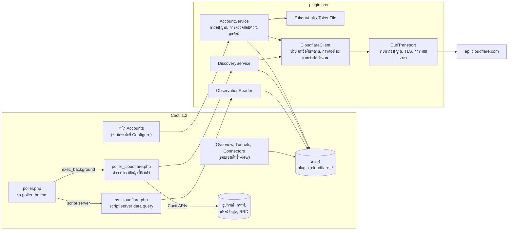

<!-- Source: README.md; SHA256: f8de0e02c5904e15bfa4c71edcaab219e5e5d4f6d9dbe589f4ed16351df6bf4d -->

<!-- translations:start -->
[English](../../../README.md) | [简体中文](../zh-CN/README.md) | [हिन्दी](../hi-IN/README.md) | [Español (España)](../es-ES/README.md) | [Español (Latinoamérica)](../es-419/README.md) | [العربية (السعودية)](../ar-SA/README.md) | [Afrikaans](../af-ZA/README.md) | [አማርኛ](../am-ET/README.md) | [العربية (مصر)](../ar-EG/README.md) | [العربية (المغرب)](../ar-MA/README.md) | [বাংলা](../bn-BD/README.md) | [Bosanski](../bs-BA/README.md) | [Deutsch](../de-DE/README.md) | [فارسی](../fa-IR/README.md) | [Filipino](../fil-PH/README.md) | [Français](../fr-FR/README.md) | [Français (Maroc)](../fr-MA/README.md) | [Français (Sénégal)](../fr-SN/README.md) | [Hausa](../ha-NG/README.md) | [עברית](../he-IL/README.md) | [Hrvatski](../hr-HR/README.md) | [Bahasa Indonesia](../id-ID/README.md) | [Igbo](../ig-NG/README.md) | [Italiano](../it-IT/README.md) | [日本語](../ja-JP/README.md) | [한국어](../ko-KR/README.md) | [Malagasy](../mg-MG/README.md) | [मराठी](../mr-IN/README.md) | [Bahasa Melayu](../ms-MY/README.md) | [Nederlands](../nl-NL/README.md) | [Polski](../pl-PL/README.md) | [Português (Brasil)](../pt-BR/README.md) | [Русский](../ru-RU/README.md) | [Kinyarwanda](../rw-RW/README.md) | [Soomaali](../so-SO/README.md) | [Српски](../sr-RS/README.md) | [Svenska](../sv-SE/README.md) | [Kiswahili](../sw-KE/README.md) | [தமிழ்](../ta-IN/README.md) | [తెలుగు](../te-IN/README.md) | [ไทย](README.md) | [Türkçe](../tr-TR/README.md) | [Українська](../uk-UA/README.md) | [اردو](../ur-PK/README.md) | [Tiếng Việt](../vi-VN/README.md) | [isiXhosa](../xh-ZA/README.md) | [Yorùbá](../yo-NG/README.md) | [繁體中文](../zh-TW/README.md) | [isiZulu](../zu-ZA/README.md)
<!-- translations:end -->

<p align="center">
  
</p>

# ปลั๊กอิน Cloudflare สำหรับ Cacti

[](https://github.com/somethingwithproof/plugin_cloudflare/actions/workflows/ci.yml)
[](https://sonarcloud.io/summary/new_code?id=somethingwithproof_plugin_cloudflare)
[](../../../LICENSE)


[](https://sonarcloud.io/summary/new_code?id=somethingwithproof_plugin_cloudflare)
[](https://sonarcloud.io/summary/new_code?id=somethingwithproof_plugin_cloudflare)
[](https://sonarcloud.io/summary/new_code?id=somethingwithproof_plugin_cloudflare)


ปลั๊กอินสำหรับ Cacti 1.2 ที่กำลังพัฒนาขึ้นเพื่อตรวจสอบการทำงานของ Cloudflare Tunnels และข้อมูลวิเคราะห์ระดับโซน โดยปลั๊กอินจะอ่านข้อมูลจาก Cloudflare API ด้วยโทเค็น API ที่จำกัดขอบเขตสิทธิ์ไว้ ไม่มีการเปลี่ยนแปลงค่าใด ๆ ใน Cloudflare และจัดเก็บข้อมูลไว้ในตารางฐานข้อมูลของตนเอง สำหรับฝั่ง Cacti ปลั๊กอินจะคัดลอกไฟล์ XML ของ data query ไปยัง `resource/script_server/` และสร้างอุปกรณ์ กราฟ และเทมเพลตผ่าน API ของ Cacti เองโดยไม่มีการแก้ไขไฟล์หลักของระบบ

**สถานะ: 0.4.0-dev ยังไม่เผยแพร่** เวอร์ชันที่เผยแพร่ล่าสุดคือ 0.3.0 เวอร์ชันที่กำลังพัฒนาได้เพิ่มการส่งออกรายการทรัพยากรเป็น CSV การปลดระวางทันเนลที่ถูกลบอย่างชัดเจน ข้อมูลวิเคราะห์โซนแบบแคช และเทมเพลต Thold แบบเลือกใช้ได้ การทดสอบรับรองกับผู้ให้บริการจริงและการติดตั้งใช้งานจริงยังอยู่ระหว่างดำเนินการ

ตารางด้านล่างนี้อธิบายความสามารถของรุ่นเสถียร 0.3.0 ส่วนความสามารถที่เพิ่มเข้ามาในเวอร์ชันพัฒนาได้อธิบายไว้ในหัวข้อขั้นตอนการทำงานของผู้ปฏิบัติงานและข้อมูลวิเคราะห์โซนด้านล่าง

| พร้อมใช้งานแล้ว | ตามแผนพัฒนา |
|---|---|
| ติดตั้ง อัปเกรด ปิดใช้งาน และถอนการติดตั้งผ่านตัวจัดการปลั๊กอินของ Cacti | ข้อมูลวิเคราะห์ GraphQL และการแจ้งเตือน Thold (ระยะที่ 4) |
| สิทธิ์การใช้งาน Cloudflare: View, Operator และ Configure | การจำลองความขัดข้อง (Fault injection), โมเดล TLA+ และเอกสารฉบับสมบูรณ์ (ระยะที่ 5) |
| เพิ่ม แก้ไข ลบ เปิดใช้งาน และปิดใช้งานบัญชี Cloudflare | |
| จัดเก็บโทเค็นไว้ในไฟล์หรือเข้ารหัสไว้ในฐานข้อมูลของ Cacti | |
| ตรวจสอบโทเค็นและตรวจเช็กสิทธิ์การอ่านทันเนลและโซน | |
| ค้นหาทันเนลและตัวเชื่อมต่อในตัวรวบรวมข้อมูลพื้นหลังที่เริ่มทำงานโดย poller หลัก | |
| หน้า Overview, Tunnels และ Connectors ภายใต้ Management > Cloudflare Tunnels | |
| การติดตามวงจรชีวิต: `active`, `unavailable` และ `deleted` | |
| อุปกรณ์ Cacti หนึ่งรายการต่อหนึ่งบัญชี ซึ่งสร้างโดยผู้ดูแลระบบ โดยมีทันเนลเป็นดัชนีของ data query | |
| กราฟ Connectors, Health และ Collection แยกตามทันเนล โดยดึงข้อมูลจากไฟล์ RRD หนึ่งไฟล์ต่อหนึ่งทันเนล | |
| ค่าที่ปลั๊กอินไม่สามารถยืนยันความถูกต้องได้จะถูกจัดเก็บเป็นค่าไม่ทราบ (`U`) และจะไม่ถูกบันทึกเป็น 0 | |

## บทบาทการเข้าถึง

| ขอบเขตสิทธิ์ | การเข้าถึง |
| --- | --- |
| Cloudflare: View | หน้าการตรวจสอบที่มีอยู่เดิม |
| Cloudflare: Operator | การตรวจสอบ รวมถึงหน้า Operations และการรับทราบปัญหาเฉพาะบุคคลเพื่อคัดกรอง |
| Cloudflare: Configure | สิทธิ์ระดับ Operator รวมถึงการกำหนดค่าที่มีอยู่เดิมและการดำเนินการด้านการดูแลระบบ |

หลังจากคัดลอกไฟล์อัปเกรดแล้ว ให้เปิดหน้า Plugins ในฐานะผู้ดูแลระบบเพื่อลงทะเบียนขอบเขตสิทธิ์ใหม่ กำหนดขอบเขตสิทธิ์ Operator อย่างชัดเจนภายใต้ **Configuration > Users** หรือกลุ่มผู้ใช้ การอัปเกรดจะยังคงรหัสและสิทธิ์ที่มอบหมายไว้ของขอบเขตสิทธิ์ View และ Admin เดิม สิทธิ์ Admin จะสืบทอดสิทธิ์ Operator และสิทธิ์ Operator จะสืบทอดสิทธิ์ View ในทุกคำขอ โดยการสืบทอดนี้ไม่ได้เพิ่มรายการสิทธิ์ที่จัดเก็บไว้ให้กับผู้ใช้หรือกลุ่มผู้ใช้ การตั้งค่าปลั๊กอินจำเป็นต้องมีสิทธิ์ Cloudflare: Configure นอกเหนือจากสิทธิ์ Settings ของ Cacti ด้วย

การมองเห็นบัญชี Cloudflare จะสอดคล้องกับขอบเขตสิทธิ์ View เดิม ซึ่งครอบคลุมทั้งบัญชี ข้อมูลรับรอง การกำหนดค่า การจับคู่ การลบ และการเปลี่ยนแปลงด้านการดูแลระบบอื่น ๆ จะยังคงอยู่ในหน้าการดูแลระบบ การรับทราบปัญหาจะคงอยู่เฉพาะในเซสชันของผู้ใช้ปัจจุบันเท่านั้น เป็นเวลาไม่เกินหนึ่งชั่วโมงและตราบเท่าที่ข้อมูลสังเกตการณ์เดิมยังคงใหม่อยู่ ข้อมูลสังเกตการณ์ใหม่หรือที่เปลี่ยนแปลงไปจะทำให้การรับทราบนั้นสิ้นผล และการรับทราบจะไม่ทำให้การวัดผลที่ล้มเหลวถูกมองว่าปกติหรือระงับการแจ้งเตือนแต่อย่างใด

## เหตุผลในการพัฒนาปลั๊กอินนี้

ผู้ดูแลระบบ Cacti ที่เผยแพร่บริการผ่าน Cloudflare Tunnel จะไม่มีมุมมองของทันเนลภายใน Cacti ทันเนลอาจสูญเสียตัวเชื่อมต่อทั้งหมดไปในขณะที่โฮสต์ต้นทางยังคงตอบสนองต่อ SNMP ทำให้กราฟที่มีอยู่ยังคงเป็นสีเขียวในขณะที่ผู้ใช้งานพบข้อผิดพลาด เป้าหมายของปลั๊กอินนี้คือการนำข้อมูลสถานะทันเนลและปริมาณทราฟฟิกของโซนมาแสดงไว้เคียงข้างกราฟอุปกรณ์ที่ผู้ดูแลระบบเฝ้าติดตามอยู่แล้ว โดยไม่ให้ Cacti มีความสามารถในการเปลี่ยนแปลงค่าใด ๆ ใน Cloudflare

ข้อจำกัดสามประการที่เป็นตัวกำหนดการออกแบบ:

- **แบบอ่านอย่างเดียว** ปลั๊กอินจะเรียกใช้เฉพาะจุดเชื่อมต่อ `GET` และ GraphQL Analytics API เท่านั้น โดยไม่ต้องการสิทธิ์แก้ไขบนทรัพยากรใด ๆ ของ Cloudflare
- **ไม่เป็นภาระต่อระบบหลัก** เหตุขัดข้องของ Cloudflare โทเค็นที่หมดอายุ หรือการจำกัดอัตราการเรียกใช้ต้องไม่ทำให้ UI ของ Cacti ช้าลงหรือขัดขวางการสำรวจอุปกรณ์อื่น ๆ การเรียก API ทั้งหมดมีการกำหนดเวลาหมดเขตที่แน่นอน และการรวบรวมข้อมูลจะทำงานในกระบวนการพื้นหลังที่เรียกใช้งานโดย poller
- **ไม่แก้ไขไฟล์หลัก** ปลั๊กอินใช้ฮุกปลั๊กอินของ Cacti 1.2 และตารางฐานข้อมูลของตนเอง โดยคัดลอกไฟล์ XML ของ data query หนึ่งไฟล์ไปยัง `resource/script_server/` และสร้างอุปกรณ์ กราฟ และเทมเพลตผ่าน API ของ Cacti เอง ไม่มีการเปลี่ยนแปลงไฟล์หลัก ดังนั้นการอัปเกรด Cacti และปลั๊กอินอื่น ๆ จึงไม่ได้รับผลกระทบ

## หลักการทำงาน



- **ส่วนเชื่อมต่อ Cacti** (`setup.php`, `includes/`, สคริปต์หน้าเว็บ) ทำหน้าที่ลงทะเบียนฮุกและขอบเขตสิทธิ์ แสดงผลหน้าเว็บด้วยตัวช่วยของ Cacti เอง และส่งต่อการดำเนินการทั้งหมดไปยังไลบรารีใน `src/`
- **ไลบรารี** (`src/`, เนมสเปซ `Somethingwithproof\Cloudflare\`) ไม่มีการพึ่งพาตัวแปรโกลบอลของ Cacti จึงสามารถทดสอบกับฐานข้อมูลจริงและตัวส่งข้อมูล HTTP จำลองได้โดยไม่จำเป็นต้องรัน Cacti
- **เส้นทางออกทางเครือข่ายเพียงเส้นทางเดียว** `CurlTransport` เป็นโค้ดเพียงส่วนเดียวที่เชื่อมต่อเครือข่าย และยอมรับเฉพาะ `https://api.cloudflare.com` เท่านั้น ความล้มเหลวแต่ละรายการจะถูกจับคู่กับประเภทข้อผิดพลาดหนึ่งประเภท (`auth`, `permission`, `rate_limited`, `transient`, ...) ซึ่งเป็นตัวกำหนดสถานะที่แสดงใน UI
- **การจัดเก็บข้อมูล** ดำเนินการผ่านการเชื่อมต่อ PDO ของ Cacti เองด้วย prepared statements ส่วนการเปลี่ยนแปลงสคีมาจะเป็นการไมเกรตที่มีหมายเลขกำกับและทำงานซ้ำได้โดยไม่เกิดผลกระทบซ้ำซ้อน

ดูรายละเอียดการตัดสินใจด้านการออกแบบและเหตุผลได้ที่ [docs/design.md](../../design.md)

## ภาพหน้าจอ

ภาพหน้าจอเหล่านี้มาจากชุดระบบทดสอบ ไม่ใช่บัญชี Cloudflare จริง โดยชุดระบบทดสอบรัน Cacti 1.2.31 ร่วมกับ Cloudflare API จำลองที่ส่งคืนข้อมูลตัวอย่าง ดังนั้นบัญชี รหัสบัญชี และทันเนลทั้งสามรายการจึงเป็นข้อมูลสมมติ


*รายการบัญชี Cloudflare โดย API จำลองยอมรับโทเค็น ดังนั้นการตรวจสอบจึงรายงานสถานะเป็น `ok`*


*การแก้ไขบัญชี ช่องกรอกโทเค็นจะว่างเปล่าเสมอและจะไม่มีการส่งโทเค็นที่จัดเก็บไว้กลับไปยังเบราว์เซอร์ โดยเปิดใช้งาน Collect Tunnels และ Create Graphs และปิดใช้งาน Collect Analytics ตาราง Connection Status แสดงผลลัพธ์ของการตรวจสอบล่าสุด: `ok`, ได้รับสิทธิ์อ่านทันเนล และขาดสิทธิ์อ่านโซน*


*Settings > Cloudflare*


*Management > Cloudflare Tunnels > Overview สถานะที่แสดงคือสถานะ Cloudflare ที่แย่ที่สุดในบรรดาทันเนลที่ใช้งานอยู่ของบัญชีนั้น ซึ่งในที่นี้คือ `down` เนื่องจากทันเนลตัวอย่างหนึ่งรายการอยู่ในสถานะล่ม สถานะ `Disabled`, `Not collected`, `Collection failing` และ `Not yet collected` จะมีลำดับความสำคัญเหนือสถานะสุขภาพของทันเนลตามลำดับดังกล่าว ดังนั้นบัญชีที่การรันครั้งล่าสุดล้มเหลวจะแสดงเป็น `Collection failing` ไม่ว่าทันเนลจะรายงานสถานะใดก็ตาม*


*แท็บ Tunnels ช่อง Connectors และ Connections แสดง `-` สำหรับ old-office เนื่องจาก API จำลองตอบกลับคำขอการเชื่อมต่อว่าเป็นทันเนลที่ไม่รู้จักจึงไม่มีการจัดเก็บข้อมูล และแสดง 0 สำหรับ staging ซึ่งไม่มีตัวเชื่อมต่อที่กำลังทำงานอยู่*


*กราฟ Connectors ของทันเนล blog เส้นกราฟทั้งสามเส้นมีค่าเป็น 1 ทั้งก่อนและหลังช่วงที่ขาดหายไปตรงกลาง ซึ่งเป็นช่วงที่ API จำลองส่งคืนข้อผิดพลาดและปลั๊กอินจัดเก็บเป็นค่าไม่ทราบ เส้นกราฟจึงไม่ตกลงไปที่ 0 กราฟนี้มาจากชุดข้อมูลจำลองเดียวกัน (`make screenshots`) ซึ่งตั้งค่า step ไว้ที่ 30 วินาทีสำหรับแหล่งข้อมูลนี้เพียงรายการเดียวเพื่อให้การสำรวจเจ็ดนาทีสามารถแสดงข้อมูลเต็มกราฟได้*

## ข้อกำหนด

- Cacti 1.2.25 ถึง 1.2.31 โดย Cacti 1.2.31 ต้องใช้ PHP 8.0 ขึ้นไป
  CI ทดสอบเฉพาะ 1.2.31 เท่านั้น ส่วน 1.2.25 ทดสอบด้วยตนเองครั้งล่าสุดเมื่อวันที่ 2026-10-22
- PHP 7.4 ถึง 8.4 พร้อมส่วนขยาย `curl`, `openssl` และ `pdo_mysql`
  ปลั๊กอินจะปฏิเสธการเปิดใช้งานหากไม่มีส่วนขยายเหล่านี้
- MariaDB 10.6 ขึ้นไป หรือ MySQL 8.0 ขึ้นไป
- การเข้าถึง HTTPS จากเซิร์ฟเวอร์ Cacti ไปยัง `api.cloudflare.com` ไม่รองรับการใช้งานผ่านพร็อกซี

ดูรายละเอียดสิ่งที่ผ่านการทดสอบได้ที่ [docs/compatibility.md](../../compatibility.md)

## การติดตั้ง

1. วางปลั๊กอินไว้ในไดเรกทอรี `plugins/cloudflare` ของ Cacti โดยแตกไฟล์เก็บถาวรจาก
   [GitHub Releases](https://github.com/somethingwithproof/plugin_cloudflare/releases)
   (การรัน `make package` ในเช็กเอาต์ของแท็กรีลีสจะสร้างไฟล์เก็บถาวรเดียวกัน) หรือโคลนด้วย git
   ไดเรกทอรีต้องมีชื่อว่า `cloudflare`
2. ติดตั้งและเปิดใช้งานจาก Console > Configuration > Plugins หรือใช้ CLI ในฐานะผู้ใช้เว็บเซิร์ฟเวอร์:

   ```sh
   php cli/plugin_manage.php --plugin=cloudflare --install --enable
   ```

3. ผู้ใช้ admin จะได้รับสิทธิ์ Cloudflare: Configure เมื่อติดตั้ง ให้สิทธิ์นี้แก่ผู้ใช้หรือกลุ่มอื่นได้ภายใต้ Console > Configuration > Users
4. สร้างโทเค็นที่มีสิทธิ์ตาม [docs/token-permissions.md](../../token-permissions.md) โดยสรุปคือ:
   Account > Cloudflare Tunnel > Read และเลือกเพิ่ม Zone > Zone > Read ได้ตามต้องการ
5. จัดเก็บโทเค็นด้วยหนึ่งในสองวิธีด้านล่าง จากนั้นเพิ่มบัญชีภายใต้ Console > Configuration > Cloudflare Accounts แล้วรัน Verify จากเมนูการทำงาน

### ตัวเลือก A: เข้ารหัสในฐานข้อมูล

ปลั๊กอินจะเข้ารหัสโทเค็นด้วยคีย์ขนาด 32 ไบต์ที่คุณสร้างขึ้นเอง โดยปลั๊กอินจะไม่สร้างหรือเขียนคีย์นี้เอง ไฟล์ต้องสามารถอ่านได้โดยผู้ใช้เว็บเซิร์ฟเวอร์และ poller ต้องไม่อ่านได้โดยผู้อื่น และไดเรกทอรีที่เก็บไฟล์ต้องอนุญาตให้ผู้ใช้เหล่านั้นเข้าถึงได้ สำหรับเว็บเซิร์ฟเวอร์ที่รันในฐานะ `www-data`:

```sh
sudo mkdir -p /etc/cacti
sudo sh -c 'umask 077 && openssl rand -hex 32 > /etc/cacti/cloudflare.key'
sudo chgrp www-data /etc/cacti/cloudflare.key
sudo chmod 0440 /etc/cacti/cloudflare.key
```

พาธเริ่มต้นคือ `/etc/cacti/cloudflare.key` สามารถเปลี่ยนได้ภายใต้ Settings > Cloudflare > Token Vault Key File เมื่อไม่มีไฟล์คีย์หรือถูกปฏิเสธ ฟอร์มแก้ไขจะแสดงเฉพาะตัวเลือกไฟล์โทเค็นเท่านั้น ควรสำรองข้อมูลคีย์ไว้ด้วย: หากไม่มีคีย์ จะไม่สามารถถอดรหัสโทเค็นที่จัดเก็บไว้ได้และต้องป้อนใหม่อีกครั้ง

#### การหมุนเวียนคีย์

ไม่มีคำสั่งสำหรับเปลี่ยนคีย์ คีย์ใหม่ไม่สามารถถอดรหัสโทเค็นที่จัดเก็บภายใต้คีย์เดิมได้ ดังนั้นการหมุนเวียนคีย์จึงหมายถึงการป้อนโทเค็นที่จัดเก็บไว้แต่ละรายการใหม่อีกครั้ง:

1. เตรียมค่าโทเค็นของแต่ละบัญชีไว้ให้พร้อม Cloudflare จะแสดงค่าโทเค็นเฉพาะตอนที่สร้างหรือหมุนเวียนเท่านั้น ดังนั้นให้หมุนเวียนโทเค็นในแดชบอร์ดของ Cloudflare หากคุณไม่มีค่าโทเค็นเก็บไว้แล้ว
2. สร้างคีย์ใหม่ที่พาธใหม่ด้วยคำสั่งด้านบน เช่น `/etc/cacti/cloudflare.key.new` โดยใช้เจ้าของและสิทธิ์เดียวกัน
3. ตั้งค่า Settings > Cloudflare > Token Vault Key File เป็นพาธใหม่แล้วบันทึก จากนี้ไป Verify บนบัญชีที่ยังเข้ารหัสด้วยคีย์เดิมจะรายงานว่า "Stored token cannot be decrypted" และตัวเก็บรวบรวมข้อมูลแต่ละรอบจะบันทึกข้อความ `discovery token unavailable` พร้อม `reason=decrypt_failed` สำหรับบัญชีนั้น
4. สำหรับแต่ละบัญชีที่จัดเก็บโทเค็นไว้ในฐานข้อมูล ให้เปิดภายใต้ Console > Configuration > Cloudflare Accounts วางโทเค็นลงในช่องโทเค็นทั้งสองช่อง บันทึก แล้วรัน Verify ซึ่งควรรายงานผลเป็น `ok`
5. เมื่อบัญชีดังกล่าวทั้งหมดผ่านการตรวจสอบแล้ว ให้ลบไฟล์คีย์เดิมและไฟล์สำรองออก

ระหว่างขั้นตอนที่ 3 และ 4 ทันเนลของบัญชีจะไม่ได้รับการรีเฟรช และกราฟสถานะสุขภาพ คอนเนกเตอร์ และการเชื่อมต่อจะบันทึกค่าเป็น U ส่วนบัญชีที่ใช้ไฟล์โทเค็นจะไม่ได้รับผลกระทบ

### ตัวเลือก B: ไฟล์โทเค็น

เขียนเฉพาะโทเค็นเท่านั้น ลงในไฟล์ที่ผู้ใช้เว็บเซิร์ฟเวอร์และ poller อ่านได้แต่ผู้อื่นอ่านไม่ได้ จากนั้นป้อนพาธแบบเต็มลงในฟอร์มแก้ไข:

```sh
sudo sh -c 'umask 077 && cat > /etc/cacti/cloudflare-account.token'   # paste the token, then Ctrl-D
sudo chgrp www-data /etc/cacti/cloudflare-account.token
sudo chmod 0440 /etc/cacti/cloudflare-account.token
```

ไฟล์จะถูกตรวจสอบเมื่อมีการอ่านตอนรัน Verify ไม่ใช่ตอนที่คุณบันทึก ระบบจะปฏิเสธลิงก์สัญลักษณ์ ไฟล์ที่มีขนาดเกิน 4 KiB และไฟล์ที่ผู้อื่นอ่านหรือเขียนได้

ผู้ใดก็ตามที่มีสิทธิ์ Cloudflare: Configure สามารถป้อนพาธใดก็ได้ และผู้ใช้ poller จะเป็นผู้อ่านไฟล์นั้น หากต้องการเก็บไฟล์โทเค็นไว้ในที่เดียว ให้ตั้งค่า Settings > Cloudflare > Token File Directory เช่น `/etc/cacti` จากนั้นพาธที่อยู่นอกไดเรกทอรีดังกล่าวจะถูกปฏิเสธ ดูเพิ่มเติมที่ [docs/security.md](../../security.md#token-file)

## การอัปเกรด

1. แทนที่ไฟล์ใน `plugins/cloudflare` ด้วยรีลีสใหม่ โดยคงชื่อไดเรกทอรีเดิมไว้
2. เปิด Console > Configuration > Plugins หรือ Console > Configuration > Cloudflare Accounts หนึ่งครั้งในฐานะผู้ดูแลระบบ การดำเนินการนี้จะรันการย้ายฐานข้อมูลของปลั๊กอิน นำเข้าเทมเพลต Cloudflare และคัดลอกไฟล์ data query (ดู [เมตริกและกราฟของทันเนล](#tunnel-metrics-and-graphs)) และเมื่ออัปเกรดจากเวอร์ชัน 0.1.0 จะลงทะเบียนฮุก `poller_bottom` ด้วย

`poller.php` ไม่ได้รันการอัปเกรดของปลั๊กอิน ดังนั้นจนกว่าจะทำขั้นตอนที่ 2 เสร็จสิ้น สคีมาใหม่จะยังไม่ถูกสร้างขึ้น ตัวเก็บรวบรวมข้อมูลแต่ละรอบจะไม่ทำงานและจะบันทึกข้อความ `CLOUDFLARE: collector skipped; plugin upgrade pending, open Console > Plugins` ส่วนหน้า Cloudflare Tunnels ใช้เพียงสิทธิ์ Cloudflare: View จึงไม่เคยรันการอัปเกรด และจนกว่าจะทำขั้นตอนที่ 2 หน้าเหล่านี้อาจแสดงข้อความ "The Cloudflare tunnels could not be read"

## สถานะบัญชี

Verify จะกำหนดสถานะของบัญชีดังนี้:

| สถานะ | ความหมาย |
|---|---|
| `unknown` | ยังไม่ได้ตรวจสอบนับตั้งแต่เพิ่มบัญชีหรือมีการเปลี่ยนแปลงข้อมูลรับรอง |
| `ok` | โทเค็นใช้งานได้และสามารถอ่านข้อมูลทันเนลได้ |
| `token_inactive` | Cloudflare รายงานว่าโทเค็นถูกปิดใช้งานหรือหมดอายุแล้ว |
| `auth_failed` | Cloudflare ปฏิเสธโทเค็นเนื่องจากไม่ถูกต้องหรือหมดอายุ (HTTP 401) |
| `permission_denied` | โทเค็นใช้งานได้แต่ไม่สามารถอ่านข้อมูลทันเนล หรือไม่มีสิทธิ์เรียกเอนด์พอยต์ตรวจสอบโทเค็น (HTTP 403) |
| `unreachable` | ไม่สามารถเข้าถึง API ได้ หมดเวลาการเชื่อมต่อ หรือได้รับข้อผิดพลาดจากเซิร์ฟเวอร์ |
| `rate_limited` | Cloudflare ตอบกลับด้วย HTTP 429 |
| `error` | ความล้มเหลวอื่น ๆ รวมถึงไฟล์โทเค็นที่สูญหายหรือไม่ปลอดภัย ไฟล์คีย์คลังโทเค็นที่สูญหายหรือไม่สามารถใช้งานได้ หรือโทเค็นที่จัดเก็บไว้ไม่สามารถถอดรหัสได้ |

หน้าแก้ไขยังแสดงด้วยว่าได้รับสิทธิ์อ่านข้อมูลทันเนลและสิทธิ์อ่านโซนหรือไม่

## การค้นพบทันเนล

หลังจากแต่ละรอบการโพลล์บน poller หลัก ฮุก `poller_bottom` จะเริ่มตัวเก็บรวบรวมข้อมูลเบื้องหลังด้วย `exec_background` เมื่อมีบัญชีที่เปิดใช้งานอย่างน้อยหนึ่งบัญชีเปิดใช้ Collect Tunnels ตัวเก็บรวบรวมข้อมูลจะไม่รันในโปรเซสของ poller ดังนั้นหาก Cloudflare API ช้าจะไม่ทำให้ `poller.php` ล่าช้า ส่วน poller ระยะไกลจะไม่เริ่มการทำงานนี้

สำหรับแต่ละบัญชีที่ถึงกำหนด ตัวเก็บรวบรวมข้อมูลจะดึงรายการทันเนลของบัญชี จากนั้นอ่านการเชื่อมต่อของทันเนลที่ใช้งานอยู่ ซึ่งจะได้คอนเนกเตอร์ เวอร์ชัน ศูนย์ข้อมูล และแอดเดรสต้นทางของแต่ละทันเนล บัญชีจะถึงกำหนดทุก ๆ Discovery Interval (ค่าเริ่มต้น 300 วินาที) การรันหนึ่งรอบจะไม่เริ่มบัญชีใหม่หลังจากผ่านไป 50 วินาที และส่งคำขออ่านการเชื่อมต่อได้สูงสุด 200 ครั้ง ขีดจำกัดอย่างใดอย่างหนึ่งอาจหยุดการทำงานของบัญชีกลางคันระหว่างอ่านการเชื่อมต่อได้ บัญชีนั้นจะถูกบันทึกเป็น `partial` และรอบถัดไปจะดำเนินการต่อจากทันเนลที่ถูกพยายามอ่านน้อยครั้งที่สุดล่าสุด ส่วนบัญชีที่ยังไม่ได้เริ่มจะยังคงสถานะถึงกำหนดไว้สำหรับรอบถัดไป

ทันเนลมีวงจรชีวิตที่แยกต่างหากจากสถานะที่ Cloudflare รายงาน (`healthy`, `degraded`, `down` หรือ `inactive`):

| วงจรชีวิต | ความหมาย |
|---|---|
| `active` | ทันเนลอยู่ในรายการที่ดึงได้ครบถ้วนครั้งล่าสุด |
| `deleted` | รายการที่ดึงได้ครบถ้วนไม่ได้รวมทันเนลนี้ไว้ ซึ่งรวมถึงรายการที่ว่างเปล่าด้วย แถวข้อมูลและประวัติจะยังคงอยู่ และทันเนลจะกลับมาเป็น `active` อีกครั้งหากปรากฏขึ้นใหม่ |
| `unavailable` | เกิดเหตุขัดข้องที่นับรวมได้ครบสามครั้งโดยไม่มีการดึงรายการที่ครบถ้วนคั่นกลาง ทำให้ไม่ทราบสถานะของทันเนล |

เฉพาะการดึงรายการที่ครบถ้วนและสำเร็จเท่านั้นที่จะเพิ่ม อัปเดต หรือลบทันเนล และการดึงรายการที่ล้มเหลวจะไม่มีวันลบทันเนล ความล้มเหลวในการอ่านข้อมูลจาก Cloudflare โดยสิ้นเชิง (`transient`, `rate_limited`, `auth` หรือ `permission`) จะถูกนับรวมเป็นเหตุขัดข้อง หลังจากเกิดเหตุขัดข้องที่นับรวมได้ครบสามครั้งโดยไม่มีการดึงรายการที่ครบถ้วนคั่นกลาง ทันเนลที่ `active` อยู่ของบัญชีจะเปลี่ยนเป็น `unavailable` การดึงรายการที่ครบถ้วนครั้งถัดไปจะกู้คืนสถานะและรีเซ็ตตัวนับ ทันเนลที่ Cloudflare ไม่รู้จักอีกต่อไปในขณะที่อ่านการเชื่อมต่อจะถูกข้ามไปโดยไม่ทำให้บัญชีล้มเหลว ความล้มเหลวอื่น ๆ จะไม่เพิ่มหรือรีเซ็ตตัวนับเหตุขัดข้อง

ใน `cacti.log` บรรทัดของการค้นพบจะขึ้นต้นด้วย `CLOUDFLARE: discovery` และสรุปผลการรันจะขึ้นต้นด้วย `CLOUDFLARE: collector` ความล้มเหลวและการเปลี่ยนแปลงวงจรชีวิต เช่น การดึงรายการที่ล้มเหลวหรือทันเนลที่ถูกทำเครื่องหมายเป็น `unavailable` จะถูกบันทึกในระดับเริ่มต้น `LOW` ของ Cacti ส่วนผลลัพธ์ของแต่ละบัญชีและสรุปผลการรันจะบันทึกในระดับ `MEDIUM` เนื่องจากการอ่านการเชื่อมต่ออาจล้มเหลวได้ในทุกทันเนล ดังนั้นสำหรับแต่ละบัญชีจะบันทึกเฉพาะความล้มเหลวแรกของแต่ละคลาสข้อผิดพลาดในระดับ `LOW` ส่วนที่เหลือในระดับ `MEDIUM` ตามด้วยบรรทัดระดับ `LOW` หนึ่งบรรทัดต่อคลาสพร้อมจำนวนทันเนลที่ล้มเหลว

หน้า Management > Cloudflare Tunnels ต้องใช้สิทธิ์ Cloudflare: View และเป็นแบบอ่านอย่างเดียว:

- **Overview** แสดงรายการแต่ละบัญชีพร้อมสถานะ จำนวนทันเนลแยกตามวงจรชีวิต การค้นพบที่สำเร็จล่าสุด และจำนวนความล้มเหลวต่อเนื่อง
- **Tunnels** แสดงรายการทันเนลข้ามบัญชีหรือสำหรับบัญชีเดียว พร้อมตัวกรองสำหรับบัญชี วงจรชีวิต สถานะ และชื่อ รวมถึงคอลัมน์ที่จัดเรียงได้
- **Connectors** แสดงคอนเนกเตอร์ของทันเนลที่เลือกไว้ในแท็บ Tunnels

## เมตริกและกราฟของทันเนล

Cacti อ่านสถานะทันเนลผ่านสคริปต์เซิร์ฟเวอร์ data query ชื่อ `ss_cloudflare.php` สคริปต์นี้ตอบกลับจากตารางของปลั๊กอินเท่านั้นและไม่เคยเรียกไปยัง Cloudflare ดังนั้นเหตุขัดข้องของ Cloudflare จึงไม่ทำให้ poller ช้าลง ทันเนลแต่ละตัวให้ค่าหกค่า ได้แก่ สถานะสุขภาพ (healthy 3, degraded 2, down 1, inactive 0), คอนเนกเตอร์, การเชื่อมต่อ, เวอร์ชันของคอนเนกเตอร์, จำนวนวินาทีนับตั้งแต่ครั้งล่าสุดที่อ่านการเชื่อมต่อ และจำนวนความล้มเหลวต่อเนื่องของงานค้นพบ ค่าสถานะสุขภาพ คอนเนกเตอร์ การเชื่อมต่อ และเวอร์ชันจะถูกพิมพ์ออกมาเฉพาะเมื่อปลั๊กอินสามารถรับรองค่าเหล่านั้นได้เท่านั้น ซึ่งหมายความว่าการค้นพบครั้งล่าสุดสำเร็จ ทันเนลอยู่ในสถานะ `active` และข้อมูลยังเป็นปัจจุบัน มิฉะนั้นค่าเหล่านี้จะเป็น `U` และกราฟจะแสดงเป็นช่องว่างแทนที่จะเป็นศูนย์ซึ่งอาจดูเหมือนเหตุขัดข้อง ส่วนค่าการเก็บรวบรวมสองค่าจะยังคงพิมพ์ออกมาในระหว่างที่เกิดเหตุขัดข้อง เพื่อให้กราฟ Collection แสดงให้เห็นได้ โดยค่าทั้งสองจะเป็น `U` เฉพาะสำหรับทันเนลที่ถูกลบหรือทันเนลที่ไม่เคยรีเฟรชการเชื่อมต่อเลยเท่านั้น กฎเหล่านี้อยู่ใน [docs/metrics.md](../../metrics.md)

### สร้างอุปกรณ์

หนึ่งบัญชีจะจับคู่กับอุปกรณ์ Cacti ได้สูงสุดหนึ่งรายการ อุปกรณ์นี้ใช้เก็บทันเนลของบัญชีเป็นดัชนีของ Cloudflare Tunnels data query ไม่มีระบบใดสร้างอุปกรณ์นี้โดยอัตโนมัติ:

1. เปิด Console > Configuration > Cloudflare Accounts
2. เลือกบัญชี เลือก Create Cacti Device จากเมนูการทำงาน แล้วกดยืนยัน

การทำงานนี้ต้องใช้ทั้งขอบเขตสิทธิ์ Cloudflare: Configure และ Sites/Devices/Data ของ Cacti (ขอบเขตสิทธิ์สำหรับ `host.php`) รายการเมนูนี้จะปรากฏเฉพาะกับผู้ใช้ที่มีทั้งสองสิทธิ์เท่านั้น และเซิร์ฟเวอร์จะปฏิเสธคำขอจากผู้อื่น อุปกรณ์จะตั้งชื่อว่า `Cloudflare: <account name>` ใช้เทมเพลตโฮสต์ Cloudflare Account และ poller หลัก มี SNMP เวอร์ชัน 0 และไม่มีการตรวจสอบความพร้อมใช้งาน และได้รับชื่อโฮสต์เป็น `<account ID>.cloudflare.invalid` ชื่อนี้ถูกสงวนไว้และจะไม่มีการแปลงชื่อ โดย Cacti จะไม่เชื่อมต่อกับชื่อนี้ หากบัญชีมีอุปกรณ์อยู่แล้ว การทำงานนี้จะแจ้งเตือนและไม่เปลี่ยนแปลงสิ่งใด หากผู้ดูแลระบบลบอุปกรณ์ใน Cacti ปลั๊กอินจะไม่สร้างใหม่จนกว่าจะรัน Create Cacti Device อีกครั้ง

### สร้างกราฟ

ตัวเลือก Create Graphs ในฟอร์มบัญชีจะปิดไว้ตามค่าเริ่มต้น เมื่อเปิดใช้งาน ทุกครั้งที่การค้นพบของบัญชีจบลงด้วย `ok` หรือ `partial` ตัวเก็บรวบรวมข้อมูลจะจัดทำดัชนีอุปกรณ์ใหม่และสร้างกราฟที่ขาดอยู่สำหรับทันเนลที่ `active` ของบัญชี ได้แก่ Connectors, Health และ Collection รวมสามกราฟต่อทันเนล กราฟทั้งสามของทันเนลหนึ่งตัวจะใช้ไฟล์ RRD ร่วมกัน การรันหนึ่งรอบจะสร้างกราฟได้สูงสุด 50 กราฟและหยุดหลังจาก 20 วินาที จากนั้นรอบถัดไปจะดำเนินการต่อ ปลั๊กอินจะไม่ลบอ็อบเจกต์ของ Cacti ออก กราฟที่ผู้ดูแลระบบลบไปจะไม่ถูกสร้างขึ้นใหม่อีก และทันเนลที่ Cloudflare ไม่แสดงรายการแล้วจะยังคงกราฟและไฟล์ RRD ไว้ โดยจะแสดงค่าเป็น `U`

การเปิด Create Graphs ต้องใช้ขอบเขตสิทธิ์ทั้งสองอย่าง ส่วนการปิดใช้เพียง Configure เท่านั้น ผู้ใช้ที่ไม่มีขอบเขตสิทธิ์ Sites/Devices/Data เมื่อบันทึกฟอร์มจะคงการตั้งค่าไว้ตามเดิมพร้อมข้อความแจ้งเตือน เมื่อปิด Create Graphs อุปกรณ์จะยังคงถูกจัดทำดัชนีใหม่หลังการค้นพบแต่ละครั้ง เพื่อให้ทันเนลใหม่ปรากฏเป็นดัชนีของ data query

### ไฟล์ data query

Cacti 1.2.31 อ่านไฟล์ XML ของ data query จากภายในไดเรกทอรี `resource` ของตนเท่านั้น ดังนั้นเมื่อติดตั้งและอัปเกรด ปลั๊กอินจึงคัดลอกไฟล์หนึ่งไฟล์คือ `templates/resource/cloudflare_tunnels.xml` ไปยัง `<Cacti>/resource/script_server/cloudflare_tunnels.xml` นี่เป็นไฟล์เดียวที่ปลั๊กอินเขียนไว้นอกไดเรกทอรีของตัวเอง ดังนั้นผู้ใช้ที่ติดตั้งหรืออัปเกรดปลั๊กอินต้องสามารถเขียนลงในไดเรกทอรีนั้นได้
การถอนการติดตั้งจะคงไฟล์นี้ไว้ พร้อมกับอุปกรณ์ กราฟ ไฟล์ RRD และเทมเพลตต่าง ๆ หากการคัดลอกหรือการนำเข้าเทมเพลตล้มเหลว ปลั๊กอินจะบันทึกเหตุการณ์ไว้ และ Create Cacti Device จะลองดำเนินการใหม่อีกครั้ง

## การตั้งค่า

หน้า Settings > Cloudflare ประกอบด้วยตัวเลือกต่อไปนี้:

- **Token Vault Key File**: เส้นทางไปยังไฟล์คีย์ของห้องนิรภัย
- **Token File Directory**: เมื่อกำหนดค่าไว้ ระบบจะปฏิเสธไฟล์โทเค็นที่อยู่นอกไดเรกทอรีนี้ ค่าเริ่มต้นคือเว้นว่างไว้ ซึ่งอนุญาตให้ใช้เส้นทางใดก็ได้ ดูรายละเอียดที่ [docs/security.md](../../security.md#token-file)
- **Interactive Request Timeout**: เวลารวมเป็นวินาทีสำหรับคำขอที่ส่งจากหน้าเว็บ เช่น การกด Verify ค่าเริ่มต้นคือ 10 หากกำหนดค่านอกช่วง 5 ถึง 60 ระบบจะกลับไปใช้ค่า 10
- **Collector Request Timeout**: เวลารวมเป็นวินาทีสำหรับคำขอที่ส่งโดยตัวเก็บข้อมูลเบื้องหลัง ค่าเริ่มต้นคือ 20 หากกำหนดค่านอกช่วง 5 ถึง 60 ระบบจะกลับไปใช้ค่า 20
- **Log Level**: ถูกจัดเก็บไว้ แต่ยังไม่มีส่วนใดอ่านค่านี้มาใช้งาน

ในแบบฟอร์มบัญชี ตัวเลือก Collect Tunnels และ Discovery Interval ใช้ควบคุมการค้นพบทรัพยากร และ Create Graphs ใช้ควบคุมการสร้างกราฟ ส่วน Collect Analytics จะถูกจัดเก็บไว้และยังไม่มีผลในรุ่นนี้

## ภาษา

ปลั๊กอินมาพร้อมชุดคำแปลเป็นภาษาสเปน (สเปน, `es-ES`), ฝรั่งเศส (`fr-FR`), เยอรมัน (`de-DE`), จีนตัวย่อ (`zh-CN`), ฮินดี (`hi-IN`), อาหรับ (`ar-SA`) และญี่ปุ่น (`ja-JP`) Cacti จะแสดงภาษาเหล่านี้เมื่อเปิดใช้งานการรองรับภาษา (Configuration > Settings > General > Language Support) และผู้ใช้เลือกภาษาดังกล่าว นอกจากนี้ยังมีชุดคำแปลภาษาสเปนละตินอเมริกา (`es-419`) รวมมาด้วย แต่ Cacti 1.2 ยังไม่มีโลแคลภาษาสเปนละตินอเมริกาให้เลือก จึงจะมีผลใช้งานต่อเมื่อ Cacti เพิ่มโลแคลดังกล่าวแล้วเท่านั้น ระหว่างนี้ให้เลือกภาษาสเปน (`es-ES`) แทน

ข้อความบางส่วนจะยังคงเป็นภาษาอังกฤษ ได้แก่ ค่าสถานะที่ปลั๊กอินจัดเก็บและแสดงผลตามค่าจริง (`ok`, `active`, `unavailable`, `deleted` รวมถึงสถานะ tunnel ที่ Cloudflare รายงาน) และข้อความทั้งหมดที่ปลั๊กอินบันทึกลงในล็อกของ Cacti

## การถอนการติดตั้งและการเก็บรักษาข้อมูล

การถอนการติดตั้งจะลบตารางของปลั๊กอินเอง ซึ่งจัดเก็บบัญชี โทเค็นที่เข้ารหัส รายการ tunnel ที่ค้นพบ สถานะงาน และบันทึกว่าปลั๊กอินได้สร้างออบเจ็กต์ Cacti ใดไว้บ้าง รวมถึงลบการตั้งค่า `cloudflare_` ทั้งหมด แต่จะไม่ลบไฟล์คีย์ ไฟล์โทเค็น ไฟล์ `resource/script_server/cloudflare_tunnels.xml` ที่คัดลอกไว้ หรืออุปกรณ์ กราฟ แหล่งข้อมูล ไฟล์ RRD หรือเทมเพลตใดๆ ของ Cacti เนื่องจากสิ่งเหล่านี้เก็บข้อมูลการเฝ้าสังเกตย้อนหลังไว้ และการลบออกเป็นการดำเนินการที่ผู้ดูแลระบบต้องสั่งการเองอย่างชัดเจนใน Cacti

อุปกรณ์ที่คงไว้จะหยุดรับข้อมูล หลังการถอนการติดตั้งหรือหลังลบบัญชีไปแล้ว จะไม่มีบัญชีใดเป็นเจ้าของโฮสต์นั้น กราฟจึงยังคงเก็บประวัติเดิมไว้แต่จะพิมพ์ค่า `U` ต่อไปจากนั้น การกด Create Cacti Device บนบัญชีที่ติดตั้งปลั๊กอินใหม่หรือเพิ่มเข้ามาใหม่จะสร้างอุปกรณ์ใหม่ขึ้นมาโดยไม่นำอุปกรณ์เดิมกลับมาใช้ซ้ำ ดังนั้นควรลบอุปกรณ์เดิมใน Cacti เมื่อไม่ต้องการประวัติของอุปกรณ์นั้นแล้ว

## ข้อจำกัดที่ทราบ

- การทำงานหนึ่งรอบจะส่งคำขอเชื่อมต่อได้สูงสุด 200 ครั้ง tunnel ที่เกินขีดจำกัดนี้จะได้รับการรีเฟรชถี่น้อยกว่าช่วงหน้าต่างการสังเกต ทำให้กราฟการเชื่อมต่อแสดงช่วงที่ขาดหายไป
- ปลั๊กอินจะเขียนทับการแก้ไขของผู้ดูแลระบบบนเทมเพลตที่นำเข้าไว้ เมื่อการอัปเกรดมีการเปลี่ยนแปลงไฟล์ XML ของเทมเพลตที่มากับปลั๊กอิน
- อุปกรณ์ของบัญชีต้องอยู่บน poller หลักเท่านั้น เนื่องจากตารางของปลั๊กอินอยู่ในฐานข้อมูลหลักและสคริปต์อ่านข้อมูลจากที่นั่น
- tunnel ที่ถูกลบจะยังคงอยู่ในดัชนี data query และพิมพ์ค่า `U` จนกว่าผู้ดูแลระบบจะสั่งปลดระวางอย่างชัดเจน การปลดระวางจะลบเฉพาะกราฟที่ปลั๊กอินบันทึกไว้และแหล่งข้อมูลที่ไม่ได้ใช้ร่วมกันผ่าน Cacti ส่วนแถวในรายการทรัพยากรจะยังคงมองเห็นได้ ทั้งนี้ Cacti เป็นผู้ควบคุมการล้างไฟล์ RRD
- Cacti จะปิดใช้งานปลั๊กอินที่โค้ดจบลงด้วยข้อผิดพลาดร้ายแรงจริง เช่น หน่วยความจำไม่เพียงพอ ดูรายละเอียดที่ [docs/security.md](../../security.md)

## ความปลอดภัย

- ระบบจะปฏิเสธ Global API Keys และยอมรับเฉพาะ API token ที่กำหนดขอบเขตสิทธิ์ไว้เท่านั้น
- โทเค็นจะถูกจัดเก็บในไฟล์ที่คุณจัดเตรียมไว้ หรือเข้ารหัสด้วย AES-256-GCM ภายใต้ไฟล์คีย์ที่ไม่เคยถูกนำเข้าสู่ฐานข้อมูล โทเค็นจะไม่ถูกแสดงบนหน้าเว็บ ไม่ถูกบันทึกลงในล็อก และไม่ถูกรวมอยู่ในข้อความแสดงข้อผิดพลาด
- ข้อผิดพลาดของฐานข้อมูลจะส่งต่อเฉพาะรหัส SQLSTATE และรหัสข้อผิดพลาดของไดรเวอร์เท่านั้น ไม่รวมค่าข้อมูลในคำสั่ง SQL
- การเปลี่ยนแปลงทุกอย่างเป็นคำขอ POST ที่ป้องกันด้วยโทเค็น CSRF ของ Cacti การเปลี่ยนแปลงบัญชีและการตั้งค่าระดับผู้ดูแลระบบต้องใช้สิทธิ์ Cloudflare: Configure ส่วนการรับทราบการคัดแยกปัญหาส่วนบุคคลต้องใช้สิทธิ์ Cloudflare: Operator การสร้างอุปกรณ์ Cacti หรือการเปิดใช้งาน Create Graphs ยังต้องมีสิทธิ์ Sites/Devices/Data ของ Cacti ด้วย และปลั๊กอินที่ถูกปิดใช้งานจะปฏิเสธการเข้าถึงหน้าเว็บทั้งหมดของตน

รายละเอียดและข้อจำกัดที่ทราบอยู่ใน [docs/security.md](../../security.md)
หากพบช่องโหว่ โปรดรายงานเป็นการส่วนตัวตามที่ระบุไว้ใน [SECURITY.md](../../../SECURITY.md)

## เวิร์กโฟลว์ของผู้ปฏิบัติงานและการวิเคราะห์โซน

ส่วนเพิ่มเติมระหว่างการพัฒนาประกอบด้วยการปลดระวาง tunnel ที่ถูกลบอย่างชัดเจน การวิเคราะห์โซนที่รับรู้ขีดความสามารถของแผนบริการ และเทมเพลต Thold ที่นำเข้าได้ ส่วนเพิ่มเติมเหล่านี้ยังไม่มีแท็กรุ่นเผยแพร่หรือการรับรองการใช้งานกับบัญชีจริง ดูการตั้งค่า ความหมายของเมตริก และขีดจำกัดการตรวจสอบได้ที่ [docs/analytics-and-alerting.md](../../analytics-and-alerting.md)

### การส่งออกรายการทรัพยากร

หน้า Tunnels และ Connectors มีปุ่ม Export สำหรับสิทธิ์ Cloudflare: View ไฟล์ CSV ของ Tunnel จะรวมทุกแถวที่ตรงตามเงื่อนไข โดยใช้บัญชีที่ใช้งานอยู่ สถานะวงจรชีวิต สถานะ คำค้นหา และการเรียงลำดับปัจจุบันครอบคลุมทุกหน้า ส่วนไฟล์ CSV ของ Connector จะรวมเวอร์ชัน สถาปัตยกรรม ศูนย์ข้อมูล และที่อยู่ต้นทางสำหรับ tunnel ที่เลือก การดาวน์โหลดจะอ่านเฉพาะระเบียนที่แคชไว้เท่านั้น ค่าจำนวนที่ไม่ทราบจะเป็นช่องว่าง ส่วนเซลล์ที่มีลักษณะคล้ายสูตรจะถูกเติมเครื่องหมายอะพอสทรอฟีนำหน้าเพื่อความปลอดภัยในการนำเข้าสู่สเปรดชีต

## แผนงาน

แต่ละไมล์สโตนจะเผยแพร่เป็นรุ่น 0.x ตามหมายเลขของไมล์สโตนนั้น: ไมล์สโตน 3 คือรุ่น 0.3.0 และไมล์สโตน 4 จะเป็นรุ่น 0.4.0 ส่วนไมล์สโตน 1 และ 2 ไม่ได้เผยแพร่แยกต่างหากและถูกรวมไว้ในรุ่น 0.3.0 แล้ว รุ่น 1.0.0 สงวนไว้สำหรับรุ่นที่ทำทุกไมล์สโตนด้านล่างครบสมบูรณ์

| ไมล์สโตน | ขอบเขต | สถานะ |
|---|---|---|
| 1. Foundation | วงจรชีวิตปลั๊กอิน สิทธิ์การใช้งาน การตั้งค่าบัญชี การทดสอบการเชื่อมต่อ | เผยแพร่ในรุ่น 0.3.0 ([#2](https://github.com/somethingwithproof/plugin_cloudflare/pull/2) ถึง [#5](https://github.com/somethingwithproof/plugin_cloudflare/pull/5)) |
| 2. Discovery | การค้นพบ tunnel และ connector ในตัวเก็บข้อมูลเบื้องหลัง หน้า Overview, Tunnels และ Connectors | เผยแพร่ในรุ่น 0.3.0 ([#6](https://github.com/somethingwithproof/plugin_cloudflare/pull/6)) |
| 3. Metrics | แหล่งข้อมูลสุขภาพของ tunnel เทมเพลตกราฟ การจัดการช่วงระบบล่มที่ไม่บันทึกค่าศูนย์ที่สร้างขึ้นเอง | เผยแพร่ในรุ่น 0.3.0 ([#7](https://github.com/somethingwithproof/plugin_cloudflare/pull/7)) |
| 4. Analytics and alerting | การวิเคราะห์ด้วย GraphQL ตามแผนบริการต่อโซน เกณฑ์แจ้งเตือน Thold พร้อมการระงับแจ้งเตือนช่วงระบบล่ม | วางแผนไว้ |
| 5. Hardening | การฉีดข้อผิดพลาด แบบจำลอง TLA+ สำหรับการค้นพบและการเก็บข้อมูล เอกสารประกอบฉบับสมบูรณ์ | วางแผนไว้ |

## การพัฒนา

เครื่องมือพัฒนาต้องใช้ PHP 8.x และ Composer ส่วนโค้ดของปลั๊กอินเองยังคงความเข้ากันได้กับ PHP 7.4 การทดสอบแบบบูรณาการและการทดสอบ BDD ต้องใช้ฐานข้อมูล ซึ่งคำสั่ง `make db-up` จะเริ่มต้นใน Docker บนพอร์ต 33061

```sh
composer install
make db-up
make ci            # unit, integration, BDD, PHPStan, php-cs-fixer, php -l on PHP 7.4
make smoke         # installs the plugin into Cacti 1.2.31 in Docker and walks its lifecycle
make package       # builds build/cloudflare-<version>.tar.gz and checks its contents
make db-down
```

คำสั่ง `make smoke` และ `make screenshots` ต้องมีสำเนาโค้ดของ Cacti โดยกำหนดเส้นทางผ่าน `CACTI_REPO` การทดสอบแบบบูรณาการจะอ่านค่าจาก `CF_TEST_DSN`, `CF_TEST_DB_USER` และ `CF_TEST_DB_PASS` และจะข้ามการทำงานเมื่อเชื่อมต่อฐานข้อมูลไม่ได้ เว้นแต่จะมีการตั้งค่า `CI` ไว้

## การมีส่วนร่วม

ยินดีรับ pull request ทุกคอมมิตต้องมีการลงนาม DCO (`git commit -s`) ให้เขียนการทดสอบก่อน คำสั่ง `make ci` ต้องผ่าน และการเปลี่ยนแปลงในส่วนที่เชื่อมต่อกับ Cacti ควรผ่าน `make smoke` ด้วย โค้ดของปลั๊กอินต้องยังคงเข้ากันได้กับ PHP 7.4 และปฏิบัติตามรูปแบบโค้ดของ Cacti (ใช้แท็บ ใช้เครื่องหมายคำพูดเดี่ยว และเปิดวงเล็บปีกกาในบรรทัดเดียวกัน)

### การแปล

ข้อความจะถูกทำเครื่องหมายด้วย `__('...', 'cloudflare')` สคริปต์ `locales/build_gettext.sh` (`make i18n` ซึ่งต้องใช้ GNU gettext) จะสร้างเทมเพลต `locales/po/cacti.pot` ขึ้นมาใหม่ ผสานเข้ากับชุดคำแปลแต่ละภาษาที่ `locales/po/<locale>.po` และคอมไพล์เป็น `locales/LC_MESSAGES/<locale>.mo` จากนั้นให้คอมมิตทั้งสามไฟล์ ระบบ CI จะรัน `make i18n-check` ซึ่งจะล้มเหลวหากชุดคำแปลขาดรายการหรือมีรายการแบบ fuzzy มีสตริงจัดรูปแบบไม่ตรงกัน หรือไฟล์ที่คอมไพล์แล้วล้าสมัย และชุดการทดสอบยูนิตยังตรวจสอบตัวแทนตำแหน่ง แท็ก HTML และช่องว่างขอบของทุกรายการด้วย ดังนั้นข้อความที่ถูกแก้ไขจึงต้องอัปเดตคำแปลใน pull request เดียวกัน หากต้องการเพิ่มภาษาใหม่ ให้สร้างไฟล์ `<locale>.po` ที่ตั้งชื่อตามรูปแบบโลแคลของ Cacti (เช่น `pt-BR`) เพิ่มลงใน `CatalogTest::LOCALES` และเพิ่มในการตรวจสอบไฟล์อาร์ไคฟ์ใน `tests/build/package.sh` ให้คงชื่อผลิตภัณฑ์ Cloudflare, Cacti และ Thold คำว่า API และ GraphQL รวมถึงชื่อสิทธิ์ต่างๆ เช่น `Account Cloudflare Tunnel Read` ไว้ตามเดิม

## เอกสารประกอบ

- [docs/security.md](../../security.md): การควบคุมความปลอดภัยและข้อจำกัดที่ทราบ
- [docs/token-permissions.md](../../token-permissions.md): สิทธิ์ของโทเค็น
- [docs/compatibility.md](../../compatibility.md): รุ่นที่รองรับและอินเทอร์เฟซที่ใช้งาน
- [docs/metrics.md](../../metrics.md): รายการเมตริกและกรณีที่ค่าไม่ทราบ
- [docs/collector-protocol.md](../../collector-protocol.md): สิ่งที่ `ss_cloudflare.php` อ่านและพิมพ์ออกมา
- [docs/schema.md](../../schema.md): ตารางฐานข้อมูล
- [docs/design.md](../../design.md): การตัดสินใจด้านการออกแบบ
- [CHANGELOG.md](../../../CHANGELOG.md)

## สัญญาอนุญาต

GPL-2.0-or-later ดูรายละเอียดที่ [LICENSE](../../../LICENSE)

## เครื่องหมายการค้า

Cloudflare เป็นเครื่องหมายการค้าจดทะเบียนของ Cloudflare, Inc. โครงการนี้เป็นเครื่องมือโอเพนซอร์สอิสระ และไม่มีส่วนเกี่ยวข้อง ได้รับการสนับสนุน หรือได้รับการรับรองจาก Cloudflare, Inc.

โครงการนี้ไม่มีส่วนเกี่ยวข้องกับโครงการ Cacti เช่นกัน ดูรายละเอียดเกี่ยวกับโลโก้ได้ที่ [docs/images/README-logo.md](../../images/README-logo.md)
