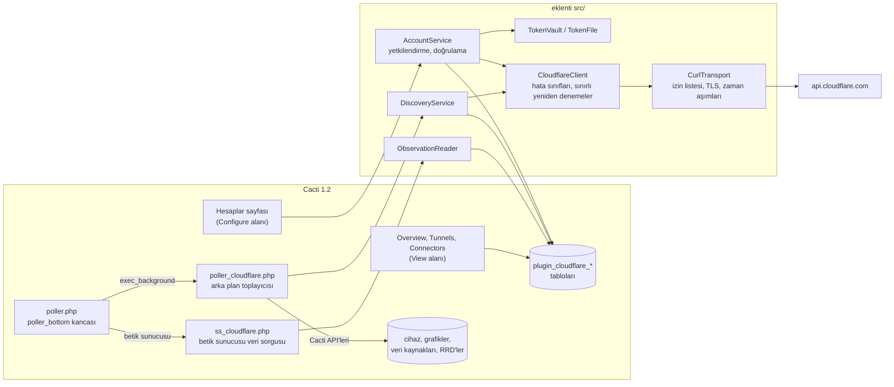
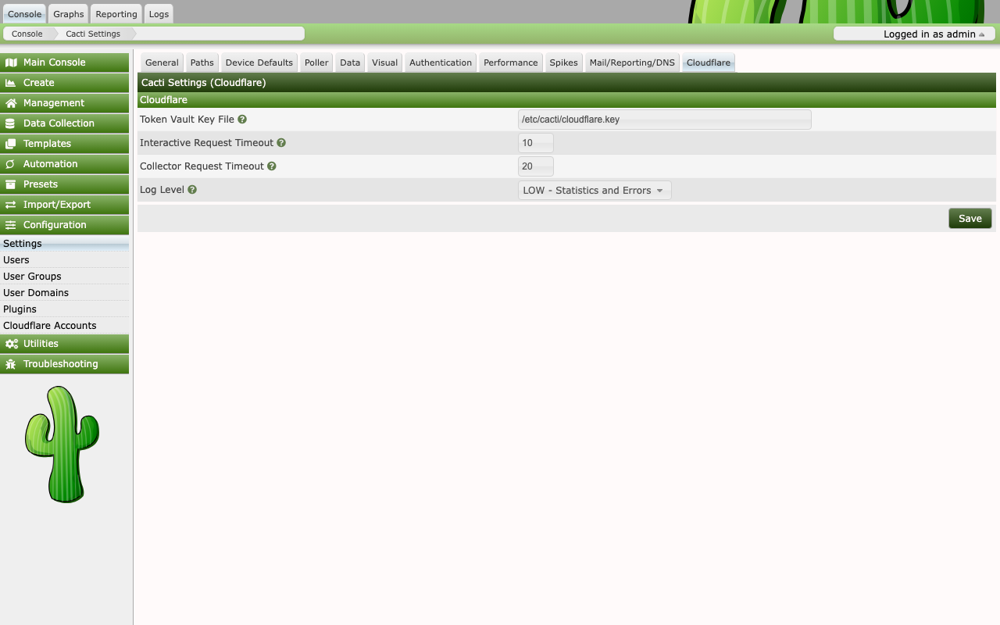

<!-- Source: README.md; SHA256: f8de0e02c5904e15bfa4c71edcaab219e5e5d4f6d9dbe589f4ed16351df6bf4d -->

<!-- translations:start -->
[English](../../../README.md) | [简体中文](../zh-CN/README.md) | [हिन्दी](../hi-IN/README.md) | [Español (España)](../es-ES/README.md) | [Español (Latinoamérica)](../es-419/README.md) | [العربية (السعودية)](../ar-SA/README.md) | [Afrikaans](../af-ZA/README.md) | [አማርኛ](../am-ET/README.md) | [العربية (مصر)](../ar-EG/README.md) | [العربية (المغرب)](../ar-MA/README.md) | [বাংলা](../bn-BD/README.md) | [Deutsch](../de-DE/README.md) | [فارسی](../fa-IR/README.md) | [Filipino](../fil-PH/README.md) | [Français](../fr-FR/README.md) | [Français (Maroc)](../fr-MA/README.md) | [Français (Sénégal)](../fr-SN/README.md) | [Hausa](../ha-NG/README.md) | [עברית](../he-IL/README.md) | [Bahasa Indonesia](../id-ID/README.md) | [Igbo](../ig-NG/README.md) | [Italiano](../it-IT/README.md) | [日本語](../ja-JP/README.md) | [한국어](../ko-KR/README.md) | [Malagasy](../mg-MG/README.md) | [मराठी](../mr-IN/README.md) | [Bahasa Melayu](../ms-MY/README.md) | [Nederlands](../nl-NL/README.md) | [Polski](../pl-PL/README.md) | [Português (Brasil)](../pt-BR/README.md) | [Русский](../ru-RU/README.md) | [Kinyarwanda](../rw-RW/README.md) | [Soomaali](../so-SO/README.md) | [Svenska](../sv-SE/README.md) | [Kiswahili](../sw-KE/README.md) | [தமிழ்](../ta-IN/README.md) | [తెలుగు](../te-IN/README.md) | [ไทย](../th-TH/README.md) | [Türkçe](README.md) | [Українська](../uk-UA/README.md) | [اردو](../ur-PK/README.md) | [Tiếng Việt](../vi-VN/README.md) | [isiXhosa](../xh-ZA/README.md) | [Yorùbá](../yo-NG/README.md) | [繁體中文](../zh-TW/README.md) | [isiZulu](../zu-ZA/README.md)
<!-- translations:end -->

<p align="center">
  
</p>

# Cacti için Cloudflare eklentisi

[](https://github.com/somethingwithproof/plugin_cloudflare/actions/workflows/ci.yml)
[](https://sonarcloud.io/summary/new_code?id=somethingwithproof_plugin_cloudflare)
[](../../../LICENSE)


[](https://sonarcloud.io/summary/new_code?id=somethingwithproof_plugin_cloudflare)
[](https://sonarcloud.io/summary/new_code?id=somethingwithproof_plugin_cloudflare)
[](https://sonarcloud.io/summary/new_code?id=somethingwithproof_plugin_cloudflare)


Cloudflare Tunnels ve bölge (zone) analizlerini izlemek için geliştirilen bir Cacti 1.2 eklentisidir. Kapsamlı API belirteçleriyle Cloudflare API'sinden okuma yapar, Cloudflare'de hiçbir değişiklik yapmaz ve verilerini kendi tablolarında tutar. Cacti'de veri sorgusu XML dosyalarını `resource/script_server/` dizinine kopyalar ve çekirdek dosyalarda hiçbir değişiklik yapmadan Cacti'nin kendi API'leri aracılığıyla cihazlar, grafikler ve şablonlar oluşturur.

**Durum: 0.4.0-dev, yayımlanmamış.** Son yayımlanan sürüm 0.3.0'dır. Geliştirme sürümü; CSV envanter dışa aktarımları, silinen tünellerin açıkça kullanımdan kaldırılması, önbelleğe alınmış bölge analizleri ve isteğe bağlı Thold şablonları ekler. Canlı sağlayıcı ve dağıtım doğrulaması henüz tamamlanmamıştır.

Aşağıdaki tablo 0.3.0 kararlı sürümünü açıklamaktadır. Geliştirme eklemeleri aşağıdaki Operatör iş akışları ve bölge analizleri bölümünde açıklanmıştır.

| Şu anda mevcut | Planlanan |
|---|---|
| Cacti'nin eklenti yöneticisi aracılığıyla kurulum, yükseltme, devre dışı bırakma ve kaldırma | GraphQL analizleri ve Thold uyarıları (Aşama 4) |
| Cloudflare: View, Operator ve Configure izinleri | Hata enjeksiyonu, TLA+ modelleri ve eksiksiz dokümantasyon (Aşama 5) |
| Cloudflare hesapları ekleme, düzenleme, silme, etkinleştirme ve devre dışı bırakma | |
| Belirteci bir dosyada veya Cacti veritabanında şifrelenmiş olarak saklama | |
| Belirteci doğrulama ve tünel ile bölge okuma izinlerini kontrol etme | |
| Ana poller tarafından başlatılan bir arka plan toplayıcısında tünel ve bağlayıcı keşfi | |
| Management > Cloudflare Tunnels altında Overview, Tunnels ve Connectors sayfaları | |
| Yaşam döngüsü takibi: `active`, `unavailable` ve `deleted` | |
| Bir yönetici tarafından oluşturulan, tünellerin bir veri sorgusunun dizinleri olarak yer aldığı hesap başına bir Cacti cihazı | |
| Tünel başına tek bir RRD dosyasından çizilen, tünel başına Connectors, Health ve Collection grafikleri | |
| Eklentinin doğrulayamadığı değerler hiçbir zaman 0 olarak değil, bilinmeyen (`U`) olarak saklanır | |

## Erişim rolleri

| Alan | Erişim |
| --- | --- |
| Cloudflare: View | Mevcut izleme sayfaları. |
| Cloudflare: Operator | İzleme sayfalarına ek olarak İşlemler sayfası ve kişisel triyaj onayları. |
| Cloudflare: Configure | Operator erişimine ek olarak mevcut yapılandırma ve yönetim işlemleri. |

Yükseltme dosyalarını kopyaladıktan sonra yeni alanı kaydetmek için yönetici olarak
Plugins sayfasını açın. **Configuration > Users** veya kullanıcı grupları altında
Operator alanını açıkça atayın. Yükseltmeler mevcut View ve Admin alan kimliklerini
ve yetkilerini korur. Her istekte Admin erişimi Operator erişimini, Operator erişimi
ise View erişimini devralır; bu işlem kullanıcılara veya gruplara kalıcı yetkiler
eklemez. Eklenti ayarları ayrıca Cacti'nin Settings iznine ek olarak
Cloudflare: Configure erişimi gerektirir.

Cloudflare hesap görünürlüğü mevcut View alanıyla eşleşir; hesap genelindedir.
Kimlik bilgileri, yapılandırma, eşleme, silme ve diğer yönetim değişiklikleri
yönetim sayfalarında kalır. Onaylar yalnızca mevcut kullanıcının oturumu süresince,
en fazla bir saat boyunca ve yalnızca aynı gözlem güncel kaldığı sürece geçerlidir.
Yeni veya değişmiş gözlemler bunları geçersiz kılar. Başarısız bir ölçümü hiçbir
zaman sağlıklı olarak işaretlemez veya uyarıları bastırmazlar.

## Neden bu eklenti

Hizmetlerini Cloudflare Tunnel üzerinden yayımlayan Cacti operatörlerinin Cacti
içinde tüneli görme imkânı yoktur. Kaynak sunucular hâlâ SNMP yanıtı verirken bir
tünel tüm bağlayıcılarını kaybedebilir; bu durumda mevcut grafikler yeşil kalırken
kullanıcılar hatalarla karşılaşır. Bu eklentinin amacı, Cacti'ye Cloudflare üzerinde
herhangi bir değişiklik yapma yetkisi vermeden tünel sağlığını ve bölge trafiğini
operatörlerin hâlihazırda izlediği cihaz grafiklerinin yanına koymaktır.

Tasarımı üç kısıt şekillendirir:

- **Salt okunur.** Eklenti yalnızca `GET` uç noktalarını ve GraphQL Analytics
  API'sini çağırır. Hiçbir Cloudflare kaynağında düzenleme iznine ihtiyaç duymaz.
- **İsteğe bağlı.** Cloudflare kesintileri, süresi dolmuş belirteçler ve hız
  sınırları Cacti kullanıcı arayüzünü yavaşlatmamalı veya diğer cihazların
  yoklanmasını durdurmamalıdır. Tüm API çağrılarında katı zaman aşımları vardır ve
  veri toplama, poller tarafından başlatılan bir arka plan sürecinde çalışır.
- **Çekirdek değişikliği yok.** Eklenti, Cacti 1.2 eklenti kancalarını ve kendi
  tablolarını kullanır. `resource/script_server/` dizinine tek bir veri sorgusu
  XML'i kopyalar ve Cacti'nin kendi API'leri aracılığıyla cihazlar, grafikler ve
  şablonlar oluşturur. Çekirdek dosyalarda değişiklik yapılmadığından Cacti
  yükseltmeleri ve diğer eklentiler etkilenmez.

## Nasıl çalışır



- **Cacti bağlantı katmanı** (`setup.php`, `includes/`, sayfa betikleri)
  kancaları ve alanları kaydeder, sayfaları Cacti'nin kendi yardımcılarıyla
  oluşturur ve her eylemi `src/` içindeki kütüphaneye devreder.
- **Kütüphane** (`src/`, ad alanı `Somethingwithproof\Cloudflare\`), Cacti genel
  değişkenlerine bağımlı değildir; bu nedenle çalışan bir Cacti olmadan gerçek bir
  veritabanı ve sahte bir HTTP aktarımı ile test edilir.
- **Tek giden yol.** Ağ ile temas eden tek kod `CurlTransport` sınıfıdır ve
  yalnızca `https://api.cloudflare.com` adresini kabul eder. Her hata tek bir hata
  sınıfına (`auth`, `permission`, `rate_limited`, `transient`, ...) eşlenir ve bu
  sınıf kullanıcı arayüzünde gösterilen durumu belirler.
- **Depolama**, hazırlanmış ifadelerle Cacti'nin kendi PDO bağlantısı üzerinden
  gerçekleşir. Şema değişiklikleri numaralandırılmış, eşgüçlü geçişlerdir.

Tasarım kararları ve gerekçeleri [docs/design.md](../../design.md) dosyasında
yer almaktadır.

## Ekran görüntüleri

Ekran görüntüleri canlı bir Cloudflare hesabından değil, bir test ortamından
alınmıştır. Bu ortam, fikstür verileri döndüren sahte bir Cloudflare API'sine karşı
Cacti 1.2.31 çalıştırmaktadır; dolayısıyla hesap, kimliği ve üç tünel yer
tutucudur.


*Cloudflare Accounts listesi. Sahte API belirteci kabul eder, bu nedenle Verify
işlemi `ok` bildirir.*


*Bir hesabın düzenlenmesi. Belirteç alanları her zaman boştur; saklanan belirteç
hiçbir zaman tarayıcıya geri gönderilmez. Collect Tunnels ve Create Graphs açık,
Collect Analytics ise kapalıdır. Connection Status son Verify sonucunu gösterir:
`ok`, tünel okuma izni verilmiş ve bölge okuma izni eksik.*



*Settings > Cloudflare.*


*Management > Cloudflare Tunnels > Overview. Durum, hesabın etkin tünelleri
arasındaki en kötü Cloudflare durumudur; burada bir fikstür tüneli kapalı olduğu
için `down` şeklindedir. `Disabled`, `Not collected`, `Collection failing` ve
`Not yet collected` durumları bu sırayla tünel sağlığına göre önceliklidir;
dolayısıyla son çalıştırması başarısız olan bir hesap, tünelleri ne bildirirse
bildirsin `Collection failing` gösterir.*


*Tunnels sekmesi. Connectors ve Connections sütunları old-office için `-` gösterir,
çünkü sahte API bu tünelin bağlantı isteğine bilinmeyen tünel yanıtı verir ve
hiçbir veri saklanmaz; çalışan bir bağlayıcısı olmayan staging için ise 0 gösterir.*


*blog tünelinin Connectors grafiği. Sahte API'nin hata döndürdüğü ve eklentinin
bilinmeyen değerler sakladığı ortadaki boşluğun öncesinde ve sonrasında her üç
çizgi de 1'dir. Çizgiler 0'a düşmez. Grafik aynı fikstür ortamından (`make screenshots`)
alınmıştır; bu ortam yedi dakikalık yoklamanın grafiği doldurması için yalnızca bu
veri kaynağında 30 saniyelik bir adım ayarlar.*

## Gereksinimler

- Cacti 1.2.25 ile 1.2.31 arası sürümler. Cacti 1.2.31 sürümünün kendisi PHP 8.0 veya üzerini gerektirir.
  CI yalnızca 1.2.31 sürümünü test eder; 1.2.25 en son 2026-10-22 tarihinde elle test edilmiştir.
- `curl`, `openssl` ve `pdo_mysql` eklentileriyle birlikte PHP 7.4 ile 8.4 arası sürümler.
  Eklenti, bunlar olmadan etkinleştirilmeyi reddeder.
- MariaDB 10.6 veya üzeri ya da MySQL 8.0 veya üzeri.
- Cacti sunucusundan `api.cloudflare.com` adresine HTTPS erişimi. Vekil sunucular desteklenmez.

Nelerin test edildiğini görmek için [docs/compatibility.md](../../compatibility.md) dosyasına bakın.

## Kurulum

1. Eklentiyi, [GitHub Sürümleri](https://github.com/somethingwithproof/plugin_cloudflare/releases) sayfasından arşivi çıkararak (`make package` komutu sürüm etiketinin bir kopyasında çalıştırıldığında aynı arşivi oluşturur) veya bir git klonlamasıyla Cacti'nin `plugins/cloudflare` dizinine yerleştirin. Dizinin adı `cloudflare` olmalıdır.
2. Eklentiyi Console > Configuration > Plugins üzerinden ya da web sunucusu kullanıcısı olarak CLI ile kurup etkinleştirin:

   ```sh
   php cli/plugin_manage.php --plugin=cloudflare --install --enable
   ```

3. Yönetici kullanıcı, kurulum sırasında Cloudflare: Configure iznini alır. Bu izni Console > Configuration > Users altından diğer kullanıcılara veya gruplara verin.
4. [docs/token-permissions.md](../../token-permissions.md) belgesindeki izinlere sahip bir belirteç (token) oluşturun. Kısaca: Account > Cloudflare Tunnel > Read ve isteğe bağlı olarak Zone > Zone > Read.
5. Belirteci aşağıdaki iki yöntemden biriyle saklayın, ardından hesabı Console > Configuration > Cloudflare Accounts altına ekleyin ve eylemler menüsünden Verify işlemini çalıştırın.

### Seçenek A: veritabanında şifrelenmiş olarak

Eklenti, belirteçleri sizin oluşturduğunuz 32 baytlık bir anahtarla şifreler. Anahtarı kendisi asla oluşturmaz veya yazmaz. Dosya, web sunucusu ve poller kullanıcıları tarafından okunabilir olmalı, diğer kullanıcılar tarafından okunamamalı ve bulunduğu dizin bu kullanıcıların dosyaya erişmesine izin vermelidir. `www-data` olarak çalışan bir web sunucusu için:

```sh
sudo mkdir -p /etc/cacti
sudo sh -c 'umask 077 && openssl rand -hex 32 > /etc/cacti/cloudflare.key'
sudo chgrp www-data /etc/cacti/cloudflare.key
sudo chmod 0440 /etc/cacti/cloudflare.key
```

Varsayılan yol `/etc/cacti/cloudflare.key` şeklindedir; bunu Settings > Cloudflare > Token Vault Key File altından değiştirebilirsiniz. Anahtar eksik olduğunda veya reddedildiğinde, düzenleme formu yalnızca belirteç dosyası seçeneğini sunar. Anahtarın bir yedeğini saklayın: anahtar olmadan, saklanan belirteçlerin şifresi çözülemez ve yeniden girilmeleri gerekir.

#### Anahtarı döndürme (rotasyon)

Yeniden şifreleme komutu yoktur. Yeni bir anahtar, eski anahtarla saklanan belirteçlerin şifresini çözemez; bu nedenle rotasyon, saklanan her belirtecin yeniden girilmesi anlamına gelir:

1. Her hesabın belirteç değerini elinizin altında bulundurun. Cloudflare bir belirtecin değerini yalnızca oluşturulduğunda veya yenilendiğinde gösterir; bu yüzden elinizde yoksa belirteci Cloudflare panosunda yenileyin.
2. Yukarıdaki komutlarla yeni bir yolda (örneğin `/etc/cacti/cloudflare.key.new`) aynı sahip ve izinlerle yeni anahtarı oluşturun.
3. Settings > Cloudflare > Token Vault Key File ayarını yeni yola getirin ve kaydedin. Bu andan itibaren, hâlâ eski anahtarla şifrelenmiş bir hesapta Verify çalıştırıldığında "Stored token cannot be decrypted" hatası bildirilir ve her toplayıcı çalıştırması bu hesap için `reason=decrypt_failed` ile birlikte `discovery token unavailable` günlüğü kaydeder.
4. Belirtecini veritabanında saklayan her hesap için Console > Configuration > Cloudflare Accounts altında hesabı açın, belirteci her iki belirteç alanına yapıştırın, kaydedin ve Verify çalıştırın. Sonucun `ok` olması gerekir.
5. Bu tür tüm hesaplar doğrulandığında, eski anahtar dosyasını ve yedeklerini kaldırın.

3. ve 4. adımlar arasında bir hesabın tünelleri yenilenmez ve sağlık, bağlayıcı ve bağlantı grafikleri U kaydeder. Belirteç dosyası kullanan hesaplar bundan etkilenmez.

### Seçenek B: belirteç dosyası

Web sunucusu ve poller kullanıcılarının okuyabildiği ancak diğerlerinin okuyamadığı bir dosyaya yalnızca belirteci (başka hiçbir şey olmadan) yazın, ardından düzenleme formuna dosyanın mutlak yolunu girin:

```sh
sudo sh -c 'umask 077 && cat > /etc/cacti/cloudflare-account.token'   # paste the token, then Ctrl-D
sudo chgrp www-data /etc/cacti/cloudflare-account.token
sudo chmod 0440 /etc/cacti/cloudflare-account.token
```

Dosya, kaydettiğinizde değil, Verify sırasında okunduğunda kontrol edilir. Sembolik bağlantılar, 4 KiB'tan büyük dosyalar ve diğer kullanıcılar tarafından okunabilen veya yazılabilen dosyalar reddedilir.

Cloudflare: Configure iznine sahip herkes herhangi bir yol girebilir ve poller kullanıcısı bu yolu okur. Belirteç dosyalarını tek bir yerde tutmak için Settings > Cloudflare > Token File Directory ayarını örneğin `/etc/cacti` olarak belirleyin; bu durumda bunun dışındaki bir yol reddedilir. Bkz. [docs/security.md](../../security.md#token-file).

## Yükseltme

1. Dizin adını koruyarak `plugins/cloudflare` içindeki dosyaları yeni sürümle değiştirin.
2. Yönetici olarak bir kez Console > Configuration > Plugins veya Console > Configuration > Cloudflare Accounts sayfasını açın. Bu işlem eklentinin veritabanı geçişlerini çalıştırır, Cloudflare şablonlarını içe aktarır, veri sorgusu dosyasını kopyalar (bkz. [Tünel metrikleri ve grafikleri](#tunnel-metrics-and-graphs)) ve 0.1.0 sürümünden yapılan bir yükseltmede `poller_bottom` kancasını kaydeder.

`poller.php` eklenti yükseltmesini çalıştırmaz; bu nedenle 2. adıma kadar yeni şema mevcut değildir. Bu durumda her toplayıcı çalıştırması hiçbir şey yapmaz ve `CLOUDFLARE: collector skipped; plugin upgrade pending, open Console > Plugins` günlüğünü kaydeder. Cloudflare Tunnels sayfaları yalnızca Cloudflare: View iznine ihtiyaç duyar, bu yüzden yükseltmeyi asla çalıştırmazlar ve 2. adıma kadar "The Cloudflare tunnels could not be read" uyarısını gösterebilirler.

## Hesap durumu

Verify işlemi hesabın durumunu ayarlar:

| Durum | Anlamı |
|---|---|
| `unknown` | Hesap eklendiğinden veya kimlik bilgileri değiştiğinden beri doğrulanmadı |
| `ok` | Belirteç etkin ve tünelleri okuyabiliyor |
| `token_inactive` | Cloudflare belirteci devre dışı veya süresi dolmuş olarak bildiriyor |
| `auth_failed` | Cloudflare belirteci geçersiz veya süresi dolmuş olarak reddetti (HTTP 401) |
| `permission_denied` | Belirteç etkin ancak tünelleri okuyamıyor ya da belirteç doğrulama uç noktalarını çağırma izinlerinden yoksun (HTTP 403) |
| `unreachable` | API'ye ulaşılamadı, zaman aşımına uğradı veya sunucu hatası döndürdü |
| `rate_limited` | Cloudflare HTTP 429 döndürdü |
| `error` | Eksik veya güvensiz bir belirteç dosyası, eksik veya kullanılamaz bir belirteç kasası anahtar dosyası ya da şifresi çözülemeyen saklanmış bir belirteç dahil olmak üzere diğer herhangi bir hata |

Düzenleme sayfası ayrıca tünel okuma ve bölge okuma izinlerinin verilip verilmediğini de gösterir.

## Tünel keşfi

Ana poller üzerindeki her yoklama döngüsünden sonra, Collect Tunnels ayarı açık olan en az bir etkin hesap varsa `poller_bottom` kancası `exec_background` ile bir arka plan toplayıcısı başlatır. Toplayıcı hiçbir zaman poller sürecinin içinde çalışmaz; bu nedenle yavaş bir Cloudflare API'si `poller.php` dosyasını geciktirmez. Uzak poller'lar bunu asla başlatmaz.

Zamanı gelmiş olan her hesap için toplayıcı önce hesabın tünellerini listeler, ardından etkin tünellerinin bağlantılarını okur; bu da her tünelin bağlayıcılarını, sürümlerini, veri merkezlerini ve kaynak adreslerini verir. Hesapların zamanı her Discovery Interval süresinde bir (varsayılan 300 saniye) gelir. Bir çalıştırma, 50 saniyeden sonra yeni bir hesap başlatmaz ve en fazla 200 bağlantı isteği yapar. Bu sınırlardan herhangi biri, bir hesabın bağlantılarını okuma işlemini yarıda da kesebilir; bu hesap `partial` olarak kaydedilir ve bir sonraki çalıştırma en uzun süredir denenmemiş tünellerle devam eder. Başlatılmayan hesaplar bir sonraki çalıştırma için zamanı gelmiş durumda kalır.

Bir tünelin, Cloudflare'ın bildirdiği durumdan (`healthy`, `degraded`, `down` veya `inactive`) ayrı tutulan bir yaşam döngüsü vardır:

| Yaşam döngüsü | Anlamı |
|---|---|
| `active` | Tünel son eksiksiz listelemede yer alıyordu |
| `deleted` | Eksiksiz bir listeleme tüneli içermedi; buna boş bir listeleme de dahildir. Satır ve geçmişi kalır ve tünel yeniden ortaya çıkarsa tekrar `active` olur |
| `unavailable` | Aralarında eksiksiz bir listeleme olmadan gerçekleşen üç sayılmış kesinti, tünelin durumunu bilinmez bırakır |

Yalnızca eksiksiz ve başarılı bir listeleme tünelleri ekler, günceller veya siler; başarısız bir listeleme asla bir tüneli silmez. Cloudflare'a hiç erişememe hatası (`transient`, `rate_limited`, `auth` veya `permission`) kesinti olarak sayılır; aralarında eksiksiz bir listeleme olmadan üç sayılmış kesintiden sonra hesabın etkin tünelleri `unavailable` olur. Bir sonraki eksiksiz listeleme bunları geri yükler ve sayacı sıfırlar. Bağlantıları okunurken Cloudflare'ın artık tanımadığı bir tünel, hesabı başarısız kılmadan atlanır. Diğer hatalar kesinti sayacını ne artırır ne de sıfırlar.

`cacti.log` dosyasında keşif satırları `CLOUDFLARE: discovery` ile, çalıştırma özeti ise `CLOUDFLARE: collector` ile başlar. Başarısız bir listeleme veya `unavailable` olarak işaretlenen tüneller gibi hatalar ve yaşam döngüsü değişiklikleri Cacti'nin varsayılan `LOW` düzeyinde; her hesabın sonucu ve çalıştırma özeti ise `MEDIUM` düzeyinde günlüğe kaydedilir. Bağlantı okumaları her tünelde başarısız olabileceğinden, her hesap için her hata sınıfının yalnızca ilk hatası `LOW` düzeyinde, geri kalanı `MEDIUM` düzeyinde günlüğe kaydedilir ve ardından sınıf başına başarısız olan tünel sayısını içeren tek bir `LOW` satırı gelir.

Management > Cloudflare Tunnels sayfası Cloudflare: View iznini gerektirir ve salt okunurdur:

- **Overview**, her hesabı durumuyla, yaşam döngüsüne göre tünel sayılarıyla, son başarılı keşifle ve ardışık hata sayısıyla birlikte listeler.
- **Tunnels**, hesaplar genelindeki veya tek bir hesaptaki tünelleri hesap, yaşam döngüsü, durum ve ad filtreleriyle ve sıralanabilir sütunlarla listeler.
- **Connectors**, Tunnels sekmesinde seçilen tünelin bağlayıcılarını gösterir.

<a name="tunnel-metrics-and-graphs"></a>

## Tünel metrikleri ve grafikleri

Cacti, tünel durumunu bir betik sunucusu veri sorgusu olan `ss_cloudflare.php` aracılığıyla okur. Bu sorgu yalnızca eklentinin tablolarından yanıt verir ve hiçbir zaman Cloudflare'ı çağırmaz; böylece bir Cloudflare kesintisi poller'ı yavaşlatamaz. Her tünel altı değer verir: sağlık (healthy 3, degraded 2, down 1, inactive 0), bağlayıcılar, bağlantılar, bağlayıcı sürümleri, bağlantılarının son okunmasından bu yana geçen saniye sayısı ve keşif işinin ardışık hataları. Sağlık, bağlayıcılar, bağlantılar ve sürümler yalnızca eklenti bunlara kefil olabildiğinde yazdırılır; bu da son keşfin başarılı olduğu, tünelin `active` olduğu ve okumanın güncel olduğu anlamına gelir. Aksi takdirde `U` olurlar ve grafik, kesinti gibi görünecek bir sıfır yerine bir boşluk gösterir. İki toplama değeri bir kesinti sırasında yazdırılmaya devam eder, böylece Collection grafiği kesintiyi gösterir; bunlar yalnızca silinmiş bir tünel veya bağlantıları hiç yenilenmemiş bir tünel için `U` olur. Kurallar [docs/metrics.md](../../metrics.md) belgesindedir.

### Cihazı oluşturma

Bir hesap en fazla bir Cacti cihazıyla eşleşir. Cihaz, hesabın tünellerini Cloudflare Tunnels veri sorgusunun dizinleri olarak tutar. Bunu otomatik olarak oluşturan bir şey yoktur:

1. Console > Configuration > Cloudflare Accounts sayfasını açın.
2. Hesabı seçin, eylemler menüsünden Create Cacti Device seçeneğini seçin ve onaylayın.

Bu eylem hem Cloudflare: Configure yetki alanını hem de Cacti'nin Sites/Devices/Data yetki alanını (`host.php` için olanı) gerektirir. Menü girişi yalnızca her ikisine de sahip kullanıcılara görünür ve sunucu başka birinden gelen isteği reddeder. Cihaz `Cloudflare: <account name>` olarak adlandırılır, Cloudflare Account ana bilgisayar şablonunu ve ana poller'ı kullanır, SNMP sürüm 0 ve kullanılabilirlik denetimi olmadan ayarlanır ve `<account ID>.cloudflare.invalid` ana bilgisayar adını alır. Bu ad ayrılmıştır ve hiçbir zaman çözümlenmez; Cacti bu ada bağlanmaz. Hesabın zaten bir cihazı varsa, eylem bunu bildirir ve hiçbir şey değiştirmez. Bir yönetici Cacti'de cihazı silerse, eklenti Create Cacti Device yeniden çalıştırılana kadar yenisini oluşturmaz.

### Grafik Oluşturma (Create Graphs)

Hesap formundaki Create Graphs ayarı varsayılan olarak kapalıdır. Açık olduğunda, hesabın bir keşfi `ok` veya `partial` olarak her tamamlandığında toplayıcı cihazı yeniden dizinler ve hesabın `active` tünelleri için eksik grafikleri oluşturur: her tünel için Connectors, Health ve Collection olmak üzere üç grafik. Bir tünelin üç grafiği tek bir RRD dosyasını paylaşır. Tek bir çalıştırma en fazla 50 grafik oluşturur ve 20 saniye sonra durur; bir sonraki çalıştırma devam eder. Eklenti hiçbir zaman bir Cacti nesnesini kaldırmaz. Bir yöneticinin sildiği grafik yeniden oluşturulmaz ve Cloudflare'ın artık listelemediği bir tünel, `U` değerini gösteren grafiğini ve RRD dosyasını korur.

Create Graphs ayarını açmak her iki yetki alanını da gerektirir. Kapatmak için yalnızca Configure yeterlidir. Sites/Devices/Data yetki alanına sahip olmayan bir kullanıcı formu kaydettiğinde, ayar bir uyarı ile olduğu gibi bırakılır. Create Graphs kapalıyken, yeni tünellerin veri sorgusu dizinleri olarak görünmesi için cihaz her keşiften sonra yine yeniden dizinlenir.

### Veri sorgusu dosyası

Cacti 1.2.31, bir veri sorgusu XML dosyasını yalnızca kendi `resource` dizini içinden okur. Bu nedenle eklenti, kurulum ve yükseltme sırasında tek bir dosyayı, `templates/resource/cloudflare_tunnels.xml` dosyasını `<Cacti>/resource/script_server/cloudflare_tunnels.xml` konumuna kopyalar. Bu, eklentinin kendi dizini dışına yazdığı tek dosyadır; bu nedenle eklentiyi kuran veya yükselten kullanıcının bu dizine yazma iznine sahip olması gerekir.
Kaldırma işlemi, cihazlar, grafikler, RRD dosyaları ve şablonlarla birlikte bu dosyayı da korur. Kopyalama veya şablon içe aktarma başarısız olursa eklenti bunu günlüğe kaydeder ve Create Cacti Device işlemi tekrar dener.

## Ayarlar

Ayarlar > Cloudflare bölümünde şunlar yer alır:

- **Belirteç Kasası Anahtar Dosyası**: kasa anahtarının yolu.
- **Belirteç Dosyası Dizini**: ayarlandığında, bunun dışındaki bir belirteç dosyası reddedilir. Varsayılan olarak boştur; bu durumda herhangi bir yola izin verilir. Bkz. [docs/security.md](../../security.md#token-file).
- **Etkileşimli İstek Zaman Aşımı**: web arayüzünden yapılan Doğrula gibi bir istek için toplam saniye süresi. Varsayılan 10; 5 ile 60 dışındaki değerler 10'a geri döner.
- **Toplayıcı İstek Zaman Aşımı**: arka plan toplayıcısı tarafından yapılan bir istek için toplam saniye süresi. Varsayılan 20; 5 ile 60 dışındaki değerler 20'ye geri döner.
- **Günlük Düzeyi**: saklanır. Henüz hiçbir bileşen tarafından okunmamaktadır.

Hesap formunda Tünelleri Topla ve Keşif Aralığı keşfi denetler, Grafikleri Oluştur ise grafik oluşturmayı denetler. Analitikleri Topla değeri saklanır ve bu sürümde bir etkisi yoktur.

## Diller

Eklenti; İspanyolca (İspanya, `es-ES`), Fransızca (`fr-FR`), Almanca (`de-DE`), Basitleştirilmiş Çince (`zh-CN`), Hintçe (`hi-IN`), Arapça (`ar-SA`) ve Japonca (`ja-JP`) çevirileriyle birlikte gelir. Dil desteği açıldığında (Yapılandırma > Ayarlar > Genel > Dil Desteği) ve bir kullanıcı dili seçtiğinde Cacti bunları gösterir. Latin Amerika İspanyolcası kataloğu (`es-419`) da paketle birlikte gelir, ancak Cacti 1.2'de seçilebilecek bir Latin Amerika İspanyolcası yerel ayarı yoktur; bu nedenle yalnızca Cacti bir tane eklediğinde etkinleşir; o zamana kadar İspanyolca (`es-ES`) seçin.

Bazı metinler İngilizce kalır: eklentinin sakladığı ve olduğu gibi gösterdiği durum değerleri (`ok`, `active`, `unavailable`, `deleted` ve Cloudflare'in bildirdiği tünel durumu) ile eklentinin Cacti günlüğüne yazdığı her şey.

## Kaldırma ve veri saklama

Kaldırma işlemi eklentinin kendi tablolarını (hesapları, şifrelenmiş belirteçleri, keşfedilen tünelleri, iş durumunu ve oluşturduğu Cacti nesnelerinin kaydını tutan tabloları) siler ve `cloudflare_` ayarlarını kaldırır. Anahtar dosyasını, belirteç dosyalarını, kopyalanan `resource/script_server/cloudflare_tunnels.xml` dosyasını veya herhangi bir Cacti cihazını, grafiğini, veri kaynağını, RRD dosyasını ya da şablonunu kaldırmaz. Bunlar geçmiş izleme verilerini tutar ve bunları kaldırmak Cacti'de yöneticinin açıkça yapması gereken bir işlemdir.

Tutulan cihaz veri almayı durdurur. Bir kaldırma işleminden sonra veya hesabı silindikten sonra hiçbir hesap ana bilgisayara sahip olmaz; bu nedenle grafikleri geçmişlerini korur ancak bundan sonra `U` yazdırır. Yeniden yüklenen veya yeniden eklenen hesapta Cacti Cihazı Oluştur yeni bir cihaz oluşturur; eskisini yeniden kullanmaz, bu nedenle geçmişine artık ihtiyaç kalmadığında eski cihazı Cacti'de silin.

## Bilinen sınırlamalar

- Bir çalıştırmada en fazla 200 bağlantı isteği yapılır. Bu sınırın ötesindeki tüneller gözlem penceresinden daha seyrek yenilenir, bu nedenle bağlantı grafiklerinde boşluklar görülür.
- Bir yükseltme paketle gelen şablon XML'ini değiştirdiğinde, eklenti içe aktarılan şablonlarda yöneticinin yaptığı düzenlemelerin üzerine yazar.
- Hesabın cihazı ana yoklayıcıda kalmalıdır. Eklentinin tabloları ana veritabanındadır ve betik bunları oradan okur.
- Silinen tüneller veri sorgusu dizininde kalır ve bir yönetici onları açıkça kullanımdan kaldırana kadar `U` yazdırır. Kullanımdan kaldırma yalnızca eklenti tarafından kaydedilen grafikleri ve paylaşılmayan veri kaynaklarını Cacti aracılığıyla kaldırır; envanter satırı görünür kalır. RRD temizliğini Cacti yönetir.
- Cacti, bellek tükenmesi gibi gerçek bir ölümcül hatayla sonlanan koda sahip bir eklentiyi devre dışı bırakır. Bkz. [docs/security.md](../../security.md).

## Güvenlik

- Genel API Anahtarları reddedilir; yalnızca kapsamı belirlenmiş API belirteçleri kabul edilir.
- Belirteçler, sağladığınız bir dosyada saklanır veya veritabanına hiçbir zaman girmeyen bir anahtar dosya altında AES-256-GCM ile şifrelenir. Hiçbir zaman bir sayfada gösterilmez, günlüğe yazılmaz veya bir hata mesajına dahil edilmezler.
- Veritabanı hataları yalnızca SQLSTATE ve sürücü hata kodunu taşır, hiçbir zaman deyimin değerlerini taşımaz.
- Her değişiklik, Cacti'nin CSRF belirteci ile korunan bir POST isteğidir. Yönetimsel hesap ve yapılandırma değişiklikleri Cloudflare: Yapılandır yetkisi gerektirir; kişisel önceliklendirme onayları Cloudflare: Operatör yetkisi gerektirir. Bir Cacti cihazı oluşturmak veya Grafikleri Oluştur seçeneğini açmak ayrıca Cacti'nin Siteler/Cihazlar/Veri iznini gerektirir. Devre dışı bırakılmış bir eklenti sayfalarını reddeder.

Ayrıntılar ve bilinen sınırlamalar [docs/security.md](../../security.md) dosyasındadır.
Güvenlik açıklarını [SECURITY.md](../../../SECURITY.md) dosyasında açıklandığı şekilde gizli olarak bildirin.

## Operatör iş akışları ve bölge analitikleri

Geliştirme eklemeleri arasında silinen tünellerin açıkça kullanımdan kaldırılması, yetenek farkındalıklı bölge analitikleri ve içe aktarılabilir Thold şablonları yer alır. Bu eklemelerin henüz bir sürüm etiketi veya canlı hesap yeterliliği yoktur. Kurulum, metrik anlamları ve doğrulama sınırları için [docs/analytics-and-alerting.md](../../analytics-and-alerting.md) dosyasına bakın.

### Envanter dışa aktarımları

Tüneller ve Bağlayıcılar sayfaları, Cloudflare: Görüntüle alanı için Dışa Aktar seçeneğini sunar. Tünel CSV dosyaları; tüm sayfalardaki etkin hesap, yaşam döngüsü, durum, arama ve sıralama ayarlarını kullanarak eşleşen her satırı içerir. Bağlayıcı CSV dosyaları; seçilen tünel için sürümleri, mimariyi, veri merkezlerini ve kaynak adreslerini içerir. İndirmeler yalnızca önbelleğe alınmış kayıtları okur. Bilinmeyen sayılar boştur; formül benzeri hücrelerin başına güvenli elektronik tablo içe aktarımı için bir kesme işareti eklenir.

## Yol haritası

Her kilometre taşı kendi numarasını taşıyan bir 0.x sürümü olarak yayınlanır: Kilometre Taşı 3, 0.3.0 sürümüdür; Kilometre Taşı 4, 0.4.0 sürümü olacaktır. Kilometre Taşı 1 ve 2 tek başlarına yayınlanmamıştır ve 0.3.0'ın bir parçasıdır. 1.0.0 sürümü, aşağıdaki tüm kilometre taşlarını tamamlayan sürüm için ayrılmıştır.

| Kilometre Taşı | Kapsam | Durum |
|---|---|---|
| 1. Temel | Eklenti yaşam döngüsü, izinler, hesap yapılandırması, bağlantı testi | 0.3.0'da yayınlandı ([#2](https://github.com/somethingwithproof/plugin_cloudflare/pull/2) - [#5](https://github.com/somethingwithproof/plugin_cloudflare/pull/5)) |
| 2. Keşif | Arka plan toplayıcısında tünel ve bağlayıcı keşfi, Genel Bakış, Tüneller ve Bağlayıcılar sayfaları | 0.3.0'da yayınlandı ([#6](https://github.com/somethingwithproof/plugin_cloudflare/pull/6)) |
| 3. Metrikler | Tünel sağlığı veri kaynakları, grafik şablonları, asla uydurulmuş bir sıfır kaydetmeyen kesinti yönetimi | 0.3.0'da yayınlandı ([#7](https://github.com/somethingwithproof/plugin_cloudflare/pull/7)) |
| 4. Analitik ve uyarı | Bölge başına plana duyarlı GraphQL analitikleri, kesinti bastırmalı Thold eşikleri | Planlandı |
| 5. Sağlamlaştırma | Hata enjeksiyonu, keşif ve toplama TLA+ modelleri, eksiksiz dokümantasyon | Planlandı |

## Geliştirme

Araçlar PHP 8.x ve Composer gerektirir; eklenti kodunun kendisi ise PHP 7.4 uyumlu kalır. Entegrasyon ve BDD testleri, `make db-up` komutunun Docker içinde 33061 numaralı bağlantı noktasında başlattığı bir veritabanına ihtiyaç duyar.

```sh
composer install
make db-up
make ci            # unit, integration, BDD, PHPStan, php-cs-fixer, php -l on PHP 7.4
make smoke         # installs the plugin into Cacti 1.2.31 in Docker and walks its lifecycle
make package       # builds build/cloudflare-<version>.tar.gz and checks its contents
make db-down
```

`make smoke` ve `make screenshots` bir Cacti deposu kopyası gerektirir; `CACTI_REPO` değişkenini bunun yoluna ayarlayın. Entegrasyon testleri `CF_TEST_DSN`, `CF_TEST_DB_USER` ve `CF_TEST_DB_PASS` değişkenlerini okur ve `CI` ayarlanmadıkça veritabanına ulaşılamadığında atlanır.

## Katkıda bulunma

Çekme istekleri memnuniyetle karşılanır. Her işlem (commit) bir DCO imzası (`git commit -s`) gerektirir. Önce testi yazın; `make ci` geçmelidir ve Cacti bağlantı kodundaki değişiklikler `make smoke` kontrolünden de geçmelidir. Eklenti kodu PHP 7.4 uyumlu kalmalı ve Cacti'nin kod stiline (sekmeler, tek tırnaklar, aynı satırda süslü parantezler) uymalıdır.

### Çeviriler

İletiler `__('...', 'cloudflare')` ile işaretlenir. `locales/build_gettext.sh` (`make i18n`, GNU gettext gerektirir) `locales/po/cacti.pot` şablonunu yeniden oluşturur, bunu her `locales/po/<locale>.po` kataloğuyla birleştirir ve `locales/LC_MESSAGES/<locale>.mo` dosyalarını derler; üçünü de commit edin. CI, bir katalog eksik veya belirsiz bir girdi içerdiğinde, bir biçim dizesi farklı olduğunda ya da derlenmiş bir dosya güncel olmadığında başarısız olan `make i18n-check` komutunu çalıştırır; birim test paketi ayrıca her girdinin yer tutucularını, HTML etiketlerini ve kenar boşluklarını denetler. Bu nedenle değiştirilen bir iletinin çevirilerinin aynı çekme isteğinde güncellenmesi gerekir. Yeni bir dil, Cacti'nin yerel ayarlarını adlandırdığı biçimde (örneğin `pt-BR`) adlandırılmış, `CatalogTest::LOCALES` listesine ve `tests/build/package.sh` içindeki arşiv denetimine eklenmiş yeni bir `<locale>.po` dosyasıdır. Cloudflare, Cacti ve Thold ürün adlarını, API ve GraphQL terimlerini ve `Account Cloudflare Tunnel Read` gibi izin adlarını olduğu gibi bırakın.

## Dokümantasyon

- [docs/security.md](../../security.md): güvenlik denetimleri ve bilinen sınırlamalar
- [docs/token-permissions.md](../../token-permissions.md): belirteç izinleri
- [docs/compatibility.md](../../compatibility.md): desteklenen sürümler ve kullanılan arayüzler
- [docs/metrics.md](../../metrics.md): metrik kataloğu ve bir değerin ne zaman bilinmeyen olduğu
- [docs/collector-protocol.md](../../collector-protocol.md): `ss_cloudflare.php` betiğinin ne okuduğu ve ne yazdırdığı
- [docs/schema.md](../../schema.md): veritabanı tabloları
- [docs/design.md](../../design.md): tasarım kararları
- [CHANGELOG.md](../../../CHANGELOG.md)

## Lisans

GPL-2.0-or-later. Bkz. [LICENSE](../../../LICENSE).

## Ticari markalar

Cloudflare, Cloudflare, Inc.'in tescilli ticari markasıdır. Bu proje bağımsız bir açık kaynak aracıdır ve Cloudflare, Inc. ile bağlantılı değildir, onun tarafından desteklenmez veya onaylanmaz.

Proje, Cacti projesiyle de bağlantılı değildir. Logo için [docs/images/README-logo.md](../../images/README-logo.md) dosyasına bakın.
