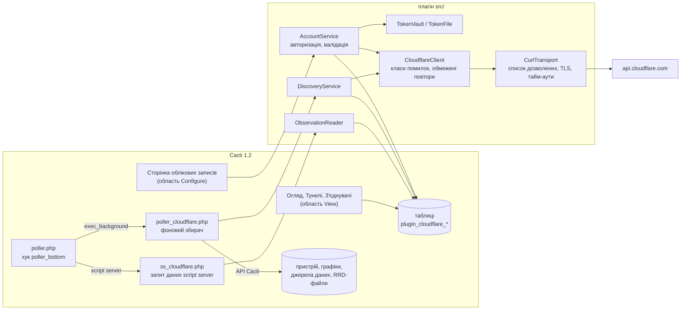

<!-- Source: README.md; SHA256: f8de0e02c5904e15bfa4c71edcaab219e5e5d4f6d9dbe589f4ed16351df6bf4d -->

<!-- translations:start -->
[English](../../../README.md) | [简体中文](../zh-CN/README.md) | [हिन्दी](../hi-IN/README.md) | [Español (España)](../es-ES/README.md) | [Español (Latinoamérica)](../es-419/README.md) | [العربية (السعودية)](../ar-SA/README.md) | [Afrikaans](../af-ZA/README.md) | [አማርኛ](../am-ET/README.md) | [العربية (مصر)](../ar-EG/README.md) | [العربية (المغرب)](../ar-MA/README.md) | [বাংলা](../bn-BD/README.md) | [Deutsch](../de-DE/README.md) | [فارسی](../fa-IR/README.md) | [Filipino](../fil-PH/README.md) | [Français](../fr-FR/README.md) | [Français (Maroc)](../fr-MA/README.md) | [Français (Sénégal)](../fr-SN/README.md) | [Hausa](../ha-NG/README.md) | [עברית](../he-IL/README.md) | [Bahasa Indonesia](../id-ID/README.md) | [Igbo](../ig-NG/README.md) | [Italiano](../it-IT/README.md) | [日本語](../ja-JP/README.md) | [한국어](../ko-KR/README.md) | [Malagasy](../mg-MG/README.md) | [मराठी](../mr-IN/README.md) | [Bahasa Melayu](../ms-MY/README.md) | [Nederlands](../nl-NL/README.md) | [Polski](../pl-PL/README.md) | [Português (Brasil)](../pt-BR/README.md) | [Русский](../ru-RU/README.md) | [Kinyarwanda](../rw-RW/README.md) | [Soomaali](../so-SO/README.md) | [Svenska](../sv-SE/README.md) | [Kiswahili](../sw-KE/README.md) | [தமிழ்](../ta-IN/README.md) | [తెలుగు](../te-IN/README.md) | [ไทย](../th-TH/README.md) | [Türkçe](../tr-TR/README.md) | [Українська](README.md) | [اردو](../ur-PK/README.md) | [Tiếng Việt](../vi-VN/README.md) | [isiXhosa](../xh-ZA/README.md) | [Yorùbá](../yo-NG/README.md) | [繁體中文](../zh-TW/README.md) | [isiZulu](../zu-ZA/README.md)
<!-- translations:end -->

<p align="center">
  
</p>

# Плагін Cloudflare для Cacti

[](https://github.com/somethingwithproof/plugin_cloudflare/actions/workflows/ci.yml)
[](https://sonarcloud.io/summary/new_code?id=somethingwithproof_plugin_cloudflare)
[](../../../LICENSE)


[](https://sonarcloud.io/summary/new_code?id=somethingwithproof_plugin_cloudflare)
[](https://sonarcloud.io/summary/new_code?id=somethingwithproof_plugin_cloudflare)
[](https://sonarcloud.io/summary/new_code?id=somethingwithproof_plugin_cloudflare)


Плагін для Cacti 1.2, що розробляється для моніторингу Cloudflare Tunnels та
аналітики зон. Він читає дані з Cloudflare API за допомогою токенів API з обмеженими правами,
ніколи нічого не змінює в Cloudflare і зберігає дані у власних таблицях.
У Cacti плагін копіює XML-файли запитів даних до `resource/script_server/` і
створює пристрої, графіки й шаблони через власні API Cacti без жодних
змін у файлах ядра.

**Статус: 0.4.0-dev, не випущено.** Остання випущена версія — 0.3.0. Версія в розробці додає експорт інвентаризації у форматі CSV, явне виведення з експлуатації видалених тунелів, кешовану аналітику зон та необов'язкові шаблони Thold. Перевірка на реальному провайдері та кваліфікація розгортання ще тривають.

Таблиця нижче описує стабільний випуск 0.3.0. Доповнення версії в розробці описано нижче в розділі про робочі процеси оператора та аналітику зон.

| Доступно зараз | Заплановано |
|---|---|
| Встановлення, оновлення, вимкнення та видалення через менеджер плагінів Cacti | Аналітика GraphQL і сповіщення Thold (Етап 4) |
| Дозволи Cloudflare: View, Operator та Configure | Ін'єкція відмов, моделі TLA+ і повна документація (Етап 5) |
| Додавання, редагування, видалення, увімкнення та вимкнення облікових записів Cloudflare | |
| Збереження токена у файлі або в зашифрованому вигляді в базі даних Cacti | |
| Перевірка токена та його дозволів на читання тунелів і зон | |
| Виявлення тунелів і з'єднувачів у фоновому збирачі, що запускається основним опитувачем | |
| Сторінки Overview, Tunnels і Connectors у меню Management > Cloudflare Tunnels | |
| Відстеження життєвого циклу: `active`, `unavailable` і `deleted` | |
| Один пристрій Cacti на обліковий запис, створений адміністратором, із тунелями як індексами запиту даних | |
| Окремі графіки Connectors, Health і Collection для кожного тунелю, побудовані з одного RRD-файлу на тунель | |
| Значення, достовірність яких плагін не може гарантувати, зберігаються як невідомі (`U`), а не як 0 | |

## Ролі доступу

| Область доступу | Доступ |
| --- | --- |
| Cloudflare: View | Наявні сторінки моніторингу. |
| Cloudflare: Operator | Моніторинг, а також сторінка Operations та персональні підтвердження під час первинного розбору. |
| Cloudflare: Configure | Доступ рівня Operator, а також наявні дії з налаштування та адміністрування. |

Після копіювання файлів оновлення відкрийте сторінку Plugins від імені адміністратора, щоб зареєструвати
нову область доступу. Призначте область доступу Operator явно в розділі **Configuration > Users** або для груп користувачів.
Під час оновлення зберігаються наявні ідентифікатори та права доступу для областей View і Admin. Доступ Admin
успадковує доступ Operator, а доступ Operator успадковує доступ View під час кожного запиту;
це не додає збережених прав користувачам чи групам. Налаштування плагіна також потребують
доступу Cloudflare: Configure на додачу до дозволу Settings у Cacti.

Видимість облікового запису Cloudflare відповідає наявній області доступу View; вона поширюється на весь обліковий запис.
Облікові дані, конфігурація, зіставлення, видалення та інші адміністративні зміни
залишаються на адміністративних сторінках. Підтвердження діють лише в межах поточної
сесії користувача, щонайбільше одну годину і лише доти, доки те саме спостереження залишається
актуальним. Нові або змінені спостереження роблять їх недійсними. Вони ніколи не позначають невдале
вимірювання як справне та не пригнічують сповіщення.

## Навіщо цей плагін

Оператори Cacti, які публікують сервіси через Cloudflare Tunnel, не бачать
стану тунелю всередині Cacti. Тунель може втратити всі свої з'єднувачі, тоді як
вихідні хости все ще відповідають на запити SNMP, тому наявні графіки залишаються зеленими,
хоча користувачі бачать помилки. Мета цього плагіна — розмістити показники стану тунелів і трафіку
зон поруч із графіками пристроїв, які оператори вже відстежують, не надаючи
Cacti жодної можливості змінювати конфігурацію Cloudflare.

Архітектуру визначають три обмеження:

- **Тільки для читання.** Плагін викликає лише кінцеві точки `GET` та GraphQL
  Analytics API. Йому не потрібні дозволи на редагування жодного ресурсу Cloudflare.
- **Необов'язковість.** Збої Cloudflare, прострочені токени та обмеження частоти запитів не повинні
  сповільнювати інтерфейс Cacti чи блокувати опитування інших пристроїв. Усі виклики API мають
  жорсткі тайм-аути, а збір даних виконується у фоновому процесі, який запускає
  опитувач.
- **Без змін у ядрі.** Плагін використовує хуки плагінів Cacti 1.2 і
  власні таблиці. Він копіює один XML-файл запиту даних до `resource/script_server/` та
  створює пристрої, графіки й шаблони через власні API Cacti. Файли ядра
  не змінюються, тому оновлення Cacti та інші плагіни залишаються незачепленими.

## Як це працює



- **Інтеграція з Cacti** (`setup.php`, `includes/`, скрипти сторінок) реєструє
  хуки та області доступу, відображає сторінки за допомогою власних допоміжних функцій Cacti та делегує
  кожну дію бібліотеці в `src/`.
- **Бібліотека** (`src/`, простір імен `Somethingwithproof\Cloudflare\`) не залежить
  від глобальних змінних Cacti, тому її тестують на реальній базі даних та
  імітованому HTTP-транспорті без запущеного екземпляра Cacti.
- **Єдиний вихідний шлях.** `CurlTransport` — єдиний код, що звертається до
  мережі, і він приймає лише `https://api.cloudflare.com`. Кожен збій
  зіставляється з одним класом помилок (`auth`, `permission`, `rate_limited`,
  `transient`, ...), який визначає статус, що відображається в інтерфейсі.
- **Збереження даних** відбувається через власне PDO-з'єднання Cacti з підготовленими
  виразами. Зміни схеми реалізовано як нумеровані ідемпотентні міграції.

Архітектурні рішення та їх обґрунтування наведено в
[docs/design.md](../../design.md).

## Знімки екрана

Знімки екрана зроблено на тестовому стенді, а не на реальному обліковому записі Cloudflare. На
стенді запущено Cacti 1.2.31 з імітованим Cloudflare API, який повертає тестові
дані, тому обліковий запис, його ідентифікатор і три тунелі є демонстраційними заглушками.


*Список облікових записів Cloudflare. Імітований API приймає токен, тому перевірка Verify
повертає `ok`.*


*Редагування облікового запису. Поля токена завжди порожні; збережений токен
ніколи не надсилається назад у браузер. Параметри Collect Tunnels і Create Graphs увімкнено, а
Collect Analytics вимкнено. Connection Status показує результат останньої перевірки
Verify: `ok`, доступ на читання тунелів надано, а на читання зон — відсутній.*


*Settings > Cloudflare.*


*Management > Cloudflare Tunnels > Overview. Статус визначається за найгіршим статусом Cloudflare
серед активних тунелів облікового запису — тут це `down`, оскільки один із тестових
тунелів не працює. Статуси `Disabled`, `Not collected`, `Collection failing` і `Not yet
collected` мають вищий пріоритет за стан тунелів саме в такому порядку, тому обліковий запис,
останній запуск якого завершився збоєм, показує `Collection failing` незалежно від повідомлень його тунелів.*


*Вкладка Tunnels. Поля Connectors і Connections показують `-` для old-office, оскільки
імітований API відповідає на запит його підключень як для невідомого тунелю і нічого
не було збережено, та 0 для staging, у якого немає запущених з'єднувачів.*


*Графік Connectors для тунелю blog. Усі три лінії дорівнюють 1 до та
після розриву посередині, де імітований API повертав помилки, а плагін
зберігав невідомі значення. Лінії не падають до 0. Графік отримано з того самого
тестового стенда (`make screenshots`), який встановлює крок у 30 секунд для цього
одного джерела даних, щоб сім хвилин опитування заповнили графік.*

## Вимоги

- Cacti версій від 1.2.25 до 1.2.31. Для самої Cacti 1.2.31 потрібен PHP 8.0 або
  новішої версії. У CI тестується лише 1.2.31; версію 1.2.25 востаннє перевіряли
  вручну 2026-10-22.
- PHP від 7.4 до 8.4 із розширеннями `curl`, `openssl` та `pdo_mysql`. Без них
  плагін відмовляється вмикатися.
- MariaDB 10.6 або новішої версії, або MySQL 8.0 або новішої версії.
- Доступ по HTTPS із сервера Cacti до `api.cloudflare.com`. Проксі-сервери не
  підтримуються.

Перелік того, що тестується, наведено у [docs/compatibility.md](../../compatibility.md).

## Встановлення

1. Розмістіть плагін у каталозі `plugins/cloudflare` вашої інсталяції Cacti —
   або розпакувавши архів із
   [GitHub Releases](https://github.com/somethingwithproof/plugin_cloudflare/releases)
   (команда `make package`, запущена у робочій копії тегу випуску, збирає такий
   самий архів), або за допомогою git clone. Каталог обов’язково повинен мати
   назву `cloudflare`.
2. Встановіть та увімкніть його через Console > Configuration > Plugins або через
   CLI від імені користувача вебсервера:

   ```sh
   php cli/plugin_manage.php --plugin=cloudflare --install --enable
   ```

3. Під час встановлення адміністратор отримує право доступу
   Cloudflare: Configure. Надайте його іншим користувачам або групам у розділі
   Console > Configuration > Users.
4. Створіть токен із правами доступу, зазначеними в
   [docs/token-permissions.md](../../token-permissions.md). Коротко:
   Account > Cloudflare Tunnel > Read та, за потреби, Zone > Zone > Read.
5. Збережіть токен одним із двох способів нижче, потім додайте обліковий запис
   у розділі Console > Configuration > Cloudflare Accounts і запустіть Verify
   з меню дій.

### Варіант A: шифрування в базі даних

Плагін шифрує токени за допомогою 32-байтового ключа, який ви створюєте
самостійно. Сам він ніколи не створює і не записує цей ключ. Файл повинен бути
доступним для читання користувачам вебсервера та опитувача, недоступним для
читання іншим користувачам, а його каталог має дозволяти цим користувачам
перехід до нього. Для вебсервера, що працює від імені `www-data`:

```sh
sudo mkdir -p /etc/cacti
sudo sh -c 'umask 077 && openssl rand -hex 32 > /etc/cacti/cloudflare.key'
sudo chgrp www-data /etc/cacti/cloudflare.key
sudo chmod 0440 /etc/cacti/cloudflare.key
```

Типовий шлях — `/etc/cacti/cloudflare.key`; його можна змінити в
Settings > Cloudflare > Token Vault Key File. Якщо ключ відсутній або
відхилений, форма редагування пропонує лише варіант із файлом токена.
Зберігайте резервну копію ключа: без нього збережені токени не вдасться
розшифрувати і їх доведеться вводити знову.

#### Ротація ключа

Команди перешифрування не передбачено. Новий ключ не може розшифрувати токени,
збережені під старим, тому ротація означає повторне введення кожного
збереженого токена:

1. Майте під рукою значення токена кожного облікового запису. Cloudflare показує
   значення токена лише під час його створення або перевипуску, тож якщо ви його
   не зберегли, перевипустіть токен у панелі керування Cloudflare.
2. Створіть новий ключ за новим шляхом за допомогою наведених вище команд,
   наприклад `/etc/cacti/cloudflare.key.new`, із тим самим власником і правами
   доступу.
3. Вкажіть новий шлях у Settings > Cloudflare > Token Vault Key File та
   збережіть налаштування. Відтепер дія Verify для облікового запису, досі
   зашифрованого старим ключем, повідомлятиме «Stored token cannot be decrypted»,
   а кожен запуск збирача записуватиме для нього в журнал
   `discovery token unavailable` із `reason=decrypt_failed`.
4. Для кожного облікового запису, що зберігає свій токен у базі даних, відкрийте
   його в Console > Configuration > Cloudflare Accounts, вставте токен в обидва
   поля токена, збережіть і запустіть Verify. Статус має бути `ok`.
5. Коли всі такі облікові записи пройдуть перевірку, видаліть старий файл ключа
   та його резервні копії.

Між кроками 3 і 4 тунелі облікового запису не оновлюються, а їхні графіки
стану, конекторів і з’єднань записують значення U. Облікові записи, що
використовують файл токена, це не зачіпає.

### Варіант B: файл токена

Запишіть токен — і нічого більше — у файл, який можуть читати користувачі
вебсервера та опитувача і не можуть інші, а потім введіть його абсолютний шлях у
формі редагування:

```sh
sudo sh -c 'umask 077 && cat > /etc/cacti/cloudflare-account.token'   # paste the token, then Ctrl-D
sudo chgrp www-data /etc/cacti/cloudflare-account.token
sudo chmod 0440 /etc/cacti/cloudflare-account.token
```

Файл перевіряється під час читання — під час виконання Verify, а не під час
збереження. Символічні посилання, файли розміром понад 4 КіБ, а також файли,
доступні іншим для читання чи запису, відхиляються.

Будь-хто з правом Cloudflare: Configure може вказати довільний шлях, і
користувач опитувача його прочитає. Щоб зберігати файли токенів в одному місці,
задайте каталог у Settings > Cloudflare > Token File Directory, наприклад
`/etc/cacti`; шлях за його межами тоді буде відхилено. Див.
[docs/security.md](../../security.md#token-file).

## Оновлення

1. Замініть файли у `plugins/cloudflare` файлами нового випуску, зберігши назву
   каталогу.
2. Відкрийте один раз Console > Configuration > Plugins або
   Console > Configuration > Cloudflare Accounts під обліковим записом
   адміністратора. Це запустить міграції плагіна, імпортує шаблони Cloudflare,
   скопіює файл запиту даних (див.
   [Метрики та графіки тунелів](#tunnel-metrics-and-graphs)), а під час
   оновлення з версії 0.1.0 також зареєструє перехоплювач `poller_bottom`.

`poller.php` не виконує оновлення плагіна, тому до виконання кроку 2 нова схема
бази даних відсутня. Кожен запуск збирача тоді нічого не робить і записує в
журнал `CLOUDFLARE: collector skipped; plugin upgrade pending, open Console > Plugins`.
Сторінки Cloudflare Tunnels вимагають лише права Cloudflare: View, тому вони
ніколи не запускають оновлення і до кроку 2 можуть показувати «The Cloudflare
tunnels could not be read».

## Статус облікового запису

Дія Verify встановлює статус облікового запису:

| Статус | Значення |
|---|---|
| `unknown` | Перевірку не виконували з моменту додавання облікового запису або зміни його облікових даних |
| `ok` | Токен активний і може зчитувати тунелі |
| `token_inactive` | Cloudflare повідомляє, що токен вимкнений або термін його дії вичерпано |
| `auth_failed` | Cloudflare відхилив токен як недійсний або прострочений (HTTP 401) |
| `permission_denied` | Токен активний, але не може зчитувати тунелі або не має прав для виклику кінцевих точок перевірки токена (HTTP 403) |
| `unreachable` | Не вдалося з’єднатися з API, вичерпано час очікування або отримано помилку сервера |
| `rate_limited` | Cloudflare повернув HTTP 429 |
| `error` | Будь-яка інша помилка, зокрема відсутній або небезпечний файл токена, відсутній або непридатний файл ключа сховища токенів або збережений токен, який не вдається розшифрувати |

Сторінка редагування також показує, чи надано права на читання тунелів і
читання зон.

## Виявлення тунелів

Після кожного циклу опитування на головному опитувачі перехоплювач
`poller_bottom` запускає фоновий збирач через `exec_background`, якщо принаймні
в одному ввімкненому обліковому записі активовано параметр Collect Tunnels.
Збирач ніколи не виконується у процесі самого опитувача, тож повільний API
Cloudflare не затримує `poller.php`. Віддалені опитувачі його ніколи не
запускають.

Для кожного облікового запису, якому настав час опитування, збирач отримує
список тунелів, а потім зчитує з’єднання його активних тунелів, що дає
інформацію про конектори кожного тунелю, їхні версії, дата-центри та вихідні
адреси. Час опитування облікових записів настає кожні Discovery Interval секунд
(типово 300 секунд). Після 50 секунд роботи запуск не бере в опрацювання нові
облікові записи та робить щонайбільше 200 запитів з’єднань. Будь-яке з цих
обмежень також може зупинити обробку облікового запису посеред зчитування його
з’єднань; такий обліковий запис позначається як `partial`, а наступний запуск
продовжує з тунелів, до яких зверталися найдавніше. Облікові записи, обробку
яких не розпочинали, залишаються в черзі на наступний запуск.

Тунель має життєвий цикл, що відстежується окремо від статусу, який повертає
Cloudflare (`healthy`, `degraded`, `down` або `inactive`):

| Життєвий цикл | Значення |
|---|---|
| `active` | Тунель був присутній в останньому повному переліку |
| `deleted` | Повний перелік не містив його (зокрема й порожній перелік). Запис і його історія зберігаються, і тунель знову стає `active`, якщо з’явиться повторно |
| `unavailable` | Три зафіксовані збої без жодного повного переліку між ними залишають стан тунелю невідомим |

Лише повний успішний перелік додає, оновлює або позначає тунелі як видалені, а
невдалий запит переліку ніколи не видаляє жодного тунелю. Повна неможливість
зчитати дані з Cloudflare (`transient`, `rate_limited`, `auth` або `permission`)
зараховується як збій; після трьох зарахованих збоїв без повного переліку між
ними активні тунелі облікового запису переходять у стан `unavailable`. Наступний
повний перелік відновлює їх і скидає лічильник. Тунель, про який Cloudflare вже
не знає під час зчитування його з’єднань, пропускається без фіксації збою для
облікового запису. Інші помилки ані збільшують, ані скидають лічильник збоїв.

У файлі `cacti.log` рядки виявлення починаються з `CLOUDFLARE: discovery`, а
підсумок запуску — з `CLOUDFLARE: collector`. Збої та зміни життєвого циклу,
як-от невдале отримання переліку або позначення тунелів як `unavailable`,
записуються з типовим для Cacti рівнем `LOW`; результат кожного облікового
запису та підсумок запуску журналюються на рівні `MEDIUM`. Оскільки зчитування
з’єднань може завершитися помилкою на кожному тунелі, для кожного облікового
запису лише перша помилка кожного класу записується з рівнем `LOW`, решта — з
`MEDIUM`, а наприкінці додається один рядок `LOW` для кожного класу з кількістю
тунелів, де сталася помилка.

Розділ Management > Cloudflare Tunnels вимагає права Cloudflare: View і працює
лише в режимі читання:

- **Overview** показує кожен обліковий запис із його статусом, кількістю тунелів
  за життєвим циклом, часом останнього успішного виявлення та кількістю
  послідовних збоїв.
- **Tunnels** відображає тунелі по всіх облікових записах або для одного запису
  з фільтрами за обліковим записом, життєвим циклом, статусом і назвою, а також
  із можливістю сортування стовпців.
- **Connectors** показує конектори тунелю, вибраного на вкладці Tunnels.

## Метрики та графіки тунелів

Cacti зчитує стан тунелів через запит даних сервера сценаріїв
`ss_cloudflare.php`. Він відповідає виключно з таблиць плагіна і ніколи не
звертається до Cloudflare, тому збій Cloudflare не може сповільнити опитувач.
Кожен тунель надає шість значень: стан здоров’я (healthy — 3, degraded — 2,
down — 1, inactive — 0), кількість конекторів, кількість з’єднань, версії
конекторів, кількість секунд із моменту останнього зчитування з’єднань та
кількість послідовних збоїв завдання виявлення. Стан здоров’я, конектори,
з’єднання та версії виводяться лише тоді, коли плагін може за них поручитися,
тобто останнє виявлення завершилося успішно, тунель має статус `active`, а дані
є актуальними. Інакше вони мають значення `U`, і на графіку відображається
розрив замість нуля, який виглядав би як простій. Два значення збору даних
продовжують виводитися під час збою, щоб графік Collection відображав його; вони
набувають значення `U` лише для видаленого тунелю або тунелю, з’єднання якого
ніколи не оновлювалися. Правила описано у [docs/metrics.md](../../metrics.md).

### Створення пристрою

Один обліковий запис відповідає щонайбільше одному пристрою Cacti. Пристрій
містить тунелі облікового запису як індекси запиту даних Cloudflare Tunnels.
Автоматично він не створюється:

1. Відкрийте Console > Configuration > Cloudflare Accounts.
2. Виберіть обліковий запис, оберіть Create Cacti Device у меню дій та
   підтвердьте.

Для цієї дії потрібні обидва права доступу: Cloudflare: Configure та право
Cacti Sites/Devices/Data (те саме, що для `host.php`). Пункт меню відображається
лише користувачам, які мають обидва права, а сервер відхиляє запит від будь-кого
іншого. Пристрій отримує назву `Cloudflare: <account name>`, використовує шаблон
хоста Cloudflare Account і головний опитувач, має версію SNMP 0 без перевірки
доступності та ім’я хоста `<account ID>.cloudflare.invalid`. Це ім’я
зарезервоване й ніколи не перетворюється на IP-адресу; Cacti не підключається до
нього. Якщо обліковий запис уже має пристрій, дія повідомляє про це й нічого не
змінює. Якщо адміністратор видалить пристрій у Cacti, плагін не створюватиме
інший, доки Create Cacti Device не буде запущено знову.

### Створення графіків

Параметр Create Graphs у формі облікового запису типово вимкнений. Коли його
ввімкнено, щоразу після завершення виявлення облікового запису зі статусом `ok`
або `partial` збирач переіндексовує пристрій і створює всі відсутні графіки для
`active` тунелів облікового запису: Connectors, Health та Collection — по три на
кожен тунель. Три графіки одного тунелю використовують спільний RRD-файл. Один
запуск створює щонайбільше 50 графіків і зупиняється через 20 секунд, а наступний
запуск продовжує роботу. Плагін ніколи не видаляє об’єкти Cacti. Графік,
видалений адміністратором, повторно не створюється, а тунель, якого Cloudflare
більше не повертає у переліку, зберігає свій графік і RRD-файл, які показують
`U`.

Щоб увімкнути Create Graphs, потрібні обидва права доступу. Щоб вимкнути — лише
право Configure. Коли форму зберігає користувач без права Sites/Devices/Data,
параметр залишається без змін із відповідним попередженням. Коли Create Graphs
вимкнено, пристрій все одно переіндексовується після кожного виявлення, тому
нові тунелі з’являються як індекси запиту даних.

### Файл запиту даних

Cacti 1.2.31 зчитує XML-файл запиту даних лише зі свого каталогу `resource`.
Тому під час встановлення та оновлення плагін копіює один файл,
`templates/resource/cloudflare_tunnels.xml`, у
`<Cacti>/resource/script_server/cloudflare_tunnels.xml`. Це єдиний файл, який
плагін записує поза межами власного каталогу, тож користувач, який встановлює
або оновлює плагін, повинен мати право запису до цього каталогу. Видалення
плагіна зберігає цей файл разом із пристроями, графіками, RRD-файлами та
шаблонами. Якщо копіювання або імпорт шаблону завершується помилкою, плагін
записує її в журнал, а дія Create Cacti Device повторює спробу.

## Налаштування

Розділ «Параметри > Cloudflare» (Settings > Cloudflare) містить такі поля:

- **Файл ключа сховища токенів (Token Vault Key File)**: шлях до ключа сховища.
- **Каталог файлів токенів (Token File Directory)**: якщо задано, файл токена поза цим каталогом відхиляється. За замовчуванням порожній, що дозволяє будь-який шлях. Див. [docs/security.md](../../security.md#token-file).
- **Тайм-аут інтерактивного запиту (Interactive Request Timeout)**: загальний час у секундах для запиту з вебінтерфейсу, наприклад Verify («Перевірити»). Значення за замовчуванням — 10; значення поза діапазоном від 5 до 60 повертаються до 10.
- **Тайм-аут запиту збирача (Collector Request Timeout)**: загальний час у секундах для запиту фонового збирача. Значення за замовчуванням — 20; значення поза діапазоном від 5 до 60 повертаються до 20.
- **Рівень журналювання (Log Level)**: зберігається, але поки що нічим не зчитується.

У формі облікового запису параметри «Збирати тунелі» (Collect Tunnels) та «Інтервал виявлення» (Discovery Interval) керують виявленням, а «Створювати графіки» (Create Graphs) — створенням графіків. Значення «Збирати аналітику» (Collect Analytics) зберігається, але в цьому випуску не має жодного впливу.

## Мови

Плагін постачається з перекладами іспанською (Іспанія, `es-ES`), французькою (`fr-FR`), німецькою (`de-DE`), спрощеною китайською (`zh-CN`), гінді (`hi-IN`), арабською (`ar-SA`) та японською (`ja-JP`). Cacti відображає їх після ввімкнення мовної підтримки («Конфігурація > Параметри > Загальні > Підтримка мов» / Configuration > Settings > General > Language Support) і вибору мови користувачем. Також постачається каталог латиноамериканської іспанської (`es-419`), однак у Cacti 1.2 немає відповідної локалі для вибору, тому він почне діяти лише після того, як Cacti додасть її; доти обирайте іспанську (`es-ES`).

Частина тексту залишається англійською: значення станів, які плагін зберігає та показує без змін (`ok`, `active`, `unavailable`, `deleted`, а також стан тунелю, який повідомляє Cloudflare), і все, що плагін записує до журналу Cacti.

## Деінсталяція та збереження даних

Процедура деінсталяції видаляє власні таблиці плагіна, які містять облікові записи, зашифровані токени, виявлені тунелі, стан завдань і записи про створені об'єкти Cacti, а також видаляє його параметри з префіксом `cloudflare_`. Вона не видаляє файл ключа, файли токенів, скопійований файл `resource/script_server/cloudflare_tunnels.xml`, а також жодні пристрої, графіки, джерела даних, файли RRD чи шаблони Cacti. Вони зберігають історичні дані моніторингу, тож їхнє видалення є явною дією адміністратора в Cacti.

Збережений пристрій припиняє отримувати дані. Після деінсталяції або видалення відповідного облікового запису жоден обліковий запис більше не володіє вузлом, тому його графіки зберігають історію, але надалі виводять `U`. Дія «Створити пристрій Cacti» (Create Cacti Device) для повторно встановленого плагіна або повторно доданого облікового запису створює новий пристрій і не використовує старий повторно, тому видаліть старий пристрій у Cacti, щойно його історія більше не буде потрібна.

## Відомі обмеження

- За один запуск виконується щонайбільше 200 запитів з'єднань. Тунелі понад це обмеження оновлюються рідше, ніж вікно спостереження, тому на їхніх графіках з'єднань з'являються прогалини.
- Плагін перезаписує правки адміністратора в імпортованих шаблонах, якщо оновлення змінює XML-файл шаблону, що входить до комплекту постачання.
- Пристрій облікового запису має залишатися на головному опитувачі (poller). Таблиці плагіна розміщені в головній базі даних, і скрипт зчитує їх саме звідти.
- Видалені тунелі залишаються в індексі запиту даних (data query) і виводять `U`, доки адміністратор явно не виведе їх з експлуатації. Виведення з експлуатації видаляє через Cacti лише зафіксовані плагіном графіки та неспільні джерела даних; рядок в інвентаризації залишається видимим. Очищенням RRD керує Cacti.
- Cacti вимикає плагін, якщо виконання його коду завершується справжньою фатальною помилкою, наприклад через вичерпання пам'яті. Див. [docs/security.md](../../security.md).

## Безпека

- Глобальні ключі API (Global API Keys) відхиляються; приймаються лише API-токени з обмеженою областю дії.
- Токени зберігаються у підготовленому вами файлі або шифруються за алгоритмом AES-256-GCM за допомогою файлу ключа, який ніколи не потрапляє до бази даних. Вони ніколи не відображаються на сторінці, не записуються до журналу й не включаються до повідомлень про помилки.
- Помилки бази даних містять лише SQLSTATE і код помилки драйвера, але ніколи — значення інструкції.
- Кожна зміна виконується через POST-запит, захищений CSRF-токеном Cacti. Адміністративні зміни облікових записів і конфігурації потребують права «Cloudflare: Configure»; персональні підтвердження сортування (triage) потребують права «Cloudflare: Operator». Створення пристрою Cacti або ввімкнення параметра «Створювати графіки» (Create Graphs) також потребує дозволу Cacti «Sites/Devices/Data». Вимкнений плагін відхиляє доступ до своїх сторінок.

Докладні відомості та відомі обмеження наведено в [docs/security.md](../../security.md).
Повідомляйте про вразливості конфіденційно, як описано в [SECURITY.md](../../../SECURITY.md).

## Робочі процеси оператора та аналітика зон

Нововведення у гілці розробки охоплюють явне виведення видалених тунелів з експлуатації, аналітику зон з урахуванням доступних можливостей і шаблони Thold для імпорту. Ці можливості ще не мають тегу випуску та не пройшли кваліфікацію на живому обліковому записі. Див. [docs/analytics-and-alerting.md](../../analytics-and-alerting.md) щодо налаштування, семантики метрик та обмежень перевірки.

### Експорт інвентаризації

На сторінках Tunnels («Тунелі») та Connectors («З'єднувачі») доступна дія Export («Експорт») для області прав «Cloudflare: View». CSV-файли тунелів містять усі відповідні рядки з урахуванням активного облікового запису, життєвого циклу, стану, параметрів пошуку та сортування на всіх сторінках. CSV-файли з'єднувачів містять версії, архітектуру, центри обробки даних та адреси джерел (origin) для вибраного тунелю. Під час завантаження зчитуються лише кешовані записи. Невідомі кількісні значення залишаються порожніми; перед комірками, схожими на формули, додається апостроф для безпечного імпорту в електронні таблиці.

## Дорожня карта

Кожен етап випускається як реліз серії 0.x з відповідним номером: етап 3 — це 0.3.0, етап 4 буде 0.4.0. Етапи 1 і 2 не випускалися окремо та входять до складу 0.3.0. Версію 1.0.0 зарезервовано для випуску, який завершує всі наведені нижче етапи.

| Етап | Обсяг | Стан |
|---|---|---|
| 1. Основа | Життєвий цикл плагіна, дозволи, конфігурація облікового запису, перевірка з'єднання | Випущено в 0.3.0 (від [#2](https://github.com/somethingwithproof/plugin_cloudflare/pull/2) до [#5](https://github.com/somethingwithproof/plugin_cloudflare/pull/5)) |
| 2. Виявлення | Виявлення тунелів і з'єднувачів у фоновому збирачі, сторінки Overview, Tunnels і Connectors | Випущено в 0.3.0 ([#6](https://github.com/somethingwithproof/plugin_cloudflare/pull/6)) |
| 3. Метрики | Джерела даних стану тунелів, шаблони графіків, обробка збоїв без запису вигаданого нуля | Випущено в 0.3.0 ([#7](https://github.com/somethingwithproof/plugin_cloudflare/pull/7)) |
| 4. Аналітика та сповіщення | GraphQL-аналітика для кожної зони з урахуванням тарифного плану, порогові значення Thold із приглушенням під час збоїв | Заплановано |
| 5. Посилення надійності | Ін'єкція збоїв, TLA+-моделі виявлення та збору, повна документація | Заплановано |

## Розробка

Інструменти розробки потребують PHP 8.x і Composer; сам код плагіна залишається сумісним із PHP 7.4. Інтеграційні та BDD-тести потребують бази даних, яку команда `make db-up` запускає в Docker на порту 33061.

```sh
composer install
make db-up
make ci            # unit, integration, BDD, PHPStan, php-cs-fixer, php -l on PHP 7.4
make smoke         # installs the plugin into Cacti 1.2.31 in Docker and walks its lifecycle
make package       # builds build/cloudflare-<version>.tar.gz and checks its contents
make db-down
```

Команди `make smoke` і `make screenshots` потребують локальної копії репозиторію Cacti; задайте шлях до неї у змінній `CACTI_REPO`. Інтеграційні тести зчитують `CF_TEST_DSN`, `CF_TEST_DB_USER` і `CF_TEST_DB_PASS` та пропускаються, якщо база даних недоступна, якщо не встановлено `CI`.

## Участь у розробці

Запити на злиття (pull requests) вітаються. Кожен коміт потребує підпису DCO (`git commit -s`). Спочатку пишіть тест; команда `make ci` має проходити успішно, а зміни в інтеграційному шарі Cacti також мають проходити `make smoke`. Код плагіна має залишатися сумісним із PHP 7.4 і відповідати стилю коду Cacti (табуляція, одинарні лапки, фігурні дужки на тому самому рядку).

### Переклади

Повідомлення позначаються за допомогою `__('...', 'cloudflare')`. Скрипт `locales/build_gettext.sh` (`make i18n`, для якого потрібен GNU gettext) повторно генерує шаблон `locales/po/cacti.pot`, об'єднує його з кожним каталогом `locales/po/<locale>.po` і компілює `locales/LC_MESSAGES/<locale>.mo`; комітьте всі три файли. CI запускає `make i18n-check`, який завершується помилкою, якщо в каталозі відсутній переклад або є нечіткий (fuzzy) запис, відрізняється рядок форматування або застарів скомпільований файл; модульні тести також перевіряють заповнювачі, HTML-теги та крайові пробіли кожного запису. Отже, змінене повідомлення потребує оновлення своїх перекладів у тому самому pull request. Нова мова додається як новий файл `<locale>.po`, названий відповідно до іменування локалей у Cacti (наприклад, `pt-BR`), доданий до `CatalogTest::LOCALES` і до перевірки архіву в `tests/build/package.sh`. Назви продуктів Cloudflare, Cacti та Thold, терміни API і GraphQL, а також назви дозволів, як-от `Account Cloudflare Tunnel Read`, залишайте без змін.

## Документація

- [docs/security.md](../../security.md): засоби захисту та відомі обмеження
- [docs/token-permissions.md](../../token-permissions.md): дозволи токенів
- [docs/compatibility.md](../../compatibility.md): підтримувані версії та використовувані інтерфейси
- [docs/metrics.md](../../metrics.md): каталог метрик і випадки, коли значення невідоме
- [docs/collector-protocol.md](../../collector-protocol.md): що зчитує та виводить `ss_cloudflare.php`
- [docs/schema.md](../../schema.md): таблиці бази даних
- [docs/design.md](../../design.md): архітектурні рішення
- [CHANGELOG.md](../../../CHANGELOG.md)

## Ліцензія

GPL-2.0-or-later. Див. [LICENSE](../../../LICENSE).

## Торговельні марки

Cloudflare є зареєстрованою торговельною маркою компанії Cloudflare, Inc. Цей проєкт є незалежним інструментом із відкритим кодом і не пов'язаний із Cloudflare, Inc., не спонсорується та не схвалюється нею.

Проєкт також не пов'язаний із проєктом Cacti. Відомості про логотип див. у [docs/images/README-logo.md](../../images/README-logo.md).
