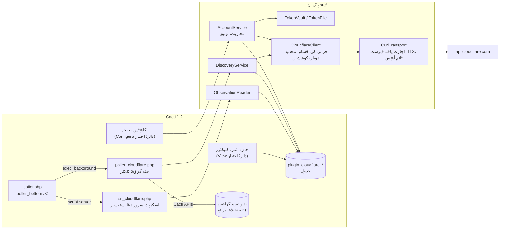

<!-- Source: README.md; SHA256: f8de0e02c5904e15bfa4c71edcaab219e5e5d4f6d9dbe589f4ed16351df6bf4d -->

<!-- translations:start -->
[English](../../../README.md) | [简体中文](../zh-CN/README.md) | [हिन्दी](../hi-IN/README.md) | [Español (España)](../es-ES/README.md) | [Español (Latinoamérica)](../es-419/README.md) | [العربية (السعودية)](../ar-SA/README.md) | [Afrikaans](../af-ZA/README.md) | [አማርኛ](../am-ET/README.md) | [العربية (مصر)](../ar-EG/README.md) | [العربية (المغرب)](../ar-MA/README.md) | [বাংলা](../bn-BD/README.md) | [Deutsch](../de-DE/README.md) | [فارسی](../fa-IR/README.md) | [Filipino](../fil-PH/README.md) | [Français](../fr-FR/README.md) | [Français (Maroc)](../fr-MA/README.md) | [Français (Sénégal)](../fr-SN/README.md) | [Hausa](../ha-NG/README.md) | [עברית](../he-IL/README.md) | [Bahasa Indonesia](../id-ID/README.md) | [Igbo](../ig-NG/README.md) | [Italiano](../it-IT/README.md) | [日本語](../ja-JP/README.md) | [한국어](../ko-KR/README.md) | [Malagasy](../mg-MG/README.md) | [मराठी](../mr-IN/README.md) | [Bahasa Melayu](../ms-MY/README.md) | [Nederlands](../nl-NL/README.md) | [Polski](../pl-PL/README.md) | [Português (Brasil)](../pt-BR/README.md) | [Русский](../ru-RU/README.md) | [Kinyarwanda](../rw-RW/README.md) | [Soomaali](../so-SO/README.md) | [Svenska](../sv-SE/README.md) | [Kiswahili](../sw-KE/README.md) | [தமிழ்](../ta-IN/README.md) | [తెలుగు](../te-IN/README.md) | [ไทย](../th-TH/README.md) | [Türkçe](../tr-TR/README.md) | [Українська](../uk-UA/README.md) | [اردو](README.md) | [Tiếng Việt](../vi-VN/README.md) | [isiXhosa](../xh-ZA/README.md) | [Yorùbá](../yo-NG/README.md) | [繁體中文](../zh-TW/README.md) | [isiZulu](../zu-ZA/README.md)
<!-- translations:end -->

<p align="center">
  
</p>

# Cacti کے لیے Cloudflare پلگ ان

[](https://github.com/somethingwithproof/plugin_cloudflare/actions/workflows/ci.yml)
[](https://sonarcloud.io/summary/new_code?id=somethingwithproof_plugin_cloudflare)
[](../../../LICENSE)


[](https://sonarcloud.io/summary/new_code?id=somethingwithproof_plugin_cloudflare)
[](https://sonarcloud.io/summary/new_code?id=somethingwithproof_plugin_cloudflare)
[](https://sonarcloud.io/summary/new_code?id=somethingwithproof_plugin_cloudflare)


یہ ایک Cacti 1.2 پلگ ان ہے جو Cloudflare Tunnels اور زون اینالیٹکس کی نگرانی کے لیے تیار کیا جا رہا ہے۔ یہ محدود دائرۂ اختیار والے API ٹوکنز کے ذریعے Cloudflare API سے صرف معلومات پڑھتا ہے، Cloudflare میں کبھی کوئی تبدیلی نہیں کرتا، اور اپنا ڈیٹا اپنے علیحدہ جدولوں میں محفوظ رکھتا ہے۔ Cacti میں یہ ڈیٹا استفسار (data query) کی XML فائلیں `resource/script_server/` میں کاپی کرتا ہے اور Cacti کی اپنی APIs کے ذریعے بغیر کسی بنیادی فائل کو تبدیل کیے ڈیوائسز، گرافس اور ٹیمپلیٹس بناتا ہے۔

**حیثیت: 0.4.0-dev، غیر جاری شدہ۔** آخری جاری کردہ ورژن 0.3.0 ہے۔ ترقیاتی ورژن میں CSV انوینٹری ایکسپورٹس، حذف شدہ ٹنلز کی صریح برطرفی، کیشڈ زون اینالیٹکس اور اختیاری Thold ٹیمپلیٹس شامل کیے گئے ہیں۔ لائیو فراہم کنندہ اور تعیناتی کی تصدیق ابھی باقی ہے۔

ذیل کا جدول 0.3.0 مستحکم ورژن کی وضاحت کرتا ہے۔ ترقیاتی اضافے ذیل میں آپریٹر ورک فلو اور زون اینالیٹکس کے تحت بیان کیے گئے ہیں۔

| اب دستیاب ہے | منصوبہ بند |
|---|---|
| Cacti کے پلگ ان مینیجر کے ذریعے تنصیب، اپ گریڈ، غیر فعال اور غیر نصب کرنا | GraphQL اینالیٹکس اور Thold الرٹس (سنگِ میل 4) |
| Cloudflare: View، Operator اور Configure اجازتیں | فالٹ انجیکشن، TLA+ ماڈلز اور مکمل دستاویزات (سنگِ میل 5) |
| Cloudflare اکاؤنٹس شامل کرنا، ترمیم کرنا، حذف کرنا، فعال اور غیر فعال کرنا | |
| ٹوکن کو کسی فائل میں یا Cacti ڈیٹا بیس میں انکرپٹ شدہ حالت میں محفوظ کرنا | |
| ٹوکن کی تصدیق کرنا اور اس کے ٹنل اور زون پڑھنے کی اجازتیں جانچنا | |
| مرکزی پولر کے ذریعے شروع کیے گئے بیک گراؤنڈ کلکٹر میں ٹنل اور کنیکٹر کی دریافت | |
| Management > Cloudflare Tunnels کے تحت Overview، Tunnels اور Connectors صفحات | |
| لائف سائیکل ٹریکنگ: `active`، `unavailable` اور `deleted` | |
| فی اکاؤنٹ ایک Cacti ڈیوائس، جو منتظم کی طرف سے بنائی جاتی ہے، جس میں ٹنلز ڈیٹا استفسار کے اشاریے ہوتے ہیں | |
| فی ٹنل Connectors، Health اور Collection گرافس، جو فی ٹنل ایک RRD فائل سے تیار ہوتے ہیں | |
| وہ قدریں جن کی پلگ ان تصدیق نہیں کر سکتا، انہیں نامعلوم (`U`) کے طور پر محفوظ کیا جاتا ہے، کبھی 0 کے طور پر نہیں | |

## رسائی کے کردار

| دائرۂ اختیار | رسائی |
| --- | --- |
| Cloudflare: View | موجودہ نگرانی کے صفحات۔ |
| Cloudflare: Operator | نگرانی کے علاوہ Operations صفحہ اور ذاتی درجہ بندی کی توثیقات۔ |
| Cloudflare: Configure | Operator رسائی کے علاوہ موجودہ ترتیب اور انتظامی کارروائیاں۔ |

اپ گریڈ فائلیں کاپی کرنے کے بعد، نیا دائرۂ اختیار رجسٹر کرنے کے لیے بطور منتظم Plugins صفحہ کھولیں۔ **Configuration > Users** یا صارف گروپس کے تحت Operator دائرۂ اختیار کو صراحت سے تفویض کریں۔
اپ گریڈ موجودہ View اور Admin دائرۂ اختیار کے IDs اور اجازتوں کو برقرار رکھتے ہیں۔ Admin رسائی ہر درخواست پر Operator رسائی وراثت میں لیتی ہے، اور Operator رسائی View رسائی وراثت میں لیتی ہے؛ اس سے صارفین یا گروپس میں محفوظ شدہ اجازتیں شامل نہیں ہوتیں۔ پلگ ان کی ترتیبات کے لیے Cacti کی Settings اجازت کے علاوہ Cloudflare: Configure رسائی بھی درکار ہوتی ہے۔

Cloudflare اکاؤنٹ کی مرئیت موجودہ View دائرۂ اختیار سے مطابقت رکھتی ہے؛ یہ پورے اکاؤنٹ کی سطح پر ہے۔
اسناد، ترتیب، میپنگ، حذف کرنے اور دیگر انتظامی تبدیلیاں انتظامی صفحات میں ہی رہتی ہیں۔ توثیقات صرف موجودہ صارف کے سیشن میں، زیادہ سے زیادہ ایک گھنٹے کے لیے اور صرف اس وقت تک برقرار رہتی ہیں جب تک وہی مشاہدہ تازہ رہے۔ نئے یا تبدیل شدہ مشاہدات انہیں کالعدم کر دیتے ہیں۔ یہ کبھی کسی ناکام پیمائش کو صحت مند قرار نہیں دیتیں اور نہ ہی الرٹس کو روکتی ہیں۔

## یہ پلگ ان کیوں

Cacti کے وہ آپریٹرز جو Cloudflare Tunnel کے ذریعے سروسز شائع کرتے ہیں، انہیں Cacti کے اندر ٹنل کی کوئی صورتِ حال نظر نہیں آتی۔ کوئی ٹنل اپنے تمام کنیکٹرز کھو سکتی ہے جبکہ اصل میزبان (origin hosts) ابھی بھی SNMP کا جواب دے رہے ہوتے ہیں، لہٰذا موجودہ گرافس سبز رہتے ہیں جبکہ صارفین کو خرابیاں نظر آتی ہیں۔ اس پلگ ان کا مقصد ٹنل کی صحت اور زون ٹریفک کو ان ڈیوائس گرافس کے ساتھ دکھانا ہے جنہیں آپریٹرز پہلے ہی دیکھتے ہیں، بغیر Cacti کو Cloudflare میں تبدیلی کا کوئی اختیار دیے۔

تین پابندیاں اس ڈیزائن کی تشکیل کرتی ہیں:

- **صرف پڑھنے کے لیے۔** پلگ ان صرف `GET` اینڈ پوائنٹس اور GraphQL Analytics API کو کال کرتا ہے۔ اسے کسی بھی Cloudflare وسیلے پر ترمیم کی اجازت کی ضرورت نہیں ہے۔
- **اختیاری۔** Cloudflare کی بندش، زائد المیعاد ٹوکنز اور شرح کی حدود کو Cacti کے UI کو سست نہیں کرنا چاہیے اور نہ ہی دیگر ڈیوائسز کی پولنگ کو روکنا چاہیے۔ تمام API کالز کے لیے سخت ٹائم آؤٹس مقرر ہیں، اور ڈیٹا جمع کرنے کا عمل پولر کے ذریعے چلائے گئے بیک گراؤنڈ عمل میں چلتا ہے۔
- **بنیادی فائلوں میں کوئی تبدیلی نہیں۔** پلگ ان Cacti 1.2 کے پلگ ان ہُکس اور اپنے جدول استعمال کرتا ہے۔ یہ ایک ڈیٹا استفسار XML فائل `resource/script_server/` میں کاپی کرتا ہے اور Cacti کی اپنی APIs کے ذریعے ڈیوائسز، گرافس اور ٹیمپلیٹس بناتا ہے۔ بنیادی فائلوں میں کوئی تبدیلی نہ ہونے کی وجہ سے Cacti اپ گریڈ اور دیگر پلگ انز متاثر نہیں ہوتے۔

## یہ کیسے کام کرتا ہے



- **Cacti کا ربط ساز کوڈ** (`setup.php`، `includes/`، صفحہ اسکرپٹس) ہُکس اور دائرۂ اختیارات رجسٹر کرتا ہے، Cacti کے اپنے مددگار فنکشنز کے ذریعے صفحات رینڈر کرتا ہے، اور ہر کارروائی `src/` میں موجود لائبریری کے سپرد کرتا ہے۔
- **لائبریری** (`src/`، نیم اسپیس `Somethingwithproof\Cloudflare\`) کا Cacti کے گلوبل متغیرات پر کوئی انحصار نہیں ہے، اس لیے اس کی جانچ حقیقی ڈیٹا بیس اور نقلی HTTP ٹرانسپورٹ کے ساتھ بغیر چلتے ہوئے Cacti کے کی جاتی ہے۔
- **ایک بیرونی راستہ۔** `CurlTransport` واحد کوڈ ہے جو نیٹ ورک سے رابطہ کرتا ہے، اور یہ صرف `https://api.cloudflare.com` کو قبول کرتا ہے۔ ہر ناکامی کو ایک خرابی کی قسم (`auth`، `permission`، `rate_limited`، `transient`، ...) سے منسلک کیا جاتا ہے، جو UI میں دکھائی جانے والی حیثیت کا تعین کرتی ہے۔
- **اسٹوریج** تیار کردہ بیانات (prepared statements) کے ساتھ Cacti کے اپنے PDO کنکشن کے ذریعے ہوتی ہے۔ اسکیما کی تبدیلیاں نمبر شدہ اور idempotent مائیگریشنز ہیں۔

ڈیزائن کے فیصلے اور ان کی وجوہات [docs/design.md](../../design.md) میں درج ہیں۔

## اسکرین شاٹس

اسکرین شاٹس ایک ٹیسٹ اسٹیک سے لیے گئے ہیں، کسی لائیو Cloudflare اکاؤنٹ سے نہیں۔ یہ اسٹیک Cacti 1.2.31 کو ایک نقلی Cloudflare API کے خلاف چلاتا ہے جو فکسچر ڈیٹا لوٹاتی ہے، لہٰذا اکاؤنٹ، اس کا ID اور تینوں ٹنلز محض فرضی مثالیں ہیں۔


*Cloudflare Accounts کی فہرست۔ نقلی API ٹوکن کو قبول کرتی ہے، اس لیے Verify `ok` رپورٹ کرتا ہے۔*


*اکاؤنٹ میں ترمیم۔ ٹوکن کے خانے ہمیشہ خالی رہتے ہیں؛ محفوظ شدہ ٹوکن کبھی براؤزر کو واپس نہیں بھیجا جاتا۔ Collect Tunnels اور Create Graphs آن ہیں اور Collect Analytics آف ہے۔ Connection Status آخری Verify کا نتیجہ دکھاتا ہے: `ok`، ٹنل پڑھنے کی اجازت حاصل ہے اور زون پڑھنے کی اجازت غائب ہے۔*


*Settings > Cloudflare۔*


*Management > Cloudflare Tunnels > Overview۔ حیثیت اکاؤنٹ کے فعال ٹنلز میں سے بدترین Cloudflare حیثیت ہوتی ہے، یہاں `down` ہے کیونکہ ایک فکسچر ٹنل بند ہے۔ `Disabled`، `Not collected`، `Collection failing` اور `Not yet collected` اسی ترتیب سے ٹنل کی صحت پر فوقیت رکھتے ہیں، لہٰذا جس اکاؤنٹ کا آخری رن ناکام ہوا ہو وہ `Collection failing` دکھاتا ہے چاہے اس کے ٹنلز کچھ بھی رپورٹ کریں۔*


*Tunnels ٹیب۔ old-office کے لیے Connectors اور Connections میں `-` نظر آتا ہے، کیونکہ نقلی API اس کے کنیکشنز کی درخواست پر نامعلوم ٹنل کا جواب دیتی ہے اور کچھ محفوظ نہیں ہوا، جبکہ staging کے لیے 0 نظر آتا ہے، جس میں کوئی چلتا ہوا کنیکٹر نہیں ہے۔*


*blog ٹنل کا Connectors گراف۔ درمیان میں وقفے سے پہلے اور بعد میں تینوں لکیریں 1 پر ہیں، جہاں نقلی API نے خرابیاں لوٹائیں اور پلگ ان نے نامعلوم قدریں محفوظ کیں۔ لکیریں 0 تک نہیں گرتیں۔ یہ گراف اسی فکسچر اسٹیک (`make screenshots`) سے آیا ہے، جو اس ایک ڈیٹا ماخذ پر 30 سیکنڈ کا مرحلہ مقرر کرتا ہے تاکہ سات منٹ کی پولنگ گراف کو بھر سکے۔*

## تقاضے

- Cacti 1.2.25 تا 1.2.31۔ Cacti 1.2.31 کے لیے خود PHP 8.0 یا اس کے بعد کا ورژن درکار ہے۔
  CI صرف 1.2.31 پر ٹیسٹ کرتا ہے؛ 1.2.25 کو آخری بار دستی طور پر 2026-10-22 کو ٹیسٹ کیا گیا تھا۔
- PHP 7.4 تا 8.4، `curl`، `openssl` اور `pdo_mysql` ایکسٹینشنز کے ساتھ۔
  ان کے بغیر پلگ ان فعال ہونے سے انکار کر دیتا ہے۔
- MariaDB 10.6 یا اس کے بعد کا ورژن، یا MySQL 8.0 یا اس کے بعد کا ورژن۔
- Cacti سرور سے `api.cloudflare.com` تک HTTPS رسائی۔ پراکسیز کی سہولت دستیاب نہیں ہے۔

یہ جاننے کے لیے کہ کن چیزوں کو ٹیسٹ کیا گیا ہے، [docs/compatibility.md](../../compatibility.md) دیکھیں۔

## تنصیب

1. پلگ ان کو Cacti کی `plugins/cloudflare` ڈائریکٹری میں رکھیں، چاہے
   [GitHub ریلیزز](https://github.com/somethingwithproof/plugin_cloudflare/releases)
   سے آرکائیو نکال کر (ریلیز ٹیگ کے چیک آؤٹ میں `make package` چلانے سے یہی
   آرکائیو بنتا ہے) یا git clone کے ذریعے۔ ڈائریکٹری کا نام `cloudflare` ہونا ضروری ہے۔
2. اسے کنسول > کنفیگریشن > پلگ انز سے انسٹال اور فعال کریں، یا ویب سرور
   صارف کے طور پر CLI کے ذریعے کریں:

   ```sh
   php cli/plugin_manage.php --plugin=cloudflare --install --enable
   ```

3. ایڈمن صارف کو تنصیب کے وقت Cloudflare: Configure کی اجازت مل جاتی ہے۔
   کنسول > کنفیگریشن > صارفین کے تحت دیگر صارفین یا گروپس کو یہ اجازت دیں۔
4. [docs/token-permissions.md](../../token-permissions.md) میں درج اجازتوں کے ساتھ ایک ٹوکن بنائیں۔
   مختصراً: Account > Cloudflare Tunnel > Read، اور اختیاری طور پر Zone > Zone > Read۔
5. نیچے دیے گئے دو طریقوں میں سے کسی ایک سے ٹوکن محفوظ کریں، پھر کنسول > کنفیگریشن >
   Cloudflare Accounts کے تحت اکاؤنٹ شامل کریں اور ایکشنز مینو سے Verify چلائیں۔

### آپشن A: ڈیٹا بیس میں خفیہ کردہ

پلگ ان ٹوکنز کو ایک 32 بائٹ کلید کے ساتھ خفیہ کرتا ہے جو آپ خود بناتے ہیں۔ یہ
کلید خود کبھی نہیں بناتا یا لکھتا۔ فائل ویب سرور اور پولر صارفین کے لیے پڑھنے کے قابل
ہونی چاہیے، دوسروں کے لیے پڑھنے کے قابل نہیں ہونی چاہیے، اور اس کی ڈائریکٹری ایسی ہو
کہ وہ صارفین اس تک پہنچ سکیں۔ `www-data` کے طور پر چلنے والے ویب سرور کے لیے:

```sh
sudo mkdir -p /etc/cacti
sudo sh -c 'umask 077 && openssl rand -hex 32 > /etc/cacti/cloudflare.key'
sudo chgrp www-data /etc/cacti/cloudflare.key
sudo chmod 0440 /etc/cacti/cloudflare.key
```

طے شدہ راستہ `/etc/cacti/cloudflare.key` ہے؛ اسے سیٹنگز >
Cloudflare > Token Vault Key File کے تحت تبدیل کریں۔ جب کلید موجود نہ ہو یا مسترد کر دی جائے، تو
ترمیمی فارم صرف ٹوکن فائل کا آپشن فراہم کرتا ہے۔ کلید کا بیک اپ محفوظ رکھیں:
اس کے بغیر محفوظ کردہ ٹوکنز کو ڈیکرپٹ نہیں کیا جا سکتا اور انہیں دوبارہ درج کرنا ہوگا۔

#### کلید تبدیل کرنا

دوبارہ خفیہ کاری کی کوئی کمانڈ نہیں ہے۔ نئی کلید پرانی کلید کے تحت محفوظ کردہ
ٹوکنز کو ڈیکرپٹ نہیں کر سکتی، اس لیے کلید تبدیل کرنے کا مطلب ہر محفوظ کردہ ٹوکن کو دوبارہ درج کرنا ہے:

1. ہر اکاؤنٹ کے ٹوکن کی قدر اپنے پاس تیار رکھیں۔ Cloudflare ٹوکن کی قدر صرف
   اس وقت دکھاتا ہے جب اسے بنایا یا رول کیا جائے، اس لیے اگر آپ کے پاس یہ موجود نہیں ہے
   تو Cloudflare ڈیش بورڈ میں ٹوکن کو رول کریں۔
2. اوپر دی گئی کمانڈز کے ساتھ نئے راستے پر نئی کلید بنائیں، مثال کے طور پر
   `/etc/cacti/cloudflare.key.new`، اسی مالک اور موڈ کے ساتھ۔
3. سیٹنگز > Cloudflare > Token Vault Key File کو نئے راستے پر سیٹ کریں اور محفوظ کریں۔
   اب سے، پرانی کلید کے ساتھ اب بھی خفیہ کردہ اکاؤنٹ پر Verify چلانے سے
   "محفوظ کردہ ٹوکن کو ڈیکرپٹ نہیں کیا جا سکتا" کی اطلاع ملے گی، اور ہر کلکٹر رن اس کے لیے
   `reason=decrypt_failed` کے ساتھ `discovery token unavailable` لاگ کرے گا۔
4. ہر اس اکاؤنٹ کے لیے جو اپنا ٹوکن ڈیٹا بیس میں محفوظ کرتا ہے، اسے کنسول > کنفیگریشن >
   Cloudflare Accounts کے تحت کھولیں، دونوں ٹوکن خانوں میں ٹوکن پیسٹ کریں،
   محفوظ کریں، اور Verify چلائیں۔ اسے `ok` کی اطلاع دینی چاہیے۔
5. جب ہر ایسا اکاؤنٹ تصدیق ہو جائے، تو پرانی کلید کی فائل اور اس کے بیک اپس ہٹا دیں۔

مرحلہ 3 اور 4 کے درمیان اکاؤنٹ کی ٹنلز کو تازہ نہیں کیا جاتا اور ان کے
صحت، کنیکٹر اور کنکشن گرافس U ریکارڈ کرتے ہیں۔ ٹوکن فائل اکاؤنٹس متاثر نہیں ہوتے۔

### آپشن B: ٹوکن فائل

ایک ایسی فائل میں صرف ٹوکن لکھیں، اور کچھ نہیں، جسے ویب سرور اور پولر صارفین
پڑھ سکیں اور دوسرے نہ پڑھ سکیں، پھر ترمیمی فارم پر اس کا مکمل راستہ درج کریں:

```sh
sudo sh -c 'umask 077 && cat > /etc/cacti/cloudflare-account.token'   # paste the token, then Ctrl-D
sudo chgrp www-data /etc/cacti/cloudflare-account.token
sudo chmod 0440 /etc/cacti/cloudflare-account.token
```

فائل کی جانچ اس وقت کی جاتی ہے جب اسے Verify پر پڑھا جاتا ہے، نہ کہ جب آپ محفوظ کرتے ہیں۔
علامتی روابط، 4 KiB سے بڑی فائلیں اور دوسروں کے لیے پڑھنے یا لکھنے کے قابل فائلیں
مسترد کر دی جاتی ہیں۔

Cloudflare: Configure کی اجازت رکھنے والا کوئی بھی شخص کوئی بھی راستہ درج کر سکتا ہے، اور پولر صارف
اسے پڑھتا ہے۔ ٹوکن فائلوں کو ایک جگہ رکھنے کے لیے، سیٹنگز > Cloudflare >
Token File Directory سیٹ کریں، مثال کے طور پر `/etc/cacti` پر؛ پھر اس سے باہر کا کوئی بھی راستہ
مسترد کر دیا جاتا ہے۔ [docs/security.md](../../security.md#token-file) دیکھیں۔

## اپ گریڈ

1. ڈائریکٹری کا نام برقرار رکھتے ہوئے `plugins/cloudflare` میں موجود فائلوں کو نئی ریلیز سے تبدیل کریں۔
2. ایڈمن کے طور پر ایک بار کنسول > کنفیگریشن > پلگ انز، یا کنسول > کنفیگریشن >
   Cloudflare Accounts کھولیں۔ اس سے پلگ ان کی مائیگریشنز چلتی ہیں،
   Cloudflare ٹیمپلیٹس درآمد ہوتے ہیں اور ڈیٹا کوئری فائل کاپی ہوتی ہے (دیکھیں
   [ٹنل میٹرکس اور گرافس](#tunnel-metrics-and-graphs))، اور 0.1.0 سے اپ گریڈ پر
   `poller_bottom` ہک رجسٹر ہوتا ہے۔

`poller.php` پلگ ان کا اپ گریڈ نہیں چلاتا، اس لیے مرحلہ 2 تک نیا
اسکیمہ موجود نہیں ہوتا۔ پھر ہر کلکٹر رن کچھ نہیں کرتا اور
`CLOUDFLARE: collector skipped; plugin upgrade pending, open Console > Plugins` لاگ کرتا ہے۔
Cloudflare Tunnels کے صفحات کو صرف Cloudflare: View کی ضرورت ہوتی ہے، اس لیے وہ کبھی اپ گریڈ
نہیں چلاتے، اور مرحلہ 2 تک وہ "Cloudflare ٹنلز کو پڑھا نہیں جا سکا" دکھا سکتے ہیں۔

## اکاؤنٹ کی حیثیت

Verify اکاؤنٹ کی حیثیت سیٹ کرتا ہے:

| حیثیت | مفہوم |
|---|---|
| `unknown` | اکاؤنٹ شامل کیے جانے یا اس کی اسناد تبدیل ہونے کے بعد سے تصدیق نہیں ہوئی |
| `ok` | ٹوکن فعال ہے اور ٹنلز کو پڑھ سکتا ہے |
| `token_inactive` | Cloudflare ٹوکن کو غیر فعال یا میعاد ختم شدہ کے طور پر رپورٹ کرتا ہے |
| `auth_failed` | Cloudflare نے ٹوکن کو غلط یا میعاد ختم شدہ قرار دے کر مسترد کر دیا (HTTP 401) |
| `permission_denied` | ٹوکن فعال ہے لیکن ٹنلز کو نہیں پڑھ سکتا، یا اس کے پاس ٹوکن کی تصدیق کے اینڈ پوائنٹس کو کال کرنے کی اجازتیں نہیں ہیں (HTTP 403) |
| `unreachable` | API تک رسائی نہیں ہو سکی، ٹائم آؤٹ ہو گیا یا سرور کی خرابی واپس آئی |
| `rate_limited` | Cloudflare نے HTTP 429 واپس کیا |
| `error` | کوئی بھی دوسری ناکامی، بشمول ٹوکن فائل کا غائب یا غیر محفوظ ہونا، ٹوکن والٹ کلید کی فائل کا غائب یا ناقابل استعمال ہونا، یا محفوظ کردہ ٹوکن کا ڈیکرپٹ نہ ہو سکنا |

ترمیم کا صفحہ یہ بھی دکھاتا ہے کہ آیا ٹنل پڑھنے اور زون پڑھنے کی اجازت دی گئی تھی یا نہیں۔

## ٹنل کی دریافت

مرکزی پولر پر ہر پولنگ سائیکل کے بعد، `poller_bottom` ہک `exec_background` کے ساتھ
ایک پس منظری کلکٹر شروع کرتا ہے جب کم از کم ایک فعال اکاؤنٹ میں Collect Tunnels آن ہو۔
کلکٹر کبھی بھی پولر کے عمل میں نہیں چلتا، اس لیے سست Cloudflare API `poller.php` میں تاخیر نہیں کرتا۔
ریموٹ پولرز اسے کبھی شروع نہیں کرتے۔

ہر اس اکاؤنٹ کے لیے جس کی باری ہو، کلکٹر اکاؤنٹ کی ٹنلز کی فہرست بناتا ہے، پھر
اس کی فعال ٹنلز کے کنکشنز پڑھتا ہے، جس سے ہر ٹنل کے کنیکٹرز، ان کے ورژنز،
ڈیٹا سینٹرز اور اصل پتے حاصل ہوتے ہیں۔ اکاؤنٹس ہر Discovery Interval (طے شدہ 300 سیکنڈ)
کے بعد قابلِ دریافت ہوتے ہیں۔ ایک رن 50 سیکنڈ کے بعد کوئی نیا اکاؤنٹ شروع نہیں کرتا اور زیادہ سے زیادہ
200 کنکشن درخواستیں کرتا ہے۔ ان دونوں میں سے کوئی بھی حد کسی اکاؤنٹ کے کنکشنز پڑھنے کے دوران
اسے درمیان میں بھی روک سکتی ہے؛ وہ اکاؤنٹ `partial` کے طور پر ریکارڈ ہوتا ہے، اور اگلا رن
ان ٹنلز سے جاری رہتا ہے جن پر سب سے زیادہ عرصہ پہلے کوشش کی گئی تھی۔ جو اکاؤنٹس شروع نہ ہوئے ہوں
وہ اگلے رن کے لیے باقی رہتے ہیں۔

ٹنل کا ایک لائف سائیکل ہوتا ہے، جسے Cloudflare کی رپورٹ کردہ حیثیت
(`healthy`، `degraded`، `down` یا `inactive`) سے الگ رکھا جاتا ہے:

| لائف سائیکل | مفہوم |
|---|---|
| `active` | ٹنل آخری مکمل فہرست میں موجود تھی |
| `deleted` | ایک مکمل فہرست میں یہ شامل نہیں تھی، جس میں خالی فہرست بھی شامل ہے۔ قطار اور اس کی تاریخ برقرار رہتی ہے، اور اگر ٹنل دوبارہ ظاہر ہو تو یہ پھر سے `active` ہو جاتی ہے |
| `unavailable` | درمیان میں کسی مکمل فہرست کے بغیر تین شمار شدہ تعطل ٹنل کی حالت کو نامعلوم چھوڑ دیتے ہیں |

صرف ایک مکمل اور کامیاب فہرست ہی ٹنلز کو شامل، اپ ڈیٹ یا حذف کرتی ہے، اور
ناکام فہرست کبھی کسی ٹنل کو حذف نہیں کرتی۔ Cloudflare کو بالکل نہ پڑھ سکنے کی ناکامی
(`transient`، `rate_limited`، `auth` یا `permission`) ایک تعطل کے طور پر شمار ہوتی ہے؛
درمیان میں کسی مکمل فہرست کے بغیر تین شمار شدہ تعطل کے بعد، اکاؤنٹ کی فعال ٹنلز
`unavailable` ہو جاتی ہیں۔ اگلی مکمل فہرست انہیں بحال کر دیتی ہے اور گنتی کو صفر کر دیتی ہے۔
جب کسی ٹنل کے کنکشنز پڑھے جا رہے ہوں اور Cloudflare اسے مزید نہ پہچانتا ہو تو
اکاؤنٹ کو ناکام کیے بغیر اسے چھوڑ دیا جاتا ہے۔ دیگر ناکامیاں تعطل کے کاؤنٹر کو نہ بڑھاتی ہیں
اور نہ ہی صفر کرتی ہیں۔

`cacti.log` میں، دریافت کی سطریں `CLOUDFLARE: discovery` سے اور رن کا خلاصہ
`CLOUDFLARE: collector` سے شروع ہوتا ہے۔ ناکامیاں اور لائف سائیکل کی تبدیلیاں، جیسے
ناکام فہرست یا `unavailable` نشان زد کی گئی ٹنلز، Cacti کے طے شدہ `LOW` درجے پر لاگ کی جاتی ہیں؛
ہر اکاؤنٹ کا نتیجہ اور رن کا خلاصہ `MEDIUM` پر لاگ کیا جاتا ہے۔ کنکشن پڑھنے کی کارروائی ہر ٹنل پر
ناکام ہو سکتی ہے، اس لیے ہر اکاؤنٹ کے لیے ہر ایرر کلاس کی صرف پہلی ناکامی `LOW` پر، باقی
`MEDIUM` پر لاگ کی جاتی ہیں، جس کے بعد فی کلاس ایک `LOW` سطر آتی ہے جس میں ناکام ہونے والی ٹنلز کی تعداد ہوتی ہے۔

مینجمنٹ > Cloudflare Tunnels کو Cloudflare: View کی اجازت درکار ہے اور یہ صرف پڑھنے کے لیے ہے:

- **جائزہ** ہر اکاؤنٹ کو اس کی حیثیت، لائف سائیکل کے لحاظ سے ٹنلز کی تعداد،
  آخری کامیاب دریافت اور مسلسل ناکامیوں کی تعداد کے ساتھ فہرست میں دکھاتا ہے۔
- **ٹنلز** تمام اکاؤنٹس یا کسی ایک اکاؤنٹ کے لیے ٹنلز کی فہرست دکھاتا ہے، جس میں اکاؤنٹ،
  لائف سائیکل، حیثیت اور نام کے فلٹرز، اور ترتیب دینے کے قابل کالم موجود ہیں۔
- **کنیکٹرز** Tunnels ٹیب پر منتخب کردہ ٹنل کے کنیکٹرز دکھاتا ہے۔

<a name="tunnel-metrics-and-graphs"></a>

## ٹنل میٹرکس اور گرافس

Cacti ایک اسکرپٹ سرور ڈیٹا کوئری، `ss_cloudflare.php` کے ذریعے ٹنل کی حالت پڑھتا ہے۔
یہ صرف پلگ ان کی جدولوں سے جواب دیتا ہے اور کبھی Cloudflare کو کال نہیں کرتا، اس لیے
Cloudflare کا تعطل پولر کو سست نہیں کر سکتا۔ ہر ٹنل چھ قدریں فراہم کرتی ہے:
صحت (healthy 3، degraded 2، down 1، inactive 0)، کنیکٹرز، کنکشنز، کنیکٹر ورژنز،
آخری بار اس کے کنکشنز پڑھے جانے کے بعد گزرے ہوئے سیکنڈز، اور دریافت کے کام کی مسلسل ناکامیاں۔
صحت، کنیکٹرز، کنکشنز اور ورژنز صرف اس وقت پرنٹ ہوتے ہیں جب پلگ ان ان کی ضمانت دے سکے،
جس کا مطلب ہے کہ آخری دریافت کامیاب رہی، ٹنل `active` ہے اور ریڈنگ حالیہ ہے۔
بصورت دیگر وہ `U` ہوتے ہیں، اور گراف صفر کے بجائے ایک خلا دکھاتا ہے جو تعطل جیسا لگتا۔
کلیکشن کی دونوں قدریں تعطل کے دوران بھی پرنٹ رہتی ہیں، تاکہ Collection گراف اسے دکھا سکے؛
وہ صرف حذف شدہ ٹنل یا ایسی ٹنل کے لیے `U` ہوتی ہیں جس کے کنکشنز کبھی تازہ نہ ہوئے ہوں۔
قواعد [docs/metrics.md](../../metrics.md) میں موجود ہیں۔

### ڈیوائس بنائیں

ایک اکاؤنٹ زیادہ سے زیادہ ایک Cacti ڈیوائس سے منسلک ہوتا ہے۔ یہ ڈیوائس اکاؤنٹ کی
ٹنلز کو Cloudflare Tunnels ڈیٹا کوئری کے انڈیکسز کے طور پر رکھتی ہے۔ کوئی بھی چیز اسے خودکار طور پر نہیں بناتی:

1. کنسول > کنفیگریشن > Cloudflare Accounts کھولیں۔
2. اکاؤنٹ منتخب کریں، ایکشنز مینو سے Create Cacti Device چنیں، اور تصدیق کریں۔

اس عمل کے لیے Cloudflare: Configure دائرہ کار اور Cacti کا Sites/Devices/Data دائرہ کار
(جو `host.php` کے لیے ہے) دونوں درکار ہیں۔ مینو کا یہ اندراج صرف ان صارفین کو نظر آتا ہے
جن کے پاس دونوں موجود ہوں، اور سرور کسی اور کی درخواست کو مسترد کر دیتا ہے۔ ڈیوائس کا نام
`Cloudflare: <account name>` رکھا جاتا ہے، یہ Cloudflare Account ہوسٹ ٹیمپلیٹ اور مرکزی پولر
استعمال کرتی ہے، اس کا SNMP ورژن 0 ہوتا ہے اور کوئی دستیابی کی جانچ نہیں ہوتی، اور اسے
`<account ID>.cloudflare.invalid` ہوسٹ نام ملتا ہے۔ یہ نام مختص ہے اور کبھی ریزولو نہیں ہوتا؛
Cacti اس سے جڑتا نہیں ہے۔ اگر اکاؤنٹ کے پاس پہلے سے ڈیوائس موجود ہو، تو یہ عمل اس کی اطلاع دیتا ہے اور
کوئی تبدیلی نہیں کرتا۔ اگر کوئی ایڈمنسٹریٹر Cacti میں ڈیوائس کو حذف کر دے، تو پلگ ان اس وقت تک
دوسری نہیں بناتا جب تک Create Cacti Device دوبارہ نہ چلایا جائے۔

### گرافس بنائیں

اکاؤنٹ فارم پر Create Graphs طے شدہ طور پر بند ہوتا ہے۔ جب یہ آن ہو، تو ہر بار
جب اکاؤنٹ کی دریافت `ok` یا `partial` پر ختم ہوتی ہے، کلکٹر ڈیوائس کو دوبارہ انڈیکس کرتا ہے اور
اکاؤنٹ کی `active` ٹنلز کے لیے کوئی بھی غائب گرافس بناتا ہے: Connectors، Health اور Collection،
فی ٹنل تین۔ ایک ٹنل کے تینوں گرافس ایک ہی RRD فائل کا اشتراک کرتے ہیں۔ ایک رن زیادہ سے زیادہ
50 گرافس بناتا ہے اور 20 سیکنڈ کے بعد رک جاتا ہے، اور اگلا رن جاری رکھتا ہے۔ پلگ ان کبھی بھی
کسی Cacti آبجیکٹ کو نہیں ہٹاتا۔ جو گراف ایڈمنسٹریٹر حذف کر دے وہ دوبارہ نہیں بنایا جاتا، اور جس ٹنل کو
Cloudflare مزید فہرست میں نہ رکھے وہ اپنا گراف اور RRD فائل برقرار رکھتی ہے، جو `U` دکھاتے ہیں۔

Create Graphs کو آن کرنے کے لیے دونوں دائرہ کار درکار ہیں۔ اسے بند کرنے کے لیے صرف
Configure درکار ہے۔ Sites/Devices/Data دائرہ کار کے بغیر کوئی صارف جو فارم محفوظ کرتا ہے،
وہ ایک انتباہ کے ساتھ اس ترتیب کو ویسا ہی چھوڑ دیتا ہے جیسی وہ تھی۔ Create Graphs بند ہونے پر بھی،
ہر دریافت کے بعد ڈیوائس کو دوبارہ انڈیکس کیا جاتا ہے، تاکہ نئی ٹنلز ڈیٹا کوئری کے انڈیکسز کے طور پر ظاہر ہوں۔

### ڈیٹا کوئری فائل

Cacti 1.2.31 ڈیٹا کوئری XML کو صرف اپنی `resource` ڈائریکٹری کے اندر سے پڑھتا ہے۔
اس لیے تنصیب اور اپ گریڈ کے وقت پلگ ان ایک فائل، `templates/resource/cloudflare_tunnels.xml` کو
`<Cacti>/resource/script_server/cloudflare_tunnels.xml` میں کاپی کرتا ہے۔ یہ واحد فائل ہے
جو پلگ ان اپنی ڈائریکٹری سے باہر لکھتا ہے، اس لیے جو صارف پلگ ان کو انسٹال یا اپ گریڈ کرتا ہے
اس کے پاس اس ڈائریکٹری میں لکھنے کی اجازت ہونی چاہیے۔
ان انسٹال کرنے پر یہ فائل، ڈیوائسز، گرافس، RRD فائلیں اور ٹیمپلیٹس برقرار رہتے ہیں۔
اگر کاپی یا ٹیمپلیٹ درآمد ناکام ہو جائے، تو پلگ ان اسے لاگ کرتا ہے اور Create Cacti Device دوبارہ کوشش کرتا ہے۔

## ترتیبات

Settings > Cloudflare میں یہ ترتیبات موجود ہیں:

- **Token Vault Key File**: والٹ کلید کا پاتھ۔
- **Token File Directory**: جب یہ سیٹ ہو تو اس سے باہر کی ٹوکن فائل مسترد کر دی جاتی ہے۔
  ڈیفالٹ طور پر خالی ہوتی ہے، جو کسی بھی پاتھ کی اجازت دیتی ہے۔ دیکھیں [docs/security.md](../../security.md#token-file)۔
- **Interactive Request Timeout**: ویب انٹرفیس سے کی جانے والی درخواست، جیسے
  Verify، کے لیے کل سیکنڈز۔ ڈیفالٹ 10؛ 5 سے 60 کے دائرے سے باہر کی قدریں
  واپس 10 پر آ جاتی ہیں۔
- **Collector Request Timeout**: پس منظر کلیکٹر کی طرف سے کی جانے والی درخواست
  کے لیے کل سیکنڈز۔ ڈیفالٹ 20؛ 5 سے 60 کے دائرے سے باہر کی قدریں واپس 20 پر آ جاتی ہیں۔
- **Log Level**: محفوظ کیا جاتا ہے۔ ابھی کوئی چیز اسے نہیں پڑھتی۔

اکاؤنٹ فارم پر، Collect Tunnels اور Discovery Interval دریافت کو کنٹرول کرتے ہیں،
اور Create Graphs گراف کی تخلیق کو کنٹرول کرتا ہے۔ Collect Analytics محفوظ کیا جاتا ہے اور اس ریلیز میں
اس کا کوئی اثر نہیں ہے۔

## زبانیں

یہ پلگ ان ہسپانوی (ہسپانیہ، `es-ES`)، فرانسیسی (`fr-FR`)، جرمن (`de-DE`)،
آسان چینی (`zh-CN`)، ہندی (`hi-IN`)، عربی (`ar-SA`) اور جاپانی (`ja-JP`)
میں تراجم فراہم کرتا ہے۔ جب زبان کی معاونت آن ہو (Configuration >
Settings > General > Language Support) اور صارف زبان منتخب کرے تو Cacti انہیں دکھاتا ہے۔
لاطینی امریکی ہسپانوی کیٹلاگ (`es-419`) بھی ساتھ آتا ہے، لیکن Cacti 1.2 میں منتخب کرنے کے لیے
لاطینی امریکی ہسپانوی لوکیل موجود نہیں ہے، اس لیے یہ تب ہی نافذ ہوگا جب Cacti اسے
شامل کرے گا؛ تب تک ہسپانوی (`es-ES`) منتخب کریں۔

کچھ متن انگریزی میں ہی رہتا ہے: وہ سٹیٹس کی قدریں جو پلگ ان محفوظ کرتا ہے اور جوں کی توں
دکھاتا ہے (`ok`، `active`، `unavailable`، `deleted`، اور وہ ٹنل سٹیٹس جو
Cloudflare رپورٹ کرتا ہے)، اور وہ سب کچھ جو پلگ ان Cacti لاگ میں لکھتا ہے۔

## ان انسٹال اور ڈیٹا کا تحفظ

ان انسٹال پلگ ان کی اپنی ٹیبلز کو حذف کر دیتا ہے، جن میں اکاؤنٹس، انکرپٹڈ
ٹوکنز، دریافت شدہ ٹنلز، جاب کی حالت اور ان Cacti اشیاء کا ریکارڈ ہوتا ہے جو اس نے
بنائی ہیں، اور اس کی `cloudflare_` ترتیبات کو مٹا دیتا ہے۔ یہ کلیدی فائل،
ٹوکن فائلز، کاپی کی گئی `resource/script_server/cloudflare_tunnels.xml`، یا کسی بھی
Cacti ڈیوائسز، گرافس، ڈیٹا سورسز، RRD فائلز یا ٹیمپلیٹس کو نہیں ہٹاتا۔ ان میں
تاریخی مانیٹرنگ ڈیٹا ہوتا ہے، اور انہیں ہٹانا Cacti میں ایڈمنسٹریٹر کا ایک واضح
عمل ہے۔

برقرار رکھی گئی ڈیوائس ڈیٹا وصول کرنا بند کر دیتی ہے۔ ان انسٹال کے بعد، یا اس کے
اکاؤنٹ کو حذف کرنے کے بعد، کوئی اکاؤنٹ اس ہوسٹ کا مالک نہیں رہتا، اس لیے اس کے گرافس اپنی
تاریخ برقرار رکھتے ہیں لیکن اس کے بعد سے `U` پرنٹ کرتے ہیں۔ دوبارہ انسٹال یا
دوبارہ شامل کیے گئے اکاؤنٹ پر Create Cacti Device نئی ڈیوائس بناتا ہے؛ یہ پرانی ڈیوائس کو دوبارہ استعمال نہیں کرتا، اس لیے جب پرانی ڈیوائس کی تاریخ کی مزید ضرورت نہ رہے تو اسے Cacti میں حذف کر دیں۔

## معلوم حدود

- ایک رن میں زیادہ سے زیادہ 200 کنکشن درخواستیں کی جاتی ہیں۔ اس حد سے باہر کے ٹنلز
  مشاہداتی ونڈو کے مقابلے میں کم بار ریفریش ہوتے ہیں، اس لیے ان کے کنکشن
  گرافس میں وقفے نظر آتے ہیں۔
- جب کوئی اپ گریڈ شپ کیے گئے ٹیمپلیٹ XML کو تبدیل کرتا ہے تو پلگ ان امپورٹ شدہ
  ٹیمپلیٹس میں ایڈمنسٹریٹر کی ترامیم کو اوور رائٹ کر دیتا ہے۔
- اکاؤنٹ کی ڈیوائس کو مین پولر پر ہی رہنا ضروری ہے۔ پلگ ان کی ٹیبلز
  مین ڈیٹا بیس میں ہوتی ہیں اور اسکرپٹ انہیں وہیں سے پڑھتا ہے۔
- حذف شدہ ٹنلز ڈیٹا کوئری انڈیکس میں رہتے ہیں اور تب تک `U` پرنٹ کرتے ہیں جب تک ایڈمنسٹریٹر انہیں واضح طور پر ریٹائر نہ کر دے۔ ریٹائرمنٹ Cacti کے ذریعے صرف پلگ ان کے ریکارڈ کردہ گرافس اور غیر مشترکہ ڈیٹا سورسز کو ہٹاتی ہے؛ انوینٹری کی قطار نظر آتی رہتی ہے۔ RRD کلین اپ کو Cacti کنٹرول کرتا ہے۔
- Cacti اس پلگ ان کو غیر فعال کر دیتا ہے جس کا کوڈ کسی حقیقی مہلک خرابی (fatal error) پر ختم ہو، جیسے
  میموری ختم ہو جانا۔ دیکھیں [docs/security.md](../../security.md)۔

## سیکیورٹی

- Global API Keys مسترد کر دی جاتی ہیں؛ صرف اسکوپڈ API ٹوکنز قبول کیے جاتے ہیں۔
- ٹوکنز آپ کی فراہم کردہ فائل میں محفوظ کیے جاتے ہیں یا AES-256-GCM کے ساتھ
  ایک ایسی کلیدی فائل کے تحت انکرپٹ کیے جاتے ہیں جو کبھی ڈیٹا بیس میں داخل نہیں ہوتی۔ وہ کبھی کسی
  صفحے پر نہیں دکھائے جاتے، لاگ میں نہیں لکھے جاتے، یا کسی خرابی کے پیغام میں شامل نہیں کیے جاتے۔
- ڈیٹا بیس کی خرابیوں میں صرف SQLSTATE اور ڈرائیور ایرر کوڈ ہوتا ہے، اسٹیٹمنٹ
  کی قدریں کبھی نہیں ہوتیں۔
- ہر تبدیلی ایک POST ہوتی ہے جو Cacti کے CSRF ٹوکن سے محفوظ ہوتی ہے۔ انتظامی
  اکاؤنٹ اور کنفیگریشن کی تبدیلیوں کے لیے Cloudflare: Configure درکار ہوتا ہے؛ ذاتی
  ٹرائیاج کی تصدیقوں کے لیے Cloudflare: Operator درکار ہوتا ہے۔ Cacti ڈیوائس بنانے
  یا Create Graphs کو آن کرنے کے لیے Cacti کی Sites/Devices/Data اجازت بھی درکار
  ہوتی ہے۔ غیر فعال پلگ ان اپنے صفحات کو مسترد کر دیتا ہے۔

تفصیلات اور معلوم حدود [docs/security.md](../../security.md) میں موجود ہیں۔
سیکیورٹی کمزوریوں کی نجی طور پر اطلاع دینے کا طریقہ [SECURITY.md](../../../SECURITY.md) میں بیان کیا گیا ہے۔

## آپریٹر ورک فلو اور زون اینالیٹکس

ڈیولپمنٹ کے اضافوں میں حذف شدہ ٹنلز کی واضح ریٹائرمنٹ، صلاحیت سے آگاہ زون اینالیٹکس اور امپورٹ کے قابل Thold ٹیمپلیٹس شامل ہیں۔ ان اضافوں کے پاس ابھی کوئی ریلیز ٹیگ یا لائیو اکاؤنٹ کی توثیق نہیں ہے۔ سیٹ اپ، میٹرک کے معانی اور تصدیق کی حدود کے لیے [docs/analytics-and-alerting.md](../../analytics-and-alerting.md) دیکھیں۔

### انوینٹری ایکسپورٹس

Tunnels اور Connectors کے صفحات Cloudflare: View دائرہ کار کے لیے Export پیش کرتے ہیں۔ ٹنل CSV فائلز میں تمام صفحات پر فعال اکاؤنٹ، لائف سائیکل، سٹیٹس، تلاش اور ترتیب کی ترتیبات استعمال کرتے ہوئے ہر مماثل قطار شامل ہوتی ہے۔ کنیکٹر CSV فائلز میں منتخب ٹنل کے لیے ورژنز، آرکیٹیکچر، ڈیٹا سینٹرز اور اوریجن ایڈریسز شامل ہوتے ہیں۔ ڈاؤن لوڈز صرف کیش کردہ ریکارڈز پڑھتے ہیں۔ نامعلوم گنتیاں خالی ہوتی ہیں؛ محفوظ اسپریڈشیٹ امپورٹ کے لیے فارمولا جیسے سیلز کے شروع میں اپوسٹروفی لگایا جاتا ہے۔

## روڈ میپ

ہر سنگِ میل 0.x ریلیز کے طور پر شائع ہوتا ہے جس کا نمبر اس کے مطابق ہوتا ہے: سنگِ میل 3،
0.3.0 ہے، سنگِ میل 4، 0.4.0 ہوگا۔ سنگِ میل 1 اور 2 الگ سے جاری نہیں کیے گئے تھے
اور یہ 0.3.0 کا حصہ ہیں۔ ورژن 1.0.0 اس ریلیز کے لیے مخصوص ہے جو ذیل کے
ہر سنگِ میل کو مکمل کرے گی۔

| سنگِ میل | دائرہ کار | حالت |
|---|---|---|
| 1. Foundation | پلگ ان لائف سائیکل، اجازتیں، اکاؤنٹ کنفیگریشن، کنکشن ٹیسٹ | 0.3.0 میں جاری ([#2](https://github.com/somethingwithproof/plugin_cloudflare/pull/2) تا [#5](https://github.com/somethingwithproof/plugin_cloudflare/pull/5)) |
| 2. Discovery | پس منظر کلیکٹر میں ٹنل اور کنیکٹر کی دریافت، Overview، Tunnels اور Connectors کے صفحات | 0.3.0 میں جاری ([#6](https://github.com/somethingwithproof/plugin_cloudflare/pull/6)) |
| 3. Metrics | ٹنل ہیلتھ ڈیٹا سورسز، گراف ٹیمپلیٹس، آؤٹیج ہینڈلنگ جو کبھی من گھڑت صفر ریکارڈ نہیں کرتی | 0.3.0 میں جاری ([#7](https://github.com/somethingwithproof/plugin_cloudflare/pull/7)) |
| 4. Analytics and alerting | فی زون پلان سے آگاہ GraphQL اینالیٹکس، آؤٹیج سپریشن کے ساتھ Thold تھریشولڈز | منصوبہ بند |
| 5. Hardening | فالٹ انجیکشن، دریافت اور کلیکشن کے TLA+ ماڈلز، مکمل دستاویزات | منصوبہ بند |

## ڈیولپمنٹ

ٹولز کے لیے PHP 8.x اور Composer درکار ہیں؛ پلگ ان کا کوڈ خود PHP 7.4
کے مطابق رہتا ہے۔ انٹیگریشن اور BDD ٹیسٹوں کو ایک ڈیٹا بیس کی ضرورت ہوتی ہے، جسے
`make db-up` پورٹ 33061 پر Docker میں شروع کرتا ہے۔

```sh
composer install
make db-up
make ci            # unit, integration, BDD, PHPStan, php-cs-fixer, php -l on PHP 7.4
make smoke         # installs the plugin into Cacti 1.2.31 in Docker and walks its lifecycle
make package       # builds build/cloudflare-<version>.tar.gz and checks its contents
make db-down
```

`make smoke` اور `make screenshots` کے لیے Cacti چیک آؤٹ درکار ہوتا ہے؛ `CACTI_REPO`
کو اس کے پاتھ پر سیٹ کریں۔ انٹیگریشن ٹیسٹ `CF_TEST_DSN`، `CF_TEST_DB_USER`
اور `CF_TEST_DB_PASS` پڑھتے ہیں، اور جب ڈیٹا بیس تک رسائی ممکن نہ ہو تو اسکیپ کر دیتے ہیں الا یہ کہ `CI`
سیٹ ہو۔

## تعاون

پل ریکویسٹس کا خیرمقدم ہے۔ ہر کمٹ کے لیے DCO سائن آف
(`git commit -s`) ضروری ہے۔ پہلے ٹیسٹ لکھیں؛ `make ci` کا پاس ہونا ضروری ہے، اور Cacti
گلو میں تبدیلیوں کو `make smoke` بھی پاس کرنا چاہیے۔ پلگ ان کوڈ کا PHP
7.4 کے مطابق رہنا اور Cacti کے کوڈ اسٹائل (ٹیبز، سنگل کوٹس، بریسز
اسی لائن پر) کی پیروی کرنا ضروری ہے۔

### تراجم

پیغامات کو `__('...', 'cloudflare')` سے نشان زد کیا جاتا ہے۔ `locales/build_gettext.sh`
(`make i18n`، جس کے لیے GNU gettext درکار ہے) ٹیمپلیٹ
`locales/po/cacti.pot` کو دوبارہ بناتا ہے، اسے ہر کیٹلاگ `locales/po/<locale>.po` میں ضم کرتا ہے
اور `locales/LC_MESSAGES/<locale>.mo` کو کمپائل کرتا ہے؛ ان تینوں کو کمٹ کریں۔ CI
`make i18n-check` چلاتا ہے، جو اس وقت ناکام ہو جاتا ہے جب کسی کیٹلاگ میں کوئی اندراج چھوٹ جائے یا fuzzy اندراج ہو،
فارمیٹ اسٹرنگ مختلف ہو، یا کمپائل کی گئی فائل پرانی ہو، اور یونٹ سویٹ
ہر اندراج کے پلیس ہولڈرز، HTML ٹیگز اور کناروں کی وائٹ اسپیس کی جانچ بھی کرتا ہے۔ اس لیے
کسی تبدیل شدہ پیغام کے تراجم کو اسی پل ریکویسٹ میں اپ ڈیٹ کرنا ضروری ہے۔ نئی زبان کے لیے ایک نئی `<locale>.po` فائل بنائی جاتی ہے جس کا نام Cacti کے لوکیلز کے نام کے مطابق ہوتا ہے
(مثلاً `pt-BR`)، اسے `CatalogTest::LOCALES` میں اور
`tests/build/package.sh` میں آرکائیو چیک میں شامل کیا جاتا ہے۔ Cloudflare، Cacti اور Thold
پروڈکٹ کے نام، API اور GraphQL، اور اجازتوں کے نام جیسے
`Account Cloudflare Tunnel Read` جوں کے توں رکھیں۔

## دستاویزات

- [docs/security.md](../../security.md): سیکیورٹی کنٹرولز اور معلوم حدود
- [docs/token-permissions.md](../../token-permissions.md): ٹوکن کی اجازتیں
- [docs/compatibility.md](../../compatibility.md): معاونت یافتہ ورژنز اور استعمال شدہ انٹرفیسز
- [docs/metrics.md](../../metrics.md): میٹرک کیٹلاگ اور کب کوئی قدر نامعلوم ہوتی ہے
- [docs/collector-protocol.md](../../collector-protocol.md): `ss_cloudflare.php` کیا پڑھتا اور پرنٹ کرتا ہے
- [docs/schema.md](../../schema.md): ڈیٹا بیس ٹیبلز
- [docs/design.md](../../design.md): ڈیزائن کے فیصلے
- [CHANGELOG.md](../../../CHANGELOG.md)

## لائسنس

GPL-2.0-or-later۔ دیکھیں [LICENSE](../../../LICENSE)۔

## ٹریڈ مارکس

Cloudflare، Cloudflare, Inc. کا ایک رجسٹرڈ ٹریڈ مارک ہے۔ یہ پروجیکٹ ایک آزاد اوپن سورس ٹول ہے اور Cloudflare, Inc. سے منسلک، سپانسر شدہ یا تائید شدہ نہیں ہے۔

یہ پروجیکٹ Cacti پروجیکٹ سے بھی منسلک نہیں ہے۔ لوگو کے لیے دیکھیں
[docs/images/README-logo.md](../../images/README-logo.md)۔
