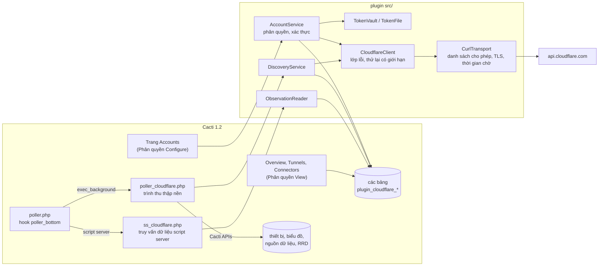

<!-- Source: README.md; SHA256: f8de0e02c5904e15bfa4c71edcaab219e5e5d4f6d9dbe589f4ed16351df6bf4d -->

<!-- translations:start -->
[English](../../../README.md) | [简体中文](../zh-CN/README.md) | [हिन्दी](../hi-IN/README.md) | [Español (España)](../es-ES/README.md) | [Español (Latinoamérica)](../es-419/README.md) | [العربية (السعودية)](../ar-SA/README.md) | [Afrikaans](../af-ZA/README.md) | [አማርኛ](../am-ET/README.md) | [العربية (مصر)](../ar-EG/README.md) | [العربية (المغرب)](../ar-MA/README.md) | [বাংলা](../bn-BD/README.md) | [Bosanski](../bs-BA/README.md) | [Deutsch](../de-DE/README.md) | [فارسی](../fa-IR/README.md) | [Filipino](../fil-PH/README.md) | [Français](../fr-FR/README.md) | [Français (Maroc)](../fr-MA/README.md) | [Français (Sénégal)](../fr-SN/README.md) | [Hausa](../ha-NG/README.md) | [עברית](../he-IL/README.md) | [Hrvatski](../hr-HR/README.md) | [Bahasa Indonesia](../id-ID/README.md) | [Igbo](../ig-NG/README.md) | [Italiano](../it-IT/README.md) | [日本語](../ja-JP/README.md) | [한국어](../ko-KR/README.md) | [Malagasy](../mg-MG/README.md) | [मराठी](../mr-IN/README.md) | [Bahasa Melayu](../ms-MY/README.md) | [Nederlands](../nl-NL/README.md) | [Polski](../pl-PL/README.md) | [Português (Brasil)](../pt-BR/README.md) | [Русский](../ru-RU/README.md) | [Kinyarwanda](../rw-RW/README.md) | [Soomaali](../so-SO/README.md) | [Српски](../sr-RS/README.md) | [Svenska](../sv-SE/README.md) | [Kiswahili](../sw-KE/README.md) | [தமிழ்](../ta-IN/README.md) | [తెలుగు](../te-IN/README.md) | [ไทย](../th-TH/README.md) | [Türkçe](../tr-TR/README.md) | [Українська](../uk-UA/README.md) | [اردو](../ur-PK/README.md) | [Tiếng Việt](README.md) | [isiXhosa](../xh-ZA/README.md) | [Yorùbá](../yo-NG/README.md) | [繁體中文](../zh-TW/README.md) | [isiZulu](../zu-ZA/README.md)
<!-- translations:end -->

<p align="center">
  
</p>

# Plugin Cloudflare cho Cacti

[](https://github.com/somethingwithproof/plugin_cloudflare/actions/workflows/ci.yml)
[](https://sonarcloud.io/summary/new_code?id=somethingwithproof_plugin_cloudflare)
[](../../../LICENSE)


[](https://sonarcloud.io/summary/new_code?id=somethingwithproof_plugin_cloudflare)
[](https://sonarcloud.io/summary/new_code?id=somethingwithproof_plugin_cloudflare)
[](https://sonarcloud.io/summary/new_code?id=somethingwithproof_plugin_cloudflare)


Đây là một plugin dành cho Cacti 1.2 đang được phát triển để giám sát Cloudflare Tunnels và
phân tích zone (zone analytics). Plugin đọc dữ liệu từ Cloudflare API bằng các API token có phạm vi quyền hạn chế,
không bao giờ thay đổi bất kỳ thiết lập nào trên Cloudflare và lưu trữ dữ liệu trong các bảng riêng.
Trong Cacti, plugin sao chép các tệp XML truy vấn dữ liệu vào `resource/script_server/` và
tạo thiết bị, biểu đồ cùng mẫu (template) thông qua chính các API của Cacti mà không sửa đổi
tệp lõi nào.

**Trạng thái: 0.4.0-dev, chưa phát hành.** Phiên bản phát hành gần nhất là 0.3.0. Phiên bản đang phát triển bổ sung tính năng xuất danh mục CSV, đánh dấu ngừng sử dụng rõ ràng đối với các tunnel đã bị xóa, lưu bộ nhớ đệm phân tích zone và các mẫu Thold tùy chọn. Quá trình kiểm định với nhà cung cấp thực tế và triển khai vẫn đang chờ hoàn tất.

Bảng dưới đây mô tả bản phát hành ổn định 0.3.0. Các bổ sung trong bản đang phát triển được mô tả trong phần Quy trình vận hành và phân tích zone bên dưới.

| Hiện có sẵn | Dự kiến |
|---|---|
| Cài đặt, nâng cấp, vô hiệu hóa và gỡ cài đặt thông qua trình quản lý plugin của Cacti | Phân tích GraphQL và cảnh báo Thold (Cột mốc 4) |
| Các quyền Cloudflare: View, Operator và Configure | Chèn lỗi (fault injection), mô hình TLA+ và tài liệu đầy đủ (Cột mốc 5) |
| Thêm, chỉnh sửa, xóa, bật và tắt tài khoản Cloudflare | |
| Lưu trữ token trong một tệp hoặc mã hóa trong cơ sở dữ liệu Cacti | |
| Xác minh token và kiểm tra quyền đọc tunnel và zone | |
| Phát hiện tunnel và connector trong một trình thu thập nền do poller chính khởi chạy | |
| Các trang Overview, Tunnels và Connectors trong mục Management > Cloudflare Tunnels | |
| Theo dõi vòng đời: `active`, `unavailable` và `deleted` | |
| Một thiết bị Cacti cho mỗi tài khoản, do quản trị viên tạo, với các tunnel làm chỉ mục của một truy vấn dữ liệu | |
| Các biểu đồ Connectors, Health và Collection cho từng tunnel, được vẽ từ một tệp RRD cho mỗi tunnel | |
| Các giá trị mà plugin không thể xác nhận được lưu dưới dạng không xác định (`U`), không bao giờ lưu là 0 | |

## Vai trò truy cập

| Phân quyền (Realm) | Quyền truy cập |
| --- | --- |
| Cloudflare: View | Các trang giám sát hiện có. |
| Cloudflare: Operator | Giám sát cùng với trang Operations và các xác nhận phân loại (triage acknowledgment) cá nhân. |
| Cloudflare: Configure | Quyền Operator cùng với các hành động cấu hình và quản trị hiện có. |

Sau khi sao chép các tệp nâng cấp, hãy mở trang Plugins với tư cách quản trị viên để đăng ký
phân quyền mới. Gán phân quyền Operator một cách tường minh trong mục **Configuration > Users** hoặc các nhóm người dùng.
Việc nâng cấp vẫn giữ nguyên ID và quyền đã cấp cho phân quyền View và Admin hiện có. Quyền truy cập Admin
kế thừa quyền Operator, và quyền Operator kế thừa quyền View trên mỗi yêu cầu;
điều này không thêm các quyền được lưu trữ vào người dùng hay nhóm. Phần cài đặt plugin cũng yêu cầu
quyền Cloudflare: Configure bên cạnh quyền Settings của Cacti.

Phạm vi hiển thị tài khoản Cloudflare khớp với phân quyền View hiện có; phạm vi này áp dụng trên toàn bộ tài khoản.
Thông tin xác thực, cấu hình, ánh xạ, thao tác xóa và các thay đổi quản trị khác
vẫn nằm trong các trang quản trị. Các xác nhận phân loại chỉ có hiệu lực trong phiên làm việc hiện tại
của người dùng, tối đa một giờ và chỉ khi cùng một quan sát (observation) vẫn còn
mới. Các quan sát mới hoặc thay đổi sẽ làm mất hiệu lực của chúng. Chúng không bao giờ đánh dấu một phép đo thất bại
là bình thường hoặc triệt tiêu cảnh báo.

## Lý do xây dựng plugin này

Người vận hành Cacti xuất bản dịch vụ qua Cloudflare Tunnel không có góc nhìn
về tunnel bên trong Cacti. Một tunnel có thể mất toàn bộ connector trong khi
các máy chủ gốc vẫn phản hồi SNMP, do đó các biểu đồ hiện tại vẫn hiển thị màu xanh trong khi
người dùng gặp lỗi. Mục tiêu của plugin này là đặt trạng thái sức khỏe tunnel và lưu lượng zone
bên cạnh các biểu đồ thiết bị mà người vận hành vốn đang theo dõi, mà không trao cho
Cacti bất kỳ khả năng thay đổi nào đối với Cloudflare.

Ba ràng buộc định hình nên thiết kế:

- **Chỉ đọc (Read-only).** Plugin chỉ gọi các điểm cuối `GET` và GraphQL
  Analytics API. Plugin không cần bất kỳ quyền chỉnh sửa nào trên bất kỳ tài nguyên Cloudflare nào.
- **Tùy chọn và không gây nghẽn (Optional).** Sự cố ngừng hoạt động của Cloudflare, token hết hạn và giới hạn tốc độ (rate limit) không được
  làm chậm giao diện người dùng Cacti hoặc làm đình trệ việc thu thập dữ liệu của các thiết bị khác. Tất cả lệnh gọi API đều có
  thời gian chờ (timeout) cứng, và việc thu thập chạy trong một tiến trình nền do
  poller khởi chạy.
- **Không sửa đổi lõi (No core changes).** Plugin sử dụng các hook plugin của Cacti 1.2 và các bảng
  riêng của nó. Plugin sao chép một tệp XML truy vấn dữ liệu vào `resource/script_server/` và
  tạo thiết bị, biểu đồ cùng mẫu thông qua chính các API của Cacti. Không có tệp lõi nào bị thay đổi,
  do đó việc nâng cấp Cacti và các plugin khác không bị ảnh hưởng.

## Cách hoạt động



- **Mã kết nối Cacti** (`setup.php`, `includes/`, các tập lệnh trang) đăng ký
  hook và phân quyền, kết xuất trang bằng các hàm trợ giúp của chính Cacti, và ủy quyền
  mọi hành động cho thư viện trong `src/`.
- **Thư viện** (`src/`, không gian tên `Somethingwithproof\Cloudflare\`) không phụ thuộc
  vào các biến toàn cục của Cacti, nên có thể kiểm thử trực tiếp với cơ sở dữ liệu thực và
  một lớp truyền tải HTTP giả lập mà không cần Cacti đang chạy.
- **Một đường ra duy nhất.** `CurlTransport` là đoạn mã duy nhất chạm tới
  mạng và chỉ chấp nhận `https://api.cloudflare.com`. Mỗi lỗi
  được ánh xạ tới một lớp lỗi (`auth`, `permission`, `rate_limited`,
  `transient`, ...), điều khiển trạng thái hiển thị trên giao diện người dùng.
- **Lưu trữ** đi qua kết nối PDO riêng của Cacti với các câu lệnh chuẩn bị sẵn
  (prepared statements). Các thay đổi lược đồ là các bản di trú (migration) được đánh số và có tính lũy đẳng (idempotent).

Các quyết định thiết kế và lý do tương ứng nằm trong
[docs/design.md](../../design.md).

## Ảnh chụp màn hình

Các ảnh chụp màn hình được lấy từ một hệ thống thử nghiệm, không phải tài khoản Cloudflare thực tế. Hệ thống
chạy Cacti 1.2.31 với một Cloudflare API giả lập trả về dữ liệu mẫu cố định,
vì vậy tài khoản, ID tài khoản và ba tunnel đều là dữ liệu giữ chỗ.


*Danh sách Cloudflare Accounts. API giả lập chấp nhận token, nên thao tác Verify
báo cáo `ok`.*


*Chỉnh sửa tài khoản. Các trường token luôn trống; token đã lưu không bao giờ
được gửi ngược lại trình duyệt. Collect Tunnels và Create Graphs đang bật còn
Collect Analytics đang tắt. Connection Status hiển thị kết quả của lần Verify
gần nhất: `ok`, đã được cấp quyền đọc tunnel và thiếu quyền đọc zone.*


*Settings > Cloudflare.*


*Management > Cloudflare Tunnels > Overview. Trạng thái là trạng thái Cloudflare
xấu nhất trong số các tunnel đang hoạt động của tài khoản, ở đây là `down` vì một tunnel mẫu
đang ngoại tuyến. `Disabled`, `Not collected`, `Collection failing` và `Not yet
collected` có mức độ ưu tiên cao hơn trạng thái sức khỏe tunnel theo đúng thứ tự đó, vì vậy một tài khoản
có lần chạy gần nhất bị lỗi sẽ hiển thị `Collection failing` bất kể các tunnel của nó báo cáo gì.*


*Thẻ Tunnels. Connectors và Connections hiển thị `-` đối với old-office, vì
API giả lập trả lời yêu cầu kết nối của nó là tunnel không xác định và không có gì
được lưu, và hiển thị 0 đối với staging vì không có connector nào đang chạy.*


*Biểu đồ Connectors của tunnel blog. Cả ba đường đều ở mức 1 trước và
sau khoảng trống ở giữa, nơi API giả lập trả về lỗi và plugin
đã lưu các giá trị không xác định. Các đường không tụt xuống 0. Biểu đồ này đến từ
cùng hệ thống dữ liệu mẫu (`make screenshots`), vốn đặt bước thời gian 30 giây cho riêng
nguồn dữ liệu này để bảy phút thu thập đủ làm đầy biểu đồ.*

## Yêu cầu

- Cacti 1.2.25 đến 1.2.31. Bản thân Cacti 1.2.31 cần PHP 8.0 trở lên.
  CI chỉ kiểm thử 1.2.31; phiên bản 1.2.25 được kiểm thử thủ công lần cuối vào ngày 2026-10-22.
- PHP 7.4 đến 8.4 với các tiện ích mở rộng `curl`, `openssl` và `pdo_mysql`.
  Plugin sẽ từ chối bật nếu thiếu các tiện ích này.
- MariaDB 10.6 trở lên hoặc MySQL 8.0 trở lên.
- Truy cập HTTPS từ máy chủ Cacti đến `api.cloudflare.com`. Proxy không được
  hỗ trợ.

Xem [docs/compatibility.md](../../compatibility.md) để biết những gì đã được kiểm thử.

## Cài đặt

1. Đặt plugin vào thư mục `plugins/cloudflare` của Cacti, bằng cách
   giải nén tệp lưu trữ từ
   [GitHub Releases](https://github.com/somethingwithproof/plugin_cloudflare/releases)
   (chạy `make package` trong bản checkout của tag phát hành sẽ tạo ra
   cùng tệp lưu trữ) hoặc bằng lệnh git
   clone. Thư mục phải có tên là `cloudflare`.
2. Cài đặt và bật plugin từ Console > Configuration > Plugins, hoặc bằng
   CLI với tư cách người dùng máy chủ web:

   ```sh
   php cli/plugin_manage.php --plugin=cloudflare --install --enable
   ```

3. Người dùng quản trị được cấp quyền Cloudflare: Configure khi cài đặt. Cấp
   quyền này cho người dùng hoặc nhóm khác trong Console > Configuration > Users.
4. Tạo một token với các quyền trong
   [docs/token-permissions.md](../../token-permissions.md). Tóm tắt:
   Account > Cloudflare Tunnel > Read, và tùy chọn Zone > Zone > Read.
5. Lưu trữ token theo một trong hai cách dưới đây, sau đó thêm tài khoản trong
   Console > Configuration > Cloudflare Accounts và chạy Verify từ menu
   tác vụ.

### Tùy chọn A: mã hóa trong cơ sở dữ liệu

Plugin mã hóa các token bằng khóa 32 byte do bạn tự tạo. Plugin không bao giờ
tự tạo hoặc ghi khóa này. Tệp khóa phải đọc được bởi người dùng máy chủ web
và người dùng poller, không được phép đọc bởi những người khác, và thư mục chứa nó
phải cho phép các người dùng đó truy cập. Đối với máy chủ web chạy dưới quyền `www-data`:

```sh
sudo mkdir -p /etc/cacti
sudo sh -c 'umask 077 && openssl rand -hex 32 > /etc/cacti/cloudflare.key'
sudo chgrp www-data /etc/cacti/cloudflare.key
sudo chmod 0440 /etc/cacti/cloudflare.key
```

Đường dẫn mặc định là `/etc/cacti/cloudflare.key`; thay đổi đường dẫn này trong Settings >
Cloudflare > Token Vault Key File. Khi khóa bị thiếu hoặc bị từ chối, biểu mẫu
chỉnh sửa chỉ hiển thị tùy chọn tệp token. Hãy giữ một bản sao lưu của khóa:
nếu không có nó, các token đã lưu không thể giải mã được và phải nhập lại.

#### Xoay vòng khóa

Không có lệnh thay khóa. Khóa mới không thể giải mã các token được lưu bằng
khóa cũ, vì vậy việc xoay vòng đồng nghĩa với việc phải nhập lại từng token đã lưu:

1. Chuẩn bị sẵn giá trị token của từng tài khoản. Cloudflare chỉ hiển thị giá trị
   của token khi mới tạo hoặc khi làm mới, vì vậy hãy làm mới token trong bảng điều khiển
   Cloudflare nếu bạn không còn giữ giá trị đó.
2. Tạo khóa mới tại một đường dẫn mới bằng các lệnh ở trên, ví dụ
   `/etc/cacti/cloudflare.key.new`, với cùng chủ sở hữu và quyền hạn.
3. Đặt Settings > Cloudflare > Token Vault Key File thành đường dẫn mới và lưu lại.
   Kể từ lúc này, thao tác Verify trên tài khoản vẫn được mã hóa bằng khóa cũ
   sẽ báo "Stored token cannot be decrypted", và mỗi lần chạy trình thu thập sẽ ghi nhật ký
   `discovery token unavailable` kèm `reason=decrypt_failed` cho tài khoản đó.
4. Đối với mỗi tài khoản lưu token trong cơ sở dữ liệu, hãy mở tài khoản đó trong
   Console > Configuration > Cloudflare Accounts, dán token vào cả hai trường
   token, lưu lại và chạy Verify. Kết quả phải báo `ok`.
5. Khi mọi tài khoản như vậy đều xác minh thành công, hãy xóa tệp khóa cũ và các
   bản sao lưu của nó.

Giữa bước 3 và bước 4, các tunnel của tài khoản sẽ không được làm mới và các
biểu đồ trạng thái, connector và kết nối của chúng ghi nhận U. Các tài khoản dùng tệp token
không bị ảnh hưởng.

### Tùy chọn B: tệp token

Ghi token, và không ghi gì khác, vào một tệp mà người dùng máy chủ web và poller
có thể đọc còn những người khác thì không, sau đó nhập đường dẫn tuyệt đối của tệp trên biểu mẫu chỉnh sửa:

```sh
sudo sh -c 'umask 077 && cat > /etc/cacti/cloudflare-account.token'   # paste the token, then Ctrl-D
sudo chgrp www-data /etc/cacti/cloudflare-account.token
sudo chmod 0440 /etc/cacti/cloudflare-account.token
```

Tệp được kiểm tra khi đọc, tại thời điểm Verify, chứ không phải khi bạn lưu. Liên kết
tượng trưng, tệp lớn hơn 4 KiB và tệp có quyền đọc hoặc ghi cho người khác đều bị
từ chối.

Bất kỳ ai có quyền Cloudflare: Configure đều có thể nhập bất kỳ đường dẫn nào, và người dùng poller
sẽ đọc nó. Để giữ các tệp token ở một nơi, hãy đặt Settings > Cloudflare >
Token File Directory, ví dụ thành `/etc/cacti`; khi đó đường dẫn nằm ngoài thư mục này
sẽ bị từ chối. Xem [docs/security.md](../../security.md#token-file).

## Nâng cấp

1. Thay thế các tệp trong `plugins/cloudflare` bằng bản phát hành mới, giữ nguyên
   tên thư mục.
2. Mở Console > Configuration > Plugins, hoặc Console > Configuration >
   Cloudflare Accounts, một lần với tư cách quản trị viên. Thao tác này chạy các bản di trú của plugin,
   nhập các mẫu Cloudflare và sao chép tệp truy vấn dữ liệu (xem
   [Chỉ số và biểu đồ của tunnel](#tunnel-metrics-and-graphs)), đồng thời, khi
   nâng cấp từ 0.1.0, đăng ký hook `poller_bottom`.

`poller.php` không chạy quá trình nâng cấp của plugin, vì vậy cho đến bước 2, lược đồ
mới vẫn bị thiếu. Mỗi lần chạy trình thu thập khi đó không làm gì và ghi nhật ký
`CLOUDFLARE: collector skipped; plugin upgrade pending, open Console > Plugins`.
Các trang Cloudflare Tunnels chỉ cần quyền Cloudflare: View nên không bao giờ chạy
quá trình nâng cấp, và cho đến bước 2 chúng có thể hiển thị "The Cloudflare tunnels could not
be read".

## Trạng thái tài khoản

Verify thiết lập trạng thái của tài khoản:

| Trạng thái | Ý nghĩa |
|---|---|
| `unknown` | Chưa được xác minh kể từ khi tài khoản được thêm hoặc thông tin xác thực bị thay đổi |
| `ok` | Token đang hoạt động và có thể đọc các tunnel |
| `token_inactive` | Cloudflare báo token đã bị vô hiệu hóa hoặc hết hạn |
| `auth_failed` | Cloudflare từ chối token vì không hợp lệ hoặc đã hết hạn (HTTP 401) |
| `permission_denied` | Token đang hoạt động nhưng không thể đọc các tunnel, hoặc thiếu quyền để gọi các điểm cuối xác minh token (HTTP 403) |
| `unreachable` | Không thể kết nối tới API, hết thời gian chờ hoặc trả về lỗi máy chủ |
| `rate_limited` | Cloudflare trả về HTTP 429 |
| `error` | Bất kỳ lỗi nào khác, bao gồm tệp token bị thiếu hoặc không an toàn, tệp khóa kho lưu trữ token bị thiếu hoặc không dùng được, hoặc token đã lưu không thể giải mã |

Trang chỉnh sửa cũng hiển thị liệu quyền đọc tunnel và đọc zone đã được cấp hay chưa.

## Phát hiện tunnel

Sau mỗi chu kỳ thăm dò trên poller chính, hook `poller_bottom` khởi chạy
trình thu thập chạy nền bằng `exec_background` khi có ít nhất một tài khoản đã bật
có bật Collect Tunnels. Trình thu thập không bao giờ chạy trong tiến trình của poller,
vì vậy việc API Cloudflare phản hồi chậm không làm trễ `poller.php`. Các poller từ xa
không bao giờ khởi chạy nó.

Đối với mỗi tài khoản đến hạn, trình thu thập liệt kê các tunnel của tài khoản, sau đó
đọc các kết nối của các tunnel đang hoạt động, từ đó lấy thông tin connector của từng tunnel,
phiên bản, trung tâm dữ liệu và địa chỉ gốc của chúng. Tài khoản đến hạn
theo mỗi Discovery Interval (mặc định 300 giây). Một lượt chạy không bắt đầu tài khoản mới
nào sau 50 giây và thực hiện tối đa 200 yêu cầu kết nối. Một trong hai
giới hạn này cũng có thể dừng một tài khoản giữa chừng khi đang đọc các kết nối của nó; tài khoản đó
được ghi nhận là `partial`, và lượt chạy tiếp theo tiếp tục với các tunnel
được thử gần đây ít nhất. Các tài khoản chưa bắt đầu vẫn đến hạn cho lượt chạy tiếp theo.

Một tunnel có vòng đời riêng, tách biệt với trạng thái mà Cloudflare báo cáo
(`healthy`, `degraded`, `down` hoặc `inactive`):

| Vòng đời | Ý nghĩa |
|---|---|
| `active` | Tunnel có mặt trong danh sách đầy đủ gần nhất |
| `deleted` | Một danh sách đầy đủ không bao gồm nó, kể cả trường hợp danh sách trống. Hàng dữ liệu và lịch sử của nó vẫn được giữ lại, và tunnel trở lại `active` nếu xuất hiện lại |
| `unavailable` | Ba lần mất kết nối được tính mà không có danh sách đầy đủ nào ở giữa khiến trạng thái của tunnel trở thành không xác định |

Chỉ một danh sách đầy đủ và thành công mới thêm, cập nhật hoặc xóa tunnel, và một
danh sách thất bại không bao giờ xóa tunnel nào. Lỗi không thể đọc được Cloudflare
(`transient`, `rate_limited`, `auth` hoặc `permission`) được tính là một lần mất kết nối;
sau ba lần mất kết nối được tính mà không có danh sách đầy đủ nào ở giữa, các tunnel
đang hoạt động của tài khoản chuyển sang `unavailable`. Danh sách đầy đủ tiếp theo
khôi phục chúng và đặt lại bộ đếm. Một tunnel mà Cloudflare không còn nhận biết
khi đọc kết nối của nó sẽ bị bỏ qua mà không làm tài khoản bị đánh dấu lỗi. Các lỗi khác
không làm tăng cũng không đặt lại bộ đếm mất kết nối.

Trong `cacti.log`, các dòng phát hiện bắt đầu bằng `CLOUDFLARE: discovery` và dòng
tóm tắt lượt chạy bắt đầu bằng `CLOUDFLARE: collector`. Các lỗi và thay đổi vòng đời, chẳng hạn như
liệt kê thất bại hoặc các tunnel bị đánh dấu `unavailable`, được ghi nhật ký ở mức
`LOW` mặc định của Cacti; kết quả của từng tài khoản và bản tóm tắt lượt chạy được ghi ở mức
`MEDIUM`. Việc đọc kết nối có thể thất bại trên mọi tunnel, vì vậy đối với mỗi tài khoản chỉ
lỗi đầu tiên của mỗi lớp lỗi được ghi ở mức `LOW`, phần còn lại ở mức
`MEDIUM`, theo sau là một dòng `LOW` cho mỗi lớp kèm số lượng tunnel bị
lỗi.

Management > Cloudflare Tunnels cần quyền Cloudflare: View và ở chế độ
chỉ đọc:

- **Overview** liệt kê từng tài khoản kèm trạng thái, số lượng tunnel theo vòng đời,
  lần phát hiện thành công gần nhất và số lần thất bại liên tiếp.
- **Tunnels** liệt kê các tunnel trên các tài khoản hoặc cho một tài khoản, có bộ lọc
  theo tài khoản, vòng đời, trạng thái và tên, cùng các cột có thể sắp xếp.
- **Connectors** hiển thị các connector của tunnel được chọn trên thẻ Tunnels.

<a name="tunnel-metrics-and-graphs"></a>

## Chỉ số và biểu đồ của tunnel

Cacti đọc trạng thái tunnel thông qua một truy vấn dữ liệu máy chủ script,
`ss_cloudflare.php`. Truy vấn này chỉ trả lời từ các bảng của plugin và không bao giờ gọi
Cloudflare, nên sự cố phía Cloudflare không thể làm chậm poller. Mỗi tunnel cung cấp
sáu giá trị: trạng thái (healthy 3, degraded 2, down 1, inactive 0), số connector,
số kết nối, phiên bản connector, số giây kể từ lần cuối kết nối của nó được
đọc, và số lần thất bại liên tiếp của tác vụ phát hiện. Trạng thái, connector,
kết nối và phiên bản chỉ được in ra khi plugin có thể xác thực cho chúng,
nghĩa là lần phát hiện gần nhất thành công, tunnel ở trạng thái `active` và
giá trị đọc là mới. Nếu không, chúng là `U`, và biểu đồ hiển thị một khoảng trống thay vì
số không dễ gây nhầm lẫn thành sự cố mất kết nối. Hai giá trị thu thập vẫn được
in ra trong thời gian mất kết nối để biểu đồ Collection hiển thị sự cố đó; chúng chỉ là `U`
đối với tunnel đã bị xóa hoặc tunnel chưa từng được làm mới kết nối. Các quy tắc
được nêu trong [docs/metrics.md](../../metrics.md).

### Tạo thiết bị

Một tài khoản ánh xạ tới tối đa một thiết bị Cacti. Thiết bị chứa các tunnel
của tài khoản dưới dạng các chỉ mục của truy vấn dữ liệu Cloudflare Tunnels. Không có gì tự động
tạo nó:

1. Mở Console > Configuration > Cloudflare Accounts.
2. Chọn tài khoản, chọn Create Cacti Device từ menu tác vụ và
   xác nhận.

Thao tác này cần cả quyền Cloudflare: Configure và quyền
Sites/Devices/Data của Cacti (quyền dành cho `host.php`). Mục menu chỉ hiển thị
với người dùng có cả hai quyền, và máy chủ từ chối yêu cầu từ bất kỳ ai khác.
Thiết bị được đặt tên là `Cloudflare: <account name>`, sử dụng mẫu máy chủ Cloudflare Account
và poller chính, có phiên bản SNMP là 0 và không kiểm tra tính khả dụng,
và nhận tên máy chủ `<account ID>.cloudflare.invalid`. Tên đó là
tên dành riêng và không bao giờ phân giải; Cacti không kết nối tới nó. Nếu tài khoản
đã có thiết bị, thao tác sẽ thông báo như vậy và không thay đổi gì. Nếu
quản trị viên xóa thiết bị trong Cacti, plugin không tạo lại thiết bị khác
cho đến khi chạy lại Create Cacti Device.

### Tạo biểu đồ

Tùy chọn Create Graphs trên biểu mẫu tài khoản mặc định tắt. Khi bật, mỗi lần
quá trình phát hiện tài khoản kết thúc `ok` hoặc `partial`, trình thu thập lập lại chỉ mục
thiết bị và tạo bất kỳ biểu đồ nào còn thiếu cho các tunnel `active` của tài khoản:
Connectors, Health và Collection, ba biểu đồ cho mỗi tunnel. Ba biểu đồ của một tunnel
dùng chung một tệp RRD. Một lượt chạy tạo tối đa 50 biểu đồ và dừng sau 20
giây, và lượt chạy tiếp theo tiếp tục. Plugin không bao giờ xóa bất kỳ đối tượng Cacti nào.
Biểu đồ mà quản trị viên xóa không được tạo lại, và một tunnel mà
Cloudflare không còn liệt kê vẫn giữ nguyên biểu đồ và tệp RRD của nó, hiển thị `U`.

Việc bật Create Graphs cần cả hai quyền. Việc tắt chỉ cần quyền
Configure. Người dùng không có quyền Sites/Devices/Data khi lưu biểu mẫu
sẽ giữ nguyên thiết lập như cũ kèm cảnh báo. Khi Create Graphs tắt,
thiết bị vẫn được lập lại chỉ mục sau mỗi lần phát hiện, nên các tunnel mới xuất hiện dưới dạng
các chỉ mục của truy vấn dữ liệu.

### Tệp truy vấn dữ liệu

Cacti 1.2.31 chỉ đọc tệp XML truy vấn dữ liệu từ bên trong thư mục `resource`
của nó. Do đó, khi cài đặt và nâng cấp, plugin sao chép một tệp,
`templates/resource/cloudflare_tunnels.xml`, vào
`<Cacti>/resource/script_server/cloudflare_tunnels.xml`. Đây là tệp duy nhất
plugin ghi ra ngoài thư mục của chính nó, vì vậy người dùng cài đặt hoặc
nâng cấp plugin phải có quyền ghi vào thư mục đó.
Quá trình gỡ cài đặt vẫn giữ lại tệp này, cùng với các thiết bị, biểu đồ, tệp RRD và
các mẫu. Nếu việc sao chép hoặc nhập mẫu thất bại, plugin sẽ ghi nhật ký và
Create Cacti Device sẽ thử lại.

## Cài đặt

Mục Settings > Cloudflare bao gồm:

- **Token Vault Key File**: đường dẫn đến tệp khóa vault.
- **Token File Directory**: khi được thiết lập, tệp token nằm ngoài thư mục này sẽ bị từ chối. Mặc định để trống, cho phép mọi đường dẫn. Xem [docs/security.md](../../security.md#token-file).
- **Interactive Request Timeout**: tổng số giây cho một yêu cầu được thực hiện từ giao diện web, chẳng hạn như Verify. Mặc định là 10; các giá trị ngoài khoảng 5 đến 60 sẽ quay về 10.
- **Collector Request Timeout**: tổng số giây cho một yêu cầu được thực hiện bởi bộ thu thập nền. Mặc định là 20; các giá trị ngoài khoảng 5 đến 60 sẽ quay về 20.
- **Log Level**: được lưu trữ. Hiện chưa có thành phần nào đọc giá trị này.

Trên biểu mẫu tài khoản, Collect Tunnels và Discovery Interval điều khiển quá trình phát hiện, còn Create Graphs điều khiển việc tạo đồ thị. Collect Analytics được lưu trữ và chưa có tác dụng trong bản phát hành này.

## Ngôn ngữ

Plugin đi kèm bản dịch sang tiếng Tây Ban Nha (Tây Ban Nha, `es-ES`), tiếng Pháp (`fr-FR`), tiếng Đức (`de-DE`), tiếng Trung giản thể (`zh-CN`), tiếng Hindi (`hi-IN`), tiếng Ả Rập (`ar-SA`) và tiếng Nhật (`ja-JP`). Cacti sẽ hiển thị các bản dịch này khi tính năng hỗ trợ ngôn ngữ được bật (Configuration > Settings > General > Language Support) và người dùng chọn ngôn ngữ tương ứng. Danh mục tiếng Tây Ban Nha khu vực Mỹ Latinh (`es-419`) cũng được đóng gói kèm theo, nhưng Cacti 1.2 chưa có locale tiếng Tây Ban Nha Mỹ Latinh để lựa chọn, nên danh mục này chỉ có hiệu lực khi Cacti bổ sung locale đó; cho đến lúc đó, hãy chọn tiếng Tây Ban Nha (`es-ES`).

Một số văn bản vẫn giữ nguyên bằng tiếng Anh: các giá trị trạng thái mà plugin lưu trữ và hiển thị nguyên trạng (`ok`, `active`, `unavailable`, `deleted`, và trạng thái tunnel mà Cloudflare trả về), cùng với mọi nội dung mà plugin ghi vào nhật ký Cacti.

## Gỡ cài đặt và lưu giữ dữ liệu

Quá trình gỡ cài đặt sẽ xóa các bảng riêng của plugin — nơi lưu trữ tài khoản, token đã mã hóa, các tunnel đã phát hiện, trạng thái tác vụ và bản ghi về những đối tượng Cacti mà plugin đã tạo — đồng thời xóa các thiết lập có tiền tố `cloudflare_`. Quá trình này không xóa tệp khóa, các tệp token, tệp `resource/script_server/cloudflare_tunnels.xml` đã sao chép, hay bất kỳ thiết bị, đồ thị, nguồn dữ liệu, tệp RRD hoặc mẫu nào của Cacti. Những thành phần đó lưu giữ dữ liệu giám sát lịch sử, và việc xóa chúng là thao tác chủ động của quản trị viên trong Cacti.

Thiết bị được giữ lại sẽ ngừng nhận dữ liệu. Sau khi gỡ cài đặt, hoặc sau khi tài khoản của thiết bị bị xóa, không còn tài khoản nào sở hữu máy chủ đó nữa, vì vậy các đồ thị của nó vẫn giữ lịch sử nhưng từ đó về sau sẽ ghi giá trị `U`. Thao tác Create Cacti Device trên tài khoản được cài đặt lại hoặc thêm lại sẽ tạo một thiết bị mới; nó không tái sử dụng thiết bị cũ, vì vậy hãy xóa thiết bị cũ trong Cacti khi không còn cần lịch sử của nó nữa.

## Giới hạn đã biết

- Mỗi lượt chạy thực hiện tối đa 200 yêu cầu kết nối. Các tunnel vượt quá giới hạn đó sẽ được làm mới ít thường xuyên hơn cửa sổ quan sát, nên đồ thị kết nối của chúng sẽ xuất hiện các khoảng trống.
- Plugin sẽ ghi đè các chỉnh sửa của quản trị viên đối với những mẫu đã nhập khi bản nâng cấp thay đổi tệp XML mẫu đi kèm.
- Thiết bị của tài khoản phải nằm trên poller chính. Các bảng của plugin nằm trong cơ sở dữ liệu chính và script đọc dữ liệu từ đó.
- Các tunnel đã xóa vẫn nằm trong chỉ mục truy vấn dữ liệu và in ra `U` cho đến khi quản trị viên cho ngừng hoạt động một cách tường minh. Việc ngừng hoạt động chỉ xóa các đồ thị do plugin ghi nhận và các nguồn dữ liệu không dùng chung thông qua Cacti; hàng trong danh mục kiểm kê vẫn hiển thị. Cacti kiểm soát việc dọn dẹp RRD.
- Cacti sẽ vô hiệu hóa một plugin nếu mã của plugin kết thúc bằng lỗi nghiêm trọng thực sự, chẳng hạn như hết bộ nhớ. Xem [docs/security.md](../../security.md).

## Bảo mật

- Global API Keys bị từ chối; chỉ chấp nhận các API token được phân quyền theo phạm vi.
- Token được lưu trong một tệp do bạn cấp phát hoặc được mã hóa bằng AES-256-GCM dưới một tệp khóa không bao giờ đi vào cơ sở dữ liệu. Chúng không bao giờ được hiển thị trên trang web, ghi vào nhật ký hay đưa vào thông báo lỗi.
- Lỗi cơ sở dữ liệu chỉ mang mã SQLSTATE và mã lỗi của driver, không bao giờ chứa các giá trị của câu lệnh.
- Mọi thay đổi đều là yêu cầu POST được bảo vệ bởi CSRF token của Cacti. Các thay đổi về cấu hình và tài khoản quản trị yêu cầu quyền Cloudflare: Configure; việc xác nhận phân loại cá nhân yêu cầu quyền Cloudflare: Operator. Việc tạo thiết bị Cacti hoặc bật Create Graphs cũng cần quyền Sites/Devices/Data của Cacti. Một plugin bị vô hiệu hóa sẽ từ chối truy cập vào các trang của nó.

Thông tin chi tiết và các giới hạn đã biết có trong [docs/security.md](../../security.md). Hãy báo cáo lỗ hổng bảo mật một cách riêng tư theo hướng dẫn trong [SECURITY.md](../../../SECURITY.md).

## Quy trình vận hành và phân tích zone

Các bổ sung đang phát triển bao gồm việc cho ngừng hoạt động tường minh đối với các tunnel đã xóa, phân tích zone theo năng lực gói và các mẫu Thold có thể nhập. Những bổ sung này chưa có thẻ phát hành hay kiểm định trên tài khoản thực tế. Xem [docs/analytics-and-alerting.md](../../analytics-and-alerting.md) để biết cách thiết lập, ngữ nghĩa chỉ số và các giới hạn kiểm chứng.

### Xuất danh mục kiểm kê

Các trang Tunnels và Connectors cung cấp nút Export cho quyền Cloudflare: View. Tệp CSV của Tunnels bao gồm mọi hàng khớp điều kiện, sử dụng các thiết lập tài khoản đang hoạt động, vòng đời, trạng thái, tìm kiếm và sắp xếp trên tất cả các trang. Tệp CSV của Connectors bao gồm phiên bản, kiến trúc, trung tâm dữ liệu và địa chỉ origin cho tunnel được chọn. Tệp tải xuống chỉ đọc các bản ghi đã lưu đệm. Các số đếm không xác định sẽ để trống; các ô có dạng công thức được thêm tiền tố dấu nháy đơn để nhập vào bảng tính an toàn.

## Lộ trình

Mỗi cột mốc được phát hành dưới dạng phiên bản 0.x đánh số theo nó: Cột mốc 3 là 0.3.0, Cột mốc 4 sẽ là 0.4.0. Cột mốc 1 và 2 không được phát hành riêng lẻ mà là một phần của bản 0.3.0. Phiên bản 1.0.0 được dành riêng cho bản phát hành hoàn thành mọi cột mốc dưới đây.

| Cột mốc | Phạm vi | Trạng thái |
|---|---|---|
| 1. Nền tảng | Vòng đời plugin, phân quyền, cấu hình tài khoản, kiểm tra kết nối | Đã phát hành trong 0.3.0 ([#2](https://github.com/somethingwithproof/plugin_cloudflare/pull/2) đến [#5](https://github.com/somethingwithproof/plugin_cloudflare/pull/5)) |
| 2. Phát hiện | Phát hiện tunnel và connector trong bộ thu thập nền, các trang Overview, Tunnels và Connectors | Đã phát hành trong 0.3.0 ([#6](https://github.com/somethingwithproof/plugin_cloudflare/pull/6)) |
| 3. Chỉ số | Nguồn dữ liệu sức khỏe tunnel, mẫu đồ thị, xử lý sự cố gián đoạn không bao giờ ghi nhận giá trị 0 bịa đặt | Đã phát hành trong 0.3.0 ([#7](https://github.com/somethingwithproof/plugin_cloudflare/pull/7)) |
| 4. Phân tích và cảnh báo | Phân tích GraphQL theo gói cho từng zone, ngưỡng Thold có tính năng triệt tiêu khi gián đoạn | Đã lên kế hoạch |
| 5. Tăng cường độ tin cậy | Tiêm lỗi, mô hình TLA+ cho quá trình phát hiện và thu thập, tài liệu đầy đủ | Đã lên kế hoạch |

## Phát triển

Các công cụ cần PHP 8.x và Composer; bản thân mã nguồn plugin vẫn giữ khả năng tương thích với PHP 7.4. Các bài kiểm thử tích hợp và BDD cần một cơ sở dữ liệu, có thể khởi chạy bằng `make db-up` trong Docker trên cổng 33061.

```sh
composer install
make db-up
make ci            # unit, integration, BDD, PHPStan, php-cs-fixer, php -l on PHP 7.4
make smoke         # installs the plugin into Cacti 1.2.31 in Docker and walks its lifecycle
make package       # builds build/cloudflare-<version>.tar.gz and checks its contents
make db-down
```

`make smoke` và `make screenshots` cần một bản mã nguồn Cacti đã checkout; hãy đặt `CACTI_REPO` thành đường dẫn tới thư mục đó. Các bài kiểm thử tích hợp đọc `CF_TEST_DSN`, `CF_TEST_DB_USER` và `CF_TEST_DB_PASS`, và sẽ bỏ qua khi không thể kết nối tới cơ sở dữ liệu trừ khi biến `CI` được thiết lập.

## Đóng góp

Hoan nghênh các pull request. Mỗi commit cần có chữ ký DCO (`git commit -s`). Hãy viết kiểm thử trước; `make ci` phải đạt, và các thay đổi đối với phần kết nối Cacti cũng phải vượt qua `make smoke`. Mã nguồn plugin phải duy trì tương thích PHP 7.4 và tuân theo quy chuẩn mã nguồn của Cacti (dùng tab, dấu nháy đơn, dấu ngoặc nhọn mở trên cùng dòng).

### Bản dịch

Các thông điệp được đánh dấu bằng `__('...', 'cloudflare')`. Lệnh `locales/build_gettext.sh` (`make i18n`, yêu cầu GNU gettext) sẽ tạo lại tệp mẫu `locales/po/cacti.pot`, hợp nhất nó vào từng danh mục `locales/po/<locale>.po` và biên dịch `locales/LC_MESSAGES/<locale>.mo`; hãy commit cả ba loại tệp này. CI chạy `make i18n-check`, lệnh này sẽ thất bại nếu một danh mục thiếu mục dịch hoặc có mục fuzzy, chuỗi định dạng bị sai khác, hoặc tệp đã biên dịch bị lỗi thời; bộ kiểm thử đơn vị cũng kiểm tra placeholder, thẻ HTML và khoảng trắng đầu/cuối của từng mục. Do đó, một thông điệp bị thay đổi cần được cập nhật bản dịch trong cùng pull request. Một ngôn ngữ mới sẽ là một tệp `<locale>.po` mới được đặt tên theo cách Cacti đặt tên locale (ví dụ `pt-BR`), được thêm vào `CatalogTest::LOCALES` và vào bước kiểm tra gói lưu trữ trong `tests/build/package.sh`. Giữ nguyên tên sản phẩm Cloudflare, Cacti và Thold, API và GraphQL, cũng như tên các quyền như `Account Cloudflare Tunnel Read`.

## Tài liệu

- [docs/security.md](../../security.md): các biện pháp kiểm soát bảo mật và giới hạn đã biết
- [docs/token-permissions.md](../../token-permissions.md): các quyền của token
- [docs/compatibility.md](../../compatibility.md): các phiên bản được hỗ trợ và các giao diện được sử dụng
- [docs/metrics.md](../../metrics.md): danh mục chỉ số và khi nào một giá trị là không xác định
- [docs/collector-protocol.md](../../collector-protocol.md): những gì `ss_cloudflare.php` đọc và in ra
- [docs/schema.md](../../schema.md): các bảng cơ sở dữ liệu
- [docs/design.md](../../design.md): các quyết định thiết kế
- [CHANGELOG.md](../../../CHANGELOG.md)

## Giấy phép

GPL-2.0-or-later. Xem [LICENSE](../../../LICENSE).

## Nhãn hiệu

Cloudflare là nhãn hiệu đã đăng ký của Cloudflare, Inc. Dự án này là một công cụ mã nguồn mở độc lập và không liên kết, không được tài trợ, hay chứng thực bởi Cloudflare, Inc.

Dự án này cũng không liên kết với dự án Cacti. Xem [docs/images/README-logo.md](../../images/README-logo.md) để biết thông tin về logo.
