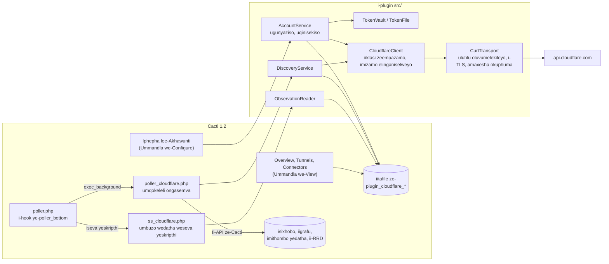

<!-- Source: README.md; SHA256: f8de0e02c5904e15bfa4c71edcaab219e5e5d4f6d9dbe589f4ed16351df6bf4d -->

<!-- translations:start -->
[English](../../../README.md) | [简体中文](../zh-CN/README.md) | [हिन्दी](../hi-IN/README.md) | [Español (España)](../es-ES/README.md) | [Español (Latinoamérica)](../es-419/README.md) | [العربية (السعودية)](../ar-SA/README.md) | [Afrikaans](../af-ZA/README.md) | [አማርኛ](../am-ET/README.md) | [العربية (مصر)](../ar-EG/README.md) | [العربية (المغرب)](../ar-MA/README.md) | [বাংলা](../bn-BD/README.md) | [Bosanski](../bs-BA/README.md) | [Deutsch](../de-DE/README.md) | [فارسی](../fa-IR/README.md) | [Filipino](../fil-PH/README.md) | [Français](../fr-FR/README.md) | [Français (Maroc)](../fr-MA/README.md) | [Français (Sénégal)](../fr-SN/README.md) | [Hausa](../ha-NG/README.md) | [עברית](../he-IL/README.md) | [Hrvatski](../hr-HR/README.md) | [Bahasa Indonesia](../id-ID/README.md) | [Igbo](../ig-NG/README.md) | [Italiano](../it-IT/README.md) | [日本語](../ja-JP/README.md) | [한국어](../ko-KR/README.md) | [Malagasy](../mg-MG/README.md) | [मराठी](../mr-IN/README.md) | [Bahasa Melayu](../ms-MY/README.md) | [Nederlands](../nl-NL/README.md) | [Polski](../pl-PL/README.md) | [Português (Brasil)](../pt-BR/README.md) | [Русский](../ru-RU/README.md) | [Kinyarwanda](../rw-RW/README.md) | [Soomaali](../so-SO/README.md) | [Српски](../sr-RS/README.md) | [Svenska](../sv-SE/README.md) | [Kiswahili](../sw-KE/README.md) | [தமிழ்](../ta-IN/README.md) | [తెలుగు](../te-IN/README.md) | [ไทย](../th-TH/README.md) | [Türkçe](../tr-TR/README.md) | [Українська](../uk-UA/README.md) | [اردو](../ur-PK/README.md) | [Tiếng Việt](../vi-VN/README.md) | [isiXhosa](README.md) | [Yorùbá](../yo-NG/README.md) | [繁體中文](../zh-TW/README.md) | [isiZulu](../zu-ZA/README.md)
<!-- translations:end -->

<p align="center">
  
</p>

# I-plugin ye-Cloudflare ye-Cacti

[](https://github.com/somethingwithproof/plugin_cloudflare/actions/workflows/ci.yml)
[](https://sonarcloud.io/summary/new_code?id=somethingwithproof_plugin_cloudflare)
[](../../../LICENSE)


[](https://sonarcloud.io/summary/new_code?id=somethingwithproof_plugin_cloudflare)
[](https://sonarcloud.io/summary/new_code?id=somethingwithproof_plugin_cloudflare)
[](https://sonarcloud.io/summary/new_code?id=somethingwithproof_plugin_cloudflare)


I-plugin ye-Cacti 1.2 eyakhelwa ukubeka iliso kwi-Cloudflare Tunnels nakwi-analytics yendawo (zone analytics). Ifunda kwi-API ye-Cloudflare isebenzisa iithokheni ze-API ezisikelwe umda, ayisoze itshintshe nto kwi-Cloudflare, kwaye igcina idatha yayo kwiitafile zayo. Kwi-Cacti ikopa iifayile ze-XML zemibuzo yedatha kwi-`resource/script_server/` kwaye idala izixhobo, iigrafu kunye neetemplates ngee-API ze-Cacti ngokwazo, ngaphandle kokutshintsha iifayile ezingundoqo.

**Imeko: 0.4.0-dev, ayikakhutshwa.** Uguqulelo lokugqibela olukhutshiweyo ngu-0.3.0. Uguqulelo lophuhliso longezela ukuthunyelwa koluhlu lwempahla nge-CSV, ukuyekiswa ngokucacileyo kweetunnels ezicinyiweyo, i-analytics yendawo egcinwe kwikheshi kunye neetemplates ze-Thold ezikhethekayo. Uqinisekiso lomenzi wenkonzo okhoyo nolofakelo lusalindelekile.

Itheyibhile engezantsi ichaza ukukhutshwa okuzinzileyo kwe-0.3.0. Izongezo zophuhliso zichazwe phantsi kweenkqubo zomqhubi kunye ne-analytics yendawo ngezantsi.

| Efumanekayo ngoku | Ecetyiweyo |
|---|---|
| Faka, hlaziya, khubaza kwaye ukhuphe ngomphathi wee-plugin we-Cacti | I-GraphQL analytics nezilumkiso ze-Thold (Inqanaba 4) |
| Iimvume ze-Cloudflare: View, Operator kunye ne-Configure | Ukufakwa kweziphene, iimodeli ze-TLA+ namaxwebhu apheleleyo (Inqanaba 5) |
| Yongeza, hlela, cima, vula kwaye ukhubaze ii-akhawunti ze-Cloudflare | |
| Gcina ithokheni kwifayile okanye ifihliwe kwisiseko sedatha se-Cacti | |
| Qinisekisa ithokheni kwaye ukhangele iimvume zayo zokufunda itunnel nendawo | |
| Ukufumanisa itunnel ne-connector kumqokeleli ongasemva oqaliswa yi-poller engundoqo | |
| Amaphepha e-Overview, Tunnels kunye ne-Connectors phantsi kwe-Management > Cloudflare Tunnels | |
| Ukulandelela umjikelo wobomi: `active`, `unavailable` kunye ne-`deleted` | |
| Isixhobo esinye se-Cacti nge-akhawunti nganye, esidalwa ngumlawuli, iitunnels zizisalathiso zombuzo wedatha | |
| Iigrafu ze-Connectors, Health kunye ne-Collection ngetunnel nganye, ezizotywe kwifayile enye ye-RRD ngetunnel nganye | |
| Amaxabiso i-plugin engenakuwaqinisekisa agcinwa njengengaziwayo (`U`), ingaze ibe ngu-0 | |

## Iindima zofikelelo

| Ummandla (Realm) | Ufikelelo |
| --- | --- |
| Cloudflare: View | Amaphepha okubeka iliso akhoyo. |
| Cloudflare: Operator | Ukubeka iliso kunye nephepha le-Operations neziqinisekiso zokuhlola zobuqu. |
| Cloudflare: Configure | Ufikelelo lwe-Operator kunye nolungiselelo olukhoyo namanyathelo olawulo. |

Emva kokukopa iifayile zohlaziyo, vula iphepha lee-Plugins njengomlawuli ukubhalisa ummandla omtsha. Yabela ummandla we-Operator ngokucacileyo phantsi kwe-**Configuration > Users** okanye amaqela abasebenzisi. Uhlaziyo lugcina ii-ID zemimandla ye-View ne-Admin ezikhoyo kunye nezibonelelo. Ufikelelo lwe-Admin lufumana ufikelelo lwe-Operator njengelifa, kwaye ufikelelo lwe-Operator lufumana ufikelelo lwe-View njengelifa kwisicelo ngasinye; oku akongezi zibonelelo zigciniweyo kubasebenzisi okanye kumaqela. Iisethingi ze-plugin zikwafuna ufikelelo lwe-Cloudflare: Configure ukongeza kwimvume ye-Settings ye-Cacti.

Ukubonakala kwe-akhawunti ye-Cloudflare kuhambelana nommandla we-View okhoyo; kubanzi nge-akhawunti yonke. Iziqinisekiso, ulungiselelo, ulwabiwo, ukucima nolunye utshintsho lolawulo zihlala kumaphepha olawulo. Iziqinisekiso zokwamkela zihlala kwiseshoni yomsebenzisi yangoku kuphela, ubuninzi iyure enye kwaye kuphela ngelixa loo mbono uhlala umtsha. Imibono emitsha okanye etshintshileyo iyaziphelelisa. Azisoze ziphawule umlinganiselo ongaphumelelanga njengophumeleleyo okanye zicinezele izilumkiso.

## Kutheni le plugin

Abaqhubi be-Cacti abapapasha iinkonzo nge-Cloudflare Tunnel abanayo indlela yokubona itunnel ngaphakathi kwi-Cacti. Itunnel inokuphulukana nazo zonke ii-connector zayo ngelixa ababuki zindwendwe bemvelaphi besaphendula kwi-SNMP, ngoko iigrafu ezikhoyo zihlala ziluhlaza ngelixa abasebenzisi bebona iimpazamo. Injongo yale plugin kukubeka impilo yetunnel kunye netrafikhi yendawo ecaleni kweegrafu zesixhobo abaqhubi abasele bezijongile, ngaphandle kokunika i-Cacti nakuphi na ukukwazi ukutshintsha i-Cloudflare.

Imiqobo emithathu iyila uyilo:

- **Funda kuphela.** I-plugin ibiza kuphela iziphelo ze-`GET` kunye ne-GraphQL Analytics API. Ayifuni mvume yokuhlela nakwesiphi na isixhobo se-Cloudflare.
- **Ikhethekile.** Ukuphazamiseka kwe-Cloudflare, iithokheni eziphelelwe lixesha kunye nemida yezinga akufuneki zicothise i-UI ye-Cacti okanye zimise ukuvavanywa kwezinye izixhobo. Zonke iifowuni ze-API zinamaxesha okuphuma aqinileyo, kwaye uqokelelo lusebenza kwinkqubo engasemva eqaliswa yi-poller.
- **Akukho tshintsho lungundoqo.** I-plugin isebenzisa ii-hook ze-plugin ze-Cacti 1.2 kunye neetafile zayo. Ikopa i-XML enye yombuzo wedatha kwi-`resource/script_server/` kwaye idala izixhobo, iigrafu kunye neetemplates ngee-API ze-Cacti ngokwazo. Akukho tshintsho lwefayile engundoqo, ngoko uhlaziyo lwe-Cacti nezinye ii-plugin azichaphazeleki.

## Isebenza njani



- **Iglu ye-Cacti** (`setup.php`, `includes/`, izikripthi zamaphepha) ibhalisa ii-hook nemimandla, inikezela amaphepha ngabancedisi be-Cacti ngokwazo, kwaye igqithisela lonke inyathelo kwithala leencwadi elikwi-`src/`.
- **Ithala leencwadi** (`src/`, indawo yegama `Somethingwithproof\Cloudflare\`) alinakuxhomekeka kwii-globals ze-Cacti, ngoko livavanywa ngokuchasene nesiseko sedatha sokwenyani kunye nothutho lwe-HTTP olungeyonyani ngaphandle kwe-Cacti esebenzayo.
- **Indlela enye ephumayo.** I-`CurlTransport` kuphela kwekhowudi echukumisa inethiwekhi, kwaye yamkela kuphela `https://api.cloudflare.com`. Ukusilela ngakunye kubekwa kwiklasi enye yempazamo (`auth`, `permission`, `rate_limited`, `transient`, ...), eqhuba imeko eboniswa kwi-UI.
- **Ugcino** ludlula kuqhagamshelo lwe-PDO ye-Cacti ngokwayo ngeengxelo ezilungisiweyo. Utshintsho lweskimu lufuduko olunombolo, olufanayo nokuba luphindaphindwe (idempotent).

Izigqibo zoyilo nezizathu zazo zikwi-[docs/design.md](../../design.md).

## Imifanekiso yeskrini

Imifanekiso yeskrini ivela kwisitaki sovavanyo, hayi kwi-akhawunti ye-Cloudflare ephilayo. Isitaki sisebenzisa i-Cacti 1.2.31 ngokuchasene ne-API ye-Cloudflare engeyonyani ebuyisela idatha yomfanekiso, ngoko i-akhawunti, i-ID yayo kunye neetunnels ezintathu ziindawo ezibambeleyo.


*Uluhlu lwee-Akhawunti ze-Cloudflare. I-API engeyonyani iyamkela ithokheni, ngoko i-Verify inika ingxelo ethi `ok`.*


*Ukuhlela i-akhawunti. Iindawo zethokheni zihlala zingenanto; ithokheni egciniweyo ayisoze ithunyelwe kwisikhangeli. I-Collect Tunnels ne-Create Graphs zivuliwe kwaye i-Collect Analytics icinyiwe. I-Connection Status ibonisa isiphumo se-Verify yokugqibela: `ok`, ukufundwa kwetunnel kuvunyelwe kwaye ukufundwa kwendawo akukho.*


*Settings > Cloudflare.*


*Management > Cloudflare Tunnels > Overview. Imeko yeyona meko imbi ye-Cloudflare phakathi kweetunnels ezisebenzayo ze-akhawunti, apha ngu-`down` kuba itunnel enye yomfanekiso iphantsi. I-`Disabled`, `Not collected`, `Collection failing` kunye ne-`Not yet collected` zihamba phambili ngaphezu kwempilo yetunnel, ngolo luhlu, ngoko i-akhawunti umsebenzi wayo wokugqibela oye wasilela ibonisa `Collection failing` nokuba iitunnels zayo zinika ingxelo yantoni.*


*Ithebhu ye-Tunnels. I-Connectors ne-Connections zibonisa `-` kwi-old-office, kuba i-API engeyonyani iphendula isicelo sayo soqhagamshelwano njengetunnel engaziwayo kwaye akukho nto igciniweyo, kunye no-0 kwi-staging, engenayo i-connector esebenzayo.*


*Igrafu ye-Connectors yetunnel ye-blog. Yonke imigca emithathu ngu-1 phambi nasemva kwesikhewu esiphakathi, apho i-API engeyonyani ibuyisele iimpazamo kwaye i-plugin igcine amaxabiso angaziwayo. Imigca ayehli iye ku-0. Igrafu ivela kwisitaki esifanayo somfanekiso (`make screenshots`), esibeka inyathelo lemizuzwana engama-30 kulo mthombo mnye wedatha ukuze imizuzu esixhenxe yokuvavanya izalise igrafu.*

## Iimfuno

- I-Cacti 1.2.25 ukuya ku-1.2.31. I-Cacti 1.2.31 ngokwayo ifuna i-PHP 8.0 okanye eyona intsha.
  I-CI ivavanya i-1.2.31 kuphela; i-1.2.25 yagqibela ukuvavanywa ngesandla ngomhla we-2026-10-22.
- I-PHP 7.4 ukuya ku-8.4 eneendawo zokwandisa ze-`curl`, `openssl` kunye ne-`pdo_mysql`.
  Iplagini ayivumeli ukuba yenziwe isebenze ngaphandle kwazo.
- I-MariaDB 10.6 okanye eyona intsha, okanye i-MySQL 8.0 okanye eyona intsha.
- Ufikelelo lwe-HTTPS ukusuka kwiseva ye-Cacti ukuya ku-`api.cloudflare.com`. Iiproksi
  azixhaswa.

Jonga ku-[docs/compatibility.md](../../compatibility.md) ukuze ubone okwavavanywayo.

## Ukufakela

1. Beka iplagini kulawulo lwe-Cacti oluyi-`plugins/cloudflare`, nokuba kungokukhupha
   ugcino kwi-
   [GitHub Releases](https://github.com/somethingwithproof/plugin_cloudflare/releases)
   (`make package` esetyenziswa kwi-checkout ye-release tag yakha ugcino
   olufanayo) okanye nge-git
   clone. Ulawulo kufuneka lubizwe ngokuba yi-`cloudflare`.
2. Yifakele kwaye uyenze isebenze ukusuka kwi-Console > Configuration > Plugins, okanye nge-
   CLI njengomsebenzisi weseva yewebhu:

   ```sh
   php cli/plugin_manage.php --plugin=cloudflare --install --enable
   ```

3. Umsebenzisi ongumlawuli ufumana imvume ye-Cloudflare: Configure xa efakela. Yinike
   abanye abasebenzisi okanye amaqela phantsi kwe-Console > Configuration > Users.
4. Yenza ithokheni eneemvume ezikwi-
   [docs/token-permissions.md](../../token-permissions.md). Ngokufutshane:
   Account > Cloudflare Tunnel > Read, kwaye ngokuzithandela i-Zone > Zone > Read.
5. Gcina ithokheni ngenye yeendlela ezimbini ezingezantsi, emva koko wongeze i-akhawunti phantsi
   kwe-Console > Configuration > Cloudflare Accounts uze usebenzise u-Verify ukusuka
   kwimenyu yezenzo.

### Ukhetho A: ifihliwe kwisiseko sedatha

Iplagini ifihla iithokheni ngeqhosha le-32-byte olidalayo. Ayize ilidale
okanye ilibhale ngokwayo iqhosha. Ifayile kufuneka ifundeke ngabasebenzisi beseva
yewebhu nabe-poller, ingafundeki ngabanye, kwaye ulawulo lwayo
kufuneka luvumele abo basebenzisi bafikelele kuyo. Kwiseva yewebhu esebenza njengo-`www-data`:

```sh
sudo mkdir -p /etc/cacti
sudo sh -c 'umask 077 && openssl rand -hex 32 > /etc/cacti/cloudflare.key'
sudo chgrp www-data /etc/cacti/cloudflare.key
sudo chmod 0440 /etc/cacti/cloudflare.key
```

Indlela esisiseko ngu-`/etc/cacti/cloudflare.key`; yitshintshe phantsi kwe-Settings >
Cloudflare > Token Vault Key File. Xa iqhosha lingekho okanye laliwa,
ifomu yokuhlela inika kuphela ukhetho lwefayile yethokheni. Gcina ugcino lweqhosha:
ngaphandle kwalo, iithokheni ezigciniweyo azinakukhululwa ekufihlweni kwaye kufuneka zifakwe kwakhona.

#### Ukujikelezisa iqhosha

Akukho myalelo wokutshintsha iqhosha. Iqhosha elitsha alinakukhulula iithokheni ezigcinwe phantsi
kwelidala, ngoko ke ukujikelezisa kuthetha ukufaka ithokheni nganye egciniweyo kwakhona:

1. Yiba nexabiso lethokheni ye-akhawunti nganye esandleni. I-Cloudflare ibonisa ixabiso lethokheni
   kuphela xa idalwa okanye ihlaziywa, ngoko ke hlaziya ithokheni
   kwidashboard ye-Cloudflare ukuba awusenalo.
2. Dala iqhosha elitsha kwindlela entsha ngemiyalelo engentla, umzekelo
   `/etc/cacti/cloudflare.key.new`, linomnini ofanayo kunye nemowudi efanayo.
3. Seta i-Settings > Cloudflare > Token Vault Key File kwindlela entsha uze ugcine.
   Ukusukela ngoku, u-Verify kwi-akhawunti esafihliwe ngeqhosha elidala
   uxelela u-"Stored token cannot be decrypted", kwaye umsebenzi ngamnye wokuqokelela ubhala
   u-`discovery token unavailable` kunye no-`reason=decrypt_failed` kuyo.
4. Kwi-akhawunti nganye egcina ithokheni yayo kwisiseko sedatha, yivule phantsi
   kwe-Console > Configuration > Cloudflare Accounts, ncamathisela ithokheni kuzo zombini
   iindawo zethokheni, ugcine, uze usebenzise u-Verify. Kufuneka ixele u-`ok`.
5. Xa yonke i-akhawunti enjalo iqinisekisiwe, susa ifayile yeqhosha elidala kunye
   nogcino lwayo.

Phakathi kwamanyathelo 3 no-4 iithaneli ze-akhawunti azihlaziywa kwaye impilo
yazo, iikhonektha neegrafu zoqhagamshelwano zibhala u-U. Ii-akhawunti zefayile yethokheni
azichaphazeleki.

### Ukhetho B: ifayile yethokheni

Bhala ithokheni, kunye nokungabi nanto yimbi, kwifayile abanokuyifunda abasebenzisi beseva yewebhu nabe-poller
kwaye abanye bengenakho, emva koko ufake indlela yayo epheleleyo kwifomu yokuhlela:

```sh
sudo sh -c 'umask 077 && cat > /etc/cacti/cloudflare-account.token'   # paste the token, then Ctrl-D
sudo chgrp www-data /etc/cacti/cloudflare-account.token
sudo chmod 0440 /etc/cacti/cloudflare-account.token
```

Ifayile ihlolwa xa ifundwa, kwi-Verify, hayi xa ugcina. Iilinki
ze-symbolic, iifayile ezingaphezu kwe-4 KiB kunye neefayile ezifundekayo okanye ezibhalekayo ngabanye
ziyaliwa.

Nabani na one-Cloudflare: Configure unokufaka nayiphi na indlela, kwaye umsebenzisi we-poller
uyayifunda. Ukugcina iifayile zethokheni kwindawo enye, seta i-Settings > Cloudflare >
Token File Directory, umzekelo ku-`/etc/cacti`; indlela engaphandle kwayo
iyaliwa. Jonga ku-[docs/security.md](../../security.md#token-file).

## Ukuphucula

1. Tshintsha iifayile ezikwi-`plugins/cloudflare` ngokukhutshwa okutsha, ugcina
   igama lolawulo.
2. Vula i-Console > Configuration > Plugins, okanye i-Console > Configuration >
   Cloudflare Accounts, kanye njengomlawuli. Oko kuqhuba iimigrations zeplagini,
   kungenisa iitemplate ze-Cloudflare kwaye kukopa ifayile ye-data query (jonga ku-
   [Iimetriki zeethaneli neegrafu](#tunnel-metrics-and-graphs)), kwaye, xa
   kuphuculwa ukusuka ku-0.1.0, kubhalisa i-hook ye-`poller_bottom`.

I-`poller.php` ayiluqhubi uphuculo lweplagini, ngoko ke kude kube linyathelo 2 iskimu
esitsha asikho. Umsebenzi ngamnye wokuqokelela awenzi nto uze ubhale
`CLOUDFLARE: collector skipped; plugin upgrade pending, open Console > Plugins`.
Amaphepha e-Cloudflare Tunnels afuna i-Cloudflare: View kuphela, ngoko ke akaze aqhube
uphuculo, kwaye kude kube linyathelo 2 anokubonisa "The Cloudflare tunnels could not
be read".

## Imeko ye-akhawunti

U-Verify useta imeko ye-akhawunti:

| Imeko | Intsingiselo |
|---|---|
| `unknown` | Ayikaqinisekiswa ukusukela oko i-akhawunti yongeziweyo okanye iinkcukacha zayo zokungena zatshintshwayo |
| `ok` | Ithokheni iyasebenza kwaye iyakwazi ukufunda iithaneli |
| `token_inactive` | I-Cloudflare ibika ukuba ithokheni icinyiwe okanye iphelelwe lixesha |
| `auth_failed` | I-Cloudflare iyikhanyele ithokheni njengengasebenziyo okanye ephelelwe lixesha (HTTP 401) |
| `permission_denied` | Ithokheni iyasebenza kodwa ayikwazi ukufunda iithaneli, okanye ayinazo iimvume zokubiza ii-endpoint zokuqinisekisa ithokheni (HTTP 403) |
| `unreachable` | I-API ayifikeleleki, iphelelwe lixesha okanye ibuyise imposiso yeseva |
| `rate_limited` | I-Cloudflare ibuyise i-HTTP 429 |
| `error` | Nakuphi na okunye ukusilela, kubandakanya ifayile yethokheni engekhoyo okanye engakhuselekanga, ifayile yeqhosha le-token vault engekhoyo okanye engasebenzisekiyo, okanye ithokheni egciniweyo engenakukhululwa ekufihlweni |

Iphepha lokuhlela libonisa kwakhona ukuba imvume yokufunda iithaneli kunye neyokufunda iizowuni zinikiwe na.

## Ukufunyanwa kweethaneli

Emva komjikelo ngamnye we-polling kwi-poller engundoqo, i-hook ye-`poller_bottom` iqalisa
umqokeleli wangemva nge-`exec_background` xa ubuncinane i-akhawunti enye evuliweyo
ine-Collect Tunnels evuliweyo. Umqokeleli akaze asebenze kwinkqubo
ye-poller, ngoko ke i-Cloudflare API ecothayo ayiyilibazisi i-`poller.php`. Ii-poller ezikude
azize ziwuqalise.

Kwi-akhawunti nganye efikelelwe lixesha, umqokeleli udwelisa iithaneli ze-akhawunti, emva koko
afunde uqhagamshelwano lweethaneli zayo ezisebenzayo, nto leyo enika iikhonektha zethaneli
nganye, iinguqulelo zazo, amaziko edatha kunye needilesi zemvelaphi. Ii-akhawunti
zifikelelwa lixesha qho nge-Discovery Interval (okusesisiseko yimizuzwana engama-300). Umsebenzi omnye awuqalisi i-akhawunti
entsha emva kwemizuzwana engama-50 kwaye wenza izicelo zoqhagamshelwano ezingadluliyo kuma-200. Nawuphi na
umda unokuyimisa i-akhawunti phakathi ekufundeni uqhagamshelwano lwayo; loo
akhawunti irekhodwa njenge-`partial`, kwaye umsebenzi olandelayo uqhubeka ngeethaneli
ekwakudala zizanywa. Ii-akhawunti ezingaqaliswanga zihlala zilindele umsebenzi olandelayo.

Ithaneli inomjikelo wobomi, ogcinwa uhlukile kwimeko ebikwa yi-Cloudflare
(`healthy`, `degraded`, `down` okanye `inactive`):

| Umjikelo wobomi | Intsingiselo |
|---|---|
| `active` | Ithaneli ibikho kuludwe olugqibeleleyo lokugqibela |
| `deleted` | Uludwe olugqibeleleyo aluyibandakanyanga, nto leyo ebandakanya noludwe olungenanto. Umqolo nembali yayo ziyahlala, kwaye ithaneli iba yi-`active` kwakhona ukuba iphinde ivele |
| `unavailable` | Ukunqaphazeka okubalwayo okuthathu ngaphandle koludwe olugqibeleleyo phakathi kwako kushiya imeko yethaneli ingaziwa |

Kuphela kuludwe olugqibeleleyo noluphumeleleyo olongeza, oluhlaziya okanye olucima iithaneli, kwaye
uludwe olusileleyo aluze lucime nanye. Ukusilela ukufunda i-Cloudflare konke-konke
(`transient`, `rate_limited`, `auth` okanye `permission`) kubalelwa kukunqaphazeka;
emva kokunqaphazeka okubalwayo okuthathu ngaphandle koludwe olugqibeleleyo phakathi kwako,
iithaneli ezisebenzayo ze-akhawunti ziba yi-`unavailable`. Uludwe olugqibeleleyo olulandelayo
luyazibuyisela kwaye lusete kwakhona inani. Ithaneli engasaziwayo yi-Cloudflare
xa kufundwa uqhagamshelwano lwayo iyatsitywa ngaphandle kokwenza i-akhawunti isilele. Ezinye
iimpazamo azinyusi kwaye aziseti kwakhona isibali sokunqaphazeka.

Kwi-`cacti.log`, imigca yokufumanisa iqala ngo-`CLOUDFLARE: discovery` kwaye isishwankathelo
somsebenzi ngo-`CLOUDFLARE: collector`. Ukusilela kunye notshintsho lomjikelo wobomi, njengoludwe
olusileleyo okanye iithaneli eziphawulwe njenge-`unavailable`, zibhalwa kwinqanaba
elisisiseko le-Cacti eliyi-`LOW`; isiphumo se-akhawunti nganye kunye nesishwankathelo somsebenzi zibhalwa
ku-`MEDIUM`. Ukufundwa koqhagamshelwano kunokusilela kwithaneli nganye, ngoko ke kwi-akhawunti nganye
kusilela kokuqala kodidi ngalunye lwempazamo kuphela okubhalwa ku-`LOW`, okunye ku-`MEDIUM`,
kulandelwe ngumgca omnye we-`LOW` kudidi ngalunye onenani leethaneli ezisileleyo.

I-Management > Cloudflare Tunnels ifuna imvume ye-Cloudflare: View kwaye
yeyokufunda kuphela:

- I-**Overview** idwelisa i-akhawunti nganye kunye nemeko yayo, amanani eethaneli ngomjikelo wobomi,
  ukufunyanwa okuphumeleleyo kokugqibela kunye nenani lokusilela okulandelelanayo.
- I-**Tunnels** idwelisa iithaneli kuzo zonke ii-akhawunti okanye kwi-akhawunti enye, inezihluzi
  ze-akhawunti, umjikelo wobomi, imeko kunye negama, kunye neekholamu ezihlelekayo.
- I-**Connectors** ibonisa iikhonektha zethaneli ekhethwe kwithebhu ye-Tunnels.

<a name="tunnel-metrics-and-graphs"></a>

## Iimetriki zeethaneli neegrafu

I-Cacti ifunda imeko yethaneli nge-script server data query,
i-`ss_cloudflare.php`. Iphendula ngokusebenzisa iitheyibhile zeplagini kuphela kwaye ayize ibize
i-Cloudflare, ngoko ke ukunqaphazeka kwe-Cloudflare akunakuyicothisa i-poller. Ithaneli nganye inika
amaxabiso amathandathu: impilo (healthy 3, degraded 2, down 1, inactive 0), iikhonektha,
uqhagamshelwano, iinguqulelo zeekhonektha, imizuzwana ukusukela oko uqhagamshelwano lwayo lwagqibela
ukufundwa, kunye nokusilela okulandelelanayo komsebenzi wokufumanisa. Impilo, iikhonektha,
uqhagamshelwano kunye neenguqulelo ziprintwa kuphela xa iplagini inokuziqinisekisa,
nto leyo ethetha ukuba ukufumanisa kokugqibela kuphumelele, ithaneli yi-`active` kwaye
ufundo lwakutsha nje. Kungenjalo ziba ngu-`U`, kwaye igrafu ibonisa isithuba endaweni
ka-zero obeya kubonakala njengokunqaphazeka. Amaxabiso amabini okuqokelela ahlala
eprintiwe ngexesha lokunqaphazeka, ukuze igrafu ye-Collection ibonise oko; aba ngu-`U` kuphela
kwithaneli ecinyiweyo okanye leyo uqhagamshelwano lwayo lungazange luhlaziywe. Imigaqo
ikwi-[docs/metrics.md](../../metrics.md).

### Ukudala isixhobo

I-akhawunti inxibelelana nesixhobo se-Cacti esinye ubuninzi. Isixhobo sigcina iithaneli
ze-akhawunti njenge-indexes ze-data query ye-Cloudflare Tunnels. Akukho nto
isidalayo ngokuzenzekelayo:

1. Vula i-Console > Configuration > Cloudflare Accounts.
2. Khetha i-akhawunti, khetha u-Create Cacti Device kwimenyu yezenzo, uze
   uqinisekise.

Eli nyathelo lifuna zombini i-Cloudflare: Configure realm kunye ne-Sites/Devices/Data
realm ye-Cacti (leyo ye-`host.php`). Ungeno lwemenyu lubonakala kuphela
kubasebenzisi abanazo zombini, kwaye iseva iyala isicelo esivela kuye nabani na omnye.
Isixhobo sithiywa ngokuba yi-`Cloudflare: <account name>`, sisebenzisa i-Cloudflare Account
host template kunye ne-poller engundoqo, sinenguqulelo ye-SNMP 0 kwaye asinakuhlolwa
kokufumaneka, kwaye sifumana i-hostname engu-`<account ID>.cloudflare.invalid`. Elo gama
ligciniwe kwaye alize lisonjululwe; i-Cacti ayiqhagamshelani nalo. Ukuba i-akhawunti
sele inesixhobo, inyathelo litsho njalo kwaye alitshintshi nto. Ukuba
umlawuli ucima isixhobo kwi-Cacti, iplagini ayenzi esinye
de u-Create Cacti Device asetyenziswe kwakhona.

### Ukudala iigrafu

U-Create Graphs kwifomu ye-akhawunti ucinyiwe ngokwendalo. Xa uvuliwe, ngalo lonke ixesha
ukufunyanwa kwe-akhawunti kuphela ngo-`ok` okanye u-`partial`, umqokeleli wenza i-reindex kwakhona
kwisixhobo kwaye udala naziphi na iigrafu ezilahlekileyo zeethaneli ezisebenzayo (`active`) ze-akhawunti:
i-Connectors, i-Health kunye ne-Collection, ezintathu kwithaneli nganye. Iigrafu ezintathu zethaneli
zabelana ngefayile ye-RRD enye. Umsebenzi omnye udala ubuninzi iigrafu ezingama-50 uze ume emva kwemizuzwana engama-20,
kwaye umsebenzi olandelayo uyaqhubeka. Iplagini ayize isuse into ye-Cacti.
Igrafu ecinywe ngumlawuli ayiphindi yenziwe, kwaye ithaneli engasadweliswa
yi-Cloudflare igcina igrafu yayo kunye nefayile ye-RRD, ezibonisa u-`U`.

Ukuvula u-Create Graphs kufuna zombini ii-realms. Ukuwucima kufuna kuphela
i-Configure. Umsebenzisi ongenayo i-Sites/Devices/Data realm ogcina ifomu
ushiya isetingi njengoko ibinjalo, enesilumkiso. Xa u-Create Graphs ucinyiwe,
isixhobo sisahlelwa kwakhona (reindexed) emva kokufumanisa ngakunye, ngoko ke iithaneli ezintsha zivela njenge-indexes
ze-data query.

### Ifayile ye-data query

I-Cacti 1.2.31 ifunda i-XML ye-data query kuphela ngaphakathi kulawulo lwayo lwe-`resource`.
Ngoko ke xa ifakelwa naxa iphuculwa, iplagini ikopa ifayile enye,
i-`templates/resource/cloudflare_tunnels.xml`, iye ku-
`<Cacti>/resource/script_server/cloudflare_tunnels.xml`. Yiyo kuphela ifayile
eyibhalwa yiplagini ngaphandle kolawulo lwayo, ngoko ke umsebenzisi ofakela okanye
ophucula iplagini kufuneka akwazi ukubhala kuloo lawulo.
Ukukhupha (uninstall) kuyigcina ifayile, kunye nezixhobo, iigrafu, iifayile ze-RRD kunye
neetemplate. Ukuba ukukopa okanye ukungeniswa kwetemplate kuyasilela, iplagini iyakubhala oko kwaye
u-Create Cacti Device uyazama kwakhona.

## Iisetingi

I-Settings > Cloudflare iqulethe:

- **Token Vault Key File**: umendo oya kwisitshixo se-vault.
- **Token File Directory**: xa isetiwe, ifayile yethokheni engaphandle kwayo iyaliwa. Ayinanto ngokungagqibekanga, nto leyo evumela nawuphi na umendo. Jonga ku-[docs/security.md](../../security.md#token-file).
- **Interactive Request Timeout**: imizuzwana iyonke yesicelo esenziwe kwikhonkco lewebhu, njengoku-Verify. Okungagqibekanga yi-10; amaxabiso angaphandle kwe-5 ukuya kwi-60 abuyela kwi-10.
- **Collector Request Timeout**: imizuzwana iyonke yesicelo esenziwe ngumqokeleli wangaphambili. Okungagqibekanga yi-20; amaxabiso angaphandle kwe-5 ukuya kwi-60 abuyela kwi-20.
- **Log Level**: igciniwe. Akukho nto iyifundayo okwangoku.

Kwifomu yeakhawunti, i-Collect Tunnels ne-Discovery Interval zilawula ukufumanisa, kwaye i-Create Graphs ilawula ukudalwa kweegrafu. I-Collect Analytics igciniwe kwaye ayinasiphumo kolu khupho.

## Iilwimi

Isixhobo esongezelelwayo sithumela iinguqulelo kwisiSpanish (eSpain, `es-ES`), isiFrentshi (`fr-FR`), isiJamani (`de-DE`), isiTshayina esenziwe lula (`zh-CN`), isiHindi (`hi-IN`), isiArabhu (`ar-SA`) nesiJapani (`ja-JP`). I-Cacti iyazibonisa xa inkxaso yolwimi ivuliwe (Configuration > Settings > General > Language Support) kwaye umsebenzisi ekhetha ulwimi. Ikhathalogu yesiSpanish saseLatin America (`es-419`) nayo iyathunyelwa, kodwa i-Cacti 1.2 ayinayo indawo yolwimi lwesiSpanish saseLatin America yokukhetha, ngoko ke isebenza kuphela xa i-Cacti yongeza enye; kude kube ngoko, khetha isiSpanish (`es-ES`).

Omnye umbhalo uhlala ngesiNgesi: amaxabiso obume esixhobo esongezelelwayo asigcinayo kwaye asibonise njengoko enjalo (`ok`, `active`, `unavailable`, `deleted`, kunye nobume bethaneli obuxelwa yi-Cloudflare), kunye nayo yonke into esixhobo esongezelelwayo esiyibhalela kwilog ye-Cacti.

## Ukukhupha nokugcina idatha

Ukukhupha kususa iitheyibhile zesixhobo esongezelelwayo ngokwaso, ezibamba iiakhawunti, iithokheni ezifihliweyo, iithaneli ezifunyenweyo, ubume bomsebenzi kunye nerekhodi yezinto ze-Cacti esizenzileyo, kwaye kususa iisetingi zayo ze-`cloudflare_`. Akuyisusi ifayile yesitshixo, iifayile zethokheni, i-`resource/script_server/cloudflare_tunnels.xml` ekotshiweyo, okanye naziphi na izixhobo ze-Cacti, iigrafu, imithombo yedatha, iifayile ze-RRD okanye iitempleyithi. Ezo zigcina idatha yembali yokujonga, kwaye ukuzisusa sisenzo esicacileyo somlawuli kwi-Cacti.

Isixhobo esigciniweyo siyeka ukufumana idatha. Emva kokukhutshwa, okanye emva kokuba iakhawunti yaso icinyiwe, akukho akhawunti engumnini womamkeli, ngoko ke iigrafu zaso zigcina imbali yazo kodwa zishicilela u-`U` ukususela ngoko. I-Create Cacti Device kwiakhawunti efakwe kwakhona okanye eyongezwe kwakhona yenza isixhobo esitsha; ayisebenzisi esidala kwakhona, ngoko cima isixhobo esidala kwi-Cacti xa imbali yaso ingasafuneki.

## Imida eyaziwayo

- Ukuqhuba okukodwa kwenza ubuninzi bezicelo zoqhagamshelo ezingama-200. Iithaneli ezingaphaya kwaloo mda zihlaziywa ngokungaphantsi kwefestile yokujonga, ngoko ke iigrafu zazo zoqhagamshelo zibonisa izikhewu.
- Isixhobo esongezelelwayo sibhala phezu kweenguqu zomlawuli kwiitempleyithi ezithunyelweyo ngaphakathi xa uhlaziyo lutshintsha i-XML yetempleyithi ethunyelweyo.
- Isixhobo seakhawunti kufuneka sihlale kwi-poller ephambili. Iitheyibhile zesixhobo esongezelelwayo zikwidathabheyisi ephambili kwaye iskripthi siyazifunda apho.
- Iithaneli ezicinyiweyo zihlala kwisalathiso sombuzo wedatha kwaye zishicilela u-`U` de umlawuli azirhoxise ngokucacileyo. Ukurhoxisa kususa kuphela iigrafu ezirekhodwe sisixhobo esongezelelwayo kunye nemithombo yedatha engabelwananga nge-Cacti; umqolo we-inventory uhlala ubonakala. I-Cacti ilawula ukucocwa kwe-RRD.
- I-Cacti iyakhubaza isixhobo esongezelelwayo esikhowudi yaso iphela kwimpazamo enkulu yokwenyani, efana nokuphelelwa yimemori. Jonga ku-[docs/security.md](../../security.md).

## Ukhuseleko

- I-Global API Keys ziyaliwa; kuphela ziithokheni ze-API ezinomda ezamkelwayo.
- Iithokheni zigcinwa kwifayile oyilungiselelayo okanye zifihliwe nge-AES-256-GCM phantsi kwefayile yesitshixo engaze ingene kwidathabheyisi. Azize ziboniswe kwiphepha, zibhalwe kwilog, okanye zifakwe kumyalezo wempazamo.
- Iimpazamo zedathabheyisi zithwala kuphela i-SQLSTATE kunye nekhowudi yempazamo yomqhubi, azize zithwale amaxabiso esitatimenti.
- Lonke utshintsho yi-POST ekhuselwe yithokheni ye-CSRF ye-Cacti. Utshintsho lweakhawunti yolawulo nolucwangciso lufuna i-Cloudflare: Configure; ukuvuma kokuhlela komntu ngamnye kufuna i-Cloudflare: Operator. Ukudala isixhobo se-Cacti okanye ukuvula i-Create Graphs kukwafuna imvume ye-Cacti ye-Sites/Devices/Data. Isixhobo esongezelelwayo esikhubaziweyo siyala amaphepha aso.

Iinkcukacha nemida eyaziwayo ziku-[docs/security.md](../../security.md).
Xela ubuthathaka ngasese njengoko kuchaziwe ku-[SECURITY.md](../../../SECURITY.md).

## Ukuhamba komsebenzi womsebenzisi kunye nohlalutyo lwendawo

Ukongezwa kophuhliso kuquka ukurhoxiswa ngokucacileyo kweethaneli ezicinyiweyo, uhlalutyo lwendawo oluqonda amandla kunye neetempleyithi ze-Thold ezinokungeniswa. Oku kongezwa akukabi nalo ithegi yokukhupha okanye ukuqinisekiswa kweakhawunti ephilayo okwangoku. Jonga ku-[docs/analytics-and-alerting.md](../../analytics-and-alerting.md) ukufumana ukuseta, intsingiselo yemilinganiselo kunye nemida yokuqinisekisa.

### Ukuthunyelwa ngaphandle kwe-inventory

Amaphepha e-Tunnels ne-Connectors anikezela nge-Export kummandla we-Cloudflare: View. Iifayile ze-CSV zethaneli ziquka yonke imiqolo ehambelanayo, zisebenzisa iisetingi zeakhawunti esebenzayo, umjikelo wobomi, ubume, ukukhangela nokuhlela kuwo onke amaphepha. Iifayile ze-CSV zomxhumanisi ziquka iinguqulelo, uyilo, amaziko edatha kunye needilesi zemvelaphi zethaneli ekhethiweyo. Ukhuphelo lufunda kuphela iirekhodi ezikwi-cache. Amanani angaziwayo akananto; iiseli ezifana neefomyula zandulelwa yi-apostrophe ukuze zingeniswe ngokukhuselekileyo kwispredishithi.

## Imephu yendlela

Inqanaba ngalinye lithunyelwa njengokhupho lwe-0.x olubalwe emva kwalo: Inqanaba 3 yi-0.3.0, Inqanaba 4 liya kuba yi-0.4.0. Amanqanaba 1 no-2 akazange akhutshwe ngokwawo kwaye ayinxalenye ye-0.3.0. Inguqulelo 1.0.0 igcinelwe ukhupho olugqibezela onke amanqanaba angezantsi.

| Inqanaba | Umda | Ubume |
|---|---|---|
| 1. Isiseko | Umjikelo wobomi besixhobo esongezelelwayo, iimvume, ucwangciso lweakhawunti, uvavanyo loqhagamshelo | Sikhutshwe kwi-0.3.0 ([#2](https://github.com/somethingwithproof/plugin_cloudflare/pull/2) ukuya ku-[#5](https://github.com/somethingwithproof/plugin_cloudflare/pull/5)) |
| 2. Ukufumanisa | Ukufumaniswa kwethaneli nomxhumanisi kumqokeleli wangaphambili, amaphepha e-Overview, e-Tunnels nawe-Connectors | Sikhutshwe kwi-0.3.0 ([#6](https://github.com/somethingwithproof/plugin_cloudflare/pull/6)) |
| 3. Imilinganiselo | Imithombo yedatha yempilo yethaneli, iitempleyithi zeegrafu, ukuphathwa kokuphazamiseka okungaze kurekhode u-zero owenziweyo | Sikhutshwe kwi-0.3.0 ([#7](https://github.com/somethingwithproof/plugin_cloudflare/pull/7)) |
| 4. Uhlalutyo nezilumkiso | Uhlalutyo lwe-GraphQL oluqonda isicwangciso ngendawo nganye, imida ye-Thold kunye nokucinezela ukuphazamiseka | Kucwangcisiwe |
| 5. Ukuqinisa | Ukufakwa kweempazamo, iimodeli ze-TLA+ zokufumanisa nokuqokelela, uxwebhu olupheleleyo | Kucwangcisiwe |

## Uphuhliso

Izixhobo zifuna i-PHP 8.x ne-Composer; ikhowudi yesixhobo esongezelelwayo ngokwayo ihlala ihambelana ne-PHP 7.4. Uvavanyo lokudibanisa kunye ne-BDD lufuna idathabheyisi, apho i-`make db-up` iqala khona kwi-Docker kwipoti 33061.

```sh
composer install
make db-up
make ci            # unit, integration, BDD, PHPStan, php-cs-fixer, php -l on PHP 7.4
make smoke         # installs the plugin into Cacti 1.2.31 in Docker and walks its lifecycle
make package       # builds build/cloudflare-<version>.tar.gz and checks its contents
make db-down
```

I-`make smoke` ne-`make screenshots` zifuna ukukhutshelwa kwe-Cacti; seta i-`CACTI_REPO` kumendo wayo. Uvavanyo lokudibanisa lufunda i-`CF_TEST_DSN`, `CF_TEST_DB_USER` kunye ne-`CF_TEST_DB_PASS`, kwaye lutsiba xa idathabheyisi ingafikeleleki ngaphandle kokuba i-`CI` isetiwe.

## Ukufaka isandla

Izicelo zokutsala zamkelekile. Ikhomithi nganye ifuna i-DCO sign-off (`git commit -s`). Bhala uvavanyo kuqala; i-`make ci` kufuneka iphumelele, kwaye utshintsho kwi-glue ye-Cacti kufuneka luphumelele ne-`make smoke`. Ikhowudi yesixhobo esongezelelwayo kufuneka ihlale ihambelana ne-PHP 7.4 kwaye ilandele isimbo sekhowudi se-Cacti (iitab, iikhowuthi ezinye, izibiyeli ezisemgceni ofanayo).

### Iinguqulelo

Imiyalezo iphawulwe nge-`__('...', 'cloudflare')`. I-`locales/build_gettext.sh` (`make i18n`, efuna i-GNU gettext) yenza kwakhona itempleyithi i-`locales/po/cacti.pot`, iyidibanise kwikhathalogu nganye i-`locales/po/<locale>.po` kwaye ihlanganise i-`locales/LC_MESSAGES/<locale>.mo`; zenze ikhomithi zontathu. I-CI iqhuba i-`make i18n-check`, esilelayo xa ikhathalogu ilahlekile okanye inegama elingacacanga (fuzzy), umtya wefomathi wahlukile, okanye ifayile ehlanganisiweyo iphelelwe lixesha, kwaye isuti yeyunithi ikwajonga izibambi-ndawo, iithegi ze-HTML kunye nezithuba ezisemaphethelweni zegama ngalinye. Umyalezo otshintshiweyo ngoko ufuna iinguqulelo zawo zihlaziywe kwisicelo esifanayo sokutsala. Ulwimi olutsha yi-`<locale>.po` entsha ethiywe njengoko i-Cacti ithiya iindawo zayo zolwimi (umzekelo `pt-BR`), yongezwe kwi-`CatalogTest::LOCALES` nakukhangelo logcino kwi-`tests/build/package.sh`. Gcina amagama eemveliso e-Cloudflare, e-Cacti nawe-Thold, i-API ne-GraphQL, kunye namagama eemvume afana ne-`Account Cloudflare Tunnel Read`, njengoko enjalo.

## Uxwebhu

- [docs/security.md](../../security.md): ulawulo lokhuseleko nemida eyaziwayo
- [docs/token-permissions.md](../../token-permissions.md): iimvume zethokheni
- [docs/compatibility.md](../../compatibility.md): iinguqulelo ezixhaswayo kunye namakhonkco asetyenzisiweyo
- [docs/metrics.md](../../metrics.md): ikhathalogu yemilinganiselo kunye naxa ixabiso lingaziwa
- [docs/collector-protocol.md](../../collector-protocol.md): oko i-`ss_cloudflare.php` ikufundayo nekushicilelayo
- [docs/schema.md](../../schema.md): iitheyibhile zedathabheyisi
- [docs/design.md](../../design.md): izigqibo zoyilo
- [CHANGELOG.md](../../../CHANGELOG.md)

## Ilayisensi

I-GPL-2.0-or-later. Jonga ku-[LICENSE](../../../LICENSE).

## Iimpawu zorhwebo

I-Cloudflare luphawu lorhwebo olubhalisiweyo lwe-Cloudflare, Inc. Le projekthi sisixhobo esizimeleyo se-open-source kwaye ayidibananga, ayixhaswanga, okanye ayikhuthazwanga yi-Cloudflare, Inc.

Le projekthi nayo ayidibananga neprojekthi ye-Cacti. Jonga ku-[docs/images/README-logo.md](../../images/README-logo.md) ngelogo.
