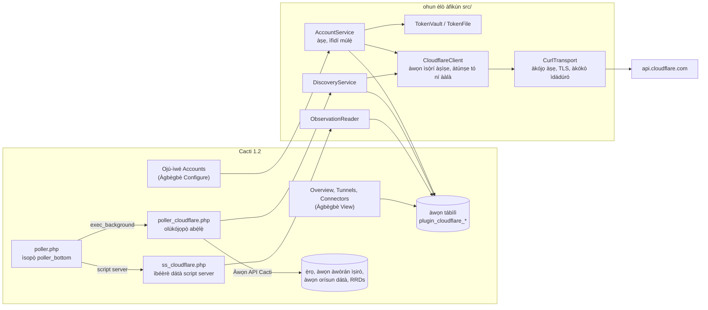

<!-- Source: README.md; SHA256: 813d1c85c236b426b83e42e63c69496f33f8909b5e435d0d45efa6a4ba2f17ca -->

<!-- translations:start -->
[English](../../../README.md) | [简体中文](../zh-CN/README.md) | [हिन्दी](../hi-IN/README.md) | [Español (España)](../es-ES/README.md) | [Español (Latinoamérica)](../es-419/README.md) | [العربية (السعودية)](../ar-SA/README.md) | [Afrikaans](../af-ZA/README.md) | [አማርኛ](../am-ET/README.md) | [العربية (مصر)](../ar-EG/README.md) | [العربية (المغرب)](../ar-MA/README.md) | [বাংলা](../bn-BD/README.md) | [Bosanski](../bs-BA/README.md) | [Deutsch](../de-DE/README.md) | [فارسی](../fa-IR/README.md) | [Filipino](../fil-PH/README.md) | [Français](../fr-FR/README.md) | [Français (Maroc)](../fr-MA/README.md) | [Français (Sénégal)](../fr-SN/README.md) | [Hausa](../ha-NG/README.md) | [עברית](../he-IL/README.md) | [Hrvatski](../hr-HR/README.md) | [Bahasa Indonesia](../id-ID/README.md) | [Igbo](../ig-NG/README.md) | [Italiano](../it-IT/README.md) | [日本語](../ja-JP/README.md) | [한국어](../ko-KR/README.md) | [Malagasy](../mg-MG/README.md) | [मराठी](../mr-IN/README.md) | [Bahasa Melayu](../ms-MY/README.md) | [Nederlands](../nl-NL/README.md) | [Polski](../pl-PL/README.md) | [Português (Brasil)](../pt-BR/README.md) | [Русский](../ru-RU/README.md) | [Kinyarwanda](../rw-RW/README.md) | [Soomaali](../so-SO/README.md) | [Српски](../sr-RS/README.md) | [Svenska](../sv-SE/README.md) | [Kiswahili](../sw-KE/README.md) | [தமிழ்](../ta-IN/README.md) | [తెలుగు](../te-IN/README.md) | [ไทย](../th-TH/README.md) | [Türkçe](../tr-TR/README.md) | [Українська](../uk-UA/README.md) | [اردو](../ur-PK/README.md) | [Tiếng Việt](../vi-VN/README.md) | [isiXhosa](../xh-ZA/README.md) | [Yorùbá](README.md) | [繁體中文](../zh-TW/README.md) | [isiZulu](../zu-ZA/README.md)
<!-- translations:end -->

<p align="center">
  
</p>

# Àfikún Cloudflare fún Cacti

[](https://github.com/somethingwithproof/plugin_cloudflare/actions/workflows/ci.yml)
[](https://sonarcloud.io/summary/new_code?id=somethingwithproof_plugin_cloudflare)
[](../../../LICENSE)


[](https://sonarcloud.io/summary/new_code?id=somethingwithproof_plugin_cloudflare)
[](https://sonarcloud.io/summary/new_code?id=somethingwithproof_plugin_cloudflare)
[](https://sonarcloud.io/summary/new_code?id=somethingwithproof_plugin_cloudflare)


Ohun èlò àfikún Cacti 1.2 tí a ń kọ́ láti ṣe àbójútó Cloudflare Tunnels àti
àtúpalẹ̀ agbègbè. Ó ń ka dátà láti Cloudflare API pẹ̀lú àwọn àmì ìdánimọ̀ API tí a ṣàkóso àṣẹ wọn,
kì í yí ohunkóhun padà nínú Cloudflare, ó sì ń tọ́jú dátà rẹ̀ sínú àwọn tábìlì tirẹ̀.
Nínú Cacti, ó ń ṣe àdàkọ àwọn fáìlì XML ìbéèrè dátà sínú `resource/script_server/` ó sì ń
ṣẹ̀dá àwọn ẹ̀rọ, àwọn àwòrán ìṣirò àti àwọn àdàkọ nípasẹ̀ àwọn API Cacti fúnra rẹ̀, láìyí
fáìlì pàtàkì kankan padà.

**Ipò: 0.4.0-dev, tí a kò tí ì tú sílẹ̀.** Ẹ̀dà tó kẹ́yìn tí a tú sílẹ̀ ni 0.3.0. Ẹ̀dà ìdàgbàsókè yìí fi ìkójáde àkójọpọ̀ CSV, ìyọkúrò ní pàtó fún àwọn tunnel tí a ti pa rẹ́, àtúpalẹ̀ agbègbè tí a tọ́jú sí ìrántí ìgbà díẹ̀, oníbàárà GraphQL Analytics kíkà-nìkan tí a fọwọ́ sí (`GraphqlAnalyticsClient`) pẹ̀lú àwọn olùrànlọ́wọ́ àkópọ̀ tí ó ṣe tán fún Thold (`AnalyticsSummary`), CLI Configuration-as-Code (`cli/cloudflare.php`), àwọn ìsopọ̀ ètò àyíká (`abilities_register`, `doctor_register_checks`, `casc_register_providers`), àti àtìlẹ́yìn olùkójọpọ̀ òkèèrè tí ó dá lórí poller (`replicate_out`) kún un. Ìjẹ́rìísí pẹ̀lú olùpèsè gidi àti ìṣàkóso ìgbékalẹ̀ ṣì ń bẹ lọ́nà.

Tábìlì tó wà ní ìsàlẹ̀ ṣàpèjúwe ìtúsílẹ̀ 0.3.0 tó fẹsẹ̀ múlẹ̀. A ṣàpèjúwe àwọn àfikún ìdàgbàsókè nínú 0.4.0-dev lábẹ́ àwọn ìṣàn-iṣẹ́ olùṣiṣẹ́ àti àtúpalẹ̀ agbègbè ní ìsàlẹ̀.

| Wà lọ́wọ́lọ́wọ́ | Wà lérò |
|---|---|
| Fifi sí i, ìgbéga, ìdádúró àti yíyọ kúrò nípasẹ̀ olùṣàkóso ohun èlò àfikún Cacti | Ìjẹ́rìísí GraphQL lórí àkọọ́lẹ̀ alààyè àti ìgbékalẹ̀ (ìparí Ìpele 4) |
| Àwọn àṣẹ Cloudflare: View, Operator àti Configure | Àyẹ̀wò ìdánwò àṣìṣe (fault injection), àwọn àpẹẹrẹ TLA+ àti ìwé ìtọ́kasí kíkún (Ìpele 5) |
| Fi kún, ṣàtúnṣe, pa rẹ́, mú ṣiṣẹ́ kí o sì dá àwọn àkọọ́lẹ̀ Cloudflare dúró | |
| Tọ́jú àmì ìdánimọ̀ sínú fáìlì tàbí ní ìpamọ́ aláṣírí nínú ibi ìpamọ́ dátà Cacti | |
| Jẹ́rìí sí àmì ìdánimọ̀ kí o sì ṣàyẹ̀wò àṣẹ kíkà tunnel àti agbègbè rẹ̀ | |
| Ìwárí tunnel àti connector nínú olùkójọpọ̀ abẹ́lẹ̀ (`poller_cloudflare.php`) | |
| Àwọn ojú-ìwé Overview, Tunnels àti Connectors lábẹ́ Management > Cloudflare Tunnels | |
| Títọpa ìgbésẹ̀ ìṣẹ̀dá àti ìparẹ́: `active`, `unavailable` àti `deleted` | |
| Ẹ̀rọ Cacti kan fún àkọọ́lẹ̀ kọ̀ọ̀kan, tí olùṣàkóso dá sílẹ̀, pẹ̀lú àwọn tunnel gẹ́gẹ́ bí ìtọ́kasí ìbéèrè dátà kan | |
| Àwọn àwòrán ìṣirò Connectors, Health àti Collection fún tunnel kọ̀ọ̀kan, tí a yà láti inú fáìlì RRD kan fún tunnel kọ̀ọ̀kan | |
| Àwọn ìye tí ohun èlò àfikún kò lè fìdí rẹ̀ múlẹ̀ ni a tọ́jú gẹ́gẹ́ bí àìmọ̀ (`U`), kì í ṣe 0 rárá | |

## Àwọn ipa ìráyè

| Àgbègbè (Realm) | Ìráyè |
| --- | --- |
| Cloudflare: View | Àwọn ojú-ìwé àbójútó tó wà tẹ́lẹ̀. |
| Cloudflare: Operator | Àbójútó pẹ̀lú ojú-ìwé Operations àti àwọn ìfọwọ́sí ìtúpalẹ̀ ìṣòro ti ẹnìkọ̀ọ̀kan. |
| Cloudflare: Configure | Ìráyè Operator pẹ̀lú àwọn ìṣètò àti àwọn ìgbésẹ̀ ìṣàkóso tó wà tẹ́lẹ̀. |

Lẹ́yìn títọ́jú àwọn fáìlì ìgbéga sí ipò wọn, ṣí ojú-ìwé Plugins gẹ́gẹ́ bí olùṣàkóso láti forúkọ sílẹ̀
àgbègbè (realm) tuntun. Yan àgbègbè Operator ní pàtó lábẹ́ **Configuration > Users** tàbí àwọn ẹgbẹ́ olùlò.
Àwọn ìgbéga ń pa àwọn ID àgbègbè View àti Admin tó wà tẹ́lẹ̀ àti àwọn àṣẹ wọn mọ́. Ìráyè Admin
ń jogún ìráyè Operator, ìráyè Operator sì ń jogún ìráyè View lórí ìbéèrè kọ̀ọ̀kan;
èyí kì í fi àwọn àṣẹ tí a tọ́jú kún fún àwọn olùlò tàbí àwọn ẹgbẹ́. Àwọn ìṣètò ohun èlò àfikún tún nílò
ìráyè Cloudflare: Configure ní àfikún sí àṣẹ Settings ti Cacti.

Ìríran àkọọ́lẹ̀ Cloudflare bá àgbègbè View tó wà tẹ́lẹ̀ mu; ó jẹ́ fún gbogbo àkọọ́lẹ̀ lápapọ̀.
Àwọn ìwé-ẹ̀rí ìdánimọ̀, ìṣètò, ìsopọ̀ àwọn nǹkan, ìparẹ́ àti àwọn àyípadà ìṣàkóso mìíràn
ṣì wà nínú àwọn ojú-ìwé ìṣàkóso. Àwọn ìfọwọ́sí wà fún ìgbà ìṣẹ́lẹ̀ olùlò lọ́wọ́lọ́wọ́
nìkan, fún wákàtí kan ní púpọ̀ jùlọ àti nígbà tí àkíyèsí kan náà ṣì wà ní
tuntun nìkan. Àwọn àkíyèsí tuntun tàbí tí a yí padà máa ń sọ wọ́n di aláìníyè. Wọn kì í sàmì sí ìwọ̀n tó kùnà
gẹ́gẹ́ bí èyí tó dára tàbí dẹ́kun àwọn ìkìlọ̀.

## Ìdí tí ohun èlò àfikún yìí fi wà

Àwọn olùṣiṣẹ́ Cacti tí wọ́n ń gbé àwọn iṣẹ́ jáde nípasẹ̀ Cloudflare Tunnel kò ní ààyè
láti wo tunnel náà nínú Cacti. Tunnel kan lè pàdánù gbogbo àwọn connector rẹ̀ nígbà tí
àwọn ẹ̀rọ ìpilẹ̀ṣẹ̀ ṣì ń dáhùn SNMP, nítorí náà àwọn àwòrán ìṣirò tó wà tẹ́lẹ̀ á dúró ní aláwọ̀ ewé nígbà tí
àwọn olùlò ń rí àwọn àṣìṣe. Ète ohun èlò àfikún yìí ni láti gbé ìlera tunnel àti ìrìn-àjò agbègbè
sẹ́gbẹ̀ẹ́ àwọn àwòrán ìṣirò ẹ̀rọ tí àwọn olùṣiṣẹ́ ti ń ṣọ́ tẹ́lẹ̀, láìfún
Cacti ní agbára kankan láti yí Cloudflare padà.

Àwọn ìdíwọ́ mẹ́ta ló ṣe àgbékalẹ̀ rẹ̀:

- **Kíkà nìkan.** Ohun èlò àfikún yìí ń pe àwọn ibi ìsopọ̀ `GET` àti GraphQL
  Analytics API nìkan. Kò nílò àṣẹ àtúnṣe kankan lórí ohun èlò Cloudflare èyíkéyìí.
- **Kì í ṣe dandan.** Àwọn ìdádúró iṣẹ́ Cloudflare, àwọn àmì ìdánimọ̀ tó ti parí àti àwọn ààlà ìwọ̀n ìbéèrè kò gbọdọ̀
  fa àkókò ojú-ìwé Cacti sẹ́yìn tàbí dá ṣíṣàyẹ̀wò àwọn ẹ̀rọ mìíràn dúró. Gbogbo àwọn ìpè API ní
  àkókò ìdádúró tó lágbára, ìkójọpọ̀ sì ń ṣiṣẹ́ nínú ìlànà abẹ́lẹ̀ tí
  olùṣàyẹ̀wò bẹ̀rẹ̀.
- **Kò sí àyípadà fáìlì pàtàkì.** Ohun èlò àfikún yìí ń lo àwọn ìsopọ̀ ohun èlò àfikún Cacti 1.2 àti
  àwọn tábìlì tirẹ̀. Ó ń ṣe àdàkọ XML ìbéèrè dátà kan sínú `resource/script_server/` ó sì ń
  ṣẹ̀dá àwọn ẹ̀rọ, àwọn àwòrán ìṣirò àti àwọn àdàkọ nípasẹ̀ àwọn API Cacti fúnra rẹ̀. Kò sí àyípadà
  fáìlì pàtàkì kankan, nítorí náà àwọn ìgbéga Cacti àti àwọn ohun èlò àfikún mìíràn kò ní ní ìpalára.

## Bí ó ṣe ń ṣiṣẹ́



- **Ìsopọ̀ Cacti** (`setup.php`, `includes/`, àwọn ìwé àṣẹ ojú-ìwé) ń forúkọ sílẹ̀
  àwọn ìsopọ̀ àti àwọn àgbègbè, ó ń ṣàfihàn àwọn ojú-ìwé pẹ̀lú àwọn olùrànlọ́wọ́ Cacti fúnra rẹ̀, ó sì ń fi
  gbogbo ìgbésẹ̀ lé ilé-ìkàwé tí ó wà nínú `src/` lọ́wọ́.
- **Ilé-ìkàwé náà** (`src/`, ààyè orúkọ `Somethingwithproof\Cloudflare\`) kò ní
  ìgbẹ́kẹ̀lé kankan lórí àwọn ohun èlò àgbáyé Cacti, nítorí náà a ń dán an wò lòdì sí ibi ìpamọ́ dátà gidi àti
  ọ̀nà ìgbéjáde HTTP èké láìsí Cacti tó ń ṣiṣẹ́.
- **Ọ̀nà jáde kan ṣoṣo.** `CurlTransport` nìkan ni kóòdù tó ń kan
  nẹ́tíwọ́ọ̀kì, ó sì ń gba `https://api.cloudflare.com` nìkan. Ìkùnà kọ̀ọ̀kan
  ni a so mọ́ ìsọ̀rí àṣìṣe kan (`auth`, `permission`, `rate_limited`,
  `transient`, ...), èyí tó ń darí ipò tí a fi hàn nínú UI.
- **Ìpamọ́** ń gba orí ìsopọ̀ PDO ti Cacti fúnra rẹ̀ kọjá pẹ̀lú àwọn gbólóhùn tí a ti pèsè
  sílẹ̀. Àwọn àyípadà ètò ibi ìpamọ́ dátà jẹ́ àwọn ìyípadà tí a fi nọ́mbà sí tí kò sì ní ipa ìlọ́po méjì.

Àwọn ìpinnu àgbékalẹ̀ àti àwọn ìdí wọn wà nínú
[docs/design.md](../../design.md).

## Àwọn àwòrán ojú-ìbòjú

Àwọn àwòrán ojú-ìbòjú wọ̀nyí wá láti inú ètò ìdánwò kan, kì í ṣe àkọọ́lẹ̀ Cloudflare gidi. Ètò
náà ń ṣiṣẹ́ Cacti 1.2.31 lòdì sí Cloudflare API èké kan tó ń dá dátà àpẹẹrẹ
padà, nítorí náà àkọọ́lẹ̀ náà, ID rẹ̀ àti àwọn tunnel mẹ́tẹ̀ẹ̀ta jẹ́ àwọn àfihàn fún àpẹẹrẹ.


*Àkójọ Cloudflare Accounts. API èké náà gba àmì ìdánimọ̀ náà, nítorí náà Verify
ròyìn `ok`.*


*Ṣíṣàtúnṣe àkọọ́lẹ̀ kan. Àwọn ààyè àmì ìdánimọ̀ máa ń ṣófo nígbà gbogbo; àmì ìdánimọ̀ tí a tọ́jú
kì í padà sí ẹ̀rọ aṣàwárí ayélujára rárá. Collect Tunnels àti Create Graphs wà ní títàn,
Collect Analytics sì wà ní pípa. Connection Status fi èsì
Verify tó kẹ́yìn hàn: `ok`, kíkà tunnel tí a fún ní àṣẹ àti kíkà agbègbè tó sọnù.*


*Settings > Cloudflare.*


*Management > Cloudflare Tunnels > Overview. Ipò náà ni ipò Cloudflare
tó burú jù lọ láàárín àwọn tunnel tó ń ṣiṣẹ́ fún àkọọ́lẹ̀ náà, níbí `down` nítorí pé tunnel àpẹẹrẹ kan
wà ní ìsàlẹ̀. `Disabled`, `Not collected`, `Collection failing` àti `Not yet collected`
gba àṣẹ ìṣáájú lórí ìlera tunnel, ní ìtòlẹ́sẹẹsẹ yẹn, nítorí náà àkọọ́lẹ̀
tí ìṣiṣẹ́ rẹ̀ tó kẹ́yìn kùnà fi `Collection failing` hàn láìka ohun tí àwọn tunnel rẹ̀ ròyìn sí.*


*Táàbù Tunnels. Connectors àti Connections fi `-` hàn fún old-office, nítorí pé
API èké náà dáhùn ìbéèrè àwọn ìsopọ̀ rẹ̀ gẹ́gẹ́ bí tunnel àìmọ̀ kò sì sí ohunkóhun
tí a tọ́jú, ó sì fi 0 hàn fún staging, tí kò ní connector kankan tó ń ṣiṣẹ́.*


*Àwòrán ìṣirò Connectors ti tunnel blog. Gbogbo àwọn ìlà mẹ́tẹ̀ẹ̀ta jẹ́ 1 ṣáájú àti
lẹ́yìn àlàfo tó wà láàárín, níbi tí API èké náà ti dá àwọn àṣìṣe padà tí ohun èlò àfikún náà sì
tọ́jú àwọn ìye àìmọ̀. Àwọn ìlà náà kò já sí 0. Àwòrán ìṣirò náà wá láti inú
ètò àpẹẹrẹ kan náà (`make screenshots`), tó ṣètò ìgbésẹ̀ ìṣẹ́jú àáyá 30 lórí
orísun dátà kan ṣoṣo yìí kí ìṣàyẹ̀wò ìṣẹ́jú méje lè kún àwòrán ìṣirò náà.*

## Àwọn ohun tí a nílò

- Cacti 1.2.25 títí dé 1.2.31. Cacti 1.2.31 fúnra rẹ̀ nílò PHP 8.0 tàbí èyí tó ga jù bẹ́ẹ̀ lọ.
  CI ń ṣàyẹ̀wò 1.2.31 nìkan; a ṣe àyẹ̀wò 1.2.25 lọ́wọ́ gbẹ̀yìn ní ọjọ́ 2026-10-22.
- PHP 7.4 títí dé 8.4 pẹ̀lú àwọn àfikún `curl`, `openssl` àti `pdo_mysql`.
  Àfikún-ètò náà máa ń kọ̀ láti ṣiṣẹ́ láìsí wọn.
- MariaDB 10.6 tàbí èyí tó ga jù bẹ́ẹ̀ lọ, tàbí MySQL 8.0 tàbí èyí tó ga jù bẹ́ẹ̀ lọ.
- Ìwọlé HTTPS láti orí olùpèsè-ètò Cacti sí `api.cloudflare.com`. A kò ṣe àtìlẹ́yìn fún àwọn
  aṣojú-ẹ̀rọ.

Wo [docs/compatibility.md](../../compatibility.md) fún ohun tí a ti ṣàyẹ̀wò.

## Ìfisílẹ̀

1. Fi àfikún-ètò náà sí inú àkójọ-fáìlì `plugins/cloudflare` ti Cacti, yálà nípa
   yíyọ àkójọ fáìlì kúrò láti
   [Àwọn Ìtẹ̀jáde GitHub](https://github.com/somethingwithproof/plugin_cloudflare/releases)
   (ṣíṣe `make package` níbi tí a ti ṣe checkout àmì ìtẹ̀jáde náà máa ń kọ àkójọ fáìlì
   kan náà) tàbí pẹ̀lú git clone. Orúkọ àkójọ-fáìlì náà gbọ́dọ̀ jẹ́ `cloudflare`.
2. Fi sí i kí o sì mú un ṣiṣẹ́ láti Console > Configuration > Plugins, tàbí pẹ̀lú
   CLI gẹ́gẹ́ bí olùlò olùpèsè-ayélujára:

   ```sh
   php cli/plugin_manage.php --plugin=cloudflare --install --enable
   ```

3. Olùlò alákòóso máa ń gba àṣẹ Cloudflare: Configure nígbà ìfisílẹ̀. Fún
   àwọn olùlò tàbí ẹgbẹ́ mìíràn ní àṣẹ náà lábẹ́ Console > Configuration > Users.
4. Ṣẹ̀dá tókìnì pẹ̀lú àwọn àṣẹ inú
   [docs/token-permissions.md](../../token-permissions.md). Ní ṣókí:
   Account > Cloudflare Tunnel > Read, àti bó bá ṣe é ṣe, Zone > Zone > Read.
5. Tọ́jú tókìnì náà ní ọ̀kan nínú àwọn ọ̀nà méjì ìsàlẹ̀ yìí, lẹ́yìn náà fi àkántì náà kún un lábẹ́
   Console > Configuration > Cloudflare Accounts kí o sì ṣe Verify láti inú
   àtòjọ ìṣe.

### Àṣàyàn A: ti a fi àṣírí pamọ́ sínú ibi-ìpamọ́ dátà

Àfikún-ètò náà máa ń fi kọ́kọ́rọ́ oní-32-byte tí o ṣẹ̀dá pa àwọn tókìnì mọ́ ní ìkọ̀kọ̀. Kò kì í
ṣẹ̀dá tàbí kọ kọ́kọ́rọ́ náà fúnra rẹ̀. Fáìlì náà gbọ́dọ̀ ṣe é kà fún olùlò olùpèsè-ayélujára
àti ti poller, kò gbọ́dọ̀ ṣe é kà fún àwọn ẹlòmíràn, àti pé àkójọ-fáìlì rẹ̀
gbọ́dọ̀ gba àwọn olùlò wọ̀nyẹn láàyè láti dé ọ̀dọ̀ rẹ̀. Fún olùpèsè-ayélujára tí ó ń ṣiṣẹ́ gẹ́gẹ́ bí `www-data`:

```sh
sudo mkdir -p /etc/cacti
sudo sh -c 'umask 077 && openssl rand -hex 32 > /etc/cacti/cloudflare.key'
sudo chgrp www-data /etc/cacti/cloudflare.key
sudo chmod 0440 /etc/cacti/cloudflare.key
```

Ọ̀nà ìbẹ̀rẹ̀ náà ni `/etc/cacti/cloudflare.key`; yí i padà lábẹ́ Settings >
Cloudflare > Token Vault Key File. Nígbà tí kọ́kọ́rọ́ náà bá sọnù tàbí tí a kọ̀ ọ́,
fọ́ọ̀mù àtúnṣe yóò fi àṣàyàn fáìlì tókìnì nìkan hàn. Pa àtọ́jú kọ́kọ́rọ́ náà mọ́:
láìsí i, a kò lè tú àwọn tókìnì tí a tọ́jú sílẹ̀, a ó sì ní láti tún wọn tẹ̀ sí i.

#### Yíyí kọ́kọ́rọ́ padà

Kò sí àṣẹ àtún-kọ́kọ́rọ́. Kọ́kọ́rọ́ tuntun kò lè tú àwọn tókìnì tí a tọ́jú lábẹ́
èyí àtijọ́, nítorí náà yíyí padà túmọ̀ sí títún gbogbo tókìnì tí a tọ́jú tẹ̀ sí i:

1. Rí i pé iye tókìnì àkántì kọ̀ọ̀kan wà lọ́wọ́ rẹ. Cloudflare máa ń fi iye tókìnì hàn
   nígbà tí a bá ṣẹ̀dá rẹ̀ tàbí tí a bá yí i padà nìkan, nítorí náà tún tókìnì náà ṣe ní ojú-òpó Cloudflare
   bí kò bá sí lọ́wọ́ rẹ mọ́.
2. Ṣẹ̀dá kọ́kọ́rọ́ tuntun sí ọ̀nà tuntun pẹ̀lú àwọn àṣẹ òkè yìí, fún àpẹẹrẹ
   `/etc/cacti/cloudflare.key.new`, pẹ̀lú olùní àti àṣẹ ìṣàmúlò kan náà.
3. Ṣètò Settings > Cloudflare > Token Vault Key File sí ọ̀nà tuntun náà kí o sì fi pamọ́.
   Láti ìgbà yìí lọ, Verify lórí àkántì tí a ṣì fi kọ́kọ́rọ́ àtijọ́ pa mọ́
   yóò ròyìn "Stored token cannot be decrypted", àti pé ìṣiṣẹ́ olùkójọ kọ̀ọ̀kan yóò kọ
   `discovery token unavailable` pẹ̀lú `reason=decrypt_failed` fún un.
4. Fún àkántì kọ̀ọ̀kan tí ó tọ́jú tókìnì rẹ̀ sínú ibi-ìpamọ́ dátà, ṣí i lábẹ́
   Console > Configuration > Cloudflare Accounts, lẹ̀ tókìnì náà sínú àwọn ààyè
   tókìnì méjèèjì, fi pamọ́, kí o sì ṣe Verify. Ó yẹ kí ó ròyìn `ok`.
5. Nígbà tí gbogbo irú àkántì bẹ́ẹ̀ bá ti fìdí múlẹ̀, yọ fáìlì kọ́kọ́rọ́ àtijọ́ àti àwọn
   àtọ́jú rẹ̀ kúrò.

Láàárín ìgbésẹ̀ 3 àti 4, a kò ní sọ àwọn ọ̀nà-àṣírí àkántì di tuntun, àwọn àwòrán
ìlera, olùsopọ̀ àti ìsopọ̀ wọn yóò sì kọ U sílẹ̀. Èyí kò kan àwọn àkántì fáìlì tókìnì.

### Àṣàyàn B: fáìlì tókìnì

Kọ tókìnì náà, láìsí ohunkóhun mìíràn, sínú fáìlì tí olùlò olùpèsè-ayélujára àti ti poller
lè kà tí àwọn ẹlòmíràn kò sì lè kà, lẹ́yìn náà tẹ ọ̀nà kíkún rẹ̀ sínú fọ́ọ̀mù àtúnṣe:

```sh
sudo sh -c 'umask 077 && cat > /etc/cacti/cloudflare-account.token'   # paste the token, then Ctrl-D
sudo chgrp www-data /etc/cacti/cloudflare-account.token
sudo chmod 0440 /etc/cacti/cloudflare-account.token
```

A máa ń ṣàyẹ̀wò fáìlì náà nígbà tí a bá ń kà á, ní àkókò Verify, kì í ṣe nígbà tí o bá fi pamọ́. A máa ń kọ
àwọn ìjápọ̀ àmì, àwọn fáìlì tó ju 4 KiB lọ àti àwọn fáìlì tí àwọn ẹlòmíràn lè kà tàbí kọ sí.

Ẹnikẹ́ni tó bá ní Cloudflare: Configure lè tẹ ọ̀nà èyíkéyìí wọlé, olùlò poller yóò sì
kà á. Láti tọ́jú àwọn fáìlì tókìnì sí ibì kan ṣoṣo, ṣètò Settings > Cloudflare >
Token File Directory, fún àpẹẹrẹ sí `/etc/cacti`; lẹ́yìn náà, a ó kọ ọ̀nà èyíkéyìí tó wà lóde rẹ̀.
Wo [docs/security.md](../../security.md#token-file).

## Ìgbéga

1. Rọ́pò àwọn fáìlì inú `plugins/cloudflare` pẹ̀lú ìtẹ̀jáde tuntun, kí o sì pa
   orúkọ àkójọ-fáìlì náà mọ́.
2. Ṣí Console > Configuration > Plugins, tàbí Console > Configuration >
   Cloudflare Accounts, ní ẹ̀ẹ̀kan gẹ́gẹ́ bí alákòóso. Ìyẹn máa ń ṣe àwọn ìṣíkiri dátà àfikún-ètò náà,
   ó ń kó àwọn àwòkọ Cloudflare wọlé, ó sì ń da fáìlì ìbéèrè dátà kọ (wo
   [Àwọn òṣùwọ̀n àti àwòrán ọ̀nà-àṣírí](#tunnel-metrics-and-graphs)), ó ń forúkọsílẹ̀ àwọn ìsopọ̀ ètò àyíká `abilities_register`, `doctor_register_checks`, `casc_register_providers`, àti `replicate_out` (`includes/ecosystem.php`), àti lórí
   ìgbéga láti 0.1.0, ó ń forúkọsílẹ̀ ìkọ̀kọ̀ `poller_bottom`.

`poller.php` kì í ṣe ìgbéga àfikún-ètò náà, nítorí náà títí di ìgbésẹ̀ 2, ètò dátà tuntun
kò ní sí. Ìṣiṣẹ́ olùkójọ kọ̀ọ̀kan kì í ṣe nǹkan kan, yóò sì kọ
`CLOUDFLARE: collector skipped; plugin upgrade pending, open Console > Plugins` sí àkọsílẹ̀.
Àwọn ojú-ewé Cloudflare Tunnels nílò Cloudflare: View nìkan, nítorí náà wọn kì í ṣe
ìgbéga náà, títí di ìgbésẹ̀ 2 wọ́n sì lè fi "The Cloudflare tunnels could not
be read" hàn.

## Ipò àkántì

Verify máa ń ṣètò ipò àkántì náà:

| Ipò | Ìtumọ̀ |
|---|---|
| `unknown` | A kò tíì fìdí rẹ̀ múlẹ̀ láti ìgbà tí a ti fi àkántì náà kún un tàbí tí a ti yí ìwé-ẹ̀rí rẹ̀ padà |
| `ok` | Tókìnì náà ń ṣiṣẹ́ ó sì lè ka àwọn ọ̀nà-àṣírí |
| `token_inactive` | Cloudflare ròyìn pé tókìnì náà ti wà ní pípa tàbí pé ó ti parí àkókò |
| `auth_failed` | Cloudflare kọ tókìnì náà nítorí pé kò tọ́ tàbí ó ti parí àkókò (HTTP 401) |
| `permission_denied` | Tókìnì náà ń ṣiṣẹ́ ṣùgbọ́n kò lè ka àwọn ọ̀nà-àṣírí, tàbí pé kò ní àṣẹ láti pe àwọn òpin-ìsopọ̀ ìfìdímúlẹ̀ tókìnì (HTTP 403) |
| `unreachable` | A kò lè dé ọ̀dọ̀ API náà, àkókò rẹ̀ parí, tàbí ó dá àṣìṣe olùpèsè-ètò padà |
| `rate_limited` | Cloudflare dá HTTP 429 padà |
| `error` | Ìkùnà mìíràn èyíkéyìí, títí kan fáìlì tókìnì tó sọnù tàbí tí kò ní ààbò, fáìlì kọ́kọ́rọ́ ibi-ìpamọ́ tókìnì tó sọnù tàbí tí kò ṣe é lò, tàbí tókìnì tí a tọ́jú tí a kò lè tú |

Ojú-ewé àtúnṣe tún máa ń fi hàn bóyá a fún un ní àṣẹ kíkà ọ̀nà-àṣírí àti kíkà agbègbè.

## Ìwárí ọ̀nà-àṣírí

Lẹ́yìn ìyípo ìbéèrè kọ̀ọ̀kan lórí poller olùkójọ tí a ṣètò (`cloudflare_poller_id`, àìyípadà `1`), ìkọ̀kọ̀ `poller_bottom` máa ń bẹ̀rẹ̀
olùkójọ abẹ́lẹ̀ pẹ̀lú `exec_background` nígbà tí ó kéré tán àkántì kan tí a mú ṣiṣẹ́
bá ti tan Collect Tunnels. Olùkójọ náà kì í ṣiṣẹ́ nínú ìlànà poller
rárá, nítorí náà API Cloudflare tí ó bá lọ́ra kò ní fa `poller.php` sẹ́yìn. `INFO` ń kéde `remote_collect:1`, àti pé ìsopọ̀ `replicate_out` (`RemoteReplication`) ń ti àwọn tábìlì metadata tí kì í ṣe àṣírí (`plugin_cloudflare_accounts` pẹ̀lú `token_ciphertext` tí a bọ́ sí `NULL`, `plugin_cloudflare_tunnels`, `plugin_cloudflare_connectors`, `plugin_cloudflare_zones`, `plugin_cloudflare_metric_mappings`, àti `plugin_cloudflare_resources`) sí àwọn poller òkèèrè (`poller_id > 1`) nígbà tí ó ń yọ ohun èlò kọ́kọ́rọ́ ìpamọ́ kúrò.

Fún àkántì kọ̀ọ̀kan tí àkókò rẹ̀ bá tó, olùkójọ náà máa ń to àwọn ọ̀nà-àṣírí àkántì náà, lẹ́yìn náà
ó ń ka àwọn ìsopọ̀ ti àwọn ọ̀nà-àṣírí rẹ̀ tó ń ṣiṣẹ́, èyí tí ó ń fúnni ní àwọn olùsopọ̀ ọ̀nà-àṣírí kọ̀ọ̀kan,
àwọn ẹ̀dà wọn, àwọn ilé-iṣẹ́ dátà àti àwọn àdírẹ́sì ìpilẹ̀ṣẹ̀. Àkókò àwọn àkántì máa ń
tó ní gbogbo Discovery Interval (ìbẹ̀rẹ̀ rẹ̀ jẹ́ ìṣẹ́jú-àáyá 300). Ìṣiṣẹ́ kan kì í bẹ̀rẹ̀ àkántì
tuntun kankan lẹ́yìn ìṣẹ́jú-àáyá 50, kò sì ní ṣe ju ìbéèrè ìsopọ̀ 200 lọ. Ọ̀kan nínú
àwọn òpin méjèèjì tún lè dá àkántì kan dúró láàárín kíkà àwọn ìsopọ̀ rẹ̀; a ó kọ
àkántì yẹn sílẹ̀ gẹ́gẹ́ bí `partial`, ìṣiṣẹ́ tó tẹ̀lé yóò sì tẹ̀síwájú pẹ̀lú àwọn ọ̀nà-àṣírí
tí a dán wò tipẹ́ jù lọ. Àwọn àkántì tí a kò bẹ̀rẹ̀ yóò wà ní ìmúrasílẹ̀ fún ìṣiṣẹ́ tó tẹ̀lé.

Ọ̀nà-àṣírí kan ní ìyípo-ìgbésí-ayé, tí a yà sọ́tọ̀ kúrò lára ipò tí Cloudflare ń ròyìn
(`healthy`, `degraded`, `down` tàbí `inactive`):

| Ìyípo-ìgbésí-ayé | Ìtumọ̀ |
|---|---|
| `active` | Ọ̀nà-àṣírí náà wà nínú àtòjọ pípé tó kẹ́yìn |
| `deleted` | Àtòjọ pípé kan kò fi kún un, èyí tó tún ní àtòjọ òfo nínú. Ìlà náà àti ìtàn rẹ̀ yóò wà níbẹ̀, ọ̀nà-àṣírí náà yóò sì di `active` padà bí ó bá tún farahàn |
| `unavailable` | Ìdádúró mẹ́ta tí a kà láìsí àtòjọ pípé láàárín wọn máa ń jẹ́ kí ipò ọ̀nà-àṣírí náà jẹ́ àìmọ̀ |

Àtòjọ pípé tó yọrí sí rere nìkan ni ó máa ń fi kún, ṣe àtúnṣe tàbí pa àwọn ọ̀nà-àṣírí rẹ́, àtòjọ
tó kùnà kò sì kì í pa ọ̀kan rẹ́ rárá. Ìkùnà láti ka Cloudflare rárá
(`transient`, `rate_limited`, `auth` tàbí `permission`) máa ń kà sí ìdádúró;
lẹ́yìn ìdádúró mẹ́ta tí a kà láìsí àtòjọ pípé láàárín wọn, àwọn ọ̀nà-àṣírí àkántì náà
tó ń ṣiṣẹ́ yóò di `unavailable`. Àtòjọ pípé tó tẹ̀lé
yóò dá wọn padà, yóò sì tún ìkà náà bẹ̀rẹ̀. Ọ̀nà-àṣírí tí Cloudflare kò mọ̀ mọ́
nígbà tí a bá ń ka àwọn ìsopọ̀ rẹ̀ ni a ó fò láìjẹ́ kí àkántì náà kùnà. Àwọn ìkùnà
mìíràn kì í fi kún un, wọn kì í sì í tún òǹkà ìdádúró bẹ̀rẹ̀.

Nínú `cacti.log`, àwọn ìlà ìwárí máa ń bẹ̀rẹ̀ pẹ̀lú `CLOUDFLARE: discovery` àti àkópọ̀ ìṣiṣẹ́
pẹ̀lú `CLOUDFLARE: collector`. Àwọn ìkùnà àti àwọn àyípadà ìyípo-ìgbésí-ayé, bíi
àtòjọ tó kùnà tàbí àwọn ọ̀nà-àṣírí tí a sàmì sí `unavailable`, ni a máa ń kọ sílẹ̀ ní ìpele `LOW` ìbẹ̀rẹ̀ ti
Cacti; èsì àkántì kọ̀ọ̀kan àti àkópọ̀ ìṣiṣẹ́ ni a máa ń kọ sílẹ̀ ní
`MEDIUM`. Kíkà ìsopọ̀ lè kùnà lórí gbogbo ọ̀nà-àṣírí, nítorí náà fún àkántì kọ̀ọ̀kan
ìkùnà àkọ́kọ́ ti ẹ̀ka àṣìṣe kọ̀ọ̀kan nìkan ni a máa ń kọ sílẹ̀ ní `LOW`, àwọn ìyókù ní
`MEDIUM`, tí ìlà `LOW` kan fún ẹ̀ka kọ̀ọ̀kan yóò sì tẹ̀lé pẹ̀lú iye àwọn ọ̀nà-àṣírí tó
kùnà.

Management > Cloudflare Tunnels nílò àṣẹ Cloudflare: View ó sì jẹ́
kíkà nìkan:

- **Overview** máa ń to àkántì kọ̀ọ̀kan pẹ̀lú ipò rẹ̀, iye ọ̀nà-àṣírí nípasẹ̀ ìyípo-ìgbésí-ayé,
  ìwárí tó yọrí sí rere tó kẹ́yìn àti iye ìkùnà tí ó tẹ̀lé ara wọn.
- **Tunnels** máa ń to àwọn ọ̀nà-àṣírí káàkiri àwọn àkántì tàbí fún àkántì kan, pẹ̀lú àwọn àṣẹ́
  fún àkántì, ìyípo-ìgbésí-ayé, ipò àti orúkọ, àti àwọn ọ̀wọ̀n tí a lè tò.
- **Connectors** máa ń fi àwọn olùsopọ̀ ti ọ̀nà-àṣírí tí a yàn lórí táàbù Tunnels hàn.

<a name="tunnel-metrics-and-graphs"></a>

## Àwọn òṣùwọ̀n àti àwòrán ọ̀nà-àṣírí

Cacti máa ń ka ipò ọ̀nà-àṣírí nípasẹ̀ ìbéèrè dátà script server kan,
`ss_cloudflare.php`. Ó máa ń dáhùn láti inú àwọn tábìlì àfikún-ètò náà nìkan kò sì kì í pe
Cloudflare rárá, nítorí náà ìdádúró Cloudflare kò lè fa poller sẹ́yìn. Ọ̀nà-àṣírí kọ̀ọ̀kan máa ń fúnni ní
iye mẹ́fà: ìlera (healthy 3, degraded 2, down 1, inactive 0), àwọn olùsopọ̀,
àwọn ìsopọ̀, àwọn ẹ̀dà olùsopọ̀, iye ìṣẹ́jú-àáyá láti ìgbà tí a ti ka àwọn ìsopọ̀ rẹ̀ gbẹ̀yìn,
àti àwọn ìkùnà títẹ̀léra ti iṣẹ́ ìwárí. Ìlera, àwọn olùsopọ̀,
àwọn ìsopọ̀ àti àwọn ẹ̀dà ni a máa ń tẹ̀ jáde nìkan nígbà tí àfikún-ètò náà bá lè jẹ́rìí sí wọn,
èyí tí ó túmọ̀ sí pé ìwárí tó kẹ́yìn yọrí sí rere, ọ̀nà-àṣírí náà jẹ́ `active`, kíkà náà
sì jẹ́ tuntun. Bí bẹ́ẹ̀ kọ́ wọ́n jẹ́ `U`, àwòrán náà yóò sì fi àlàfo hàn dípò
òdo tí ì bá dà bí ìdádúró. Àwọn iye ìkójọ méjèèjì yóò máa hàn
nígbà ìdádúró, kí àwòrán Collection lè fi hàn; wọ́n jẹ́ `U` nìkan
fún ọ̀nà-àṣírí tí a ti pa rẹ́ tàbí èyí tí a kò sọ àwọn ìsopọ̀ rẹ̀ di tuntun rí. Àwọn òfin náà
wà nínú [docs/metrics.md](../../metrics.md).

### Ṣẹ̀dá ẹ̀rọ náà

Àkántì kan so mọ́ ẹ̀rọ Cacti kan ṣoṣo ní púpọ̀ jù lọ. Ẹ̀rọ náà máa ń di àwọn ọ̀nà-àṣírí àkántì náà
mú gẹ́gẹ́ bí àwọn ìtọ́kasí ti ìbéèrè dátà Cloudflare Tunnels. Kò sí ohun tí ó ń ṣẹ̀dá
rẹ̀ fúnra rẹ̀:

1. Ṣí Console > Configuration > Cloudflare Accounts.
2. Yan àkántì náà, yan Create Cacti Device láti inú àtòjọ ìṣe, kí o sì
   fìdí rẹ̀ múlẹ̀.

Ìṣe náà nílò àwọn àgbègbè-àṣẹ Cloudflare: Configure àti Sites/Devices/Data ti Cacti
(èyí fún `host.php`) méjèèjì. Àkọsílẹ̀ àtòjọ náà máa ń farahàn fún
àwọn olùlò tí ó ní méjèèjì nìkan, olùpèsè-ètò yóò sì kọ ìbéèrè láti ọ̀dọ̀ ẹlòmíràn.
Orúkọ ẹ̀rọ náà ni `Cloudflare: <account name>`, ó ń lo àwòkọ olùgbàlejò Cloudflare Account
àti poller àkọ́kọ́, ó ní ẹ̀dà SNMP 0 láìsí àyẹ̀wò
ìwàlárọ̀wọ́, ó sì máa ń gba orúkọ olùgbàlejò `<account ID>.cloudflare.invalid`. Orúkọ yẹn wà ní
ìpamọ́ kò sì kì í túmọ̀ rárá; Cacti kì í sopọ̀ mọ́ ọn. Bí àkántì náà
bá ti ní ẹ̀rọ kan tẹ́lẹ̀, ìṣe náà yóò sọ bẹ́ẹ̀ kò sì ní yí ohunkóhun padà. Bí
alákòóso bá pa ẹ̀rọ náà rẹ́ nínú Cacti, àfikún-ètò náà kò ní ṣe òmíràn
títí a ó fi tún Create Cacti Device ṣe lẹ́ẹ̀kan sí i.

### Ṣẹ̀dá Àwọn Àwòrán

Create Graphs lórí fọ́ọ̀mù àkántì wà ní pípa ní ìbẹ̀rẹ̀. Nígbà tí ó bá wà ní títàn, ní gbogbo ìgbà
tí ìwárí àkántì kan bá parí pẹ̀lú `ok` tàbí `partial`, olùkójọ náà yóò tún ẹ̀rọ náà tò sípò,
yóò sì ṣẹ̀dá àwọn àwòrán kọ̀ọ̀kan tó bá sọnù fún àwọn ọ̀nà-àṣírí `active` ti àkántì náà:
Connectors, Health àti Collection, mẹ́ta fún ọ̀nà-àṣírí kọ̀ọ̀kan. Àwọn àwòrán mẹ́ta ti ọ̀nà-àṣírí kan
máa ń lo fáìlì RRD kan náà. Ìṣiṣẹ́ kan máa ń ṣẹ̀dá àwòrán 50 ní púpọ̀ jù lọ, ó sì máa ń dúró lẹ́yìn ìṣẹ́jú-àáyá 20,
ìṣiṣẹ́ tó tẹ̀lé yóò sì tẹ̀síwájú. Àfikún-ètò náà kì í yọ ohun Cacti kankan kúrò rárá.
Àwòrán tí alákòóso bá pa rẹ́ ni a kò ní tún ṣe mọ́, ọ̀nà-àṣírí tí
Cloudflare kò sì tò mọ́ yóò pa àwòrán rẹ̀ àti fáìlì RRD rẹ̀ mọ́, èyí tí yóò fi `U` hàn.

Títan Create Graphs nílò àwọn àgbègbè-àṣẹ méjèèjì. Pípa á nílò
Configure nìkan. Olùlò tí kò ní àgbègbè-àṣẹ Sites/Devices/Data tí ó bá fi fọ́ọ̀mù náà pamọ́
yóò fi ètò náà sílẹ̀ bí ó ti wà tẹ́lẹ̀, pẹ̀lú ìkìlọ̀ kan. Nígbà tí Create Graphs bá wà ní pípa,
a ṣì máa ń tún ẹ̀rọ náà tò sípò lẹ́yìn ìwárí kọ̀ọ̀kan, kí àwọn ọ̀nà-àṣírí tuntun lè farahàn gẹ́gẹ́ bí
àwọn ìtọ́kasí ti ìbéèrè dátà náà.

### Fáìlì ìbéèrè dátà

Cacti 1.2.31 máa ń ka XML ìbéèrè dátà láti inú àkójọ-fáìlì `resource`
rẹ̀ nìkan. Nítorí náà, nígbà ìfisílẹ̀ àti ìgbéga, àfikún-ètò náà máa ń ṣe ẹ̀dà fáìlì kan,
`templates/resource/cloudflare_tunnels.xml`, sí
`<Cacti>/resource/script_server/cloudflare_tunnels.xml`. Òun nìkan ni fáìlì
tí àfikún-ètò náà ń kọ síta kúrò nínú àkójọ-fáìlì tirẹ̀, nítorí náà olùlò tí ó ń fi àfikún-ètò náà sílẹ̀ tàbí
tí ó ń gbé e ga gbọ́dọ̀ lè kọ sí àkójọ-fáìlì yẹn.
Yíyọ kúrò máa ń pa fáìlì náà mọ́, pẹ̀lú àwọn ẹ̀rọ, àwòrán, àwọn fáìlì RRD àti
àwọn àwòkọ. Bí ṣíṣe ẹ̀dà tàbí kíkó àwòkọ wọlé bá kùnà, àfikún-ètò náà yóò kọ ọ́ sí àkọsílẹ̀,
Create Cacti Device yóò sì tún gbìyànjú lẹ́ẹ̀kan sí i.

## Àwọn Ètò

Àwọn Ètò > Cloudflare ní nínú:

- **Fáìlì Kọ́kọ́rọ́ Àpò Àmì**: ọ̀nà sí kọ́kọ́rọ́ àpò ìfipamọ́.
- **Fódà Fáìlì Àmì**: nígbà tí a bá ṣètò rẹ̀, fáìlì àmì tí ó wà lóde rẹ̀ ni a óò kọ̀. Ó ṣófo ní
  àìyípadà, èyí tí ó fàyè gba ọ̀nà èyíkéyìí. Wo [docs/security.md](../../security.md#token-file).
- **Àkókò Ìdádúró Ìbéèrè Ìbánisọ̀rọ̀**: àpapọ̀ ìṣẹ́jú-àáyá fún ìbéèrè tí a ṣe láti
  ojú-ọ̀nà wẹ́ẹ̀bù, bíi Ìdánilójú. Àìyípadà jẹ́ 10; àwọn iye tí ó wà lóde 5 sí 60
  yóò padà sí 10.
- **Àkókò Ìdádúró Ìbéèrè Olùkójọ**: àpapọ̀ ìṣẹ́jú-àáyá fún ìbéèrè tí olùkójọ
  abẹ́lẹ̀ ṣe. Àìyípadà jẹ́ 20; àwọn iye tí ó wà lóde 5 sí 60 yóò padà sí 20.
- **Ìpele Àkọsílẹ̀**: a tọ́jú rẹ̀. Kò sí ohun tí ó ń kà á síbẹ̀.

Lórí fọ́ọ̀mù àkántì, Kójọ Àwọn Ojú-ọ̀nà Àṣírí (Collect Tunnels) àti Àlàfo Àwárí (Discovery Interval) ń darí àwárí,
Ṣẹ̀dá Àwọn Àwòrán Ìṣirò (Create Graphs) sì ń darí ìṣẹ̀dá àwòrán ìṣirò. Kójọ Àtúpalẹ̀ (Collect Analytics) ni a tọ́jú, kò sì ní
ipa kankan nínú ìtẹ̀jáde yìí.

## Àwọn Èdè

Àfikún náà kó àwọn ìtumọ̀ sí èdè Sípéènì (Sípéènì, `es-ES`), Faransé
(`fr-FR`), Jámánì (`de-DE`), Ṣáínà Ìrọ̀rùn (`zh-CN`), Híndì (`hi-IN`),
Lárúbáwá (`ar-SA`) àti Jàpáànù (`ja-JP`) pọ̀. Cacti ń fi wọ́n hàn ní kété tí àtìlẹ́yìn èdè bá ti wà ní títàn (Ìṣètò >
Àwọn Ètò > Gbogbogbò > Àtìlẹ́yìn Èdè) tí olùlò sì yan èdè náà. Àtòjọ èdè Sípéènì ti
Látìn Amẹ́ríkà (`es-419`) pẹ̀lú wà nínú rẹ̀, ṣùgbọ́n Cacti 1.2 kò ní àgbègbè èdè Sípéènì ti Látìn
Amẹ́ríkà láti yàn, nítorí náà ó máa ń ṣiṣẹ́ kìkì nígbà tí Cacti bá fi ọ̀kan
kún un; títí di ìgbà náà, yan Sípéènì (`es-ES`).

Àwọn ọ̀rọ̀ kan dúró ní èdè Gẹ̀ẹ́sì: àwọn iye ipò tí àfikún náà tọ́jú tí ó sì fi hàn
bí wọ́n ṣe rí (`ok`, `active`, `unavailable`, `deleted`, àti ipò ojú-ọ̀nà àṣírí tí
Cloudflare ròyìn), àti ohun gbogbo tí àfikún náà kọ sínú àkọsílẹ̀ Cacti.

## Yíyọ kúrò àti ìtọ́jú dátà

Yíyọ kúrò máa ń pa àwọn tábìlì ti àfikún náà fúnra rẹ̀ rẹ́, èyí tí ó ní àwọn àkántì, àwọn àmì tí a fi ìpamọ́ bò,
àwọn ojú-ọ̀nà àṣírí tí a ṣàwárí, ipò iṣẹ́ àti àkọsílẹ̀ irú àwọn ohun Cacti tí ó
ṣẹ̀dá, ó sì máa ń pa àwọn ètò `cloudflare_` rẹ̀ rẹ́. Kì í yọ fáìlì kọ́kọ́rọ́,
àwọn fáìlì àmì, `resource/script_server/cloudflare_tunnels.xml` tí a ṣẹ̀dá àdàkọ rẹ̀, tàbí àwọn
ẹ̀rọ Cacti, àwọn àwòrán ìṣirò, àwọn orísun dátà, àwọn fáìlì RRD tàbí àwọn àdàkọ kankan kúrò. Àwọn wọ̀nyí ní
dátà àbójútó ti ìtàn nínú, yíyọ wọ́n kúrò sì jẹ́ ìgbésẹ̀ pàtó tí olùṣàkóso
gbọ́dọ̀ gbé nínú Cacti.

Ẹ̀rọ tí a tọ́jú yóò dáwọ́ gbígba dátà dúró. Lẹ́yìn yíyọ kúrò, tàbí lẹ́yìn tí a bá pa
àkántì rẹ̀ rẹ́, kò sí àkántì tí ó ni olùgbàlejò náà, nítorí náà àwọn àwòrán ìṣirò rẹ̀ yóò pa ìtàn
wọn mọ́ ṣùgbọ́n wọn yóò máa tẹ `U` jáde láti ìgbà náà lọ. Ṣẹ̀dá Ẹ̀rọ Cacti (Create Cacti Device) lórí àkántì tí a tún fi sórí ẹ̀rọ tàbí tí a tún
fi kún un máa ń ṣẹ̀dá ẹ̀rọ tuntun; kì í tún ti àtijọ́ lò, nítorí náà pa
ẹ̀rọ àtijọ́ rẹ́ nínú Cacti ní kété tí ìtàn rẹ̀ kò bá wúlò mọ́.

## Àwọn ààlà tí a mọ̀

- Ìṣiṣẹ́ kan máa ń ṣe àwọn ìbéèrè ìsopọ̀ tí kò ju 200 lọ. Àwọn ojú-ọ̀nà àṣírí tí ó rékọjá ààlà yẹn ni a
  máa ń sọ di tuntun ní ìgbà díẹ̀ ju fèrèsé àkíyèsí lọ, nítorí náà àwọn àwòrán ìṣirò ìsopọ̀
  wọn máa ń fi àlàfo hàn.
- Àfikún náà máa ń kọ lé àwọn àtúnṣe olùṣàkóso sí àwọn àdàkọ tí a kó wọlé nígbà tí
  ìgbéga bá yí XML àdàkọ tí a kó wọlé padà.
- Àwọn poller òkèèrè máa ń gba metadata tí a ṣe àtúnṣe láìsí ìwé-ẹ̀rí ìdánimọ̀ (`token_ciphertext` ni a bọ́ sí `NULL`, a kò sì ṣe àtúnṣe àwọn kọ́kọ́rọ́ ìpamọ́ rárá). Nígbà tí o bá ń ṣiṣẹ́ olùkójọ lórí poller òkèèrè tí a yàn (`cloudflare_poller_id`), pèsè àwọn fáìlì àmì tàbí kọ́kọ́rọ́ ìpamọ́ tààrà lórí olùgbàlejò olùkójọ náà.
- Àwọn ojú-ọ̀nà àṣírí tí a pa rẹ́ máa ń dúró nínú àtọ́ka ìbéèrè dátà, wọn yóò sì máa tẹ `U` títí tí olùṣàkóso yóò fi fẹ̀yìntì wọ́n ní gbangba. Ìfẹ̀yìntì máa ń yọ kìkì àwọn àwòrán ìṣirò tí àfikún kọ sílẹ̀ àti àwọn orísun dátà tí kò ní àjọpín kúrò nípasẹ̀ Cacti; ìlà àkójọpọ̀ ohun-ìní náà yóò wà ní rírí. Cacti ni ó ń ṣàkóso ìwẹ̀nùmọ́ RRD.
- Cacti máa ń pa àfikún tí kóòdù rẹ̀ bá parí pẹ̀lú àṣìṣe apaniyan òótọ́, bíi
  kí ìrántí tán. Wo [docs/security.md](../../security.md).

## Ààbò

- A kọ̀ Àwọn Kọ́kọ́rọ́ API Àgbáyé; kìkì àwọn àmì API tí a pín ààlà fún ni a gbà.
- A tọ́jú àwọn àmì sínú fáìlì tí o pèsè tàbí a fi AES-256-GCM pa wọ́n mọ́
  lábẹ́ fáìlì kọ́kọ́rọ́ tí kì í wọ inú àkójọpọ̀ dátà rárá. A kì í fi wọ́n hàn
  ní ojú-ìwé kan, a kì í kọ wọ́n sínú àkọsílẹ̀, tàbí kí a fi wọ́n sínú ìránṣẹ́ àṣìṣe.
- Àwọn àṣìṣe àkójọpọ̀ dátà máa ń gbé kìkì SQLSTATE àti kóòdù àṣìṣe awakọ̀ náà, kì í ṣe
  àwọn iye gbólóhùn náà rárá.
- Gbogbo àyípadà jẹ́ POST tí àmì CSRF ti Cacti dáàbò bò. Àwọn àyípadà àkántì àti
  ìṣètò ti ìṣàkóso nílò Cloudflare: Configure; àwọn ìjẹ́wọ́ ìtọ́jú ìṣòro ti
  ara-ẹni nílò Cloudflare: Operator. Ṣíṣẹ̀dá ẹ̀rọ Cacti kan
  tàbí títan Ṣẹ̀dá Àwọn Àwòrán Ìṣirò (Create Graphs) tún nílò àṣẹ Sites/Devices/Data
  ti Cacti. Àfikún tí a ti pa máa ń kọ̀ àwọn ojú-ìwé rẹ̀.
- Configuration-as-Code (`cli/cloudflare.php` àti `casc_register_providers`)
  gba àwọn ìtọ́kasí àṣírí `vault:<account_id>` tàbí `file:<absolute_path>` nìkan,
  ń kọ àwọn àmì tútù, àwọn àṣírí ìpamọ́, àti àwọn ìkéde XML `DOCTYPE`, ó sì
  nílò `--confirm=<PLAN_HASH>` gangan ṣáájú kíkọ.
- Àwọn Agbára Tí A Forúkọsílẹ̀ (`cloudflare-list-tunnels`, `cloudflare-get-health`) jẹ́
  kíkà nìkan ní pàtó, wọ́n ń ṣe ìṣàyẹ̀wò agbègbè Cloudflare: View tààrà lòdì sí
  àwọn tábìlì ìdánimọ̀ Cacti fún ID olùlò olùpè (kì í ṣe ipò ìṣẹ́lẹ̀ rárá), wọn kò sì
  dá àmì tàbí ohun èlò kọ́kọ́rọ́ kankan padà.

Àwọn àlàyé àti àwọn ààlà tí a mọ̀ wà nínú [docs/security.md](../../security.md).
Ròyìn àwọn àìlera ààbò ní ìkọ̀kọ̀ bí a ṣe ṣàpèjúwe rẹ̀ nínú [SECURITY.md](../../../SECURITY.md).

## Àwọn ìṣàn-iṣẹ́ olùṣiṣẹ́ àti àtúpalẹ̀ agbègbè

Àwọn àfikún ìdàgbàsókè nínú `0.4.0-dev` ní nínú ìfẹ̀yìntì gbangba ti àwọn ojú-ọ̀nà àṣírí tí a pa rẹ́, àtúpalẹ̀ GraphQL agbègbè àti tunnel tí ó mọ agbára, àwọn olùrànlọ́wọ́ àkópọ̀ tí ó ṣe tán fún Thold àti àwọn àdàkọ tí a lè kó wọlé, CLI CasC àti ìlera, àwọn ìsopọ̀ ètò àyíká, àti ìṣàtúnṣe olùkójọpọ̀ òkèèrè. Àwọn àfikún wọ̀nyí kò tíì ní àmì ìtẹ̀jáde tàbí ìjẹ́rìísí àkántì alààyè síbẹ̀. Wo [docs/analytics-and-alerting.md](../../analytics-and-alerting.md) fún ìṣètò, ìtumọ̀ ìwọ̀n, àti àwọn ààlà ìdánilójú.

- **Oníbàárà GraphQL Analytics àti àkópọ̀ Thold (`src/Api/GraphqlAnalyticsClient.php`, `src/Metrics/AnalyticsSummary.php`)**: `GraphqlAnalyticsClient` ń ṣiṣẹ́ kìkì àwọn ìbéèrè kíkà-nìkan tí a fọwọ́ sí ní àkókò ìkọ́jọpọ̀ (`zone_settings`, `zone_http_metrics`, `zone_edge_latency`, `tunnel_analytics`) lórí `CloudflareClient` (TLS tí a fìdí múlẹ̀, tí a so mọ́ `api.cloudflare.com`, àwọn ìdáhùn tí ó ní ààlà, àti ìdádúró ààlà ìwọ̀n `RetryPolicy`) láti kó iye ìbéèrè agbègbè àti tunnel, ìwọ̀n àṣìṣe HTTP 5xx, àwọn byte ìdáhùn, àti ìdádúró etí (àpínkárí àti p95) jọ. `AnalyticsSummary` pèsè `recommendedThresholds()` tí a báramu pẹ̀lú àwọn orúkọ RRD DS ti àfikún náà (`health`, `collect_age`, `error_pct`, `age`), `summarizeZones()`, àti `evaluateSample()`.
- **CLI Olùṣiṣẹ́ àti CasC (`cli/cloudflare.php`)**: tí `ConfigCodec` (`src/Config/ConfigCodec.php`) àti `ConfigService` (`src/Config/ConfigService.php`) ṣe àtìlẹ́yìn fún, ó ń ṣe àtìlẹ́yìn fún `cli/cloudflare.php export [--format=yaml|xml] [--file=PATH]` (ó ń fi àwọn ìtọ́kasí àṣírí `vault:` / `file:` nìkan jáde), `cli/cloudflare.php validate --file=PATH [--format=yaml|xml]`, `cli/cloudflare.php plan --file=PATH [--format=yaml|xml]`, `cli/cloudflare.php apply --file=PATH --confirm=<PLAN_HASH> [--format=yaml|xml]`, àti `cli/cloudflare.php health [--format=text|json]`.
- **Àwọn ìsopọ̀ ìṣọ̀kan ètò àyíká (`includes/ecosystem.php`, `setup.php`)**:
  - `abilities_register` (`AbilitiesProvider`): ń forúkọsílẹ̀ `cloudflare-list-tunnels` àti `cloudflare-get-health` kíkà-nìkan tí a ṣàkóso lórí agbègbè Cloudflare: View (àwọn àṣẹ tààrà àti ti ẹgbẹ́) láìsí àmì tàbí àṣírí kankan nínú àbájáde.
  - `doctor_register_checks` (`DoctorChecks`): ń ṣàfihàn `cloudflare_vault_key` (ìfìdí-múlẹ̀ ipò, symlink, àti gígùn), `cloudflare_token_dir` (àyẹ̀wò ọ̀nà kíkún, symlink, àti kíkọ fún gbogbo ènìyàn), `cloudflare_tunnel_freshness`, àti `cloudflare_api_failure_rate`.
  - `casc_register_providers` (`CascProvider`): ń ṣàfihàn olùpèsè CasC `cloudflare` (`export`, `validate`, `plan`, `apply`) fún àwọn àkọọ́lẹ̀ (ìtọ́kasí àṣírí nìkan), àwọn agbègbè, àwọn tunnel, àti àwọn ìsopọ̀ òṣùwọ̀n.
  - `replicate_out` (`RemoteReplication`): ń ṣe àtúnṣe àwọn tábìlì metadata tí kì í ṣe àṣírí sí àwọn poller òkèèrè (`poller_id > 1`) pẹ̀lú `token_ciphertext` tí a bọ́ sí `NULL` àti yíyọ ohun èlò kọ́kọ́rọ́ ìpamọ́ kúrò.

### Àwọn ìkójáde àkójọpọ̀ ohun-ìní

Àwọn ojú-ìwé Àwọn Ojú-ọ̀nà Àṣírí (Tunnels) àti Àwọn Olùsopọ̀ (Connectors) ń pèsè Ìkójáde (Export) fún agbègbè Cloudflare: View. Àwọn fáìlì CSV Ojú-ọ̀nà Àṣírí ní gbogbo ìlà tí ó báramu, nípa lílo àkántì tí ó ń ṣiṣẹ́, ìgbésí-ayé, ipò, ìwádìí àti àwọn ètò ìtòlẹ́sẹẹsẹ ní gbogbo ojú-ìwé. Àwọn fáìlì CSV Olùsopọ̀ ní àwọn ẹ̀dà, ìṣètò ẹ̀rọ, àwọn ibùdó dátà àti àwọn àdírẹ́sì ìpilẹ̀ṣẹ̀ fún ojú-ọ̀nà àṣírí tí a yàn. Àwọn ìgbàsílẹ̀ máa ń ka àwọn àkọsílẹ̀ tí a tọ́jú sí ìrántí ìgbà díẹ̀ nìkan. Àwọn òǹkà tí a kò mọ̀ wà ní ṣíṣófo; àwọn sẹ́ẹ̀lì tí ó jọ ìlànà ìṣirò ni a fi àmì àpọ́sítírọ́fì sí iwájú wọn fún gbígbé wọlé sínú ìwé-ìṣirò láìléwu.

## Àtòjọ Ọ̀nà Ìdàgbàsókè

Ìgbésẹ̀ pàtàkì kọ̀ọ̀kan máa ń jáde gẹ́gẹ́ bí ìtẹ̀jáde 0.x tí a fi nọ́ńbà rẹ̀ sọ̀rọ̀ lẹ́yìn rẹ̀: Ìgbésẹ̀ Pàtàkì 3 jẹ́
0.3.0, Ìgbésẹ̀ Pàtàkì 4 yóò jẹ́ 0.4.0. Àwọn Ìgbésẹ̀ Pàtàkì 1 àti 2 kò jáde ní
tiwọn fúnra wọn, wọ́n sì jẹ́ apá kan 0.3.0. Ẹ̀dà 1.0.0 ni a dá sílẹ̀ fún ìtẹ̀jáde tí ó parí
gbogbo ìgbésẹ̀ pàtàkì tí ó wà ní ìsàlẹ̀.

| Ìgbésẹ̀ Pàtàkì | Ààlà Iṣẹ́ | Ipò |
|---|---|---|
| 1. Ìpìlẹ̀ | Ìgbésí-ayé àfikún, àwọn àṣẹ, ìṣètò àkántì, ìdánwò ìsopọ̀ | A tẹ̀ ẹ́ jáde nínú 0.3.0 ([#2](https://github.com/somethingwithproof/plugin_cloudflare/pull/2) sí [#5](https://github.com/somethingwithproof/plugin_cloudflare/pull/5)) |
| 2. Àwárí | Àwárí ojú-ọ̀nà àṣírí àti olùsopọ̀ nínú olùkójọ abẹ́lẹ̀, Àkópọ̀, Àwọn ojú-ìwé Àwọn Ojú-ọ̀nà Àṣírí àti Àwọn Olùsopọ̀ | A tẹ̀ ẹ́ jáde nínú 0.3.0 ([#6](https://github.com/somethingwithproof/plugin_cloudflare/pull/6)) |
| 3. Àwọn Ìwọ̀n | Àwọn orísun dátà ìlera ojú-ọ̀nà àṣírí, àwọn àdàkọ àwòrán ìṣirò, ìṣàkóso ìdádúró tí kì í kọ òdo èké sílẹ̀ rárá | A tẹ̀ ẹ́ jáde nínú 0.3.0 ([#7](https://github.com/somethingwithproof/plugin_cloudflare/pull/7)) |
| 4. Àtúpalẹ̀ àti ìkìlọ̀ | Àtúpalẹ̀ GraphQL tí ó mọ ètò (`GraphqlAnalyticsClient`), àkópọ̀ àti àdàkọ Thold (`AnalyticsSummary`), CLI CasC (`cli/cloudflare.php`), àwọn ìsopọ̀ ètò àyíká, àti ìṣàtúnṣe òkèèrè | A ti ṣe àgbékalẹ̀ rẹ̀ nínú 0.4.0-dev; ìjẹ́rìísí àkọọ́lẹ̀ alààyè ṣì ń dúró |
| 5. Ìmúle | Àbẹ́rẹ́ àṣìṣe, àwọn àwòkọ́ṣe TLA+ ti àwárí àti ìkójọ, ìwé ìtọ́kasí kíkún | A ti pète rẹ̀ |

## Ìdàgbàsókè

Àwọn irinṣẹ́ náà nílò PHP 8.x àti Composer; kóòdù àfikún náà fúnra rẹ̀ dúró ní ìbámu pẹ̀lú PHP 7.4.
Àwọn ìdánwò ìṣọ̀kan àti BDD nílò àkójọpọ̀ dátà kan, èyí tí
`make db-up` bẹ̀rẹ̀ nínú Docker lórí ibùdó 33061.

```sh
composer install
make db-up
make ci            # unit, integration, BDD, PHPStan, php-cs-fixer, php -l on PHP 7.4
make smoke         # installs the plugin into Cacti 1.2.31 in Docker and walks its lifecycle
make package       # builds build/cloudflare-<version>.tar.gz and checks its contents
make db-down
```

`make smoke` àti `make screenshots` nílò ẹ̀dà Cacti tí a fà jáde; ṣètò `CACTI_REPO`
sí ọ̀nà rẹ̀. Àwọn ìdánwò ìṣọ̀kan máa ń ka `CF_TEST_DSN`, `CF_TEST_DB_USER`
àti `CF_TEST_DB_PASS`, wọ́n sì máa ń fò ó kọjá nígbà tí a kò bá lè dé àkójọpọ̀ dátà náà àyàfi tí a bá ṣètò `CI`.

## Ìkópa

Àwọn ìbéèrè ìfàsẹ́yìn (Pull requests) jẹ́ ìtẹ́wọ́gbà. Ìfipamọ́ kọ̀ọ̀kan nílò ìfọwọ́sí DCO
(`git commit -s`). Kọ ìdánwò náà ní àkọ́kọ́; `make ci` gbọ́dọ̀ yege, àwọn àyípadà sí
àsopọ̀ Cacti náà sì gbọ́dọ̀ yege `make smoke`. Kóòdù àfikún gbọ́dọ̀ dúró ní ìbámu pẹ̀lú PHP
7.4 kí ó sì tẹ̀lé àṣà kóòdù Cacti (àwọn táàbù, àmì àyọlò ẹyọkan, àwọn àkámọ́ onígun-rìrọ̀
lórí ìlà kan náà).

### Àwọn Ìtumọ̀

A fi `__('...', 'cloudflare')` sàmì sí àwọn ìránṣẹ́. `locales/build_gettext.sh`
(`make i18n`, tí ó nílò GNU gettext) máa ń tún àdàkọ
`locales/po/cacti.pot` ṣẹ̀dá, ó máa ń dà á pọ̀ mọ́ àtòjọ kọ̀ọ̀kan `locales/po/<locale>.po`
ó sì máa ń ṣàkójọ `locales/LC_MESSAGES/<locale>.mo`; fi àwọn mẹ́tẹ̀ẹ̀ta pamọ́. CI máa ń ṣiṣẹ́
`make i18n-check`, èyí tí ó máa ń kùnà nígbà tí àtòjọ kan bá pàdánù tàbí ní àkọsílẹ̀ tí kò ṣe kedere,
tí okùn ìṣètò bá yàtọ̀, tàbí tí fáìlì tí a ṣàkójọ bá ti pẹ́ jù, àti pé àkójọpọ̀ ìdánwò ẹyọkan
tún ń ṣàyẹ̀wò àwọn ààyè àfipamọ́, àwọn àmì HTML àti ààyè òfo etí ti gbogbo àkọsílẹ̀. Nítorí náà,
ìránṣẹ́ tí a yí padà nílò kí a ṣe àtúnṣe àwọn ìtumọ̀ rẹ̀ nínú ìbéèrè ìfàsẹ́yìn kan
náà. Èdè tuntun jẹ́ `<locale>.po` tuntun tí a sọ ní orúkọ bí Cacti ṣe ń sọ
àwọn àgbègbè èdè rẹ̀ (fún àpẹẹrẹ `pt-BR`), tí a fi kún `CatalogTest::LOCALES` àti sí
àyẹ̀wò ibi ìpamọ́ nínú `tests/build/package.sh`. Pa àwọn orúkọ ọjà Cloudflare, Cacti àti Thold,
API àti GraphQL, àti àwọn orúkọ àṣẹ bíi
`Account Cloudflare Tunnel Read`, mọ́ bí wọ́n ṣe wà.

## Ìwé Ìtọ́kasí

- [docs/security.md](../../security.md): àwọn ìṣàkóso ààbò àti àwọn ààlà tí a mọ̀
- [docs/token-permissions.md](../../token-permissions.md): àwọn àṣẹ àmì
- [docs/compatibility.md](../../compatibility.md): àwọn ẹ̀dà tí a ṣe àtìlẹ́yìn fún àti àwọn ojú-ọ̀nà ìbánisọ̀rọ̀ tí a lò
- [docs/metrics.md](../../metrics.md): àtòjọ ìwọ̀n àti ìgbà tí iye kan jẹ́ àìmọ̀
- [docs/collector-protocol.md](../../collector-protocol.md): ohun tí `ss_cloudflare.php` kà tí ó sì tẹ̀ jáde
- [docs/schema.md](../../schema.md): àwọn tábìlì àkójọpọ̀ dátà
- [docs/design.md](../../design.md): àwọn ìpinnu ìṣètò
- [CHANGELOG.md](../../../CHANGELOG.md)

## Ìwé-àṣẹ

GPL-2.0-or-later. Wo [LICENSE](../../../LICENSE).

## Àwọn Àmì Ìṣòwò

Cloudflare jẹ́ àmì ìṣòwò tí a forúkọsílẹ̀ ti Cloudflare, Inc. Iṣẹ́ àkànṣe yìí jẹ́ irinṣẹ́ orísun ṣíṣí olómìnira, kò sì ní àjọṣepọ̀, ìgbọ̀wọ́, tàbí ìfọwọ́sí láti ọ̀dọ̀ Cloudflare, Inc.

Iṣẹ́ àkànṣe náà kò tún ní àjọṣepọ̀ pẹ̀lú iṣẹ́ àkànṣe Cacti. Wo
[docs/images/README-logo.md](../../images/README-logo.md) fún àmì ìdánimọ̀ náà.
