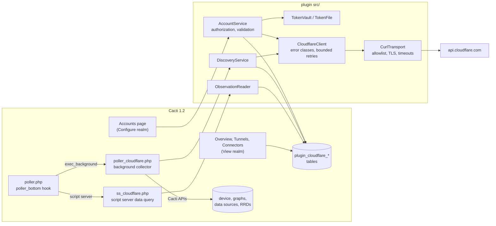

<!-- Source: README.md; SHA256: 813d1c85c236b426b83e42e63c69496f33f8909b5e435d0d45efa6a4ba2f17ca -->

<!-- translations:start -->
[English](../../../README.md) | [简体中文](README.md) | [हिन्दी](../hi-IN/README.md) | [Español (España)](../es-ES/README.md) | [Español (Latinoamérica)](../es-419/README.md) | [العربية (السعودية)](../ar-SA/README.md) | [Afrikaans](../af-ZA/README.md) | [አማርኛ](../am-ET/README.md) | [العربية (مصر)](../ar-EG/README.md) | [العربية (المغرب)](../ar-MA/README.md) | [বাংলা](../bn-BD/README.md) | [Bosanski](../bs-BA/README.md) | [Deutsch](../de-DE/README.md) | [فارسی](../fa-IR/README.md) | [Filipino](../fil-PH/README.md) | [Français](../fr-FR/README.md) | [Français (Maroc)](../fr-MA/README.md) | [Français (Sénégal)](../fr-SN/README.md) | [Hausa](../ha-NG/README.md) | [עברית](../he-IL/README.md) | [Hrvatski](../hr-HR/README.md) | [Bahasa Indonesia](../id-ID/README.md) | [Igbo](../ig-NG/README.md) | [Italiano](../it-IT/README.md) | [日本語](../ja-JP/README.md) | [한국어](../ko-KR/README.md) | [Malagasy](../mg-MG/README.md) | [मराठी](../mr-IN/README.md) | [Bahasa Melayu](../ms-MY/README.md) | [Nederlands](../nl-NL/README.md) | [Polski](../pl-PL/README.md) | [Português (Brasil)](../pt-BR/README.md) | [Русский](../ru-RU/README.md) | [Kinyarwanda](../rw-RW/README.md) | [Soomaali](../so-SO/README.md) | [Српски](../sr-RS/README.md) | [Svenska](../sv-SE/README.md) | [Kiswahili](../sw-KE/README.md) | [தமிழ்](../ta-IN/README.md) | [తెలుగు](../te-IN/README.md) | [ไทย](../th-TH/README.md) | [Türkçe](../tr-TR/README.md) | [Українська](../uk-UA/README.md) | [اردو](../ur-PK/README.md) | [Tiếng Việt](../vi-VN/README.md) | [isiXhosa](../xh-ZA/README.md) | [Yorùbá](../yo-NG/README.md) | [繁體中文](../zh-TW/README.md) | [isiZulu](../zu-ZA/README.md)
<!-- translations:end -->

<p align="center">
  
</p>

<a id="cloudflare-plugin-for-cacti"></a>
# Cacti 的 Cloudflare 插件

[](https://github.com/somethingwithproof/plugin_cloudflare/actions/workflows/ci.yml)
[](https://sonarcloud.io/summary/new_code?id=somethingwithproof_plugin_cloudflare)
[](../../../LICENSE)


[](https://sonarcloud.io/summary/new_code?id=somethingwithproof_plugin_cloudflare)
[](https://sonarcloud.io/summary/new_code?id=somethingwithproof_plugin_cloudflare)
[](https://sonarcloud.io/summary/new_code?id=somethingwithproof_plugin_cloudflare)


这是一个正在开发的 Cacti 1.2 插件，用于监控 Cloudflare Tunnels 和区域分析数据。它使用限定作用域的 API 令牌读取 Cloudflare API，从不更改 Cloudflare，并将数据保存在自己的表中。在 Cacti 内，它将一个数据查询 XML 复制到 `resource/script_server/`，并通过 Cacti 自身的 API 创建设备、图表和模板，不修改核心文件。

**状态：0.4.0-dev，尚未发布。** 最新稳定版本为 0.3.0。开发版本新增 CSV 清单导出、显式退役已删除的隧道、缓存的区域分析和可选 Thold 模板。真实云账户和部署环境的验证仍待完成。

下表描述 0.3.0 稳定版本。开发版本的新增功能见后面的操作工作流与区域分析。

| 现已提供 | 计划中 |
|---|---|
| 通过 Cacti 插件管理器安装、升级、禁用和卸载 | GraphQL 分析和 Thold 告警（里程碑 4） |
| Cloudflare: View、Operator 和 Configure 权限 | 故障注入、TLA+ 模型及完整文档（里程碑 5） |
| 添加、编辑、删除、启用和禁用 Cloudflare 账户 | |
| 将令牌存储在文件中，或加密存储在 Cacti 数据库中 | |
| 验证令牌，检查隧道和区域读取权限 | |
| 由主轮询器启动的后台采集器发现隧道和连接器 | |
| Management > Cloudflare Tunnels 下的 Overview、Tunnels 和 Connectors 页面 | |
| 生命周期跟踪：`active`、`unavailable` 和 `deleted` | |
| 每个账户由管理员创建一个 Cacti 设备，隧道作为数据查询的索引 | |
| 每个隧道提供 Connectors、Health 和 Collection 图表，共用一个 RRD 文件 | |
| 插件无法确认的值存储为未知（`U`），绝不存储为 0 | |

<a id="access-roles"></a>
## 访问角色

| 权限域 | 访问范围 |
| --- | --- |
| Cloudflare: View | 现有监控页面。 |
| Cloudflare: Operator | 监控、Operations 页面及个人分诊确认。 |
| Cloudflare: Configure | Operator 访问权限以及现有配置和管理操作。 |

复制升级文件后，以管理员身份打开 Plugins 页面以注册新权限域。在 **Configuration > Users** 或用户组中明确授予 Operator。升级保留现有 View 和 Admin 权限域的 ID 及授权。每次请求中，Admin 继承 Operator，Operator 继承 View；这不会向用户或用户组添加存储的授权。插件设置除 Cacti 的 Settings 权限外，还要求 Cloudflare: Configure。

Cloudflare 账户可见性与现有 View 权限域一致，覆盖整个账户。凭据、配置、映射、删除及其他管理变更仍在管理页面执行。确认仅在当前用户会话中有效，最长一小时，且仅在同一观测仍然新鲜时有效。新的或更改后的观测会使确认失效。确认绝不会将失败测量标记为健康，也不会抑制告警。

<a id="why-this-plugin"></a>
## 为什么需要此插件

通过 Cloudflare Tunnel 发布服务的 Cacti 运维人员无法在 Cacti 内看到隧道情况。隧道可能失去所有连接器，而源站主机仍响应 SNMP，因此用户看到错误时，现有图表仍显示正常。插件旨在将隧道健康状态和区域流量放在运维人员日常查看的设备图表旁，同时不给予 Cacti 修改 Cloudflare 的能力。

设计受三项约束：

- **只读。** 插件仅调用 `GET` 端点和 GraphQL Analytics API，不需要任何 Cloudflare 资源的编辑权限。
- **可选。** Cloudflare 故障、令牌过期和速率限制不得拖慢 Cacti 界面或阻塞其他设备的轮询。所有 API 调用都有严格超时，采集在轮询器启动的后台进程中运行。
- **不更改核心。** 插件使用 Cacti 1.2 插件钩子和自己的表，将一个数据查询 XML 复制到 `resource/script_server/`，并通过 Cacti 自身的 API 创建设备、图表和模板。不修改核心文件，因此不影响 Cacti 升级或其他插件。

<a id="how-it-works"></a>
## 工作原理



- **Cacti 集成层**（`setup.php`、`includes/` 和页面脚本）注册钩子及权限域，使用 Cacti 自身的辅助函数呈现页面，并将所有操作委托给 `src/` 中的库。
- **库**（`src/`，命名空间 `Somethingwithproof\Cloudflare\`）不依赖 Cacti 全局变量，因此可在不运行 Cacti 的情况下，使用真实数据库和模拟 HTTP 传输进行测试。
- **唯一出站路径。** `CurlTransport` 是唯一访问网络的代码，仅接受 `https://api.cloudflare.com`。每次失败映射到一个错误类别（`auth`、`permission`、`rate_limited`、`transient` 等），决定界面显示的状态。
- **存储** 使用 Cacti 自身的 PDO 连接和预处理语句。模式更改采用有编号、可幂等执行的迁移。

设计决策及理由见 [docs/design.md](../../design.md)。

<a id="screenshots"></a>
## 屏幕截图

截图来自测试环境，并非真实 Cloudflare 账户。该环境运行 Cacti 1.2.31，连接返回测试固定数据的模拟 Cloudflare API，因此账户、账户 ID 和三个隧道均为占位示例。


*Cloudflare Accounts 列表。模拟 API 接受令牌，因此 Verify 报告 `ok`。*


*编辑账户。令牌字段始终为空，存储的令牌绝不返回浏览器。Collect Tunnels 和 Create Graphs 已开启，Collect Analytics 已关闭。Connection Status 显示上次 Verify 的结果：`ok`、隧道读取已获准、区域读取缺失。*


*Settings > Cloudflare。*


*Management > Cloudflare Tunnels > Overview。状态取账户活动隧道中最差的 Cloudflare 状态；此处为 `down`，因为一个测试隧道已停机。`Disabled`、`Not collected`、`Collection failing` 和 `Not yet collected` 按此顺序优先于隧道健康状态，因此上次运行失败的账户无论隧道报告什么，都显示 `Collection failing`。*


*Tunnels 选项卡。old-office 的 Connectors 和 Connections 显示 `-`，因为模拟 API 将其连接请求作为未知隧道响应，未存储任何数据；staging 显示 0，因为没有运行中的连接器。*


*blog 隧道的 Connectors 图表。三条线在中间缺口前后均为 1；缺口期间模拟 API 返回错误，插件存储未知值。曲线不会降至 0。图表来自同一测试环境（`make screenshots`），该数据源的步长设为 30 秒，使七分钟轮询即可填满图表。*

<a id="requirements"></a>
## 要求

- Cacti 1.2.25 至 1.2.31。Cacti 1.2.31 本身要求 PHP 8.0 或更高版本。CI 仅测试 1.2.31；1.2.25 最近一次手工测试为 2026-10-22。
- PHP 7.4 至 8.4，包含 `curl`、`openssl` 和 `pdo_mysql` 扩展。缺少这些扩展时，插件拒绝启用。
- MariaDB 10.6 或更高版本，或 MySQL 8.0 或更高版本。
- Cacti 服务器可通过 HTTPS 访问 `api.cloudflare.com`。不支持代理。

测试范围见 [docs/compatibility.md](docs/compatibility.md)。

<a id="install"></a>
## 安装

1. 将插件放入 Cacti 的 `plugins/cloudflare` 目录，可解压 [GitHub Releases](https://github.com/somethingwithproof/plugin_cloudflare/releases) 中的压缩包（在发布标签的检出目录运行 `make package` 会构建同样的压缩包），或使用 git 克隆。目录必须命名为 `cloudflare`。
2. 在 Console > Configuration > Plugins 中安装并启用，或以 Web 服务器用户身份使用 CLI：

   ```sh
   php cli/plugin_manage.php --plugin=cloudflare --install --enable
   ```

3. 安装时，管理员用户获得 Cloudflare: Configure 权限。在 Console > Configuration > Users 中将其授予其他用户或用户组。
4. 按 [docs/token-permissions.md](docs/token-permissions.md) 创建令牌，权限为 Account > Cloudflare Tunnel > Read，可选 Zone > Zone > Read。
5. 按以下两种方式之一存储令牌，然后在 Console > Configuration > Cloudflare Accounts 添加账户，并从操作菜单运行 Verify。

<a id="option-a-encrypted-in-the-database"></a>
### 方式 A：在数据库中加密

插件使用您创建的 32 字节密钥加密令牌。插件绝不自行创建或写入密钥。文件必须允许 Web 服务器和轮询器用户读取，禁止其他用户读取，所在目录也必须允许这些用户访问。假设 Web 服务器以 `www-data` 运行：

```sh
sudo mkdir -p /etc/cacti
sudo sh -c 'umask 077 && openssl rand -hex 32 > /etc/cacti/cloudflare.key'
sudo chgrp www-data /etc/cacti/cloudflare.key
sudo chmod 0440 /etc/cacti/cloudflare.key
```

默认路径为 `/etc/cacti/cloudflare.key`，可在 Settings > Cloudflare > Token Vault Key File 更改。密钥缺失或被拒绝时，编辑表单仅提供令牌文件选项。请备份密钥：没有它就无法解密已存储的令牌，必须重新输入。

<a id="rotating-the-key"></a>
#### 轮换密钥

没有重新加密命令。新密钥无法解密使用旧密钥存储的令牌，因此轮换意味着重新输入每个已存储令牌：

1. 准备各账户的令牌值。Cloudflare 仅在创建或轮换令牌时显示其值；若已不再持有，请在 Cloudflare 控制面板轮换令牌。
2. 使用以上命令在新路径创建密钥，例如 `/etc/cacti/cloudflare.key.new`，保持相同所有者和权限模式。
3. 将 Settings > Cloudflare > Token Vault Key File 设为新路径并保存。此后，仍以旧密钥加密的账户执行 Verify 会报告“Stored token cannot be decrypted”，且每次采集运行会为其记录 `discovery token unavailable`，附带 `reason=decrypt_failed`。
4. 对每个将令牌存储在数据库中的账户，在 Console > Configuration > Cloudflare Accounts 打开，将令牌粘贴到两个令牌字段，保存并运行 Verify。结果应为 `ok`。
5. 所有这些账户均验证通过后，删除旧密钥文件及其备份。

步骤 3 到 4 之间，账户隧道不会刷新，健康、连接器和连接图表记录 U。使用令牌文件的账户不受影响。

<a id="option-b-token-file"></a>
### 方式 B：令牌文件

将令牌且仅将令牌写入 Web 服务器和轮询器用户可读、其他用户不可读的文件，然后在编辑表单输入绝对路径：

```sh
sudo sh -c 'umask 077 && cat > /etc/cacti/cloudflare-account.token'   # paste the token, then Ctrl-D
sudo chgrp www-data /etc/cacti/cloudflare-account.token
sudo chmod 0440 /etc/cacti/cloudflare-account.token
```

文件在 Verify 读取时检查，而非保存时检查。符号链接、超过 4 KiB 的文件，以及其他用户可读或可写的文件均被拒绝。

具有 Cloudflare: Configure 权限的人员可输入任何路径，由轮询器用户读取。要将令牌文件限制在一个位置，请设置 Settings > Cloudflare > Token File Directory，例如 `/etc/cacti`，此后会拒绝该目录之外的路径。见 [docs/security.md](docs/security.md#token-file)。

<a id="upgrade"></a>
## 升级

1. 用新版本替换 `plugins/cloudflare` 中的文件，保留目录名。
2. 以管理员身份打开一次 Console > Configuration > Plugins 或 Console > Configuration > Cloudflare Accounts。这会运行插件迁移、导入 Cloudflare 模板、复制数据查询文件（见[隧道指标与图表](#tunnel-metrics-and-graphs)）；从 0.1.0 升级时还会注册 `poller_bottom` 钩子。

`poller.php` 不执行插件升级，因此完成步骤 2 前缺少新模式。此时每次采集运行均不执行操作，并记录 `CLOUDFLARE: collector skipped; plugin upgrade pending, open Console > Plugins`。Cloudflare Tunnels 页面仅要求 Cloudflare: View，因此从不执行升级；完成步骤 2 前可能显示“The Cloudflare tunnels could not be read”。

<a id="account-status"></a>
## 账户状态

Verify 设置账户状态：

| 状态 | 含义 |
|---|---|
| `unknown` | 添加账户或更改凭据后尚未验证 |
| `ok` | 令牌活动且可读取隧道 |
| `token_inactive` | Cloudflare 报告令牌已禁用或过期 |
| `auth_failed` | Cloudflare 因令牌无效或过期而拒绝（HTTP 401） |
| `permission_denied` | 令牌活动但无法读取隧道，或缺少调用令牌验证端点的权限（HTTP 403） |
| `unreachable` | 无法访问 API、请求超时或返回服务器错误 |
| `rate_limited` | Cloudflare 返回 HTTP 429 |
| `error` | 其他失败，包括令牌文件缺失或不安全、令牌保险库密钥文件缺失或不可用，或存储令牌无法解密 |

编辑页面还显示隧道读取和区域读取是否获准。

<a id="tunnel-discovery"></a>
## 隧道发现

主轮询器每个轮询周期结束后，只要至少一个启用账户开启 Collect Tunnels，`poller_bottom` 钩子便使用 `exec_background` 启动后台采集器。采集器从不在轮询器进程内运行，因此缓慢的 Cloudflare API 不会延迟 `poller.php`。远程轮询器从不启动它。

对于每个到期账户，采集器先列出账户隧道，再读取活动隧道的连接，获得各隧道的连接器、版本、数据中心和源站地址。账户按 Discovery Interval 到期，默认 300 秒。一次运行在 50 秒后不再开始新账户，且最多发出 200 次连接请求。任一限制也可能在读取连接中途停止账户处理；该账户记录为 `partial`，下次从最久未尝试的隧道继续。未开始的账户仍保持到期，等待下次运行。

隧道生命周期与 Cloudflare 报告的状态（`healthy`、`degraded`、`down` 或 `inactive`）分开保存：

| 生命周期 | 含义 |
|---|---|
| `active` | 隧道出现在最近一次完整列表中 |
| `deleted` | 一次完整列表未包含该隧道，也包括空列表。行和历史保留，隧道重新出现时恢复 `active` |
| `unavailable` | 期间没有完整列表的三次计入中断使隧道状态未知 |

仅完整且成功的列表才能添加、更新或删除隧道；列表读取失败绝不删除隧道。完全无法读取 Cloudflare（`transient`、`rate_limited`、`auth` 或 `permission`）计为故障；在两次完整列表之间累计三次，账户的活动隧道变为 `unavailable`。下一次完整列表恢复它们并重置计数。读取连接时若 Cloudflare 已不再认识某个隧道，则跳过该隧道，不使账户失败。其他失败既不增加也不重置中断计数。

在 `cacti.log` 中，发现日志以 `CLOUDFLARE: discovery` 开头，运行摘要以 `CLOUDFLARE: collector` 开头。失败和生命周期变更（如列表读取失败或隧道标记为 `unavailable`）采用 Cacti 默认的 `LOW` 级别；各账户结果和运行摘要采用 `MEDIUM`。连接读取可能在所有隧道失败，因此每个账户中每种错误类别的首次失败以 `LOW` 记录，其余以 `MEDIUM` 记录，随后每类附一条 `LOW` 日志列出失败隧道数。

Management > Cloudflare Tunnels 需要 Cloudflare: View 权限，且为只读：

- **Overview** 列出各账户的状态、按生命周期统计的隧道数、最近成功发现时间和连续失败次数。
- **Tunnels** 列出所有账户或单一账户的隧道，支持账户、生命周期、状态和名称筛选及列排序。
- **Connectors** 显示 Tunnels 选项卡所选隧道的连接器。

<a id="tunnel-metrics-and-graphs"></a>
## 隧道指标与图表

Cacti 通过脚本服务器数据查询 `ss_cloudflare.php` 读取隧道状态。它只从插件表返回数据，从不调用 Cloudflare，因此 Cloudflare 故障不会拖慢轮询器。每个隧道提供六个值：健康状态（healthy 3、degraded 2、down 1、inactive 0）、连接器数、连接数、连接器版本数、距最近读取连接的秒数，以及发现作业连续失败次数。健康状态、连接器、连接和版本仅在插件能确认时输出，即最近发现成功、隧道为 `active` 且读取结果新鲜。否则为 `U`，图表显示缺口，而不是看似故障的零。两项采集值在故障期间仍输出，使 Collection 图表能显示故障；仅当隧道已删除或连接从未刷新时为 `U`。规则见 [docs/metrics.md](docs/metrics.md)。

<a id="create-the-device"></a>
### 创建设备

一个账户最多映射一个 Cacti 设备。设备将账户隧道作为 Cloudflare Tunnels 数据查询的索引。设备不会自动创建：

1. 打开 Console > Configuration > Cloudflare Accounts。
2. 选择账户，从操作菜单选择 Create Cacti Device 并确认。

该操作同时要求 Cloudflare: Configure 和 Cacti 的 Sites/Devices/Data 权限域（`host.php` 使用的权限域）。只有同时具备两者的用户才能看到菜单项，服务器拒绝其他用户请求。设备名称为 `Cloudflare: <account name>`，使用 Cloudflare Account 主机模板及主轮询器，SNMP 版本为 0，不做可用性检查，主机名为 `<account ID>.cloudflare.invalid`。此名称保留且不会解析，Cacti 不连接它。若账户已有设备，操作会提示且不更改任何内容。管理员在 Cacti 删除设备后，插件不会创建替代设备，直到再次运行 Create Cacti Device。

<a id="create-graphs"></a>
### 创建图表

账户表单中的 Create Graphs 默认关闭。开启后，每当账户发现以 `ok` 或 `partial` 结束，采集器重新索引设备，并为 `active` 隧道创建缺失图表：Connectors、Health 和 Collection，每隧道三个，三图共用一个 RRD 文件。一次运行最多创建 50 个图表，并在 20 秒后停止，下次继续。插件绝不删除 Cacti 对象。管理员删除的图表不会重建；Cloudflare 不再列出的隧道保留图表和 RRD 文件，显示 `U`。

开启 Create Graphs 需要两个权限域，关闭仅需 Configure。没有 Sites/Devices/Data 权限的用户保存表单时，此设置保持原值并显示警告。即使 Create Graphs 关闭，每次发现后仍会重新索引设备，因此新隧道会出现在数据查询索引中。

<a id="the-data-query-file"></a>
### 数据查询文件

Cacti 1.2.31 仅从其 `resource` 目录内读取数据查询 XML。因此安装和升级时，插件将 `templates/resource/cloudflare_tunnels.xml` 复制到 `<Cacti>/resource/script_server/cloudflare_tunnels.xml`。这是插件在自身目录外写入的唯一文件，安装或升级的用户必须可写该目录。卸载会保留此文件以及设备、图表、RRD 文件和模板。复制或模板导入失败时，插件会记录日志，Create Cacti Device 会再次尝试。

<a id="settings"></a>
## 设置

Settings > Cloudflare 包含：

- **Token Vault Key File**：保险库密钥路径。
- **Token File Directory**：设置后拒绝目录之外的令牌文件。默认为空，允许任意路径。见 [docs/security.md](docs/security.md#token-file)。
- **Interactive Request Timeout**：Web 界面请求（如 Verify）的总超时秒数。默认 10，超出 5 至 60 的值回退为 10。
- **Collector Request Timeout**：后台采集器请求的总超时秒数。默认 20，超出 5 至 60 的值回退为 20。
- **Log Level**：会保存，但尚无组件读取。

账户表单中，Collect Tunnels 和 Discovery Interval 控制发现，Create Graphs 控制图表创建。Collect Analytics 会保存，但在此版本无效。

<a id="languages"></a>
## 语言

插件提供西班牙语（西班牙，`es-ES`）、法语（`fr-FR`）、德语（`de-DE`）、简体中文（`zh-CN`）、日语（`ja-JP`）、印地语（`hi-IN`）和阿拉伯语（`ar-SA`）翻译。在 Configuration > Settings > General > Language Support 开启语言支持并由用户选择语言后，Cacti 即可显示。还提供拉丁美洲西班牙语目录（`es-419`），但 Cacti 1.2 没有可选的相应区域设置，须待 Cacti 添加后才生效；在此之前请选择西班牙语（`es-ES`）。

部分文本保持英文：插件原样存储和显示的状态值（`ok`、`active`、`unavailable`、`deleted` 及 Cloudflare 报告的隧道状态），以及插件写入 Cacti 日志的所有内容。

<a id="uninstall-and-data-retention"></a>
## 卸载与数据保留

卸载会删除插件自身表，其中包含账户、加密令牌、已发现隧道、作业状态和创建过的 Cacti 对象记录，并删除 `cloudflare_` 设置。不会删除密钥文件、令牌文件、已复制的 `resource/script_server/cloudflare_tunnels.xml`，也不会删除任何 Cacti 设备、图表、数据源、RRD 文件或模板。这些对象包含历史监控数据，必须由管理员在 Cacti 中明确删除。

保留设备不再接收数据。卸载后或账户删除后，没有账户拥有该主机，因此图表保留历史，但从此输出 `U`。在重新安装或重新添加的账户上执行 Create Cacti Device 会创建新设备，不复用旧设备；不再需要历史时，请在 Cacti 中删除旧设备。

<a id="known-limitations"></a>
## 已知限制

- 每次运行最多发出 200 次连接请求。超出上限的隧道刷新频率可能低于观测窗口要求，其连接图表会出现缺口。
- 升级改变随附模板 XML 时，插件会覆盖管理员对已导入模板的编辑。
- 账户设备必须留在主轮询器。插件表位于主数据库，脚本在那里读取。
- 已删除隧道保留在数据查询索引中，同时保留图表和 RRD 文件，输出 `U`。
- 插件代码发生真正的致命错误（如内存耗尽）时，Cacti 会禁用插件。见 [docs/security.md](docs/security.md)。

<a id="security"></a>
## 安全性

- 拒绝全局 API 密钥，仅接受限定作用域的 API 令牌。
- 令牌存储于您准备的文件中，或通过从不进入数据库的密钥文件以 AES-256-GCM 加密。令牌绝不显示在页面、写入日志或包含在错误消息中。
- 数据库错误仅携带 SQLSTATE 和驱动错误代码，绝不包含语句值。
- 每项变更均使用受 Cacti CSRF 令牌保护的 POST。账户管理和配置变更需要 Cloudflare: Configure；个人排查确认需要 Cloudflare: Operator。创建 Cacti 设备或开启 Create Graphs 还需 Cacti 的 Sites/Devices/Data 权限。已禁用的插件拒绝其页面请求。

详情和已知限制见 [docs/security.md](docs/security.md)。请按照 [SECURITY.md](../../../SECURITY.md) 私下报告漏洞。

<a id="roadmap"></a>
## 操作工作流与区域分析

开发版本可显式退役已删除的隧道，按区域能力采集并缓存分析数据，并提供 Cacti 和 Thold 模板。这些新增功能尚未发布，也未完成真实账户验证。设置方法、指标含义和验证范围见[英文说明](../../analytics-and-alerting.md)。

### 清单导出

隧道和连接器页面为 Cloudflare: View 用户提供导出功能。隧道 CSV 保留账户、生命周期、状态、搜索和排序条件，并包含所有匹配页面。连接器 CSV 包含所选隧道的版本、架构、数据中心和源地址。下载仅读取缓存记录；未知数量留空，类似公式的单元格前加单引号以安全导入电子表格。

## 路线图

各里程碑作为对应编号的 0.x 版本发布：里程碑 3 为 0.3.0，里程碑 4 将为 0.4.0。里程碑 1 和 2 未单独发布，已包含在 0.3.0 中。1.0.0 保留给完成以下所有里程碑的版本。

| 里程碑 | 范围 | 状态 |
|---|---|---|
| 1. 基础 | 插件生命周期、权限、账户配置、连接测试 | 已在 0.3.0 发布（[#2](https://github.com/somethingwithproof/plugin_cloudflare/pull/2) 至 [#5](https://github.com/somethingwithproof/plugin_cloudflare/pull/5)） |
| 2. 发现 | 后台采集器发现隧道和连接器，Overview、Tunnels、Connectors 页面 | 已在 0.3.0 发布（[#6](https://github.com/somethingwithproof/plugin_cloudflare/pull/6)） |
| 3. 指标 | 隧道健康数据源、图表模板，以及绝不记录虚构零值的故障处理 | 已在 0.3.0 发布（[#7](https://github.com/somethingwithproof/plugin_cloudflare/pull/7)） |
| 4. 分析和告警 | 根据套餐能力的逐区域 GraphQL 分析、故障抑制下的 Thold 阈值 | 计划中 |
| 5. 加固 | 故障注入、发现和采集的 TLA+ 模型、完整文档 | 计划中 |

<a id="development"></a>
## 开发

工具需要 PHP 8.x 和 Composer，插件代码本身保持 PHP 7.4 兼容。集成和 BDD 测试需要数据库，`make db-up` 会在 Docker 中以端口 33061 启动它。

```sh
composer install
make db-up
make ci            # unit, integration, BDD, PHPStan, php-cs-fixer, php -l on PHP 7.4
make smoke         # installs the plugin into Cacti 1.2.31 in Docker and walks its lifecycle
make package       # builds build/cloudflare-<version>.tar.gz and checks its contents
make db-down
```

`make smoke` 和 `make screenshots` 需要 Cacti 检出目录；将 `CACTI_REPO` 设置为其路径。集成测试读取 `CF_TEST_DSN`、`CF_TEST_DB_USER` 和 `CF_TEST_DB_PASS`，数据库不可访问时跳过，除非设置了 `CI`。

<a id="contributing"></a>
## 贡献

欢迎提交拉取请求。每次提交都需 DCO 签署（`git commit -s`）。先编写测试；`make ci` 必须通过，Cacti 集成层变更还应通过 `make smoke`。插件代码必须保持 PHP 7.4 兼容并遵循 Cacti 代码风格：制表符缩进、单引号、左大括号同行。

<a id="translations"></a>
### 翻译

消息以 `__('...', 'cloudflare')` 标记。`locales/build_gettext.sh`（`make i18n`，需要 GNU gettext）重新生成 `locales/po/cacti.pot`，合并到各目录 `locales/po/<locale>.po`，并编译 `locales/LC_MESSAGES/<locale>.mo`；三者都需提交。CI 运行 `make i18n-check`，目录缺失条目、有 fuzzy 条目、格式字符串不同或编译文件过时时会失败；单元测试还检查各条目的占位符、HTML 标签及首尾空白。因此，更改消息时必须在同一拉取请求更新翻译。新语言需新增按 Cacti 区域名称命名的 `<locale>.po`（如 `pt-BR`），并加入 `CatalogTest::LOCALES` 和 `tests/build/package.sh` 的压缩包检查。保持 Cloudflare、Cacti、Thold 产品名称，API、GraphQL 和 `Account Cloudflare Tunnel Read` 等权限名称不变。

<a id="documentation"></a>
## 文档

- [docs/security.md](docs/security.md)：安全控制和已知限制
- [docs/token-permissions.md](docs/token-permissions.md)：令牌权限
- [docs/compatibility.md](docs/compatibility.md)：支持的版本和使用的接口
- [docs/metrics.md](docs/metrics.md)：指标目录及值何时未知
- [docs/collector-protocol.md](../../collector-protocol.md)：`ss_cloudflare.php` 的读取和输出
- [docs/schema.md](../../schema.md)：数据库表
- [docs/design.md](../../design.md)：设计决策
- [CHANGELOG.md](../../../CHANGELOG.md)

<a id="license"></a>
## 许可证

GPL-2.0-or-later。见 [LICENSE](../../../LICENSE)。

<a id="trademarks"></a>
## 商标

Cloudflare 是 Cloudflare, Inc. 的注册商标。本项目为独立开源工具，与 Cloudflare, Inc. 无隶属关系，也未获其赞助或认可。

本项目也不隶属于 Cacti 项目。标志说明见 [docs/images/README-logo.md](../../images/README-logo.md)。
