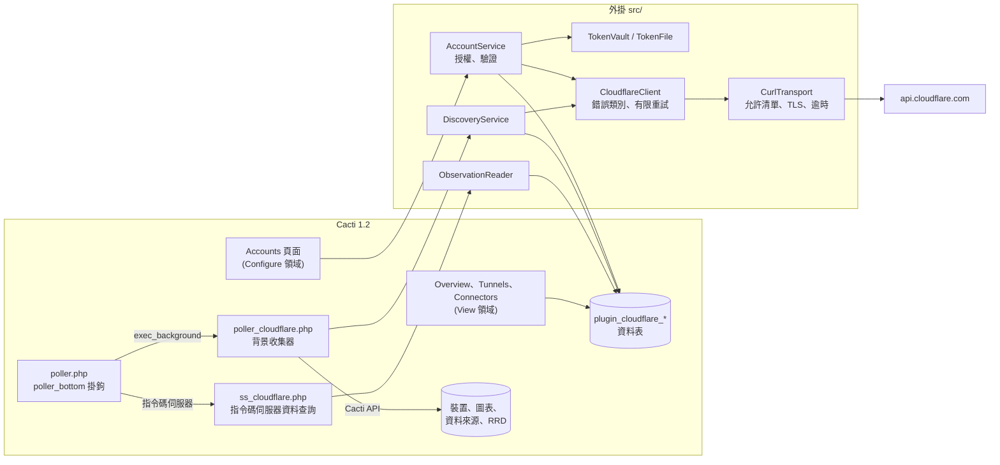

<!-- Source: README.md; SHA256: 813d1c85c236b426b83e42e63c69496f33f8909b5e435d0d45efa6a4ba2f17ca -->

<!-- translations:start -->
[English](../../../README.md) | [简体中文](../zh-CN/README.md) | [हिन्दी](../hi-IN/README.md) | [Español (España)](../es-ES/README.md) | [Español (Latinoamérica)](../es-419/README.md) | [العربية (السعودية)](../ar-SA/README.md) | [Afrikaans](../af-ZA/README.md) | [አማርኛ](../am-ET/README.md) | [العربية (مصر)](../ar-EG/README.md) | [العربية (المغرب)](../ar-MA/README.md) | [বাংলা](../bn-BD/README.md) | [Bosanski](../bs-BA/README.md) | [Deutsch](../de-DE/README.md) | [فارسی](../fa-IR/README.md) | [Filipino](../fil-PH/README.md) | [Français](../fr-FR/README.md) | [Français (Maroc)](../fr-MA/README.md) | [Français (Sénégal)](../fr-SN/README.md) | [Hausa](../ha-NG/README.md) | [עברית](../he-IL/README.md) | [Hrvatski](../hr-HR/README.md) | [Bahasa Indonesia](../id-ID/README.md) | [Igbo](../ig-NG/README.md) | [Italiano](../it-IT/README.md) | [日本語](../ja-JP/README.md) | [한국어](../ko-KR/README.md) | [Malagasy](../mg-MG/README.md) | [मराठी](../mr-IN/README.md) | [Bahasa Melayu](../ms-MY/README.md) | [Nederlands](../nl-NL/README.md) | [Polski](../pl-PL/README.md) | [Português (Brasil)](../pt-BR/README.md) | [Русский](../ru-RU/README.md) | [Kinyarwanda](../rw-RW/README.md) | [Soomaali](../so-SO/README.md) | [Српски](../sr-RS/README.md) | [Svenska](../sv-SE/README.md) | [Kiswahili](../sw-KE/README.md) | [தமிழ்](../ta-IN/README.md) | [తెలుగు](../te-IN/README.md) | [ไทย](../th-TH/README.md) | [Türkçe](../tr-TR/README.md) | [Українська](../uk-UA/README.md) | [اردو](../ur-PK/README.md) | [Tiếng Việt](../vi-VN/README.md) | [isiXhosa](../xh-ZA/README.md) | [Yorùbá](../yo-NG/README.md) | [繁體中文](README.md) | [isiZulu](../zu-ZA/README.md)
<!-- translations:end -->

<p align="center">
  
</p>

# Cacti 的 Cloudflare 外掛

[](https://github.com/somethingwithproof/plugin_cloudflare/actions/workflows/ci.yml)
[](https://sonarcloud.io/summary/new_code?id=somethingwithproof_plugin_cloudflare)
[](../../../LICENSE)


[](https://sonarcloud.io/summary/new_code?id=somethingwithproof_plugin_cloudflare)
[](https://sonarcloud.io/summary/new_code?id=somethingwithproof_plugin_cloudflare)
[](https://sonarcloud.io/summary/new_code?id=somethingwithproof_plugin_cloudflare)


一個為監控 Cloudflare Tunnels 與區域（zone）分析而開發的 Cacti 1.2 外掛。它使用限定範圍的 API 權杖從 Cloudflare API 讀取資料，絕不會修改 Cloudflare 中的任何設定，並將資料儲存在自有的資料表中。在 Cacti 端，它會將資料查詢 XML 檔案複製到 `resource/script_server/`，並透過 Cacti 本身的 API 建立裝置、圖表與範本，無需變更任何核心檔案。

**狀態：0.4.0-dev，尚未釋出。** 最新釋出版本為 0.3.0。開發版本新增了 CSV 盤點匯出、已刪除通道的明確退役處理、快取的區域分析，以及選用的 Thold 範本。實際服務供應商環境與部署驗證仍在進行中。

下表說明 0.3.0 穩定版的功能。開發中新增的功能請參閱下方的「操作員工作流程與區域分析」章節。

| 目前可用 | 規劃中 |
|---|---|
| 透過 Cacti 外掛管理員進行安裝、升級、停用與解除安裝 | GraphQL 分析與 Thold 警示（里程碑 4） |
| Cloudflare: View、Operator 與 Configure 權限 | 故障注入、TLA+ 模型與完整文件（里程碑 5） |
| 新增、編輯、刪除、啟用與停用 Cloudflare 帳戶 | |
| 將權杖儲存在檔案中，或加密儲存於 Cacti 資料庫 | |
| 驗證權杖並檢查其通道與區域讀取權限 | |
| 在由主輪詢器啟動的背景收集器中進行通道與連接器探索 | |
| 位於 Management > Cloudflare Tunnels 下的 Overview、Tunnels 與 Connectors 頁面 | |
| 生命週期追蹤：`active`、`unavailable` 與 `deleted` | |
| 每個帳戶對應一個由管理員建立的 Cacti 裝置，並以通道作為資料查詢的索引 | |
| 每個通道專屬的 Connectors、Health 與 Collection 圖表，由每個通道各自的單一 RRD 檔案繪製 | |
| 外掛無法確認正確性的數值一律儲存為未知（`U`），絕不記為 0 | |

## 存取角色

| 領域 | 存取權限 |
| --- | --- |
| Cloudflare: View | 現有的監控頁面。 |
| Cloudflare: Operator | 監控權限，外加 Operations 頁面與個人異常處理確認。 |
| Cloudflare: Configure | Operator 權限，外加現有的設定與管理操作。 |

複製升級檔案後，請以管理員身分開啟 Plugins 頁面以註冊新領域。接著在 **Configuration > Users** 或使用者群組下明確指派 Operator 領域。升級會保留既有的 View 與 Admin 領域 ID 及授權。每次請求時，Admin 權限會自動繼承 Operator 權限，而 Operator 權限會自動繼承 View 權限；此機制不會為使用者或群組新增儲存的授權紀錄。除了 Cacti 本身的 Settings 權限外，外掛設定也要求具備 Cloudflare: Configure 權限。

Cloudflare 帳戶的可見範圍與既有的 View 領域一致，皆為全帳戶層級。憑證、設定、對應關係、刪除及其他管理變更仍保留於管理頁面中。異常確認僅在目前使用者的工作階段中有效，最長維持一小時，且僅在相同觀測結果仍為最新時有效；一旦出現新的或變更後的觀測結果，確認狀態便會失效。這些確認絕不會將失敗的量測標記為健康，也不會抑制警示。

## 為何開發此外掛

透過 Cloudflare Tunnel 發布服務的 Cacti 操作員，在 Cacti 內部無法看見通道的狀態。當來源主機仍正常回應 SNMP 時，通道可能早已失去所有連接器，導致現有圖表維持綠燈，使用者卻持續遇到錯誤。此外掛的目標是將通道健康狀態與區域流量直接呈現在操作員日常監看的裝置圖表旁，同時不賦予 Cacti 任何修改 Cloudflare 的能力。

這項設計由三個核心限制所塑造：

- **唯讀。** 此外掛僅呼叫 `GET` 端點與 GraphQL Analytics API，不需要任何 Cloudflare 資源的編輯權限。
- **選用性。** Cloudflare 服務中斷、權杖過期或速率限制，絕不能拖慢 Cacti 介面或阻塞其他裝置的輪詢作業。所有 API 呼叫皆設有強制逾時，且資料收集會在輪詢器啟動的背景行程中執行。
- **不修改核心。** 此外掛使用 Cacti 1.2 外掛掛鉤與自有的資料表，僅將單一資料查詢 XML 複製到 `resource/script_server/`，並透過 Cacti 本身的 API 建立裝置、圖表與範本。由於不改動任何核心檔案，Cacti 升級與其他外掛皆不受影響。

## 運作方式



- **Cacti 銜接層**（`setup.php`、`includes/` 及各頁面指令碼）負責註冊掛鉤與領域、使用 Cacti 內建輔助函式渲染頁面，並將所有動作委派給 `src/` 中的程式庫。
- **程式庫**（`src/`，命名空間 `Somethingwithproof\Cloudflare\`）不依賴 Cacti 全域變數，因此可在沒有執行中 Cacti 實例的情況下，直接針對真實資料庫與模擬 HTTP 傳輸層進行測試。
- **單一出站路徑。** `CurlTransport` 是唯一會接觸網路的程式碼，且僅接受 `https://api.cloudflare.com`。每個失敗都會對應到單一錯誤類別（`auth`、`permission`、`rate_limited`、`transient` 等），並以此驅動介面中顯示的狀態。
- **儲存機制**透過 Cacti 本身的 PDO 連線搭配預處理陳述式（prepared statements）運作。結構變更則採用具編號且具冪等性的遷移（migrations）。

設計決策與背後原因詳見
[docs/design.md](../../design.md)。

## 畫面截圖

以下畫面截圖來自測試環境，而非實際的 Cloudflare 帳戶。該測試環境在 Cacti 1.2.31 上運行，並連接至回傳固定測試資料（fixture data）的模擬 Cloudflare API，因此帳戶名稱、帳戶 ID 與三個通道皆為預留佔位資料。


*Cloudflare 帳戶清單。模擬 API 接受該權杖，因此 Verify 回報為 `ok`。*


*編輯帳戶。權杖欄位永遠為空白；已儲存的權杖絕不會傳回瀏覽器。Collect Tunnels 與 Create Graphs 為開啟狀態，Collect Analytics 為關閉狀態。Connection Status 顯示上次 Verify 的結果：`ok`、已授予通道讀取權限，且缺少區域讀取權限。*


*Settings > Cloudflare。*


*Management > Cloudflare Tunnels > Overview。此處顯示的狀態為該帳戶使用中通道中最嚴重的 Cloudflare 狀態；由於其中一個測試通道處於停擺狀態，因此顯示為 `down`。`Disabled`、`Not collected`、`Collection failing` 與 `Not yet collected` 的優先順序依序高於通道健康狀態，因此若帳戶上次執行失敗，無論其通道回報為何，都會顯示 `Collection failing`。*


*Tunnels 分頁。old-office 的 Connectors 與 Connections 顯示為 `-`，因為模擬 API 將其連線請求視為未知通道而未儲存任何資料；staging 則因沒有執行中的連接器而顯示為 0。*


*blog 通道的 Connectors 圖表。三條線在中間斷層前後皆維持為 1；該斷層期間模擬 API 回傳錯誤，外掛因此儲存未知值，線條並未跌落至 0。此圖表同樣來自測試環境（`make screenshots`），該環境對此單一資料來源設定了 30 秒的步長（step），使七分鐘的輪詢即可填滿圖表。*

## 系統需求

- Cacti 1.2.25 至 1.2.31。Cacti 1.2.31 本身需要 PHP 8.0 或更新版本。
  CI 僅測試 1.2.31；1.2.25 最後一次手動測試是在 2026-10-22。
- PHP 7.4 至 8.4，且須具備 `curl`、`openssl` 與 `pdo_mysql` 擴充套件。
  缺少這些擴充套件時，外掛程式將拒絕啟用。
- MariaDB 10.6 或更新版本，或 MySQL 8.0 或更新版本。
- 從 Cacti 伺服器到 `api.cloudflare.com` 的 HTTPS 連線存取。不支援 Proxy。

請參閱 [docs/compatibility.md](../../compatibility.md) 了解測試範圍。

## 安裝

1. 將外掛程式放入 Cacti 的 `plugins/cloudflare` 目錄中，您可以從
   [GitHub Releases](https://github.com/somethingwithproof/plugin_cloudflare/releases)
   解壓縮封存檔（在發行標籤的檢出目錄中執行 `make package` 亦可建置相同的封存檔），
   或透過 git clone 取得。目錄名稱必須為 `cloudflare`。
2. 從「主控台 > 設定 > 外掛程式」（Console > Configuration > Plugins）進行安裝並啟用，
   或以網頁伺服器使用者身分透過 CLI 執行：

   ```sh
   php cli/plugin_manage.php --plugin=cloudflare --install --enable
   ```

3. 安裝時，admin 使用者會自動獲得「Cloudflare: Configure」權限。
   您可以在「主控台 > 設定 > 使用者」（Console > Configuration > Users）中將此權限授予其他使用者或群組。
4. 依照 [docs/token-permissions.md](../../token-permissions.md) 中的權限建立權杖。
   簡而言之：Account > Cloudflare Tunnel > Read，以及選用的 Zone > Zone > Read。
5. 使用以下兩種方式之一儲存權杖，接著在「主控台 > 設定 > Cloudflare 帳號」（Console > Configuration > Cloudflare Accounts）中新增帳號，並從動作選單執行 Verify（驗證）。

### 選項 A：加密儲存於資料庫

此外掛程式會使用您建立的 32 位元組金鑰來加密權杖，它本身絕不會建立或寫入金鑰。
該金鑰檔案必須可由網頁伺服器與輪詢器使用者讀取、不可被其他使用者讀取，
且其所在目錄必須允許這些使用者存取。若網頁伺服器以 `www-data` 執行：

```sh
sudo mkdir -p /etc/cacti
sudo sh -c 'umask 077 && openssl rand -hex 32 > /etc/cacti/cloudflare.key'
sudo chgrp www-data /etc/cacti/cloudflare.key
sudo chmod 0440 /etc/cacti/cloudflare.key
```

預設路徑為 `/etc/cacti/cloudflare.key`；您可以在「設定 > Cloudflare > Token Vault Key File」（Settings > Cloudflare > Token Vault Key File）中變更。
當金鑰遺失或被拒絕存取時，編輯表單只會提供權杖檔案選項。
請務必備份金鑰：若沒有金鑰，已儲存的權杖將無法解密，必須重新輸入。

#### 輪替金鑰

本外掛程式沒有重新加密指令。新金鑰無法解密以舊金鑰儲存的權杖，
因此輪替金鑰代表必須重新輸入每個已儲存的權杖：

1. 先備妥每個帳號的權杖值。Cloudflare 僅在建立或輪替權杖時顯示權杖值，
   若您已不再保留該值，請在 Cloudflare 儀表板中輪替權杖。
2. 使用上述指令在新的路徑建立新金鑰，例如 `/etc/cacti/cloudflare.key.new`，
   並設定相同的擁有者與權限模式。
3. 將「設定 > Cloudflare > Token Vault Key File」設為新路徑並儲存。
   從此時起，對仍以舊金鑰加密的帳號執行 Verify 會回報「Stored token cannot be decrypted」（無法解密已儲存的權杖），
   且每次收集器執行時都會為該帳號記錄 `discovery token unavailable` 與 `reason=decrypt_failed`。
4. 針對每個將權杖儲存於資料庫的帳號，在「主控台 > 設定 > Cloudflare 帳號」（Console > Configuration > Cloudflare Accounts）中開啟它，
   將權杖貼入兩個權杖欄位、儲存並執行 Verify。此時應會回報 `ok`。
5. 當所有此類帳號都驗證通過後，即可移除舊的金鑰檔案及其備份。

在步驟 3 與步驟 4 之間，帳號的通道不會重新整理，且其健康狀態、連接器與連線圖表會記錄為 U。
使用權杖檔案的帳號不受影響。

### 選項 B：權杖檔案

將權杖（且僅包含權杖本身）寫入一個網頁伺服器與輪詢器使用者可讀取、
而其他使用者無法讀取的檔案中，然後在編輯表單中輸入其絕對路徑：

```sh
sudo sh -c 'umask 077 && cat > /etc/cacti/cloudflare-account.token'   # paste the token, then Ctrl-D
sudo chgrp www-data /etc/cacti/cloudflare-account.token
sudo chmod 0440 /etc/cacti/cloudflare-account.token
```

檔案會在執行 Verify 而非儲存時進行讀取與檢查。符號連結、超過 4 KiB 的檔案，
以及可供其他使用者讀取或寫入的檔案都會被拒絕。

任何具備「Cloudflare: Configure」權限的人都可以輸入任意路徑，並由輪詢器使用者讀取。
若要將權杖檔案集中於同一位置，請設定「設定 > Cloudflare > Token File Directory」（例如設為 `/etc/cacti`）；
之後任何位於該目錄之外的路徑都會被拒絕。請參閱 [docs/security.md](../../security.md#token-file)。

## 升級

1. 以新版本的檔案替換 `plugins/cloudflare` 中的檔案，並保留目錄名稱。
2. 以管理員身分開啟一次「主控台 > 設定 > 外掛程式」（Console > Configuration > Plugins）或
   「主控台 > 設定 > Cloudflare 帳號」（Console > Configuration > Cloudflare Accounts）。
   這會執行外掛程式的資料庫遷移、匯入 Cloudflare 範本並複製資料查詢檔案
   （請參閱[通道指標與圖表](#tunnel-metrics-and-graphs)），
   且在從 0.1.0 升級時會註冊 `poller_bottom` 掛鉤。

`poller.php` 不會執行外掛程式的升級程序，因此在完成步驟 2 之前會缺少新的資料表結構。
此時每次收集器執行都不會進行任何動作，並會記錄
`CLOUDFLARE: collector skipped; plugin upgrade pending, open Console > Plugins`。
Cloudflare Tunnels 頁面僅需要「Cloudflare: View」權限，因此絕不會執行升級程序，
且在步驟 2 之前可能會顯示「The Cloudflare tunnels could not be read」（無法讀取 Cloudflare 通道）。

## 帳號狀態

Verify 會設定帳號的狀態：

| 狀態 | 說明 |
|---|---|
| `unknown` | 自新增帳號或變更其憑證以來尚未驗證 |
| `ok` | 權杖為啟用中且可讀取通道 |
| `token_inactive` | Cloudflare 回報該權杖已停用或過期 |
| `auth_failed` | Cloudflare 拒絕該權杖，判定為無效或過期（HTTP 401） |
| `permission_denied` | 權杖為啟用中但無法讀取通道，或缺少呼叫權杖驗證端點的權限（HTTP 403） |
| `unreachable` | 無法連線至 API、連線逾時或回傳伺服器錯誤 |
| `rate_limited` | Cloudflare 回傳 HTTP 429 |
| `error` | 任何其他失敗，包括權杖檔案遺失或不安全、權杖保存庫金鑰檔案遺失或無法使用，或無法解密已儲存的權杖 |

編輯頁面也會顯示是否已授予通道讀取（tunnel read）與區域讀取（zone read）權限。

## 通道探索

在主輪詢器每次輪詢週期結束後，只要至少有一個已啟用的帳號開啟了 Collect Tunnels，
`poller_bottom` 掛鉤就會透過 `exec_background` 啟動背景收集器。
收集器絕不會在輪詢器的處理程序中執行，因此較慢的 Cloudflare API 回應不會延遲 `poller.php`。
遠端輪詢器絕不會啟動收集器。

對於每個到期的帳號，收集器會先列出該帳號的通道，再讀取其啟用中通道的連線資訊，
藉此取得每個通道的連接器、版本、資料中心與來源位址。帳號每隔一個探索間隔（Discovery Interval，預設為 300 秒）到期一次。
單次執行在超過 50 秒後不會再開始新的帳號，且最多只會發出 200 次連線請求。
這兩項限制都可能使帳號在讀取連線的途中提前停止；該帳號會被記錄為 `partial`，
而下一次執行會從最久未嘗試的通道繼續。尚未開始的帳號則會維持到期狀態，留待下次執行。

通道具有生命週期（lifecycle），與 Cloudflare 回報的狀態（`healthy`、`degraded`、`down` 或 `inactive`）分開記錄：

| 生命週期 | 說明 |
|---|---|
| `active` | 該通道包含在上一次完整的列表中 |
| `deleted` | 完整的列表中未包含該通道（包含空列表）。該資料列與其歷史紀錄會保留，若通道再次出現則會重新變為 `active` |
| `unavailable` | 連續三次計入的中斷且期間未有完整列表，導致該通道的狀態不明 |

唯有完整且成功的列表取得才會新增、更新或刪除通道；失敗的列表取得絕不會刪除任何通道。
完全無法讀取 Cloudflare 的失敗（`transient`、`rate_limited`、`auth` 或 `permission`）會計入中斷次數；
若連續三次計入中斷且期間沒有任何完整列表，該帳號啟用中的通道會變為 `unavailable`。
下一次取得完整列表時會將其恢復並重設計數。
若在讀取某通道連線時發現 Cloudflare 已無該通道資訊，則會略過該通道而不會導致整個帳號失敗。
其他失敗既不會增加也不會重設中斷計數器。

在 `cacti.log` 中，探索日誌行以 `CLOUDFLARE: discovery` 開頭，執行摘要則以 `CLOUDFLARE: collector` 開頭。
失敗與生命週期變更（例如列表取得失敗或通道被標記為 `unavailable`）會以 Cacti 預設的 `LOW` 層級記錄；
每個帳號的結果與執行摘要則以 `MEDIUM` 層級記錄。
由於每個通道都可能發生連線讀取失敗，因此對每個帳號而言，每種錯誤類別僅第一次失敗會以 `LOW` 層級記錄，
其餘則以 `MEDIUM` 層級記錄，最後再針對每種錯誤類別輸出一行包含失敗通道數量的 `LOW` 層級日誌。

「管理 > Cloudflare 通道」（Management > Cloudflare Tunnels）頁面需要「Cloudflare: View」權限，且為唯讀模式：

- **Overview（總覽）** 列出每個帳號的狀態、依生命週期分類的通道數量、最後一次成功探索的時間，以及連續失敗次數。
- **Tunnels（通道）** 列出跨帳號或單一帳號的通道，提供依帳號、生命週期、狀態與名稱篩選的功能，以及可排序的欄位。
- **Connectors（連接器）** 顯示在 Tunnels 分頁中所選通道的連接器。

<a name="tunnel-metrics-and-graphs"></a>

## 通道指標與圖表

Cacti 透過腳本伺服器資料查詢 `ss_cloudflare.php` 來讀取通道狀態。
它只從外掛程式的資料表回應資料，絕不呼叫 Cloudflare，因此 Cloudflare 服務中斷不會拖慢輪詢器。
每個通道提供六項數值：健康狀態（healthy 為 3、degraded 為 2、down 為 1、inactive 為 0）、
連接器數量、連線數量、連接器版本數、距離上次讀取連線的秒數，以及探索工作的連續失敗次數。
健康狀態、連接器、連線與版本僅在外掛程式可確認其有效性時才會輸出，
亦即上次探索成功、通道為 `active` 且讀數為近期資料。
否則這些值會輸出為 `U`，圖表會顯示為空白斷點，而非容易被誤認為中斷的零值。
兩項收集相關數值在中斷期間仍會持續輸出，以便在 Collection 圖表中呈現中斷情況；
只有已刪除的通道或從未重新整理過連線的通道才會顯示為 `U`。詳細規則請參閱 [docs/metrics.md](../../metrics.md)。

### 建立裝置

一個帳號最多對應到一個 Cacti 裝置。該裝置會將帳號的通道保存為 Cloudflare Tunnels 資料查詢的索引。
沒有任何程序會自動建立此裝置：

1. 開啟「主控台 > 設定 > Cloudflare 帳號」（Console > Configuration > Cloudflare Accounts）。
2. 選取帳號，從動作選單中選擇「建立 Cacti 裝置」（Create Cacti Device）並確認。

此動作同時需要「Cloudflare: Configure」權限領域與 Cacti 的「Sites/Devices/Data」權限領域（即 `host.php` 所使用的權限）。
該選單項目只會對同時擁有這兩項權限的使用者顯示，伺服器也會拒絕其他任何人的請求。
裝置名稱為 `Cloudflare: <account name>`，使用 Cloudflare Account 主機範本與主輪詢器，
SNMP 版本為 0 且不進行可用性檢查，主機名稱則設為 `<account ID>.cloudflare.invalid`。
該名稱為保留網域且絕不會解析；Cacti 也不會連線至該位址。
若帳號已有裝置，此動作會提示已有裝置且不做任何變更。
若管理員在 Cacti 中刪除該裝置，外掛程式不會重新建立，直到再次執行 Create Cacti Device 為止。

### 建立圖表

帳號表單上的「建立圖表」（Create Graphs）預設為關閉。開啟時，每當帳號的探索以 `ok` 或 `partial` 結束，
收集器便會重新索引裝置，並為該帳號處於 `active` 狀態的通道建立任何缺少的圖表：
Connectors、Health 與 Collection，每個通道共三張圖表。單一通道的三張圖表共用一個 RRD 檔案。
單次執行最多建立 50 張圖表並在 20 秒後停止，下次執行時再繼續。
外掛程式絕不會移除任何 Cacti 物件。管理員刪除的圖表不會重新建立，
而 Cloudflare 不再列出的通道仍會保留其圖表與 RRD 檔案，並顯示 `U`。

開啟 Create Graphs 需要上述兩項權限領域；關閉時僅需要 Configure 權限。
若不具備 Sites/Devices/Data 權限的使用者儲存表單，該設定將保持原狀並顯示警告。
即使關閉 Create Graphs，每次探索後裝置仍會重新索引，因此新通道仍會顯示為資料查詢的索引。

### 資料查詢檔案

Cacti 1.2.31 僅會從其 `resource` 目錄內部讀取資料查詢 XML。
因此，外掛程式在安裝與升級時會將 `templates/resource/cloudflare_tunnels.xml` 複製到
`<Cacti>/resource/script_server/cloudflare_tunnels.xml`。
這是外掛程式唯一寫入自身目錄之外的檔案，因此執行安裝或升級的使用者必須對該目錄擁有寫入權限。
解除安裝時會保留此檔案，以及相關裝置、圖表、RRD 檔案與範本。
若複製檔案或匯入範本失敗，外掛程式會記錄該錯誤，並在執行 Create Cacti Device 時再次嘗試。

## 設定

「設定 > Cloudflare」包含以下項目：

- **權杖保存庫金鑰檔案（Token Vault Key File）**：保存庫金鑰的路徑。
- **權杖檔案目錄（Token File Directory）**：設定後，位於此目錄之外的權杖檔案將會被拒絕。預設為空值，表示允許任何路徑。請參閱 [docs/security.md](../../security.md#token-file)。
- **互動式請求逾時（Interactive Request Timeout）**：從網頁介面發起請求（例如「驗證」）的總秒數。預設為 10；超出 5 到 60 範圍的值會退回使用 10。
- **收集器請求逾時（Collector Request Timeout）**：由背景收集器發起請求的總秒數。預設為 20；超出 5 到 60 範圍的值會退回使用 20。
- **日誌層級（Log Level）**：僅供儲存，目前尚無任何功能讀取此設定。

在帳號表單中，「收集 Tunnel（Collect Tunnels）」與「探索間隔（Discovery Interval）」控制探索行為，而「建立圖表（Create Graphs）」控制圖表建立。「收集分析（Collect Analytics）」僅會儲存，在此版本中沒有作用。

## 語言

本外掛內附西班牙文（西班牙，`es-ES`）、法文（`fr-FR`）、德文（`de-DE`）、簡體中文（`zh-CN`）、印地文（`hi-IN`）、阿拉伯文（`ar-SA`）與日文（`ja-JP`）翻譯。當開啟語言支援（組態 > 設定 > 一般 > 語言支援）並由使用者選取語言後，Cacti 即會顯示對應翻譯。外掛亦隨附拉丁美洲西班牙文語系檔（`es-419`），但 Cacti 1.2 尚未提供拉丁美洲西班牙文語系可供選擇，因此僅在 Cacti 新增該語系後才會生效；在此之前，請選擇西班牙文（`es-ES`）。

部分文字會維持英文：外掛原封不動儲存並顯示的狀態值（`ok`、`active`、`unavailable`、`deleted` 及 Cloudflare 回報的 Tunnel 狀態），以及外掛寫入 Cacti 日誌的所有內容。

## 解除安裝與資料保留

解除安裝會卸除本外掛自有的資料表（其中儲存帳號、加密權杖、已探索的 Tunnel、作業狀態以及外掛所建立的 Cacti 物件記錄），並刪除其 `cloudflare_` 設定。它不會移除金鑰檔案、權杖檔案、已複製的 `resource/script_server/cloudflare_tunnels.xml`，也不會移除任何 Cacti 裝置、圖表、資料來源、RRD 檔案或範本。這些項目保有歷史監控資料，若要移除須由管理員在 Cacti 中明確執行操作。

保留下來的裝置會停止接收資料。解除安裝後，或在所屬帳號遭到刪除後，該主機不再屬於任何帳號，因此其圖表會保留歷史資料，但之後會印出 `U`。在重新安裝或重新新增的帳號上執行「建立 Cacti 裝置（Create Cacti Device）」會建立一個新裝置，而不會重複使用舊裝置，因此在不再需要舊裝置的歷史資料後，請於 Cacti 中將其刪除。

## 已知限制

- 單次執行最多發出 200 個連線請求。超出此上限的 Tunnel 更新頻率會低於觀察視窗，因此其連線圖表會出現缺口。
- 當升級變更內附的範本 XML 時，外掛會覆寫管理員對已匯入範本所做的編輯。
- 帳號所屬的裝置必須維持在主輪詢器上。本外掛的資料表位於主資料庫中，指令碼會從該處讀取資料。
- 已刪除的 Tunnel 會留在資料查詢索引中並印出 `U`，直到管理員明確將其退役為止。退役只會透過 Cacti 移除外掛記錄的圖表與非共用的資料來源；清冊列仍會保持可見。RRD 清理則由 Cacti 控制。
- 若外掛程式碼因真正的嚴重錯誤（例如記憶體不足）而終止，Cacti 會停用該外掛。請參閱 [docs/security.md](../../security.md)。

## 安全性

- 拒絕使用 Global API Key，僅接受具範圍限制的 API 權杖。
- 權杖會儲存在您佈建的檔案中，或使用絕不會進入資料庫的金鑰檔案以 AES-256-GCM 加密。權杖絕不會顯示於頁面中、寫入日誌或包含在錯誤訊息內。
- 資料庫錯誤只會攜帶 SQLSTATE 與驅動程式錯誤碼，絕不會包含陳述式的值。
- 所有變更皆為受 Cacti CSRF 權杖保護的 POST 請求。管理帳號與組態變更需要 Cloudflare: Configure 權限；個人分診確認需要 Cloudflare: Operator 權限。建立 Cacti 裝置或開啟「建立圖表（Create Graphs）」還需要 Cacti 的 Sites/Devices/Data 權限。已停用的外掛會拒絕存取其頁面。

詳細資訊與已知限制請參閱 [docs/security.md](../../security.md)。
請依照 [SECURITY.md](../../../SECURITY.md) 所述私下回報弱點。

## 操作人員工作流程與區域分析

開發中的新增功能包含明確退役已刪除的 Tunnel、感知功能的區域分析，以及可匯入的 Thold 範本。這些新增功能尚未建立發行標籤或經過真實帳號驗證。有關設定、指標語意與驗證限制，請參閱 [docs/analytics-and-alerting.md](../../analytics-and-alerting.md)。

### 清冊匯出

Tunnels 與 Connectors 頁面為 Cloudflare: View 權限範圍提供匯出功能。Tunnel CSV 檔案包含所有符合條件的資料列，並跨所有分頁套用目前使用中的帳號、生命週期、狀態、搜尋與排序設定。Connector CSV 檔案包含所選 Tunnel 的版本、架構、資料中心與來源位址。下載內容僅讀取快取的記錄。未知的計數會留空；類似公式的儲存格會加上單引號前綴，以確保試算表匯入安全。

## 路線圖

每個里程碑都會以對應編號的 0.x 版本發布：里程碑 3 為 0.3.0，里程碑 4 將為 0.4.0。里程碑 1 與 2 並未單獨發布，而是包含於 0.3.0 中。1.0.0 版保留給完成下列所有里程碑的發布版本。

| 里程碑 | 範圍 | 狀態 |
|---|---|---|
| 1. 基礎架構 | 外掛生命週期、權限、帳號組態、連線測試 | 已於 0.3.0 發布（[#2](https://github.com/somethingwithproof/plugin_cloudflare/pull/2) 至 [#5](https://github.com/somethingwithproof/plugin_cloudflare/pull/5)） |
| 2. 探索功能 | 在背景收集器中進行 Tunnel 與 Connector 探索，以及總覽、Tunnels 與 Connectors 頁面 | 已於 0.3.0 發布（[#6](https://github.com/somethingwithproof/plugin_cloudflare/pull/6)） |
| 3. 指標功能 | Tunnel 健康狀態資料來源、圖表範本，以及絕不記錄虛構零值的中斷處理機制 | 已於 0.3.0 發布（[#7](https://github.com/somethingwithproof/plugin_cloudflare/pull/7)） |
| 4. 分析與告警 | 依方案感知的每區域 GraphQL 分析、具中斷抑制功能的 Thold 閾值 | 規劃中 |
| 5. 強化與穩定性 | 錯誤注入、探索與收集的 TLA+ 模型、完整文件 | 規劃中 |

## 開發

開發工具需要 PHP 8.x 與 Composer；外掛程式碼本身維持與 PHP 7.4 相容。整合測試與 BDD 測試需要資料庫，可透過 `make db-up` 在 Docker 的 33061 連接埠上啟動。

```sh
composer install
make db-up
make ci            # unit, integration, BDD, PHPStan, php-cs-fixer, php -l on PHP 7.4
make smoke         # installs the plugin into Cacti 1.2.31 in Docker and walks its lifecycle
make package       # builds build/cloudflare-<version>.tar.gz and checks its contents
make db-down
```

`make smoke` 與 `make screenshots` 需要一份 Cacti 簽出副本；請將 `CACTI_REPO` 設為其路徑。整合測試會讀取 `CF_TEST_DSN`、`CF_TEST_DB_USER` 與 `CF_TEST_DB_PASS`，且當無法連線至資料庫時會略過測試，除非已設定 `CI`。

## 貢獻

歡迎提交 Pull Request。每個提交都需要 DCO 簽署（`git commit -s`）。請先撰寫測試；`make ci` 必須通過，而對 Cacti 介接程式碼的變更也應通過 `make smoke`。外掛程式碼必須維持與 PHP 7.4 相容，並遵循 Cacti 的程式碼風格（使用 Tab 縮排、單引號、大括號置於同一行）。

### 翻譯

訊息使用 `__('...', 'cloudflare')` 標記。`locales/build_gettext.sh`（即需要 GNU gettext 的 `make i18n`）會重新產生範本 `locales/po/cacti.pot`，將其合併至各語系檔 `locales/po/<locale>.po`，並編譯 `locales/LC_MESSAGES/<locale>.mo`；請將這三種檔案一併提交。CI 會執行 `make i18n-check`，若語系檔缺少項目、出現模糊（fuzzy）條目、格式字串不一致或編譯檔案過時，檢查就會失敗；單元測試套件也會檢查每個條目的預留位置、HTML 標籤與頭尾空白。因此，變更訊息時必須在同一個 Pull Request 中更新其翻譯。新增語言需建立一個以 Cacti 語系命名方式命名的新 `<locale>.po`（例如 `pt-BR`），並將其加入 `CatalogTest::LOCALES` 與 `tests/build/package.sh` 中的封存檢查。請維持 Cloudflare、Cacti 與 Thold 產品名稱、API 與 GraphQL，以及如 `Account Cloudflare Tunnel Read` 等權限名稱的原文不變。

## 文件

- [docs/security.md](../../security.md)：安全性控制項與已知限制
- [docs/token-permissions.md](../../token-permissions.md)：權杖權限
- [docs/compatibility.md](../../compatibility.md)：支援的版本與使用的介面
- [docs/metrics.md](../../metrics.md)：指標目錄與數值未知的情況
- [docs/collector-protocol.md](../../collector-protocol.md)：`ss_cloudflare.php` 讀取與輸出的內容
- [docs/schema.md](../../schema.md)：資料庫資料表
- [docs/design.md](../../design.md)：設計決策
- [CHANGELOG.md](../../../CHANGELOG.md)

## 授權條款

GPL-2.0-or-later。請參閱 [LICENSE](../../../LICENSE)。

## 商標

Cloudflare 是 Cloudflare, Inc. 的註冊商標。本專案為獨立的開源工具，與 Cloudflare, Inc. 並無關聯，亦未受其贊助或背書。

本專案亦與 Cacti 專案無關。標誌相關資訊請參閱 [docs/images/README-logo.md](../../images/README-logo.md)。
