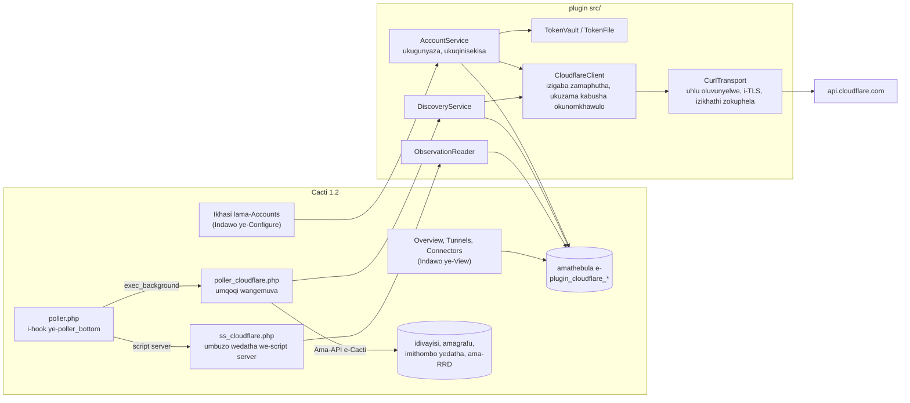

<!-- Source: README.md; SHA256: f8de0e02c5904e15bfa4c71edcaab219e5e5d4f6d9dbe589f4ed16351df6bf4d -->

<!-- translations:start -->
[English](../../../README.md) | [简体中文](../zh-CN/README.md) | [हिन्दी](../hi-IN/README.md) | [Español (España)](../es-ES/README.md) | [Español (Latinoamérica)](../es-419/README.md) | [العربية (السعودية)](../ar-SA/README.md) | [Afrikaans](../af-ZA/README.md) | [አማርኛ](../am-ET/README.md) | [العربية (مصر)](../ar-EG/README.md) | [العربية (المغرب)](../ar-MA/README.md) | [বাংলা](../bn-BD/README.md) | [Bosanski](../bs-BA/README.md) | [Deutsch](../de-DE/README.md) | [فارسی](../fa-IR/README.md) | [Filipino](../fil-PH/README.md) | [Français](../fr-FR/README.md) | [Français (Maroc)](../fr-MA/README.md) | [Français (Sénégal)](../fr-SN/README.md) | [Hausa](../ha-NG/README.md) | [עברית](../he-IL/README.md) | [Hrvatski](../hr-HR/README.md) | [Bahasa Indonesia](../id-ID/README.md) | [Igbo](../ig-NG/README.md) | [Italiano](../it-IT/README.md) | [日本語](../ja-JP/README.md) | [한국어](../ko-KR/README.md) | [Malagasy](../mg-MG/README.md) | [मराठी](../mr-IN/README.md) | [Bahasa Melayu](../ms-MY/README.md) | [Nederlands](../nl-NL/README.md) | [Polski](../pl-PL/README.md) | [Português (Brasil)](../pt-BR/README.md) | [Русский](../ru-RU/README.md) | [Kinyarwanda](../rw-RW/README.md) | [Soomaali](../so-SO/README.md) | [Српски](../sr-RS/README.md) | [Svenska](../sv-SE/README.md) | [Kiswahili](../sw-KE/README.md) | [தமிழ்](../ta-IN/README.md) | [తెలుగు](../te-IN/README.md) | [ไทย](../th-TH/README.md) | [Türkçe](../tr-TR/README.md) | [Українська](../uk-UA/README.md) | [اردو](../ur-PK/README.md) | [Tiếng Việt](../vi-VN/README.md) | [isiXhosa](../xh-ZA/README.md) | [Yorùbá](../yo-NG/README.md) | [繁體中文](../zh-TW/README.md) | [isiZulu](README.md)
<!-- translations:end -->

<p align="center">
  
</p>

# I-plugin ye-Cloudflare ye-Cacti

[](https://github.com/somethingwithproof/plugin_cloudflare/actions/workflows/ci.yml)
[](https://sonarcloud.io/summary/new_code?id=somethingwithproof_plugin_cloudflare)
[](../../../LICENSE)


[](https://sonarcloud.io/summary/new_code?id=somethingwithproof_plugin_cloudflare)
[](https://sonarcloud.io/summary/new_code?id=somethingwithproof_plugin_cloudflare)
[](https://sonarcloud.io/summary/new_code?id=somethingwithproof_plugin_cloudflare)


I-plugin ye-Cacti 1.2 eyakhelwa ukuqapha ama-Cloudflare Tunnel kanye nokuhlaziywa kwezoni. Ifunda kusuka ku-Cloudflare API ngamathokheni e-API anesilinganiso esiqondile, ayishintshi lutho ku-Cloudflare, futhi igcina idatha yayo kumathebula ayo. Ku-Cacti ikopisha amafayela e-XML ombuzo wedatha ku-`resource/script_server/` bese idala amadivayisi, amagrafu nezifanekiso ngama-API e-Cacti ngokwawo, ngaphandle kwezinguquko zamafayela ayisisekelo.

**Isimo: 0.4.0-dev, ayikakhishwa.** Inguqulo yokugcina ekhishiwe ngu-0.3.0. Inguqulo yokuthuthukisa yengeza ukukhishwa kwempahla ye-CSV, ukuhoxiswa okucacile kwama-tunnel asusiwe, ukuhlaziywa kwezoni okulondoloziwe kanye nezifanekiso ze-Thold ezingakhethwa. Ukufaneleka komhlinzeki ophilayo nokusetshenziswa kusasele kulindile.

Ithebula elingezansi lichaza ukukhishwa okuzinzile kuka-0.3.0. Okungeziwe kokuthuthukisa kuchazwa ngaphansi kwezokuhamba komsebenzi zomqhubi kanye nokuhlaziywa kwezoni ngezansi.

| Okutholakalayo manje | Okuhleliwe |
|---|---|
| Faka, thuthukisa, khubaza bese ukhipha ngomphathi wama-plugin we-Cacti | Ukuhlaziywa kwe-GraphQL kanye nezexwayiso ze-Thold (Ingqophamlando 4) |
| Izimvume ze-Cloudflare: View, Operator kanye ne-Configure | Ukufakwa kwamaphutha, amamodeli e-TLA+ kanye nemibhalo ephelele (Ingqophamlando 5) |
| Engeza, hlela, susa, vumela futhi ukhubaze ama-akhawunti e-Cloudflare | |
| Gcina ithokheni efayeleni noma uyibhale ngemfihlo kudathabheyisi ye-Cacti | |
| Qinisekisa ithokheni bese uhlola izimvume zayo zokufunda i-tunnel nezoni | |
| Ukutholwa kwe-tunnel nesixhumi kumqoqi wangemuva oqalwa yi-poller eyinhloko | |
| Amakhasi e-Overview, Tunnels kanye ne-Connectors ngaphansi kwe-Management > Cloudflare Tunnels | |
| Ukulandelela umjikelezo wempilo: `active`, `unavailable` kanye ne-`deleted` | |
| Idivayisi eyodwa ye-Cacti nge-akhawunti ngayinye, edalwe ngumlawuli, nama-tunnel njengezinkomba zombuzo wedatha | |
| Amagrafu e-Connectors, Health kanye ne-Collection nge-tunnel ngayinye, adwetshwe efayeleni elilodwa le-RRD nge-tunnel ngayinye | |
| Amanani i-plugin engenakuwaqinisekisa agcinwa njengengaziwa (`U`), hhayi njengo-0 | |

## Izindima zokufinyelela

| Indawo yokulawula | Ukufinyelela |
| --- | --- |
| Cloudflare: View | Amakhasi okuqapha akhona. |
| Cloudflare: Operator | Ukuqapha kanye nekhasi le-Operations nezivumelwano zokuhlukanisa izinkinga zomuntu siqu. |
| Cloudflare: Configure | Ukufinyelela kwe-Operator kanye nokucushwa okukhona nezenzo zokuphatha. |

Ngemuva kokukopisha amafayela okuthuthukisa, vula ikhasi le-Plugins njengomlawuli ukuze ubhalise indawo entsha yokulawula. Yabela indawo ye-Operator ngokucacile ngaphansi kwe-**Configuration > Users** noma amaqembu abasebenzisi. Ukuthuthukiswa kugcina ama-ID endawo yokulawula ye-View ne-Admin akhona kanye nezibonelelo. Ukufinyelela kwe-Admin kudla ifa lokufinyelela kwe-Operator, futhi ukufinyelela kwe-Operator kudla ifa lokufinyelela kwe-View esicelweni ngasinye; lokhu akungezi izibonelelo ezigciniwe kubasebenzisi noma emaqenjini. Izilungiselelo ze-plugin zidinga futhi ukufinyelela kwe-Cloudflare: Configure ngaphezu kwemvume ye-Settings ye-Cacti.

Ukubonakala kwe-akhawunti ye-Cloudflare kufana nendawo yokulawula ye-View ekhona; kuhlanganisa yonke i-akhawunti. Iziqinisekiso, ukucushwa, ukumepha, ukususa kanye nezinye iziguquko zokuphatha kuhlala emakhasini okuphatha. Izivumelwano zihlala kuphela kuseshini yamanje yomsebenzisi, okungenani ihora elilodwa futhi kuphela uma ukubonwa okufanayo kusalokhu kukusha. Ukubonwa okusha noma okushintshile kuzenza zingasebenzi. Azikaze zimake ukulinganisa okuhlulekile njengokuphilile noma zicindezele izexwayiso.

## Kungani le-plugin

Abaqhubi be-Cacti abashicilela amasevisi nge-Cloudflare Tunnel abanakho ukubuka kwe-tunnel ngaphakathi kwe-Cacti. I-tunnel ingalahlekelwa yizo zonke izixhumi zayo ngenkathi amahosthi omsuka esaphendula i-SNMP, ngakho-ke amagrafu akhona ahlala eluhlaza ngenkathi abasebenzisi bebona amaphutha. Umgomo wale plugin ukubeka impilo ye-tunnel kanye nethrafikhi yezoni eduze kwamagrafu edivayisi abaqhubi asebevele bewabuka, ngaphandle kokunikeza i-Cacti noma yiliphi ikhono lokushintsha i-Cloudflare.

Imingcele emithathu ibumba umklamo:

- **Ukufunda kuphela.** I-plugin ibiza kuphela iziphetho ze-`GET` kanye ne-GraphQL Analytics API. Ayidingi mvume yokuhlela kunoma iyiphi insiza ye-Cloudflare.
- **Okungakhethwa.** Ukuphazamiseka kwe-Cloudflare, amathokheni aphelelwe yisikhathi kanye nemikhawulo yezinga akumele kubambezele i-UI ye-Cacti noma kumise ukuqoqwa kwedatha kwamanye amadivayisi. Zonke izicelo ze-API zinesikhathi esinqunyiwe esiqinile, futhi ukuqoqwa kusebenza kunqubo yangemuva eqalwe yi-poller.
- **Azikho izinguquko zamafayela ayisisekelo.** I-plugin isebenzisa ama-hook e-plugin ye-Cacti 1.2 kanye namathebula ayo. Ikopisha i-XML eyodwa yombuzo wedatha ku-`resource/script_server/` bese idala amadivayisi, amagrafu nezifanekiso ngama-API e-Cacti ngokwawo. Azikho izinguquko zamafayela ayisisekelo, ngakho ukuthuthukiswa kwe-Cacti namanye ama-plugin akuthinteki.

## Indlela esebenza ngayo



- **Isixhumi se-Cacti** (`setup.php`, `includes/`, izikripthi zamakhasi) sibhalisa ama-hook nezindawo zokulawula, sinikezela ngamakhasi ngezinye izinsiza ze-Cacti uqobo, futhi sidlulisela zonke izenzo kumtapo wolwazi ku-`src/`.
- **Umtapo wolwazi** (`src/`, i-namespace `Somethingwithproof\Cloudflare\`) awuncikile kuma-global e-Cacti, ngakho-ke uhlolwa ngokumelene nedathabheyisi yangempela kanye nokuthutha kwe-HTTP okungelona iqiniso ngaphandle kwe-Cacti esebenzayo.
- **Indlela eyodwa ephumayo.** `CurlTransport` ukuphela kwekhodi ethinta inethiwekhi, futhi yamukela kuphela `https://api.cloudflare.com`. Ukuhluleka ngakunye kumetshelwa esigabeni esisodwa sephutha (`auth`, `permission`, `rate_limited`, `transient`, ...), esiqhuba isimo esiboniswa ku-UI.
- **Ukugcinwa** kudlula kuxhumano lwe-PDO lwe-Cacti ngokwalo ngezitatimende ezilungiselelwe. Izinguquko ze-schema zingukufuduka okunenombolo, okunganikezi umphumela ohlukile uma kuphindwa.

Izinqumo zomklamo nezizathu zazo zitholakala ku-
[docs/design.md](../../design.md).

## Izithombe-skrini

Izithombe-skrini zivela esitakini sokuhlola, hhayi ku-akhawunti ye-Cloudflare ephilayo. Isitaki sisebenzisa i-Cacti 1.2.31 ngokumelene ne-Cloudflare API engelona iqiniso ebuyisa idatha yesibonelo, ngakho i-akhawunti, i-ID yayo kanye nama-tunnel amathathu izibambi zendawo.


*Uhlu lwe-Cloudflare Accounts. I-API engelona iqiniso yamukela ithokheni, ngakho i-Verify ibika `ok`.*


*Ukuhlela i-akhawunti. Izinkambu zethokheni zihlala zingenalutho; ithokheni egciniwe ayikaze ibuyiselwe esipheqululini. I-Collect Tunnels kanye ne-Create Graphs zivuliwe futhi i-Collect Analytics ivaliwe. I-Connection Status ibonisa umphumela we-Verify yokugcina: `ok`, ukufunda i-tunnel kuvunyelwe kanye nokufunda izoni kushoda.*


*Settings > Cloudflare.*


*Management > Cloudflare Tunnels > Overview. Isimo siyisimo esibi kakhulu se-Cloudflare phakathi kwama-tunnel asebenzayo e-akhawunti, lapha ngu-`down` ngoba i-tunnel eyodwa yesibonelo iphansi. I-`Disabled`, `Not collected`, `Collection failing` kanye ne-`Not yet collected` zithatha indawo yokuqala ngaphezu kwempilo ye-tunnel, ngalolo hlelo, ukuze i-akhawunti ukusebenza kwayo kokugcina okuhlulekile ibonise `Collection failing` noma ngabe ama-tunnel ayo abikani.*


*Ithebhu ye-Tunnels. I-Connectors kanye ne-Connections kubonisa `-` ku-old-office, ngoba i-API engelona iqiniso iphendula isicelo sayo sokuxhumana njenge-tunnel engaziwa futhi akukho lutho olwagcinwa, kanye no-0 ku-staging, engenaso isixhumi esisebenzayo.*


*Igrafu ye-Connectors ye-blog tunnel. Yonke imigqa emithathu ngu-1 ngaphambi nangemva kwesikhala phakathi nendawo, lapho i-API engelona iqiniso yabuyisa amaphutha futhi i-plugin yagcina amanani angaziwa. Imigqa ayehleli ku-0. Igrafu ivela esitakini esifanayo sesibonelo (`make screenshots`), esibeka isinyathelo samasekhondi angu-30 kulo mthombo wedatha owodwa ukuze imizuzu eyisikhombisa yokuqoqa idatha igcwalise igrafu.*

## Izimfuneko

- I-Cacti 1.2.25 kuya ku-1.2.31. I-Cacti 1.2.31 ngokwayo idinga i-PHP 8.0 noma eyakamuva.
  I-CI ihlola i-1.2.31 kuphela; i-1.2.25 yagcinwa ukuhlolwa ngesandla ngomhla ka-2026-10-22.
- I-PHP 7.4 kuya ku-8.4 enezandiso ze-`curl`, `openssl` kanye ne-`pdo_mysql`.
  I-plugin iyenqaba ukuvuleka ngaphandle kwazo.
- I-MariaDB 10.6 noma eyakamuva, noma i-MySQL 8.0 noma eyakamuva.
- Ukufinyelela kwe-HTTPS kusuka kuseva ye-Cacti kuya ku-`api.cloudflare.com`. Ama-proxy
  awasekelwa.

Bheka i-[docs/compatibility.md](../../compatibility.md) ukuze ubone okuhlolwayo.

## Ukufaka

1. Faka i-plugin kufolda ye-Cacti ethi `plugins/cloudflare`, ngokukhipha ingobo
   yomlando kusuka ku-
   [Ukukhishwa kwe-GitHub](https://github.com/somethingwithproof/plugin_cloudflare/releases)
   (`make package` esetshenziswe ekukhipheni ithegi yokukhishwa yakha ingobo
   yomlando efanayo) noma nge-git clone. Ifolda kufanele ibizwe ngokuthi
   `cloudflare`.
2. Yifake bese uyayinika amandla kusuka ku-Console > Configuration > Plugins,
   noma nge-CLI njengomsebenzisi weseva yewebhu:

   ```sh
   php cli/plugin_manage.php --plugin=cloudflare --install --enable
   ```

3. Umsebenzisi womphathi uthola imvume ye-Cloudflare: Configure ngesikhathi
   sokufaka. Yinikeze abanye abasebenzisi noma amaqembu ngaphansi kwe-Console >
   Configuration > Users.
4. Dala ithokheni enezimvume eziku-
   [docs/token-permissions.md](../../token-permissions.md). Ngamafuphi:
   Account > Cloudflare Tunnel > Read, kanye nokuzikhethela kwe-Zone > Zone > Read.
5. Gcina ithokheni ngenye yezindlela ezimbili ezingezansi, bese wengeza i-akhawunti
   ngaphansi kwe-Console > Configuration > Cloudflare Accounts futhi uqalise
   i-Verify kumenyu yezenzo.

### Inketho A: ibethelwe kusizindalwazi

I-plugin ibethela amathokheni ngokhiye we-32-byte owakha wena. Ayikaze
izidalele noma izibhalele ukhiye yona ngokwayo. Ifayela kufanele lifundeke
kubasebenzisi beseva yewebhu kanye ne-poller, akufanele lifundeke kwabanye,
futhi ifolda yalo kufanele ivumele labo basebenzisi bafinyelele kulo. Kuseva
yewebhu esebenza njenge-`www-data`:

```sh
sudo mkdir -p /etc/cacti
sudo sh -c 'umask 077 && openssl rand -hex 32 > /etc/cacti/cloudflare.key'
sudo chgrp www-data /etc/cacti/cloudflare.key
sudo chmod 0440 /etc/cacti/cloudflare.key
```

Indlela ezenzakalelayo ithi `/etc/cacti/cloudflare.key`; yishintshe ngaphansi
kwe-Settings > Cloudflare > Token Vault Key File. Uma ukhiye ungekho noma
wenqatshwa, ifomu lokuhlela linikeza inketho yefayela lethokheni kuphela.
Gcina ikhophi eyisipele yokhiye: ngaphandle kwayo, amathokheni agciniwe awakwazi
ukususwa ukubethela futhi kufanele afakwe futhi.

#### Ukushintshanisa ukhiye

Awukho umyalo wokufaka ukhiye omusha. Ukhiye omusha awukwazi ukususa ukubethela
kwamathokheni agcinwe ngaphansi kowakudala, ngakho ukushintshanisa kusho
ukufaka ithokheni ngayinye egciniwe futhi:

1. Yiba nenani lethokheni ye-akhawunti ngayinye eduze. I-Cloudflare ibonisa
   inani lethokheni kuphela uma lidalwa noma lishintshwa, ngakho shintsha
   ithokheni kudeshibhodi ye-Cloudflare uma ungasenalo.
2. Dala ukhiye omusha endleleni entsha ngemiyalo engenhla, isibonelo
   `/etc/cacti/cloudflare.key.new`, enomnikazi ofanayo nemodi efanayo.
3. Setha i-Settings > Cloudflare > Token Vault Key File endleleni entsha bese
   ulondoloza. Kusukela manje kuqhubeke, i-Verify ku-akhawunti esabethelwe
   ngokhiye omdala ibika ukuthi "Stored token cannot be decrypted", futhi
   ukusebenza ngakunye komqoqi kuqopha `discovery token unavailable` ene-
   `reason=decrypt_failed` ngayo.
4. Ku-akhawunti ngayinye egcina ithokheni yayo kusizindalwazi, yivule ngaphansi
   kwe-Console > Configuration > Cloudflare Accounts, namathisela ithokheni
   kuzo zombili izinkambu zethokheni, londoloza, bese uqalisa i-Verify.
   Kufanele ibike `ok`.
5. Uma yonke i-akhawunti enjalo iqinisekiswa, susa ifayela lokhiye elidala
   namakhophi alo ayisipele.

Phakathi kwezinyathelo 3 no-4 ama-tunnel e-akhawunti awavuselelwa futhi
amagrafu awo empilo, isixhumi kanye nokuxhumeka aqopha u-U. Ama-akhawunti
efayela lethokheni awathinteki.

### Inketho B: ifayela lethokheni

Bhala ithokheni, futhi akukho okunye, efayeleni elingafundwa ngabasebenzisi
beseva yewebhu kanye ne-poller futhi elingafundeki kwabanye, bese ufaka
indlela yalo ephelele efomini lokuhlela:

```sh
sudo sh -c 'umask 077 && cat > /etc/cacti/cloudflare-account.token'   # paste the token, then Ctrl-D
sudo chgrp www-data /etc/cacti/cloudflare-account.token
sudo chmod 0440 /etc/cacti/cloudflare-account.token
```

Ifayela liyahlolwa uma lifundwa, ngesikhathi se-Verify, hhayi uma ulondoloza.
Izixhumanisi ezifanekiselayo, amafayela angaphezu kuka-4 KiB kanye namafayela
afundekayo noma abhalekayo kwabanye ayenqatshwa.

Noma ubani one-Cloudflare: Configure angafaka noma iyiphi indlela, futhi
umsebenzisi we-poller uyayifunda. Ukugcina amafayela amathokheni endaweni
eyodwa, setha i-Settings > Cloudflare > Token File Directory, isibonelo ku-
`/etc/cacti`; indlela engaphandle kwayo iyabe isiyenqatshwa. Bheka
i-[docs/security.md](../../security.md#token-file).

## Ukuthuthukisa

1. Faka amafayela okukhishwa okusha esikhundleni salawo aku-`plugins/cloudflare`,
   ugcine igama lefolda.
2. Vula i-Console > Configuration > Plugins, noma i-Console > Configuration >
   Cloudflare Accounts, kanye njengomphathi. Lokho kuqalisa ukufuduka
   kwe-plugin, kungenise izifanekiso ze-Cloudflare futhi kukopishe ifayela
   lombuzo wedatha (bheka
   [Amamethrikhi namagrafu ama-tunnel](#tunnel-metrics-and-graphs)), futhi,
   ekuthuthukiseni kusuka ku-0.1.0, kubhalise i-hook ye-`poller_bottom`.

I-`poller.php` ayikwazi ukuqalisa ukuthuthukiswa kwe-plugin, ngakho kuze kube
yisinyathelo sesi-2 isikimu esisha sisuke singekho. Ukusebenza ngakunye
komqoqi kube sekungazenzi lutho futhi kuqophe
`CLOUDFLARE: collector skipped; plugin upgrade pending, open Console > Plugins`.
Amakhasi e-Cloudflare Tunnels adinga kuphela i-Cloudflare: View, ngakho awaze
aqalise ukuthuthukiswa, futhi kuze kube yisinyathelo sesi-2 angabonisa ukuthi
"The Cloudflare tunnels could not be read".

## Isimo se-akhawunti

I-Verify isetha isimo se-akhawunti:

| Isimo | Incazelo |
|---|---|
| `unknown` | Ayikaqinisekiswa kusukela i-akhawunti yengezwa noma imininingwane yayo yokungena yashintshwa |
| `ok` | Ithokheni iyasebenza futhi ingafunda ama-tunnel |
| `token_inactive` | I-Cloudflare ibika ukuthi ithokheni ikhutshaziwe noma iphelelwe yisikhathi |
| `auth_failed` | I-Cloudflare iyilahlile ithokheni njengengasebenzi noma ephelelwe yisikhathi (HTTP 401) |
| `permission_denied` | Ithokheni iyasebenza kodwa ayikwazi ukufunda ama-tunnel, noma ayinazo izimvume zokubiza ama-endpoint okuqinisekisa ithokheni (HTTP 403) |
| `unreachable` | I-API ayikwazanga ukufinyelelwa, iphelelwe yisikhathi noma ibuyise iphutha leseva |
| `rate_limited` | I-Cloudflare ibuyise i-HTTP 429 |
| `error` | Noma yikuphi okunye ukwehluleka, okuhlanganisa ifayela lethokheni elingekho noma elingaphephile, ifayela lokhiye wendawo yethokheni elingekho noma elingasebenziseki, noma ithokheni egciniwe engakwazi ukususwa ukubethela |

Ikhasi lokuhlela liphinde libonise ukuthi ukufunda i-tunnel nokufunda i-zone
kunikeziwe yini.

## Ukutholwa kwama-tunnel

Ngemva komjikelezo ngamunye wokuvota ku-poller eyinhloko, i-hook ye-
`poller_bottom` iqala umqoqi wangemuva nge-`exec_background` uma okungenani
i-akhawunti eyodwa enikwe amandla ine-Collect Tunnels evuliwe. Umqoqi
akaze asebenze enqubweni ye-poller, ngakho i-API ye-Cloudflare ehamba kancane
ayibambezeli i-`poller.php`. Ama-poller akude awaze amqale.

Ku-akhawunti ngayinye esesikhathini sayo, umqoqi ubala ama-tunnel e-akhawunti,
bese ufunda ukuxhumana kwama-tunnel ayo asebenzayo, okunikeza izixhumi
ze-tunnel ngayinye, izinhlobo zazo, izikhungo zedatha kanye namakheli emvelaphi.
Ama-akhawunti asuke esesikhathini sawo njalo nge-Discovery Interval (okuzenzakalelayo
amasekhondi angu-300). Ukusebenza okukodwa akuqali i-akhawunti entsha ngemva
kwamasekhondi angu-50 futhi kwenza izicelo zokuxhumana ezingaphezu kwezingu-200
okungenani. Noma yimuphi umkhawulo ungaphinde umise i-akhawunti phakathi
ekufundeni ukuxhumana kwayo; leyo akhawunti iqoshwa njenge-`partial`, futhi
ukusebenza okulandelayo kuqhubeka nama-tunnel azanywe kancane muva nje.
Ama-akhawunti angaqalwanga ahlala elungele ukusebenza okulandelayo.

I-tunnel inomjikelezo wempilo, ogcinwa uhlukile esimweni esibikwa yi-Cloudflare
(`healthy`, `degraded`, `down` noma `inactive`):

| Umjikelezo wempilo | Incazelo |
|---|---|
| `active` | I-tunnel yayisohlwini lokugcina oluphelele |
| `deleted` | Uhlu oluphelele aluzange luyihlanganise, okuhlanganisa nohlu olungenalutho. Umugqa nomlando wayo kuyahlala, futhi i-tunnel iba yi-`active` futhi uma iphinda ivela |
| `unavailable` | Ukuphazamiseka okubaliwe okuthathu ngaphandle kohlu oluphelele phakathi kwako kushiya isimo se-tunnel singaziwa |

Uhlu oluphelele noluphumelelayo kuphela olungeza, olubuyekeza noma olususa
ama-tunnel, futhi uhlu oluhlulekile alukaze lususe neyodwa. Ukwehluleka
ukufunda i-Cloudflare nhlobo (`transient`, `rate_limited`, `auth` noma
`permission`) kubalelwa ekuphazamisekeni; ngemva kokuphazamiseka okuthathu
okubaliwe ngaphandle kohlu oluphelele phakathi kwako, ama-tunnel asebenzayo
e-akhawunti aba yi-`unavailable`. Uhlu oluphelele olulandelayo luyawabuyisela
bese lusetha kabusha isibalo. I-tunnel i-Cloudflare engasayazi uma ukuxhumana
kwayo kufundwa iyaye yeqiwe ngaphandle kokuhluleka kwe-akhawunti. Okunye
ukwehluleka akwandisi futhi akusethi kabusha isibali sokuphazamiseka.

Ku-`cacti.log`, imigqa yokutholwa iqala nge-`CLOUDFLARE: discovery` kanti
isifinyezo sokusebenza siqala nge-`CLOUDFLARE: collector`. Ukwehluleka
nezinguquko zomjikelezo wempilo, njengohlu oluhlulekile noma ama-tunnel
amakwe njenge-`unavailable`, kuqoshwa ezingeni elizenzakalelayo le-Cacti
le-`LOW`; umphumela we-akhawunti ngayinye nesifinyezo sokusebenza kuqoshwa
ku-`MEDIUM`. Ukufundwa kokuxhumana kungehluleka kuyo yonke i-tunnel, ngakho
ku-akhawunti ngayinye ukwehluleka kokuqala kwesigaba ngasinye sephutha kuqoshwa
ku-`LOW`, okunye ku-`MEDIUM`, kulandelwe umugqa owodwa we-`LOW` ngesigaba
ngasinye onenani lama-tunnel ahlulekile.

I-Management > Cloudflare Tunnels idinga imvume ye-Cloudflare: View futhi
eyokufunda kuphela:

- **Overview** ibala i-akhawunti ngayinye nesimo sayo, izibalo zama-tunnel
  ngomjikelezo wempilo, ukutholwa kokugcina okuphumelelayo kanye nenani
  lokwehluleka okulandelanayo.
- **Tunnels** ibala ama-tunnel kuwo wonke ama-akhawunti noma ku-akhawunti
  eyodwa, inezihlungi ze-akhawunti, umjikelezo wempilo, isimo negama, kanye
  namakholomu ahleleke ngokuhlungwa.
- **Connectors** ibonisa izixhumi ze-tunnel ekhethwe kuthebhu ye-Tunnels.

## Amamethrikhi namagrafu ama-tunnel

I-Cacti ifunda isimo se-tunnel ngombuzo wedatha weseva yeskripthi,
`ss_cloudflare.php`. Iphendula ngamathebula e-plugin kuphela futhi ayikaze
ibize i-Cloudflare, ngakho ukuphazamiseka kwe-Cloudflare ngeke kubambezele
i-poller. I-tunnel ngayinye inikeza amanani ayisithupha: impilo (healthy 3,
degraded 2, down 1, inactive 0), izixhumi, ukuxhumana, izinhlobo zezixhumi,
amasekhondi kusukela ukuxhumana kwayo kwagcinwa ukufundwa, kanye nokwehluleka
okulandelanayo komsebenzi wokutholwa. Impilo, izixhumi, ukuxhumana nezinhlobo
kuphrintwa kuphela uma i-plugin ingakuqinisekisa, okusho ukuthi ukutholwa
kokugcina kuphumelele, i-tunnel iyi-`active` futhi ukufundwa kwakamuva.
Ngaphandle kwalokho kuba ngu-`U`, futhi igrafu ibonisa isikhala esikhundleni
seqanda ebelingabukeka njengokuphazamiseka. Amanani amabili okuqoqwa ahlala
ephrintiwe ngesikhathi sokuphazamiseka, ukuze igrafu ye-Collection ikubonise;
aba ngu-`U` kuphela ku-tunnel esusiwe noma leyo ukuxhumana kwayo okungakaze
kuvuselelwe. Imithetho iku-[docs/metrics.md](../../metrics.md).

### Dala idivayisi

I-akhawunti ihambisana nedivayisi eyodwa ye-Cacti kakhulu. Idivayisi igcina
ama-tunnel e-akhawunti njengezinkomba zombuzo wedatha we-Cloudflare Tunnels.
Akukho okuzenzakalelayo okuyidalayo:

1. Vula i-Console > Configuration > Cloudflare Accounts.
2. Khetha i-akhawunti, khetha i-Create Cacti Device kumenyu yezenzo, bese
   uqinisekisa.

Isenzo sidinga kokubili indawo ye-Cloudflare: Configure kanye nendawo ye-Cacti
ye-Sites/Devices/Data (leyo ye-`host.php`). Okufakiwe kwemenyu kuvela kuphela
kubasebenzisi abaphethe kokubili, futhi iseva iyasenqaba isicelo esivela
kunoma ubani omunye. Idivayisi ibizwa ngokuthi `Cloudflare: <account name>`,
isebenzisa isifanekiso sokusingatha se-Cloudflare Account kanye ne-poller
eyinhloko, inohlobo lwe-SNMP olungu-0 futhi ayinakho ukuhlolwa kokutholakala,
futhi ithola igama lomsingathi elithi `<account ID>.cloudflare.invalid`. Lelo
gama libekelwe eceleni futhi alikaze lixazululeke; i-Cacti ayixhumi kulo.
Uma i-akhawunti isinayo idivayisi, isenzo siyasho lokho futhi asishintshi
lutho. Uma umphathi esusa idivayisi ku-Cacti, i-plugin ayenzi enye kuze
kuphinde kuqaliswe i-Create Cacti Device.

### Dala Amagrafu

I-Create Graphs efomini le-akhawunti ivaliwe ngokuzenzakalelayo. Uma ivuliwe,
ngaso sonke isikhathi uma ukutholwa kwe-akhawunti kuphela nge-`ok` noma
i-`partial`, umqoqi uphinda afake izinkomba edivayisini futhi adale noma
yimaphi amagrafu angekho ama-tunnel e-akhawunti e-`active`: i-Connectors,
i-Health kanye ne-Collection, amathathu nge-tunnel ngayinye. Amagrafu amathathu
e-tunnel eyodwa abelana ngefayela elilodwa le-RRD. Ukusebenza okukodwa kudala
amagrafu angaphezu kuka-50 okungenani futhi kuma ngemva kwamasekhondi angu-20,
bese ukusebenza okulandelayo kuyaqhubeka. I-plugin ayikaze isuse into ye-Cacti.
Igrafu elisuswa ngumphathi aliphindi lenziwe, futhi i-tunnel i-Cloudflare
engasayibali igcina igrafu yayo nefayela le-RRD, okubonisa u-`U`.

Ukuvula i-Create Graphs kudinga zombili izindawo. Ukuyivala kudinga kuphela
i-Configure. Umsebenzisi ongenayo indawo ye-Sites/Devices/Data olondoloza
ifomu ushiya ukulungiselelwa njengoba bekunjalo, enesexwayiso. Uma i-Create
Graphs ivaliwe, idivayisi isaphinda ifakwe izinkomba ngemva kokutholwa
ngakunye, ngakho ama-tunnel amasha avela njengezinkomba zombuzo wedatha.

### Ifayela lombuzo wedatha

I-Cacti 1.2.31 ifunda i-XML yombuzo wedatha kuphela ngaphakathi kwefolda yayo
ye-`resource`. Ekufakeni nasekuthuthukiseni i-plugin ngakho-ke ikopisha ifayela
elilodwa, i-`templates/resource/cloudflare_tunnels.xml`, iye ku-
`<Cacti>/resource/script_server/cloudflare_tunnels.xml`. Yilo kuphela ifayela
i-plugin elibhala ngaphandle kwefolda yayo, ngakho umsebenzisi ofaka noma
othuthukisa i-plugin kufanele akwazi ukubhala kuleyo folda. Ukukhipha kugcina
ifayela, kanye namadivayisi, amagrafu, amafayela e-RRD nezifanekiso. Uma
ukukopisha noma ukungenisa isifanekiso kuhluleka, i-plugin iyakubhala
emibhalweni futhi i-Create Cacti Device izama futhi.

## Izilungiselelo

I-Settings > Cloudflare iqukethe:

- **Token Vault Key File**: indlela eya kukhiye we-vault.
- **Token File Directory**: uma isethiwe, ifayela le-token elingaphandle kwayo liyenqatshwa. Ayinalutho ngokuzenzakalelayo, okuvumela noma iyiphi indlela. Bheka [docs/security.md](../../security.md#token-file).
- **Interactive Request Timeout**: inani eliphelele lamasekhondi esicelo esenziwa ku-interface yewebhu, njengokuthi Verify. Okuzenzakalelayo ngu-10; amanani angaphandle kuka-5 kuya ku-60 abuyela ku-10.
- **Collector Request Timeout**: inani eliphelele lamasekhondi esicelo esenziwa umqoqi ongemuva. Okuzenzakalelayo ngu-20; amanani angaphandle kuka-5 kuya ku-60 abuyela ku-20.
- **Log Level**: kulondoloziwe. Akukho okukufundayo okwamanje.

Efomini le-akhawunti, i-Collect Tunnels ne-Discovery Interval kulawula ukutholwa, kanti i-Create Graphs ilawula ukwakhiwa kwamagrafu. I-Collect Analytics ilondoloziwe futhi ayinamphumela kule nguqulo.

## Izilimi

I-plugin ihambisana nezinguqulo zesi-Spanish (Spain, `es-ES`), isiFulentshi (`fr-FR`), isiJalimane (`de-DE`), isiShayina Esenziwe Lula (`zh-CN`), isiHindi (`hi-IN`), isi-Arabhu (`ar-SA`) kanye nesiJapane (`ja-JP`). I-Cacti iyazibonisa uma ukwesekwa kolimi kuvuliwe (Configuration > Settings > General > Language Support) futhi umsebenzisi ekhetha ulimi. Ikhathalogi yesi-Spanish saseLatin America (`es-419`) nayo ihambisana nayo, kodwa i-Cacti 1.2 ayinayo i-locale yesi-Spanish saseLatin America engakhethwa, ngakho isebenza kuphela uma i-Cacti ingeza eyodwa; kuze kube yileso sikhathi, khetha isi-Spanish (`es-ES`).

Eminye imibhalo ihlala ngesiNgisi: amanani ezimo i-plugin ewalondolozayo futhi iwabonise njengoba enjalo (`ok`, `active`, `unavailable`, `deleted`, kanye nesimo se-tunnel esibikwa yi-Cloudflare), nakho konke i-plugin ekubhala ku-log ye-Cacti.

## Ukukhipha kanye nokugcinwa kwedatha

Ukukhipha kususa amathebula e-plugin ngokwayo, agcina ama-akhawunti, ama-token abethelwe, ama-tunnel atholiwe, isimo somsebenzi kanye nerekhodi lezinto ze-Cacti eziwenzile, futhi kususa izilungiselelo zayo ze-`cloudflare_`. Akususi ifayela lokhiye, amafayela ama-token, i-`resource/script_server/cloudflare_tunnels.xml` ekopishiwe, noma amadivayisi e-Cacti, amagrafu, imithombo yedatha, amafayela e-RRD noma izifanekiso. Lezo zinto zigcina idatha yokuqapha yomlando, futhi ukuzisusa kuyisenzo esicacile somlawuli ku-Cacti.

Idivayisi egciniwe iyayeka ukuthola idatha. Ngemva kokukhipha, noma ngemva kokuba i-akhawunti yayo isusiwe, ayikho i-akhawunti engumnikazi we-host, ngakho amagrafu ayo agcina umlando wawo kodwa abhala u-`U` kusukela lapho kuya phambili. I-Create Cacti Device ku-akhawunti efakwe kabusha noma engezwe kabusha yenza idivayisi entsha; ayisebenzisi kabusha endala, ngakho susa idivayisi endala ku-Cacti uma umlando wayo ungasadingeki.

## Imikhawulo eyaziwayo

- Umgijimo owodwa wenza izicelo zokuxhuma ezingeqi ku-200. Ama-tunnel angaphezu kwalowo mkhawulo avuselelwa ngaphansi kokuvama kunewindi lokubuka, ngakho amagrafu awo okuxhuma abonisa izikhala.
- I-plugin ibhala phezu kwezinguquko zomlawuli ezifakwe ezifanekisweni ezingenisiwe uma ukuthuthukiswa kushintsha i-XML yesifanekiso ehambisanayo.
- Idivayisi ye-akhawunti kufanele ihlale ku-poller eyinhloko. Amathebula e-plugin asedathabhesini eyinhloko futhi iskripthi siwafunda lapho.
- Ama-tunnel asusiwe ahlala ku-index yemibuzo yedatha futhi abhala u-`U` kuze kube yilapho umlawuli ewahoxisa ngokusobala. Ukuhoxiswa kususa kuphela amagrafu arekhodwe yi-plugin nemithombo yedatha engabiwe nge-Cacti; umugqa wohlu lwezinto uhlala ubonakala. I-Cacti ilawula ukuhlanzwa kwe-RRD.
- I-Cacti ikhubaza i-plugin ekhodi yayo iphela ngephutha elibulalayo langempela, njengokuphelelwa yinkumbulo. Bheka [docs/security.md](../../security.md).

## Ezokuphepha

- Ama-Global API Key ayenqatshwa; kwamukelwa kuphela ama-API token anemikhawulo.
- Ama-token agcinwa efayeleni olilungiselelayo noma abethelwe nge-AES-256-GCM ngaphansi kwefayela lokhiye elingalokothi lingene kudathabhesi. Awaze aboniswe ekhasini, abhalwe ku-log, noma afakwe emlayezweni wephutha.
- Amaphutha edathabhesi aphatha kuphela i-SQLSTATE nekhodi yephutha lomshayeli, hhayi amanani esitatimende.
- Lonke ushintsho luyi-POST evikelwe nge-token ye-CSRF ye-Cacti. Izinguquko zokuphatha i-akhawunti nokumiswa zidinga i-Cloudflare: Configure; ukuvunywa kokuhlungwa komuntu siqu kudinga i-Cloudflare: Operator. Ukwakha idivayisi ye-Cacti noma ukuvula i-Create Graphs nakho kudinga imvume ye-Cacti ethi Sites/Devices/Data. I-plugin ekhutshaziwe iyenqaba amakhasi ayo.

Imininingwane nemikhawulo eyaziwayo iku-[docs/security.md](../../security.md).
Bika ubungozi bokuphepha ngasese njengoba kuchaziwe ku-[SECURITY.md](../../../SECURITY.md).

## Ukuhamba komsebenzi womqhubi kanye nokuhlaziywa kwezoni

Izengezo zokuthuthukisa zihlanganisa ukuhoxiswa ngokusobala kwama-tunnel asusiwe, ukuhlaziywa kwezoni okwazi amakhono kanye nezifanekiso ze-Thold ezingenisekayo. Lezi zengezo azikabi nalo ilebula lokukhululwa noma ukufaneleka kwe-akhawunti ebukhoma okwamanje. Bheka [docs/analytics-and-alerting.md](../../analytics-and-alerting.md) ukuze uthole ukusetha, incazelo yamamethrikhi kanye nemikhawulo yokuqinisekisa.

### Ukuthunyelwa kohlu lwezinto

Amakhasi e-Tunnels ne-Connectors ahlinzeka nge-Export yendawo ye-Cloudflare: View. Amafayela e-CSV e-Tunnel ahlanganisa yonke imigqa efanayo, esebenzisa i-akhawunti esebenzayo, umjikelezo wokuphila, isimo, ukusesha kanye nezilungiselelo zokuhlela kuwo wonke amakhasi. Amafayela e-CSV e-Connector ahlanganisa izinhlobo, ukwakheka, izikhungo zedatha kanye namakheli omsuka we-tunnel ekhethiwe. Okulandiwe kufunda amarekhodi alondolozwe ku-cache kuphela. Izibalo ezingaziwa azinalutho; amaseli afana nefomula aqaliswa nge-apostrophe ukuze kungeniswe ngokuphephile ku-spreadsheet.

## Umhlahlandlela wokuqhubeka

Ingqophamlando ngayinye ikhululwa njengenguqulo engu-0.x eqanjwe ngayo: i-Milestone 3 ngu-0.3.0, i-Milestone 4 izoba ngu-0.4.0. I-Milestone 1 no-2 azizange zikhululwe zodwa futhi ziyingxenye ka-0.3.0. Inguqulo 1.0.0 igcinelwe ukukhululwa okuqedela yonke ingqophamlando engezansi.

| Ingqophamlando | Ububanzi bomsebenzi | Isimo |
|---|---|---|
| 1. Isisekelo | Umjikelezo wokuphila we-plugin, izimvume, ukumiswa kwe-akhawunti, ukuhlolwa kokuxhumana | Ikhululwe ku-0.3.0 ([#2](https://github.com/somethingwithproof/plugin_cloudflare/pull/2) kuya ku-[#5](https://github.com/somethingwithproof/plugin_cloudflare/pull/5)) |
| 2. Ukutholwa | Ukutholwa kwe-tunnel ne-connector kumqoqi ongemuva, amakhasi e-Overview, Tunnels ne-Connectors | Ikhululwe ku-0.3.0 ([#6](https://github.com/somethingwithproof/plugin_cloudflare/pull/6)) |
| 3. Amamethrikhi | Imithombo yedatha yempilo ye-tunnel, izifanekiso zamagrafu, ukuphathwa kokuphuma kwenkonzo okungalokothi kurekhode u-zero oqanjiwe | Ikhululwe ku-0.3.0 ([#7](https://github.com/somethingwithproof/plugin_cloudflare/pull/7)) |
| 4. Ukuhlaziywa kanye nezaziso | Ukuhlaziywa kwe-GraphQL okuhambisana nohlelo ngendawo ngayinye, imikhawulo ye-Thold enokucindezelwa kokuphuma kwenkonzo | Kuhleliwe |
| 5. Ukuqiniswa | Ukujova amaphutha, amamodeli e-TLA+ okutholwa nokuqoqwa, imibhalo ephelele | Kuhleliwe |

## Ukuthuthukiswa

Amathuluzi adinga i-PHP 8.x ne-Composer; ikhodi ye-plugin ngokwayo ihlala ihambisana ne-PHP 7.4. Ukuhlolwa kokuhlanganiswa ne-BDD kudinga idathabhesi, eqalwa yi-`make db-up` ku-Docker ku-port 33061.

```sh
composer install
make db-up
make ci            # unit, integration, BDD, PHPStan, php-cs-fixer, php -l on PHP 7.4
make smoke         # installs the plugin into Cacti 1.2.31 in Docker and walks its lifecycle
make package       # builds build/cloudflare-<version>.tar.gz and checks its contents
make db-down
```

I-`make smoke` ne-`make screenshots` zidinga i-checkout ye-Cacti; setha i-`CACTI_REPO` endleleni yayo. Ukuhlolwa kokuhlanganiswa kufunda i-`CF_TEST_DSN`, `CF_TEST_DB_USER` ne-`CF_TEST_DB_PASS`, futhi kuyeqa uma idathabhesi ingafinyeleleki ngaphandle kokuba i-`CI` isethiwe.

## Ukufaka isandla

Ama-pull request amukelekile. I-commit ngayinye idinga isignesha ye-DCO (`git commit -s`). Bhala ukuhlolwa kuqala; i-`make ci` kufanele iphumelele, futhi nezinguquko ekuhlanganiseni kwe-Cacti kufanele nazo ziphumelele ku-`make smoke`. Ikhodi ye-plugin kufanele ihlale ihambisana ne-PHP 7.4 futhi ilandele isitayela sekhodi ye-Cacti (amathebhu, omacaphuna ababodwa, ama-brace emugqeni ofanayo).

### Izinguqulo zezilimi

Imilayezo imakwe ngo-`__('...', 'cloudflare')`. I-`locales/build_gettext.sh` (`make i18n`, edinga i-GNU gettext) ikhiqiza kabusha isifanekiso esithi `locales/po/cacti.pot`, isihlanganise kukhathalogi ngayinye ethi `locales/po/<locale>.po` futhi ihlanganise i-`locales/LC_MESSAGES/<locale>.mo`; faka konke okuthathu ku-commit. I-CI igijima i-`make i18n-check`, ehlulekayo uma ikhathalogi ishoda noma inento engaqinisekisiwe, uma uchungechunge lwefomethi luhlukile, noma ifayela elihlanganisiwe seliphelelwe yisikhathi, futhi nohlelo lokuhlola lwe-unit luhlola ama-placeholder, ama-tag e-HTML nezikhala ezisemaphethelweni zento ngayinye. Ngakho-ke umyalezo oshintshiwe udinga ukuthi izinhumusho zawo zivuselelwe ku-pull request efanayo. Ulimi olusha liyifayela elisha elithi `<locale>.po` eliqanjwe njengoba i-Cacti iqamba izindawo zayo zezilimi (isibonelo `pt-BR`), elingezwa ku-`CatalogTest::LOCALES` nasekuhloleni kwengobo yomlando ku-`tests/build/package.sh`. Gcina amagama emikhiqizo e-Cloudflare, Cacti ne-Thold, i-API ne-GraphQL, kanye namagama ezimvume njengokuthi `Account Cloudflare Tunnel Read`, njengoba enjalo.

## Imibhalo

- [docs/security.md](../../security.md): izilawuli zokuphepha nemikhawulo eyaziwayo
- [docs/token-permissions.md](../../token-permissions.md): izimvume ze-token
- [docs/compatibility.md](../../compatibility.md): izinhlelo ezisekelwayo nama-interface asetshenziswayo
- [docs/metrics.md](../../metrics.md): ikhathalogi yamamethrikhi nokuthi inani alaziwa nini
- [docs/collector-protocol.md](../../collector-protocol.md): lokho i-`ss_cloudflare.php` ekufundayo futhi ikubhale
- [docs/schema.md](../../schema.md): amathebula edathabhesi
- [docs/design.md](../../design.md): izinqumo zokuklama
- [CHANGELOG.md](../../../CHANGELOG.md)

## Ilayisensi

GPL-2.0-or-later. Bheka [LICENSE](../../../LICENSE).

## Izimpawu zokuthengisa

I-Cloudflare iwuphawu lokuthengisa olubhalisiwe lwe-Cloudflare, Inc. Le phrojekthi iyithuluzi elizimele elinomthombo ovulekile futhi ayihlangene, ayixhasiwe, futhi ayigunyazwanga yi-Cloudflare, Inc.

Le phrojekthi futhi ayihlangene nephrojekthi ye-Cacti. Bheka [docs/images/README-logo.md](../../images/README-logo.md) ukuze ubone ilogo.
